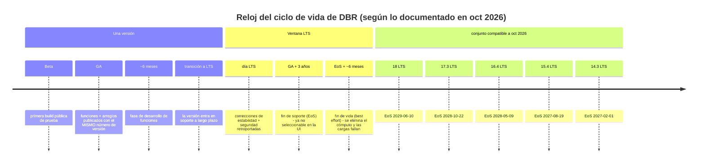
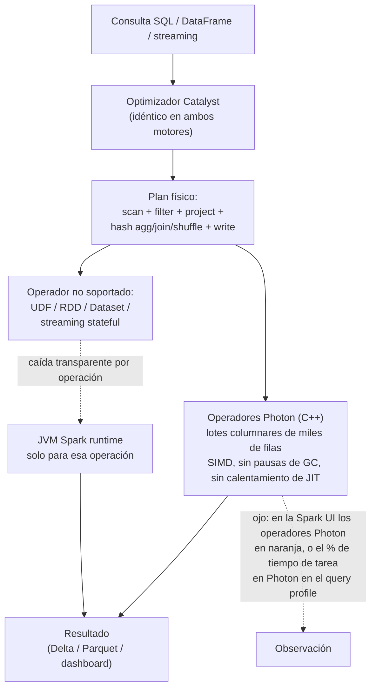
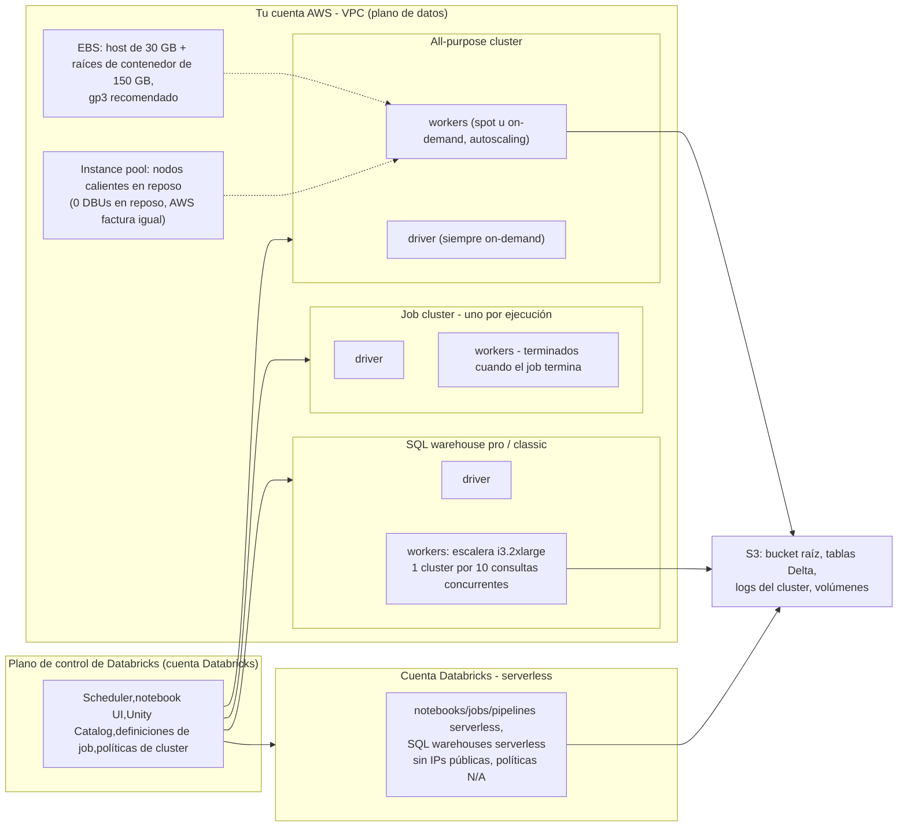
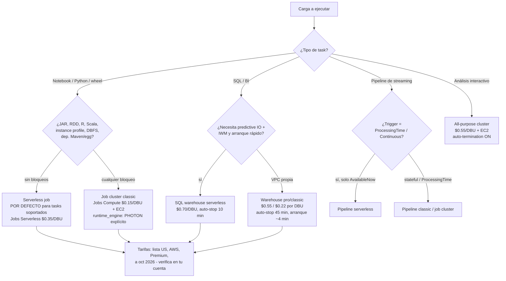
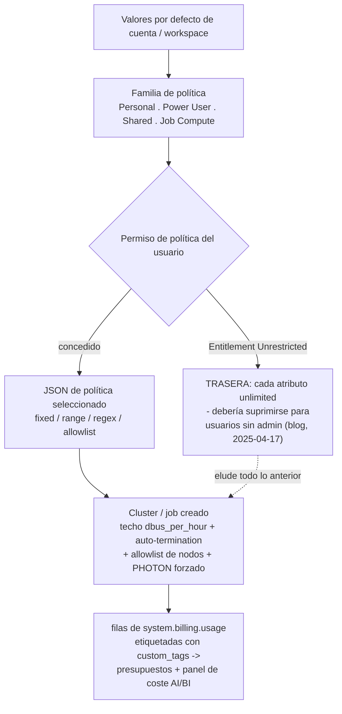

# Databricks Runtime, Photon y clusters: DBR/LTS, políticas, pools y forma del coste de cómputo

Todo pipeline de este curso se ejecuta en algo. Las tablas Delta no se optimizan solas, Auto Loader no lista un prefijo gratis y un pipeline de Lakeflow solo es tan barato como las máquinas que hay debajo. Esta lección trata de ese *algo*: qué versión de **Databricks Runtime** fijas, si **Photon** está ejecutando tu plan, en qué **tipo de cluster** (o warehouse, o sesión serverless) corre el trabajo, quién tiene permiso para crearlo (**cluster policies**), qué tan rápido puede arrancar (**instance pools**), qué **familia EC2** usa y, la parte que aparece en la factura, qué **tarifa de DBU** le corresponde.

Ese último punto es la columna vertebral de la lección. En AWS, **la misma instancia EC2 se factura a una tarifa de DBU distinta según el tipo de cómputo al que la conectaste.** La Jobs API 2.0 lo dice sin rodeos: "When you run a job on a new jobs cluster, the job is treated as a Jobs Compute (automated) workload subject to Jobs Compute pricing" y "When you run a job on an existing all-purpose cluster, it is treated as an All-Purpose Compute (interactive) workload subject to All-Purpose Compute pricing" (docs.../jobs-2.0-api, página fechada 2026-08-03). Mismos nodos, mismo Spark, mismos datos, y con los precios de lista de EE. UU. a oct 2026, un SKU de **$0.15/DBU** frente a un SKU de **$0.55/DBU**. Todo lo demás de esta lección es una decisión de rendimiento o de gobernanza; esta es aritmética pura, y por eso un ETL nocturno de 45 minutos puede costar $1,027 o $2,947 al mes (ejemplo resuelto E5).

```text
 =============================================================
  MAPA DE LA LECCIÓN 06 - cómputo en AWS, a octubre de 2026
 ------------------------------------------------------------
  Versión   DBR 19 (actual) / 18 LTS (hasta 2029-06-10)
  Motor     Photon (C++, columnar, SIMD) + planificador Catalyst
  Tipos     all-purpose | job | SQL warehouse | serverless
  Barandas  cluster policies (JSON) + instance pools
  Hardware  familias M/C/R/I, Graviton, fleet, EBS, spot
  Medidor   $0.15 jobs . $0.55 all-purpose . $0.22/$0.55/$0.70 SQL
            (lista US, nivel Premium, AWS, a oct 2026 -
             confirma contra system.billing.list_prices)
  -------------------------------------------------------------
  Regla de la lección: elige el TIPO de cómputo antes de ajustar
  el cluster. El tipo fija la tarifa; el ajuste solo fija horas.
 =============================================================
```

En esta lección vas a:

- leer la **tabla de DBR compatibles a oct 2026** con todas sus fechas de EoS, y recorrer el ciclo **Beta → GA → LTS → EoS → EoL** como un diagrama;
- rastrear una consulta por **Catalyst y Photon**, nombrar los cuatro casos en los que Photon no ayuda y poner fecha a cada benchmark que cites;
- separar el cómputo **all-purpose, job, SQL warehouse y serverless**, incluida la regla de precios que decide la factura;
- trabajar **seis ejemplos resueltos**: un **JSON de cluster policy** anotado, una **configuración de instance pool**, la **selección de familia de instancias** para cuatro formas de carga, la **forma de coste job vs all-purpose**, un **triaje de Photon o no**, y una **postura de notebook de producción**;
- aplicar **cluster policies** (fixed/allowlist/regex/range, `dbus_per_hour`, `cluster_type`, `auto:latest-lts`) y cerrar la **trasera Unrestricted**;
- configurar **ventanas de autoscaling, terminación automática, topología de spot y `first_on_demand`** sin tropezar con las trampas documentadas;
- estudiar **Comcast y Addepar** en AWS, leer el **recuadro de actualizaciones de 2026** y practicar con **doce preguntas** más cuatro comprobaciones interactivas.

---

## 1. Databricks Runtime: la escalera de versiones y el reloj LTS

### 1.1 El conjunto compatible (página de notas de lanzamiento actualizada el 11 sep 2026)

Databricks publica dos líneas a la vez: una línea **actual** que sigue recibiendo funciones y una línea **LTS** que cambia novedades por una ventana de soporte de tres años. La tabla de versiones compatibles en AWS (docs .../release-notes/runtime, última actualización **11 sep 2026**, consultada 2026-10) es la única lista de versiones en la que debes fiarte:

| Runtime | Spark | Lanzamiento | Fin de soporte (EoS) | Línea |
|---|---|---|---|---|
| **DBR 19** | 4.2.0 | **15 jun 2026** | Determinado en la transición a LTS | actual (listada como compatible) |
| **18 LTS** | 4.1.0 | **10 jun 2026** | **10 jun 2029** | LTS actual |
| **17.3 LTS** | 4.0.0 | **22 oct 2025** | **22 oct 2028** | LTS |
| **16.4 LTS** | 3.5.2 | **9 may 2025** | **9 may 2028** | LTS |
| **15.4 LTS** | 3.5.0 | **19 ago 2024** | **19 ago 2027** | LTS |
| **14.3 LTS** | 3.5.0 | **1 feb 2024** | **1 feb 2027** | LTS (la más antigua soportada) |

Cada versión también trae una **variante ML** (mismo número, MLflow más librerías ML fijadas a esa versión): la matriz de MLflow lee 19 → MLflow **3.12.0**, 18 LTS → **3.8.1**, 17.3 LTS → **3.0.1**, 16.4 LTS → **2.21.3** (misma página, consultada 2026-10).

Dos detalles de 2026 importan más que las cifras en sí:

1. **La numeración cambió en DBR 19.** "Prior to Databricks Runtime 19, Databricks released runtimes as minor feature versions (for example, 18.0, 18.1, 18.2), each with its own Beta and GA release" (docs .../release-notes/runtime/databricks-runtime-ver, consultada 2026-10). A partir de la 19, la fase de desarrollo de funciones transcurre como una única línea mayor.
2. **Una minor retirada y un LTS vivo conviven.** La propia página de notas de la **DBR 18.0** ya está etiquetada como **(EoS)**, "El soporte para esta versión de Databricks Runtime ha terminado", aunque esa misma página también registra "This version incorporates all features … Databricks released this version in January 2026", Spark **4.1.0** y **JDK 21** por defecto (docs.../release-notes/runtime/18.0, consultada 2026-10). Mientras tanto, **18 LTS** está soportado hasta el **10 jun 2029**. Fíjate en la *línea LTS*, nunca en un número minor retirado.

### 1.2 El ciclo de vida, dibujado



Las cuatro duraciones salen directamente de la página del ciclo de vida de soporte (consultada 2026-10): una fase de funciones GA de **~seis meses**, retroportaciones LTS durante **tres años**, "The end-of-support date is three years after the GA release date" y "Databricks makes a best effort to set the end-of-life date **six months after the end-of-support date**". En el EoS la versión "ya no se puede seleccionar en la UI cuando creas o actualizas un recurso de cómputo"; en el EoL "becomes unusable … existing workloads running on these versions fail". Esa es la diferencia entre *un job que deja de programarse* y *un job que se cae*, y por eso fijar la versión es un control de producción, no una preferencia.

### 1.3 Qué línea para qué carga

La página de configuración de cómputo es explícita (docs .../compute/configure, última actualización **6 oct 2026**): "Para el cómputo all-purpose, usa la versión más reciente … Para el cómputo de jobs que ejecuta cargas de trabajo operativas, considera usar la versión de Databricks Runtime de soporte a largo plazo (LTS)." Traducción:

- **Interactivo/exploratorio (all-purpose):** la versión compatible más nueva: quieres las funciones y, además, reinicias a menudo.
- **Jobs operativos:** una línea LTS, fijada por la cadena exacta (`17.3.x-scala2.12`), porque un minor de Spark inesperado a mitad de trimestre es una caída.
- **Ciencia de datos / ML:** la variante ML de la línea que hayas elegido.
- **En una cluster policy:** `spark_version` con un token especial, `auto:latest-lts`, `auto:latest-ml`, `auto:prev-major`, `auto:prev-lts`, que "no hace que el cómputo se actualice solo cuando se publica una nueva versión del runtime"; se resuelve **cuando un usuario edita** el cómputo (docs.../admin/clusters/policy-definition, última actualización **1 oct 2026**).

- **📚 ¿Sabías que…?** Databricks retiene "cluster configuration information for terminated clusters for **30 days**" (intro de la Clusters API, consultada 2026-10). Es suficiente para responder «¿qué runtime y tipo de nodo usaba aquel job que falló el martes pasado?» y suficientemente corto como para que convenga exportar las formas que te interesan (con asset bundles o Terraform) en lugar de hacer arqueología en la UI.

---

## 2. Photon: lo que hace el motor vectorizado, y lo que no hace

### 2.1 Un planificador, dos motores de ejecución

"Photon is the Databricks-native **vectorized query engine** that accelerates your SQL workloads, DataFrame API calls, ETL pipelines, and **stateless streaming** workloads" (docs.../compute/photon, última actualización **11 sep 2026**). La frase de arquitectura que hay que memorizar: "El optimizador de consultas de Apache Spark (Catalyst) sigue planificando tu consulta, pero Photon se hace cargo en la **capa de ejecución**", y "Cuando Photon encuentra una operación no soportada … vuelve de forma transparente al runtime de Spark para el resto de esa operación."



Photon procesa "data in batches of thousands of rows at a time, enabling modern CPUs to use **SIMD** instructions", y funciones como el I/O predictivo y el podado dinámico de archivos en `MERGE`/`UPDATE`/`DELETE` *requieren* Photon (misma página). Es "el **motor predeterminado para todos los SQL warehouses**", está habilitado en el cómputo serverless y en los pipelines Lakeflow serverless y, desde DBR 9.1 LTS, "Photon is enabled by default on compute running Databricks Runtime 9.1 LTS and above" para el cómputo classic all-purpose y de jobs creado a través de la UI.

> [!IMPORTANT]
> ⚠️ **La trampa de la API: los clusters creados por API corren sin Photon en silencio.** La misma página de docs dice: "If you create these resources using the **Clusters API or Jobs API**, you must explicitly enable Photon by setting `runtime_engine` to `PHOTON`." Los equipos de Terraform, CLI y asset bundles benchmarkan "Photon es lento" cada año cuando en realidad benchmarkaron *non-Photon*. Pon `"runtime_engine": "PHOTON"` en tus definiciones de job/cluster (o deja que una cluster policy lo fuerce: sección 6) y después confirma en la Spark UI.

### 2.2 Dónde no ayuda Photon

Las docs son inusualmente directas, y cada cláusula de abajo es citable:

| Caso | Lo que dicen las docs (docs .../compute/photon, 11 sep 2026) | Qué hacer en su lugar |
|---|---|---|
| **Consultas de menos de ~2 segundos** | "Queries that normally complete in under two seconds don't see meaningful improvement because execution time is dominated by planning and scheduling overhead." | Arregla el plan, la caché o el número de consultas: no el motor. |
| **UDFs de Python** | "Photon doesn't support **UDFs**, RDD APIs, or Dataset APIs." Los cuerpos de las UDF se ejecutan fuera de Photon. | Reescribe las UDFs calientes como expresiones DataFrame / pandas UDFs / funciones integradas. |
| **Streaming stateful** | "**Stateful streaming is not supported.**" El streaming stateless *sí* está soportado hacia sinks Delta o Parquet, desde fuentes Delta, Parquet, CSV, JSON, Kafka y Kinesis. | Deja el operador stateful en Spark o rediseña a stateless + `foreachBatch`. |
| **Un solo operador no soportado** | La caída es por operación: un plan mezcla operadores Photon (naranja) y operadores Spark classic. | Lee el query profile antes de concluir en una dirección u otra. |

También hay una cláusula de economía: Photon no es velocidad gratis. "Photon instance types consume DBUs at a **different rate** than the same instance type running the non-Photon runtime" (blog de Databricks, "Announcing Photon Public Preview", **2021-06-17**). La regla operativa: **Photon solo compensa cuando es más que proporcional en velocidad**: así que haz benchmark de *tu* carga y mide la cuota de Photon en la Spark UI en lugar de adivinar.

### 2.3 Las pruebas, con fecha

Cítalas con sus fechas; no son intercambiables:

| Afirmación | Fuente (fecha) |
|---|---|
| "up to **5x better price/performance** for data and analytics workloads compared to other cloud data warehouses" (TPC-DS) | docs .../compute/photon (actualizada **2021→2026-09-11**) |
| "Photon is up to **2x faster** than Databricks Runtime 8.0" (TPC-DS 1TB) y "2-4x average speedups" en preview | blog, Photon Public Preview (**2021-06-17**) |
| "delivered benchmark-setting price/performance at **up to 12x better** than traditional cloud data warehouses"; el 90% de 400 clientes de preview informó de consultas más rápidas | blog, Photon GA (**2022-08-03**) |
| "Photon has accelerated some customer workloads by **over 10×**"; el consejo TPC ejecutó TPC-DS 100TB en **S3**, **256-node cluster of i3.2xlarge**, DBR + Photon | artículo SIGMOD '22, *Photon: A Fast Query Engine for Lakehouse Systems* (**junio 2022**, DOI 10.1145/3514221.3526054) |
| "Databricks SQL has set a new world record in 100TB TPC-DS … outperformed the previous record by **2.2x**", auditado formalmente por el consejo TPC | blog (**2021-11-02**) |
| Photon + AWS **i4i** frente a i3 sin Photon: mejora de latencia de **5.3x**, mejora de coste de **2.5x** | blog, *Faster Insights with Databricks Photon using AWS i4i instances* (cargas ejecutadas en **julio 2022**, página fechada **2024-06-21**) |
| DBSQL Serverless: ganancia de rendimiento de **5x** desde 2022, más "up to **25% faster**" de Predictive Query Execution y Photon Vectorized Shuffle (**1.5x** de rendimiento de shuffle) | blog, *Databricks SQL Accelerates Customer Workloads by 5x* (**2025-06-17**) |

- **📚 ¿Sabías que…?** El récord auditado de TPC-DS de 100 TB se ejecutó **sobre el sustrato de este curso**: datos en **Amazon S3**, 256 × **i3.2xlarge** (SIGMOD '22). Instancias optimizadas para almacenamiento más un motor vectorizado es el dato de referencia de "el lakehouse gana al warehouse", y es la misma familia de instancias en la que los warehouses classic y pro siguen estandarizándose hoy (todos los workers de warehouse classic/pro son **i3.2xlarge**, docs.../warehouse-behavior, consultada 2026-10).

### 2.4 Ejemplo resuelto E1: ¿Photon o no? Tría dos notebooks

**A octubre de 2026.** Dos equipos afirman "Photon no ayudó". Tría antes de cambiar nada:

```text
Ejemplo resuelto E1 - triaje de Photon (mecanismos según docs .../compute/photon, 2026-09-11)
---------------------------------------------------------------------------------------------
Equipo A: joins/agregaciones al estilo TPC-DS de 30 minutos sobre 2 TB en
          nodos r5, consultas de 8-90 s cada una, solo DataFrame API.
  -> Espera una mejora. Confirma: la Spark UI muestra los operadores Photon
     en naranja; el query profile muestra el % de tiempo de tarea en Photon.
     Puntos de referencia: i4i vs i3 sin Photon = 5.3x latencia (página
     2024-06-21); SIGMOD de más de 10x en algunas cargas de clientes (jun 2022).

Equipo B: pipeline de UDF de Python por fila, consultas de 200 ms, más un
          paso de streaming stateful con una agregación con ventana.
  -> Dos casos documentados sin mejora apilados: los cuerpos de UDF no se
     vectorizan, y "Stateful streaming is not supported". Además cada
     consulta es < 2 s, donde "execution time is dominated by planning and
     scheduling overhead".
  -> Acción: reescribe la UDF como expresiones DataFrame, quita Photon si la
     diferencia de emisión es medible en TU cuenta (lee
     system.billing.list_prices filtrado por los SKU de Photon), mantén el
     operador stateful en Spark. No concluyas a partir de un panel de
     consultas de 200 ms.

Regla: Photon es un cambio de capa de ejecución. Mide el plan, no la intuición.
```

---

## 3. Anatomía del cluster: all-purpose vs job vs warehouse vs serverless

### 3.1 Qué corre dónde, en AWS

"Databricks components" (docs, página fechada **2026-07-28**) traza la línea así de simple: "There are two types of clusters: all-purpose and job." Añade los SQL warehouses y las sesiones serverless y tienes los cuatro tipos de cómputo que usa este curso.



Tres hechos específicos de AWS de ese dibujo: los clusters classic y los warehouses classic/pro corren en **EC2 en tu VPC** ("With a pro SQL warehouse (unlike a serverless SQL warehouse), the **compute layer exists in your AWS account**", docs .../warehouse-types, última actualización **12 feb 2026**); serverless corre en la **cuenta de Databricks sin IPs públicas**; y con la conectividad segura de clusters activada (el modo de despliegue por defecto), nada del plano de datos necesita una IP pública de entrada.

### 3.2 La diferencia de ciclo de vida, y la de precio

| | All-purpose | Job cluster |
|---|---|---|
| Creado por | Tú (UI/CLI/REST API) | El **programador de jobs**, por ejecución |
| Ciclo de vida | "You can manually terminate and restart": varios usuarios lo comparten | "terminates the cluster when the job is complete. **You cannot restart a job cluster**" |
| Clase de carga | interactiva | automatizada |
| Tarifa de DBU (lista US, oct 2026) | **All-Purpose Compute $0.55/DBU** | **Jobs Compute $0.15/DBU** |
| Encaje en producción | exploración, análisis ad-hoc | todo pipeline programado |

Cita de la docs (página de componentes, 2026-07-28): "El programador de trabajos de Databricks crea un job cluster cuando ejecutas un job en un job cluster nuevo, y termina el cluster cuando el job está completo." Y la consecuencia en precios, de la Jobs API 2.0 (página fechada **2026-08-03**): "When you run a job on a new jobs cluster, the job is treated as a Jobs Compute (automated) workload subject to Jobs Compute pricing": mientras que apuntar un job a un all-purpose cluster existente es **All-Purpose pricing** y, según la página de componentes, "running a job on an existing all-purpose cluster is also treated as an **interactive** workload." La misma API añade: "We suggest running jobs on new clusters for greater reliability."

La guía de jobs-compute de Databricks va más lejos (docs.../jobs/compute, última actualización **15 sep 2026**): "**El cómputo serverless para jobs es el predeterminado para todos los tasks que lo admiten**", y "Cómputo all-purpose: Puedes configurar opcionalmente tasks usando cómputo all-purpose classic. **Databricks no recomienda esta configuración para jobs de producción.**"

Un matizo que conviene llevar a la lección 09: un **job cluster compartido** está "scoped to a single job run and cannot be used by other jobs or runs of the same job. **Libraries cannot be declared in a shared job cluster configuration.**" Declara las dependencias por task (o con job environments), nunca en el objeto del cluster compartido.

### 3.3 Ejemplo resuelto E2, la forma de coste: un pipeline, tres configuraciones

**A octubre de 2026, lista US, nivel Premium, AWS.** Escenario: un ETL nocturno de 45 minutos que ejecuta **400 horas-cluster al mes**, 4 nodos en total (1 driver + 3 workers). El propio ejemplo resuelto de Databricks usa un nodo que "runs at 3 DBU/hour" (blog, *Best practices for cost management in Databricks*, **2022-10-18**): trata ese valor de emisión como **ilustrativo**: la emisión de DBU por nodo no se publica como tabla oficial, así que lee la tuya en `system.billing.list_prices` o en la calculadora de precios.

```text
Ejemplo resuelto E2 - el mismo pipeline, tres tipos de cómputo (lista US, oct 2026)
----------------------------------------------------------------------------------
DBU/hora  = 4 nodos x 3 DBU/h/nodo          = 12 DBU/h   (emisión ilustrativa)
coste DBU = 12 DBU/h x 400 h x tarifa
coste AWS = 4 x m5.xlarge x $0.192/h x 400 h = $307.20    (us-east-1, leído 2026-10-12)

(A) Job cluster nuevo, Jobs Compute $0.15/DBU
    DBU  4,800 x 0.15 =    $720.00  + AWS $307.20  =  $1,027.20 / mes
(B) El mismo job apuntando a un all-purpose cluster permanente, $0.55/DBU
    DBU  4,800 x 0.55 =  $2,640.00  + AWS $307.20  =  $2,947.20 / mes
    delta A->B = $1,920.00 / mes  (65% de la factura combinada)
(C) Misma forma, workers spot con -60% solo en la columna AWS
    AWS  $307.20 x 0.40 = $122.88 ; columna DBU SIN CAMBIAR  =  $1,142.88 (A + spot)
```

La configuración (B) también arrastra horas en reposo: un all-purpose cluster factura mientras está *encendido*, no mientras trabaja, que es exactamente por lo que existen la terminación automática (sección 8) y las políticas (sección 6). Fíjate en lo que **no** cambió entre (A) y (B): nodos, runtime, Spark, datos. Solo el **tipo de cómputo**, y con él, el SKU. Esa es la decisión de mayor apalancamiento de toda esta lección, y por eso Databricks informa de que los clientes "saved tens of thousands of dollars by simply moving just ten percent of their workloads from all-purpose clusters to jobs clusters" (blog, 2022-10-18).

```plot
{
  "type": "bar",
  "title": "Coste mensual de un pipeline de 400 horas por tipo de cómputo (lista US, AWS, a oct 2026)",
  "xLabel": "Configuración de cómputo",
  "yLabel": "USD al mes (DBU + AWS)",
  "xKey": "config",
  "dataKeys": ["usd_per_month"],
  "data": [
    {"config": "New job cluster, Jobs $0.15/DBU", "usd_per_month": 1027.2},
    {"config": "Job + spot workers (-60% AWS side)", "usd_per_month": 1142.88},
    {"config": "Existing all-purpose cluster, $0.55/DBU", "usd_per_month": 2947.2}
  ]
}
```

---

## 4. Cómputo serverless y SQL warehouses

### 4.1 La matriz de cómputo recomendado

Databricks publica una tabla de recomendación por tipo de task (docs .../jobs/compute, última actualización **15 sep 2026**). Léela como "lo por defecto, salvo que tu lista de dependencias lo prohíba":

| Tipo de task | Recomendado | También soportado |
|---|---|---|
| Notebook / script Python / Python wheel | **Serverless jobs** | jobs classic, all-purpose classic |
| SQL | **SQL warehouse serverless** | SQL warehouse pro |
| Pipeline (declarativo) de Lakeflow | **Pipeline serverless** | pipeline classic |
| dbt | **SQL warehouse serverless** |: |
| **Task JAR** |: | **solo jobs classic** |
| **Spark Submit** |: | **solo jobs classic** |

Elegibilidad de serverless en AWS (docs.../sql/admin/serverless, última actualización **10 jun 2026**): workspace en **plan Premium o superior**, no es una prueba gratuita, soportado en **todas las regiones de AWS**, sin IPs públicas, y "**Cluster policies, including spot instance policies, are not supported**". Esa última cláusula es el borde de todo lo de la sección 6: las políticas gobiernan el cómputo *classic*; serverless se gobierna con controles a nivel de cuenta o de workspace.

### 4.2 Limitaciones de serverless: lee esta lista antes de migrar un job

De docs .../compute/serverless/limitations (consultada 2026-10), los bloqueos que obligan al cómputo classic:

- "**R is not supported.**" · "Scala y R no están soportados en notebooks."
- "Solo las APIs de **Spark Connect** están soportadas. Las APIs RDD de Spark no están soportadas."
- "**Maven coordinates are not supported.**" · "**JAR libraries are not supported in notebooks** … JAR tasks in jobs are supported." · "Las librerías de task no están soportadas para tasks de notebook."
- "Debes usar **Unity Catalog** para conectarte a fuentes de datos externas." · "Access to **DBFS** is limited."
- "**Serverless compute has a maximum runtime of 7 days.**"
- Triggers de streaming: `Trigger.AvailableNow()` (recomendado) y el obsoleto `Trigger.Once()`; `Trigger.ProcessingTime` y `Trigger.Continuous` **no** están soportados.

La página de migración (última actualización **2026-07-10**) lista los mismos bloqueos como cosas que sustituir *primero*: imágenes personalizadas, variantes de ML Runtime, DBR < 13, instance profiles, y "dependencies such as **eggs, JARs, and Maven libraries**", con sus patrones de sustitución: RDD APIs → DataFrame APIs, rutas DBFS → volúmenes UC, IAM instance profiles → external locations de UC, JARs JDBC propios → Lakehouse Federation.

### 4.3 SQL warehouses: tres tipos, dos relojes

(docs .../sql-warehouse/warehouse-types, última actualización **12 feb 2026**; auto-stop de docs .../sql-warehouse/create, consultada 2026-10)

| | Serverless | Pro | Classic |
|---|---|---|---|
| Corre en | cuenta de Databricks | **tu cuenta AWS** | **tu cuenta AWS** |
| Photon | sí (por defecto) | sí | sí |
| Predictive IO | sí | sí | no |
| Intelligent Workload Management | sí | no | no |
| Arranque | rápido | "typically approximately **4 minutes**" | "approximately 4 minutes" |
| Workers | vertical + IWM | escalera **i3.2xlarge** | escalera **i3.2xlarge** |
| **Valor por defecto de auto-stop** | **10 minutos** (mín. 5 UI / 1 API) | **45 minutos** (mín. 10) | **45 minutos** (mín. 10) |

El dimensionado de classic/pro es un cluster por 10 consultas concurrentes, desde 2X-Small (1 driver + 1 worker) pasando por X-Small, Small … X-Large (32 workers), 2X (64), 3X (128), 4X (256), con **5X-Large (512) en Public Preview** (docs.../warehouse-behavior, consultada 2026-10). La recomendación permanente de Databricks: "**Databricks recommends using serverless SQL warehouses when available**", y la frase de facturación que hay que memorizar: "**Idle SQL warehouses continue to accumulate DBU and cloud instance charges until they are stopped.**"



> **Veredicto comparativo: job cluster vs all-purpose vs SQL warehouse vs serverless (a oct 2026)**
> - **Job cluster (classic, Jobs Compute $0.15/DBU + tu EC2)**: la **respuesta por defecto para el batch de producción**. Efímero por ejecución, sin reinicio, se termina junto con la ejecución, admite spot, gobernado por política, el SKU classic más barato por DBU. Paga las horas en las que corre de verdad; tú eres dueño de EC2, EBS y del calentamiento. Úsalo cuando las dependencias sean solo classic (JAR/Spark Submit, RDD, instance profiles, DBFS) o cuando el job corra largo y caliente con una forma predecible.
> - **All-purpose (All-Purpose Compute $0.55/DBU + tu EC2)**: **solo interactivo**: exploración, notebooks compartidos, enseñanza. 3,7× la tarifa por DBU de jobs en lista US, factura mientras está *encendido*, y apuntar jobs de producción a él es a la vez un anti-patrón de facturación interactiva y de fiabilidad ("Databricks no recomienda esta configuración para jobs de producción"). Controles obligatorios: terminación automática, una política, nunca un driver en spot.
> - **SQL warehouse (SQL Classic $0.22 / Pro $0.55 / Serverless $0.70 por DBU)**, la vía de servicio de BI, facturado mientras está **encendido**, dimensionado por talla de camiseta y no por los workers que elijas. Serverless añade Predictive IO + IWM y un auto-stop de 10 minutos; pro/classic corren en tu VPC sobre i3.2xlarge con auto-stop de 45 minutos y arranque de ~4 minutos. Elige por *concurrencia de consultas y SLA de latencia*, no solo por la tarifa de DBU, la brecha classic/serverless ($0.48 por DBU-hora) es la máquina más operaciones que serverless absorbe por ti.
> - **Jobs/notebooks serverless (Jobs Serverless $0.35/DBU, All-Purpose Serverless $0.75/DBU)**: **el valor por defecto de la plataforma donde la lista de limitaciones lo permite**: sin factura de EC2, sin pools, sin calentamiento, sin superficie de política, runtime máximo de 7 días, facturación por segundo, coste en reposo cero. Cuesta entre 1,3 y 2,3× más por DBU que classic, pero borra las columnas de tiempo en reposo y de administración de la factura.
> - **Veredicto en una línea:** *serverless por defecto → job clusters classic cuando un bloqueo o una forma larga y caliente lo exigen → all-purpose para humanos, nunca para pipelines → SQL warehouse para BI con auto-stop obligado.* Todas las tarifas de arriba son lista US, nivel Premium, AWS, a oct 2026; confírmalas contra `system.billing.list_prices` en tu cuenta antes de comprometer un presupuesto.

---

## 5. Instance pools: arranque en caliente, no cómputo gratis

Un pool es "A set of idle, ready-to-use instances that reduce cluster start and auto-scaling times" (docs .../getting-started/concepts, 2026-07-28). Los clusters conectados toman su driver y sus workers del pool y los devuelven al terminar. Tres mandos de dimensionado (docs .../compute/pools, consultada 2026-10): **`min_idle_instances`**, **`max_capacity`**, **`idle_instance_autotermination_minutes`**.

La regla de facturación es la que los estudiantes suelen fallar: "Databricks no cobra DBUs mientras las instancias están en reposo en el pool. El cobro del proveedor de instancias sí aplica" (docs .../pool-best-practices / pool-index, consultadas 2026-10). Los pools desplazan el coste de la columna de DBU a la de AWS y te compran minutos de arranque; no borran la factura. Restricciones y reglas de las mismas páginas:

- Un pool es "either all spot instances or all on-demand instances"; la Instance Pools API añade **`SPOT_WITH_FALLBACK`**: "el pool adquiere primero instancias spot y pasa a instancias on-demand cuando la capacidad spot no está disponible".
- "By default, Databricks sets the max spot price at **100% of the on-demand price**."
- El sobreescalado falla en voz alta: "Si un cluster que usa el pool solicita más instancias que este número durante el autoscaling, la solicitud falla con un error de tipo **INSTANCE_POOL_MAX_CAPACITY_FAILURE**." Mantén el tamaño máximo del cluster ≤ pool `max_capacity`.
- Los clusters heredan la **availability zone** del pool; usa **pools separados** cuando los requisitos de driver y de workers difieran.
- **Nunca pongas el driver en spot:** "No uses un pool con instancias spot como tipo de driver. Elige un tipo de driver on-demand para evitar que tu driver sea reclamado."
- Donde encaja serverless, el consejo de Databricks es directo: "If your workload supports serverless compute, Databricks recommends using serverless compute instead of pools."
- Guía de dimensionado: pools spot para los workers que toleran el coste; **pools on-demand para "jobs with short execution times and strict execution time requirements"**.

### 5.1 Ejemplo resuelto E3: configuración del pool + la factura en reposo

**A octubre de 2026 (lista us-east-1, leída 2026-10-12).** Un equipo quiere arranques en caliente para un job nocturno de 45 minutos y para clusters de desarrollo interactivos.

```json
{
  "pool_name": "etl-workers-spot-fallback",
  "node_type_id": "r5.xlarge",
  "min_idle_instances": 2,
  "max_capacity": 8,
  "idle_instance_autotermination_minutes": 20,
  "aws_attributes": { "availability": "SPOT_WITH_FALLBACK" },
  "custom_tags": { "COST_CENTER": "9531", "team": "data-eng" }
}
```

```text
Ejemplo resuelto E3 - lo que cuesta el pool mientras te mantiene listo (oct 2026)
----------------------------------------------------------------------------------
Reglas aplicadas: 0 DBUs en reposo (pool), AWS factura igual;
                   workers pueden ser spot, driver NUNCA (pool on-demand aparte);
                   mantén el cluster con max_workers <= max_capacity = 8.

Pool del driver (on-demand, aparte):   1 x r5.xlarge
  AWS  1 x $0.252/h x 6 h en reposo/día x 30 d = $45.36/mes   DBU = $0
Pool de workers (SPOT_WITH_FALLBACK, 2 en caliente):
  AWS  2 x $0.252/h x 6 h en reposo/día x 30 d = $90.72/mes   DBU = $0
  (si no hay capacidad spot, el pool cae a on-demand al mismo
   precio de nodo; precio máx. spot por defecto = 100% del on-demand)
Total del seguro de arranque en caliente:  $136.08/mes en AWS, $0 DBU
Qué compras: nodos ya en marcha -> el arranque del cluster y la latencia
             de autoscale bajan de minutos a segundos, además de reserva
             de capacidad. Contraste: idle_instance_autotermination
             20 min gana a un hueco de job de 45 min; entre tanto no
             se acumulan DBUs.
Trampa: cluster de 8 nodos contra un pool de 6 -> INSTANCE_POOL_MAX_CAPACITY_FAILURE
```

- **📚 ¿Sabías que…?** El seguro en reposo del pool cuesta unos **$136/mes** en este ejemplo: mientras que un solo *día* accidental de ese all-purpose cluster de 4 nodos dejado encendido (12 DBU/h × 24 h × $0.55 = **$158.40** de DBUs **más** 4 × $0.192 × 24 ≈ **$18.43** de EC2 ≈ **$177**) ya cuesta más que un mes entero de arranques en caliente. Los pools son para **la latencia de arranque y la capacidad**; la terminación automática es para **el coste**; los equipos que instalan pools pero se saltan la terminación automática suelen acabar con las dos facturas.

---

## 6. Cluster policies: gobernanza y barandas de coste en JSON

"A policy is a tool workspace admins can use to limit a user or group's compute creation permissions based on a set of policy rules" (docs.../admin/clusters/policies, página fechada **2026-06-10**). Los beneficios documentados: ajustes prescritos, límites a cuántos clusters puede crear un usuario, una UI simplificada, "Control cost by limiting per-cluster maximum cost" y "Enforce cluster-scoped library installations". El propio blog de introducción de políticas de Databricks (2025-04-17) nombra las dos recompensas, "**Simplification of platform usage and effective cost control are the two main benefits of cluster policies**", y el conjunto inicial de cuatro familias: **Personal Compute, Power User Compute, Shared Compute, Job Compute**.

Mecánica que debes conocer antes de escribir JSON (docs .../admin/clusters/policy-definition, última actualización **1 oct 2026**):

- Las reglas se enganchan a "cualquiera de los atributos controlados con la Clusters API", y "**Solo puede haber una limitación por atributo.**"
- Tipos de limitación: **`fixed`, `forbidden`, `allowlist`, `blocklist`, `regex`, `range`, `unlimited`** (cada uno puede llevar `defaultValue`, `isOptional`, `hidden`).
- **Atributos virtuales:** `dbus_per_hour`, "Atributo calculado que representa el máximo de DBUs que un recurso puede usar por hora, incluido el nodo driver … Úsalo con **range**", y `cluster_type` (`all-purpose` / `job` / `dlt`), que te deja bloquear de entrada una clase de cómputo.
- `runtime_engine` acepta `PHOTON` o `STANDARD`; `spark_version` acepta los tokens `auto:*` (sección 1); `workload_type.clients.jobs` / `.notebooks` controlan qué tipo de cliente puede conectarse.
- **Trampa de la API:** "Default values don't automatically get applied to compute created with the Clusters API. To apply default values using the API, add the parameter `apply_policy_default_values` … set it to true."
- Borrar una política no limpia nada: el cómputo en marcha continúa, pero "cannot be edited unless the user has unrestricted cluster creation permissions."

### 6.1 Ejemplo resuelto E4: una política de baranda de coste solo para jobs

Construida sobre el propio ejemplo solo-para-jobs de las docs (página policy-definition, 1 oct 2026) y ampliada con Photon, topología de spot y etiquetas. Este es el JSON que pegarías en un recurso `databricks_cluster_policy` de Terraform o en la UI de administración:

```json
{
  "cluster_type":                 { "type": "fixed", "value": "job", "hidden": true },
  "dbus_per_hour":                { "type": "range", "maxValue": 100 },
  "spark_version":                { "type": "unlimited", "defaultValue": "auto:latest-lts" },
  "runtime_engine":               { "type": "fixed", "value": "PHOTON", "hidden": true },
  "node_type_id":                 { "type": "regex", "pattern": "[rmci][3-5][rnad]*.[0-8]{0,1}xlarge" },
  "driver_node_type_id":          { "type": "regex", "pattern": "[rmci][3-5][rnad]*.[0-8]{0,1}xlarge" },
  "num_workers":                  { "type": "range", "minValue": 1, "maxValue": 10, "defaultValue": 2 },
  "aws_attributes.availability":  { "type": "fixed", "value": "SPOT_WITH_FALLBACK" },
  "aws_attributes.first_on_demand": { "type": "fixed", "value": 1 },
  "autotermination_minutes":      { "type": "fixed", "value": 60, "hidden": true },
  "custom_tags.COST_CENTER":      { "type": "allowlist", "values": ["9999", "9921", "9531"] },
  "workload_type.clients.notebooks": { "type": "fixed", "value": false },
  "workload_type.clients.jobs":      { "type": "fixed", "value": true }
}
```

```text
Ejemplo resuelto E4 - intención línea a línea (página policy-definition, 2026-10-01)
--------------------------------------------------------------------------------------
cluster_type fixed "job"       la política aparece solo en la UI de cómputo JOB;
                                los notebooks ad-hoc no pueden elegirla
dbus_per_hour range <= 100     el techo real de DBU por hora incl. driver -
                                el único número que acota el gasto en el peor caso
spark_version auto:latest-lts  cada job aterriza en la línea LTS; el token se
                                resuelve al editar, NO actualiza solo el cómputo en marcha
runtime_engine fixed PHOTON    cierra la trampa del cluster creado por API (sección 2.1)
node/driver regex              admite familias r/m/c/i, generaciones 3-5, hasta
                                solo xlarge - sin monstruos de 8xl salvo excepción
num_workers range 1..10        techo de workers; por defecto 2
SPOT_WITH_FALLBACK +           workers pueden ser spot con caída a on-demand;
first_on_demand = 1            la PRIMERA instancia (el driver) es siempre on-demand
autotermination_minutes 60     un mata-idles forzado - la baranda que gana a
                                un barrido manual semanal (el valor es una decisión
                                de la política; no hay por defecto oficial publicado
                                para clusters)
custom_tags.COST_CENTER        solo allowlist - las etiquetas que llegan a los
                                informes de EC2 + DBU
notebooks=false / jobs=true    política de producción, nadie corre ad-hoc sobre ella
Recordatorio: el cómputo creado por API necesita apply_policy_default_values=true
para recoger los valores por defecto de arriba.
```



> [!WARNING]
> ⚠️ **Cierra la trasera Unrestricted antes de escribir una sola regla.** "The 'unrestricted' cluster policy entitlement provides a **backdoor route for bypassing the cluster policies** and should be suppressed for non-admin users" (Cluster Policy Onboarding Primer, databricks.com/blog, **2025-04-17**). Y mira lo que dicen las docs: "By default, workspace admins have permissions on all policies. Non-admin users must be granted permissions on a policy to access it": así que un conjunto de políticas sin ninguna asignación a tu grupo de usuarios no protege a nadie. Despliega las políticas así: escribe el JSON → concédelo al grupo → quita Unrestricted de ese grupo → verifica intentando sobreaprovisionar.

---

## 7. Librerías y postura del notebook

### 7.1 Cuatro ámbitos, una matriz de fuentes

(docs .../libraries, última actualización **11 sep 2026**)

| Ámbito | Se fija en | ¿Persiste? | Notas |
|---|---|---|---|
| **A nivel de cómputo** | cluster / warehouse | sí, mientras viva el cómputo | "used by all notebooks and jobs running on the compute": la página de mejores prácticas dice que lo **evites** donde bastan los environments o las dependencias de job |
| **Librerías de job/task** | objeto `libraries` de la Jobs API | por ejecución | en serverless solo vía **job environments**; las librerías de task no están soportadas para tasks de notebook |
| **A nivel de notebook** | mágicas `%pip` / `%R` | **no**: "do not persist and must be re-installed for each session" | solo Python/R; "**JARs cannot be installed at the notebook level.**" |
| **Environments** | environment base en YAML (Beta, DBR 19+ con standard access mode) | sí | sustituye a las librerías de cluster en configuraciones declarativas |

Fuentes: **PyPI, Maven, CRAN**, archivos del workspace, **volúmenes de Unity Catalog**, almacenamiento de objetos de la nube. Los cortes a oct 2026:

- El standard access mode necesita **DBR 13.3 LTS+** para PyPI, Maven, volúmenes y archivos del workspace; "**CRAN: Not supported**" en standard access mode (dedicated/legacy lo conservan).
- Los **eggs** de Python solo en "Databricks Runtime 13.3 LTS and below"; `requirements.txt` necesita **DBR 15.0+**.
- "**storing library files in the DBFS root is deprecated and disabled by default in Databricks Runtime 15.1 and above**": usa archivos del workspace, volúmenes UC o repos de paquetes.
- "**Las librerías del workspace están obsoletas** y no deberían usarse": ten en cuenta que los *archivos* del workspace siguen siendo totalmente soportados.
- Precedencia de import de Python (de mayor a menor): cwd de carpeta Git → raíz de carpeta Git → notebook-scoped (`%pip`) → a nivel de cómputo → librerías incluidas en la DBR.

Ergonomía de notebook que vale la pena memorizar: "`%pip`, Install Python packages (notebook-scoped)" pero "los comandos %pip no reinician automáticamente el proceso de Python … puede que necesites `dbutils.library.restartPython()`"; "`%run`, Execute another notebook, importing its functions and variables" y "**%run must be in a cell by itself, because it runs the entire notebook inline.**" En serverless, `%uv pip` es la alternativa más rápida (versión del environment 5+).

### 7.2 Ejemplo resuelto E5: la postura del notebook de producción

```text
Ejemplo resuelto E5 - notebook de producción parametrizado (docs, 11 sep 2026)
-------------------------------------------------------------------------------
SÍ
  desde una carpeta Git / Databricks Repo (trunk-based, un único repositorio)
  dbutils.widgets.text("env", "dev")            # params; los marcadores de
                                                # parámetros SQL necesitan
                                                # DBR 15.2+ (guardia de inyección)
  %run /Shared/helpers $X = "10"                # definiciones de ayuda inline;
                                                # DEBE ocupar su propia celda
  librerías a nivel de task O job environments  # declaradas en el código, versionadas
  "Run as" con un service principal             # las ejecuciones ligadas a un token
                                                # heredan los permisos de la
                                                # identidad del token
  mantener la lógica de negocio en src/*.py, con los notebooks como
  "capas finas de orquestación y visualización"

NO
  %pip install pandas==2.2.2 a mitad de notebook en un all-purpose cluster compartido
      -> solo por sesión; un job cluster nuevo no lo tendrá
  hardcodear spark.executor.memory / spark.dynamicAllocation.* en las definiciones de job
  hacer commit de artefactos de build (.jar/.whl), tokens o credenciales al repo
  tratar el notebook como el contenedor de la lógica de negocio
      -> "if something isn't in version control, it doesn't exist"

Regla de dependencias en producción: lo declarativo (job/env/cluster) gana a lo
mágico; %pip es solo para iteración interactiva.
```

- **📚 ¿Sabías que…?** La guía de ingeniería de Databricks dice hoy: "**Declarative automation is built on the idea that if something isn't in version control, it doesn't exist**" y "**Minimize business logic in notebooks** … Use notebooks only as thin orchestration and visualization layers that call the underlying code" (docs .../notebooks/best-practices y .../developers/best-practices, ambas última actualización **2026-09-11**). El repositorio complementario es `github.com/databricks/notebook-best-practices`.

---

## 8. Autoscaling, terminación automática y spot

### 8.1 Horizontal en classic, vertical en el lado serverless

Los clusters classic all-purpose y de jobs hacen autoscaling **solo de workers**, entre `autoscale.min_workers` y `max_workers`. El autoscaling optimizado (Premium y superior; los workspaces en plan Standard reciben autoscaling estándar) tiene cuatro características documentadas (docs .../compute/configure, última actualización **6 oct 2026**):

- "Scales up from min to max in **at most 2 scaling events**."
- "On job compute, scales down if the compute resource is underutilized over the last **40 seconds**. On all-purpose compute … **150 seconds**." (`spark.databricks.aggressiveWindowDownS`, hasta **600 s**, ralentiza esa caída.)
- Puede bajar nodos que no están en reposo usando el estado de los archivos de shuffle: así que un nodo caliente-pero-esperando no está protegido.
- El autoscaling estándar en cambio arranca con "+8 nodes, then exponential" y "baja cuando el 90% de los nodos están inactivos durante 10 minutos".

El escalado vertical no existe en classic: "Scale vertically by adding or removing resources from a single machine … This typically means **stopping the workload, moving it to a larger machine, and restarting it**" (docs.../performance-efficiency, consultada 2026-10). La selección vertical de instancias es una característica de **pipelines serverless**: "Vertical autoscaling is used for all serverless pipelines", eligiendo tipos de instancia eficientes en coste a partir de evidencias de OOM (docs.../ldp/auto-scaling, consultada 2026-10).

Dos trampas documentadas: "**Do not enable Apache Spark Dynamic Allocation** (`spark.dynamicAllocation.enabled`) **on compute resources that use Databricks autoscaling**" (ejecutores en conflicto → `NODES_LOST`), y el autoscaling "has limitations scaling down … for Structured Streaming workloads": los streams de larga duración quieren un suelo, no un suelo que se mueve.

### 8.2 Terminación automática y topología de spot

**Terminación automática:** mata un all-purpose cluster en reposo tras `autotermination_minutes` de inactividad. La API acepta **10 to 10.000 minutos, y `0` lo desactiva** (docs del esquema de asset bundles y de jobs de Databricks, consultadas 2026-10), y las páginas de docs leídas en octubre de 2026 **no imprimen ningún valor numérico por defecto**, así que fíjalo explícitamente en lugar de fiarte de un valor de la UI que no has comprobado. Los valores por defecto de auto-stop de los SQL warehouse **sí** están documentados (sección 4.3): **45 min** pro/classic, **10 min** serverless.

**Spot**, de la misma página de configuración de cómputo: `aws_attributes.availability` ∈ `SPOT` / `ON_DEMAND` / `SPOT_WITH_FALLBACK`; `aws_attributes.first_on_demand` fija el driver (y N nodos) a on-demand; `aws_attributes.spot_bid_price_percent` por defecto es el **100% del on-demand**. "La primera instancia siempre será on-demand (el nodo driver siempre es on-demand) y las instancias siguientes serán spot." AWS precifica el Spot a "up to 90% off On-Demand prices" (aws.amazon.com/ec2/spot, consultada 2026-10) con un **aviso de interrupción de dos minutos**, y el ahorro cae **solo en la columna de AWS**: las tarifas de DBU y los recuentos de emisión no cambian con el spot.

> [!IMPORTANT]
> ⚠️ **Nunca ejecutes el driver en spot.** "No uses un pool con instancias spot como tipo de driver. Elige un tipo de driver on-demand para evitar que tu driver sea reclamado" (docs.../compute/configure, 2026-10-06); las mejores prácticas de pools lo repiten: "Usa pools spot solo como nodos worker. Tu nodo driver debería usar instancias on-demand." Un driver reclamado se lleva por delante todo el contexto de Spark: a mitad de tarea, después del aviso de dos minutos de AWS. Fija `first_on_demand >= 1`, usa un pool de driver on-demand dedicado y haz que cada stage sea reiniciable (lección 13).

---

## 9. Tipos de nodo AWS: familias, Graviton, fleet y discos

### 9.1 Las familias

De la documentación de tipos de instancia de EC2 (consultada 2026-10): **M** de propósito general, **C** optimizadas para cómputo, **R** optimizadas para memoria y **D/I** optimizadas para almacenamiento con NVMe local: "Storage optimized instances are designed for workloads that require high, sequential read and write access to very large data sets on local storage" (las familias abarcan C5…C9g, R5…R9g, D3/D3en/I3en/I4i/I7i/I8g/Im4gn/Is4gen).

La propia guía de selección de Databricks (docs .../cluster-config-best-practices, página fechada **2026-06-11**): el ETL por lotes simple que "don't require wide transformations" → "instancias con requisitos bajos de memoria y almacenamiento"; las cargas analíticas "will likely require reading the same data repeatedly, so recommended node types are **storage optimized with disk cache enabled or instances with local storage**"; y "Para jobs ETL por lotes simples … usa instancias spot para cargas de trabajo con requisitos de latencia laxos."

### 9.2 Ejemplo resuelto E6: selección de familia de instancias para cuatro formas de carga

**A octubre de 2026; EC2 Linux on-demand, us-east-1, leído de la lista de precios de AWS el 2026-10-12.**

```text
Ejemplo resuelto E6 - elige la familia antes de ajustar Spark
--------------------------------------------------------------------------
(A) ETL nocturno de dedupe + join, 45 min, latencia laxa, sobre todo CPU
    -> familia C o M, workers spot:  c6i.xlarge  $0.170/h
       (ETL por lotes simple: memoria/almacenamiento bajos según docs 2026-06-11)
    Forma: 4 nodos = 0.68/h AWS  + Jobs Compute $0.15/DBU

(B) Agregaciones amplias / caché en memoria / joins con skew
    -> familia R:  r5.xlarge  $0.252/h  (optimizada para memoria)
       La alternativa Graviton de la clase r6g/r7g es más barata por vCPU
       pero necesita DBR 10.2+ para Photon, y "Databricks does not support
       mixing AWS Graviton and non-AWS Graviton instance types" - una ISA
       por cluster; verifica las ruedas de terceros solo x86 antes de cambiar.

(C) Escaneos repetidos de tipo analítico/BI en SQL warehouse classic o pro
    -> optimizadas para almacenamiento:  i3.2xlarge  $0.624/h
       (el caballo de batalla documentado del warehouse: TODOS los workers
        classic/pro del warehouse son i3.2xlarge; escalera de tamaños
        2X-Small -> 4X-Large = 256 workers, 5X-Large en preview;
        1 cluster por cada 10 consultas concurrentes)

(D) Escaneos locales enormes de NVMe, p. ej. i3.4xlarge  $1.248/h
    -> solo cuando el almacenamiento local gana de verdad a S3 + disco caché;
       recuerda también el lado EBS: raíz de host de 30 GB + raíz de
       contenedor de 150 GB por worker, gp3 recomendado, almacenamiento
       local con autoscaling hasta 5 TB por instancia, capacidad EBS
       por defecto del workspace de 50 TiB.

Contraste de forma de coste para (A): 4 x $0.170 x 400 h = $272 AWS/mes
más 4,800 DBU x $0.15 = $720  ->  $992/mes en total (lista, oct 2026).
Compara con E2(B): las mismas horas en all-purpose = $2,640 + AWS. La
elección de familia ahorró ~11%; el TIPO de cómputo ahorró 65%.
```

Dos hechos de hardware más que conviene llevar: los **tipos de instancia fleet** (`m-fleet.xlarge`, `rd-fleet.4xlarge`, …) son "a variable instance type that automatically resolves to the best available instance type of the same size" usando el Spot Placement Score de AWS, y "Si actualizas el porcentaje de puja de instancias spot desde la API o JSON, no tiene efecto cuando el tipo de nodo worker es un tipo de instancia fleet." Los tipos fleet no llevan GPUs. La **EC2 P2 ya no está soportada** (misma página). Para ventanas garantizadas de GPU o de instancias, los Capacity Blocks se conectan con la etiqueta `X-Databricks-AwsCapacityBlockId` más una AZ y solo on-demand.

---

## 10. El medidor: la misma instancia, dos facturas distintas

### 10.1 La tabla de tarifas sobre la que te examinan

**Lista US, nivel Premium, AWS, a oct 2026**: fuentes documentales (las propias páginas de precios de Databricks se renderizan en cliente; estas cifras vienen del registro de proveedor UK G-Cloud 15 capturado el **2026-09-25** más seis lecturas independientes de la misma tarifa fechadas entre el **2026-06-03 y el 2026-10-06**, y están corroboradas para SQL por instantáneas de página de databricks.com). Confírmalas en tu cuenta con `system.billing.list_prices` antes de presupuestar:

| SKU de cómputo | Classic $/DBU | Serverless $/DBU |
|---|---|---|
| **Jobs Compute** (Lakeflow Jobs) | **0.15** (Enterprise 0.20) | **0.35** |
| **All-Purpose Compute** | **0.55** (Enterprise 0.65) | **0.75** (Enterprise 0.95) |
| **SQL Classic / Pro / Serverless** | 0.22 / 0.55 | **0.70** |
| Lakeflow Pipelines (nivel Standard heredado) | 0.20 Core / 0.25 Pro / 0.36 Advanced | 0.35 (serverless) |
| Jobs heredados "Light" (nivel Standard) | 0.10, **retirado** |, |

Tres reglas alrededor de esa tabla:

1. **Región:** las tarifas classic son planas en todas las regiones de AWS (de todos modos pagas EC2 local); **las tarifas serverless no lo son**: SQL Serverless es **$0.70/DBU en us-east-1 frente a $0.91 en eu-central-1** (lectura de page-data, 2026-08-07). Una cifra de EE. UU. nunca se traslada a Fráncfort.
2. **El nivel Standard se acabó.** "Databricks has announced end-of-life for the Standard tier. All current Standard tier workspaces will be upgraded to the Premium tier effective **October 1, 2025 on AWS and GCP**": así que la vieja tarifa de $0.10 para jobs es historia (databricks.com/product/pricing/lakeflow-jobs, consultada 2026-10).
3. **Dos facturas en classic, una en serverless.** Classic = DBUs + EC2/EBS en tu cuenta; serverless dobla la máquina dentro de la DBU. `system.billing.usage` contiene solo el lado de Databricks: "El `system.billing.usage` solo contiene los costos de Databricks … el gasto de infraestructura en la nube no está incluido y debería revisarse desde la consola de la nube correspondiente" (blog, **2026-09-22**).

### 10.2 Atribución: da a cada DBU una dirección

`system.billing.usage` (página fechada **2026-07-23**) lleva `sku`, `usage_type`, `product_feature`, `workspace_name`, `region`, `tags`, `run_as`, `metered_quantity`, `list_price` y `unblended_cost`, "When a classic compute resource's driver and worker nodes use different instance types, their usage appears as **separate records**". Agrupa por `sku` + `run_as` y verás exactamente cuánto de tu parque está sobre All-Purpose frente a Jobs. Un límite que recordar cuando construyas el panel: las consultas de atribución de coste de jobs "only calculate costs for jobs run on **jobs compute and serverless compute**. Jobs run on SQL warehouses and all-purpose compute are **not billed as jobs**" (docs.../system-tables/jobs-cost, consultadas 2026-10). Y los presupuestos (hasta **1.000** por cuenta, **4 umbrales** cada uno, en USD a precio de lista) **monitorizan** el gasto, no lo acotan (doc de presupuestos, **2026-10-07**).

---

## 11. Las trampas: catorce confusiones que esta lección no te deja conservar

1. **"LTS significa el número con `.x`."** A oct 2026 **18 LTS está soportado (hasta 2029-06-10) mientras que 18.0 está en EoS.** Fija `spark_version` a la línea LTS.
2. **"`auto:latest-lts` mantiene mis clusters al día."** Se resuelve **cuando se edita el cómputo**, no de forma continua: los clusters en marcha no se actualizan solos.
3. **"Nuestros clusters creados por API están sobre Photon."** No, salvo que `runtime_engine` sea `"PHOTON"`: el valor por defecto de la UI no viaja a la Clusters API ni a la Jobs API.
4. **"Photon arreglará mi dashboard de 100 ms."** "Queries that normally complete in under two seconds don't see meaningful improvement."
5. **"Photon gestiona todo lo que gestiona Spark."** Sin UDFs, sin APIs RDD/Dataset, sin streaming stateful; la caída es por operación y en silencio.
6. **"Un job sobre un all-purpose cluster existente es la opción barata."** Se factura al precio de **All-Purpose (interactivo)** y se marca como interactivo: 3,7× la tarifa por DBU en lista US.
7. **"Los pools son gratis."** 0 DBUs en reposo, pero **los cargos de instancia de AWS continúan**; fija `min_idle_instances` de forma deliberada.
8. **"Workers en spot, driver en spot."** Nunca: el driver siempre on-demand (`first_on_demand >= 1`), y el spot solo descuenta la columna de AWS.
9. **"Dynamic Allocation + autoscaling de Databricks = más seguridad."** Explícitamente desaconsejado: rotación de ejecutores y `NODES_LOST`.
10. **"Más memoria = nodo más grande, sin reinicio."** Los clusters classic no tienen escalado vertical; cambiar el tipo de nodo implica un reinicio.
11. **"Los valores por defecto de la política se aplican solos."** No vía la Clusters API: tienes que pasar `apply_policy_default_values: true`.
12. **"Borramos la política, así que el gasto se detuvo."** El cómputo existente sigue corriendo y se vuelve no editable (salvo para usuarios unrestricted).
13. **"`%pip install` en el notebook significa que el job tiene el paquete."** Las librerías notebook-scoped "do not persist": declara las dependencias a nivel de task, cluster o environment.
14. **"La tarifa de DBU es mi coste total."** En classic es la mitad de la factura; la mitad de EC2/EBS/NAT/S3 vive solo en AWS Cost Explorer.

### Actualizaciones de 2026 (en octubre de 2026)

> [!NOTE]
> **Qué cambió en la capa de cómputo y runtime de la que depende esta lección:**
> - **2026-09-11: la tabla de versiones compatibles es la fuente de verdad de la DBR.** DBR 19 (Spark 4.2.0, 15 jun 2026, "EoS: Determined at LTS transition") y **18 LTS** (Spark 4.1.0, 10 jun 2026 → **EoS 10 jun 2029**) encabezan la lista de AWS, con 17.3/16.4/15.4/14.3 LTS detrás; "Prior to Databricks Runtime 19, Databricks released runtimes as minor feature versions (for example, 18.0, 18.1, 18.2)" (docs.../release-notes/runtime, última actualización **2026-09-11**). La propia página de 18.0 ya está marcada como **(EoS)**.
> - **2026-10-06: la configuración de cómputo es el manual de reglas actual** para los valores por defecto de Photon, la topología de spot ("the driver node is always on-demand"), las ventanas de autoscaling (40 s en jobs / 150 s en all-purpose, ≤2 eventos de redimensionado) y las raíces EBS de 30 GB + 150 GB (docs.../compute/configure, última actualización **2026-10-06**).
> - **2026-10-01: la referencia de políticas documenta ahora los atributos virtuales** `dbus_per_hour` (range = techo de DBU por hora) y `cluster_type`, además de los tokens `spark_version` de la familia `auto:latest-lts` y `apply_policy_default_values` (docs.../admin/clusters/policy-definition, última actualización **2026-10-01**).
> - **2026-09-15: serverless es el valor por defecto documentado para los tasks de job**, con JAR y Spark Submit obligados a jobs classic, y el all-purpose desaconsejado explícitamente para producción (docs.../jobs/compute, última actualización **2026-09-15**).
> - **2026-10-07: los controles de coste pasan a la superficie de la plataforma**: se reiteran los valores por defecto de auto-stop (45 min Pro/Classic, 10 min Serverless), "custom tags can be enforced via compute policies and serverless usage policies", más una página de Cost en el Governance Hub (Beta) y nuevas **query tags** (Public Preview) en `system.query.history` (blog, *Set budgets and alerts for cloud data warehouse costs*, **2026-10-07**; consultas de coste sobre system tables, **2026-09-22**).
> - **2026-05-04: el blueprint de certificación examina el alcance de esta lección**: la guía del examen DEA (versión vigente **2026-05-04**) asigna "Troubleshooting, Monitoring, and Optimization" al 10% del examen, y el mapeo curso-blueprint vincula "L06 (DBR, Photon, compute, cost models)" con el dominio de plataforma (digest 19, consultado **2026-10-12**).

---

## Casos Reales

> **📋 Caso A: Comcast (comunicaciones y medios, Cloud: AWS)**
> **Reto.** Petabytes de telemetría y miles de millones de interacciones de voz de más de 20 millones de mandos de voz; pipelines frágiles y dolor de ingestión de archivos pequeños, con cientos de modelos desplegados en la nube, on-prem y edge.
> **Stack en AWS.** Databricks con Delta Lake para la ingestión y la optimización de archivos pequeños, MLflow gestionado y **autoscaling con instancias spot**: `Cloud: AWS` en la página de la historia (https://www.databricks.com/customers/comcast, página sin fecha, consultada 2026-10); también listado entre los clientes "already leveraging Databricks on AWS" (https://www.databricks.com/company/newsroom/press-releases/databricks-strengthens-scope-of-work-with-aws, **2022-05-10**).
> **Resultado comunicado.** "**10x Reduction in overall compute costs** to process data · **90% Reduction in required DevOps resources**"; "Delta Lake has enabled Comcast to optimize data ingestion, **replacing 640 machines with 64** while improving performance" (https://www.databricks.com/customers/comcast, sin fecha, consultada 2026-10; historia originada en 2019).
> **Encaje con esta lección.** Secciones 8 to 10: los workers spot más el autoscaling horizontal y el right-sizing estructural son exactamente las palancas del ejemplo resuelto E2: el ahorro vino de *qué forma de cómputo ejecutó el trabajo*, no de un descuento.
> ⏳ *Nota temporal: una historia de origen 2019 que en 2026 sigue mostrándose: enséñala como lo que Comcast informó en su momento, no como un 10× garantizado.*

> **📋 Caso B: Addepar (gestión de patrimonio, Cloud: AWS)**
> **Reto.** Equipos de ingeniería y de datos en silos, entregas de pipeline lentas y coste de infraestructura creciente en una plataforma que modela más de 8 billones de dólares en inversiones.
> **Stack en AWS.** Databricks sobre AWS con Unity Catalog, notebooks compartidos y Databricks SQL: etiqueta `Cloud: AWS` en la página de la historia.
> **Resultado comunicado.** "Addepar models over **$8 trillion** in investments on Databricks running on AWS. Shared notebooks, Unity Catalog and collaborative data access bring engineering and data teams together in one place, **accelerating pipeline delivery by 5x and cutting infrastructure costs by $2 million**" (https://www.databricks.com/customers/addepar/aws, página sin fecha, consultada 2026-10).
> **Encaje con esta lección.** Secciones 6 y 10: una reducción de infraestructura de 2 millones de dólares con 5× de velocidad de entrega es lo que "la gobernanza y la estandarización del cómputo" significan en una factura: el cómputo compartido y gobernado por políticas gana al desorden de un-cluster-por-notebook, que es el problema de la política de cómputo personal de la sección 6 resuelto a escala de empresa.
> ⏳ *Nota temporal: página sin fecha, consultada en oct 2026; los 2 millones de dólares son coste de infraestructura, no coste de DBU.*

---

> [!SUCCESS]
> **Conclusiones Clave (Key Takeaways):**
> 1. **Dos líneas, un reloj.** DBR 19 es la línea actual (Spark 4.2.0, 15 jun 2026); **18 LTS corre hasta el 10 jun 2029**; EoS = GA + 3 años, EoL ≈ EoS + 6 meses. All-purpose → la más nueva; jobs operativos → LTS fijado; ML → variante ML. A oct 2026, **18.0 está en EoS mientras que 18 LTS no**.
> 2. **Photon es un cambio de capa de ejecución, no un planificador.** Catalyst planifica; Photon ejecuta en lotes columnares SIMD con caída transparente por operación. No puede ayudar a consultas de <2 s, a código UDF/RDD/Dataset ni a streaming stateful, y el cómputo creado por API necesita `runtime_engine: "PHOTON"` explícito.
> 3. **El tipo de cómputo fija la tarifa; el ajuste solo fija las horas.** Job cluster nuevo = Jobs Compute (**$0.15/DBU**), all-purpose existente = All-Purpose (**$0.55/DBU**) y clasificación interactiva: mismos nodos, 3,7× la tarifa (lista US, AWS, oct 2026).
> 4. **Serverless es el valor por defecto donde las limitaciones lo permiten**: sin tasks JAR/Spark Submit, sin RDD/R/Scala, sin Maven, runtime máximo de 7 días, solo `AvailableNow`, UC obligatorio, políticas N/A: plan Premium+, todas las regiones de AWS, sin IPs públicas.
> 5. **Los warehouses facturan mientras están encendidos**: auto-stop de **45 min** pro/classic (mín. 10), **10 min** serverless (mín. 5 UI / 1 API); todos los workers classic/pro son **i3.2xlarge**; arranque de ~4 min en pro/classic; un cluster por cada 10 consultas concurrentes.
> 6. **Pools = 0 DBUs en reposo, AWS factura igual.** Dimensiona con `min_idle_instances` / `max_capacity` / `idle_instance_autotermination_minutes`, vigila `INSTANCE_POOL_MAX_CAPACITY_FAILURE` y mantén el driver on-demand en su propio pool.
> 7. **Las políticas son la baranda más barata**: una regla por atributo; el rango de `dbus_per_hour` es el techo horario real; `cluster_type` controla la clase de cómputo; `apply_policy_default_values` es obligatorio en creaciones por API; suprime la trasera **Unrestricted**.
> 8. **Librerías**: ámbitos de cómputo, job, task y notebook; `%pip` es por sesión; los JARs no pueden ser notebook-scoped; CRAN se cae en standard access mode; el almacenamiento en la raíz de DBFS apagado desde DBR 15.1: las dependencias de producción van en librerías de task o en environments, y los notebooks se quedan finos.
> 9. **El autoscaling es solo horizontal en classic** (≤2 eventos de redimensionado; ventanas de caída de 40 s en jobs y 150 s en all-purpose): nunca lo combines con Dynamic Allocation; el spot solo descuenta la columna de AWS y el driver siempre es on-demand.
> 10. **Todo son dos columnas.** `system.billing.usage` guarda la columna de DBU (agrupa por `sku` + `run_as`); AWS Cost Explorer guarda la columna de EC2/EBS/NAT/S3; los presupuestos alertan pero nunca acotan, y los jobs sobre all-purpose o SQL warehouses "are not billed as jobs".

---
## Preguntas de Práctica (Practice Questions)

```question
{
  "id": "dbl-06-q1",
  "type": "multiple-choice",
  "question": "Según la página de versiones compatibles actualizada el 11 sep 2026, ¿qué afirmación sobre las versiones de Databricks Runtime en AWS es correcta?",
  "options": [
    "18 LTS está soportado hasta el 10 de junio de 2029, mientras que la página de notas de la DBR 18.0 ya está marcada como EoS: así que los jobs operativos deben fijarse en la línea LTS, no en un minor retirado",
    "DBR 18.0 y 18 LTS son lo mismo y ambos reciben arreglos hasta el 10 de junio de 2029",
    "DBR 19 se eliminó de la tabla de compatibles cuando terminó su periodo de Beta",
    "El fin de vida ocurre antes que el fin de soporte, así que el EoS es la fecha límite más blanda"
  ],
  "correct": 0,
  "explanation": "La página de notas de lanzamiento (última actualización 2026-09-11) lista 18 LTS (Spark 4.1.0, 10 jun 2026) con EoS 10 jun 2029, mientras que la propia página de 18.0 dice «Support for this Databricks Runtime version has ended» - y exactamente por eso fijas la línea LTS. La opción B mezcla dos artefactos distintos; la DBR 19 está en la tabla de compatibles (fecha de lanzamiento 15 jun 2026, EoS determinado en la transición a LTS), así que C es falsa; el ciclo de vida es EoS (GA + 3 años) y después EoL por best effort (~6 meses después), así que D invierte el orden."
}
```

```question
{
  "id": "dbl-06-q2",
  "type": "true-false",
  "question": "Un job cluster creado por el programador de jobs de Databricks puede detenerse y reiniciarse más tarde por parte de un administrador, exactamente igual que un all-purpose cluster.",
  "options": ["Verdadero", "Falso"],
  "correct": 1,
  "explanation": "Falso. «The Databricks job scheduler creates a job cluster when you run a job on a new job cluster and terminates the cluster when the job is complete. You cannot restart a job cluster» (docs.../getting-started/concepts, página fechada 2026-07-28). Solo los clusters all-purpose se pueden iniciar, detener y compartir manualmente: y por eso son el SKU interactivo, mientras que los job clusters son el SKU automatizado."
}
```

```question
{
  "id": "dbl-06-q3",
  "type": "multiple-choice",
  "question": "Un job nocturno se reapunta desde un job cluster nuevo hacia un all-purpose cluster compartido ya existente. Según la Jobs API 2.0, ¿qué cambia?",
  "options": [
    "La facturación pasa del precio de Jobs Compute al de All-Purpose Compute, y la ejecución se clasifica como carga de trabajo interactiva: aunque nada del código cambió",
    "No cambia nada: el precio de las DBU depende solo del tipo de instancia, no del tipo de cómputo",
    "La facturación pasa a la de SQL warehouse porque el job ejecuta SQL",
    "El job se mueve automáticamente a serverless y conserva la tarifa de Jobs Compute"
  ],
  "correct": 0,
  "explanation": "«When you run a job on a new jobs cluster, the job is treated as a Jobs Compute (automated) workload subject to Jobs Compute pricing» frente a «When you run a job on an existing all-purpose cluster, it is treated as an All-Purpose Compute (interactive) workload subject to All-Purpose Compute pricing» (docs.../jobs-2.0-api, página fechada 2026-08-03), y la página de componentes añade que «is also treated as an interactive workload». En lista US (oct 2026) eso es $0.15 frente a $0.55 por DBU: aproximadamente 3,7x. La opción B es la confusión central que esta lección existe para matar; C y D inventan SKU."
}
```

```fillblank
{
  "question": "Completa los datos sobre Photon tal y como los declara la documentación de octubre de 2026:",
  "template": "Photon es el motor de consultas {{1}} nativo de Databricks y, aunque el optimizador de consultas de Apache Spark, Catalyst, todavía {{2}} tu consulta, Photon se hace cargo en la capa de ejecución; las consultas que normalmente terminan en menos de {{3}} segundos no ven una mejora significativa, y Photon no soporta UDFs, RDD APIs ni Dataset APIs: mientras que el streaming stateful no se soporta en absoluto, aunque el streaming stateless hacia un sink Delta o Parquet sí.",
  "answers": {
    "1": "vectorizado",
    "2": "planifica",
    "3": "dos"
  },
  "distractors": ["orientado a filas", "distribuido", "relacional", "ejecuta", "optimiza", "compila", "uno", "cinco", "diez", "treinta"],
  "explanation": "docs.../compute/photon (última actualización 2026-09-11) llama a Photon «the Databricks-native vectorized query engine», dice «The Apache Spark query optimizer (Catalyst) still plans your query, but Photon takes over at the execution layer» y afirma «Queries that normally complete in under two seconds don't see meaningful improvement because execution time is dominated by planning and scheduling overhead». Los distractores son palabras de motor y de umbrales que suenan bien y que no aparecen en ninguna parte de esa página: Catalyst planifica en lugar de ejecutar, y el suelo son dos segundos, no uno ni cinco."
}
```

```question
{
  "id": "dbl-06-q4",
  "type": "multiple-choice",
  "question": "Tu módulo de Terraform crea job clusters mediante la Clusters API. ¿Qué debe hacer para que Photon se ejecute de verdad?",
  "options": [
    "Fijar runtime_engine a \"PHOTON\" explícitamente: el valor por defecto de la UI no se aplica a creaciones de la Clusters API o de la Jobs API",
    "Nada: Photon está habilitado por defecto en todo recurso de cómputo desde DBR 9.1 LTS, con API o sin ella",
    "Instalar la rueda de Photon como librería a nivel de cómputo al arrancar el cluster",
    "Elegir un tipo de instancia Graviton, que fuerza Photon"
  ],
  "correct": 0,
  "explanation": "Docs de Photon (última actualización 2026-09-11): Photon está habilitado por defecto en serverless, en los SQL warehouses y (desde DBR 9.1 LTS) en el cómputo classic creado desde la UI, pero «If you create these resources using the Clusters API or Jobs API, you must explicitly enable Photon by setting runtime_engine to PHOTON». La opción B es el punto ciego clásico de la IaC; C confunde un motor con una librería; D es falsa: el soporte de Graviton (DBR 10.2+ con Photon) es ortogonal y aun así no puedes mezclar Graviton y no-Graviton en un mismo cluster."
}
```

```question
{
  "id": "dbl-06-q5",
  "type": "true-false",
  "question": "Un job de Structured Streaming con una agregación con ventana se ejecutará enteramente dentro de Photon en cuanto Photon se habilite, porque Photon acelera todas las cargas de streaming.",
  "options": ["Verdadero", "Falso"],
  "correct": 1,
  "explanation": "Falso. Photon soporta solo «stateless streaming», hacia un sink Delta o Parquet, desde fuentes como Delta, Parquet, CSV, JSON, Kafka y Kinesis - «Stateful streaming is not supported» (docs.../compute/photon, 2026-09-11). Una agregación con ventana es stateful, así que ese operador cae de forma transparente al Spark runtime: comportamiento correcto, pero sin aceleración de Photon. La caída es por operación, así que el plan mezclará operadores Photon y classic."
}
```

```question
{
  "id": "dbl-06-q6",
  "type": "multiple-choice",
  "question": "Dos instancias on-demand de r5.xlarge pasan la tarde en reposo en un instance pool durante seis horas al día. ¿Qué se factura?",
  "options": [
    "Cero DBUs, pero los cargos de instancia de AWS continúan: los pools no cobran DBUs mientras las instancias están en reposo; la facturación del proveedor de instancias sí se aplica",
    "Cero coste total, porque las instancias en pool son capacidad reservada pagada por Databricks",
    "Cargos completos de DBU de All-Purpose, porque los nodos están conectados a la capacidad pool de un cluster",
    "DBUs solo mientras las instancias ejecutan activamente una tarea de Spark, y nada en caso contrario"
  ],
  "correct": 0,
  "explanation": "«Databricks does not charge DBUs while instances are idle in the pool. Instance provider billing does apply» (docs.../pool best-practices, consultadas 2026-10). Los pools compran latencia de arranque y capacidad, no cómputo gratis: 2 x r5.xlarge a $0.252/h (us-east-1, leído 2026-10-12) x 6 h x 30 días = $181.44/mes en la columna de AWS con $0 DBUs (el ejemplo resuelto E3 usa una ilustración de 6 horas de la misma regla). Las opciones B y D contradicen la frase citada; C confunde la capacidad del pool con la conexión a un cluster: un nodo de pool en reposo no es cómputo de cluster."
}
```

```question
{
  "id": "dbl-06-q7",
  "type": "multiple-choice",
  "question": "Un admin escribe una cluster policy con un valor por defecto de spark_version de auto:latest-lts y un rango de dbus_per_hour con maxValue 100, y después crea un cluster mediante la Clusters API. ¿Qué par de afirmaciones es correcto?",
  "options": [
    "dbus_per_hour es un atributo virtual documentado que se usa con una limitación de range para acotar las DBU por hora, y el cómputo creado por API necesita apply_policy_default_values en true para recoger los valores por defecto",
    "dbus_per_hour se rechaza porque las políticas no pueden restringir el coste, y los valores por defecto se aplican siempre automáticamente",
    "El valor por defecto actualiza automáticamente los clusters en marcha cada vez que se publica una LTS nueva",
    "La limitación de range se aplica a las DBU por ejecución en lugar de por hora, y solo a los SQL warehouses"
  ],
  "correct": 0,
  "explanation": "La referencia de políticas de cómputo (última actualización 2026-10-01) documenta dbus_per_hour como «Calculated attribute representing the maximum DBUs a resource can use on an hourly basis including the driver node … Use with range», y advierte «Default values don't automatically get applied to compute created with the Clusters API. To apply default values using the API, add the parameter apply_policy_default_values … set it to true». La opción C malinterpreta los tokens especiales de spark_version: se resuelven cuando se edita el cómputo, no actualizan automáticamente los clusters en marcha; B y D contradicen ambas cláusulas."
}
```

```question
{
  "id": "dbl-06-q8",
  "type": "multiple-choice",
  "question": "¿Qué camino de migración está bloqueado hacia serverless jobs, lo que obliga a job clusters classic según la página de limitaciones de octubre de 2026?",
  "options": [
    "Una task JAR que necesita un driver JDBC personalizado desde Maven: las tasks JAR/Spark Submit corren en jobs classic, y las coordenadas Maven no están soportadas en serverless",
    "Un notebook que lee tablas Delta a través de external locations de Unity Catalog",
    "Un job Python que usa Trigger.AvailableNow() y operaciones de DataFrame de pandas",
    "Un pipeline que corre en SQL warehouses serverless en una región de AWS fuera de us-east-1"
  ],
  "correct": 0,
  "explanation": "La matriz de cómputo recomendado envía las tasks JAR y Spark Submit a los jobs classic, y la página de limitaciones de serverless declara «Maven coordinates are not supported», «JAR libraries are not supported in notebooks … JAR tasks in jobs are supported», además de sin R, sin notebooks Scala/R, solo Spark Connect (sin APIs RDD), runtime máximo de 7 días, y SQL warehouses serverless soportados en todas las regiones de AWS (docs, 10 jun 2026). Las opciones B, C y D son todos patrones serverless soportados: las external locations de UC de hecho son obligatorias en serverless, AvailableNow es el trigger recomendado, y el SQL serverless en AWS no depende de la región."
}
```

```question
{
  "id": "dbl-06-q9",
  "type": "multiple-choice",
  "question": "Un equipo habilita spark.dynamicAllocation.enabled junto al autoscaling de Databricks en un job cluster. ¿Qué advierten las docs?",
  "options": [
    "No habilites Dynamic Allocation en cómputo que use el autoscaling de Databricks: los dos pelean por el número de ejecutores y producen fallos NODES_LOST",
    "Dynamic Allocation duplica automáticamente la tarifa de DBU del cluster",
    "La combinación es necesaria para que el autoscaling optimizado escale a la baja en un máximo de 2 eventos",
    "Está soportado, pero solo cuando el cluster está conectado a un instance pool"
  ],
  "correct": 0,
  "explanation": "Configuración de cómputo (última actualización 2026-10-06): «Do not enable Apache Spark Dynamic Allocation (spark.dynamicAllocation.enabled) on compute resources that use Databricks autoscaling.» Dos gestores reservando y liberando los mismos ejecutores causan rotura y NODES_LOST. Las opciones B, C y D inventan mecánica: el autoscaling ya escala los workers (ventana de caída de 40 s en jobs, 150 s en all-purpose, de min a max en un máximo de 2 eventos) y ningún documento ata Dynamic Allocation a pools ni a precios."
}
```

```question
{
  "id": "dbl-06-q10",
  "type": "multiple-choice",
  "question": "Configuras un pool de spot para un cluster de ETL. ¿Qué disposición está documentada como correcta?",
  "options": [
    "Workers del pool de spot (o SPOT_WITH_FALLBACK) y driver en un tipo on-demand - «Do not use a pool with spot instances as your driver type» - con first_on_demand >= 1",
    "Driver y workers del mismo pool de solo spot, para maximizar el descuento",
    "Driver de un pool de spot con spot_bid_price_percent en 25 para limitar el riesgo de interrupción",
    "Workers en spot y el driver también en spot, siempre que el pool fije max_capacity suficientemente alto"
  ],
  "correct": 0,
  "explanation": "Configuración de cómputo (2026-10-06): «Do not use a pool with spot instances as your driver type. Select an on-demand driver type to prevent your driver from being reclaimed» y «The first instance will always be on-demand (the driver node is always on-demand)»; las mejores prácticas de pools añaden «Only use spot pools as worker nodes. Your driver node should use on-demand instances.» Un pool es de todo spot o de todo on-demand (la API añade SPOT_WITH_FALLBACK), así que una forma mixta de driver y workers necesita pools separados; unos porcentajes de puja más bajos no protegen a un driver reclamado, y AWS sigue emitiendo un aviso de interrupción de dos minutos."
}
```

```question
{
  "id": "dbl-06-q11",
  "type": "multiple-choice",
  "question": "Usando la aritmética del ejemplo resuelto E2 (12 DBU/h, 400 horas, 4 x m5.xlarge a $0.192/h, lista US oct 2026), ¿cuál es la diferencia mensual entre ejecutar el pipeline en un job cluster nuevo ($0.15/DBU) y en un all-purpose cluster existente ($0.55/DBU)?",
  "options": [
    "$1,920: alrededor del 65% de la factura combinada de $2,947.20 en all-purpose: solo por el tipo de cómputo, ya que la columna de AWS es idéntica",
    "$307.20: la diferencia entre las dos columnas de AWS",
    "$0: el mismo tipo de instancia siempre se factura a la misma tarifa de DBU",
    "$720: exactamente el coste en DBU del job cluster, que es todo el ahorro"
  ],
  "correct": 0,
  "explanation": "4 nodos x 3 DBU/h (emisión ilustrativa del propio ejemplo resuelto de Databricks, blog 2022-10-18) = 12 DBU/h; 12 x 400 = 4,800 DBU. Jobs: 4,800 x 0.15 = $720 + AWS $307.20 = $1,027.20. All-purpose: 4,800 x 0.55 = $2,640 + AWS $307.20 = $2,947.20. Diferencia = $1,920 (65% del total en all-purpose). La opción B es la columna de AWS (idéntica en ambos casos, así que no puede ser la diferencia); C es la confusión que se examina; D confunde un componente del coste con el delta."
}
```

```dragdrop
{
  "question": "Ordena el despliegue de un programa de barandas de coste de cómputo en un workspace Databricks-on-AWS (a oct 2026):",
  "items": [
    "Escribe y revisa el JSON de la cluster policy: puerta cluster_type, rango dbus_per_hour, allowlist de nodos, autotermination, custom_tags forzados",
    "Asigna la política a cada grupo que no sea admin y después suprime el entitlement Unrestricted para que la trasera quede cerrada",
    "Crea pools de driver on-demand y de workers SPOT_WITH_FALLBACK dimensionados a la demanda real, manteniendo el tamaño máximo del cluster dentro del max_capacity del pool",
    "Pasa los tasks de producción de all-purpose a serverless jobs por defecto, cayendo a job clusters classic solo donde la lista de limitaciones lo obliga",
    "Verifica en system.billing.usage que la mezcla sku/run_as se desplaza de All-Purpose hacia Jobs y serverless, y pon presupuestos con cuatro umbrales",
    "Ajusta y optimiza: ventanas de autoscaling, Photon donde ayude, workers spot para los stages de latencia laxa: ahora es seguro porque las barandas aguantan"
  ],
  "correctOrder": [
    "Escribe y revisa el JSON de la cluster policy: puerta cluster_type, rango dbus_per_hour, allowlist de nodos, autotermination, custom_tags forzados",
    "Asigna la política a cada grupo que no sea admin y después suprime el entitlement Unrestricted para que la trasera quede cerrada",
    "Crea pools de driver on-demand y de workers SPOT_WITH_FALLBACK dimensionados a la demanda real, manteniendo el tamaño máximo del cluster dentro del max_capacity del pool",
    "Pasa los tasks de producción de all-purpose a serverless jobs por defecto, cayendo a job clusters classic solo donde la lista de limitaciones lo obliga",
    "Verifica en system.billing.usage que la mezcla sku/run_as se desplaza de All-Purpose hacia Jobs y serverless, y pon presupuestos con cuatro umbrales",
    "Ajusta y optimiza: ventanas de autoscaling, Photon donde ayude, workers spot para los stages de latencia laxa: ahora es seguro porque las barandas aguantan"
  ],
  "explanation": "Gobernanza antes que optimización: una política que nadie puede eludir (y cuya trasera Unrestricted está suprimida: blog, 2025-04-17) hace que cada ahorro posterior sea enforceable y no solo un consejo. Los pools van después porque fijan el sobre de capacidad que la política debe respetar (max_capacity frente a max_workers, si no INSTANCE_POOL_MAX_CAPACITY_FAILURE). La elección de SKU (serverless por defecto, jobs para los tasks solo-classic) es la palanca del 65% del ejemplo resuelto E2 y debe preceder al micro-ajuste; la medición con system.billing.usage y etiquetas prueba el cambio y los presupuestos (monitoreo, no topes) alertan de las regresiones; el ajuste de rendimiento va al final para que su efecto sea medible contra una línea base estable."
}
```

```matching
{
  "question": "Empareja cada tipo de cómputo con su regla de facturación y su control a octubre de 2026:",
  "pairs": [
    {"left": "Job cluster nuevo", "right": "Precio de Jobs Compute (lista US $0.15/DBU) - carga automatizada, terminada cuando termina la ejecución, EC2 facturado aparte"},
    {"left": "All-purpose cluster existente", "right": "Precio de All-Purpose Compute ($0.55/DBU) y clasificado como interactivo: incluso cuando quien lo invoca es un job programado"},
    {"left": "SQL warehouse (classic/pro)", "right": "Facturado mientras está encendido a $0.22/$0.55 por DBU con auto-stop por defecto de 45 min, workers de i3.2xlarge, arranque de ~4 minutos"},
    {"left": "Job / notebook serverless", "right": "$0.35 jobs serverless / $0.75 all-purpose serverless por DBU, máquina doblada dentro de la tarifa, sin factura de EC2, runtime máximo de 7 días"},
    {"left": "Instance pool, en reposo", "right": "Cero DBUs en reposo: los cargos de instancia de AWS siguen aplicándose, así que los pools desplazan el coste entre columnas en lugar de borrarlo"}
  ],
  "explanation": "Cada fila tiene un medidor distinto: el tipo de cómputo fija el SKU (Jobs API 2.0, página fechada 2026-08-03), el uptime del warehouse fija el reloj («Idle SQL warehouses continue to accumulate DBU and cloud instance charges until they are stopped»), serverless empaqueta la máquina dentro de una tarifa por DBU más alta, y los pools no cobran DBUs en reposo pero igual cuestan dinero en AWS. Respuestas trampa: tratar los cuatro como «DBU x horas» a secas, o asumir que un job hereda la tarifa de jobs sin importar a qué cluster apunte."
}
```

```question
{
  "id": "dbl-06-q12",
  "type": "multiple-choice",
  "question": "Un notebook de producción ejecuta %pip install great-expectations==1.1.0 en su primera celda, en un job cluster que se recrea en cada ejecución. ¿Cuál es la estrategia de dependencias correcta?",
  "options": [
    "Declarar la dependencia a nivel de task o de cluster (o con job environments) para que los job clusters nuevos la reciban; %pip es notebook-scoped, no persiste y puede necesitar dbutils.library.restartPython() de todos modos",
    "Mantener %pip: las librerías notebook-scoped persisten en el cluster durante la vida del workspace",
    "Subir el archivo egg a la raíz de DBFS para que cada ejecución pueda instalar desde ahí",
    "Instalarla como librería del workspace, que es el ámbito recomendado actualmente"
  ],
  "correct": 0,
  "explanation": "Las librerías notebook-scoped «do not persist and must be re-installed for each session» y «JARs cannot be installed at the notebook level» (docs.../libraries, 2026-09-11); un job cluster creado fresco en cada ejecución significa que la celda de %pip es lo único que separa al job de un ImportError: las dependencias declarativas de task, cluster o environment son la respuesta de producción (mejores prácticas: evita las instalaciones a nivel de cómputo donde bastan los environments o las dependencias de job). La opción B describe mal la persistencia; C está bloqueada porque «storing library files in the DBFS root is deprecated and disabled by default in Databricks Runtime 15.1 and above»; D es falsa - «Workspace libraries have been deprecated and should not be used»."
}
```

```question
{
  "id": "dbl-06-q13",
  "type": "multiple-choice",
  "question": "¿Qué conjunto de hechos sobre la selección de nodos en AWS es correcto a octubre de 2026?",
  "options": [
    "Las cargas analíticas que releen los mismos datos se orientan a instancias optimizadas para almacenamiento con disco caché o almacenamiento local; los SQL warehouse classic/pro estandarizan workers de i3.2xlarge; los tipos Graviton y no-Graviton no pueden mezclarse en un mismo cluster",
    "Los nodos Graviton se pueden mezclar libremente con nodos x86 porque Spark abstrae la arquitectura de la CPU",
    "Los tipos de instancia fleet responden a spot_bid_price_percent, porque la puja es lo que resuelve el fleet",
    "Las instancias EC2 P2 siguen siendo totalmente soportadas para clusters GPU heredados en DBR 19"
  ],
  "correct": 0,
  "explanation": "La página de mejores prácticas de cómputo classic (fechada 2026-06-11) recomienda instancias optimizadas para almacenamiento o con almacenamiento local para las cargas analíticas; la documentación del comportamiento de los warehouses lista i3.2xlarge como el worker de cada tamaño classic/pro; y la configuración de cómputo (2026-10-06) declara «Databricks does not support mixing AWS Graviton and non-AWS Graviton instance types, as each type requires a different Databricks Runtime» (Graviton + Photon necesita DBR 10.2+). La opción C es falsa de forma explícita - «If you update the spot instance bid percentage … it has no effect when the worker node type is a fleet instance type»; la opción D es falsa: la EC2 P2 ya no está soportada."
}
```
