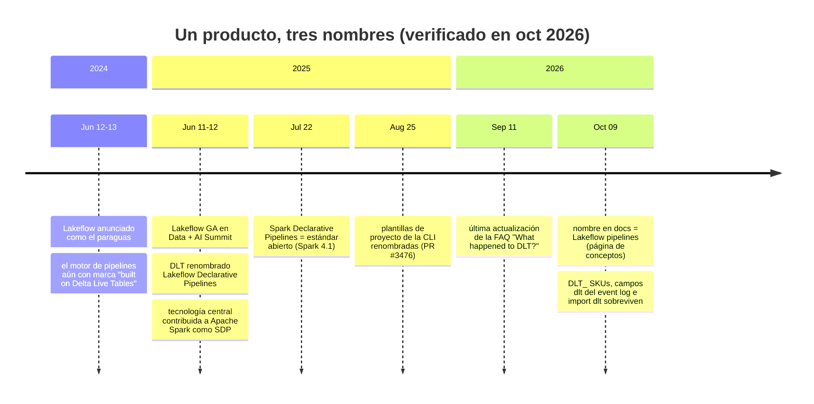
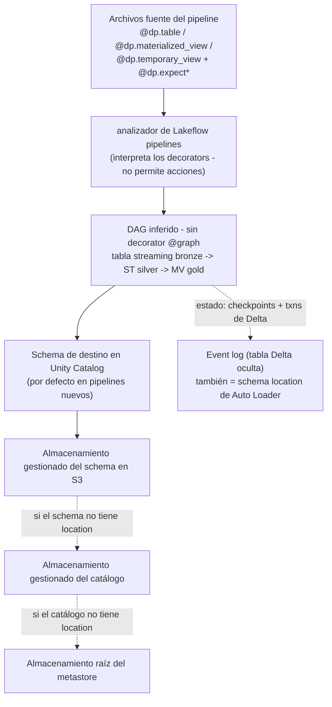
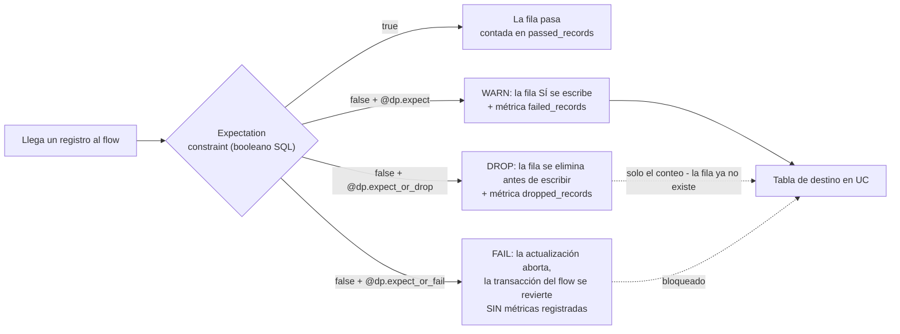
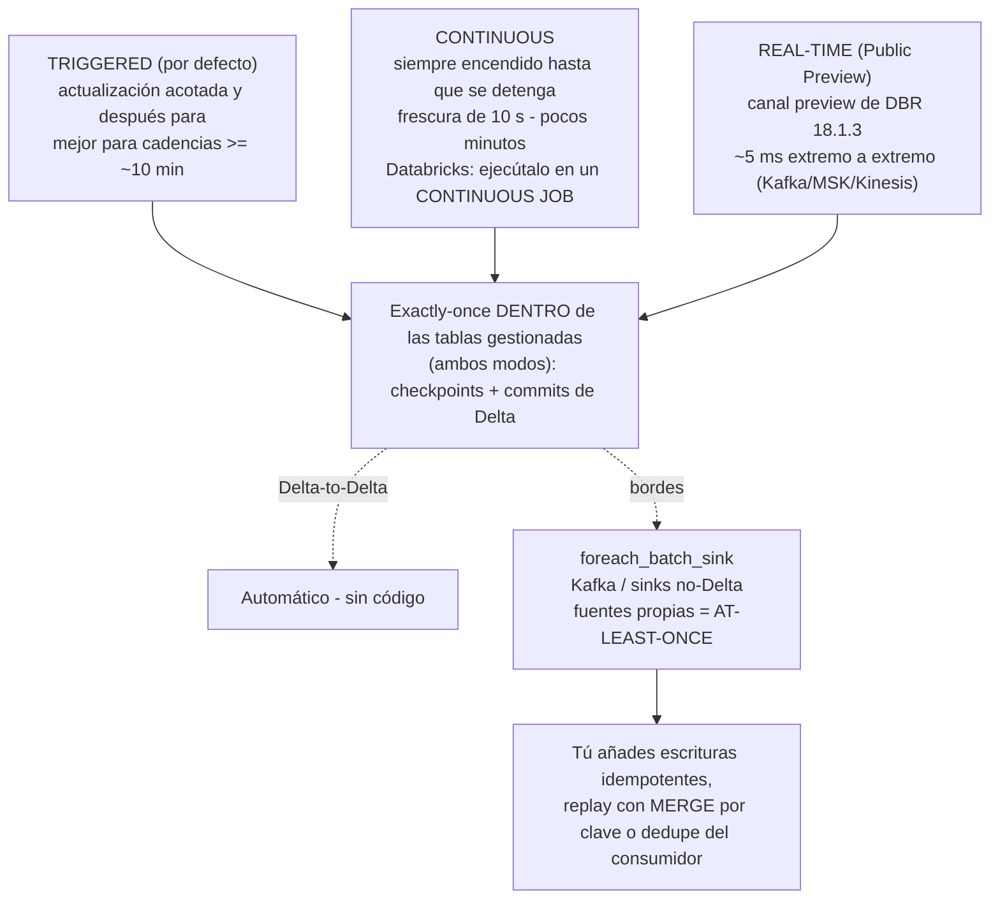
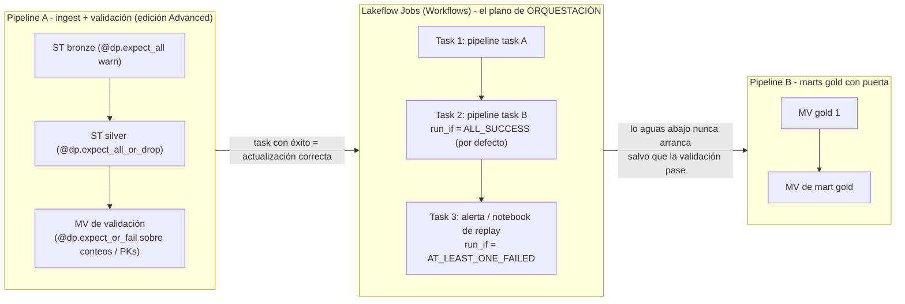

# Lakeflow Declarative Pipelines (antes Delta Live Tables): expectations, modos y la decisión DLT frente a Jobs

Toda infraestructura de datos acaba haciendo dos preguntas a su capa de ETL: *¿son buenos los datos?* y *¿el job se ejecutó de verdad?* En Databricks sobre AWS, la primera pregunta se responde dentro de **Lakeflow pipelines** — el producto que tus tutoriales de 2023 llamaban **Delta Live Tables (DLT)** — mediante una función llamada **expectations**: comprobaciones SQL por registro con tres acciones graduadas (warn, drop, fail) y métricas legibles por máquina. La segunda se responde con la orquestación, que en el mundo de Databricks significa **Lakeflow Jobs** (Workflows). El error más caro de este campo es confundir los dos planos: las expectations aplican la **calidad de datos**, los jobs aplican la **orquestación**, y la documentación lo dice literalmente — "**Expectations enforce data quality, not orchestration**" (docs .../ldp/expectation-patterns, fechada el **2026-07-14**).

Esta lección enseña el producto con su **nombre actual y con todo su historial de renombramientos**, porque a octubre de 2026 tu infraestructura contendrá los tres nombres a la vez: notebooks con `import dlt`, facturas con SKUs `DLT_`, campos del event log con `dlt` dentro — y documentación que dice "Lakeflow pipelines". "The product formerly known as Delta Live Tables (DLT) has been updated to **Lakeflow pipelines**. If you have previously used DLT, there is **no migration required** to use Lakeflow pipelines: your code will still work" (docs .../ldp/concepts/where-is-dlt, pie de página **Sep 11, 2026**). Tres nombres, un producto, cero reescrituras forzadas — y una superficie de facturación que sigue diciendo DLT.

```text
 =============================================================
  MAPA DE LA LECCIÓN 07 - Lakeflow pipelines en AWS, a oct 2026
 ------------------------------------------------------------
  Nombre     DLT -> Lakeflow Declarative Pipelines (GA 2025-06)
             -> "Lakeflow pipelines" en la documentación (oct 2026)
             estándar abierto: Apache Spark Declarative Pipelines
             (SDP, pyspark.pipelines, Apache Spark 4.1)
  Modelo     pipelines | flows | streaming tables | MVs |
             views | sinks - el DAG se INFERE (sin @graph)
  Calidad    6 decorators de expectations, 3 acciones
             warn (conserva + métricas) | drop (elimina + cuenta)
             | fail (aborta, SIN métricas)
             las métricas viven en EVENTOS flow_progress, no en columnas
             cuarentena = PATRÓN documentado, no un decorator
  Modos      triggered (por defecto, cadencias >= ~10 min)
             | continuous (ejecútalo en un CONTINUOUS JOB)
             | real-time (Public Preview, DBR 18.1.3 preview)
  Cómputo    serverless es el defecto para pipelines ETL nuevos
             (Unity Catalog obligatorio) | classic (Hive/legacy)
  Ediciones  Core (ingest) < Pro (+CDC) < Advanced (+expect)
  Medidor    serverless $0.35/DBU publicado en la página de precios
             (hilo de la comunidad 2025-07-10, confirmado por staff)
             classic DLT_CORE $0.20 / DLT_PRO $0.25 /
             DLT_ADVANCED $0.36 (CSV de terceros, 2026-04-10 -
             solo corroboración; confirma en la página de precios)
  -------------------------------------------------------------
  Regla de la lección: los pipelines aplican la calidad de DATOS;
  los jobs aplican la ORQUESTACIÓN. Nunca los confundas.
 =============================================================
```

En esta lección vas a:

- reconstruir la **línea temporal de nombres** (anuncio de Lakeflow 2024-06 → GA 2025-06 + renombramiento de DLT + contribución a Spark → nombre en la documentación oct 2026) y triar los **vestigios de DLT** que la sobreviven;
- escribir Python de pipeline con la **API `dp`** y comprobar por ti mismo que el viejo estilo `@dlt.expect` sigue funcionando;
- aplicar los **seis decorators de expectations** y las **tres acciones**, y explicar con precisión por qué **fail no registra métricas**;
- consultar las métricas de expectations desde el **event log** y la system table **`pipeline_events`** en Beta;
- construir el **patrón de cuarentena** con reglas seguras ante NULL para que las filas buenas y las malas particionen la entrada exactamente una vez;
- elegir entre los modos **triggered, continuous y real-time**, y calcular la **forma de coste de $105 frente a $2,520 al mes** de esa elección;
- configurar pipelines en AWS: **cascada de almacenamiento de Unity Catalog, serverless frente a classic, ediciones, ejecución como service principals, Declarative Automation Bundles**;
- decidir **Lakeflow pipelines frente a Workflows jobs** con una matriz de decisión, estudiar **NAB y Shell** en AWS, leer el **recuadro de actualizaciones de 2026** y practicar con **doce preguntas** más cuatro comprobaciones interactivas.

---

## 1. Un producto, tres nombres: la línea temporal que se te va a examinar

### 1.1 El renombramiento, con fechas

| Fecha | Qué anunció Databricks | Fuente |
|---|---|---|
| **2024-06-12/13** | **Lakeflow** se presenta como el paraguas unificado de ingeniería de datos (Connect + Pipelines + Jobs); el motor de pipelines es "Lakeflow Pipelines, built on Delta Live Tables technology" | blog *Introducing Databricks Lakeflow* (**2024-06-13**) + nota de prensa (**2024-06-12**) |
| **2025-06-11/12** (Data + AI Summit) | **Lakeflow pasa a GA**; **DLT se renombra Lakeflow Declarative Pipelines**, "100% source-compatible with the open standard" Apache Spark Declarative Pipelines y "100% backward-compatible with DLT pipelines"; la tecnología central se contribuye a Apache Spark | blog *Announcing the GA of Databricks Lakeflow* (**2025-06-12**) |
| **2025-07-22** | "We've **contributed our core declarative pipeline technology to the Apache Spark™ project as Spark Declarative Pipelines** … It's now an open standard"; "**DLT is now Lakeflow Declarative Pipelines**, with the same core benefits and full backward compatibility" | blog *What's New in Lakeflow Declarative Pipelines: July 2025* (**2025-07-22**) |
| **2025-08-25** | La herramienta se pone al día: las plantillas de proyecto de Databricks CLI dejan de llamarse "Delta Live Tables" (databricks/cli PR #3476, fusionado el **2025-08-25**) | GitHub PR |
| **Oct 2026** | El nombre del producto en la documentación es **"Lakeflow pipelines"**; la página de FAQ *What happened to Delta Live Tables (DLT)?* (pie de página **2026-09-11**) documenta el renombramiento y los vestigios de DLT que sobreviven | docs .../ldp/ (página de conceptos fechada el **2026-10-09**) |



Redacción del curso que hay que memorizar: **Delta Live Tables (DLT), renombrado Lakeflow Declarative Pipelines al hacer GA en junio de 2025 y hoy llamado Lakeflow pipelines en la documentación — mismo producto, tres nombres, una sola línea temporal.** Dos nombres relacionados no deben confundirse con el nombre del producto: **Apache Spark™ Declarative Pipelines (SDP)** es el *estándar abierto* que Databricks extendió ("All Lakeflow pipelines Python APIs are implemented in the `pyspark.pipelines` module"; "Apache Spark™ includes declarative pipelines **beginning in Spark 4.1**", docs .../ldp/developer/python-dev, fechada el **2026-07-10**), y **Lakeflow** es la *familia*: **Lakeflow Connect** (ingestión gestionada), **Lakeflow Declarative Pipelines** (esta lección), **Lakeflow Jobs** (Workflows) (blog de GA, 2025-06-12).

### 1.2 Los vestiges: por qué tus consultas de coste siguen haciendo grep por `dlt`

La página de FAQ es explícita sobre lo que *no* cambió: "There are still some references to the DLT name in Databricks. The **classic SKUs for Lakeflow pipelines still begin with `DLT`**, and **event log schemas with `dlt` in the name have not changed**. Python APIs that used `dlt` in the name can still be used, but Databricks recommends moving to the new names" (docs .../ldp/concepts/where-is-dlt, **2026-09-11**).

| Superficie | Sigue diciendo DLT (oct 2026) | Qué haces al respecto |
|---|---|---|
| SKUs clásicos de DBU | `DLT_CORE_COMPUTE`, `DLT_PRO_COMPUTE`, `DLT_ADVANCED_COMPUTE` (y variantes Photon) | Conserva los filtros `DLT_` en las consultas de coste |
| Facturación serverless | `billing_origin_product` in (`JOBS`, **`DLT`**); las actualizaciones de MV en SQL warehouses muestran `billing_origin_product='SQL'` **con** `usage_metadata.dlt_pipeline_id` establecido (docs .../admin/system-tables/serverless-billing, **2026-06-01**) | Haz el join por `dlt_pipeline_id`, no solo por el nombre del producto |
| Campos del event log | Los campos con nombre `dlt` en los esquemas heredados no cambian | No reescribas las consultas históricas de eventos |
| Python | `import dlt`, `@dlt.expect`, `dlt.read` siguen funcionando | Código nuevo: `from pyspark import pipelines as dp` |

- **📚 ¿Sabías que…?** Un ticket de soporte que dice «¿por qué hay un ID de *pipeline* en nuestra factura de **SQL**?» tiene una respuesta documentada: "When you create a materialized view in a Databricks SQL warehouse, a **serverless pipeline is created** to process refreshes" — y la fila de facturación aparece como `billing_origin_product = 'SQL'` con `usage_metadata.dlt_pipeline_id IS NOT NULL` (docs .../admin/system-tables/serverless-billing, **2026-06-01**). Los pipelines no son solo lo que tú construyes; también son maquinaria que otros productos ponen en marcha a tus espaldas.

### 1.3 Ejemplo resuelto E1 — la migración: código heredado `dlt` frente a código `dp` actual

**A oct 2026.** El equipo A envía un notebook DLT de 2023. El equipo B pregunta si hay que reescribirlo. Respuesta según la documentación: *no hay migración obligatoria — pero la división de `@dlt.table` en dos decorators importa*.

```python
# --- LEGACY STYLE (2022-2024 tutorials). STILL RUNS on Lakeflow pipelines.
import dlt

@dlt.table
@dlt.expect("order_id_not_null", "order_id IS NOT NULL")            # warn
@dlt.expect_or_drop("valid_amount", "amount IS NOT NULL AND amount >= 0")  # drop
def silver_orders():
    return spark.readStream.table("bronze_orders").filter("event_type = 'ORDER'")
```

```python
# --- CURRENT STYLE (docs .../ldp/developer/python-ref, dated 2026-08-06).
from pyspark import pipelines as dp

@dp.table                                                             # streaming DF -> streaming table
@dp.expect("order_id_not_null", "order_id IS NOT NULL")              # warn
@dp.expect_or_drop("valid_amount", "amount IS NOT NULL AND amount >= 0")
def silver_orders():
    return spark.readStream.table("bronze_orders").filter("event_type = 'ORDER'")
```

La tabla de correspondencia de la referencia de Python (fechada el **2026-08-06**) — aprende la columna del medio y cita la columna izquierda solo cuando leas código antiguo:

| DLT (`import dlt`) | Lakeflow / SDP (`pipelines as dp`) | Nota |
|---|---|---|
| `@dlt.table` sobre un DF **streaming** | `@dp.table` | crea una **streaming table** |
| `@dlt.table` sobre un DF de **batch** | `@dp.materialized_view` | la división de 2025 — mismo decorator, dos tipos de dataset |
| `@dlt.view` | `@dp.temporary_view` | se evalúa bajo demanda, no se persiste |
| `dlt.read(t)` / `dlt.read_stream(t)` | `spark.read.table(t)` / `spark.readStream.table(t)` | lectores de Spark corrientes dentro de las funciones de dataset |
| `dlt.apply_changes(...)` | `dp.create_auto_cdc_flow(...)` | exclusivo de Databricks (no está en Apache Spark), edición Pro o superior |
| `@dlt.create_sink` | `dp.create_sink` | los sinks no pueden llevar expectations |
| `@dlt.expect*` | `dp.expect*` | seis decorators, exclusivos de Databricks (no están en SDP) |
| — (no disponible en DLT) | `@dp.update_flow`, `dp.foreach_batch_sink`, `dp.create_auto_cdc_from_snapshot_flow`, `dp.replace_flow` | capacidades nuevas de Lakeflow |

Dos trampas visibles en este ejemplo. Primero, la **división de decorators**: `@dlt.table` cubría ambos tipos de dataset; `@dp.table` con un DataFrame de *batch* (o `@dp.materialized_view` con uno streaming) declara mal el dataset y rompe la planificación de flows (mapeo de python-ref, 2026-08-06). Segundo, el **predicado seguro ante NULL**: `amount >= 0` solo elimina las filas donde el predicado es *falso*; un amount NULL evalúa a NULL y lo **conserva** el modo drop. Escribe `amount IS NOT NULL AND amount >= 0` (la sección 5 vuelve a esto con la prueba de la partición de cuarentena).

> ⚠️ **ADVERTENCIA — no copies y pegues el resto de una publicación de blog DLT de 2023.** El material antiguo también dice "set continuous in the pipeline settings for production", "query `LIVE.my_table`" y "serverless is preview". A oct 2026: el modo de publicación por defecto **ignora `LIVE`** (consulta `catalog.schema.table`), **serverless es el defecto** para los pipelines ETL nuevos, y Databricks **desaconseja el ajuste incorporado de continuous para los pipelines nuevos** — envuelve el pipeline en un **continuous job** en su lugar (docs .../ldp/concepts/pipeline-mode, consultada 2026-10; .../ldp/serverless, **2026-10-09**; .../ldp/target-schema, **2026-09-11**).

---

## 2. El modelo declarativo: lo que escribes tú frente a lo que hace la plataforma

### 2.1 Pipelines, flows, datasets — y un DAG inferido

"A pipeline is the main unit of development and execution of Apache Spark™ Declarative Pipelines (SDP) in Lakeflow. A pipeline is a collection of source code files and a configuration" (docs .../ldp/concepts/pipelines, fechada el **2026-10-09**). La página de conceptos nombra los componentes: "pipelines, **flows**, **streaming tables**, **materialized views**, and **sinks**" (docs .../ldp/concepts/, fechada el **2026-08-15**). Tú declaras los datasets con decorators; la plataforma "automatically infer[s] dependencies between datasets and arrange[s] them in a **directed acyclic graph (DAG)**" — **no existe el decorator `@graph`**; el grafo se infiere de lo que leen tus funciones de dataset (concepts/pipelines, 2026-10-09).

| Tipo de dataset | Python | Semántica (concepts, 2026-08-15) |
|---|---|---|
| **Streaming table** | `@dp.table` que devuelve un DataFrame **streaming** | "Each record is processed **exactly one time**, assuming an append-only source" |
| **Materialized view** | `@dp.materialized_view` que devuelve un DataFrame de **batch** | "Results are recomputed as needed" (refresh incremental en serverless) |
| **View** | `@dp.temporary_view` | "Evaluated on demand, not persisted" |
| **Sink** | `dp.create_sink` / `dp.foreach_batch_sink` | escrituras personalizadas o externas — y ahí termina el sobre de exactly-once |

Un **flow** es la arista de procesamiento: "A flow reads data from a source, applies user-defined processing logic, and writes the result into a target … (Currently, only the **Append** and **Update** flows are exposed.)" (concepts, 2026-08-15). Los flows Append son el defecto, uno por destino; los flows Update existen solo en Python, vía `@dp.update_flow`.



### 2.2 Leyes de codificación: el motor evalúa tu función repetidamente

"Python pipeline code does not directly call the functions that perform data ingestion and transformation … Instead, Lakeflow pipelines **interpret the decorator functions** … and build a dataflow graph" (docs .../ldp/developer/python-dev, **2026-07-10**). Las funciones de dataset "must return a Spark DataFrame", y nunca debes llamar a `collect()`, `count()`, `toPandas()`, `save()`, `saveAsTable()`, `start()`, `toTable()` dentro de ellas — el planificador evalúa las definiciones varias veces, así que las acciones y los efectos secundarios rompen la idempotencia. Leer otros datasets se hace con los lectores corrientes de Spark (`spark.read.table`, `spark.readStream.table`, SQL `STREAM(...)`), no con un ayudante especial `source()`.

### 2.3 Fuentes en AWS: de dónde vienen los bytes

| Fuente | Cómo (docs, oct 2026) | Nota sobre el sustrato AWS |
|---|---|---|
| **Tablas de Unity Catalog** | batch `spark.read.table` → materialized view; streaming `spark.readStream.table` → streaming table; SQL `STREAM(cat.schema.table)` | gobernado por los grants de UC |
| **Auto Loader / `read_files`** | `spark.readStream.format("cloudFiles").load(<path>)` o SQL `read_files("/path", format => "json")` | "**Auto Loader using the `read_files()` function to read from Unity Catalog external locations**" — se requieren external location + storage credential (IAM role) + grant **`READ FILES`** (docs .../ldp/unity-catalog, **2026-10-09**; .../ldp/load, **2026-08-15**) |
| **Kafka / Amazon MSK, Kinesis** | fuentes streaming en pipelines de UC | el dúo streaming nativo de AWS; Event Hubs es de Azure |
| **Lakeflow Connect** | conectores gestionados → tipo de pipeline `MANAGED_INGESTION` | fuentes SaaS sin escribir código |
| **Hive metastore** | vía el catálogo de federación | **no se puede actualizar a UC** — clona y vuelve a ingerir (doc de unity-catalog, 2026-10-09) |

Dentro de los pipelines la plataforma posee la fontanería: "If you use Lakeflow pipelines, Databricks manages schema location and other checkpoint information automatically" (docs de schema de auto-loader, **2026-07-10**), y "The **event log location also serves as the schema location** for any Auto Loader queries in the pipeline" (docs .../ldp/monitor-event-logs, **2026-10-09**). La página de mejores prácticas de Auto Loader enuncia sin rodeos el valor por defecto de producción: "For most users and production pipelines, **Auto Loader with Lakeflow pipelines is a good fit**. However, if you need maximum control and customization, use Auto Loader with Structured Streaming" (docs, **2026-06-29**).

> [!IMPORTANT]
> ⚠️ **Nunca borres el event log.** La misma página advierte: "Do not delete the event log or the parent catalog or schema … Deleting the event log might result in your pipeline failing to update during future runs" — porque esa ubicación hace doble función de **schema location de Auto Loader**. Mover o publicar el event log es un evento de seguimiento de esquema, no de limpieza (docs .../ldp/monitor-event-logs, **2026-10-09**).

---

## 3. Expectations: seis decorators, tres acciones, un reglamento

### 3.1 El inventario verificado — exactamente seis, sin decorator de cuarentena

"Expectations are optional clauses in pipeline materialized view, streaming table, or view creation statements that apply data quality checks on each record passing through a query. Expectations use standard SQL Boolean statements" (docs .../ldp/expectations, pie de página **Sep 11, 2026**). La referencia de Python (fechada el **2026-09-11**) no deja lugar a dudas: "The `dp` module includes **six decorators** to control expectations behavior" — y el orden canónico es *después* del decorator de dataset y *antes* de la función:

| Decorator | Firma | Acción ante una violación |
|---|---|---|
| `@dp.expect(description, constraint)` | comprobación única | **warn** (por defecto): la fila **se escribe** en el destino; se cuentan las que pasan y las que fallan |
| `@dp.expect_or_drop(...)` | comprobación única | **drop**: "Invalid records are dropped before data is written to the target. The count of dropped records is logged alongside other dataset metrics" |
| `@dp.expect_or_fail(...)` | comprobación única | **fail**: "Invalid records prevent the update from succeeding. Manual intervention is required before reprocessing" |
| `@dp.expect_all({description: constraint, ...})` | **dict** de comprobaciones | warn ante cualquier fallo |
| `@dp.expect_all_or_drop({...})` | dict | drop ante cualquier fallo |
| `@dp.expect_all_or_fail({...})` | dict | fail en la actualización ante cualquier fallo |

Gemelo SQL (para datasets escritos en SQL): `CONSTRAINT name EXPECT (expr)` con `ON VIOLATION DROP ROW` u `ON VIOLATION FAIL UPDATE` opcional. **No existe el decorator `expect_all_or_quarantine`** — la cuarentena es un *patrón* documentado que construyes tú mismo (sección 5). Las expectations requieren la edición de producto **Advanced**: "Core to run streaming ingest workloads … doesn't require advanced features such as change data capture (CDC) or expectations. Pro … plus … CDC. Advanced … and includes **data quality constraints with expectations**" (docs .../ldp/configure-pipeline, fechada el **2026-10-01**).

### 3.2 Las tres acciones, dibujadas



Tres cláusulas del documento de expectations (2026-09-11) que deciden el diseño de producción:

1. "**Because `fail` causes the update to fail when an invalid record is detected, metrics are not recorded.**" Fail es una *señál de stop*, no un *instrumento de medición* — nunca instrumentes una tabla con expectations en modo fail y después te preguntes por qué tu dashboard de calidad está en blanco.
2. "An expectation **name must be unique for a given dataset**. You can reuse expectations across multiple datasets in a pipeline."
3. Los constraints "must use valid SQL syntax and cannot contain … Custom Python functions, External service calls, Subqueries referencing other tables." Sin UDFs, sin APIs externas, sin comprobaciones entre tablas — si necesitas eso, va en un notebook de validación o en un pipeline aparte.

La semántica del modo de ejecución también cuenta: "In a triggered pipeline, the failure of a single flow does not cause other parallel flows to fail. In a continuous pipeline, an expectation failure **stops the flow, all dependent flows**, and the pipeline emits a message explaining why it stopped" (misma página). El propio artefacto de depuración de la documentación para el modo fail: `[EXPECTATION_VIOLATION.VERBOSITY_ALL] Flow 'sensor-pipeline' failed to meet the expectation. Violated expectations: 'temperature_in_valid_range'. Input data: '{"id":"TEMP_001",…}'` — nombre del flow, nombre de la expectation y el registro culpable, en un solo error.

### 3.3 Ejemplo resuelto E2 — un pipeline medallón, las tres acciones

**A oct 2026, serverless, edición Advanced, destinos en Unity Catalog.** La fuente completa del pipeline (adaptada de la forma resuelta de la documentación; los alias `@dlt.expect*` funcionan igual):

```python
# file: transformations/orders_pipeline.py   (pipeline source; NO actions allowed)
from pyspark import pipelines as dp
from pyspark.sql.functions import col, expr

LANDING = "/Volumes/lake/landing/orders/"   # UC volume; external location also fine

bronze_rules = {
    "order_id_not_null": "order_id IS NOT NULL",
    "event_ts_not_null": "event_ts IS NOT NULL",
}

@dp.table(
    name="bronze_orders",
    table_properties={"quality": "bronze", "pipelines.autoOptimize.managed": "true"},
    # path omitted -> managed storage of the target schema (the S3 cascade)
)
@dp.expect_all(bronze_rules)                     # WARN: keep rows, emit metrics
def bronze_orders():
    return (
        spark.readStream.format("cloudFiles")
             .option("cloudFiles.format", "json")
             .option("cloudFiles.schemaEvolutionMode", "addNewColumns")
             .load(LANDING)
    )

silver_rules = {
    "valid_order_id":  "order_id IS NOT NULL",                          # total (NULL-safe)
    "valid_amount":    "amount IS NOT NULL AND amount >= 0",
    "valid_currency":  "currency IN ('USD','EUR','GBP')",
}

@dp.table(name="silver_orders")
@dp.expect_all_or_drop(silver_rules)            # DROP: bad rows excluded, counts logged
def silver_orders():
    return (
        spark.readStream.table("bronze_orders")
             .filter(expr("event_type = 'ORDER'"))
    )

@dp.materialized_view(name="gold_daily_revenue")
@dp.expect_or_fail("row_count_positive", "total_revenue >= 0")   # FAIL: abort this flow
def gold_daily_revenue():
    return (
        spark.read.table("silver_orders")
             .groupBy("order_date", "currency")
             .agg(col("amount").sum().alias("total_revenue"))
    )
```

Narra el grafo antes de ejecutarlo: **bronze advierte** (solo métricas — bronze es para la forense, no para servir), **silver elimina** (las filas malas nunca llegan a los consumidores; solo quedan los conteos — la sección 5 muestra qué hacer cuando los conteos no bastan), **gold falla** (un total de ingresos negativo es imposible, así que detén la actualización en lugar de publicarla). El motor infiere el DAG (`bronze_orders` → `silver_orders` → `gold_daily_revenue`), publica los tres en el **schema de destino del pipeline en Unity Catalog** (aterrizando físicamente en el almacenamiento gestionado de ese schema) y una actualización **triggered** procesa los datos disponibles al arrancar y después se detiene. Fíjate en la división de tipos de dataset en acción: `gold_daily_revenue` es una agregación de *batch*, así que es `@dp.materialized_view`, no `@dp.table`.

---

## 4. Métricas: dónde viven de verdad los números de las expectations

### 4.1 El payload del event log es la API de métricas

Las métricas **no** son columnas de tu tabla de destino. La documentación actual las define puramente como **payloads del event log**: "the metrics for the number of records that passed and failed an expectation are stored in the `details:flow_progress.data_quality.expectations` object. The metric for the number of dropped records is stored in the `details:flow_progress.data_quality` object. Events … have the event type `flow_progress`" (docs .../ldp/monitor-event-logs, **2026-10-09**). El esquema del array de expectations se publica: `array<struct<name: string, dataset: string, passed_records: int, failed_records: int>>`, y `dropped_records` cuenta las filas que "failed one or more expectations".

Tres superficies leen los mismos números:

1. **UI de monitoreo de pipelines → dataset → pestaña Data quality** (expectations warn/drop; la vista humana).
2. **El event log por pipeline** — una tabla Delta oculta consultable con `SELECT * FROM event_log(<pipeline_id>)` (formateada como `event_log_{pipeline_id}`), que puedes **publicar** en una tabla con nombre de Unity Catalog para un acceso más amplio (JSON de Advanced settings `{"event_log": {"catalog", "schema", "name"}}`).
3. **La system table `pipeline_events` (Beta)** — `system.lakeflow_pipeline_events_preview.pipeline_events`, que "contains events for all pipelines across the workspaces in a region" y es hoy la superficie de consulta **recomendada**, con un dashboard de Lakeview descargable (docs .../ldp/monitor-and-query-events, **2026-10-09**).

> ⚠️ **No salgas a cazar columnas `_expectation_name` en tu tabla silver.** El material antiguo de la comunidad muestra columnas de metadatos de expectation; la documentación actual define el contrato de arriba y nada más. Si tu SQL de monitoreo selecciona `_expectation_*` de una tabla de pipeline, estás ejecutando código obsoleto (docs .../ldp/monitor-event-logs, **2026-10-09**; documento de expectations, **2026-09-11**). Y recuerda: las expectations en modo fail dejan **sin métricas por diseño**, y exactamente por eso fail va en las puertas orquestadas (sección 7), no en las tablas de servicio monitoreadas.

### 4.2 Ejemplo resuelto E3 — SQL de monitoreo de DQ: event log, system table, factura

```sql
-- (a) Per-update expectation metrics from the per-pipeline event log
WITH exploded AS (
  SELECT explode(from_json(
           details:flow_progress:data_quality:expectations,
           "array<struct<name: string, dataset: string, passed_records: int, failed_records: int>>"
         )) AS row_expectations
  FROM event_log(<pipeline_id>)
  WHERE event_type = 'flow_progress'
)
SELECT row_expectations.dataset           AS dataset,
       row_expectations.name              AS expectation,
       SUM(row_expectations.passed_records) AS passing_records,
       SUM(row_expectations.failed_records) AS failing_records
FROM exploded
GROUP BY 1, 2;

-- (b) Region-wide, cross-pipeline (Beta system table; requires USE/SELECT on system schemas)
SELECT pipeline_id, update_id,
       coalesce(expectation.dataset, origin.dataset_name) AS dataset_name,
       expectation.name,
       SUM(expectation.failed_records) AS failed
FROM system.lakeflow_pipeline_events_preview.pipeline_events
LATERAL VIEW explode(variant_get(details,
  '$.flow_progress.data_quality.expectations',
  'ARRAY<STRUCT<name:STRING,dataset:STRING,passed_records:BIGINT,failed_records:BIGINT>>')) AS expectation
WHERE event_type = 'flow_progress'
GROUP BY 1, 2, 3, 4
HAVING SUM(expectation.failed_records) > 0;

-- (c) What did this pipeline cost? (billing still keys on the dlt_pipeline_id)
SELECT sku_name, product_features.performance_target, SUM(usage_quantity) AS dbus
FROM system.billing.usage
WHERE usage_metadata.dlt_pipeline_id = '<pipeline_id>'
GROUP BY 1, 2;
```

La consulta (c) es la tabla de vestigios de la §1.2 en forma ejecutable: los pipelines se facturan por `usage_metadata.dlt_pipeline_id`, y las filas serverless llevan `product_features.performance_target` ∈ {`PERFORMANCE_OPTIMIZED`, `STANDARD`} (docs .../admin/system-tables/serverless-billing, **2026-06-01**). La pestaña **Data quality** de la UI está bien para un humano que revisa un dataset; las consultas (a) y (b) es lo que pones en una alerta programada o en un dashboard de salud de Lakeview.

- **📚 ¿Sabías que…?** Los pipelines conservan "**60 days** of past updates in the pipeline UI and the Pipelines API" (docs .../ldp/configure-pipeline, **2026-10-01**) — pero "older ones remain only in the event log". Cualquier auditoría o revisión de incidentes que mire más allá de 60 días es una consulta al **event log** (o a la tabla publicada del event log), y esa es una razón más para borrar esa tabla nunca.

---

## 5. Cuarentena: un patrón, no un decorator — y la trampa NULL que hay dentro

Cuando las expectations en modo drop son demasiado destructivas (datos regulados, requisitos de replay) necesitas conservar las filas malas. Databricks documenta la receta — una **streaming table temporal particionada por un flag `is_quarantined` calculado**, anotada con `@dp.expect_all(rules)` para que las métricas sigan fluyendo, y después dos views que dividen el stream (docs .../ldp/expectation-patterns, fechada el **2026-07-14**).

### 5.1 Ejemplo resuelto E4 — la forma oficial de cuarentena, hecha segura ante NULL

```python
from pyspark import pipelines as dp
from pyspark.sql.functions import expr

rules = {
    "valid_pickup_zip":  "(pickup_zip IS NOT NULL)",
    "valid_dropoff_zip": "(dropoff_zip IS NOT NULL)",
}
# NOT(all rules) -> TRUE means "at least one rule failed" (NULL-safe: rules are total)
quarantine_expr = "NOT({0})".format(" AND ".join(rules.values()))

@dp.view
def raw_trips_data():
    return spark.readStream.table("samples.nyctaxi.trips")

@dp.table(temporary=True, partition_cols=["is_quarantined"])
@dp.expect_all(rules)                            # metrics still recorded per rule
def trips_data_quarantine():
    return (spark.readStream.table("raw_trips_data")
                 .withColumn("is_quarantined", expr(quarantine_expr)))

@dp.view
def valid_trips_data():
    return spark.read.table("trips_data_quarantine").filter("is_quarantined = false")

@dp.view
def invalid_trips_data():
    return spark.read.table("trips_data_quarantine").filter("is_quarantined = true")
```

Después, en producción, promueve `invalid_trips_data` a un `@dp.table(name="trips_quarantine")` de verdad (tiene que persistir en S3 bajo Unity Catalog — en pipelines UC eso significa el almacenamiento gestionado del schema, la location del catálogo o la raíz del metastore, en ese orden de respaldo) y **alerta sobre su conteo de filas**; nada en la plataforma reproduce ni expira automáticamente las tablas de cuarentena.

> [!WARNING]
> **La trampa NULL en cada división hecha a mano.** `expect_or_drop` elimina una fila solo cuando el predicado es **falso** — un SQL NULL *no* es falso. Así que la regla ingenua `fare > 0` **conserva** en silencio las tarifas NULL, y su negación `NOT(fare > 0)` también es NULL, lo que significa que una fila con tarifa NULL cae en *ninguna* de las dos ramas de una división `valid`/`invalid` y tus dos ramas ya no particionan la entrada. Haz cada regla **total** (`fare IS NOT NULL AND fare > 0`) o calcula un único booleano explícito y bifúrcate sobre *él*, exactamente como hace el flag `is_quarantined` de arriba (patrón documentado, expectation-patterns, **2026-07-14**; comportamiento de NULL, documento de expectations, **2026-09-11**).

**Historia de replay (práctica del curso, coherente con el patrón documentado):** triar las filas de cuarentena → corregir aguas arriba o aceptarlas → reejecutar la misma transformación filtrada con un predicado ampliado o un `MERGE` desde la tabla de cuarentena tras la reparación → la siguiente actualización del pipeline continúa (el ACID de Delta y el estado del pipeline mantienen los replays idempotentes **siempre que replays por clave**, no por un append ciego) → archivar o eliminar las filas de cuarentena con permisos `MODIFY` de UC y un rastro de auditoría.

---

## 6. Modos y garantías: triggered, continuous, real-time

### 6.1 La tabla de modos

"Triggered mode refreshes available data and stops, while continuous mode keeps tables fresh as new data arrives" (docs .../ldp/concepts/pipeline-mode, consultada 2026-10). Dos hechos que los alumnos suelen dejar mal: "**Pipeline mode is independent of the type of table** being computed" (tanto las MV como las streaming tables se actualizan en cualquier modo), y "Refresh operations for **standalone** materialized views and streaming tables **always run using triggered pipeline mode**".

| | **Triggered** (por defecto) | **Continuous** | **Real-time** (Public Preview) |
|---|---|---|---|
| Ciclo de vida | "Automatically when complete" — procesa los datos disponibles al arrancar y después se detiene | "Runs continuously until manually stopped" | una optimización a nivel de flow **encima de continuous** |
| Frescura | "every 10 minutes, hourly, or daily" | "between every 10 seconds and a few minutes" | extremo a extremo "as low as **five milliseconds**" |
| Forma de coste | pagas por actualización | cómputo siempre encendido — la palanca mayor de esta lección | siempre encendido, baja latencia |
| Extras | lo más barato; solo aquí las MV/ST independientes | se salta el trabajo cuando las tablas Delta dependientes no han cambiado; cadencia con `pipelines.trigger.interval` (prefiere **por tabla** — los flows streaming y batch "have different defaults") | canal **preview de DBR 18.1.3**; `spark.databricks.streaming.realTimeMode.enabled=true` + `pipelines.trigger: RealTime` en un `@dp.update_flow` que apunte a un `dp.create_sink`; Kafka/MSK entrada y salida, Kinesis entrada (EFO), **Delta no soportado**; se recomienda un flow real-time por pipeline |

### 6.2 Exactly-once: dentro del sobre y en sus bordes

"Lakeflow pipelines give you **exactly-once processing by default within the tables they manage**, and at the edges you add idempotent writes to keep re-runs safe" (docs .../ldp/best-practices/processing-guarantees, fechada el **2026-08-15**). Mecanismo: "Streaming tables use Structured Streaming checkpoints combined with Delta Lake's transactional writes: each micro-batch commits its source offsets and its output together, so a retried batch after a failure either fully succeeds or is fully rolled back … **never partially applied twice**" — para Auto Loader, Kafka, Kinesis y los upserts de `AUTO CDC`, "without any code from you". La regla práctica: "if your entire pipeline is **Delta-to-Delta** … you already have exactly-once." Dónde se acaba: `foreach_batch_sink`, los sinks Kafka/no-Delta y las fuentes Python propias son **at-least-once** — haz la escritura idempotente o deduplica aguas abajo.



### 6.3 La regla del continuous job (higiene de producción)

La guía actual de Databricks es un patrón, no una preferencia: "Databricks recommends running continuous pipelines with a **continuous job** rather than setting … Pipeline mode to continuous … the job manages the pipeline's execution lifecycle and unlocks serverless performance modes, such as Standard mode, that the pipeline's built-in continuous mode doesn't support." Y cuando un job orquesta un pipeline, "the job determines the execution mode and takes precedence … **set the pipeline's Pipeline mode to triggered (the default) when you wrap it in a continuous job.**" El ajuste incorporado "is not being removed, but Databricks **discourages its use for new pipelines**" (docs .../ldp/concepts/pipeline-mode, consultada 2026-10). El modo real-time monta sobre la misma pila: "Continuous mode is still required" (docs .../ldp/real-time, consultada 2026-10).

### 6.4 Ejemplo resuelto E5 — la decisión de modo, en dólares

**A oct 2026.** Aritmética sobre las tarifas documentadas: los Lakeflow pipelines serverless se reportan a **$0.35/DBU** (citación de cliente de la página de precios, confirmada en sustancia por una respuesta del staff de Databricks — "While the **DBU price is the same for both modes**, the Performance Optimized mode … can significantly increase total cost due to higher DBU consumption", Databricks Community, **2025-07-10**); los SKUs clásicos de DLT corroborados por un CSV de tarifas de terceros (descargado el **2026-04-10**): `DLT_CORE_COMPUTE` **$0.20**, `DLT_PRO_COMPUTE` **$0.25**, `DLT_ADVANCED_COMPUTE` **$0.36** — trata ese CSV como corroboración de nombres de SKU y confirma la tarjeta en vivo antes de comprometer un presupuesto.

```text
Ejemplo resuelto E5 - triggered frente a continuous, consumo de 10 DBU/hora
(a) Triggered, actualización nocturna de 1 hora, serverless:
      10 DBU/h x 1 h x $0.35/DBU  = $3.50/noche  ~= $105/mes (30 días)
(b) Continuous, siempre encendido, serverless (mismo consumo):
      10 DBU/h x 24 h x $0.35/DBU = $84/día      ~= $2,520/mes
(c) Misma ejecución nocturna en edición Advanced classic (solo columna DBU):
      10 DBU/h x 1 h x $0.36/DBU  = $3.60/noche  (+ EC2 - factura aparte)
DELTA de la elección de modo ............ ~$2,415/mes
Pregunta de equilibrio que hay que hacerle al negocio:
  "¿Valen más los datos con hasta ~24 horas de retraso que $2.4k/mes?"
  Si no -> triggered. Si sí -> continuous job, y después ajusta el intervalo.
```

```plot
{
  "type": "bar",
  "title": "Monthly DBU cost at a 10 DBU/h burn rate (worked example E5, as of Oct 2026)",
  "data": [
    {"mode": "Triggered nightly 1h (serverless $0.35/DBU)", "usd_per_month": 105},
    {"mode": "Triggered nightly 1h (classic ADV $0.36/DBU, DBU only)", "usd_per_month": 108},
    {"mode": "Continuous 24x7 (serverless $0.35/DBU)", "usd_per_month": 2520}
  ],
  "xKey": "mode",
  "dataKeys": ["usd_per_month"],
  "xLabel": "Pipeline mode and rate",
  "yLabel": "USD per month (DBU column only)"
}
```

El encuadre de equilibrio es la disciplina que este curso quiere: **empieza en triggered**, y compra continuous (o real-time) solo con un SLA de latencia cuyo valor de negocio supere el premium de siempre encendido. La misma aritmética se extiende a los modos de rendimiento: el modo de rendimiento serverless estándar "typically start[s] within **four to six minutes** after being triggered" y "Both modes use the same SKU, but standard performance mode consumes **fewer DBUs**" — el ahorro está en el consumo, no en la tarifa, y el modo standard para pipelines continuous solo se alcanza a través de un continuous job con "Performance optimized" desmarcado (docs .../ldp/serverless, **2026-10-09**).

---

## 7. Topología: ¿un pipeline o varios? (y por qué las expectations no pueden hacer de puerta)

### 7.1 Un pipeline: el grafo medallón en una sola actualización

Un solo pipeline puede alojar bronze→silver→gold: el motor infiere las dependencias, publica cada dataset que no sea `private` en el schema de destino y te deja ocultar los intermedios con `private=True` (tabla de referencia, **2026-08-06**). Obtienes una actualización, una asignación de cómputo, ordenación automática y estado incremental compartido — y por eso el grafo del ejemplo resuelto E2 es un solo pipeline. Pero la lógica de orquestación **no puede vivir dentro**: un dataset de validación con `expect_or_fail` solo falla su propio flow (modo triggered) o a sus dependientes (modo continuous), y "A validation table doesn't gate its downstream tables … To stop downstream processing when a validation fails, **split the validation logic and the downstream work into separate pipelines and orchestrate them with a job**" (expectation-patterns, **2026-07-14**).



Regla práctica de este curso: **un pipeline por dominio/SLA acotado** (p. ej., ingestión y limpieza de pedidos; un segundo pipeline para los marts gold con puerta), jobs que los orquesten en orden, ejecutándose como un **service principal**. El `run_if = ALL_SUCCESS` por defecto del job es lo que convierte una expectation en modo fail en una puerta real — "Because a pipeline task fails when its update fails, the downstream task doesn't run unless the validation pipeline succeeds" (expectation-patterns, 2026-07-14).

### 7.2 Actualizaciones de desarrollo frente a actualizaciones de producción

Las actualizaciones interactivas desde el **Lakeflow Pipelines Editor** (el "IDE for data engineering" anunciado en el release de GA, con emparejamiento código-DAG, vistas previas contextuales y ejecución selectiva de un solo archivo/tabla) usan "fast-start, debugging-focused behavior"; las actualizaciones desde **Jobs o la Pipelines API — y todas las continuous updates — usan reintento y reinicio automáticos** (reinicio del cluster ante errores recuperables como credenciales caducadas, reintento si falla el arranque del cluster, cluster destruido tras la ejecución) (monitor-event-logs, 2026-10-09; doc de updates). Lista de higiene de producción: programa un **pipeline task** en Workflows (los triggers de actualización son "Manual … Scheduled (jobs) … Programmatic"), pon **run-as** a un service principal ("Running pipelines as service principals is considered a best practice because they are not tied to individual users"), promueve el código con **Declarative Automation Bundles**, mantén el pipeline en **triggered** salvo que un SLA subsegundo demostrado exija continuous/real-time, y recuerda la ventana de historial de **60 días** en UI/API.

---

## 8. Configurar el pipeline en AWS: almacenamiento, cómputo, ediciones, identidad

### 8.1 Dónde aterrizan los datos: la cascada de almacenamiento de Unity Catalog

"Unity Catalog is the **default** for newly created pipelines" y es un **requisito** para serverless (docs .../ldp/unity-catalog, **2026-10-09**). El almacenamiento sigue una regla: "Data for materialized views and streaming tables are stored in the **storage location for the containing schema**. If a schema storage location is not specified, tables are stored in the **catalog** storage location. If schema and catalog storage locations are not specified, tables are stored in the **root storage location of the metastore**." Dos excepciones que hay que conocer de memoria:

- El parámetro **`path=`** de Python en `@dp.table(...)`/`create_table` — "A storage location for table data. **If not set, use the managed storage location for the schema containing the table**" (tabla de referencia, **2026-08-06**) — la forma soportada de fijar una tabla de pipeline a una ubicación explícita (p. ej., un volumen de UC o un prefijo S3 respaldado por una external location).
- La propiedad SQL **`LOCATION` no está soportada** al definir tablas en pipelines de UC (limitaciones de unity-catalog, 2026-10-09). Los ajustes de pipeline `storage` heredados (pipelines anteriores al **5 de febrero de 2025**, era del metastore Hive) usan por defecto `dbfs:/pipelines/` y "cannot be changed after a pipeline is created" (tabla de propiedades, **2026-07-14**).

La semántica de borrado también cambió con UC: eliminar un pipeline **conserva** sus tablas por defecto (pasan a inactivas pero siguen siendo consultables); `DELETE /api/2.0/pipelines/{id}?cascade=true` las elimina; `UNDROP` recupera las tablas eliminadas en un plazo de **7 días**; y los datos de respaldo viven bajo un catálogo `__databricks_internal` — "This is expected" (doc de unity-catalog, 2026-10-09).

### 8.2 Serverless frente a classic (AWS)

Los pipelines ETL nuevos usan por defecto "**Unity Catalog · Current channel · Serverless compute**" (configure-pipeline, 2026-10-01). Requisitos de serverless: workspace habilitado para UC, aceptación de los términos de serverless, una **región con serverless habilitado** (consulta la matriz de compatibilidad de regiones — no lo des por hecho), y "If you need to use an **AWS PrivateLink** connection with your serverless Lakeflow pipelines, **contact your Databricks representative**" (doc de serverless, 2026-10-09). No se requiere permiso de creación de clusters. Capacidades exclusivas de serverless: "**Incremental refresh for Materialized views**", "**Stream pipelining**" (habilitado por defecto) y "**Vertical autoscaling**". Classic sigue siendo la vía para los pipelines heredados de metastore Hive, las configuraciones de red no soportadas y las regiones sin serverless; sus perillas son autoscaling mejorado, tipos de instancia de worker/driver, instance profile, cluster policy, cluster tags y el interruptor de Photon. No se pueden mezclar: un pipeline escribe o en UC o en el metastore Hive, nunca en ambos — y "Existing pipelines that use the Hive metastore **cannot be upgraded** to use Unity Catalog … you must create a new pipeline and re-ingest data" (doc de unity-catalog, 2026-10-09).

### 8.3 Ejemplo resuelto E6 — cableado de producción: bundle DAB, config de pipeline, continuous job, run-as

```yaml
# databricks.yml (Declarative Automation Bundles - the documented CI/CD vehicle)
bundle:
  name: orders-lakeflow
resources:
  pipelines:
    orders_pipeline:
      name: orders_etl
      channel: CURRENT
      serverless: true
      edition: ADVANCED               # expectations need Advanced
      catalog: lake
      schema: silver
      pipeline_mode: TRIGGERED        # leave triggered; the JOB owns execution mode
      continuous: false
      configuration: {}               # extra JSON settings if needed (e.g. spark_conf)
  jobs:
    orders_continuous:
      name: orders-continuous
      continuous: true                # continuous JOB - the recommended pattern
      tasks:
        - pipeline_task:
            pipeline_key: orders_pipeline
        - job_task:
            notebook_path: ../notebooks/alert_on_quarantine.py
            depends_on: [ orders_pipeline ]
run_as:
  service_principal_name: "sp-lakeflow-prod"
targets:
  dev:  { mode: development }
  prod: { mode: production, git_branch: main }
```

La identidad run-as debe poseer, en Unity Catalog: "`USE CATALOG` on the target catalog; `USE SCHEMA` and `CREATE TABLE` on the target schema; `MODIFY` permission on existing tables that the pipeline updates" (configure-pipeline, 2026-10-01) — además de acceso al almacenamiento de la nube mediante **storage credentials** y **external locations** (los objetos respaldados por IAM roles de la lección 03) para cada ruta S3 que toque el pipeline. Fíjate en cada línea no obvia: `pipeline_mode: TRIGGERED` + `continuous: true` en el **job** es el patrón de la §6.3 (de todos modos el job manda, pero dejar el pipeline en triggered evita sorpresas); `edition: ADVANCED` es la puerta de la §3.1 para las expectations; y los **targets** dev/prod promueven el mismo código sin bifurcarlo.

- **📚 ¿Sabías que…?** El modo **file-notification** de Auto Loader tiene un límite duro de escala que acabaréis chocando: "**100 pipelines per S3 bucket**" en el modo classic de file-notification (docs, 2026-10, vía digest 07). Los file events gestionados (DBR 14.3 LTS+) usan en su lugar una cola por external location — lo que es otra razón por la que las external locations, y no las rutas crudas `s3://`, son la unidad de gobernanza de ingestión en AWS.

---

## 9. Lakeflow pipelines frente a Workflows jobs: la matriz de decisión

El encuadre de la documentación: los pipelines son "declarative datasets + flows" con estado gestionado y procesamiento incremental; los jobs clásicos sirven para el trabajo que la abstracción oculta. Las mejores prácticas de Auto Loader enuncian el valor por defecto — "For most users and production pipelines, **Auto Loader with Lakeflow pipelines is a good fit**. However, if you need maximum control and customization, use Auto Loader with Structured Streaming" (2026-06-29).

| Dimensión | **Lakeflow pipeline** | **Workflows job (tasks de notebook/JAR/Python)** |
|---|---|---|
| Estado y checkpoints | Gestionado: checkpoints + commits de Delta dan exactly-once en las tablas gestionadas | Tú construyes y vigilas los checkpoints (`checkpointLocation`), la idempotencia, los reintentos |
| Calidad de datos | **Expectations** (seis decorators, warn/drop/fail + métricas) | Asserts hechos a mano en el notebook; sin contrato de métricas |
| Orquestación | DAG **de datasets**, inferido; sin branching/condicionales | Control de flujo completo: `ifelse`, `forEach`, `run_if`, dependencias, reintentos, notificaciones |
| Trabajo que no es DataFrame | No permitido (sin acciones en las funciones de dataset) | Llamadas a APIs, entrenamiento de ML, mover archivos, jobs `%pip` — cualquier cosa imperativa |
| Librerías | Solo **Python** de terceros — "**JARs are not supported**" en pipelines de UC | JARs, Spark Submit, environments, ámbitos de librerías |
| Cómputo | Serverless por defecto (solo UC); classic para Hive/legacy | Jobs serverless por defecto, job clusters classic, all-purpose (solo interactivo) |
| Forma de coste | Serverless por DBU (`$0.35/DBU` reportado) o SKU classic `DLT_*`; continuous = siempre encendido | Jobs Compute `$0.15/DBU` classic + EC2, o jobs serverless `$0.35/DBU` |
| Portabilidad | Construido sobre **Apache Spark Declarative Pipelines** (estándar abierto, Spark 4.1) — el código SDP se mueve | APIs de job exclusivas de Databricks |
| Forma de producción | **Task de pipeline dentro de un multi-task job** (schedule, reintentos, run-as, notificaciones) | Multi-task jobs, DABs, Airflow/Step Functions en el borde |

En la práctica, las infraestructuras de producción **combinan** ambos: un pipeline task dentro de un multi-task job para programación, dependencias, reintentos y notificaciones; pipelines separados coordinados por dependencias de job para las puertas de calidad (§7.1); y jobs clásicos para el trabajo que no es DataFrame y que ninguna función de dataset puede contener.

> **Veredicto comparativo — Lakeflow pipelines (DLT) frente a Workflows jobs (a oct 2026)**
> - **Lakeflow pipeline** — la **respuesta por defecto para ETL incremental de batch-o-stream sobre Delta**. Tú declaras datasets y expectations; la plataforma infiere el DAG, gestiona los checkpoints, aplica schema evolution, emite exactly-once en las tablas gestionadas, registra métricas de calidad y publica en Unity Catalog — en serverless por defecto, con extras exclusivos de serverless (refresh incremental de MV, stream pipelining, escalado vertical). Compra la edición **Advanced** cuando necesites expectations; envuelve las cargas continuous en un **continuous job**; trata el ajuste incorporado de continuous como legacy para los pipelines nuevos.
> - **Workflows job** — la **respuesta por defecto para la orquestación y todo lo que no es DataFrame**: programación (pipeline tasks, notebook tasks, puertas `run_if`), reintentos, notificaciones, run-as de service principals, branching, trabajo JAR/Spark-Submit, entrenamiento de ML, mover archivos. Los jobs son también donde viven las *puertas de calidad entre pipelines*, porque las expectations no pueden cerrar el paso a los datasets aguas abajo de su propio pipeline.
> - **Veredicto en una línea:** *pipelines para el plano de datos, jobs para el plano de control — un pipeline por dominio/SLA acotado, con una puerta de un pipeline de validación dentro de un multi-task job, ejecutándose como un service principal, triggered por defecto y continuous solo contra un SLA de latencia escrito.* Bonus de portabilidad: la mitad de pipeline es SDP de estándar abierto; la mitad de job es nativa de Databricks.

---

## 10. Las trampas: doce confusiones que esta lección no te deja conservar

1. **"DLT ya no existe."** A medias y peligroso en operaciones: el producto ahora es Lakeflow pipelines, pero los SKUs `DLT_`, los campos `dlt` del event log, `billing_origin_product='DLT'` e `import dlt` siguen vivos — el código nuevo usa `dp`, el monitoreo sigue haciendo grep por `dlt`.
2. **"`@dlt.table` cubre ambos tipos de dataset."** No en la API actual: DF streaming → `@dp.table`, DF de batch → `@dp.materialized_view`. La discrepancia rompe la planificación de flows.
3. **"Existe el decorator `expect_all_or_quarantine`."** No existe. Hay seis decorators; la cuarentena es el patrón documentado de la sección 5.
4. **"Las expectations en modo fail pueblan mi dashboard de calidad."** "Because `fail` causes the update to fail … **metrics are not recorded**." Fail = puerta, warn/drop = medición.
5. **"Las expectations cierran el paso a todo el pipeline."** `expect_or_fail` solo falla el flow infractor (triggered) o a sus dependientes (continuous); los datasets aguas abajo no esperan el veredicto de una tabla de validación. Puerta entre pipelines = pipelines separados + un job.
6. **"`NOT(regla)` divide los NULL correctamente."** NULL no es ni verdadero ni falso; ambas ramas pueden perderse la fila. Haz las reglas totales o bifúrcate sobre un único flag explícito.
7. **"Continuous es el defecto de producción."** Es el mayor factor de coste del medidor ($2,520 frente a $105 al mes a 10 DBU/h en E5). Empieza en triggered; prefiere un **continuous job** al ajuste incorporado.
8. **"Editar un pipeline continuous en vivo es seguro."** "Continuous pipelines automatically restart with the updated configuration. **This can interrupt an active update**"; el cambio de continuous a triggered cancela la actualización en marcha.
9. **"Las rutas crudas `s3://` funcionan en pipelines de UC."** Auto Loader tiene que pasar por una **external location de UC + storage credential + `READ FILES`**; y la ubicación del event log hace doble función de schema location, así que moverla o borrarla rompe las actualizaciones futuras.
10. **"Eliminar el pipeline elimina los datos."** Los pipelines de UC **conservan** las tablas por defecto (inactivas, todavía consultables); `cascade=true` las elimina; `UNDROP` tiene **7 días**.
11. **"Las expectations funcionan en cualquier edición."** Core = ingest, Pro = +CDC, **Advanced = +expectations**; CDC necesita Pro o superior. Elige por pipeline, presupuesta por SKU.
12. **"El serverless standard es una tarifa más barata."** Mismo SKU, **menos DBUs** y un arranque de 4–6 minutos; y el modo standard para pipelines continuous solo existe vía un continuous job.

### Actualizaciones de 2026 (a octubre de 2026)

> [!NOTE]
> **Qué cambió en la capa de Lakeflow pipelines de la que depende esta lección:**
> - **2026-09-11 — la FAQ de DLT es la fuente de verdad del nombre**: "The product formerly known as Delta Live Tables (DLT) has been updated to **Lakeflow pipelines** … no migration required"; los SKUs clásicos siguen empezando por `DLT`; los esquemas de event log con `dlt` sin cambios (docs .../ldp/concepts/where-is-dlt).
> - **2026-10-09 — se actualizaron las páginas de conceptos, Unity Catalog, serverless y observabilidad**: UC + serverless son el defecto para los pipelines ETL nuevos; la system table **`pipeline_events`** (Beta) es la superficie de eventos recomendada; la ubicación del event log hace doble función de schema location de Auto Loader (docs .../ldp/concepts/pipelines, .../unity-catalog, .../serverless, .../monitor-and-query-events).
> - **2026-10-01 — configure-pipelines**: ediciones **Core < Pro (+CDC) < Advanced (+expectations)**; retención de actualizaciones de **60 días**; ejecución como service principals como buena práctica; CI/CD vía **Declarative Automation Bundles** (docs .../ldp/configure-pipeline).
> - **2026-09-11 / 2026-08-06 — referencias de Python**: exactamente **seis** decorators de expectations (sin decorator de cuarentena); tabla de correspondencia DLT→SDP; las expectations requieren la edición **Advanced** (docs .../ldp/developer/*).
> - **2026-08-15 — garantías de procesamiento y conceptos de pipeline**: "**exactly-once processing by default within the tables they manage**"; modo de pipeline independiente del tipo de dataset; los refresh de MV/ST independientes siempre son triggered (docs .../ldp/best-practices/processing-guarantees, .../concepts).
> - **2026-07-14 — patrones de expectations**: la cuarentena documentada como patrón; "Expectations enforce data quality, not orchestration"; puerta entre pipelines vía pipelines separados + job (docs .../ldp/expectation-patterns).

---

## Casos de la vida real

> **📋 Caso A — National Australia Bank (NAB) (banca, Cloud: AWS)**
> **Reto.** Un almacén Teradata de 26 años con ~1.000 casos de uso, más un ETL a mano en Spark/SQL heredado con DML de 5.000–8.000 líneas y hasta **64 `union-all` por pipeline**, mantenido de forma inconsistente por 300–400 ingenieros.
> **Stack en AWS.** Databricks SQL, **Auto Loader**, **Spark Declarative Pipelines on Lakeflow**, Unity Catalog (lineage, masking, control de acceso) y asset bundles para CI/CD — `Cloud: AWS` en la página de la historia (https://www.databricks.com/customers/national-australian-bank-nab, página sin fecha, consultada 2026-10).
> **Resultado comunicado.** "**1,800 Spark Declarative Pipelines running on Databricks Lakeflow** · **99.6% job success rate** · **80% less transformation complexity**"; latencia extremo a extremo "under 15 minutes"; calidad de datos "+38%"; algunos pipelines pasaron de 64 `union-all` a 3 (misma URL, sin fecha, consultada 2026-10). Página complementaria: almacén Teradata de 26 años dado de baja, 456 casos de uso migrados a Databricks SQL (https://www.databricks.com/customers/nab/dbsql, sin fecha, consultada 2026-10).
> **Encaje con esta lección.** Secciones 2, 7 y 9 — 1.800 pipelines declarativos es lo que significa "el DAG se infiere, la plataforma posee el estado" a escala bancaria; la cifra de 80% menos de complejidad es el modelo medallón + declarativo reemplazando decenas de miles de líneas de ETL imperativo.
> ⏳ *Nota temporal: página sin fecha, consultada en oct 2026 — trata cada cifra como lo que NAB informó, no como una garantía de la plataforma.*

> **📋 Caso B — Shell (energía, Cloud: AWS, Azure — etiqueta dual-cloud)**
> **Reto.** Millones de etiquetas de series temporales industriales, infraestructura heredada y crecimiento exponencial de datos — ETL a escala IoT con escasez de perfiles de ingeniería de datos.
> **Stack.** La plataforma de Shell.ai sobre Databricks: **Delta Live Tables** (nombre histórico; hoy *Lakeflow Declarative Pipelines*), Delta Lake, Databricks SQL y el framework de streaming **RTDIP** de código abierto. ⚠️ **Nota de alcance de nube: la página de la historia está etiquetada `Cloud: AWS, Azure`** — el patrón (tablas Delta respaldadas en S3 + ingestión streaming + pipelines declarativos) es portable entre nubes; la parte específica de AWS es el sustrato: S3, storage credentials de IAM, VPC.
> **Resultado comunicado.** "**1.3 trillion rows of sensor data processed** with Delta Live Tables · millones de dólares ahorrados con operaciones dirigidas por datos · más de 70 casos de uso de transformación impulsados por IA" (PDF de caso DLT de Shell, **agosto de 2021** — nombre histórico del producto dentro de la fuente de su época); "Real-time data consumption has increased **15-fold** over the last 5 years at Shell" (https://www.databricks.com/blog/developing-time-series-lakehouse-shell, **2023-10-09**); 600 miembros del equipo de ciencia de datos dando soporte a más de 100 aplicaciones de IA (https://www.databricks.com/customers/shell, sin fecha, consultada 2026-10).
> **Encaje con esta lección.** Secciones 2 y 6 — los pipelines declarativos son lo que permiten a un operador industrial de siglo de antigüedad procesar billones de filas de sensores sin un equipo de ETL de 100 personas; el nombre DLT en el PDF de 2021 es la línea temporal de renombramiento de esta lección hecha concreta.
> ⏳ *Nota temporal: la cifra de 1,3 billones es un informe de 2021; la cifra de 15× es de 2023 — ambos son resultados comunicados, no capacidades de la plataforma en 2026.*

---

> [!SUCCESS]
> **Conclusiones Clave (Key Takeaways):**
> 1. **Tres nombres, un producto.** DLT → **Lakeflow Declarative Pipelines** (GA, 2025-06-12, "100% backward-compatible with DLT pipelines") → **Lakeflow pipelines** en la documentación de oct 2026; el estándar abierto es **Apache Spark Declarative Pipelines** (`pyspark.pipelines`, Spark 4.1). No hay migración obligatoria — pero los SKUs `DLT_`, los campos `dlt` del event log y `billing_origin_product='DLT'` sobreviven, así que las consultas de coste siguen haciendo grep por `dlt`.
> 2. **Declara, no orquestes.** Escribes funciones de dataset anotadas con decorators (sin acciones, sin efectos secundarios); la plataforma **infiere el DAG**, gestiona checkpoints y schema locations, publica en Unity Catalog mediante la cascada de almacenamiento **schema → raíz del metastore del catálogo**, y da **exactly-once dentro de las tablas gestionadas Delta-to-Delta** (bordes como `foreach_batch_sink` y los sinks de Kafka son at-least-once).
> 3. **Seis decorators, tres acciones.** `expect`/`expect_all` (warn, conserva + métricas), `expect_or_drop`/`expect_all_or_drop` (drop + conteo), `expect_or_fail`/`expect_all_or_fail` (aborta — **sin métricas registradas**). Constraints solo SQL, nombres únicos por dataset, edición **Advanced** obligatoria. **La cuarentena es un patrón** (tabla temporal + flag `is_quarantined` + views), no un decorator — y cada regla debe ser segura ante NULL.
> 4. **Las métricas son eventos, no columnas.** Los payloads `flow_progress` llevan `passed_records` / `failed_records` por expectation más `dropped_records`; léelos desde la **pestaña Data quality**, `event_log(<id>)` (nunca lo borres — también es la schema location de Auto Loader) o la tabla Beta **`system.lakeflow_pipeline_events_preview.pipeline_events`**. Historial UI/API: **60 días**.
> 5. **Los modos cuestan más que las tarifas.** Triggered (por defecto) para cadencias de ≥~10 minutos; continuous siempre encendido — prefiere un **continuous job** dejando el pipeline en triggered; real-time es Public Preview (preview de DBR 18.1.3, ~5 ms, Kafka/MSK/Kinesis). A 10 DBU/h: **~$105/mes en triggered frente a ~$2,520/mes en continuous** (serverless $0.35/DBU, reportado el 2025-07-10).
> 6. **Los pipelines hacen calidad de datos; los jobs hacen orquestación.** Las puertas entre pipelines son pipelines de validación secuenciados por un multi-task job (`run_if = ALL_SUCCESS`), ejecutados como un **service principal** (`USE CATALOG`/`USE SCHEMA`/`CREATE TABLE`/`MODIFY`), promovidos con **Declarative Automation Bundles** — y los 1.800 pipelines de NAB con un 99.6% de éxito de jobs es lo que esa forma significa a escala bancaria en AWS.

---
## Preguntas de Práctica (Practice Questions)

```question
{
  "id": "dbl-07-q1",
  "type": "multiple-choice",
  "question": "Un compañero afirma en una revisión de diseño: «Delta Live Tables se retiró, así que todos nuestros pipelines necesitan reescribirse y nuestras consultas de coste DLT quedaron obsoletas». A octubre de 2026, ¿qué afirmación es correcta?",
  "options": [
    "El producto se renombró dos veces - Lakeflow Pipelines (2024), Lakeflow Declarative Pipelines en GA (2025-06), nombre en la documentación «Lakeflow pipelines» (2026) - pero no hay ninguna migración obligatoria, y los SKU DLT_ y los campos dlt del event log siguen existiendo, así que las consultas de facturación conservan sus filtros DLT_",
    "DLT se eliminó por completo en 2026 y todos los pipelines deben reescribirse en SQL",
    "El renombramiento solo afectó a la UI; la API de Python no cambió y se eliminó import dlt",
    "Lakeflow es un producto completamente separado que no incluye pipelines"
  ],
  "correct": 0,
  "explanation": "La página de FAQ (última actualización 2026-09-11) dice que el producto «has been updated to Lakeflow pipelines» con «no migration required», mientras que «classic SKUs ... still begin with DLT» y «event log schemas with dlt in the name have not changed» - y por eso las consultas de coste siguen teniendo que filtrar por DLT_. La opción B inventa un retiro; C es falsa porque la superficie de Python sí cambió (@dlt -> @dp, división de @dlt.table) mientras import dlt sigue funcionando; D contradice el anuncio del 2024-06-12 de que Lakeflow es el paraguas que incluye el motor de pipelines."
}
```

```question
{
  "id": "dbl-07-q2",
  "type": "true-false",
  "question": "En la API de Python actual, el mismo decorator @dp.table se usa tanto para DataFrames streaming como para DataFrames de batch, porque la plataforma infiere el tipo de dataset.",
  "options": ["Verdadero", "Falso"],
  "correct": 1,
  "explanation": "Falso. La tabla de correspondencia (docs .../ldp/developer/python-ref, fechada el 2026-08-06) divide el viejo @dlt.table: un DataFrame streaming recibe @dp.table (streaming table), un DataFrame de batch recibe @dp.materialized_view. Usar el equivocado declara mal el tipo de dataset y rompe la planificación de flows - la plataforma infiere el DAG, no el tipo de dataset."
}
```

```fillblank
{
  "question": "Completa la línea temporal de nombres exactamente como la fechan la documentación y los blogs de octubre de 2026:",
  "template": "Lakeflow se anunció como el paraguas unificado de ingeniería de datos en {{1}} de 2024; el motor de pipelines se renombró Lakeflow Declarative Pipelines al hacer GA en {{2}} de 2025, y la tecnología declarativa central se contribuyó a Apache Spark como Spark Declarative Pipelines, que se entrega en el módulo pyspark.pipelines a partir de Apache Spark {{3}}.",
  "answers": {
    "1": "junio",
    "2": "junio",
    "3": "4.1"
  },
  "distractors": ["enero", "julio", "octubre", "diciembre", "marzo", "mayo", "agosto", "noviembre", "3.5", "4.0", "2.12", "5.0"],
  "explanation": "Databricks anunció Lakeflow el 2024-06-12/13 (blog 2024-06-13, nota de prensa 2024-06-12); el blog de GA está fechado el 2025-06-12 en el Data + AI Summit, y el blog de julio de 2025 (2025-07-22) registra tanto la contribución a Spark como que «DLT is now Lakeflow Declarative Pipelines»; la doc de desarrollo de Python (2026-07-10) dice «Apache Spark includes declarative pipelines beginning in Spark 4.1». Los distractores son meses que aparecen en otras noticias de lanzamiento de Databricks y versiones de Spark que no traen pyspark.pipelines."
}
```

```question
{
  "id": "dbl-07-q3",
  "type": "multiple-choice",
  "question": "Una revisión de código señala un decorator propuesto @dp.expect_all_or_quarantine en una tabla silver. ¿Cuál es la respuesta correcta según la referencia de Python del 11 de septiembre de 2026?",
  "options": [
    "Rechazarlo: el módulo dp tiene exactamente seis decorators de expectations y ninguno es de cuarentena - la cuarentena es un patrón documentado (tabla temporal particionada por un flag is_quarantined más las views valid/invalid)",
    "Aceptarlo - la cuarentena se añadió a la plataforma en 2026 como séptimo decorator",
    "Aceptarlo solo en la edición Core, ya que la cuarentena es una función de ingestión ligera",
    "Rechazarlo, pero solo porque la cuarentena requiere SQL y no Python"
  ],
  "correct": 0,
  "explanation": "«The dp module includes six decorators to control expectations behavior» (referencia de Python de expectations, fechada el 2026-09-11): expect, expect_or_drop, expect_or_fail, expect_all, expect_all_or_drop, expect_all_or_fail. La forma de cuarentena documentada (expectation-patterns, 2026-07-14) se construye a mano con una streaming table temporal, una columna is_quarantined y dos views. Las opciones B y C inventan una función de plataforma que solo aparece en ayudas de terceros; D confunde el patrón con la sintaxis SQL CONSTRAINT ... EXPECT, que es otra cosa completamente distinta."
}
```

```question
{
  "id": "dbl-07-q4",
  "type": "multiple-choice",
  "question": "Una materialized view gold lleva @dp.expect_or_fail('revenue_sane', 'total_revenue >= 0') y la actualización abortó por una mala entrada. Un ingeniero pregunta por qué la pestaña Data quality no muestra nada para esa expectation. ¿Cuál es la explicación correcta?",
  "options": [
    "Como fail aborta la actualización, las métricas no se registran en absoluto - fail es una señal de stop, no un instrumento de medición; usa expectations warn/drop cuando necesites métricas",
    "Las métricas solo se registran en las streaming tables, nunca en las materialized views",
    "Las métricas se escribieron en una columna _expectation_name que requiere ALTER TABLE para revelarse",
    "Las métricas del modo fail aparecen solo en las system tables de facturación, no en el event log"
  ],
  "correct": 0,
  "explanation": "El documento de expectations (última actualización 2026-09-11) declara: «Because fail causes the update to fail when an invalid record is detected, metrics are not recorded.» La opción B es errónea - las expectations se aplican por igual a streaming tables, materialized views y temporary views (las métricas de las views no son fiables, pero las de las MV sí); C inventa un contrato de columna de metadatos que la documentación actual no define; D confunde las métricas de calidad con las filas de facturación de DBU."
}
```

```question
{
  "id": "dbl-07-q5",
  "type": "multiple-choice",
  "question": "¿Dónde viven las métricas de expectations en la documentación actual de Databricks y cómo se consultan a escala de región en todos los pipelines?",
  "options": [
    "En los payloads de eventos flow_progress - details:flow_progress.data_quality.expectations (array de name/dataset/passed_records/failed_records) más dropped_records - consultables vía la system table Beta system.lakeflow_pipeline_events_preview.pipeline_events",
    "Como columnas booleanas _expectation_name añadidas automáticamente a cada tabla de destino del pipeline",
    "En el registro de transacciones Delta de la tabla de destino, legible solo con DESCRIBE HISTORY",
    "En system.billing.usage, unible por usage_metadata.dlt_pipeline_id"
  ],
  "correct": 0,
  "explanation": "La página del event log (2026-10-09) define el contrato de métricas como payloads flow_progress, y la página de monitoreo (2026-10-09) nombra a system.lakeflow_pipeline_events_preview.pipeline_events (Beta) como la superficie recomendada a escala de región, con consultas publicadas de «failed expectations by dataset». La opción B es la trampa del material de comunidad obsoleto; C confunde las métricas con el historial de la tabla; D es la superficie de coste (uso de DBU por pipeline), que no lleva conteos de expectations."
}
```

```question
{
  "id": "dbl-07-q6",
  "type": "true-false",
  "question": "Un pipeline de Lakeflow que lee archivos de Auto Loader y escribe solo en sus propias streaming tables Delta recibe procesamiento exactly-once por defecto, también a través de fallos y reintentos.",
  "options": ["Verdadero", "Falso"],
  "correct": 0,
  "explanation": "Verdadero, dentro del sobre de tablas gestionadas: «Lakeflow pipelines give you exactly-once processing by default within the tables they manage» porque «each micro-batch commits its source offsets and its output together, so a retried batch after a failure either fully succeeds or is fully rolled back ... never partially applied twice» - cubriendo Auto Loader, Kafka, Kinesis y AUTO CDC (processing-guarantees, 2026-08-15). La garantía se acaba en foreach_batch_sink, los sinks Kafka/no-Delta y las fuentes propias, que son at-least-once - pero un pipeline Auto Loader Delta-to-Delta está dentro del sobre."
}
```

```question
{
  "id": "dbl-07-q7",
  "type": "multiple-choice",
  "question": "Un pipeline de pagos necesita una frescura subminuto en producción. ¿Cuál es el patrón actual documentado (oct 2026)?",
  "options": [
    "Envuelve el pipeline en un continuous job y deja el Pipeline mode del propio pipeline en triggered - el job determina el modo de ejecución y desbloquea las opciones de rendimiento serverless; el ajuste incorporado de continuous se desaconseja para los pipelines nuevos",
    "Pon el Pipeline mode del pipeline a continuous en la configuración del pipeline y no programes nada más, porque el ajuste incorporado es ahora el camino recomendado",
    "Cambia el pipeline al modo real-time, que ya no requiere continuous mode debajo",
    "Convierte el pipeline en un notebook de jobs classic para que pueda sondear cada 30 segundos"
  ],
  "correct": 0,
  "explanation": "La página de pipeline-mode declara que Databricks «recommends running continuous pipelines with a continuous job», que «the job determines the execution mode and takes precedence», que debes «set the pipeline's Pipeline mode to triggered (the default) when you wrap it in a continuous job», y que el ajuste incorporado de continuous, aunque no se retira, es algo que Databricks «discourages ... for new pipelines». La opción B invierte la guía; C es errónea - «Continuous mode is still required» para real-time (y real-time es Public Preview en el canal preview de DBR 18.1.3); D abandona el modelo declarativo por el sondeo."
}
```

```question
{
  "id": "dbl-07-q8",
  "type": "multiple-choice",
  "question": "Un equipo quiere «sin datos gold salvo que las comprobaciones de validación pasen». Añaden comprobaciones @dp.expect_or_fail a un dataset de validación dentro del mismo pipeline que las tablas gold. ¿Por qué no basta?",
  "options": [
    "Las expectations aplican calidad de datos, no orquestación: en un pipeline triggered un fail solo revierte la actualización del flow infractor, y los datasets aguas abajo no esperan el veredicto de una tabla de validación - el patrón documentado es pipelines separados orquestados por un job con run_if = ALL_SUCCESS",
    "expect_or_fail no está soportado en materialized views, solo en streaming tables",
    "El job no ejecutará un pipeline que contenga ninguna expectation en modo fail",
    "Los datasets de validación requieren la edición Core, así que la edición Advanced los rechazará"
  ],
  "correct": 0,
  "explanation": "La página expectation-patterns (2026-07-14) dice exactamente esto: «Expectations enforce data quality, not orchestration», «A validation table doesn't gate its downstream tables», y que hay que «split the validation logic and the downstream work into separate pipelines and orchestrate them with a job ... the downstream task doesn't run unless the validation pipeline succeeds». La opción B es falsa (las expectations se aplican a ST y MV); C inventa un veto de la plataforma; D invierte la escalera de ediciones (las expectations necesitan Advanced)."
}
```

```question
{
  "id": "dbl-07-q9",
  "type": "multiple-choice",
  "question": "La ruta de origen de Auto Loader de tu equipo en un pipeline de Unity Catalog sigue fallando con un error de acceso. ¿Qué arreglo cumple los requisitos documentados?",
  "options": [
    "Configura una external location de Unity Catalog respaldada por una storage credential (un IAM role) para esa ruta S3 y concede READ FILES a la identidad run-as del pipeline - los pipelines de UC deben leer las fuentes de Auto Loader a través de external locations",
    "Adjunta un instance profile a un cluster classic y pasa la ruta cruda s3:// a cloudFiles, porque los instance profiles se saltan Unity Catalog",
    "Mueve los archivos a la ubicación del event log, ya que esa ubicación está exenta de la gobernanza de external locations",
    "Pon cloudFiles.schemaLocation en la raíz del metastore, que lleva grants implícitos de lectura"
  ],
  "correct": 0,
  "explanation": "Los docs de load (2026-08-15): «Auto Loader uses Unity Catalog external locations to authenticate against cloud storage. You must configure an external location for the storage path you want to read from and grant the READ FILES privilege», respaldado por una storage credential que referencia un bucket S3; la página de UC (2026-10-09) repite que los pipelines de UC leen vía external locations. La opción B es el patrón previo a UC que los pipelines de UC rechazan; C es activamente peligrosa - la ubicación del event log es también la schema location y no debe reutilizarse ni borrarse; D mal usa la cascada de almacenamiento, que gobierna DÓNDE se ESCRIBEN las tablas de pipeline, no quién puede leerlas."
}
```

```question
{
  "id": "dbl-07-q10",
  "type": "multiple-choice",
  "question": "Usando la aritmética del ejemplo resuelto E5 (consumo de 10 DBU/h, serverless $0.35/DBU según lo reportado el 2025-07-10), ¿cuál es la diferencia mensual entre ejecutar la carga como una actualización triggered nocturna de una hora y ejecutarla de forma continua, y qué justifica?",
  "options": [
    "Unos $2,415/mes ($105 frente a $2,520) - el modo continuous debe comprarse contra un SLA de latencia escrito cuyo valor supere ese premium; en caso contrario, quédate en triggered",
    "Unos $105/mes - continuous es casi gratis porque el modo de rendimiento standard usa un SKU más barato",
    "$0 - la elección de modo solo afecta a la latencia; el consumo de DBU depende únicamente del tamaño del cluster",
    "Unos $2,520/mes - las actualizaciones triggered se facturan con un premium de reintento que el modo continuous evita"
  ],
  "correct": 0,
  "explanation": "Triggered: 10 x 1 x 0.35 = $3.50/noche ~= $105/mes. Continuous: 10 x 24 x 0.35 = $84/día ~= $2,520/mes. Delta ~= $2,415/mes para el mismo consumo - el premium de siempre encendido. La opción B es errónea: el modo de rendimiento standard usa el MISMO SKU (ahorra DBUs, no la tarifa, y arranca en 4-6 minutos); C es la confusión que se examina; D inventa un premium de reintento que ningún documento describe."
}
```

```question
{
  "id": "dbl-07-q11",
  "type": "multiple-choice",
  "question": "NAB (Cloud: AWS) informa de 1.800 Spark Declarative Pipelines sobre Lakeflow con un 99.6% de éxito de jobs. Según la página de cliente (sin fecha, consultada el 2026-10), ¿qué bajó un 80%?",
  "options": [
    "La complejidad de la transformación - algunos pipelines pasaron de 64 sentencias union-all a 3",
    "El volumen de datos que circula por el lakehouse",
    "El número de ingenieros que mantienen los pipelines",
    "El gasto en la nube en los SQL warehouses de Databricks"
  ],
  "correct": 0,
  "explanation": "La página de historia de NAB sobre Lakeflow publica «1,800 Spark Declarative Pipelines ... 99.6% job success rate ... 80% less transformation complexity» más una latencia «under 15 minutes» y calidad de datos «+38%». La cifra del 80% es de complejidad, no de volumen, de plantilla ni de gasto - esos distractores o bien vienen de otras historias (los ahorros de coste corresponden a Nubank/Addepar) o invierten una métrica. Fija siempre la cifra de un caso a su página: https://www.databricks.com/customers/national-australian-bank-nab (sin fecha, consultada 2026-10)."
}
```

```question
{
  "id": "dbl-07-q12",
  "type": "true-false",
  "question": "Un pipeline creado con Unity Catalog puede migrarse in situ desde el metastore Hive a Unity Catalog cambiando la configuración del catálogo en la configuración del pipeline.",
  "options": ["Verdadero", "Falso"],
  "correct": 1,
  "explanation": "Falso. La página de limitaciones de Unity Catalog (2026-10-09) declara: «Existing pipelines that use the Hive metastore cannot be upgraded to use Unity Catalog ... you must create a new pipeline and re-ingest data.» Un pipeline escribe o en Unity Catalog o en el metastore Hive, nunca en ambos; los pipelines de Hive tampoco pueden usar serverless, y los pipelines de UC rechazan las cláusulas SQL LOCATION y los JARs (solo standard access mode)."
}
```

```matching
{
  "question": "Empareja cada decorator de expectations con su acción documentada (docs .../ldp/expectations, última actualización 11 sep 2026):",
  "pairs": [
    {"left": "@dp.expect(name, constraint)", "right": "WARN (por defecto): el registro inválido SÍ se escribe en el destino, y los conteos passed/failed se emiten en las métricas flow_progress"},
    {"left": "@dp.expect_or_drop(name, constraint)", "right": "DROP: el registro inválido se elimina antes de la escritura; solo sobrevive como evidencia el conteo dropped_records"},
    {"left": "@dp.expect_or_fail(name, constraint)", "right": "FAIL: la actualización aborta y revierte el flow - y SIN métricas registradas, por diseño"},
    {"left": "@dp.expect_all({desc: sql, ...})", "right": "WARN ante cualquier regla fallida del dict - la familia expect_all recibe un dict de Python de pares descripción: constraint"},
    {"left": "@dp.expect_all_or_drop({desc: sql, ...})", "right": "DROP ante cualquier regla fallida - haz cada regla segura ante NULL o las filas se pueden colar por el predicado como NULL"}
  ],
  "explanation": "Tres acciones (warn/drop/fail) repartidas en seis decorators; las variantes expect_all* simplemente agrupan las mismas acciones sobre un dict. Trampas: dar por sentado que fail registra métricas (no lo hace), dar por sentado que warn protege las tablas de servicio (no lo hace - warn conserva la fila mala), y olvidar que un predicado NULL no es ni verdadero ni falso, así que una regla no total puede conservar una fila NULL incluso en modo drop."
}
```

```dragdrop
{
  "question": "Ordena el despliegue en producción de un pipeline de Lakeflow sobre AWS (a oct 2026):",
  "items": [
    "Escribe el Python del pipeline con from pyspark import pipelines as dp: ST streaming con @dp.table, MV de batch con @dp.materialized_view, reglas seguras ante NULL con @dp.expect_all*",
    "Configura el destino: catálogo/schema de Unity Catalog (serverless + UC son el defecto), edición Advanced para las expectations, external location + storage credential + READ FILES para las fuentes de Auto Loader",
    "Añade la capa de calidad: warn en bronze, drop-o-cuarentena en silver, comprobaciones en modo fail en un pipeline de validación SEPARADO para la puerta del job",
    "Cablea la orquestación: pipeline task dentro de un multi-task job, run-as de service principal con USE CATALOG/USE SCHEMA/CREATE TABLE/MODIFY, modo triggered por defecto",
    "Observa: publica el event log (nunca lo borres), consulta pipeline_events (Beta) y system.billing.usage por dlt_pipeline_id, alerta sobre los conteos de filas de cuarentena",
    "Promueve: el mismo código vía Declarative Automation Bundles de targets dev -> prod; solo entonces considera un continuous job (o real-time, preview) contra un SLA de latencia escrito"
  ],
  "correctOrder": [
    "Escribe el Python del pipeline con from pyspark import pipelines as dp: ST streaming con @dp.table, MV de batch con @dp.materialized_view, reglas seguras ante NULL con @dp.expect_all*",
    "Configura el destino: catálogo/schema de Unity Catalog (serverless + UC son el defecto), edición Advanced para las expectations, external location + storage credential + READ FILES para las fuentes de Auto Loader",
    "Añade la capa de calidad: warn en bronze, drop-o-cuarentena en silver, comprobaciones en modo fail en un pipeline de validación SEPARADO para la puerta del job",
    "Cablea la orquestación: pipeline task dentro de un multi-task job, run-as de service principal con USE CATALOG/USE SCHEMA/CREATE TABLE/MODIFY, modo triggered por defecto",
    "Observa: publica el event log (nunca lo borres), consulta pipeline_events (Beta) y system.billing.usage por dlt_pipeline_id, alerta sobre los conteos de filas de cuarentena",
    "Promueve: el mismo código vía Declarative Automation Bundles de targets dev -> prod; solo entonces considera un continuous job (o real-time, preview) contra un SLA de latencia escrito"
  ],
  "explanation": "Forma del código antes que configuración, configuración antes que puertas de calidad, puertas antes que orquestación, orquestación antes que observabilidad, observabilidad antes que promoción - porque cada paso constriñe al siguiente (las expectations necesitan la edición Advanced; la puerta del job necesita pipelines separados; serverless necesita UC; continuous es una decisión de coste, no un defecto). Saltar directamente al modo continuous es como los equipos descubren el hueco de $2,520 frente a $105 del ejemplo resuelto E5 en su primera factura."
}
```

```question
{
  "id": "dbl-07-q13",
  "type": "multiple-choice",
  "question": "¿Qué conjunto de afirmaciones sobre el cómputo y las ediciones de los pipelines en AWS es correcto a octubre de 2026?",
  "options": [
    "Los pipelines ETL nuevos usan por defecto Unity Catalog + serverless; serverless requiere UC y una región con serverless habilitado (PrivateLink + serverless significa contactar a un representante de Databricks); las ediciones son Core (ingest) < Pro (+CDC) < Advanced (+expectations); el modo de rendimiento standard arranca en 4-6 minutos y consume menos DBUs con el mismo SKU",
    "Los pipelines serverless funcionan con el metastore Hive y no necesitan permiso de creación de clusters, pero sí requieren una cluster policy classic",
    "Las expectations están incluidas en la edición Core porque se ejecutan en la capa SQL",
    "El modo de rendimiento standard es más barato porque usa una tarifa por DBU más baja que el modo performance-optimized"
  ],
  "correct": 0,
  "explanation": "Cada cláusula de A está documentada: los valores por defecto «Unity Catalog - Current channel - Serverless compute» (configure-pipeline 2026-10-01); los requisitos de serverless incluida la nota de PrivateLink (doc de serverless 2026-10-09); la escalera de ediciones (misma página configure-pipeline); y «Both modes use the same SKU, but standard performance mode consumes fewer DBUs» con un arranque de 4-6 minutos. B es erróneo - serverless requiere UC y classic es la vía de Hive; C invierte la puerta de la edición (las expectations necesitan Advanced); D confunde el consumo con la tarifa - el precio de la DBU es el mismo en ambos modos (respuesta del staff de la comunidad, 2025-07-10)."
}
```
