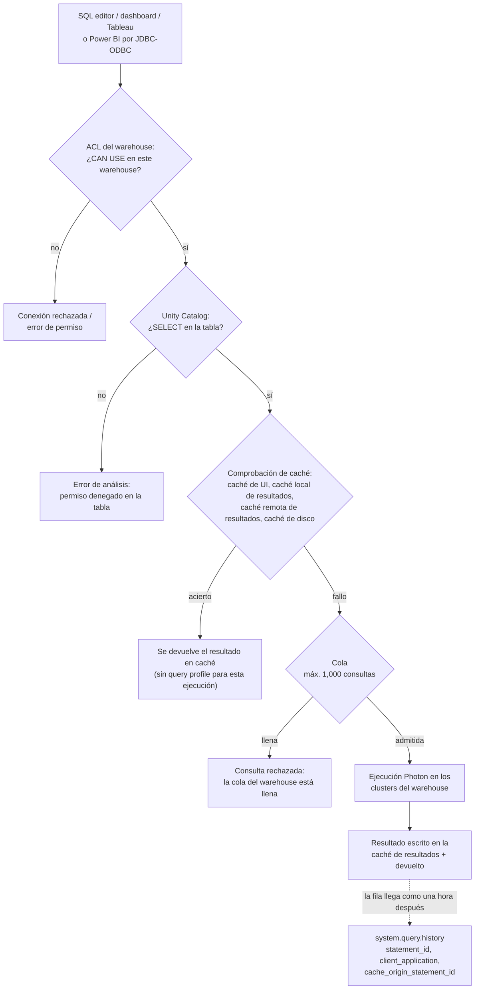
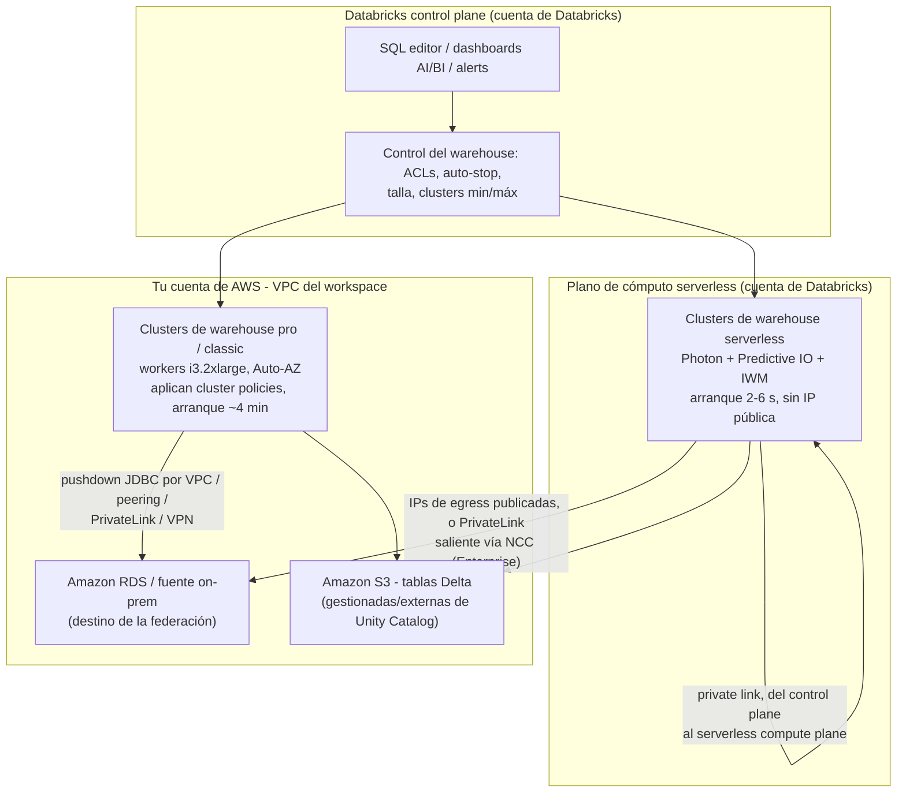
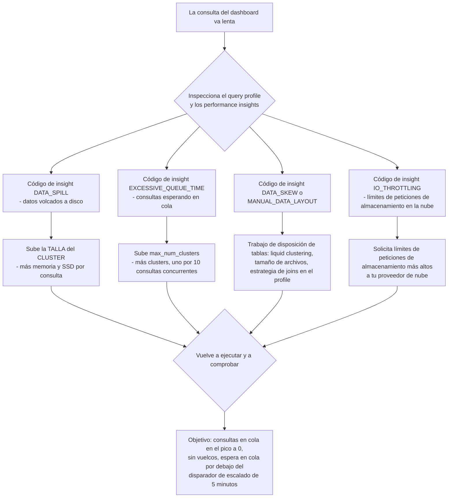
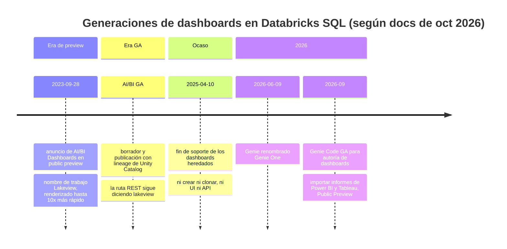
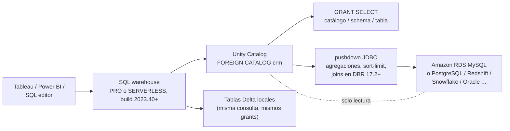

# SQL warehouses de Databricks y la capa de servicio: serverless, escalado, dashboards, BI y federación

Todo lo que hay aguas arriba en este curso termina igual: una tabla Delta, gobernada por Unity Catalog, que alguien tiene que *leer*. Los analistas la leen en un SQL editor, los directivos en un dashboard, Tableau la lee por ODBC y un pipeline de informes la lee a través de un catálogo federado. En Databricks toda esa lectura ocurre en una sola pieza de cómputo, el **SQL warehouse**, y la decisión que tomes sobre el tipo de warehouse, el tamaño, la ventana de auto-stop y el driver de BI es a la vez una decisión de latencia, una decisión de gobernanza y una factura.

Esta lección es esa decisión, resuelta de punta a punta. La columna vertebral es una distinción única que las docs de octubre de 2026 enuncian sin rodeos: **con un SQL warehouse pro o classic la capa de cómputo existe en tu cuenta de AWS; con un SQL warehouse serverless existe en la cuenta de Databricks** (docs.../compute/sql-warehouse/warehouse-types, última actualización **11 sep 2026**). Todo lo demás, arranques en frío de 2 a 6 segundos frente a unos cuatro minutos, cluster policies que dejan de aplicar, una VPC gestionada por el cliente que deja de importar, el pie de página de $0.70 "includes cloud instance cost", se deriva de esa única línea.

```text
 =============================================================
  MAPA DE LA LECCIÓN 08 - la capa de servicio de Databricks SQL, oct 2026
 ------------------------------------------------------------
  Tipos     serverless | pro | classic  (GA)
            + Lakehouse//RT (Beta, solo SELECT)
  Potencia  Photon en los tres . Predictive IO serverless+pro
            IWM solo serverless
  Ubicación serverless = cuenta de Databricks (sin IP pública)
            pro/classic = tu cuenta de AWS, VPC, workers i3
  Arranques serverless 2-6 s  .  pro/classic ~4 minutos
  Auto-stop 45/10 min pro-classic  .  10/5/1 min serverless
  Talla     1 cluster : 10 consultas concurrentes
            tope de cola 1,000 . max_num_clusters 40
  Tarifas   $0.22 classic . $0.55 pro . $0.70 serverless
            (lista US, AWS, instantánea 2026-10 - verifica
             contra system.billing.list_prices en tu cuenta)
  Servicio  SQL editor . dashboards AI/BI . alertas . herramientas BI
            foreign catalogs de Lakehouse Federation
 ------------------------------------------------------------
  Regla de la lección: el TIPO fija dónde vive el cómputo y qué
  funciones existen; la TALLA fija la potencia por consulta;
  el NÚMERO DE CLUSTERS fija la concurrencia; el auto-stop fija
  cuánto de la factura es aire.
 =============================================================
```

En esta lección vas a:

- leer la **línea de warehouses de oct 2026**, tres tipos GA más la Beta de Lakehouse//RT, y la matriz de capacidades que los separa (Photon, Predictive IO, Intelligent Workload Management);
- dibujar **dónde vive el cómputo** en AWS (cuenta de Databricks frente a tu VPC), incluida la historia del egress serverless y del PrivateLink saliente;
- resolver **siete ejemplos resueltos**: una **tabla de decisión de tipo de warehouse con la invocación de la API**, **cálculos de dimensionado de concurrencia**, un **cálculo de desperdicio por auto-stop**, un **paquete de consultas de monitoreo**, una **ficha de conexión BI para Tableau y Power BI**, una **secuencia de DDL de consulta federada** y un **boceto de coste mensual a dos columnas DBU + EC2 con tarifas de oct 2026**;
- dimensionar un warehouse del **síntoma al mando** usando el query profile y los códigos de performance insights;
- construir **dashboards AI/BI, consultas guardadas y alertas**, y saber exactamente qué pasó con los dashboards heredados;
- cablear herramientas de **Tableau, Power BI, Excel y Partner Connect** con los nombres de driver y los mínimos actuales;
- bocetar **Lakehouse Federation** con foreign catalogs, y nombrar el requisito que excluye en silencio a los warehouses classic;
- estudiar **NAB, Punchh y nCino** en AWS, leer el **recuadro de actualizaciones de 2026** y practicar con **doce preguntas** más cuatro comprobaciones interactivas.

---

## 1. Qué es Databricks SQL y las dos puertas que atraviesa cada consulta

### 1.1 Una interfaz, muchas superficies

Databricks SQL es "a cloud data warehouse built on lakehouse architecture. It runs directly on your data lake": un data warehouse en la nube construido sobre arquitectura lakehouse que corre directamente sobre tu data lake: con SQL ANSI y extensiones de Delta Lake (docs.../sql/, última actualización **11 sep 2026**). Las superficies documentadas: **SQL editor** (autoría asistida por IA, comentarios de código, historial de versiones), **notebooks** adjuntos a un warehouse, **jobs**, **dashboards**, **metric views**, **alerts**, **ETL** (streaming tables y materialized views definidas directamente desde SQL) y una **REST API**: más los monitores: historial de consultas, query profile y query performance insights.

La regla de cómputo que vale la pena memorizar: "Databricks uses SQL warehouses for compute in the following interfaces: **SQL editor · Databricks SQL queries · Dashboards · SQL alerts**" y, opcionalmente, notebooks, el file editor y Lakeflow Jobs (docs .../query, última actualización **11 sep 2026**). La misma página añade dos restricciones que dan forma a todo lo que sigue:

- "Cuando consultas datos con SQL warehouses, solo puedes usar **sintaxis SQL**.": al consultar datos con SQL warehouses solo puedes usar **sintaxis SQL**.
- "For workspaces that are enabled for Unity Catalog, **SQL warehouses always use Unity Catalog** to manage access to data sources.": en los workspaces con Unity Catalog habilitado, **los SQL warehouses usan siempre Unity Catalog** para gestionar el acceso a las fuentes de datos.

Y desde la página warehouse-types: "SQL warehouses do not support credential passthrough. Databricks recommends using Unity Catalog for data governance." No existe en un warehouse la vía de credencial por usuario: la gobernanza son grants de Unity Catalog, punto y final.

### 1.2 Las dos puertas

Toda consulta que pasa por un warehouse atraviesa dos comprobaciones independientes, y los estudiantes suelen confundirlas:

1. **El ACL del warehouse**, ¿puede este principal usar este *cómputo*? (`CAN USE` para ejecutar, `CAN MONITOR` para ver profiles, `CAN MANAGE` para reconfigurar, sección 9.)
2. **El grant de Unity Catalog**: ¿puede este principal leer esta *tabla*? (`SELECT` sobre catálogo/schema/tabla.)

Superar una no dice nada de la otra. Un usuario con `CAN USE` en el warehouse y sin `SELECT` en la tabla recibe un error de autorización; un usuario con `SELECT` y sin `CAN USE` ni siquiera llega al motor. Enseña las dos, siempre.



Ese diagrama es también el modelo mental del resto de la lección: las secciones 2 to 4 deciden *dónde está el cómputo y cuánto hay*, las secciones 5 to 6 deciden *qué ve el usuario*, las secciones 7 to 8 deciden *qué herramientas pueden hablar con él*, la sección 9 decide *quién puede*, y la sección 10 decide *cuánto cuesta*.

---

## 2. La línea de warehouses a oct 2026: serverless, pro, classic, y una Beta

### 2.1 Tres tipos GA, una Beta

"Databricks SQL supports **serverless, pro, and classic** types" y "Additionally, **Lakehouse Real-Time (Beta)** is a specialized serverless warehouse type for sub-second, high-concurrency read queries" que "supports (SELECT) queries only" (docs .../warehouse-types, última actualización **11 sep 2026**). La matriz de capacidades de la misma página:

| Capacidad | Serverless | Pro | Classic |
|---|---|---|---|
| Motor Photon | ✓ | ✓ | ✓ |
| Predictive IO | ✓ | ✓ |: |
| Intelligent Workload Management (IWM) | ✓ |, |, |
| Ubicación del cómputo | **cuenta de Databricks** | **tu cuenta de AWS** | **tu cuenta de AWS** |
| Arranque en frío | **2 to 6 segundos** | **~4 minutos** | **~4 minutos** |
| Tarifa de lista (US, AWS, instantánea 2026-10) | **$0.70/DBU** ("includes cloud instance cost") | **$0.55/DBU** | **$0.22/DBU** |

De la fila del medio se siguen tres consecuencias:

1. **Pro y classic heredan tu red de AWS.** Corren como EC2 en la VPC del workspace, eligen una availability zone mediante Auto-AZ y están gobernados por cluster policies, ajustes de spot y tu diseño de VPC/PrivateLink (la red del workspace de la lección 02).
2. **Serverless no.** "Customer-managed VPCs are not applicable to compute resources for serverless SQL warehouses", "**Cluster policies, including spot instance policies, are not supported**" y "serverless SQL warehouses do not have public IP addresses" (docs .../sql/admin/serverless, última actualización **10 jun 2026**).
3. **Classic es el valor por defecto de la API siendo el tipo menos capaz.** Usando la UI "the default SQL warehouse type is serverless"; usando la API de SQL warehouses con valores por defecto "the default SQL warehouse type is **classic**. To use serverless, set the `enable_serverless_compute` parameter to true and `warehouse_type` to pro." Los scripts de Terraform que omiten esa bandera crean en silencio el único tipo de warehouse que no puede federar, no puede crear materialized views ni streaming tables y no puede llamar a AI Functions.

### 2.2 Requisitos de serverless en AWS (léelos antes de prometerlo)

Desde docs .../sql/admin/serverless (última actualización **10 jun 2026**): la cuenta "must not be on a free trial"; el workspace "must be on the **Premium plan or above**"; "Serverless SQL warehouses are supported in **all AWS regions**"; el workspace "must not use S3 access policies" ni usar "an **external Hive legacy metastore**" (warehouse-types repite la cláusula del metastore: "If your workspace uses a legacy external Hive metastore, serverless SQL warehouses are not supported"). La identidad es Unity Catalog y la conectividad es privada: serverless "usa conectividad privada entre el plano de control de Databricks y el plano de cómputo serverless en casi todos los casos."

- **📚 ¿Sabías que…?** El egress de serverless hacia *tus* recursos es un problema distinto de la propia falta de IPs públicas de serverless. Para cualquier cosa fuera de Amazon S3 o DynamoDB de la misma región, "serverless compute uses **public IP addresses** to reach your resources", y desde **mediados de febrero de 2026** Databricks "publishes outbound IPs in JSON format on a public endpoint", tras el **25 may 2026** las listas IP heredadas quedaron retiradas (docs.../serverless-firewall, consultadas 2026-10). Para conectividad dedicada usas **PrivateLink saliente a través de una network connectivity configuration**: cada cuenta recibe hasta **10 NCC por región**, cada región **30 private endpoints** y cada NCC adjunta hasta **50 workspaces**, y esa vía necesita el **Enterprise plan** (docs.../pl-to-internal-network, consultadas 2026-10).

### 2.3 Dónde vive el cómputo, dibujado



El borde derecho es el que los estudiantes se pierden: **la federación desde un warehouse serverless hacia una base de datos privada aún tiene que recorrer una ruta de red**, y serverless trae consigo sus propias reglas de egress. Pro es la elección documentada cuando "tienes una red definida de forma personalizada y quieres conectarte a bases de datos de tu red" (warehouse-types, 11 sep 2026).

### 2.4 Ejemplo resuelto E1: la tabla de decisión de tipo de warehouse y la invocación de la API

**Entradas (tres bifurcaciones, todas específicas de AWS):**

1. ¿El workspace es elegible para serverless (Premium o superior, sin trial, sin metastore Hive externo heredado, sin S3 access policies)?
2. ¿Necesitas alcanzar una base de datos privada/on-prem para la federación, o imponer una red personalizada?
3. ¿Necesitas AI Functions, o materialized views / streaming tables creadas desde SQL?

| Bifurcación | Serverless | Pro | Classic |
|---|---|---|---|
| Elegible + sin necesidad de red privada | **✓ elección por defecto**: arranque 2 to 6 s, IWM, Predictive IO | Va, pero arranque de ~4 min y tú posees EC2 | Va a $0.22/DBU, pero mira la fila 5 |
| Necesidad de red personalizada / ruta de federación | aplican reglas de egress (IPs publicadas o PrivateLink saliente/Enterprise) | **✓ elección documentada**: cómputo en tu cuenta | ✗ federación no soportada |
| AI Functions (`ai_gen`, `ai_query`, `ai_summarise`) | ✓ | ✓ | **✗ "not available on Classic SQL warehouses"** (docs .../ai-functions, **9 oct 2026**) |
| `CREATE MATERIALIZED VIEW` / streaming table desde SQL | ✓ | **✓ "created using a Pro or Serverless SQL warehouse"** | ✗ |
| Más barato por DBU | $0.70 todo incluido | $0.55 + tu EC2 | **$0.22 + tu EC2** |

**El cuerpo de la API que te da serverless** (docs .../api/warehouses/v1/warehouse, consultadas 2026-10):

```text
POST /api/2.0/sql/warehouses
{
  "name": "bi-serverless-lg",
  "warehouse_type": "PRO",
  "enable_serverless_compute": true,
  "cluster_size": "Large",
  "min_num_clusters": 1,
  "max_num_clusters": 4,
  "auto_stop_minutes": 10,
  "tags": [{"key": "team", "value": "bi"}]
}
```

`warehouse_type` solo acepta `PRO` u `CLASSIC`; serverless es `PRO` **más** `enable_serverless_compute: true`. Omite la bandera y has construido un warehouse pro: que es un warehouse perfectamente bueno, solo que con un arranque en frío de cuatro minutos y una línea de EC2 en tu factura de AWS. Las tags están limitadas a **menos de 45 por warehouse** y existen, en las propias palabras de la API, "to monitor the cost of cloud resources used by users and groups."

---

## 3. Dimensionado: tallas de camiseta, la regla de concurrencia y los límites duros

### 3.1 La escalera de tamaños

Las tallas van de **2X-Small a 5X-Large**, y para classic/pro la escalera es concreta: "All workers use **i3.2xlarge** instances" (docs .../compute/sql-warehouse/warehouse-behavior, última actualización **8 oct 2026**).

| Tamaño | Workers (classic/pro) | Tipo de instancia del driver |
|---|---|---|
| 2X-Small | 1 | i3.2xlarge |
| X-Small | 2 | i3.2xlarge |
| Small | 4 | i3.4xlarge |
| Medium | 8 | i3.8xlarge |
| Large | 16 | i3.8xlarge |
| X-Large | 32 | i3.16xlarge |
| 2X-Large | 64 | i3.16xlarge |
| 3X-Large | 128 | i3.16xlarge |
| 4X-Large | 256 | i3.16xlarge |
| **5X-Large** | **512** | i3.16xlarge: **Public Preview** para pro y serverless |

Solo el driver escala, i3.2xlarge → i3.4xlarge → i3.8xlarge → i3.16xlarge, mientras que cada worker sigue siendo i3.2xlarge (misma página). Las docs advierten que la tabla "can vary based on product or region availability and workload"; lee `system.compute.warehouses` para saber la forma que realmente te tocó.

El valor por defecto al crear un warehouse en la UI es **X-Large**. La caché de disco vive en los SSD locales de esos workers (sección 6), y por eso la familia i3 optimizada para almacenamiento importa para el rendimiento de consultas, y por eso el precio del nodo i3 en AWS importa para el boceto de coste de la sección 10.

### 3.2 La concurrencia es un mando de *número de clusters*, no de tamaño

Reglas documentadas (warehouse-behavior 8 oct 2026; create 11 sep 2026):

- **"a cluster for every 10 concurrent queries"**: la regla de dimensionado, enunciada en ambas páginas.
- **"El número máximo de consultas en cola para todos los tipos de warehouse es 1,000."**
- Límites de la API: `max_num_clusters` **≤ 40**; `min_num_clusters` ≤ min(máx, **30**); mínimo por defecto **1**. Subir `min_num_clusters` "will ensure that a larger number of clusters are always running and therefore may **reduce the cold start time**": a un coste de facturación continua.
- Tope del workspace: **1,000 SQL warehouses** en total, fijo (docs .../resources/limits, **9 oct 2026**).
- **"Databricks recicla los clusters que llevan más de 24 horas en ejecución"** y puede terminarlos a la fuerza: así que ninguna consulta ni ninguna sesión de notebook adjunto debe dar por sentados clusters inmortales.

La regla de los dos mandos que arregla la mayoría de los dashboards: **la talla (tamaño del cluster) compra potencia por consulta; `max_num_clusters` compra concurrencia.** Vuelco a disco significa el primer mando; cola significa el segundo.

```plot
{
  "type": "bar",
  "title": "Tamaño del warehouse frente a concurrencia (escalera classic/pro, a 8 oct 2026): la talla añade workers, el número de clusters añade slots de consulta",
  "xLabel": "Tamaño del warehouse",
  "yLabel": "Workers por cluster / slots de consulta concurrentes",
  "xKey": "size",
  "dataKeys": ["workers_per_cluster", "query_slots_at_max_4_clusters"],
  "data": [
    {"size": "2X-Small", "workers_per_cluster": 1, "query_slots_at_max_4_clusters": 40},
    {"size": "X-Small", "workers_per_cluster": 2, "query_slots_at_max_4_clusters": 40},
    {"size": "Small", "workers_per_cluster": 4, "query_slots_at_max_4_clusters": 40},
    {"size": "Medium", "workers_per_cluster": 8, "query_slots_at_max_4_clusters": 40},
    {"size": "Large", "workers_per_cluster": 16, "query_slots_at_max_4_clusters": 40},
    {"size": "X-Large", "workers_per_cluster": 32, "query_slots_at_max_4_clusters": 40},
    {"size": "2X-Large", "workers_per_cluster": 64, "query_slots_at_max_4_clusters": 40},
    {"size": "3X-Large", "workers_per_cluster": 128, "query_slots_at_max_4_clusters": 40},
    {"size": "4X-Large", "workers_per_cluster": 256, "query_slots_at_max_4_clusters": 40},
    {"size": "5X-Large (Preview)", "workers_per_cluster": 512, "query_slots_at_max_4_clusters": 40}
  ]
}
```

La serie plana es la lección: con `max_num_clusters` fijado en 4 obtienes **4 × 10 = 40 slots de consulta concurrentes en cualquier talla**, desde un 2X-Small de 1 worker hasta un 5X-Large de 512 workers. Ir más ancho en el eje de tamaños multiplica la potencia por consulta (y el coste) sin admitir ni una consulta concurrente más; ir más ancho en `max_num_clusters` hace lo contrario. Los nombres de talla de warehouse son idénticos entre tipos, pero las tallas de serverless se facturan a una tarifa fija de DBU por hora que depende de la talla que elijas (docs answers, página fechada el **2026-08-27**).

### 3.3 Ejemplo resuelto E2: dimensionar 30 usuarios concurrentes de dashboard

**Escenario.** Un equipo de BI con **30 usuarios concurrentes de dashboard**, consulta media de 4 s, dashboards en marcha de 09:00 a 18:00, **21 días laborables al mes**.

```text
Paso 1  concurrencia -> clusters
        ratio documentado: 1 cluster por 10 consultas concurrentes
        clusters = ceil(30 / 10) = 3 clusters
        -> min_num_clusters 1 .. max_num_clusters >= 3 (la API admite hasta 40)

Paso 2  talla por cluster: Medium (8 workers) vs Large (16 workers)
        decide según el query profile, no según el organigrama:
        DATA_SPILL presente      -> sube la TALLA del cluster (memoria/SSD por consulta)
        domina el tiempo en cola -> sube max_num_clusters (concurrencia)
        ninguno de los dos, pero sigue lento -> ajusta operadores/joins en el profile

Paso 3  comprobación de fan-out (la trampa del dashboard)
        un dashboard de 20 widgets puede disparar 20 consultas casi simultáneas
        20 widgets x ~30 usuarios NO son 600: los widgets comparten la
        sesión del usuario, pero el estallido aterriza como decenas de
        consultas en cola
        -> dimensiona max_num_clusters para la PRIMERA reunión grande del día

Paso 4  latencia del autoscaler classic/pro (docs, 8 oct 2026)
        una consulta espera 5 minutos          -> el warehouse escala hacia arriba
        carga baja durante 15 min seguidos     -> escala hacia abajo al pico necesario
        carga 2-6 min -> +1 cluster, 6-12 -> +2, 12-22 -> +3,
        más de 22 min -> +3 más 1 por cada 15 minutos adicionales
        => el autoscaler NO salvará un estallido de 60 consultas en el minuto uno.

Paso 5  alternativa serverless
        empieza con UN warehouse MÁS GRANDE y deja que IWM gestione la concurrencia;
        "It is usually more efficient to size down if necessary than to
         start small and scale up" (warehouse-behavior, 8 oct 2026)
```

Respuesta: **tres clusters como mínimo** bajo el ratio documentado, con talla Medium o Large según la evidencia de vuelco, y `max_num_clusters` ajustado por adelantado al estallido del pico, y en serverless, un único warehouse más grande con IWM en lugar de ajustar a mano tres clusters.

### 3.4 Síntoma → mando



Dos límites duros se esconden detrás de ese árbol: la cola admite como máximo **1,000 consultas**, y el profile de un resultado **en caché** no existe (sección 6): así que para medir hay que derrotar primero la caché, o el árbol se verá más limpio de lo que es.

---

## 4. Escalado, auto-stop y economía del arranque en frío

### 4.1 Dos modelos de escalado, no uno

Dos modelos de escalado documentados: uno por familia de warehouse:

- **Classic y pro: clusters min/máx más autoscaling según carga**, con las bandas de carga citadas en E2 (añade clusters tras 2 to 6, 6 to 12, 12 to 22 minutos de carga; escala hacia arriba cuando una consulta espera **5 minutos**; escala hacia abajo tras **15 minutos seguidos** de carga baja). Las availability zones se resuelven con **Auto-AZ**.
- **Serverless: Intelligent Workload Management.** "IWM uses **machine learning models** to dynamically manage compute resources"; cuando falta capacidad "the query is placed in a queue", y "if wait times increase, the autoscaler quickly provisions more clusters" (warehouse-behavior, 8 oct 2026). IWM es exclusivo de serverless: pro y classic reciben Photon y Predictive IO pero no IWM.

### 4.2 Auto-stop: la optimización más barata de este curso

| Tipo de warehouse | Auto-stop por defecto | Mínimo | Fuente (fecha) |
|---|---|---|---|
| Pro y classic | **45 minutos** | **10 minutos** | docs .../sql-warehouse/create (**11 sep 2026**) |
| Serverless | **10 minutos** | **5 minutos** (UI) · **1 minuto** (API) | igual |

Y la frase del dinero, literal: "**Idle SQL warehouses continue to accumulate DBU and cloud instance charges until they are stopped.**" (misma página). Un warehouse factura mientras está *encendido*: no mientras está ocupado.

> ⚠️ **ADVERTENCIA, un valor por defecto de auto-stop es una decisión de facturación que heredas.** El valor por defecto de 45 minutos de pro/classic está elegido por comodidad, no por economía: cualquier hueco más corto que 45 minutos mantiene un warehouse (y sus instancias EC2, en *tu* cuenta de AWS) facturable. Al contrario, un warehouse serverless con su **mínimo de 1 minuto** por API se detendrá entre dos refrescos de dashboard de un usuario, barato, y a solo un reinicio de **2 to 6 segundos**. En un warehouse **pro/classic** ese mismo reinicio es de **~4 minutos**, que los usuarios leen como una caída del servicio. Ajusta el auto-stop al comportamiento del cliente: extracts y refrescos programados → auto-stop más largo o `min_num_clusters = 1`; humanos interactivos sobre serverless → auto-stop corto. Y nunca pongas el auto-stop en "never": la frase de cargo por inactividad de las docs es incondicional.

### 4.3 Ejemplo resuelto E3: lo que cuesta al mes un valor por defecto de auto-stop

**Escenario (supuestos declarados: vuelve a ejecutarlo con tu propio tráfico):** un warehouse pro que sirve dashboards con tráfico real solo en dos estallidos: **09:00 to 10:00 y 14:00 to 15:00**: durante **21 días laborables**.

```text
Tráfico útil        2 h/día x 21 días              =  42.0 h/mes

Auto-stop 45 min (el valor por defecto de pro/classic)
  sesión de mañana  09:00 -> 10:00 + 45 min         =  1.75 h/día
  sesión de tarde   14:00 -> 15:00 + 45 min         =  1.75 h/día
  horas encendido   3.50 h/día x 21                 =  73.5 h/mes
  desperdicio       73.5 - 42.0                     =  31.5 h/mes

Auto-stop 10 min (el mínimo documentado de pro/classic)
  sesión de mañana  09:00 -> 10:10                  =  1.167 h/día
  sesión de tarde   14:00 -> 15:10                  =  1.167 h/día
  horas encendido   2.333 h/día x 21                =  49.0 h/mes
  desperdicio       49.0 - 42.0                     =   7.0 h/mes

Horas recuperadas con un cambio de ajuste = 73.5 - 49.0 = 24.5 h/mes
A la forma ilustrativa de 2X-Small (4 DBU/h, 2 x i3.2xlarge):
  columna DBU      24.5 h x 4 DBU/h x $0.22  = $ 21.56
  columna AWS      24.5 h x 2 x $0.624/h     = $ 30.58
  ahorro en UN warehouse                 = $ 52.14/mes
  x 20 warehouses en un workspace          ~ $ 1,043/mes
```

Tarifas: SQL Classic **$0.22/DBU** (instantánea de página **2026-10**) y AWS us-east-1 bajo demanda **i3.2xlarge $0.624/h** (lista de precios de AWS EC2, leída el **2026-10-12**). La emisión de **4 DBU/h** es una cifra *ilustrativa* por talla: la página de precios publica **$/DBU únicamente**, así que lee tu propia DBU/hora por talla desde `system.billing.list_prices` (sección 10). El argumento sobrevive a la sustitución: **veinte minutos de auto-stop innecesario en veinte warehouses eclipsan cualquier cambio de nivel de talla.**

- **📚 ¿Sabías que…?** El auto-stop es solo la mitad de la historia de la inactividad. Subir `min_num_clusters` "reduce el tiempo de arranque en frío de consultas nuevas" (Warehouses API, consultadas 2026-10) pero mantiene clusters facturables calientes las 24 horas: mientras que en serverless el arranque en frío ya es de **2 to 6 segundos**, así que `min_num_clusters > 1` rara vez compensa pagarlo. Y porque "Databricks recicla los clusters que llevan más de 24 horas en ejecución", un warehouse que nunca se queda inactivo aún ve reciclados sus clusters, con posible terminación forzada de trabajos largos (docs.../sql-warehouse/create, 11 sep 2026).

---

## 5. Consultas, dashboards y alertas: el banco de trabajo de DBSQL

### 5.1 Las consultas guardadas tienen sus propios permisos

El SQL editor se entrega con asistencia de IA, comentarios de código e historial de versiones (docs .../sql/, 11 sep 2026). Las consultas guardadas son securables en su propio derecho (docs .../sql/user/queries, última actualización **29 abr 2026**):

- compartir una consulta requiere **`CAN MANAGE`** sobre esa consulta;
- dos modos de credencial: **"Run as viewer"**, "La credencial del visor se usa para ejecutar la consulta; el visor también debe tener al menos permisos **CAN USE** sobre el warehouse", frente a **"Run as owner"**;
- "A Databricks workspace admin user has view access to all queries in the workspace."

La UI del historial de consultas conserva **30 días** de historial; ves tus propias consultas como owner, o las de otros si tienes al menos `CAN VIEW` sobre el warehouse que las ejecutó. Cualquier cosa de vida más larga va a `system.query.history` (sección 6).

### 5.2 Dashboards AI/BI: la generación Lakeview, hoy la única generación

"AI/BI dashboards feature AI-assisted authoring, an enhanced visualization library, and a streamlined configuration experience" (docs .../dashboards, última actualización **11 sep 2026**). El conjunto de capacidades documentado: datasets y visualizaciones; filtros a nivel global/página/widget con **cross-filtering** y **drill-through**; cálculos personalizados; borrador/publicación; **"Una vez publicados, tus dashboards pueden compartirse con cualquier persona registrada en tu cuenta de Databricks, aunque no tenga acceso al workspace"**; **incrustación por iframe**; programación y suscripción por correo o Slack; **integración Git / source control**; **Declarative Automation Bundles**; APIs REST; programación como **Lakeflow Job**; agentes Genie; monitoreo de uso mediante audit logs y system tables; y lineage de Unity Catalog incorporado.

**Los dashboards heredados ya no existen.** "End of support for legacy dashboards: **April 10, 2025**. You can no longer create or clone legacy dashboards using the UI or API" (docs.../ai-bi/release-notes/2025); la documentación heredada está retirada, y el endpoint de migración `POST /api/2.0/lakeview/dashboards/migrate` está marcado como **Deprecated** con la nota "Use Lakeview (AI/BI) dashboards instead" (referencia de la API Lakeview, consultadas 2026-10).



- **📚 ¿Sabías que…?** El nombre que ves en la API es un fósil. Los dashboards AI/BI "antes se llamaban dashboards Lakeview. La API de Lakeview aún conserva ese nombre": así que toda llamada create/list/publish sigue siendo `/api/2.0/lakeview/dashboards/*` aunque la UI diga AI/BI (docs.../dashboards, 11 sep 2026; referencia de la REST API, consultadas 2026-10). Cualquier script, resource de Terraform o tutorial que hable de "migrating to Lakeview" está escribiendo historia de 2023 to 2024: el endpoint de migración está obsoleto y los dashboards heredados no pueden crearse en absoluto desde el **2025-04-10**.

### 5.3 Alertas

"Use Databricks SQL alerts to periodically run queries, evaluate defined conditions, and send notifications if a condition is met" (docs.../sql/user/alerts, página fechada el **28 jul 2026**). Desde mayo de 2025 el editor está consolidado, configuración de la consulta, condiciones, programaciones y destinos de notificación en una sola interfaz, y las alertas heredadas siguen funcionando junto a él (notas de lanzamiento, mayo de 2025). Las alertas son la mitad de cierre del bucle de monitoreo: adjunta una a la consulta de higiene de la flota del E4 y un warehouse cuyo auto-stop se pasa de 30 minutos avisa a alguien en lugar de facturar en silencio.

---

## 6. Caché, query profile y system tables

### 6.1 Cuatro cachés, cuatro vidas

| Caché | Ámbito | Vida | Trampa |
|---|---|---|---|
| **Caché de UI de Databricks SQL** | por usuario | **7 días como máximo** | "does not apply to AI/BI dashboards" |
| **Caché local de resultados** | por cluster | vida del cluster | muere cuando el warehouse se detiene |
| **Caché remota de resultados** | todo el workspace | sobrevive a parada/arranque | **exclusiva de serverless**; alcanzable desde ODBC/JDBC y la SQL Statement API |
| **Caché de disco** | SSD local del worker | invalidada al cambiar el archivo | **≤ la mitad** del SSD local del worker; `CACHE SELECT` se **ignora** en SQL warehouses y DBR 14.2+ |

(docs.../queries/query-caching y.../optimizations/disk-cache, consultadas 2026-10). Para medir con honestidad: `SET use_cached_result = false;`: documentado como apropiado "only in testing or benchmarking". Las consultas deterministas aciertan en caché; un predicado estilo `NOW()` las derrota y entonces pagas precio completo en cada ejecución.

### 6.2 El profile, los insights y sus significados

- **Query profile**: debes ser el **owner de la consulta** o tener al menos **`CAN MONITOR`** en el warehouse; "El profile de consulta **no está disponible para las consultas que se ejecutan desde la caché de consultas**. Para rodear la caché de consultas, haz un cambio trivial en la consulta, como modificar o quitar el LIMIT" (docs.../query-profile, 10 jun 2026).
- **Query performance insights**: recomendaciones con código (docs.../performance-insights, 11 sep 2026): `DATA_SPILL` → "Increase the warehouse size to add memory"; `EXCESSIVE_QUEUE_TIME` → "Increase the **maximum number of clusters**"; `IO_THROTTLING` → solicita límites de peticiones de almacenamiento más altos; más `DATA_SKEW`, `MANUAL_DATA_LAYOUT` y las aceleraciones aplicadas `AUTO_LIQUID_CLUSTERING`, `HISTORY_BASED_JOIN_STRATEGY`, `SHORT_QUERY_PRIORITIZATION`.
- **System tables**: la misma historia que los datos: `system.query.history` (Public Preview, **365 días**, regional, registros "typically available **within one hour**"), `system.compute.warehouses` (instantáneas de configuración), `system.compute.warehouse_events` (eventos de arranque/parada/escalado), `system.billing.usage` y `system.billing.list_prices` (el registro de precios, retención indefinida, global).

Nota de acceso sobre `system.query.history`: "By default, **only admins** have access to the system table… Databricks recommends creating a **dynamic view** for each user or group" (docs .../system-tables/query-history, página fechada el **21 sep 2026**). Su columna `client_application` es la que te dice si una consulta vino del "Databricks SQL Editor, Tableau, and Power BI", y `cache_origin_statement_id` es la forma de probar que un resultado vino de la caché.

### 6.3 Ejemplo resuelto E4: un paquete de monitoreo para la flota de warehouses

```sql
-- (a) fleet hygiene: warehouses that idle-expire late
SELECT warehouse_name, warehouse_type, warehouse_size,
       min_clusters, max_clusters, auto_stop_minutes
FROM   system.compute.warehouses
WHERE  delete_time IS NULL AND auto_stop_minutes > 30;

-- (b) who is actually using which warehouse (about 1-hour latency)
SELECT w.warehouse_name, q.client_application,
       COUNT(*) AS queries, SUM(q.total_duration_ms)/1000 AS seconds
FROM   system.query.history q
JOIN   system.compute.warehouses w ON w.warehouse_id = q.warehouse_id
WHERE  q.execution_status = 'FINISHED'
GROUP  BY 1, 2 ORDER BY queries DESC;

-- (c) cache effectiveness: rows whose statement differs from the origin
SELECT COUNTIF(cache_origin_statement_id <> statement_id) / COUNT(*) AS hit_rate
FROM   system.query.history
WHERE  warehouse_id = 'abc123';

-- (d) cost: DBU spend by SKU for the month
SELECT sku, usage_type, product_feature,
       SUM(metered_quantity) AS dbus, SUM(unblended_cost) AS cost
FROM   system.billing.usage
WHERE  billing_month = date_format(current_date, 'yyyy-MM')
GROUP  BY 1, 2, 3 ORDER BY cost DESC;
```

Fuentes: página de monitoring-queries (docs.../sql-warehouse/monitor/queries, **11 sep 2026**), referencia de query-history (**21 sep 2026**), system tables de facturación (actualizadas el **2026-10-08**). La consulta (a) es la que hay que cablear a una alerta; la consulta (d) es la que hay que publicar en un dashboard AI/BI: Databricks entrega consultas de coste listas y un Usage Dashboard prefabricado exactamente para esto (docs.../admin/usage/system-tables, 11 sep 2026).

---

## 7. Conectividad BI: primero los drivers, después las herramientas

### 7.1 El estado de los drivers a oct 2026

| Línea de driver | Versión actual (oct 2026) | Estado |
|---|---|---|
| **Databricks JDBC Driver** (código abierto) | **3.4.3** | actual; "Databricks supports each driver version for at least **2 years**" |
| Simba JDBC | 2.8.3 (2026-07-20) | heredado: migra |
| **Databricks ODBC Driver** | **2.12.1** (2026-08-06) | actual |
| Simba Spark ODBC | última entrada 2.10.0 (2026-02-26) | **"The Simba Spark ODBC Driver is deprecated."** |

(docs .../integrations/odbc/download, espejo de página fechado el **11 sep 2026**; páginas de descarga y de archivo de drivers, consultadas 2026-10). El renombramiento de febrero de 2026 importa operativamente: "A partir de febrero de 2026, Databricks publica nuevas versiones del driver ODBC y el driver pasó a llamarse Databricks ODBC Driver." Rutas de instalación: Windows `C:\Program Files\Databricks ODBC Driver`, macOS `/Library/databricks/databricksodbc`, Linux `/opt/databricks/databricksodbc`. Algunas herramientas empaquetan el driver (versiones recientes de Power BI Desktop); Tableau Desktop no.

El denominador común en todas las herramientas: conexión = **Server Hostname + HTTP Path de un SQL warehouse**; autenticación = OAuth / acceso de Databricks / personal access token / service principal. **La autenticación por usuario y contraseña está muerta**: la propia ayuda de Tableau registra que "Basic authentication using a Databricks user name and password reached end of life as of **July 2024**."

### 7.2 La matriz de herramientas

| Herramienta | Mínimos (docs, 2026) | Notas |
|---|---|---|
| **Tableau** | Tableau Desktop **2021.4+**, Databricks ODBC **2.6.19+** (página fechada el **22 jul 2026**) | Server Hostname + HTTP Path; módulo de Partner Connect; auth: acceso de Databricks (recomendado), PAT, service principal |
| **Power BI** | las consultas SQL nativas necesitan **Power BI v2.112.603.0+**; **ADBC u ODBC** (página fechada el **20 ago 2026**) | "**Databricks SQL warehouses are recommended when using Power BI in DirectQuery mode**"; ADBC **obligatorio para Lakehouse//RT**; service principals OAuth M2M, SSO con Microsoft Entra ID, publicación al servicio |
| **Excel** | Databricks Excel Add-in, Public Preview (páginas fechadas el **11 sep / 6 ago 2026**) | un admin del workspace debe **habilitar la preview del Excel Connector**; **solo SSO**; necesita `CAN USE` en un warehouse; puede escribir de vuelta en una tabla de Unity Catalog y usar Genie |
| **Módulos de Partner Connect** |: | **Hex, Power BI, Preset, Qlik Sense, Sigma, Tableau, ThoughtSpot** (docs.../partner-connect/bi) |

- **📚 ¿Sabías que…?** Las versiones de driver son un compromiso de *soporte*, no solo una lista de descargas: "Databricks supports each driver version for at least **2 years**" (página de descarga de drivers, consultada 2026-10). El archivo también lleva una advertencia que vale la pena leer una vez: las versiones de Simba JDBC anteriores a **2.6.21** dependen de una librería con **CVE-2021-44228** (Log4Shell): una razón concreta por la que las docs "strongly recommend migrating" fuera de las líneas Simba.

### 7.3 Ejemplo resuelto E5: ficha de conexión BI (especificación para copiar y pegar)

**Tableau Desktop → un SQL warehouse serverless**

```text
Servidor      : dbc-01234567890abcdef0123.cloud.databricks.com   (puerto 443)
Ruta HTTP     : /sql/1.0/warehouses/a1b2c3d4e5f67890              (ruta HTTP del warehouse)
Driver        : Databricks ODBC Driver 2.12.1  (>= 2.6.19 requerido)
Autenticación : OAuth / acceso de Databricks  (usuario+contraseña EOL julio 2024)
Catálogo      : main            Schema: analytics
Mínimos       : Tableau Desktop 2021.4+
Acceso        : Marketplace -> Partner Connect -> módulo de Tableau
                (descarga un archivo de conexión; necesita CAN USE en el warehouse)
```

**Power BI → el mismo warehouse**

```text
Conector        : Databricks (driver ADBC compatible; ADBC REQUERIDO para Lakehouse//RT)
Modo            : Import para actualizaciones programadas; DirectQuery -> se recomienda SQL warehouse
SQL nativo      : Power BI v2.112.603.0 o superior
Auth de servicio: M2M OAuth con un service principal registrado en Unity Catalog
SSO             : Microsoft Entra ID
Metric views    : modo de compatibilidad de BI, o MEASURE() dentro de una consulta nativa
Trampa          : un warehouse detenido da error en cada cliente hasta que alguien con
                  CAN MONITOR (o el owner) lo arranque de nuevo
```

Ambas fichas asumen las dos puertas de la sección 1: `CAN USE` en el warehouse para la identidad de la *herramienta*, `SELECT` en las tablas subyacentes para esa misma identidad (un service principal necesita las dos). Añade el `auto_stop_minutes` del warehouse a la ficha: un extract programado cada 15 minutos contra un warehouse serverless con auto-stop de 10 minutos pagará un reinicio de 2 to 6 segundos cada vez, mientras que el mismo programa contra un warehouse pro paga ~4 minutos.

---

## 8. Lakehouse Federation: consultar otros sistemas desde Databricks SQL

### 8.1 Qué es

"**Lakehouse Federation** is the Databricks query federation platform. It provides governed, **read-only** access to external data through Unity Catalog foreign catalogs, with automatic query pushdown and fine-grained access controls at the table level" (docs .../query-federation, última actualización **29 sep 2026**). Dos sabores:

- **query federation**: con pushdown hacia la base de datos externa por **JDBC**; "La consulta se ejecuta en Databricks y en el cómputo remoto… **No soportado (solo lectura)**" para escrituras;
- **catalog federation**: "Runs directly against object storage on Databricks compute only. More cost-effective and performance-optimized."

**Listas de fuentes verificadas (oct 2026).** Query federation: MySQL, PostgreSQL, Teradata, Oracle, Amazon Redshift, Salesforce Data 360, Snowflake, Microsoft SQL Server, Azure Synapse, Google BigQuery, Databricks. Catalog federation: metastore Hive heredado de Databricks, external Hive metastore, **AWS Glue metastore**, Salesforce Data 360, Snowflake, Palantir Foundry, Workday Data Connect, Google Cloud Lakehouse.

### 8.2 El requisito que excluye a los warehouses classic

Desde las páginas de federación de MySQL y SQL Server (**19 ago / 11 sep 2026**): "Databricks compute must use Databricks Runtime **13.3 LTS or above** and **Standard or Dedicated access mode**"; "**los SQL warehouses deben ser pro o serverless y usar 2023.40 o superior**"; el workspace debe tener Unity Catalog habilitado (los workspaces creados después del **8 nov 2023** lo tienen). MySQL además requiere **SSL**. El pushdown es desigual por diseño: agregaciones, aritmética, booleanos/bit a bit y orden con límite hacen pushdown en 13.3 LTS+; **los joins necesitan DBR 17.2+** (en MySQL: un toggle en Public Preview); **las funciones de ventana no están soportadas en MySQL**. Y cuando existen las dos vías, "When your source supports both Lakehouse Federation and Lakeflow Connect, Databricks recommends **Lakeflow Connect** if performance on higher data volumes and lower latency are priorities."

> [!IMPORTANT]
> **Los warehouses classic no pueden federar.** La federación necesita warehouses "pro or serverless" en build **2023.40+**, y las mismas tres carencias se repiten: classic no puede federar, no puede crear materialized views / streaming tables desde SQL y no puede ejecutar AI Functions. Porque **la API de SQL warehouses usa classic por defecto**, cada módulo de Terraform o script que olvida `enable_serverless_compute: true` (o `warehouse_type: PRO` para un warehouse pro) crea exactamente el tipo de warehouse que falla en las tres. Audita la flota con `SELECT warehouse_name, warehouse_type FROM system.compute.warehouses WHERE warehouse_type = 'CLASSIC'`.

### 8.3 Ejemplo resuelto E6: consulta federada, MySQL en RDS → Databricks SQL

```sql
-- 1) connection: credentials come from a secret scope, never inline
CREATE CONNECTION mysql_crm TYPE MYSQL
  OPTIONS (host 'crm-cluster.abc.us-east-1.rds.amazonaws.com', port '3306',
           user     secret('crm.secrets', 'user'),
           password secret('crm.secrets', 'pass'));

-- 2) foreign catalog mirrors the remote database under Unity Catalog
CREATE FOREIGN CATALOG crm USING CONNECTION mysql_crm;

-- 3) governance is ordinary UC: catalog/schema/table level grants
GRANT SELECT ON CATALOG crm TO `data-analysts`;

-- 4) federated query: JDBC pushdown runs on BOTH the warehouse and MySQL
SELECT c.region, COUNT(*) AS orders, SUM(o.amount) AS revenue
FROM   crm.shop.customers c
JOIN   local_bronze.orders o ON o.customer_id = c.id   -- local Delta join
GROUP  BY c.region
ORDER  BY revenue DESC
LIMIT  20;
```

La referencia del lenguaje (docs.../sql-ref-federated-queries, fechada el **29 jun 2026**) lo plantea como exactamente tres prerequisitos: crear una **foreign connection**, registrar **foreign catalogs**, conceder acceso, y advierte que aplica a "Databricks SQL · Databricks Runtime 13.3 LTS and above · **Unity Catalog only**". El join del paso 4 es la mitad interesante: Delta local unido a MySQL remoto, con el lado remoto empujado por JDBC y gobernado por los mismos grants que tus tablas nativas. Es de **solo lectura**, **no** sustituye a un ETL a volumen, y la ruta de red de tu warehouse hasta RDS la construyes tú (peering de VPC, PrivateLink o VPN: sección 2.3).



---

## 9. Quién puede tocar el warehouse: ACLs, entitlements y el patrón de grupos

Permisos de warehouse, desde la matriz de ACLs (docs .../access-control, última actualización **10 jul 2026**) y la página de creación de warehouse (**11 sep 2026**):

| Permiso | Qué concede |
|---|---|
| **CAN VIEW** | ver detalles del warehouse y sus consultas; no ejecutar (el nivel de solo lectura de la UI; la Permissions API lo llama `CAN READ`) |
| **CAN MONITOR** | ejecutar consultas **y** ver monitoreo, historial de consultas y **profiles**: el nivel del que depende el acceso a profiles |
| **CAN USE** | ejecutar consultas |
| **IS OWNER** | se aplica automáticamente al creador del warehouse; lleva los derechos de parar, borrar y modificar permisos (los mismos derechos de parar/borrar que `CAN MANAGE`) más la propiedad del objeto |
| **CAN MANAGE** | parar, borrar, editar configuración, modificar permisos; **los admins del workspace lo tienen en todos los objetos** |

Por encima de todo eso hay dos entitlements: el entitlement **`databricks-sql-access`** decide quién puede usar Databricks SQL en absoluto, y crear warehouses necesita admin del workspace **o** el entitlement **`Allow unrestricted cluster creation`**: "La mayoría de los usuarios no pueden crear SQL warehouses, pero pueden reiniciar cualquier SQL warehouse al que puedan conectarse." Los warehouses borrados pueden restaurarlos desde soporte **dentro de 14 días**.

El patrón de delegación que hay que enseñar: `data-analysts` → `CAN USE` en el warehouse de BI más `SELECT` en los schemas gold; `bi-viewers` → `CAN VIEW`; `data-engineers` → `CAN MANAGE` en el warehouse de plataforma y su auto-stop; service principals para Power BI/Tableau → `CAN USE` más `SELECT`. Grupos, no individuos: de lo contrario el `CAN MANAGE` generalizado de los admins del workspace se convierte en el único modelo que funciona, y con él llega la dispersión de administración.

---

## 10. Lo que cuesta: tarifas, medidores y la factura a dos columnas

### 10.1 Las tarifas (lista US, AWS, instantánea de página 2026-10)

| SKU | Tarifa | ¿Incluye la máquina? |
|---|---|---|
| SQL Classic | **$0.22 / DBU** | la página de precios no declara la inclusión de la instancia; la frase de auto-stop factura "DBU **and cloud instance charges**" |
| SQL Pro | **$0.55 / DBU** | igual |
| SQL Serverless | **$0.70 / DBU** | **sí**: pie de página "Includes cloud instance cost" |
| Lakehouse//RT (Beta) | **$0.55 / DBU** | producto en Beta (instantánea de página 2026-10) |

Salvedades que tienes que imprimir junto a cualquier número: "Databricks prices and Cloud Infrastructure prices may vary based on geographic region and cloud service provider" (FAQ de precios, 2026-10); las tarifas serverless siguen a la infraestructura regional mientras que las de classic son planas en todas las regiones de AWS porque pagas el precio local de EC2 (una lectura secundaria del archivo de datos de la página de precios informó de **$0.91/DBU** para SQL Serverless en eu-central-1 frente a $0.70 en us-east-1, 2026-08-07: verifícalo en tu cuenta); **los refresh de materialized views y streaming tables se facturan con las tarifas DLT serverless**, no con la tarifa de tu warehouse (pie de página 3 de la página de precios, 2026-10); la inferencia de AI Functions se factura aparte bajo `MODEL_SERVING` / `AI_FUNCTIONS` (docs.../ai-functions, 9 oct 2026). El número autoritativo siempre es el tuyo: `system.billing.list_prices` (retención indefinida, global) unido a `system.billing.usage`.

### 10.2 Ejemplo resuelto E7: un boceto de coste mensual a dos columnas

**Supuestos declarados:** un warehouse **2X-Small** (driver + 1 worker = **2 × i3.2xlarge**), encendido **193 h/mes** (≈9.2 h/día × 21 días laborables de BI en horario de oficina), emisión ilustrativa **4 DBU/h**, AWS us-east-1 bajo demanda **i3.2xlarge $0.624/h** (lista de precios de AWS, leída el **2026-10-12**), tarifas a **2026-10**.

```text
DBU consumidas   193 h x 4 DBU/h                       =  772 DBU
columna AWS      193 h x 2 nodos x $0.624/h            = $240.86 / mes

(A) SQL Classic  $0.22/DBU
    DBU  772 x 0.22 = $169.84   + AWS $240.86  =  $410.70 / mes
(B) SQL Pro      $0.55/DBU
    DBU  772 x 0.55 = $424.60   + AWS $240.86  =  $665.46 / mes
(C) SQL Serverless $0.70/DBU ("Includes cloud instance cost")
    DBU  772 x 0.70 = $540.40   + AWS   $0.00  =  $540.40 / mes

Sensibilidad: +50 h inactivas/mes (deriva de auto-stop) en (A)
    DBU  50 x 4 x 0.22 = $44.00  + AWS 50 x 1.248 = $62.40
    total añadido                    = $106.40 / mes
    -> la deriva cuesta más que un nivel entero de talla en esta forma
```

Léelo como tres lecciones, no como una clasificación. **(A) solo es la más barata si aceptas** un arranque en frío de ~4 minutos, sin Predictive IO, sin federación, sin AI Functions y sin creación de materialized views. **(C) gana a (B) aquí** porque con esta forma ligera y estable la columna de EC2 del warehouse pro ($240.86) supera todo el premium serverless ($540.40 − $424.60 = $115.80). Y **la línea de sensibilidad de (A) es el verdadero titular**: las horas inactivas dominan, no las tarifas de lista: que es la aritmética del auto-stop de la sección 4 apareciendo de nuevo en la factura. La cifra de **4 DBU/h** es una emisión ilustrativa por talla; la página de precios publica **$/DBU únicamente**, así que saca tu propia emisión por talla de `system.billing.list_prices` para tu contrato antes de citarle un número a nadie.

---

## 11. Las trampas: catorce confusiones que esta lección no te deja conservar

1. **"Serverless corre en mi VPC."** Corre en la cuenta de Databricks: "las VPCs gestionadas por el cliente no son aplicables", sin cluster policies, sin IPs públicas.
2. **"La API crea el mismo warehouse que la UI."** Defecto de la UI = **serverless**; defecto de la API = **classic** salvo que `enable_serverless_compute` sea true y `warehouse_type` sea `PRO`.
3. **"Classic es la opción económica."** También es la opción que **no puede federar, no puede crear MVs/STs y no puede ejecutar AI Functions**.
4. **"Un tamaño más grande significa más consultas concurrentes."** La concurrencia es `max_num_clusters` × 10; la talla es potencia por consulta. Vuelco → talla; cola → clusters.
5. **"El autoscaler se encarga del estallido de las 9."** Classic/pro escalan hacia arriba solo después de que una consulta espere **5 minutos**; el tope de cola es **1,000**.
6. **"Auto-stop de 45 minutos es inofensivo."** "Idle SQL warehouses continue to accumulate DBU and cloud instance charges until they are stopped."
7. **"El auto-stop de serverless puede ser cero."** Mínimo **5 min** en la UI, **1 min** por API; el mínimo de pro/classic es **10 min**.
8. **"Conseguí un query profile, así que entiendo la ejecución."** No existe profile para un resultado **en caché**: cambia el `LIMIT`.
9. **"Caché es caché."** Caché de UI (≤7 días, no AI/BI) ≠ caché local de resultados (muere con el cluster) ≠ caché remota de resultados (solo serverless, sobrevive a la parada) ≠ caché de disco (archivos, ≤50% del SSD).
10. **"Los dashboards heredados siguen funcionando."** Fin de soporte **2025-04-10**: ni crear, ni clonar, endpoint de migración obsoleto.
11. **"Lakeview es un producto distinto de AI/BI."** Mismo producto, nombre de preview de 2023 retenido en la ruta REST `/api/2.0/lakeview/dashboards`.
12. **"La autenticación por contraseña funciona con Tableau."** La auth básica "reached end of life as of **July 2024**"; y la línea Simba ODBC está obsoleta desde el renombramiento de **febrero de 2026**.
13. **"La federación me deja escribir de vuelta."** Solo lectura, pushdown JDBC con soporte desigual; usa **Lakeflow Connect** cuando importen volumen y latencia.
14. **"La tarifa de $0.70 es toda la factura serverless."** Los refresh de MV se facturan con tarifas **DLT serverless**, la inferencia de IA bajo `MODEL_SERVING`/`AI_FUNCTIONS`, y la red hacia tu VPC puede llevar sus propios cargos.

---

> **Veredicto comparativo: SQL warehouse classic frente a pro frente a serverless (AWS, a oct 2026)**
> - **Classic, $0.22/DBU más cargos de instancia en la nube, arranque de ~4 minutos.** El valor por defecto de la API y el suelo de la línea: solo Photon, sin Predictive IO, sin IWM. **No puede federar, no puede crear materialized views ni streaming tables desde SQL, no puede ejecutar AI Functions.** Corre en tu VPC con cluster policies, ajustes de spot y la caché de disco en el SSD local i3. Elígelo cuando la carga sea SQL simple con una forma estable, el coste por DBU sea la restricción que aprieta y ninguna de las tres funciones ausentes aplique, y pon el auto-stop a **10 minutos**, no a 45.
> - **Pro, $0.55/DBU más cargos de instancia en la nube, arranque de ~4 minutos.** Todo lo que tiene classic **más Predictive IO**, y la elección documentada cuando "tienes una red definida de forma personalizada y quieres conectarte a bases de datos de tu red", es decir, federación desde dentro de tu VPC. Siguen siendo tus instancias, tu Auto-AZ, tus políticas, tu columna de EC2. Elígelo cuando el alcance de la red privada importe más que la latencia del arranque en frío.
> - **Serverless: $0.70/DBU, máquina incluida, arranque de 2 to 6 segundos.** El valor por defecto documentado para la mayoría de las cargas: **Photon + Predictive IO + IWM**, sin cluster policies (así que tampoco guardrails basados en políticas), sin VPC gestionada por el cliente, sin IPs públicas, auto-stop por defecto de **10 minutos**, facturación por segundo sin cargo por inactividad más allá de la ventana de auto-stop. Elígelo salvo que una bifurcación de E1 diga lo contrario.
> - **Veredicto en una línea:** *serverless por defecto → pro cuando necesites el cómputo dentro de tu cuenta de AWS para federación o red personalizada → classic solo para SQL estrecho, estable y sin funciones donde $0.22 gana la aritmética.* Todas las tarifas son lista US, AWS, instantánea de página **2026-10**; la emisión de DBU por hora y por talla debe venir de `system.billing.list_prices`, no de un tutorial.

---

### Actualizaciones de 2026 (en octubre de 2026)

> [!NOTE]
> **Qué cambió en la capa de servicio de Databricks SQL de la que depende esta lección: cada línea contrastada con una fuente primaria:**
> - **2026-10-07: los controles de coste se volvieron superficie de plataforma.** Se reafirman los valores por defecto de auto-stop (45 min Pro/Classic, 10 min Serverless, hasta 5 en la UI y 1 por API); se confirma que los refresh de materialized views son uso de **serverless pipeline** y no de warehouse; llegan las **query tags (Public Preview)** a `system.query.history`; página Cost de Governance Hub (Beta); optimización predictiva activada por defecto para cuentas creadas el **2024-11-11** o después (blog de Databricks, *Set budgets and alerts for cloud data warehouse costs*, **2026-10-07**).
> - **2026-10-08: la página de dimensionado/escalado es el reglamento vigente**: "one cluster per 10 concurrent queries", tope de cola **1,000**, escalado hacia arriba tras **5 minutos** de espera en cola, escalado hacia abajo tras **15 minutos seguidos** de carga baja, **Auto-AZ**, y **5X-Large en Public Preview** para pro y serverless (docs.../compute/sql-warehouse/warehouse-behavior, última actualización **2026-10-08**).
> - **2026-09-29: la documentación de Lakehouse Federation consolidó** la división query-federation frente a catalog-federation y las listas de fuentes verificadas que usa la sección 8 (docs.../query-federation, última actualización **2026-09-29**); las páginas de requisitos de federación están fechadas **2026-08-19 / 2026-09-11**.
> - **2026-06-09 → 2026-09, la superficie de dashboards se renombró y se rearmó**: "**Genie renamed to Genie One**, June 9, 2026"; "**Genie Code for dashboard authoring … is now generally available**" (septiembre de 2026); "**Import BI files (Public Preview)**: Importing **Power BI and Tableau reports as AI/BI dashboards with Genie Code**" (docs.../ai-bi/release-notes/2026, última actualización **2026-09-17**).
> - **Febrero de 2026 → 2026-08-06: el driver ODBC fue renombrado.** "A partir de febrero de 2026 … el driver pasó a llamarse Databricks ODBC Driver", "**The Simba Spark ODBC Driver is deprecated**", release actual **2.12.1 (2026-08-06)** (docs.../integrations/odbc/download, espejo fechado **2026-09-11**; archivo de drivers, consultado 2026-10).
> - **2026-05-25: las listas de egress de serverless cambiaron de forma.** Las IPs salientes se publican en **JSON** desde mediados de febrero de 2026 y "legacy IP lists will be decommissioned" después del **25 may 2026**; la conectividad dedicada es PrivateLink saliente vía NCC (Enterprise plan) (docs.../serverless-firewall y.../pl-to-internal-network, consultadas 2026-10).

---

## Casos Reales

> **📋 Caso A: NAB (National Australia Bank, banca, Cloud: AWS)**
> **Reto.** Un **almacén Teradata de 26 años** con ~1,000 casos de uso y ~140 suites de informes, con ETL escrito a mano y prácticas inconsistentes entre 300 to 400 ingenieros.
> **Stack en AWS.** Databricks SQL como reemplazo del almacén, más Auto Loader, Spark Declarative Pipelines (Lakeflow), Unity Catalog y asset bundles: `Cloud: AWS` en la página de la historia.
> **Resultado comunicado.** "**26-year-old Teradata warehouse decommissioned · 456 Use cases migrated to Databricks SQL · 1,200+ Users enabled**"; "95% of critical workloads migrated"; ~140 suites de informes retiradas (https://www.databricks.com/customers/nab/dbsql, página sin fecha, consultada 2026-10).
> **Cita.** "La migración no habría sido posible sin Databricks SQL": Gurry, misma URL.
> **Encaje con esta lección.** Secciones 3, 7 y 9: reemplazar un almacén es una *racionalización de informes* más un ejercicio de dimensionado y ACLs: 1,200 usuarios necesitan `CAN USE` por grupo, y 456 casos de uso necesitan un presupuesto de concurrencia para toda la flota, no un almacén gigante.
> ⏳ *Nota temporal: página sin fecha, consultada en oct 2026: un resultado de cliente comunicado, no una garantía de 2026.*

> **📋 Caso B: Punchh (fidelización de comercio minorista / tecnología de restaurantes, Cloud: AWS)**
> **Reto.** Había superado a AWS MySQL, un almacén demasiado caro para mantener, y los informes de Tableau lentos por joins de 12 tablas ejecutados de cero en cada informe.
> **Stack en AWS.** Databricks SQL sobre tablas Delta bronze/silver/gold, notebooks y **Tableau encima**: `Cloud: AWS` en la página de la historia.
> **Resultado comunicado.** "**10x Faster time-to-insight · 30% Lower operational costs · 12% Increase in customer satisfaction**" (https://www.databricks.com/customers/punchh, página sin fecha, consultada 2026-10; historia de origen 2021).
> **Cita.** "Cuando unes 12 tablas sobre la marcha cada vez que un cliente ejecuta un informe, el coste de generar el informe puede ser alto. Databricks no solo mejoró el rendimiento del ETL, sino que redujo los costes generales": Phylis Savari, misma URL.
> **Encaje con esta lección.** Secciones 7 y 10: el patrón de BI externo en su forma más pura: Tableau por ODBC contra un SQL warehouse, con tablas gold preunidas haciendo lo que de otro modo un warehouse más grande tendría que hacer a la fuerza.
> ⏳ *Nota temporal: una historia de origen 2021 que aún se muestra en 2026: enseña el mecanismo, data las métricas.*

> **📋 Caso C: nCino (software bancario, Cloud: AWS)**
> **Reto.** Consolidar 13 años de datos bancarios y "trillions in loan history" manteniendo la información financiera sensible bajo control total.
> **Stack en AWS.** Databricks sobre AWS con **Unity Catalog** y **AI/BI Genie**: `Cloud: AWS`; los casos de uso listan Analytics and BI, AI, Data Warehousing, Governance and Security.
> **Resultado comunicado.** "Keeping data within a single AWS ecosystem reduces complexity, strengthens compliance and gives teams full control over sensitive financial information"; "With Unity Catalog governing access and AI/BI Genie democratizing insights, executives, analysts and relationship managers all benefit from domain-driven AI solutions" (https://www.databricks.com/customers/ncino, página sin fecha, consultada 2026-10).
> **Encaje con esta lección.** Secciones 5 y 9: dashboards AI/BI más Genie como capa de servicio gobernada, con las dos puertas (ACL del warehouse + grant de UC) haciendo el trabajo de cumplimiento.
> ⏳ *Nota temporal: página sin fecha, consultada en oct 2026.*

---

> [!SUCCESS]
> **Conclusiones Clave (Key Takeaways):**
> 1. **Una línea lo decide todo: el cómputo serverless vive en la cuenta de Databricks; pro y classic viven en tu cuenta de AWS.** Esa única distinción explica los arranques en frío de 2 to 6 s frente a ~4 minutos, por qué dejan de aplicar las cluster policies y las VPC gestionadas por el cliente, y por qué pro es la elección documentada para red personalizada y federación.
> 2. **La línea de oct 2026 son tres tipos GA más una Beta**: serverless (Photon + Predictive IO + IWM), pro (Photon + Predictive IO), classic (Photon) y Lakehouse//RT Beta para lecturas SELECT de menos de un segundo. El valor por defecto de la UI es serverless; **el valor por defecto de la API es classic** salvo que pongas `warehouse_type: PRO` con `enable_serverless_compute: true`.
> 3. **Talla ≠ concurrencia.** Un cluster por **10 consultas concurrentes**, tope de cola **1,000**, `max_num_clusters` ≤ **40**, tope del workspace **1,000** warehouses. Vuelco → sube la talla del cluster; cola → sube `max_num_clusters`; la guía de serverless es empezar más grande y reducir la talla.
> 4. **El auto-stop es la palanca más barata**: 45/10 min pro-classic (defecto/mínimo), 10/5/1 serverless: porque "Idle SQL warehouses continue to accumulate DBU and cloud instance charges until they are stopped." E3 muestra **24.5 horas recuperadas al mes** con un solo cambio de ajuste, ~$52/mes por cada warehouse 2X-Small.
> 5. **Tarifas a oct 2026 (lista US, AWS):** SQL Classic **$0.22**, SQL Pro **$0.55**, SQL Serverless **$0.70** "Includes cloud instance cost". Lleva siempre dos columnas, `system.billing.usage` para los DBU, AWS Cost Explorer para EC2/EBS, y lee la emisión por talla desde `system.billing.list_prices`.
> 6. **Los dashboards ahora son AI/BI**: los dashboards heredados terminaron el **2025-04-10**, el nombre Lakeview solo sobrevive en la ruta REST, y Genie pasó a ser **Genie One** el **2026-06-09** con Genie Code GA en septiembre de 2026.
> 7. **Las herramientas BI se conectan todas igual**: Server Hostname + HTTP Path, OAuth/PAT/service principal, **Databricks ODBC 2.12.1** actual (renombrado en feb 2026, Simba obsoleto), Tableau ≥2021.4 con ODBC ≥2.6.19, Power BI ≥ v2.112.603.0 con ADBC/ODBC: la autenticación por contraseña murió en julio de 2024.
> 8. **La federación es de solo lectura y solo pro/serverless** (build 2023.40+, DBR 13.3 LTS+, Unity Catalog, Standard/Dedicated): `CREATE CONNECTION` → `CREATE FOREIGN CATALOG` → `GRANT` → consulta, con pushdown JDBC desigual.
> 9. **Dos puertas, siempre**: el ACL del warehouse responde *puedes usar el cómputo*; los grants de Unity Catalog responden *qué puedes ver*. `CAN MONITOR` es el nivel que desbloquea los query profiles; `system.query.history` es solo para admins por defecto: delégalo con una dynamic view.

---
## Preguntas de Práctica (Practice Questions)

```question
{
  "id": "dbl-08-q1",
  "type": "multiple-choice",
  "question": "Según la página warehouse-types (última actualización 11 sep 2026), ¿qué afirmación sobre dónde se ejecuta el cómputo de los SQL warehouses en AWS es correcta?",
  "options": [
    "Los warehouses pro y classic ejecutan su capa de cómputo en tu cuenta de AWS, mientras que los warehouses serverless se ejecutan en la cuenta de Databricks",
    "Los tres tipos de warehouse corren dentro de la VPC del workspace del cliente para que los security groups apliquen siempre",
    "Los warehouses serverless se ejecutan en tu cuenta de AWS y los warehouses pro se ejecutan en la cuenta de Databricks",
    "Los warehouses classic se ejecutan en la cuenta de Databricks porque son el valor por defecto de la API"
  ],
  "correct": 0,
  "explanation": "Las docs lo dicen directamente: «With a pro SQL warehouse (unlike a serverless SQL warehouse), the compute layer exists in your AWS account rather than in the Databricks account» - y la documentación de serverless añade que «Customer-managed VPCs are not applicable», sin IPs públicas. La opción B es la concepción errónea más común de todas, y esta lección existe precisamente para matarla; C invierte los dos tipos; D confunde un valor por defecto de la API (classic) con una ubicación de despliegue."
}
```

```question
{
  "id": "dbl-08-q2",
  "type": "true-false",
  "question": "Los SQL warehouses serverless de AWS pueden estar constreñidos por cluster policies (incluidas las políticas de instancias spot) y pueden colocarse en una VPC gestionada por el cliente.",
  "options": ["Verdadero", "Falso"],
  "correct": 1,
  "explanation": "Falso. La página de configuración de serverless (última actualización 10 jun 2026) enumera ambas como limitaciones: «Cluster policies, including spot instance policies, are not supported» y «Customer-managed VPCs are not applicable to compute resources for serverless SQL warehouses.» Por eso los guardrails de serverless viven a nivel de cuenta/workspace (entitlements, grants de UC, usage policies) y no en JSON de cluster policies: y por eso pro, que corre en tu VPC, sigue siendo la elección documentada para red personalizada."
}
```

```question
{
  "id": "dbl-08-q3",
  "type": "multiple-choice",
  "question": "Un warehouse se deja con sus valores por defecto documentados de auto-stop. ¿Qué par es correcto según la página de creación de warehouse fechada el 11 sep 2026?",
  "options": [
    "Pro/classic: defecto 45 minutos, mínimo 10 minutos; serverless: defecto 10 minutos, mínimo 5 minutos en la UI (1 minuto por API)",
    "Pro/classic: defecto 60 minutos, mínimo 30 minutos; serverless: defecto 15 minutos, mínimo 5 minutos",
    "Todos los tipos de warehouse: defecto 45 minutos, mínimo 10 minutos, porque auto-stop es un ajuste a nivel de workspace",
    "Serverless: defecto 45 minutos para absorber los arranques en frío; pro/classic: defecto 10 minutos"
  ],
  "correct": 0,
  "explanation": "45/10 para pro y classic, 10/5(UI)/1(API) para serverless, según docs.../sql-warehouse/create (11 sep 2026), y la misma página lleva la frase del dinero: «Idle SQL warehouses continue to accumulate DBU and cloud instance charges until they are stopped.» La opción B inventa números; C convierte erróneamente el auto-stop en algo de todo el workspace (es por warehouse); D intercambia los dos valores por defecto: serverless es el tipo con el rápido arranque en frío de 2-6 s, así que se puede permitir el valor por defecto agresivo."
}
```

```question
{
  "id": "dbl-08-q4",
  "type": "multiple-choice",
  "question": "Ejemplo resuelto E2: 30 usuarios concurrentes de dashboard, ratio documentado de un cluster por 10 consultas concurrentes. El query profile muestra DATA_SPILL pero la cola permanece vacía. ¿Cuál es el movimiento correcto?",
  "options": [
    "Sube la TALLA del cluster (por ejemplo de Medium a Large): el vuelco significa que cada consulta necesita más memoria/SSD, y el número de clusters no es el cuello de botella",
    "Sube max_num_clusters, porque añadir clusters es la forma de arreglar el vuelco a disco",
    "Reduce auto_stop_minutes, ya que un warehouse que se detiene más a menudo vuelca menos",
    "Cambia a un warehouse classic, que es el único tipo con la caché de disco en el SSD local i3"
  ],
  "correct": 0,
  "explanation": "Dos mandos, dos síntomas (warehouse-behavior, 8 oct 2026): «If queries are spilling to disk, increase the cluster size» - y el código de performance insights DATA_SPILL dice «Increase the warehouse size to add memory», mientras que EXCESSIVE_QUEUE_TIME es el código que dice «Increase the maximum number of clusters.» La opción B es la mayor trampa: es la respuesta correcta al síntoma equivocado; el auto-stop (C) no tiene nada que ver con el vuelco; D es falsa porque los tres tipos de warehouse ejecutan Photon y la caché de disco no es exclusiva de classic (y classic no puede federar ni ejecutar AI Functions)."
}
```

```question
{
  "id": "dbl-08-q5",
  "type": "multiple-choice",
  "question": "Un equipo quiere ejecutar consultas federadas contra Amazon RDS MySQL desde Databricks SQL. ¿Qué conjunto de requisitos es correcto (docs de federación de MySQL, 19 ago 2026)?",
  "options": [
    "Workspace con Unity Catalog, DBR 13.3 LTS+ con modo de acceso Standard o Dedicated, y un SQL warehouse pro o serverless en build 2023.40 o superior: los warehouses classic no pueden federar",
    "Cualquier tipo de SQL warehouse, incluido classic, mientras el workspace esté en el plan Premium",
    "Se requiere un warehouse classic, porque la federación debe ejecutarse donde está la VPC del cliente",
    "DBR 11.3 LTS o superior con cualquier tipo de warehouse, ya que el pushdown ocurre enteramente en la base de datos remota"
  ],
  "correct": 0,
  "explanation": "Las páginas de federación declaran: «Databricks compute must use Databricks Runtime 13.3 LTS or above and Standard or Dedicated access mode» y «SQL warehouses must be pro or serverless and must use 2023.40 or above»; para MySQL también se requiere SSL. La opción B es la trampa creada por el valor por defecto de la API (classic) - classic es el tipo que falla aquí en silencio; C confunde «cómputo en tu cuenta» (pro) con un requisito de federación; D resta importancia al mínimo y olvida que la consulta se ejecuta en AMBOS lados por JDBC."
}
```

```question
{
  "id": "dbl-08-q6",
  "type": "multiple-choice",
  "question": "Usando el ejemplo resuelto E7 (193 horas encendido, 4 DBU/h ilustrativos, 2 x i3.2xlarge a $0.624/h, tarifas de lista US a oct 2026), ¿qué conclusión queda respaldada?",
  "options": [
    "Serverless suma $540.40/mes y gana a pro ($665.46) porque la columna de EC2 de pro ($240.86) supera el premium de serverless de $115.80, mientras que classic ($410.70) es el más barato pero carece de federación, AI Functions y creación de MV/ST",
    "Serverless es lo más caro a $0.70/DBU, así que pro gana siempre en cualquier forma",
    "Classic no cuesta nada más allá de $169.84 porque la precios de pro y classic incluyen el coste de la instancia en la nube",
    "La emisión de 4 DBU/h es una tarifa oficial por talla publicada en la página de precios"
  ],
  "correct": 0,
  "explanation": "772 DBU/mes: classic 772 x 0.22 + $240.86 = $410.70; pro 772 x 0.55 + $240.86 = $665.46; serverless 772 x 0.70 = $540.40 (pie de página: «Includes cloud instance cost»). La opción B es la falacia del solo-tarifa-DBU que este boceto a dos columnas existe para refutar; C es falsa: solo serverless está marcado como incluyente de la máquina, y la frase de auto-stop factura «DBU and cloud instance charges»; D es errónea: la página de precios publica únicamente $/DBU, así que la ilustrativa 4 DBU/h debe sustituirse por la emisión por talla leída de system.billing.list_prices."
}
```

```question
{
  "id": "dbl-08-q7",
  "type": "multiple-choice",
  "question": "Haces clic en una consulta en el SQL editor y no aparece ningún query profile, aunque la consulta devolvió filas. ¿Cuál es la razón documentada más probable?",
  "options": [
    "El resultado vino de la caché de consultas - «A query profile is not available for queries that run from the query cache»; cambia o quita el LIMIT para forzar la reejecución",
    "No tienes CAN USE en el warehouse, así que los profiles están ocultos para ti",
    "Los profiles solo existen para consultas ejecutadas en warehouses classic, porque pro y serverless usan IWM",
    "Los profiles se escriben en system.query.history solo después de 7 días"
  ],
  "correct": 0,
  "explanation": "docs.../query-profile (10 jun 2026): el acceso al profile requiere ser owner de la consulta o al menos CAN MONITOR en el warehouse, y «A query profile is not available for queries that run from the query cache. To circumvent the query cache, make a trivial change to the query, such as changing or removing the LIMIT.» La opción B se equivoca de nivel de permiso (CAN USE te deja ejecutar, CAN MONITOR desbloquea los profiles); C inventa una restricción por tipo: los profiles funcionan en todos los tipos de warehouse; D confunde la retención (30 días en la UI, 365 días en system.query.history, con filas que llegan como en una hora) con la disponibilidad del profile."
}
```

```question
{
  "id": "dbl-08-q8",
  "type": "true-false",
  "question": "Un equipo que sigue un tutorial antiguo todavía puede clonar un dashboard heredado por la API y migrarlo a Lakeview usando el endpoint de migración de dashboards.",
  "options": ["Verdadero", "Falso"],
  "correct": 1,
  "explanation": "Falso en ambos puntos. Las notas de lanzamiento de AI/BI de 2025 registran «End of support for legacy dashboards: April 10, 2025. You can no longer create or clone legacy dashboards using the UI or API», y POST /api/2.0/lakeview/dashboards/migrate está marcado como «Deprecated: Legacy dashboard migration is no longer supported. Use Lakeview (AI/BI) dashboards instead» (API Lakeview, consultada 2026-10). Fíjate en el fósil que sobrevive: la ruta REST aún dice «lakeview» aunque el producto sea AI/BI dashboards: el nombre no es evidencia de que la migración siga funcionando."
}
```

```question
{
  "id": "dbl-08-q9",
  "type": "multiple-choice",
  "question": "¿Qué configuración de conexión BI es correcta según la documentación de socios de octubre de 2026?",
  "options": [
    "Tableau Desktop 2021.4+ con Databricks ODBC 2.6.19+ o superior, conectado por Server Hostname y HTTP Path, autenticado con OAuth, un personal access token o un service principal",
    "Tableau Desktop 2019.1+ con el driver Simba Spark ODBC, autenticado con el usuario y la contraseña de Databricks",
    "Power BI Desktop con el driver ADBC solo para warehouses classic, ya que Lakehouse//RT necesita ODBC",
    "Excel add-in con autenticación por usuario/contraseña, habilitado por cualquier usuario del workspace"
  ],
  "correct": 0,
  "explanation": "La página de Tableau (22 jul 2026) exige Tableau Desktop 2021.4+ y Databricks ODBC 2.6.19+, conectando mediante Server Hostname + HTTP Path; la propia ayuda de Tableau registra que la autenticación básica por usuario y contraseña «reached end of life as of July 2024». La opción B falla en los tres puntos (mínimo de versión, línea Simba obsoleta desde el renombramiento de feb 2026, autenticación por contraseña muerta); C invierte la regla: ADBC lo soporta el conector de Power BI y es «required to connect to a Lakehouse//RT warehouse»; D es errónea porque el Excel add-in «uses single sign-on (SSO) authentication» y un admin del workspace debe habilitar la preview del conector."
}
```

```question
{
  "id": "dbl-08-q10",
  "type": "multiple-choice",
  "question": "NAB (Cloud: AWS) dio de baja un almacén Teradata de 26 años en favor de Databricks SQL. ¿Qué par de métricas publicadas es correcto (https://www.databricks.com/customers/nab/dbsql, sin fecha, consultada 2026-10)?",
  "options": [
    "456 casos de uso migrados a Databricks SQL y más de 1,200 usuarios habilitados",
    "40% de ahorro anual de coste mientras las consultas mensuales crecían de 20MM a 40MM",
    "10x más rápido el time-to-insight y 30% menos de costes operativos",
    "12x de reducción del coste de cómputo y 20% de reducción del coste de egress de datos"
  ],
  "correct": 0,
  "explanation": "La página de historia de NAB sobre Databricks SQL publica «26-year-old Teradata warehouse decommissioned - 456 Use cases migrated to Databricks SQL - 1,200+ Users enabled». La opción B pertenece al resumen de la sesión de Nubank en el Data + AI Summit (una empresa distinta, y una historia de coste en lugar de una de reemplazo de almacén), C son las métricas de fidelización de Punchh, y D es la historia de Unity Catalog de Block: tres trampas deliberadas entre historias, porque el hábito que este curso practica es métrica -> fuente -> fecha."
}
```

```question
{
  "id": "dbl-08-q11",
  "type": "multiple-choice",
  "question": "Un compañero necesita ver el historial de consultas de un warehouse y abrir el query profile de consultas que no escribió, pero no debe poder editar el warehouse. ¿Qué permiso debería tener?",
  "options": [
    "CAN MONITOR: permite ejecutar consultas además de ver monitoreo, historial de consultas y query profiles, sin los derechos de parar/borrar/editar de CAN MANAGE",
    "CAN VIEW: es el nivel de solo lectura y por tanto incluye los profiles",
    "CAN USE: ejecutar consultas basta para abrir cualquier profile",
    "CAN MANAGE: la forma más sencilla de conceder acceso amplio de lectura"
  ],
  "correct": 0,
  "explanation": "La matriz de ACLs (10 jul 2026) sitúa el acceso a profiles y monitoreo en CAN MONITOR: el acceso al profile requiere ser owner de la consulta «or at least CAN MONITOR permission on the SQL warehouse that executed the query», mientras que CAN VIEW es solo de ver y CAN USE únicamente ejecuta consultas. CAN MANAGE también funcionaría, pero violaría el requisito de mínimo privilegio: puede parar, borrar, editar la configuración y modificar permisos, que es exactamente el rol de dueño del gasto que este compañero no debe tener."
}
```

```question
{
  "id": "dbl-08-q12",
  "type": "multiple-choice",
  "question": "¿Qué afirmación sobre las system tables usadas para el monitoreo de warehouses es correcta a octubre de 2026?",
  "options": [
    "system.query.history está en Public Preview con 365 días de retención, los registros llegan normalmente como en una hora, y por defecto solo los admins pueden leerla: Databricks recomienda una dynamic view por usuario o grupo",
    "system.query.history es solo para admins para siempre y nunca puede delegarse",
    "system.compute.warehouse_events guarda instantáneas de configuración, mientras que system.compute.warehouses guarda eventos de arranque/parada/escalado",
    "system.billing.list_prices guarda tus filas de uso, mientras que system.billing.usage guarda el historial de precios"
  ],
  "correct": 0,
  "explanation": "La referencia de query-history (página fechada el 21 sep 2026) da la ruta de la tabla, la retención libre de 365 días, el ámbito regional, la disponibilidad de ~1 hora y «By default, only admins have access to the system table... Databricks recommends creating a dynamic view for each user or group.» La opción C intercambia las dos tablas (warehouses = instantáneas de configuración con auto_stop_minutes y min/max_clusters; warehouse_events = eventos de arranque/parada/escalado), e D intercambia el par de facturación: usage es el medidor, list_prices es el registro de precios (indefinido, global)."
}
```

```fillblank
{
  "question": "Completa los datos del warehouse exactamente como los declara la documentación de octubre de 2026:",
  "template": "Databricks SQL admite los tipos de warehouse serverless, {{1}} y classic, además de Lakehouse Real-Time en Beta; los arranques en frío de serverless tardan entre 2 y {{2}} segundos, mientras que pro y classic tardan aproximadamente 4 minutos; la regla de concurrencia documentada es un cluster por cada {{3}} consultas concurrentes; y el valor por defecto de auto-stop de los warehouses pro y classic es de {{4}} minutos.",
  "answers": {
    "1": "pro",
    "2": "6",
    "3": "10",
    "4": "45"
  },
  "distractors": ["premium", "advanced", "lite", "3", "5", "20", "100", "15", "30", "60"],
  "explanation": "Los cuatro valores son literales de la documentación de warehouses consultada 2026-10: «Databricks SQL supports serverless, pro, and classic types»; «Rapid startup time (typically between 2 and 6 seconds)»; pro/classic «takes several minutes to start up (typically approximately 4 minutes)»; «Databricks recommends a cluster for every 10 concurrent queries»; y el auto-stop de pro y classic por defecto son 45 minutos (mínimo 10). Los distractores son alternativas plausibles tomadas de otros productos u otros ajustes: nombres de nivel estilo Snowflake, el valor por defecto de 10 minutos de serverless y el tope de cola de 1,000 consultas, que es un límite completamente distinto."
}
```

```matching
{
  "question": "Empareja cada cliente de AWS con la métrica principal que realmente publicó:",
  "pairs": [
    {"left": "Punchh (Cloud: AWS)", "right": "10x más rápido el time-to-insight y 30% menos de costes operativos: Tableau sobre Databricks SQL con tablas Delta bronze/silver/gold (databricks.com/customers/punchh, sin fecha, consultada 2026-10)"},
    {"left": "NAB (Cloud: AWS)", "right": "456 casos de uso migrados a Databricks SQL y más de 1,200 usuarios habilitados tras dar de baja un almacén Teradata de 26 años (databricks.com/customers/nab/dbsql, sin fecha, consultada 2026-10)"},
    {"left": "Nubank (capa de almacenamiento en AWS en S3)", "right": "+40% de ahorro anual de coste mientras las consultas mensuales crecían de 20MM a 40MM en una migración a Databricks SQL de 12 meses sin downtime (página de la sesión del Data + AI Summit, sin fecha, consultada 2026-10)"},
    {"left": "Block (Cloud: AWS)", "right": "12x de reducción del coste de cómputo, 20% de reducción del coste de egress de datos, 12PB gobernados con Unity Catalog (databricks.com/customers/block/unity-catalog, sin fecha, consultada 2026-10)"}
  ],
  "explanation": "Cada métrica está atada a exactamente una empresa y una URL: la disciplina que este curso practica es métrica -> fuente -> fecha. Trampas: el +40% de Nubank es una historia de coste por consulta (no de reemplazo de almacén), las cifras de Block están impulsadas por gobernanza más que por BI, y el 10x de Punchh es time-to-insight y no velocidad bruta de consulta. NAB y Nubank migraron ambas a Databricks SQL, y por eso son el par más fácil de intercumbiar; la base AWS de Nubank descansa en la transcripción de una charla de 2026-08-27 que cita almacenamiento en S3, no en una etiqueta Cloud: AWS de la página de la historia."
}
```

```dragdrop
{
  "question": "Ordena los pasos de un despliegue gobernado de Lakehouse Federation desde Databricks SQL hacia una base de datos externa (a oct 2026):",
  "items": [
    "Confirma los prerequisitos: workspace con Unity Catalog, DBR 13.3 LTS+ en modo de acceso Standard o Dedicated, y un SQL warehouse PRO o SERVERLESS en build 2023.40 o superior",
    "Crea la foreign connection, manteniendo las credenciales en un secret scope: CREATE CONNECTION ... TYPE POSTGRESQL OPTIONS (..., user secret('scope','user'))",
    "Registra la base de datos remota como un securable de Unity Catalog: CREATE FOREIGN CATALOG ... USING CONNECTION ...",
    "Concede acceso a nivel de catálogo, schema o tabla a los mismos grupos que tienen CAN USE en el warehouse",
    "Ejecuta la consulta federada, verificando el pushdown en el query profile: los joins necesitan DBR 17.2+, las funciones de ventana no están soportadas en MySQL, y todo el acceso es de solo lectura",
    "Gobierna el coste y la latencia continuos: vigila el warehouse por EXCESSIVE_QUEUE_TIME y cambia a Lakeflow Connect cuando el volumen de datos o los requisitos de latencia superen la federación JDBC"
  ],
  "correctOrder": [
    "Confirma los prerequisitos: workspace con Unity Catalog, DBR 13.3 LTS+ en modo de acceso Standard o Dedicated, y un SQL warehouse PRO o SERVERLESS en build 2023.40 o superior",
    "Crea la foreign connection, manteniendo las credenciales en un secret scope: CREATE CONNECTION ... TYPE POSTGRESQL OPTIONS (..., user secret('scope','user'))",
    "Registra la base de datos remota como un securable de Unity Catalog: CREATE FOREIGN CATALOG ... USING CONNECTION ...",
    "Concede acceso a nivel de catálogo, schema o tabla a los mismos grupos que tienen CAN USE en el warehouse",
    "Ejecuta la consulta federada, verificando el pushdown en el query profile: los joins necesitan DBR 17.2+, las funciones de ventana no están soportadas en MySQL, y todo el acceso es de solo lectura",
    "Gobierna el coste y la latencia continuos: vigila el warehouse por EXCESSIVE_QUEUE_TIME y cambia a Lakeflow Connect cuando el volumen de datos o los requisitos de latencia superen la federación JDBC"
  ],
  "explanation": "El orden documentado es prerequisitos -> conexión -> foreign catalog -> grants -> consulta -> operación (referencia del lenguaje de federated-queries, 29 jun 2026: crear una foreign connection, registrar foreign catalogs, conceder acceso y después consultar). El fallo común es empezar en el paso 2 con un warehouse classic, que queda excluido por el requisito «pro or serverless», o conceder acceso al warehouse sin grants de UC: las dos puertas son independientes. El último paso es deliberado: la federación es de solo lectura con un pushdown desigual, y por eso la propia Databricks recomienda Lakeflow Connect «if performance on higher data volumes and lower latency are priorities»."
}
```
