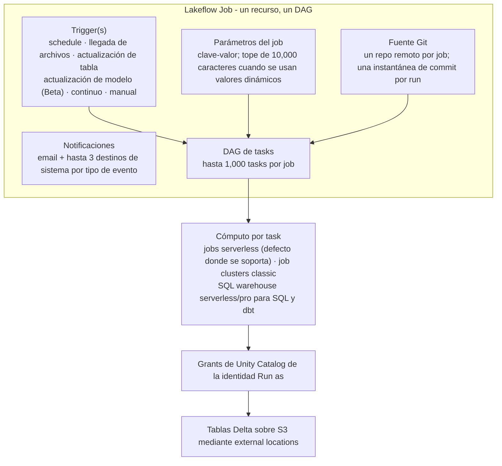
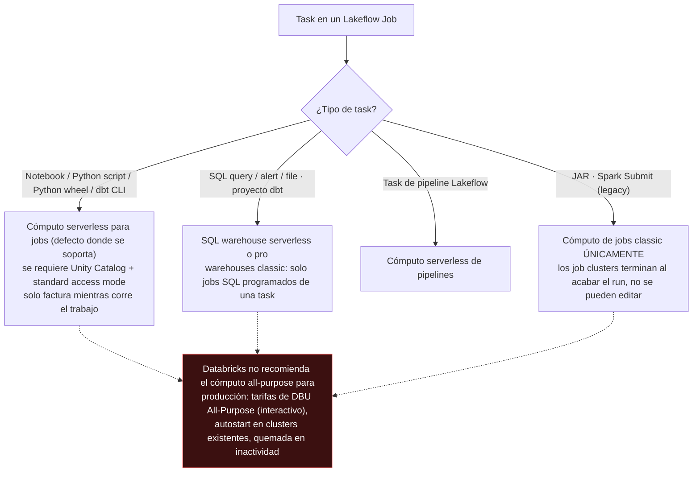
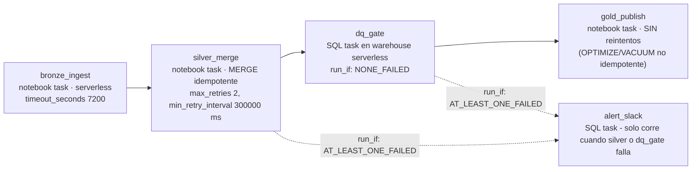
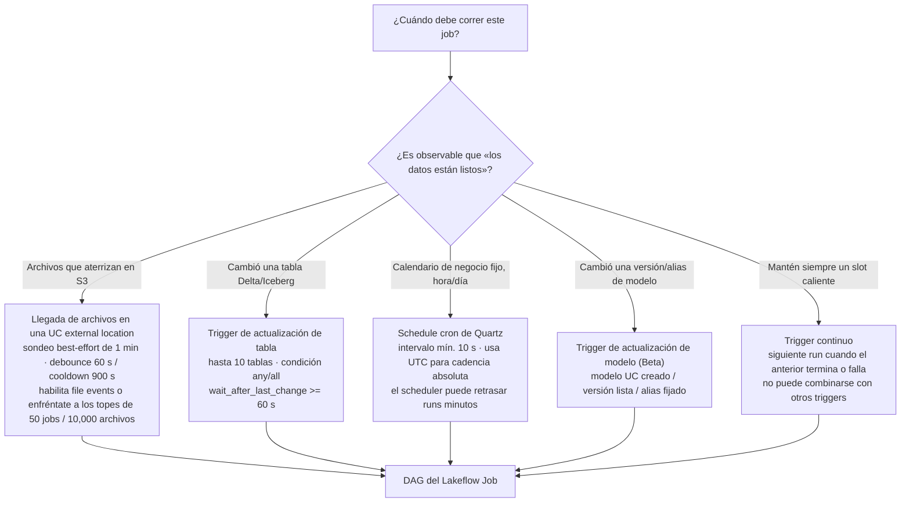
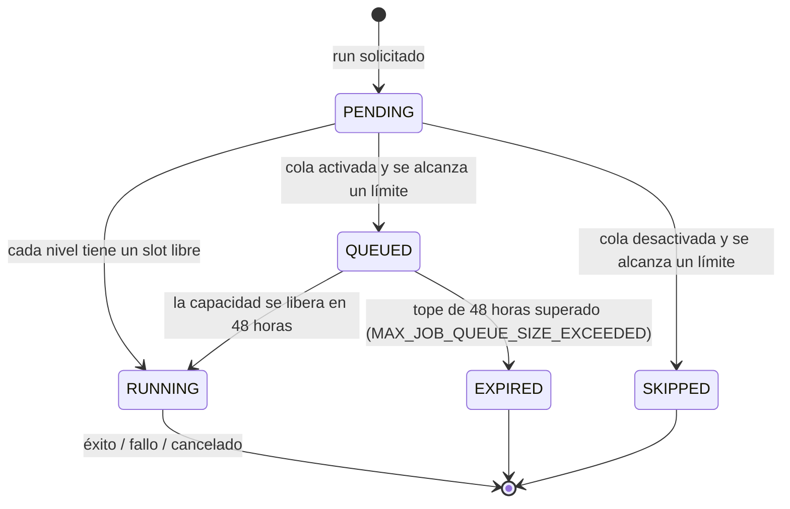
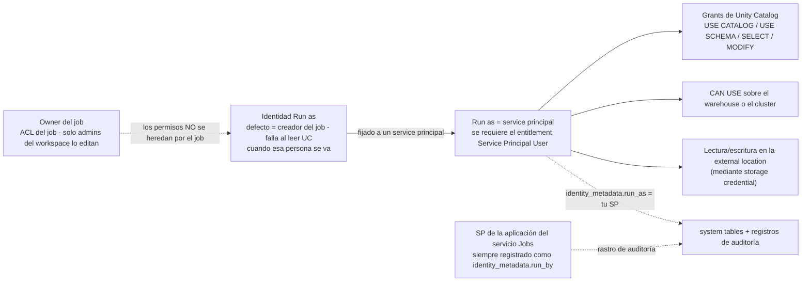

# Lakeflow Jobs (antes Databricks Workflows): multi-task jobs como código, triggers, reintentos y la matriz de decisión del scheduler

Toda lakehouse acaba fallando de la misma manera: los datos estaban bien, el cluster estaba bien, y nadie pulsó el botón — o tres botones, en el orden equivocado, dos veces. La orquestación es lo que separa la demo de un lakehouse, y en Databricks sobre AWS el orquestador nativo es **Lakeflow Jobs**. Si ese nombre te resulta nuevo, esa es la primera lección: «Databricks Workflows» pasó a llamarse **Lakeflow Jobs** dentro de la familia Lakeflow — «**Lakeflow Jobs (formerly known as Databricks Workflows)**» (blog de Databricks, **2025-07-24**) — mientras que las rutas REST, los objetos de la API y las system tables siguen diciendo `jobs`. Tres nombres, un producto, y una página de docs actualizada el **9 de octubre de 2026** que ahora abre con «Lakeflow Jobs is workflow automation for Databricks, providing orchestration for data processing workloads» (docs.databricks.com/aws/en/jobs/).

Esta lección es el manual de operaciones: cómo se construye un job (tasks, DAG, cómputo), cuándo dispara (seis tipos de trigger), qué pasa cuando se acaba la capacidad (cola frente a skip), cómo se recupera (reintentos, reparaciones, notificaciones), en quién se ejecuta (service principals), cómo se empaqueta (YAML de Declarative Automation Bundles, antes Databricks Asset Bundles) y cuándo *no* usarlo en absoluto (Amazon MWAA/Airflow, AWS Step Functions). Cada límite y cada precio lleva abajo su fuente y su fecha de **octubre de 2026**; todo lo que Databricks no publica se deja fuera en lugar de adivinarse.

```text
 =============================================================
  MAPA DE LA LECCIÓN 09 - Lakeflow Jobs en AWS, a oct 2026
 ------------------------------------------------------------
  Modelo    job -> tasks (<= 1,000) representadas como un DAG
            + triggers + parámetros + notificaciones + Git
  Triggers  programados (Quartz, >= 10 s de intervalo) |
            llegada de archivos (best-effort 1/min, UC location) |
            actualización de tabla (<= 10 tablas, >= 60 s debounce) |
            actualización de modelo (Beta) | continuo | manual
  Capacidad 2,000 task runs concurrentes/workspace (429)
            12,000 jobs guardados | 12,000 triggers activos
            10,000 creaciones de job/hora
            max_concurrent_runs: defecto 1, máx 1,000,
            0 = salta todo; tope de cola 48 horas
  Fiabilidad defecto classic = SIN reintentos; serverless
            optimiza reintentos solo; timeout 0 = ninguno;
            repair / partial runs; códigos de eventos webhook
  Identidad Run as = service principal (recomendado);
            los tokens OAuth M2M viven 1 hora
  Como código Declarative Automation Bundles (DABs,
            antes Databricks Asset Bundles):
            databricks.yml + resources/*.job.yml,
            el target dev pausa schedules y prefija nombres
  Dinero    suelo de Lakeflow Jobs $0.15/DBU vs all-purpose
            $0.40/DBU; MWAA env grande $0.99/h =
            $736.56/mes incluso con un solo DAG; Step
            Functions Standard $0.025 por 1,000 transiciones
  -------------------------------------------------------------
  Regla de la lección: el cron es una conjetura, los triggers
  son un hecho - y el scheduler NO sirve para trabajo de
  baja latencia.
 =============================================================
```

En esta lección vas a:

- reconstruir el **renombramiento Workflows → Lakeflow Jobs** y la anatomía del modelo job/tasks/triggers contra el **margen de escala publicado** (tasks, jobs, triggers, concurrencia, creaciones por hora);
- elegir **tipos de task y cómputo** desde la matriz serverless-first, y poner precio al mismo job con los suelos de **$0.15 vs $0.40 por DBU**;
- cablear el DAG: **`depends_on` + las seis condiciones `run_if`**, el control flow de condition/for-each/Run Job y la semántica **Excluded cuenta como éxito** que decide si tu alert task se ejecuta alguna vez;
- configurar las seis **familias de triggers** — schedules Quartz con el **suelo de 10 segundos** y el **arreglo DST → UTC**, triggers de llegada de archivos con **cooldown de 900 s / debounce de 60 s**, triggers de actualización de tabla con su suelo de **60 segundos** de debounce;
- separar la **cola** (tope de 48 horas, activada por defecto en jobs de UI desde 2024-04-15) del **skipping** y diagnosticar ambos forensemente en las **system tables de jobs**;
- fijar **reintentos, timeouts, repairs, partial runs** y **notificaciones por webhook**, sabiendo que las tasks classic vienen *sin* reintentos por defecto y que las alertas a nivel de job se quedan mudas mientras haya reintentos;
- ejecutar jobs de producción como **service principals** con OAuth M2M, no como la persona que pulsó Crear;
- escribir el estate como **Declarative Automation Bundles** YAML con **targets dev/prod** y **fuentes de task remotas en Git**, y tender el puente hacia los calendarios empresariales con **Amazon MWAA** y `DatabricksRunNowOperator`;
- elegir **Workflows vs Airflow/MWAA vs Step Functions** desde una matriz de decisión con precios, estudiar **NAB y Asurion** en AWS, leer el **recuadro de actualizaciones de 2026** y practicar con **catorce preguntas** más cuatro comprobaciones interactivas.

---

## 1. Anatomía: un job, un DAG, tres conceptos

Las docs son breves a propósito: un job contiene **tasks**, las tasks se representan visualmente mediante un **DAG**, y los **triggers** deciden cuándo dispara el job. Los ajustes a nivel de job cargan con lo demás — **Trigger, Parameters, Notifications (emails o webhooks), Git** (docs .../jobs/, **9 oct 2026**). Todo lo demás de esta lección es un detalle de una de esas cuatro superficies.



### 1.1 El margen de escala (todo consultado en oct 2026)

| Límite | Valor | Comportamiento al alcanzarlo | Fuente |
|---|---|---|---|
| Tasks por job | **1,000** (endpoints de escritura) | request rechazada | jobs overview (9 oct 2026); Jobs API 2.2 |
| Jobs guardados por workspace | **12,000** | creación rechazada | jobs overview |
| Creaciones de job por workspace por hora | **10,000** (incluye `runs submit`) | limitado (throttled) | jobs overview |
| Task runs concurrentes por workspace | **2,000** | HTTP **429 Too Many Requests** | jobs overview |
| Triggers activos por workspace | **12,000** (pausados excluidos) | creación rechazada | triggers (6 oct 2026) |
| Triggers por job (Multiple Triggers Beta) | **5**; el continuo no puede combinarse con otros | rechazado | triggers (6 oct 2026) |
| `max_concurrent_runs` | defecto **1**, máx **1,000**, **0 = salta todos los runs nuevos** | salta o rechaza | Jobs API 2.0; configure-job (7 jul 2026) |
| Duración de la cola | **48 horas** | el run muere con `MAX_JOB_QUEUE_SIZE_EXCEEDED` | configure-job |

Dos números causan la mayor parte del daño operativo. Primero, **`max_concurrent_runs` vale 1 por defecto**: «By default, the maximum concurrent runs for all new jobs is 1» y un run que superaría el tope se **salta** salvo que la cola lo atrape (configure-job). Segundo, **el techo del workspace de 2,000 task runs concurrentes** es global — una flota de jobs fan-out se puede privar mutuamente de capacidad, y el error aparece como un 429 o como `WORKSPACE_RUN_LIMIT_EXCEEDED` en las system tables (jobs overview; system-tables/jobs, **21 may 2026**).

- **📚 ¿Sabías que…?** La referencia heredada de Jobs API 2.0 (última actualización 3 ago 2026) todavía dice «A job can contain up to **100 tasks**», mientras que el overview actual y el blog de 2024-08-22 *«What's new in Workflows?»* dicen **1,000**. La cifra de 1,000 tasks es el límite de producto vigente (los endpoints de escritura lo imponen); el 100 es una página heredada obsoleta — y los endpoints de lectura simplemente devuelven 100 por página con paginación. Pon siempre fecha al límite que cites.

---

## 2. Tipos de task y cómputo: serverless primero, nunca all-purpose

### 2.1 La paleta de tipos de task

La paleta actual de la UI (página configure-task) dice: **Notebook · Visual data prep · Clean Room notebook · Python script · Python wheel · SQL (query/alert/file) · Pipeline (Lakeflow) · Database Table Sync pipeline · Ingestion pipeline · SQL Alert (Public Preview) · Dashboards · Power BI · dbt · dbt platform (Public Preview) · JAR · Spark Submit · Run Job · Genie Code (Beta) · If/else · For each**. El mapeo REST (Jobs API 2.2) es lo que tu YAML escribe de verdad: `notebook_task`, `spark_jar_task`, `spark_python_task`, `python_wheel_task`, `sql_task`, `dbt_task`, `run_job_task`, `condition_task`, `foreach_task`, `pipeline_task` — con `spark_submit_task` marcado como «**Deprecated (Legacy)** … Databricks recommends using the spark_jar_task instead».

Tres entradas merecen comentario antes de la matriz de cómputo:

- **dbt es de primera clase**: una task de dbt es «one or more dbt commands» más un `project_directory`, y «The dbt task requires both Databricks SQL and the ability to use a **serverless or a pro SQL warehouse**» — los SQL warehouses classic se limitan a jobs SQL programados de una sola task (Jobs API 2.2). Databricks inyecta `DBT_ACCESS_TOKEN` para la identidad Run as, y por eso el service principal de run as necesita acceso al warehouse *y* grants de UC.
- **Las tasks Condition (if/else) «do not require a cluster to execute and do not support retries or notifications»** (Jobs API 2.2; docs de bundles, 21 ago 2026). No puedes «reintentar una rama» — reintenta la task de datos que la rama protege.
- **Las tasks Run Job** disparan «other jobs configured in your Databricks workspace» — solo del mismo workspace — con los parámetros del job empujados hacia abajo, y tienen un tope duro: «Databricks does not support jobs with circular dependencies or that nest more than three Run Job tasks» (docs .../jobs/tasks/run-job, **11 sep 2026**).

### 2.2 El árbol de decisión del cómputo

La página de la matriz de cómputo (última actualización **15 sep 2026**) es explícita: «**Serverless compute for workflows… is the default** for all tasks that support it», y «**All-purpose compute | You can optionally configure tasks using classic all-purpose compute. Databricks does not recommend this configuration for production jobs.**»



La facturación sigue a la elección de cluster, y esta sola regla ancla cada lección de coste del curso: «When you run a job on a new jobs cluster, the job is treated as a **Jobs Compute (automated) workload subject to Jobs Compute pricing**. When you run a job on an existing all-purpose cluster, it is treated as an **All-Purpose Compute (interactive) workload subject to All-Purpose Compute pricing**» (referencia de Jobs API 2.0, 3 ago 2026). Los job clusters también se comportan distinto a la salida: el cómputo «terminates and is unavailable for restarting when the job is complete», mientras que un job programado apuntado a un all-purpose cluster *terminado* lo **autostarta** (docs .../compute/clusters-manage) — así es como un cluster reutilizado «barato» se convierte en silencio en una línea de 24×7.

### 2.3 Ejemplo resuelto E1 — el mismo job, dos SKUs

**A oct 2026.** Un job medallion corre 2 horas al día y consume **12 DBU/h** (un fan-out multi-task modesto sobre cómputo classic de jobs). Coste mensual en DBU a los suelos oficiales de la página de precios de Databricks (instantánea **2026-10**):

```text
Ejemplo resuelto E1 - coste en DBU de jobs vs all-purpose, a oct 2026
Carga .................. 12 DBU/h x 2 h/día x 30 días = 720 DBU/mes

Ruta A - job clusters (suelo de Jobs Compute "from $0.15 / DBU")
  720 DBU x $0.15 ................................... = $108.00 / mes DBU
  (+ instancias EC2 facturadas aparte por AWS en classic)

Ruta B - all-purpose cluster existente (suelo de All-Purpose "from $0.40 / DBU")
  720 DBU x $0.40 ................................... = $288.00 / mes DBU
  (+ quemada en inactividad mientras el cluster esté encendido entre runs)

Delta ................. $180.00 / mes - los mismos notebooks,
                        los mismos datos, un multiplicador DBU de 2.7x
```

Los jobs serverless son la tercera ruta: «bill only when a command or query runs (plus a small session fee for the REPL VM); charges stop automatically after a few minutes of idle time» (Databricks Answers, **2026-08-27**), y la página de mejores prácticas de serverless añade que «**Standard mode can reduce costs by up to 70% compared to performance-optimized mode**» — al precio de «**4 to 6 minutes**» de latencia de arranque (run-serverless-jobs, 9 oct 2026). Los jobs serverless requieren un **workspace con Unity Catalog habilitado** y **standard access mode**; la auto-optimización (incluidos los reintentos, sección 6) viene activada por defecto.

```plot
{
  "type": "bar",
  "title": "Suelo mensual en USD de un job de 720 DBU más los suelos de orquestación (ejemplo resuelto E1 + MWAA, a oct 2026)",
  "xLabel": "Diseño",
  "yLabel": "USD por mes (suelos publicados)",
  "xKey": "design",
  "dataKeys": ["usd_per_month"],
  "data": [
    {"design": "Job clusters: 720 DBU x $0.15/DBU", "usd_per_month": 108.0},
    {"design": "All-purpose: 720 DBU x $0.40/DBU", "usd_per_month": 288.0},
    {"design": "MWAA large env floor only: 744 h x $0.99/h (before any Databricks DBUs)", "usd_per_month": 736.56}
  ]
}
```

> [!WARNING]
> ⚠️ **Dos trampas de cómputo rompen los presupuestos de producción y los jobs paralelos.** (1) **Nunca apuntes tasks de producción a all-purpose clusters existentes** — pagas tarifas de DBU interactivas *y* heredas el autostart, el tiempo en inactividad y la advertencia documentada de que «you may need to manually restart the cluster if it stops responding» (Jobs API 2.0). La hoja de trucos de producción lo dice en una línea: «Use serverless compute for jobs… **Use service principals instead of user accounts**… **For classic compute: use jobs clusters for automated workflows**» (docs .../cheat-sheet/jobs, 4 abr 2026). (2) **Los job clusters compartidos filtran estado**: están ligados a un solo run y recortan la latencia de arranque, pero «Libraries cannot be declared in a shared job cluster configuration» (decláralas por task), el cluster queda inactivo mientras corren otras tasks, y «Scala singletons and companion objects are shared across tasks… If parallel tasks read from or write to the same companion-object variable, one task's value can overwrite another's» (página de cómputo, 15 sep 2026). Tasks paralelas y sensibles al aislamiento necesitan cómputo propio o serverless — punto y final.

- **📚 ¿Sabías que…?** Los jobs serverless llevan **rate-limit objects** automatizados que limitan la ejecución a unos **60 / 120 / 240 / 480 / 960 DBU por hora** de Small a 2X-Large, y «Within a single job, the cap is shared across all the job's tasks» (docs .../compute/serverless/manage-serverless-compute, consultadas oct 2026). Los límites de tasa se aplican solo a cargas automatizadas — los notebooks interactivos y Databricks Connect están exentos — y hacerlos cumplir requiere Databricks Runtime **17.3.1 o superior**. Un ticket de «¿por qué se me ha atascado mi fan-out?» suele tener esta respuesta.

---

## 3. Dependencias y control flow: el DAG que de verdad obtienes

Las tasks posteriores a la primera declaran `depends_on: [{task_key: …}]`, que dibuja los bordes. Lo que esos bordes *significan* lo decide **Run if**, y ahí es donde se torcieron los DAGs de producción. Las seis condiciones (docs de configuración de run-if, **25 jun 2026**): **All succeeded (defecto) · At least one succeeded · None failed · All done · At least one failed · All failed**.

Tres semánticas documentadas son de examen y de incidente a la vez:

1. «Upstream tasks with the **Excluded** result state are treated as **successful** when evaluating Run if conditions.»
2. «Upstream tasks marked **Upstream failed** or **Upstream canceled** are treated as **failed**, not as skipped.»
3. «If all of a task's dependencies are excluded, the task itself is also excluded… exclusion cascades along a linear dependency chain» — sin importar el propio Run if de esa task. La cancelación igualmente «propagates through downstream tasks, and tasks with a Run if condition that handles failure are run».



Lee el diagrama como una política, no como una forma. `dq_gate` usa **NONE_FAILED** porque la publicación en gold no debe ejecutarse sobre un silver corrupto — pero un upstream *cancelado* cuenta como fallido, así que una cancelación humana sigue saltándose el gold, que es justo lo que quieres. La task de alerta usa **AT_LEAST_ONE_FAILED** para sobrevivir al fallo de silver; porque «Upstream failed» cuenta como fallo, la alerta dispara exactamente en los incidentes que te importan. Los compañeros de control flow completan la caja de herramientas: **las tasks de condición If/else** comparan operandos (EQUAL_TO, GREATER_THAN, …) contra valores dinámicos como `{{job.repair_count}}` o `{{tasks.task_key.values.output}}` (docs de job-task-types de bundles, 21 ago 2026); **For each** recorre un array JSON, manual o producido aguas arriba mediante `dbutils.jobs.taskValues.set`; **Run Job** compone jobs enteros, del mismo workspace, sin ciclos, con ≤3 niveles de anidamiento.

- **📚 ¿Sabías que…?** La propagación de parámetros tiene dirección y ganador: los parámetros del job «are pushed down automatically, and if a job parameter and a task parameter share a key, the **job parameter takes precedence**» — pero «Tasks that take **JSON-array parameters don't receive job parameters automatically**; reference them explicitly with `{{job.parameters.<name>}}`» (docs .../jobs/parameters, 26 jun 2026). Las tasks con array JSON son Python script, wheel posicional, JAR, Spark Submit y For each. Si te lo saltas, tu task de Python script se ejecuta en silencio con argv vacío.

---

## 4. Triggers: el cron es una conjetura, la llegada de datos es un hecho

Hoy se entregan seis comportamientos de trigger (docs de triggers, **6 oct 2026**): **Scheduled**, **Table update**, **File arrival**, **Model update (Beta)**, **Continuous** («trigger another job run whenever a job run completes or fails») y **None (manual)**. Los triggers múltiples por job están en **Beta** — hasta **cinco**, cada uno pausable de forma independiente, y «A continuous trigger cannot be combined with any other trigger». La API los trae en un array `triggers`; no mezcles ese array con los campos heredados `schedule` / `trigger` / `continuous` en una misma request.

### 4.1 Programado: cron de Quartz, el suelo de 10 segundos y el DST

Los schedules usan **sintaxis cron de Quartz** con una **timezone id de Java**, con `pause_status` UNPAUSED/PAUSED (esquema del objeto Run, Jobs API 2.2 — ejemplo `"quartz_cron_expression": "20 30 * * * ?", "timezone_id": "Europe/London"`). Tres reglas de la página de schedules (última actualización **26 jun 2026**):

- «Databricks enforces a **minimum interval of 10 seconds** between subsequent runs triggered by the schedule of a job regardless of the configuration in the cron expression.»
- Zonas horarias con horario de verano: «an **hourly job is skipped or might appear to be delayed by an hour or two when daylight saving time begins or ends**. To run at every hour (absolute time), choose UTC.»
- «**The job scheduler is not intended for low-latency jobs.** Due to network or cloud issues, job runs might occasionally be delayed up to several minutes.»

### 4.2 Ejemplo resuelto E2 — el bug del cron y el arreglo event-driven

```text
Ejemplo resuelto E2 - diseño de schedules, a oct 2026
BUG - job nocturno, zona DST, medianoche local:
  quartz_cron_expression: "0 0 0 * * ?"
  timezone_id: "Europe/London"
  -> alrededor del cambio de octubre el reloj local no tiene
     las 00:00, así que el run de esa noche se salta; alrededor
     de marzo las 00:00 disparan dos veces en términos locales.
     Dos cargas perdidas al año en un pipeline de cumplimiento
     son un hallazgo de auditoría.

ARREGLO 1 - cadencia horaria absoluta:
  quartz_cron_expression: "0 0 * * * ?"
  timezone_id: "UTC"          <- a prueba de DST por construcción

ARREGLO 2 - deja de adivinar cuándo los datos están listos (llegada de archivos):
  triggers:
    - file_arrival:
        url: "s3://acme-landing/orders/"     # UC external location
        min_time_between_triggers_seconds: 900   # cooldown
        wait_after_last_change_seconds: 60       # debounce
  -> 3 archivos que aterrizan con 30 s de separación = UN run (debounce).
     Un segundo lote 5 min después ESPERA a que venza la
     ventana de cooldown de 900 s. Los valores son el par de
     ejemplo documentado (docs de file-arrival, 7 oct 2026).

IMPOSIBLE - cron por debajo de 10 segundos:
  "0/5 * * * * ?"   vale (¿5 s >= 10 s de suelo? NO - 5 < 10,
                    la plataforma sigue imponiendo >= 10 s entre runs)
```

Los triggers de llegada de archivos «make a best effort to **check for new files every minute**», monitorizan «the root of a Unity Catalog external location or volume, or a subpath» de forma recursiva, y «**do not incur additional costs other than cloud provider costs associated with listing files**» (docs de file-arrival, 7 oct 2026). Los filos: **solo disparan los archivos nuevos** — «Overwriting an existing file with a file of the same name does not trigger a run»; sin wildcards; y «When the configured directory does not exist or is deleted from Amazon S3…, file arrival triggers continue to be evaluated with **no error**». Sin **file events** habilitados en la external location, el workspace te limita a «**A maximum of 50 jobs**» con triggers de llegada de archivos en tales ubicaciones y «**10,000 files**» en la ruta vigilada. El acoplamiento recomendado es Auto Loader con `cloudFiles.useManagedFileEvents=true` y `trigger(availableNow=True)` — una variante foreachBatch «provides only **at-least-once** processing guarantees» — con el checkpoint guardado *fuera* de la ruta vigilada.

### 4.3 Triggers de actualización de tabla

Un trigger de actualización de tabla «checks for table updates, and when a table is updated, the job is run», monitorizando hasta **10** tablas gestionadas Delta/Iceberg de Unity Catalog, tablas externas sobre Delta, materialized views, streaming tables y vistas dependientes — detectando «updates, merges, and deletes» (docs de table-update, 26 jun 2026). `wait_after_last_change_seconds` tiene un **suelo de 60 segundos**: es un debounce, no un SLA sub-minuto. Igual que la llegada de archivos, «do[es] not incur additional costs other than cloud provider costs», y «For best performance and scalability, **enable file events** on the external location.»



```matching
{
  "question": "Empareja cada número relacionado con triggers con lo que realmente controla (todo a octubre de 2026):",
  "pairs": [
    {"left": "10 segundos", "right": "Intervalo mínimo entre runs consecutivos del schedule de un job, impuesto sin importar la expresión cron"},
    {"left": "900 s / 60 s", "right": "El par de ejemplo documentado de llegada de archivos: tiempo mínimo entre triggers (cooldown) y espera tras el último cambio (debounce)"},
    {"left": "60 segundos", "right": "Suelo de wait_after_last_change_seconds en un trigger de actualización de tabla - un debounce, no un SLA sub-minuto"},
    {"left": "5 triggers", "right": "Máximo de triggers por job durante el Beta de Multiple Triggers; un trigger continuo no puede combinarse con ningún otro"},
    {"left": "12,000 triggers activos", "right": "Tope de todo el workspace en todos los jobs y tipos de trigger - los triggers pausados no cuentan para él"},
    {"left": "50 jobs / 10,000 archivos", "right": "Topes de llegada de archivos en una ubicación SIN file events: máx. jobs con trigger por workspace y máx. archivos en la ruta vigilada"}
  ],
  "explanation": "Cada número de esta lección pertenece a una superficie de control concreta, y asignarlos mal es como los equipos envían el arreglo equivocado: subir max_concurrent_runs no arregla un salto por DST (eso es la superficie de schedule de 10 segundos/UTC); habilitar file events levanta los topes de 50 jobs/10,000 archivos pero no hace nada por el debounce de tabla de 60 segundos; y el par 900/60 es un ejemplo de control de tasa de las docs de file-arrival, no un mínimo de plataforma - los únicos suelos duros son el intervalo de schedule de 10 segundos y la espera de tabla de 60 segundos."
}
```

- **📚 ¿Sabías que…?** Un workspace puede alojar hasta **12,000 triggers activos** en todos los jobs y tipos de trigger, y **los triggers pausados no cuentan** para ese límite (docs de triggers, 6 oct 2026). Eso convierte la higiene del estado de pausa en una herramienta de capacidad: una flota de jobs de backfill dormidos debería desplegarse con `pause_status: PAUSED` — que es exactamente lo que el modo de desarrollo de Declarative Automation Bundles hace por ti (sección 8).

---

## 5. Cola, concurrencia y la trampa del skip

Cuando un run no puede arrancar, lo atrapan dos máquinas distintas, y solo una viene activada por defecto. **La cola** (activada por defecto en jobs creados desde la UI después del **15 de abril de 2024**) retiene el run «for up to **48 hours** if resources are unavailable», y se activa cuando se alcanca cualquiera de tres límites: el máximo de runs activos concurrentes del workspace, el máximo de runs concurrentes de tasks Run Job del workspace, o el propio `max_concurrent_runs` del job (configure-job, 7 jul 2026). Sin cola, alcanzar un límite significa que el run se **salta** — y un run programado saltado es un hueco de datos silencioso.



Mandos y techos que no debes confundir: `max_concurrent_runs` defecto **1**, máximo duro **1,000**, **0 salta todo**; bajarlo nunca mata runs activos; el **2,000 task runs concurrentes** de todo el workspace devuelve 429 o `WORKSPACE_RUN_LIMIT_EXCEEDED` incluso con la cola activada (jobs overview; system tables). La profundidad de la cola más allá del tope documentado de 48 horas no se publica — trata «¿qué tan profunda es la cola interna, y en qué orden hace dequeue?» como desconocido, y diseña para el tope, no para la equidad.

### 5.1 Ejemplo resuelto E3 — forensia de colas en las system tables

```text
Ejemplo resuelto E3 - incidente de capacidad, a oct 2026
Síntoma ... un job fan-out de 20 tasks con max_concurrent_runs: 10
            muestra runs atascados en PENDING; la alerta aguas abajo dispara
Hecho ..... el workspace ya está en 1,990 task runs concurrentes
Acción .... los primeros runs del job nuevo se ENCOLAN (cola activada por defecto);
            en el task run número 2,000 la API responde 429 y la
            system table registra WORKSPACE_RUN_LIMIT_EXCEEDED
Contraste . mismo job con la cola DESACTIVADA: límite alcanzado -> SKIPPED con
            MAX_CONCURRENT_RUNS_REACHED - una carga perdida en silencio
```

```sql
-- jobs system tables (docs .../admin/system-tables/jobs, last updated May 21, 2026)
SELECT
  job_run_id,
  job_name,
  run_state,
  queue_duration_seconds,
  setup_duration_seconds
FROM system.lakeflow.job_run_timeline
WHERE queue_duration_seconds > 300
ORDER BY queue_duration_seconds DESC;
```

La misma referencia lista los estados de fallo sobre los que conviene alertar: `WORKSPACE_RUN_LIMIT_EXCEEDED` («The workspace has reached the quota for the maximum number of concurrent active runs»), `MAX_CONCURRENT_RUNS_EXCEEDED`, `MAX_JOB_QUEUE_SIZE_EXCEEDED`, `CLUSTER_REQUEST_LIMIT_EXCEEDED` y `REPOSITORY_CHECKOUT_FAILED` — más la nota honesta de que `creator_user_name` y `paused` están «Not populated for rows emitted before **early December 2025**», así que las consultas de higiene histórica necesitan un suelo de fecha.

```fillblank
{
  "question": "Completa los límites y suelos publicados de Lakeflow Jobs (todo a octubre de 2026):",
  "template": "Un workspace ejecuta como máximo {{1}} task runs concurrentes (HTTP 429 por encima de eso) y puede alojar {{2}} jobs guardados y {{3}} triggers activos, con un máximo de {{4}} creaciones de job por hora. Un solo job contiene como máximo {{5}} tasks. max_concurrent_runs tiene por defecto {{6}}, no puede superar 1,000, y 0 salta todos los runs nuevos. La cola (activada por defecto en jobs de UI desde 2024-04-15) retiene un run como máximo {{7}} horas. Los runs programados están separados al menos {{8}} segundos, el debounce de actualización de tabla es de al menos {{9}} segundos, y cada job o task puede notificar como máximo {{10}} destinos de sistema por tipo de evento.",
  "answers": {
    "1": "2000",
    "2": "12000",
    "3": "12000",
    "4": "10000",
    "5": "1000",
    "6": "1",
    "7": "48",
    "8": "10",
    "9": "60",
    "10": "3"
  },
  "distractors": ["100", "500", "5000", "100000", "5", "10", "0", "24", "72", "1", "5", "10", "30", "600"],
  "explanation": "Cada número está tomado del jobs overview (9 oct 2026), la página de triggers (6 oct 2026), configure-job (7 jul 2026), la página de schedules (26 jun 2026), la página de table-update (26 jun 2026) y la página de notifications (9 oct 2026). Los distractores son los vecinos plausibles: 100 es la cifra heredada obsoleta por página/task, 5 es el tope por job del Beta de Multiple Triggers, 24 y 72 invitan al «un día / un fin de semana» sobre el tope de cola, y 600/30 invitan a confundirlos con los segundos del debounce y el límite de re-notificación del backlog de streaming."
}
```

---

## 6. Fiabilidad: reintentos, timeouts, reparaciones, notificaciones

### 6.1 Los reintentos varían según el cómputo — el valor por defecto es el silencio

«The default setting for task retries depends on the job configuration. For most configurations, the default setting **does not retry any tasks** on task failure» (configure-task). Frente a eso: «**Serverless jobs auto-optimize retries by default**» (desactívalo con la casilla «Enable serverless auto-optimization» — y *desactívalo* sí para destinos no idempotentes), y «**Continuous jobs use an exponential backoff retry policy**» (misma página). Los mandos por task: `max_retries`, `min_retry_interval_millis`, `retry_on_timeout`; `timeout_seconds` es por task con «**A value of 0 means no timeout**» (Jobs API 2.2) — y un timeout *no* se reintenta salvo que `retry_on_timeout` esté activo.

### 6.2 Ejemplo resuelto E4 — la política de reintentos como documento de diseño

```text
Ejemplo resuelto E4 - política de reintentos por task, a oct 2026
silver_merge     MERGE idempotente sobre Delta
  max_retries: 2
  min_retry_interval_millis: 300000     # 5 minutos entre intentos
  timeout_seconds: 10800                # techo de 3 h
  -> los tropiezos transitorios de EMR/HTTP se curan solos; el MERGE se puede reejecutar

gold_publish     OPTIMIZE + VACUUM + cascada de grants - NO idempotente
  max_retries: 0                        # explícito: igual que el defecto classic
  timeout_seconds: 3600
  -> reejecutar un OPTIMIZE parcial desperdicia DBUs; un VACUUM parcial es
     inofensivo pero ruidoso. Falla ruidoso, alerta, repara a mano.

dq_gate          SQL task en un warehouse serverless
  auto-optimización serverless ACTIVADA (consulta de solo lectura)
  timeout_seconds: 900

alert_slack      run_if: AT_LEAST_ONE_FAILED
  max_retries: 1                        # las alertas pueden fallar de vez en cuando; un reintento
```

Superficies de recuperación más allá de los reintentos: el **repair** reejecuta «the subset of unsuccessful tasks» en un run multi-task; los **partial runs** (blog de Lakeflow Jobs, **2025-07-24**) «allow users to select which tasks to execute without affecting others» — la respuesta operativa a «reejecuta solo la task de gold rota»; y las salidas de consultas SQL pueden alimentar tareas posteriores como parámetros (mismo blog). Las tasks de notebook también traen techos duros de salida — **30 MB** de salida combinada de celdas, **8 MB** por celda — más allá de los cuales el run falla (docs .../jobs/tasks/notebook, 11 sep 2026); las tasks parlanchinas deben escribir en Delta, no en stdout.

### 6.3 Notificaciones: tres destinos, reintentos silenciosos

Eventos de notificación (docs de notifications, **9 oct 2026**): **Start · Successful completion · Failure · umbral de duración superado · umbral de backlog de streaming superado · inicio/fin de mantenimiento (jobs continuos)**. Los destinos son «email addresses or third-party destinations such as **Slack, Microsoft Teams, PagerDuty, or any webhook-based service**», donde «An administrator must configure **system destinations**», y «For each job or task, you can configure a maximum of **three system destinations** for each notification event type». Los códigos `event_type` del webhook son estables: `jobs.on_start`, `jobs.on_success`, `jobs.on_failure`, `jobs.on_duration_warning_threshold_exceeded`.

> [!IMPORTANT]
> 🔔 **«Job-level notifications aren't sent when failed tasks are retried.»** Esa sola línea (docs de notifications, 9 oct 2026) es la razón por la que el guardia sigue perdiendo incidentes en jobs inestables: una task de silver que falla dos veces y luego tiene éxito no dispara *nada* a nivel de job. El patrón documentado es **alertas a nivel de task** más la opción de la UI «Mute notifications until the last retry» — alerta en el fallo *final*, no en el primero. Dos semánticas adyacentes completan el cuadro: «**Succeeded with failures**» cuenta como éxito (selecciona el evento Success si quieres esos), y las alertas de backlog de streaming evalúan «average backlog over a **10-minute period**» con un límite de re-notificación de **30 minutos**. Los runs cancelados y saltados se pueden silenciar por evento.

### 6.4 Ejemplo resuelto E5 — el payload del webhook y la llamada run-now

```text
Ejemplo resuelto E5 - webhook de fallo + disparo REST, a oct 2026
Lo que Databricks envía por POST a tu destino de sistema
(docs .../jobs/notifications, 9 oct 2026):

{
  "event_type": "jobs.on_failure",
  "workspace_id": "1234567890123456",
  "run":  { "run_id": "678901234567890" },
  "job":  { "job_id": "42", "name": "medallion_daily" }
}

Lo que tu equipo de plataforma llama desde el calendario empresarial
(Jobs API 2.2, /api/2.1/jobs/run-now):

curl -X POST "https://<workspace-url>/api/2.1/jobs/run-now" \
  -H "Authorization: Bearer $DATABRICKS_OAUTH_TOKEN" \
  -H "Content-Type: application/json" \
  -d '{
    "job_id": 42,
    "job_parameters": { "env": "prod", "dt": "2026-10-11" }
  }'

Repara solo el subconjunto fallido de ese run:

curl -X POST "https://<workspace-url>/api/2.1/jobs/runs/repair" \
  -H "Authorization: Bearer $DATABRICKS_OAUTH_TOKEN" \
  -H "Content-Type: application/json" \
  -d '{
    "run_id": 678901234567890,
    "rerun_tasks": [ { "task_key": "silver_merge" } ]
  }'
```

Usa tokens **OAuth M2M** (client id + secreto OAuth; access tokens válidos **1 hora**, secretos acotables a `jobs`) en lugar de personal access tokens; si una integración heredada te fuerza a un PAT, usa un **PAT de service principal**, nunca el de una persona (sección 7 y la costura de Airflow de la sección 9).

---

## 7. Identidad: owner, Run as y la marcha que rompe las 3 a.m.

Un job tiene dos identidades: el **owner** (ACL del job; «Only workspace admins can edit the job owner») y la identidad **Run as** cuyos permisos ejecutan cada task. Run as por defecto = la persona creadora del job — y la recomendación de las docs no deja lugar a dudas: «**Databricks recommends changing the Run as user to a service principal**, so that privileges can be controlled separately from the owner's privileges, and so that jobs do not break when the owner leaves or has changed privileges» (docs .../jobs/privileges, consultadas oct 2026). Cambiar Run as requiere **CAN MANAGE o IS OWNER** en el job, el service principal necesita el entitlement **Service Principal User**, y «Run as a group» está en **Public Preview**.



El matiz de auditoría importa durante la revisión de incidentes: `identity_metadata.run_as` registra *tu* identidad configurada (el grupo, en la preview de Run as por grupo), mientras que `identity_metadata.run_by` «always records» el service principal de aplicación del servicio Jobs (misma página). El modo de fallo que previene es el rompedor de producción más común del curso: el job programado sigue pareciendo sano a la hora programada y muerte en la primera lectura de UC después de que se revoque el acceso de su creador. La autenticación máquina-a-máquina para la orquestación es OAuth M2M (tokens de 1 hora) o, para Airflow en AWS, la **federación AWS IAM OIDC token** del proveedor — «exchange for a Databricks OAuth token. Stores no secrets» (docs de apache-airflow-providers-databricks 7.19.0, consultadas oct 2026).

---

## 8. Jobs como código: Declarative Automation Bundles

Montar jobs a base de clics no sobrevive a un segundo ingeniero. La superficie como código es **Declarative Automation Bundles** — «formerly known as Databricks Asset Bundles» (docs .../dev-tools/bundles, consultadas oct 2026) — que empaqueta «Source files… Definitions and settings for Databricks resources, such as **Lakeflow Jobs**, Lakeflow Spark Declarative Pipelines, Dashboards, Model Serving endpoints, MLflow Experiments». El ciclo: escribe `databricks.yml` + `resources/*.job.yml`, y luego `databricks bundle validate` → `databricks bundle deploy --target dev` → `databricks bundle run --target dev <job>`.

### 8.1 Ejemplo resuelto E6 — un job multi-task de producción, YAML completo

```yaml
# resources/medallion_daily.job.yml  (Declarative Automation Bundles)
resources:
  jobs:
    medallion_daily:
      name: "medallion_daily"
      max_concurrent_runs: 1
      queue:
        enabled: true
      run_as:
        service_principal_name: "0000aaaa-1111-bbbb-2222-cccc3333dddd"
      tags:
        cost-center: "data-engineering"
        team: "lakehouse"
      schedule:
        quartz_cron_expression: "0 0 2 * * ?"   # 02:00 daily, Quartz
        timezone_id: "UTC"                       # DST-proof cadence
        pause_status: PAUSED                     # dev target unpauses
      parameters:
        env: "prod"
        dt: "{{job.parameters.env}}"             # override on run-now
      tasks:
        - task_key: bronze_ingest
          description: "Auto Loader bronze from the S3 landing zone"
          timeout_seconds: 7200
          notebook_task:
            notebook_path: "/Repos/lakehouse/bronze_ingest"
            base_parameters: { env: "{{job.parameters.env}}" }
          new_cluster:
            spark_version: "15.4.x-scala2.12"
            node_type_id: "m6i.xlarge"
            num_workers: 4
        - task_key: silver_merge
          timeout_seconds: 10800
          max_retries: 2
          min_retry_interval_millis: 300000
          depends_on: [ { task_key: bronze_ingest } ]
          notebook_task:
            notebook_path: "/Repos/lakehouse/silver_merge"
        - task_key: dq_gate
          run_if: "NONE_FAILED"
          depends_on: [ { task_key: silver_merge } ]
          sql_task:
            query:
              query_id: 1140225567890123
            warehouse_id: "abc123def456abcd"
        - task_key: gold_publish
          depends_on: [ { task_key: dq_gate } ]
          timeout_seconds: 3600
          max_retries: 0                # non-idempotent OPTIMIZE/VACUUM
          notebook_task:
            notebook_path: "/Repos/lakehouse/gold_publish"
        - task_key: alert_slack
          run_if: "AT_LEAST_ONE_FAILED"
          depends_on:
            - { task_key: silver_merge }
            - { task_key: dq_gate }
          sql_task:
            query:
              query_id: 2255678901234567
            warehouse_id: "abc123def456abcd"
      notification_settings:
        alert_on_last_retry_only: true
        no_alert_for_skipped_runs: true
```

Todo en ese archivo mapea a un campo documentado: `run_as.service_principal_name` acepta «the email of an active workspace user or the **application ID of a service principal**» (Jobs API 2.2); `queue.enabled` refleja el comportamiento de cola de 48 horas (sección 5); el bloque de reintentos es E4; `run_if` es la sección 3; `schedule` es la forma verificada de la API del ejemplo job-settings de Jobs API 2.0 (consultada oct 2026). Los jobs existentes creados desde la UI se pueden invertir a esta forma con `databricks bundle generate job` (docs de job-task-types de bundles, 21 ago 2026) — el camino de migración más rápido desde el click-ops.

### 8.2 Los targets dev/prod son la barra de seguridad

Los presets del modo de desarrollo (docs de deployment-modes de bundles): «**Pauses all schedules and triggers** on deployed resources such as jobs» (anúlalo con `schedule.pause_status: UNPAUSED`), anteponga un prefijo de nombre `[dev ${workspace.current_user.short_name}]`, y «**Enables concurrent runs on all deployed jobs**». El modo de producción no aplica nada de eso — y por eso el mismo YAML es seguro de desplegar desde un portátil y aterrador de desplegar desde un portátil *sin targets*. La promoción es `databricks bundle deploy --target prod` desde CI, con el service principal de run as y los secretos resueltos por target.

### 8.3 Fuentes Git: un repo, un commit, una instantánea

Las tasks de notebook, Python-script, archivo SQL y dbt pueden tomar una **fuente de un repositorio Git remoto** (docs .../jobs/git, 11 sep 2026): «**All tasks in a job must reference the same commit**… Databricks takes a **snapshot** of the specified branch or commit» cuando empieza el run; «**Only one remote Git repository can be used for all tasks in a job**»; y «Tasks configured to use a remote Git repository **cannot write to workspace files**». Los **Git folders** (sync de workspace-repo) funcionan pero hay que sincronizarlos a mano y se recomiendan «only for rapid iteration and testing during development» — las tasks de staging y producción referencian el repo remoto con branch/tag/commit fijado, y el historial de runs muestra el SHA del commit.

```dragdrop
{
  "question": "Ordena el ciclo de promoción de jobs como código para un job multi-task nuevo, desde el primer artefacto hasta el schedule de producción (Declarative Automation Bundles, a oct 2026):",
  "items": [
    "Modela el job una vez en la UI (DAG visual) o escribe resources/medallion_daily.job.yml a mano",
    "Invértelo o hazle instantánea: databricks bundle generate job (opcional, pero recomendado para jobs heredados)",
    "Haz commit del YAML y de databricks.yml en el repo Git desde el que desplegará CI",
    "databricks bundle validate y después databricks bundle deploy --target dev - schedules y triggers llegan PAUSED, los nombres llevan el prefijo [dev user]",
    "Actívalos en dev, ejecuta, mata una task a propósito y después repárala o hazle un partial run para demostrar que la recuperación funciona",
    "databricks bundle deploy --target prod desde CI con el service principal de run as - schedule en vivo, sin prefijo dev, presets de concurrencia desactivados"
  ],
  "correctOrder": [
    "Modela el job una vez en la UI (DAG visual) o escribe resources/medallion_daily.job.yml a mano",
    "Invértelo o hazle instantánea: databricks bundle generate job (opcional, pero recomendado para jobs heredados)",
    "Haz commit del YAML y de databricks.yml en el repo Git desde el que desplegará CI",
    "databricks bundle validate y después databricks bundle deploy --target dev - schedules y triggers llegan PAUSED, los nombres llevan el prefijo [dev user]",
    "Actívalos en dev, ejecuta, mata una task a propósito y después repárala o hazle un partial run para demostrar que la recuperación funciona",
    "databricks bundle deploy --target prod desde CI con el service principal de run as - schedule en vivo, sin prefijo dev, presets de concurrencia desactivados"
  ],
  "explanation": "El ciclo es el flujo documentado del tutorial de bundles (validate -> deploy -> run, por target) envuelto en dos hábitos de producción que empujan las docs: invertir jobs construidos a clics con bundle generate job, y probar la recuperación (repair/partial run) ANTES de que el schedule esté en vivo. Los triggers auto-pausados del target dev son el guardarraíl incorporado contra un despliegue desde un portátil que dispare el calendario de prod; el modo de producción elimina el prefijo de nombre dev y el preset de runs concurrentes, así que el mismo YAML significa algo distinto en cada lado de la promoción."
}
```

---

## 9. La costura externa: Airflow y Amazon MWAA

Hay calendarios que son propiedad de la empresa: ventanas de SAP, mantenimiento de Redshift, SLAs de APIs de terceros. La propia página de Databricks documenta la costura — «you can also schedule your jobs using tools such as Apache Airflow» — con la advertencia de que los paquetes open source «are **not directly supported by Databricks**» (docs .../jobs/how-to/use-airflow-with-jobs, 11 sep 2026). El mapa de operadores:

| Operador | Llamada a la API | Úsalo cuando |
|---|---|---|
| **`DatabricksRunNowOperator`** | `POST /api/2.1/jobs/run-now` sobre un **job existente** | Por defecto. «Databricks recommends using the DatabricksRunNowOperator because it reduces duplication of job definitions, and job runs triggered with this operator can be found in the Jobs UI» |
| `DatabricksSubmitRunOperator` | `POST /api/2.1/jobs/runs/submit` | Runs efímeros sin job guardado — invisibles para el monitoreo a nivel de job |
| `DatabricksCreateJobsOperator` | `jobs/create` + `jobs/reset` | Empujar definiciones de job desde Airflow (se solapa con los DABs — elige un solo dueño) |

Endurecimiento de producción desde las docs del proveedor (7.19.0 / módulo 7.20.0, consultadas oct 2026): el **durable mode** persiste «the Databricks run id… to task state store before polling begins, so if the worker crashes… the operator reconnects to the run… instead of triggering a duplicate run»; existen variantes deferrables; la conexión debe llevar **SP OAuth** o **federación AWS IAM OIDC**, no un PAT humano; y el operador «write[s] the job run page URL to the Airflow logs every **polling_period_seconds** (the default is **30 seconds**)» (tutorial de Databricks). Higiene de versiones: el tutorial de Databricks todavía dice «Airflow version **2.5.0 and later**… tested with Airflow version **2.6.1**», mientras que el proveedor 7.19.0 exige «**Apache Airflow version supported by this provider distribution is 2.11.0**» — fija y prueba la pareja en MWAA en lugar de fiarte de una sola de las dos cifras.

### 9.1 Ejemplo resuelto E7 — el DAG de MWAA a Databricks, con precios

```text
Ejemplo resuelto E7 - DAG híbrido + el suelo de MWAA, a oct 2026
from airflow.providers.databricks.operators.databricks import (
    DatabricksRunNowOperator,
)

with DAG(
    dag_id="enterprise_calendar_to_lakehouse",
    schedule="0 2 * * *",          # cron de Airflow - el calendario de NEGOCIO
    catchup=False,
    default_args={"retries": 1},   # NO dupliques reintentos: Databricks
) as dag:                          # silver_merge ya reintenta dos veces
    prep = PythonOperator(...)     # trabajo local de Airflow, si lo hay
    medallion = DatabricksRunNowOperator(
        task_id="run_medallion_daily",
        databricks_conn_id="databricks_sp_oauth",  # SP OAuth o IAM OIDC
        job_id=42,
        job_parameters={"env": "prod"},
        deferrable=True,
    )
    prep >> medallion

Suelo de coste MWAA (página de precios de AWS MWAA, consultada oct 2026, us-east-1):
  entorno large ...... 744 h x $0.99/h  = $736.56 / mes
  entorno small ...... 744 h x $0.49/h  = $364.56 / mes
  workers extra large . $0.22/h cada uno (workers small $0.055/h)
  base de datos meta .. $0.10 por GB-mes (metadatos de RDS)
  regla de capacidad .. mw1.medium tiene 10 tasks por worker por defecto;
                       workers necesarios = tasks concurrentes en pico
                       / 10 x colchón de seguridad (AWS Big Data Blog,
                       2026-05-01); vigila RunningTasks y QueuedTasks
                       en CloudWatch

El lado de Databricks solo factura MIENTRAS corren las tasks (DBU de serverless/jobs).
Los $736.56 son el suelo de orquestación que pagues haya un solo DAG o
cien en ese entorno.
```

La regla de diseño que sale de E7: **una capa es dueña de los bordes del DAG, la otra del cómputo.** Los reintentos de Airflow reflejan — pero no deben multiplicar — los reintentos de task de Databricks (pon los reintentos de Airflow en 0–1 cuando el job ya reintenta 2–3); la URL del `DatabricksRunNowOperator` en el log de Airflow es tu migas de pan entre sistemas; y los estates con varios workspaces mantienen una conexión MWAA (o un juego de credenciales OIDC) **por workspace**, porque la task Run Job y run-now son primitivas del mismo workspace.

---

## 10. La matriz de decisión del scheduler: Workflows vs Airflow vs Step Functions

Tres orquestadores tocan un estate de Databricks sobre AWS, y cada uno tiene una forma de precio documentada.

| Dimensión | **Lakeflow Jobs (Workflows)** | **Amazon MWAA / Apache Airflow** | **AWS Step Functions** |
|---|---|---|---|
| Conocimiento nativo de Databricks | Total: task values, repairs, partial runs, jobs UI, run-as con UC, system tables | Mediante operadores del proveedor (`RunNow` preferido); runs invisibles para la UI de jobs si se usa `SubmitRun` | Solo a nivel de API; las llamadas a Databricks son simples integraciones de task |
| Triggers conscientes de los datos | Llegada de archivos + actualización de tabla + modelo (Beta) sobre objetos de UC; «no orchestration surcharge» — solo pagas por el cómputo de las tasks (afirmación del proveedor, blog 2025-01-12) | Sensors/operadores personalizados; patrones EventBridge→DAG; fan-out nativo de AWS | Nativo de EventBridge; precio por transición de estado |
| Coste en inactividad | $0 en inactividad (sin DBU de scheduler; el cómputo factura solo mientras corren las tasks) | **$0.99/h de entorno large = $736.56/mes de suelo** (ejemplo de la página de precios de AWS, us-east-1) + workers + metadatos de RDS | Standard **$0.025 por 1,000 transiciones de estado** (AWS Compute Blog, 2022-08-30); Express **$0.00001667 por GB-segundo** (+ precio por request que aquí no se cita) |
| Mejor encaje | El DAG es 90%+ de tasks de Databricks; medallion event-driven; repairs/partial runs; identidades gobernadas por UC | Fan-out hacia muchos sistemas que no son Databricks; estándares de Airflow a nivel de organización y backfills; capa de DAG neutral respecto al proveedor | Coordinación serverless nativa de AWS de Lambda/ECS/Batch/Glue *más* llamadas a la API de Databricks |
| Límites a respetar | 2,000 task runs concurrentes; 1,000 tasks/job; 12,000 triggers; cola 48 h | mw1.medium ≈ 10 tasks/worker; la capacidad es tu trabajo de dimensionado | Standard: pagas por transición; Express: medición por duración |

El híbrido en el que acaban la mayoría de las tiendas de AWS: **un único job de «ingest» de Databricks con trigger de llegada de archivos es dueño de la disponibilidad de los datos; MWAA es dueño del calendario empresarial y llama a ese job con `DatabricksRunNowOperator`; Step Functions coordina los pasos del lado de AWS alrededor de la llamada a Databricks.** Las alternativas de la familia Airflow gestionado (Prefect, Astronomer) se integran por la misma costura REST/SDK — misma arquitectura, factura distinta, así que mantén la comparación cualitativa hasta tener sus ofertas en vivo.

> **Veredicto comparativo — Lakeflow Jobs vs Amazon MWAA/Airflow vs AWS Step Functions (AWS, a oct 2026)**
> - **Lakeflow Jobs — el valor por defecto para DAGs nativos de Databricks.** Sin cargo de scheduler en inactividad (proveedor: «no orchestration surcharge — You pay only for compute used by your tasks», blog 2025-01-12), triggers conscientes de los datos sobre external locations con soporte S3 y tablas de UC, repairs/partial runs, service principals de run as y observabilidad del job en las system tables. Suelo de DBU **$0.15/DBU** (Data Engineering, instantánea de la página de precios 2026-10) en cómputo classic de jobs — o serverless que «bill[s] only when a command or query runs». Debilidad: la orquestación *fuera* de Databricks todavía es joven (el blog de Lakeflow de junio de 2026 anuncia External Orchestration para Snowflake/REST/Slack/PagerDuty sin declarar su madurez), y el encadenamiento con Run Job es solo del mismo workspace, ≤3 niveles, sin ciclos.
> - **Amazon MWAA/Airflow — el dueño del calendario empresarial.** DAGs neutral respecto al proveedor, operadores/sensors personalizados, semántica de backfill madura, y el único hogar cómodo para el fan-out que pasa la mayor parte de sus pasos fuera de Databricks. El coste honesto: un **entorno large de $0.99/h ≈ $736.56/mes** de suelo (ejemplo de la página de precios de AWS) más workers a $0.22/h y metadatos de RDS a $0.10/GB-mes — orquestación con su propia factura *y* su propia guardia. Llama a Databricks con `DatabricksRunNowOperator` (SP OAuth o IAM OIDC, deferrable, durable) para que los runs sigan visibles en la UI de jobs.
> - **AWS Step Functions — el pegamento de AWS.** Mejor cuando el centro de gravedad del workflow es Lambda/ECS/Batch/Glue y Databricks es una llamada a la API entre muchas; el precio de Standard es por transición de estado (**$0.025 por 1,000**, AWS Compute Blog 2022-08-30 — vuelve a comprobar la tabla en vivo), Express mide GB-segundos ($0.00001667/GB-s, página de precios consultada oct 2026). Renuncias a task values, repairs y la UI de jobs — las funciones conscientes de Databricks viven fuera de la consola.
> - **Veredicto en una línea:** *Lakeflow Jobs para el DAG interno de Databricks → MWAA donde el calendario o el fan-out no son de Databricks → Step Functions donde los servicios de AWS son el workflow y Databricks es un callee* — y en cada híbrido, exactamente una capa es dueña de los bordes del DAG, run-now es dueño de la costura, y la identidad de run as es un service principal.

---

### Actualizaciones de 2026 (a octubre de 2026)

> [!NOTE]
> **Qué cambió en la capa de orquestación de Databricks de la que depende esta lección — cada línea comprobada contra una fuente primaria:**
> - **2025-07-24 — el renombramiento y los partial runs.** «**Lakeflow Jobs (formerly known as Databricks Workflows)**»; «**Partial runs** allow users to select which tasks to execute without affecting others»; salidas de consultas SQL utilizables como parámetros de job (blog de Databricks, *What's New: Lakeflow Jobs Provides More Efficient Data Orchestration*, 2025-07-24).
> - **2025-06 → 2026-06 — consolidación de la familia Lakeflow.** El GA de Lakeflow (2025-06) puso Jobs junto a Pipelines y Connect; el blog de 2026-06-16 *Lakeflow: A new era of agentic data engineering* informa de «**50+ integrations**» y anuncia **External Orchestration** (disparar jobs de Snowflake, disparar APIs REST personalizadas, Slack/PagerDuty) — la página no declara el estado de GA/preview, así que trata la madurez como no verificada y mantén las llamadas entre sistemas en la costura de Airflow/Step Functions hasta que lo sea.
> - **2026-10-06/07/09 — refresco de docs que restate los límites.** Página de triggers: Multiple Triggers **Beta ≤5**, el continuo no puede combinar, **12,000 triggers activos** (pausados excluidos); página de file-arrival: sondeo best-effort de 1 minuto, topes sin file events **50 jobs / 10,000 archivos**, ejemplo 900 s/60 s; configure-job: tope de cola de **48 horas**, concurrencia por defecto **1**; página de notifications: **3 destinos de sistema** por tipo de evento, los fallos reintentados siguen mudos a nivel de job; jobs overview: 1,000 tasks, 12,000 jobs, 10,000 creaciones/hora, 2,000 task runs concurrentes.
> - **2026-09-11 → 2026-10-09 — las páginas de serverless y de identidad se mueven.** El serverless compute para workflows es el defecto documentado donde se soporta (UC + standard access mode; modos Standard y Performance-optimized, «up to 70%» más barato en Standard); la guía de run as se restate: service principal para producción, el Run as por grupo sigue en **Public Preview**; la página de Run Job advierte contra >3 niveles anidados y cadenas circulares.
> - **2026-08 → 2026-10 — el suelo del proveedor de Airflow se movió.** apache-airflow-providers-databricks **7.19.0** exige **Airflow ≥ 2.11.0**, mientras que el texto del tutorial de Databricks todavía dice 2.5.0+ (probado con 2.6.1) — fija la pareja explícitamente en MWAA; la persistencia del run-id en durable mode y los operadores deferrables son los guardas documentados contra runs duplicados.
> - **2025-01-12 (seguido citado en 2026) — la tesis de la consolidación.** La entrada *From Apache Airflow to Lakeflow Jobs* de Databricks sostiene que los equipos están «consolidating legacy orchestrators… onto a single, unified platform», citando un **SLA de uptime del 99.95%** y la ausencia de recargo de orquestación — afirmaciones del proveedor; compáralas con el contracaso de MWAA de la sección 9 siempre que aparezcan en un caso de negocio.

---

## Casos de la vida real

> **📋 Caso A — NAB (National Australia Bank, banca, Cloud: AWS)**
> **Desafío.** Un **almacén Teradata de 26 años** con ~1,000 casos de uso y ~140 suites de reporting, más ETL en Spark escrito a mano con DML de 5,000–8,000 líneas y hasta 64 `union-all` por pipeline, mantenido por 300–400 ingenieros con prácticas inconsistentes.
> **Stack en AWS.** Databricks SQL, Auto Loader, **Spark Declarative Pipelines sobre Lakeflow** (el hermano de pipeline de los Jobs de esta lección), Unity Catalog y **asset bundles para CI/CD** — `Cloud: AWS` en la página de la historia.
> **Resultado reportado.** «**1,800 Spark Declarative Pipelines running on Databricks Lakeflow · 99.6% Job success rate · 80% Less transformation complexity**»; latencia extremo a extremo «under 15 minutes»; calidad de datos «+38%» (https://www.databricks.com/customers/national-australian-bank-nab, página sin fecha, consultada 2026-10).
> **Cita.** «The migration wouldn't have been possible without Databricks SQL» — Gurry (https://www.databricks.com/customers/nab/dbsql, página sin fecha, consultada 2026-10).
> **Encaja con esta lección.** Secciones 6 y 8 — una **tasa de éxito de jobs del 99.6%** a través de 1,800 pipelines es una métrica de *fiabilidad*: reintentos, repairs, service principals de run as y definiciones desplegadas con bundles son lo que convierte la orquestación de hazañas heroicas en un número que un auditor puede seguir.
> ⏳ *Nota temporal: página sin fecha, consultada en oct 2026 — un resultado de cliente reportado, no una garantía de 2026.*

> **📋 Caso B — Asurion (seguros / protección de dispositivos, Cloud: AWS)**
> **Desafío.** 8,000 tablas, 10,000 vistas y ~600 data marts con mapeos de ETL por tabla, más duplicación entre la capa batch y la de velocidad a miles de jobs que no cabían en un modelo de scheduling de un cluster por job.
> **Stack en AWS.** Spark Structured Streaming, **Auto Loader**, `foreachBatch` hacia Delta; fuentes Kinesis, Kafka, SNS, SQS, CDC, APIs y ficheros planos; Databricks SQL para la capa de mart — el data lake de producción explícitamente **en AWS**.
> **Resultado reportado.** «The Asurion data lake executes **4,000+ streaming jobs** and hosts over 4,000 tables in a production data lake **on AWS**» (https://www.databricks.com/blog/2021/05/10/aws-guide-to-data-ai-summit-featuring-disney-comcast-capital-one-and-mcdonalds.html, **2021-05-10**); «unified approach to data movement from traditional ETL to streaming data pipelines between Delta tables» (https://www.databricks.com/blog/2021/09/16/large-scale-etl-and-lakehouse-implementation-at-asurion.html, **2021-09-16**).
> **Encaja con esta lección.** Secciones 1 y 2 — con más de 4,000 streaming jobs, el *diseño del job* es la arquitectura: un solo framework parametrizado con convenciones compartidas (task keys, timeouts, identidad de run as, elecciones de cómputo) gana a 4,000 ETL a medida, y los límites de escala de workspace de la sección 1.1 son exactamente el margen contra el que hay que diseñar semejante estate.
> ⏳ *Nota temporal: cifras de 2021; trátalas como un hito de escala reportado y vuelve a comprobar cualquier límite de concurrencia citado en el blog contra la documentación actual antes de reutilizarlo.*

---

> [!SUCCESS]
> **Conclusiones Clave (Key Takeaways):**
> 1. **Un producto, tres nombres:** Databricks Workflows → **Lakeflow Jobs** (blog, 2025-07-24); las rutas REST, las APIs y las system tables siguen diciendo `jobs`. El modelo es job → tasks (≤**1,000**) como DAG → triggers, con parámetros, notificaciones y Git a nivel de job.
> 2. **Margen de escala (oct 2026):** 2,000 task runs concurrentes por workspace (429), 12,000 jobs guardados, 10,000 creaciones de job/hora, 12,000 triggers activos (pausados excluidos), Multiple Triggers Beta ≤5, `max_concurrent_runs` defecto **1** / máx 1,000 / **0 = salta todo**, tope de cola de **48 horas**.
> 3. **Regla de cómputo:** los jobs serverless son el defecto donde se soporta (UC + standard access mode); los **job clusters** classic facturan Jobs Compute y terminan al acabar el run; **all-purpose no se recomienda para producción** — el mismo código en all-purpose factura el suelo de $0.40/DBU frente a $0.15/DBU en jobs (página de precios, instantánea 2026-10): el job de 720 DBU de E1 = **$108 vs $288/mes**.
> 4. **Control flow:** `run_if` tiene seis condiciones (defecto ALL_SUCCESS); **Excluded cuenta como éxito**, **Upstream failed/canceled cuenta como fallido**, la exclusión total se propaga; las tasks de condición no necesitan cluster y no admiten reintentos/notificaciones; Run Job es del mismo workspace, sin ciclos, ≤3 anidados.
> 5. **Triggers:** cron de Quartz con **intervalo mínimo de 10 segundos** y **UTC para la cadencia absoluta** (el DST salta o retrasa los jobs horarios); la llegada de archivos sondea best-effort cada minuto en locations de UC con cooldown/debounce (ejemplo 900 s/60 s), dispara solo con archivos *nuevos* y sin file events se topa en 50 jobs/10,000 archivos; la actualización de tabla monitoriza ≤10 tablas con debounce ≥60 s; la actualización de modelo está en **Beta**; el continuo no puede combinarse con otros triggers.
> 6. **Cola frente a skip:** la cola (activada por defecto en jobs de UI desde 2024-04-15) retiene runs hasta 48 h; sin ella, los límites **salta**n runs; diagnostica con `queue_reason` y `queue_duration_seconds` en `system.lakeflow.job_run_timeline`; vigila los estados `WORKSPACE_RUN_LIMIT_EXCEEDED`, `MAX_CONCURRENT_RUNS_REACHED`, `MAX_JOB_QUEUE_SIZE_EXCEEDED`.
> 7. **Fiabilidad:** las tasks classic vienen **sin reintentos**; serverless auto-optimiza los reintentos (desactívalo para destinos no idempotentes); el continuo usa backoff exponencial; los timeouts valen 0 (ninguno) por defecto y no se reintentalan salvo `retry_on_timeout`; los repairs y los **partial runs** reejecutan subconjuntos; **las alertas de fallo a nivel de job no se disparan mientras queden reintentos** — usa alertas a nivel de task / silenciar hasta el último reintento; ≤**3** destinos de sistema por tipo de evento; «Succeeded with failures» cuenta como éxito.
> 8. **Identidad:** Run as por defecto = creador del job (se rompe cuando se va); fija un **service principal** (se necesita CAN MANAGE o IS OWNER para cambiarlo; el SP necesita el entitlement Service Principal User); `identity_metadata.run_as` frente a `run_by` (siempre el SP del servicio Jobs); los tokens OAuth M2M viven **1 hora**.
> 9. **Jobs como código:** Declarative Automation Bundles (antes Databricks Asset Bundles) = `databricks.yml` + `resources/*.job.yml`, `bundle validate|deploy|run -t <target>`; **el modo dev pausa schedules/triggers, prefija los nombres y activa los runs concurrentes**; `bundle generate job` invierte jobs de la UI; las fuentes de task remotas en Git fijan un repo y una instantánea de commit por run y no pueden escribir en los workspace files.
> 10. **Costura híbrida:** prefiere `DatabricksRunNowOperator` a `SubmitRun` (los runs siguen en la UI de jobs); durable mode y operadores deferrables guardan contra runs duplicados; SP OAuth o AWS IAM OIDC, nunca un PAT humano; suelo del entorno large de MWAA **$0.99/h = $736.56/mes** más workers ($0.22/h) y metadatos de RDS ($0.10/GB-mes); capacidad ≈ tasks concurrentes en pico ÷ 10 (mw1.medium) × colchón.
> 11. **Línea de decisión:** Lakeflow Jobs para los DAGs internos de Databricks y los triggers conscientes de los datos → MWAA para calendarios empresariales y fan-out que no es de Databricks → Step Functions para la coordinación nativa de AWS (Standard $0.025/1,000 transiciones; Express $0.00001667/GB-segundo) — una capa es dueña de los bordes, run-now es dueño de la costura, un service principal es dueño de la identidad.

---

## Preguntas de Práctica (Practice Questions)

```question
{
  "id": "dbl-09-q1",
  "type": "multiple-choice",
  "question": "Un colega insiste en que vuestro equipo sigue usando «Databricks Workflows» y en que nada se ha renombrado. A octubre de 2026, ¿qué afirmación es correcta?",
  "options": [
    "El producto se renombró Lakeflow Jobs dentro de la familia Lakeflow; las URLs de las docs y la UI dicen Lakeflow Jobs / Jobs & Pipelines, mientras que las rutas REST, los objetos de la API y las system tables siguen usando «jobs»",
    "Workflows se retiró en 2025 y fue sustituido por la integración con AWS Step Functions; ya no queda orquestador nativo",
    "El renombramiento se aplica solo a los workspaces de Azure; los workspaces de AWS siguen denominando la función Workflows",
    "Lakeflow Jobs es un producto de pago aparte que no comparte la Jobs REST API con Workflows"
  ],
  "correct": 0,
  "explanation": "El propio blog de Databricks declara «Lakeflow Jobs (formerly known as Databricks Workflows)» (2025-07-24), y la página de jobs overview (última actualización 9 oct 2026) lleva el título de Lakeflow Jobs - mientras que la API sigue siendo /api/2.1/jobs/... y las system tables conservan job en sus nombres. La opción B inventa un retiro que nunca ocurrió; C contradice las docs con ámbito AWS; D inventa un segundo producto - es un solo producto con un renombramiento, y por eso tus runbooks, tus consultas de coste y tus filtros de auditoría deben actualizarse todos a la vez."
}
```

```question
{
  "id": "dbl-09-q2",
  "type": "multiple-choice",
  "question": "Un job programado tiene max_concurrent_runs: 0 y la cola activada. ¿Qué pasa cuando dispara el schedule?",
  "options": [
    "El run se encola durante hasta 48 horas y después arranca",
    "Todos los runs nuevos se saltan - poner max_concurrent_runs a 0 hace que se salten todos los runs nuevos",
    "La definición del job se rechaza al guardarla porque 0 está por debajo del mínimo de 1",
    "El workspace devuelve HTTP 429 porque se superó el límite de concurrencia"
  ],
  "correct": 1,
  "explanation": "Jobs API 2.0 lo documenta exactamente así: «This value cannot exceed 1000. Setting this value to 0 causes all new runs to be skipped. The default behavior is to allow only 1 concurrent run.» La cola no anula el 0 - la cola de 48 horas se aplica cuando la capacidad no está disponible temporalmente, no cuando la concurrencia se ha fijado a propósito para saltarlo todo. El HTTP 429 es la respuesta del techo de 2,000 task runs concurrentes de todo el workspace, un techo completamente distinto."
}
```

```question
{
  "id": "dbl-09-q3",
  "type": "true-false",
  "question": "Databricks impone un intervalo mínimo de 10 segundos entre runs consecutivos disparados por el schedule de un job, sin importar lo que diga la expresión cron.",
  "options": ["Verdadero", "Falso"],
  "correct": 0,
  "explanation": "Verdadero - la página de schedules (última actualización 26 jun 2026) declara: «Databricks enforces a minimum interval of 10 seconds between subsequent runs triggered by the schedule of a job regardless of the configuration in the cron expression.» Una expresión de Quartz que parece disparar cada 5 segundos sigue produciendo un espaciado de 10 segundos, y la misma página advierte que el scheduler «is not intended for low-latency jobs» - los runs pueden atrasarse minutos. Las cadencias de menos de un segundo o de pocos segundos pertenecen al streaming o a los triggers continuos, no al cron."
}
```

```question
{
  "id": "dbl-09-q4",
  "type": "multiple-choice",
  "question": "Un job corre cada hora con cron de Quartz, timezone_id Europe/London, y ha perdido cargas en silencio dos veces al año. ¿Cuál es el arreglo documentado?",
  "options": [
    "Subir max_concurrent_runs para que la hora saltada se encole en su lugar",
    "Poner la timezone en UTC para una cadencia de tiempo absoluto - las zonas con horario de verano hacen que los jobs horarios se salten o se atrasen una o dos horas cuando cambian los relojes",
    "Cambiar el cron al campo especial de DST de Quartz, «D» en la posición 7",
    "Activar triggers de llegada de archivos en el mismo job para que la hora perdida se reproduzca desde el listado de S3"
  ],
  "correct": 1,
  "explanation": "La página de schedules lo dice directamente: «If you select a time zone that observes daylight saving time, an hourly job is skipped or might appear to be delayed by an hour or two when daylight saving time begins or ends. To run at every hour (absolute time), choose UTC.» La concurrencia no puede recuperar un schedule que nunca disparó; Quartz no tiene campo de DST que atornillar; los triggers de llegada de archivos son otra familia de triggers (y durante el Beta de Multiple Triggers un job no puede mezclar tipos de trigger libremente) - el arreglo de un bug de calendario es el calendario: UTC."
}
```

```question
{
  "id": "dbl-09-q5",
  "type": "multiple-choice",
  "question": "En un job multi-task, la task C depende de las tasks A y B con run_if: AT_LEAST_ONE_SUCCESS. La task A termina con el estado de resultado Excluded y la task B falla. ¿Qué le pasa a C?",
  "options": [
    "C se ejecuta, porque las tasks upstream con Excluded se tratan como exitosas al evaluar las condiciones Run if - pero aquí B falló y A cuenta como éxito, así que existe al menos un éxito",
    "C se salta, porque Excluded no es ni éxito ni fallo y por tanto no puede satisfacer AT_LEAST_ONE_SUCCESS",
    "C queda excluida, porque cualquier dependencia Excluded propaga la exclusión sin importar la condición run_if",
    "C solo se ejecuta si B se reintenta y tiene éxito; un upstream Excluded siempre fuerza la semántica ALL_SUCCESS"
  ],
  "correct": 0,
  "explanation": "Las docs de run-if (25 jun 2026) declaran: «Upstream tasks with the Excluded result state are treated as successful when evaluating Run if conditions.» Así que A aporta un éxito y AT_LEAST_ONE_SUCCESS se satisface aunque B fallara. Las trampas: la cascada de exclusión solo se dispara cuando TODAS las dependencias de una task están excluidas (la opción C describe esa verdad a medias); Upstream failed/canceled cuenta como fallo, no como saltado - y por eso las tasks que manejan fallos deben escribirse con intención (sección 3)."
}
```

```question
{
  "id": "dbl-09-q6",
  "type": "multiple-choice",
  "question": "Configuras un trigger de llegada de archivos en s3://acme-landing/orders/ (una external location de Unity Catalog SIN file events) y el trigger nunca dispara. ¿Qué causa documentada NO es válida?",
  "options": [
    "El directorio vigilado se borró de Amazon S3 - los triggers de llegada de archivos siguen evaluándose sin error cuando el directorio no existe",
    "Un archivo existente fue sobrescrito con un archivo del mismo nombre - solo los archivos NUEVOS disparan runs",
    "El trigger está limitado porque la ubicación supera los topes documentados sin file events de un máximo de 50 jobs con trigger por workspace y 10,000 archivos en la ruta vigilada",
    "El trigger está limitado porque los triggers de llegada de archivos exigen más de un trigger por job durante el Beta de Multiple Triggers"
  ],
  "correct": 3,
  "explanation": "Las docs de file-arrival (7 oct 2026) listan los baches reales: las rutas de S3 borradas o inexistentes se evalúan en silencio sin error; solo disparan los archivos nuevos (las sobrescrituras no); y sin file events estás topado en 50 jobs y 10,000 archivos. Exigir varios triggers por job está del revés - el Beta de Multiple Triggers permite HASTA cinco triggers por job, y un trigger continuo ni siquiera puede combinarse con otros. Un solo trigger de llegada de archivos en una ubicación es perfectamente soportado."
}
```

```question
{
  "id": "dbl-09-q7",
  "type": "multiple-choice",
  "question": "Una task de notebook con cómputo classic falla con un error de red transitorio. Sin ajustes de reintento configurados, ¿qué hace Databricks por defecto?",
  "options": [
    "Reintenta la task tres veces con backoff exponencial, porque tres reintentos son el valor por defecto de la plataforma para todas las tasks",
    "No reintenta - para la mayoría de configuraciones el ajuste por defecto no reintenta ninguna task cuando una task falla; los jobs serverless son los que auto-optimizan los reintentos por defecto",
    "Reintenta hasta que venza el tope de cola de 48 horas y después marca el run como fallido",
    "Se cambia automáticamente al cómputo serverless y reintenta allí"
  ],
  "correct": 1,
  "explanation": "La página configure-task: «The default setting for task retries depends on the job configuration. For most configurations, the default setting does not retry any tasks on task failure» - y por separado, «Serverless jobs auto-optimize retries by default» y «Continuous jobs use an exponential backoff retry policy.» La opción A es el mito más caro de las operaciones de jobs; el tope de cola gobierna los runs pendientes, no los reintentos; y no existe un cambio automático de cómputo."
}
```

```question
{
  "id": "dbl-09-q8",
  "type": "multiple-choice",
  "question": "En un job propiedad de una persona que acaba de dejar la empresa, los runs programados empiezan a fallar en la primera lectura de Unity Catalog aunque el schedule en sí está bien. ¿Cuál es la causa raíz y el arreglo documentado?",
  "options": [
    "La marcha del owner del job borró la instantánea Git del job; reapunta las tasks a un repositorio Git remoto con un commit fijado",
    "Los jobs se ejecutan como su creador por defecto; pon Run as a un service principal con sus propios grants de UC (requiere CAN MANAGE o IS OWNER, y el SP necesita el entitlement Service Principal User)",
    "El workspace alcanzó el límite de 12,000 jobs guardados; archiva jobs antiguos para liberar capacidad",
    "La función de Run as por grupo en Public Preview revocó la pertenencia al grupo de su creador; desactiva el Run as por grupo"
  ],
  "correct": 1,
  "explanation": "Docs de privilegios: «Jobs Run as the job creator by default. If the Run as user leaves your organization, the job might fail» - de ahí que «Databricks recommends changing the Run as user to a service principal». Cambiar Run as requiere CAN MANAGE o IS OWNER en el job, y el service principal necesita el entitlement Service Principal User. Las instantáneas Git, las cuotas de jobs guardados y el Run as por grupo (todavía en Public Preview) no tienen relación con el fallo de permisos descrito."
}
```

```question
{
  "id": "dbl-09-q9",
  "type": "multiple-choice",
  "question": "Tu DAG de MWAA debe disparar un job de Databricks existente y mantener el run visible en la Jobs UI de Databricks. ¿Qué operador deberías usar?",
  "options": [
    "DatabricksSubmitRunOperator - los envíos efímeros son más rápidos y por tanto siempre preferibles en producción",
    "DatabricksRunNowOperator - llama a run-now sobre un job existente; Databricks lo recomienda porque reduce la duplicación de definiciones de job y los runs aparecen en la Jobs UI",
    "DatabricksCreateJobsOperator - crea el job en el parseo del DAG para que la definición siempre coincida con el código",
    "Un HttpOperator plano contra /api/2.1/jobs/runs/submit - cualquier llamada REST es equivalente para la visibilidad en la UI"
  ],
  "correct": 1,
  "explanation": "La página de Airflow de Databricks: «The DatabricksRunNowOperator requires an existing Databricks job and uses the POST /api/2.1/jobs/run-now API request... Databricks recommends using the DatabricksRunNowOperator because it reduces duplication of job definitions, and job runs triggered with this operator can be found in the Jobs UI.» SubmitRun usa runs/submit sin job guardado - el run es invisible para el monitoreo a nivel de job; CreateJobsOperator sirve para empujar definiciones, lo que se solapa con tu pipeline de DABs; una llamada cruda de submit hereda la misma invisibilidad."
}
```

```question
{
  "id": "dbl-09-q10",
  "type": "multiple-choice",
  "question": "Usando los suelos publicados a octubre de 2026, ¿cuánto cuesta al mes ejecutar un job de 720 DBU en job clusters classic frente al mismo job en un all-purpose cluster existente - antes de cualquier cargo de EC2?",
  "options": [
    "$108 en job clusters (720 x $0.15/DBU) frente a $288 en all-purpose (720 x $0.40/DBU)",
    "$288 en job clusters frente a $108 en all-purpose - el cómputo de jobs es el SKU premium",
    "$720 en ambos - los DBU tienen precio plano sin importar el tipo de cómputo",
    "$108 en job clusters frente a $736.56 en all-purpose - la tarifa de MWAA de $0.99/h se aplica a los clusters interactivos"
  ],
  "correct": 0,
  "explanation": "La página de precios (instantánea 2026-10) muestra Data Engineering desde $0.15/DBU y las cargas interactivas desde $0.40/DBU, y la referencia de Jobs API 2.0 ata el SKU al cluster: los job clusters nuevos facturan Jobs Compute, los all-purpose clusters existentes facturan All-Purpose Compute. 720 x 0.15 = $108; 720 x 0.40 = $288 - un multiplicador de 2.7x por código idéntico. $736.56 es el suelo del entorno large de MWAA (744 h x $0.99), una factura completamente distinta (ejemplos resueltos E1 y E7)."
}
```

```question
{
  "id": "dbl-09-q11",
  "type": "true-false",
  "question": "Una task de silver falla en el intento 1, tiene éxito en el intento 2 de 2, y el job tiene configurada una notificación de fallo a nivel de job. El webhook on-failure se dispara en cuanto falla el intento 1.",
  "options": ["Verdadero", "Falso"],
  "correct": 1,
  "explanation": "Falso - la página de notifications (9 oct 2026) declara: «Job-level notifications aren't sent when failed tasks are retried.» El patrón documentado es notificaciones a nivel de task más «Mute notifications until the last retry» para que la guardia reciba alerta en el fallo FINAL, no en cada tropiezo transitorio. Por eso los jobs inestables con reintentos se ven callados en Slack y ruidosos en el historial de runs - y por eso existen los eventos de umbral de duración y de backlog de streaming (media de 10 minutos, re-notificación a los 30 minutos) como señales separadas."
}
```

```matching
{
  "id": "dbl-09-q12",
  "type": "matching",
  "question": "Empareja cada familia de triggers con su comportamiento y límites documentados (todo a octubre de 2026):",
  "pairs": [
    {"left": "Scheduled (cron de Quartz)", "right": "Mínimo de 10 segundos entre runs programados; las zonas con horario de verano saltan o retrasan los jobs horarios - elige UTC para cadencia absoluta; el scheduler puede atrasar runs minutos"},
    {"left": "Llegada de archivos", "right": "Comprobación best-effort cada minuto sobre una external location o volume de Unity Catalog; solo disparan los archivos NUEVOS, las sobrescrituras no; sin file events: máx. 50 jobs con trigger por workspace y 10,000 archivos en la ruta"},
    {"left": "Actualización de tabla", "right": "Monitoriza hasta 10 tablas UC (updates, merges, deletes); wait_after_last_change_seconds tiene un suelo de 60 segundos; sin coste de Databricks más allá del listado"},
    {"left": "Continuo", "right": "Inicia otro run cuando el anterior termina o falla; no puede combinarse con ningún otro trigger; los jobs continuos usan reintentos con backoff exponencial"},
    {"left": "Actualización de modelo", "right": "Beta en la página de triggers del 6 oct 2026 - dispara cuando se crea un modelo de Unity Catalog, cuando una versión está lista o cuando se fija un alias"},
    {"left": "Multiple Triggers (Beta)", "right": "Un job puede tener hasta cinco triggers, cada uno pausable de forma independiente; un workspace aloja como máximo 12,000 triggers activos (pausados excluidos)"}
  ],
  "explanation": "Cada par es una extracción directa de las páginas de triggers overview (6 oct 2026), schedules (26 jun 2026), file-arrival (7 oct 2026) y table-update (26 jun 2026). Las trampas: confundir el debounce de tabla de 60 segundos con un SLA sub-minuto; dar por hecho que las sobrescrituras re-disparan la llegada de archivos; olvidar que el continuo no puede mezclarse con otros triggers; y citar la actualización de modelo como GA cuando la página todavía la marca como Beta."
}
```

```question
{
  "id": "dbl-09-q13",
  "type": "multiple-choice",
  "question": "Un equipo despliega jobs con databricks bundle deploy --target dev desde sus portátiles. ¿Qué hace el modo de desarrollo con los recursos desplegados por defecto?",
  "options": [
    "Borra todos los schedules y triggers para que los jobs de dev solo puedan ejecutarse manualmente para siempre",
    "Pausa todos los schedules y triggers, antepona a los nombres de los recursos [dev <user>] y activa los runs concurrentes en los jobs desplegados",
    "Despliega directamente a recursos de producción porque dev y prod comparten metastore",
    "Reescribe run_as al personal access token del usuario que despliega durante la sesión"
  ],
  "correct": 1,
  "explanation": "Modos de despliegue de bundles: el modo development «Pauses all schedules and triggers on deployed resources such as jobs» (anúlalo con schedule.pause_status: UNPAUSED), anteponga el prefijo [dev <user>] y «Enables concurrent runs on all deployed jobs»; el modo production no aplica ninguno de esos presets. Esa es la barra de seguridad incorporada contra un despliegue desde un portátil que dispare el calendario de prod. No se borra nada (A), dev y prod son targets separados (C), y run_as viene del service principal del YAML, no de un PAT de sesión (D)."
}
```

```dragdrop
{
  "id": "dbl-09-q14",
  "type": "dragdrop",
  "question": "Ordena los estados de capacidad a los que puede entrar un run programado, desde la solicitud hasta el resultado terminal, cuando entran en juego los límites del workspace o del job (cola ACTIVADA vs DESACTIVADA, a oct 2026):",
  "items": [
    "PENDING - el run se acepta y espera capacidad en cada nivel (2,000 task runs del workspace, max_concurrent_runs del job)",
    "RUNNING - existe un slot libre en cada nivel; el run ejecuta su DAG de tasks",
    "QUEUED - la cola está ACTIVADA (por defecto en jobs de UI desde 2024-04-15) y se alcanza un límite; el run espera hasta 48 horas",
    "EXPIRED / saltado con MAX_JOB_QUEUE_SIZE_EXCEEDED - se superó el tope de cola de 48 horas antes de que se liberara capacidad",
    "SKIPPED - la cola está DESACTIVADA (o la concurrencia es 0) y se alcanza un límite; el run nunca se ejecuta y la carga falta en silencio"
  ],
  "correctOrder": [
    "PENDING - el run se acepta y espera capacidad en cada nivel (2,000 task runs del workspace, max_concurrent_runs del job)",
    "RUNNING - existe un slot libre en cada nivel; el run ejecuta su DAG de tasks",
    "QUEUED - la cola está ACTIVADA (por defecto en jobs de UI desde 2024-04-15) y se alcanza un límite; el run espera hasta 48 horas",
    "EXPIRED / saltado con MAX_JOB_QUEUE_SIZE_EXCEEDED - se superó el tope de cola de 48 horas antes de que se liberara capacidad",
    "SKIPPED - la cola está DESACTIVADA (o la concurrencia es 0) y se alcanza un límite; el run nunca se ejecuta y la carga falta en silencio"
  ],
  "explanation": "Configure-job (7 jul 2026): un run se encola «for up to 48 hours if resources are unavailable» cuando se alcanza el máximo de runs concurrentes del workspace, el límite de tasks Run Job del workspace o el max_concurrent_runs del job; sin cola, Databricks «skips the run if the job has already reached its maximum number of active runs». El techo del workspace de 2,000 task runs concurrentes devuelve 429 / WORKSPACE_RUN_LIMIT_EXCEEDED en cualquier caso. La lección operativa: la cola convierte un hueco de datos silencioso en un retraso visible - así que déjala activada y alerta sobre queue_duration_seconds, no solo sobre el fallo."
}
```
