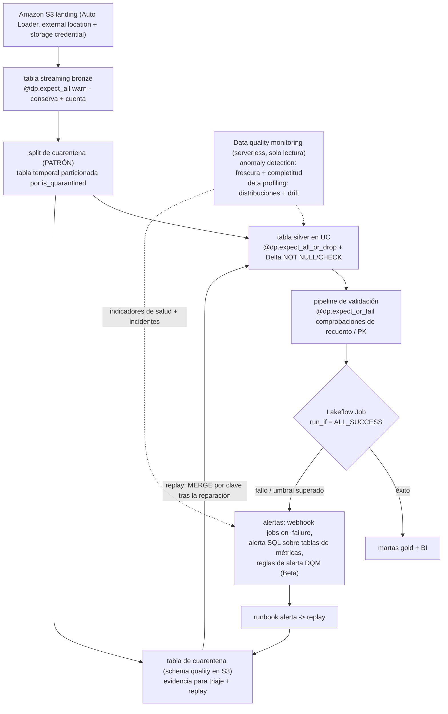
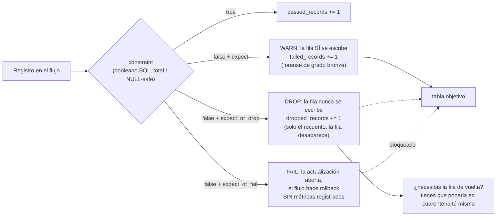
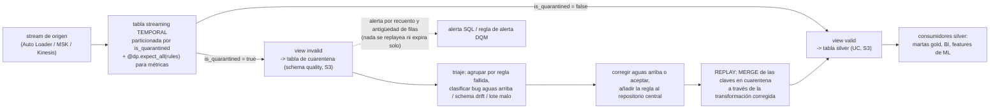
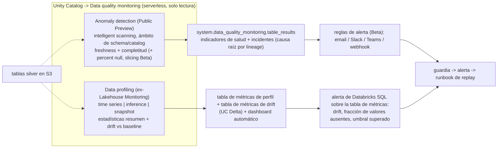
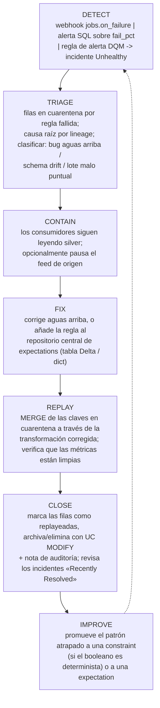

# Calidad de datos en el lakehouse de Databricks: restricciones, expectations, cuarentena y monitoreo

Toda lakehouse acaba topándose con la misma mañana desagradable: un dashboard aguas abajo muestra ingresos un 4% por debajo, y nadie puede decir si el negocio encogió o el pipeline mintió. La calidad de datos en Databricks sobre AWS es la disciplina que hace que esa mañana sea *respondible* — y a octubre de 2026 son cinco mecanismos distintos con cinco trabajos distintos, no una feature. **Constraints** son puertas de escritura siempre activas que Delta aplica en cada transacción. **Expectations** son comprobaciones SQL por registro dentro de los pipelines de Lakeflow, con tres acciones graduadas y métricas legibles por máquina. **Cuarentena** es un *patrón* documentado — no un decorador — que retiene los registros que fallan en una tabla de Unity Catalog en S3 para triaje y replay. **Data quality monitoring** es el plano de detección (**anomaly detection** a escala de schema más **data profiling** por tabla, la feature «antes conocida como Lakehouse Monitoring»). **Alertas y quality gates** viven en Lakeflow Jobs. Prevención, evidencia, detección, orquestación: si los mezclas, o pierdes filas en silencio o te ahogas en una tabla de cuarentena que nadie vacía.

La regla que mantiene recta toda la lección viene directamente de las docs: «**Expectations enforce data quality, not orchestration**» (docs .../ldp/expectation-patterns, fechado el **2026-07-14**). Constraints y expectations *previenen*; el monitoreo *detecta*; los jobs *ponen puertas*; la cuarentena *recuerda*. Un estate maduro necesita los cuatro verbos.

```text
 =============================================================
  MAPA DE LA LECCIÓN 10 - el stack de calidad de datos en AWS,
  a oct 2026
 ------------------------------------------------------------
  L1 CONSTRAINTS   Delta NOT NULL + CHECK, aplicados en WRITE
                   violación -> la transacción falla con un error
                   ADD CONSTRAINT valida las filas EXISTENTES
                   puede subir el writer protocol a >= 3
                   sin UDF / agregados / window / subconsultas
  L2 EXPECTATIONS  6 decoradores, 3 acciones, solo booleanos SQL
                   warn  -> fila conservada + métricas passed/failed
                   drop  -> fila eliminada + recuento dropped_records
                   fail  -> la actualización aborta, SIN métricas
                   necesita la edición ADVANCED
                   no existe expect_all_or_quarantine - nunca existió
  L3 QUARANTINE    un PATRÓN: tabla temporal de streaming
                   particionada por is_quarantined + views
                   valid/invalid -> tabla silver + tabla UC de
                   cuarentena en S3
  L4 MONITORING    anomaly detection (Public Preview): frescura
                      + completitud, indicadores de salud
                      -> system.data_quality_monitoring.table_results
                    data profiling (ex-Lakehouse Monitoring):
                      perfiles time series / inference / snapshot,
                      2 tablas de métricas + dashboard, drift vs
                      baseline
                    serverless, facturado DATA_QUALITY_MONITORING
  L5 ALERT+GATES   notificaciones de job/task + webhooks
                   (jobs.on_failure ...), alertas de Databricks SQL
                   sobre tablas de métricas, reglas de alerta DQM
                   (Beta), gates run_if (6 condiciones, defecto
                   ALL_SUCCESS)
  -------------------------------------------------------------
  La evidencia vive en: payloads de eventos flow_progress, event
  log, pipeline_events (Beta), tabla de cuarentena, tablas Delta
  de métricas
  Nunca: columnas _expectation_* en las tablas objetivo (mito
  obsoleto)
 =============================================================
```

En esta lección vas a:

- colocar las cinco capas en un solo diagrama de arquitectura y decir con precisión qué capa **previene**, cuál **detecta** y cuál **pone puertas**;
- escribir la escalera de constraints — `NOT NULL`, rango `CHECK` y regex — con la consulta previa que hace que la validación del historial al añadir tenga éxito, y explicar el efecto secundario del **writer protocol ≥3**;
- aplicar los **seis decoradores de expectations** con los alias heredados `@dlt.expect*` todavía en marcha, y demostrar por qué `fail` deja un dashboard vacío;
- consultar las métricas de expectations desde los payloads `flow_progress`, el event log y la tabla Beta **`system.lakeflow_pipeline_events_preview.pipeline_events`**;
- construir el **patrón de cuarentena** exactamente como está documentado (tabla temporal, partición `is_quarantined`, views valid/invalid) con reglas NULL-safe, y luego **replay** de las claves en cuarentena de forma idempotente con `MERGE`;
- configurar el bucle **alerta → replay**: notificaciones de job, códigos de eventos de webhook y las seis condiciones `run_if` que ramifican un job hacia las tasks de replay y de notificación;
- leer el **data quality monitoring** con su par de nombres verificado actual — **anomaly detection + data profiling** — con sus indicadores de salud, sus tablas de métricas y su producto de facturación `DATA_QUALITY_MONITORING`;
- pesar los tres planos entre sí en un **Veredicto comparativo**, triar **doce trampas**, estudiar **NAB y Burberry** en AWS, leer el **recuadro de actualizaciones de 2026** y practicar con **doce preguntas** más cuatro comprobaciones interactivas.

---

## 1. El stack de cinco capas: prevención, evidencia, detección, orquestación

### 1.1 Un modelo mental, cuatro verbos

| Capa | Mecanismo | Verbo | Se dispara cuando | ¿Necesita orquestación? |
|---|---|---|---|---|
| **1. Constraints de Delta** | `NOT NULL`, `CHECK` — aplicados por el writer de Delta | **previene** | cualquier escritura en la tabla, cualquier motor (Spark batch, sink de Structured Streaming, pipeline de Lakeflow, JDBC) | No — cero tuberías |
| **2. Expectations de pipeline** | seis decoradores `dp.expect*` / `CONSTRAINT ... EXPECT` | **previene** (drop) o **mide** (warn) o **detiene** (fail) | cada registro que atraviesa una consulta del pipeline | No — pero necesita la edición **Advanced** |
| **3. Cuarentena** | patrón documentado: tabla temporal + `is_quarantined` + views | **recuerda** | cada actualización, como partición del stream | En parte — tú la construyes y la vacías |
| **4. Data quality monitoring** | anomaly detection + data profiling | **detecta** | escaneos serverless en segundo plano | No — «does not modify any tables it monitors, nor does it add overhead to any jobs» (docs, **2026-09-11**) |
| **5. Alertas + gates** | notificaciones de job, webhooks, alertas SQL, reglas de alerta DQM, `run_if` | **notifica + pone puertas** | fallos, umbrales, tablas no saludables | Sí — esto *es* orquestación |

De la tabla se desprenden dos consecuencias inmediatas. Primero, las capas 1–2 son **en tiempo de escritura**: no pueden proteger una tabla en la que nadie escribe (una tabla heredada no recibe protección hasta que un propietario añade constraints o expectations aguas arriba). Segundo, la capa 4 es **detección pura**: nunca bloquea nada, así que un indicador de salud que dice «Unhealthy» es una llamada, no un cortafuegos.



### 1.2 Lo que cada capa *no* puede hacer (el espacio negativo)

- **Constraints** no pueden comprobar unicidad ni integridad referencial: `CHECK` prohíbe «User-defined functions. Aggregate functions. Window functions. Functions returning multiple rows» (docs .../tables/constraints, **2026-09-11**) — y las declaraciones de clave primaria, clave foránea y `UNIQUE` son «informational only and aren't enforced» (misma página).
- **Expectations** no pueden llamar a Python, a servicios externos ni a subconsultas (docs .../ldp/expectations, **2026-09-11**) — las comprobaciones entre tablas pertenecen a un pipeline de validación o a un notebook.
- **Cuarentena** no tiene automatización de plataforma: «nothing in the platform auto-replays or auto-expires quarantine tables» — ese trabajo es de tu runbook (práctica del curso; coherente con el patrón documentado).
- **Monitoreo** no puede aplicar: «no modifica ninguna de las tablas que monitorea» (docs, **2026-09-11**).
- **Jobs** no ven filas: ven *estados de task* y *métricas que tú les publicas*.

- **📚 ¿Sabías que…?** Todo el plano de detección se factura bajo un único producto con nombre: el data quality monitoring «runs on serverless compute and is billed as serverless DBUs under the `DATA_QUALITY_MONITORING` billing product» (docs .../data-quality-monitoring, **2026-09-11**). Para resultados creados **a partir de febrero de 2026** encuentras esas filas con `billing_origin_product = 'DATA_QUALITY_MONITORING'`; las filas de profiling más antiguas siguen etiquetadas como `custom_tags['LakehouseMonitoring'] = 'true'` — el nombre antiguo del producto sobrevive *dentro de los datos de facturación*, y por eso exactamente esta lección enseña ambos nombres.

---

## 2. Capa 1 — constraints de Delta: la puerta de escritura barata y siempre activa

### 2.1 Los dos tipos aplicados y lo que cuesta «enforced»

«Las constraints aplicadas verifican la integridad de los datos antes de añadir filas a una tabla» y «cuando se viola una constraint, la transacción falla con un error» (docs .../tables/constraints, **2026-09-11**). Solo dos tipos se aplican: **`NOT NULL`** y **`CHECK`**. Todo lo demás — `PRIMARY KEY`, `FOREIGN KEY`, `UNIQUE` — es metadatos para el optimizador («no se aplican»; PK/FK disponibles en DBR **13.3 LTS+** para Unity Catalog y tablas Delta, **GA en DBR 15.2+**; `UNIQUE` está en **Public Preview** en Databricks SQL y DBR **18.2+**).

Tres hechos operativos deciden cómo despliegas las constraints:

1. **La validación al añadir es real.** «Databricks verifica que todas las filas existentes satisfacen la constraint antes de añadir una constraint `NOT NULL` a una tabla» — y `ALTER TABLE ADD CONSTRAINT` «verifica que todas las filas existentes satisfacen la constraint antes de añadir la constraint a la tabla.» No puedes atornillar una constraint a una tabla sucia: repara o pone en cuarentena primero el historial.
2. **El writer protocol se mueve.** «Adding a constraint upgrades the table writer protocol if the current writer version is less than 3» — los clientes Delta externos antiguos pueden romperse. Verifica tus consumidores antes del despliegue de DQ.
3. **La eliminación es deliberada.** En DBR **15.4 LTS+** eliminas una check constraint con `DROP FEATURE` — no con un `ALTER` cualquiera.

Las constraints son agnósticas del motor: se aplican «to any Delta write path» — Spark batch, sinks de Structured Streaming, pipelines de Lakeflow, ingestión JDBC —, así que son la única capa que protege tablas escritas *fuera* de tus pipelines.

### 2.2 Ejemplo resuelto E1 — la escalera de constraints con su guardia previa

**A octubre de 2026, tabla silver de Unity Catalog en S3.** La forma documentada de la escalera (`people_demo` en las docs de constraints), anotada con el guardia que hace que la validación al añadir tenga éxito:

```sql
-- (0) PRE-FLIGHT: run BEFORE ALTER TABLE. Expect 0 rows, otherwise repair first.
--     The predicate is written NULL-safe: NULL must count as a violation.
SELECT count(*) AS rows_that_would_block_the_constraint
FROM lake.silver.people_demo
WHERE NOT (birthDate > DATE '1900-01-01')
   OR (birthDate > DATE '1900-01-01') IS NULL;

-- (1) Table declared with NOT NULL on the columns that must always be present
CREATE TABLE lake.silver.people_demo (
  id         INT    NOT NULL,
  middleName STRING,
  ssn        STRING,
  birthDate  DATE
);

-- (2) Relax what the business really tolerates
ALTER TABLE lake.silver.people_demo ALTER COLUMN middleName DROP NOT NULL;

-- (3) Tighten what must be present - verifies EVERY existing row first
ALTER TABLE lake.silver.people_demo ALTER COLUMN ssn SET NOT NULL;

-- (4) Range check - also verifies every existing row first
ALTER TABLE lake.silver.people_demo
  ADD CONSTRAINT dateWithinRange CHECK (birthDate > DATE '1900-01-01');

-- (5) Regex idiom from the validate docs (docs .../transform/validate, 2026-09-11)
ALTER TABLE lake.silver.orders
  ADD CONSTRAINT sku_format CHECK (sku REGEXP '^[A-Za-z0-9]+$');

-- (6) Range idiom, the documented two-sided form
ALTER TABLE lake.silver.orders
  ADD CONSTRAINT pct_within_range CHECK (pct_complete >= 0 AND pct_complete <= 100);

-- (7) Audit what is actually enforced today
SHOW TBLPROPERTIES lake.silver.people_demo;
-- (8) Removal, DBR 15.4 LTS+ only
-- ALTER TABLE lake.silver.people_demo DROP FEATURE 'dateWithinRange' CASCADE;
```

Si el paso (0) devuelve distinto de cero, el `ALTER TABLE` posterior falla con un error y no cambia nada — que es el resultado correcto y la razón por la que el guardia es el paso 0, no un añadido posterior. Observa lo que la escalera *no* puede contener: `CHECK (count(distinct id) = count(*))` (agregados prohibidos), un `CHECK` que llame a una UDF (prohibido), cualquier subconsulta. **La unicidad y la integridad referencial están fuera del alcance de `CHECK` por diseño** — usa un pipeline de validación con `expect_or_fail` sobre `count(*) = count(distinct pk)`, los tests `unique`/`relationships` de dbt, o el monitoreo (sección 6).

> [!IMPORTANT]
> ⚠️ **Las constraints protegen a quienes escriben, no a quienes leen — y nunca arreglan el historial retrospectivamente.** Añadir una constraint valida las filas existentes pero *no arregla nada*: el historial sucio debe repararse o ponerse en cuarentena primero. Al revés, una tabla heredada sin constraints sigue sirviendo filas malas a cada consumidor hasta que un propietario actúa; los lectores no reciben ningún error. Las constraints son una puerta **en tiempo de escritura** para **todo** escritor — ahí está su poder y su punto ciego.

---

## 3. Capa 2 — expectations de Lakeflow: seis decoradores, tres acciones

### 3.1 El inventario verificado

«Expectations are optional clauses in pipeline materialized view, streaming table, or view creation statements that apply data quality checks on each record passing through a query. Expectations use standard SQL Boolean statements» (docs .../ldp/expectations, footer **11 sep 2026**). «The `dp` module includes **six decorators** to control expectations behavior» (referencia de Python, página fechada el **2026-09-11**), apilados **después** del decorador de dataset y **antes** de la función:

| Decorador | Recibe | Acción ante una violación |
|---|---|---|
| `@dp.expect(description, constraint)` | una regla | **warn** (por defecto): «Invalid records are written to the target» + recuentos passed/failed |
| `@dp.expect_or_drop(...)` | una regla | **drop**: «Invalid records are dropped before data is written to the target. The count of dropped records is logged» |
| `@dp.expect_or_fail(...)` | una regla | **fail**: «Invalid records prevent the update from succeeding. Manual intervention is required before reprocessing» |
| `@dp.expect_all({desc: sql, ...})` | **dict de Python** | warn ante cualquier regla que falle |
| `@dp.expect_all_or_drop({...})` | dict | drop ante cualquier regla que falle |
| `@dp.expect_all_or_fail({...})` | dict | hace fallar la actualización ante cualquier regla que falle |

Gemelo SQL para datasets escritos en SQL: `CONSTRAINT name EXPECT (expr)` con la cláusula opcional `ON VIOLATION DROP ROW` o `ON VIOLATION FAIL UPDATE`. Cuatro cláusulas deciden el diseño en producción:

1. «**Como `fail` hace que la actualización falle cuando se detecta un registro inválido, no se registran métricas.**» Fail es una señal de alto, no un instrumento de medición.
2. «El **nombre de una expectation debe ser único para un dataset determinado**» (reutilizable entre datasets).
3. Las constraints son SQL puro: sin «Custom Python functions, External service calls, Subqueries referencing other tables.»
4. Puerta de edición: «Core … doesn't require advanced features such as change data capture (CDC) or expectations. Pro … plus … CDC. Advanced … and includes **data quality constraints with expectations**» (docs .../ldp/configure-pipeline, **2026-10-01**).

**No existe el decorador `expect_all_or_quarantine`** — ni bajo `dp` ni bajo `dlt`. Existen exactamente seis decoradores; la cuarentena se construye a mano en la sección 5. Las expectations se adhieren a streaming tables, materialized views y temporary views (las métricas de las views no son fiables — «las views solo se calculan cuando se las consulta»); los sinks y los flujos `AUTO CDC FROM SNAPSHOT` no pueden llevarlas.



### 3.2 Ejemplo resuelto E2 — un DQ suite aplicado sobre una tabla silver (ambos estilos de API)

**A octubre de 2026, serverless, edición Advanced, objetivos de Unity Catalog.** La columna izquierda es el estilo de alias heredado que todavía funciona; la derecha es el estilo actual `dp`. Los mismos seis decoradores, las mismas tres acciones.

```python
# --- LEGACY STYLE (2022-2024 tutorials) - still functional, Databricks recommends dp
import dlt

@dlt.table
@dlt.expect("order_id_not_null", "order_id IS NOT NULL")                    # warn
@dlt.expect_or_drop("valid_amount", "amount IS NOT NULL AND amount >= 0")   # drop
def bronze_orders():
    return spark.readStream.format("cloudFiles").json("/Volumes/lake/landing/orders/")

# --- CURRENT STYLE (docs .../ldp/developer/*, 2026-09-11 / 2026-08-06)
from pyspark import pipelines as dp

bronze_rules = {
    "order_id_not_null": "order_id IS NOT NULL",
    "event_ts_not_null": "event_ts IS NOT NULL",
}
silver_rules = {
    "valid_order_id":   "order_id IS NOT NULL",                       # total (NULL-safe)
    "valid_amount":     "amount IS NOT NULL AND amount >= 0",
    "valid_currency":   "currency IN ('USD','EUR','GBP')",
}

@dp.table(name="bronze_orders", table_properties={"quality": "bronze"})
@dp.expect_all(bronze_rules)                    # WARN: keep rows, emit metrics
def bronze_orders():
    return (spark.readStream.format("cloudFiles")
                 .option("cloudFiles.format", "json")
                 .load("/Volumes/lake/landing/orders/"))

@dp.table(name="silver_orders")
@dp.expect_all_or_drop(silver_rules)            # DROP: bad rows excluded, counts logged
def silver_orders():
    return spark.readStream.table("bronze_orders").filter("event_type = 'ORDER'")

@dp.materialized_view(name="gold_daily_revenue")
@dp.expect_or_fail("revenue_sane", "total_revenue >= 0")   # FAIL: abort this flow only
def gold_daily_revenue():
    return (spark.read.table("silver_orders")
                 .groupBy("order_date", "currency")
                 .agg({"amount": "sum"}))
```

Narra el suite antes de ejecutarlo: **bronze advierte** (capa forense — las filas malas son evidencia, no ruido), **silver descarta** (los consumidores nunca ven filas inválidas; solo sobreviven los recuentos — la sección 5 muestra qué hacer cuando un recuento no basta), **gold falla** (un total de ingresos negativo es imposible, así que aborta en lugar de publicar). Cada regla de arriba está escrita **total** — `amount IS NOT NULL AND amount >= 0`, nunca `amount >= 0` a secas — porque las docs exigen que cada predicado sea un booleano por registro, y una regla que pueda evaluarse a NULL con entradas NULL no se comportará como su autor quiso en un split hecho a mano (docs .../ldp/expectation-patterns, **2026-07-14**; la semántica del veredicto sobre NULL no está detallada, así que haz las reglas totales y deja de adivinar).

### 3.3 Ejemplo resuelto E2b — el gemelo SQL

```sql
CREATE OR REFRESH STREAMING TABLE lake.silver.orders AS
SELECT * FROM STREAM lake.bronze.orders_raw
CONSTRAINT order_id_not_null EXPECT (order_id IS NOT NULL)                       -- warn
CONSTRAINT valid_amount         EXPECT (amount IS NOT NULL AND amount >= 0)
  ON VIOLATION DROP ROW;                                                        -- drop
```

Ambas estrategias de nombrado aparecen en las docs: una expectation fusionada, o cláusulas separadas «resulting in multiple entries under different names» en el event log — elige una convención por dataset para que tus consultas de métricas agrupen correctamente.

- **📚 ¿Sabías que…?** Una expectation en modo fail produce el mensaje de error más *útil* de todo el stack de calidad de esta lección. El ejemplo documentado imprime nombre del flujo, nombre de la expectation, registro de entrada y registro de salida en una sola cadena: `[EXPECTATION_VIOLATION.VERBOSITY_ALL] Flow 'sensor-pipeline' failed to meet the expectation. Violated expectations: 'temperature_in_valid_range'. Input data: '{"id":"TEMP_001",…}'` (docs .../ldp/expectations, **2026-09-11**). En un pipeline con trigger solo la actualización de ese flujo hace rollback — los demás flujos paralelos siguen actualizando —, así que trata el mensaje como un reporte de bug *preciso*, no como una alarma de todo el pipeline.

---

## 4. Dónde viven las métricas de expectations (y dónde no)

### 4.1 El contrato es un payload de evento, no una columna

Las docs actuales definen las métricas puramente como **payloads de eventos `flow_progress`**: «las métricas del número de registros que pasaron y fallaron una expectation se almacenan en el objeto `details:flow_progress.data_quality.expectations`. La métrica del número de registros descartados se almacena en el objeto `details:flow_progress.data_quality`» (docs .../ldp/monitor-event-logs, **2026-10-09**). El esquema del array está publicado: `array<struct<name: string, dataset: string, passed_records: int, failed_records: int>>`, donde `dropped_records` cuenta las filas que «fallaron una o más expectations».

Tres superficies de lectura, un contrato:

1. **UI del pipeline → dataset → pestaña Data quality** — solo warn/drop, a escala humana, por pipeline.
2. **El event log** — una tabla Delta oculta, `SELECT * FROM event_log(<pipelineId>)`, publicable en una tabla con nombre de UC. Los pipelines retienen **60 días** de actualizaciones pasadas en la UI/API; el detalle más antiguo vive solo en el event log (docs .../ldp/configure-pipeline, **2026-10-01**).
3. **`system.lakeflow_pipeline_events_preview.pipeline_events` (Beta)** — la superficie recomendada a escala de pipeline con consultas publicadas de «failed expectations by dataset» y un dashboard de Lakeview listo para importar; necesita admin de metastore/cuenta o `USE`+`SELECT` sobre los schemas de sistema (docs .../ldp/monitor-and-query-events, **2026-10-09**).

> ⚠️ **WARNING — el mito de la columna obsoleta.** Si tu SQL de monitoreo selecciona `_expectation_name` o `_expectation_type` desde una tabla objetivo de un pipeline, estás ejecutando el blog de 2023 de alguien: las docs actuales definen el payload de arriba y nada más (doc de expectations **2026-09-11**; doc del event log **2026-10-09**). Y si una expectation en modo fail muestra *ninguna* métrica, eso no es un bug — «metrics are not recorded» por diseño.

### 4.2 Ejemplo resuelto E3 — el suite de métricas: event log, tabla de sistema, factura

```sql
-- (a) Pass/fail rate per expectation from the per-pipeline event log
WITH exploded AS (
  SELECT explode(from_json(
           details:flow_progress:data_quality:expectations,
           "array<struct<name: string, dataset: string, passed_records: int, failed_records: int>>"
         )) AS e
  FROM event_log(<pipeline_id>)
  WHERE event_type = 'flow_progress'
)
SELECT e.dataset AS dataset, e.name AS expectation,
       SUM(e.passed_records) AS passing, SUM(e.failed_records) AS failing,
       ROUND(100 * SUM(e.failed_records)
             / NULLIF(SUM(e.passed_records) + SUM(e.failed_records), 0), 3) AS fail_pct
FROM exploded GROUP BY 1, 2 ORDER BY failing DESC;

-- (b) Region-wide, across every pipeline in the account (Beta system table)
SELECT expectation.dataset, expectation.name,
       SUM(expectation.failed_records) AS failed
FROM system.lakeflow_pipeline_events_preview.pipeline_events
LATERAL VIEW explode(variant_get(details,
  '$.flow_progress.data_quality.expectations',
  'ARRAY<STRUCT<name:STRING,dataset:STRING,passed_records:BIGINT,failed_records:BIGINT>>')) AS expectation
WHERE event_type = 'flow_progress'
GROUP BY 1, 2
HAVING SUM(expectation.failed_records) > 0;

-- (c) What does the detection plane cost? (DBU QUANTITY only - see note below)
SELECT billing_origin_product,
       CASE WHEN usage_metadata.schema_id IS NOT NULL THEN 'anomaly detection'
            WHEN usage_metadata.table_id  IS NOT NULL THEN 'data profiling' END AS capability,
       sku_name, SUM(usage_quantity) AS dbus
FROM system.billing.usage
WHERE billing_origin_product = 'DATA_QUALITY_MONITORING'
  AND usage_date >= current_date() - 30
GROUP BY 1, 2, 3;
```

La consulta (c) suma deliberadamente **DBUs, no dólares**: el nombre del producto de facturación y la división `schema_id`/`table_id` están documentados (docs .../data-quality-monitoring/expense, **2026-09-11**), pero ninguna tarifa de lista para `DATA_QUALITY_MONITORING` está publicada en las páginas que este curso verificó — así que ponle precio desde *la* tarifa serverless de tu cuenta y etiquétalo como supuesto.

---

## 5. Capa 3 — cuarentena: un patrón, no un decorador

Cuando las expectations en modo drop son demasiado destructivas (datos regulados, requisitos de replay, «necesitamos ver qué rechazamos»), necesitas que las filas malas se *conserven*. Databricks documenta la receta: una **tabla temporal de streaming particionada por un flag calculado `is_quarantined`**, anotada con `@dp.expect_all(rules)` para que las métricas sigan fluyendo, y luego dos views que dividen el stream (docs .../ldp/expectation-patterns, **2026-07-14**).

### 5.1 Ejemplo resuelto E4 — la forma documentada de cuarentena

```python
from pyspark import pipelines as dp
from pyspark.sql.functions import expr

rules = {
    "valid_pickup_zip":  "(pickup_zip IS NOT NULL)",          # total rules only
    "valid_dropoff_zip": "(dropoff_zip IS NOT NULL)",
}
# NOT(rule1 AND rule2 ...) -> TRUE means "at least one rule failed"
quarantine_expr = "NOT({0})".format(" AND ".join(rules.values()))

@dp.view
def raw_trips_data():
    return spark.readStream.table("samples.nyctaxi.trips")

@dp.table(temporary=True, partition_cols=["is_quarantined"])
@dp.expect_all(rules)                      # metrics still recorded per rule
def trips_data_quarantine():
    return (spark.readStream.table("raw_trips_data")
                 .withColumn("is_quarantined", expr(quarantine_expr)))

@dp.view
def valid_trips_data():     # -> materialize as silver
    return spark.read.table("trips_data_quarantine").filter("is_quarantined = false")

@dp.view
def invalid_trips_data():   # -> materialize as the UC quarantine table
    return spark.read.table("trips_data_quarantine").filter("is_quarantined = true")
```

En producción, promueve `invalid_trips_data` a un `@dp.table(name="orders_quarantine")` real en un schema `quality` dedicado. En pipelines de Unity Catalog ambas tablas aterrizan físicamente en **el almacenamiento gestionado del schema en S3** (respaldo: la ubicación del catalog y después la raíz del metastore — docs .../ldp/unity-catalog, **2026-10-09**), o en tu propio prefijo S3 detrás de una external location; mismas llaves KMS, mismas reglas de ciclo de vida (p. ej., transición de los prefijos de cuarentena a un almacenamiento más barado después de N días — recomendación del lado de AWS).



### 5.2 Ejemplo resuelto E5 — SQL de replay: triaje, reparación, MERGE de vuelta, cierre

**Práctica del curso, coherente con el patrón documentado (digest 10 §B6).** El ACID de Delta más el estado del pipeline hacen que los replays sean idempotentes **siempre que replayees por clave**, nunca por append a ciegas.

```sql
-- (1) TRIAGE: what is in there, by failed rule and age?
SELECT quarantine_reason, min(quarantine_date) AS oldest, count(*) AS rows
FROM lake.quality.orders_quarantine
WHERE replayed_at IS NULL
GROUP BY 1 ORDER BY rows DESC;

-- (2) CONTAIN: consumers keep reading silver - bad rows never landed there.
-- (3) FIX upstream (bad file format, enum drift, late schema change) or accept the rows.

-- (4) REPLAY: reprocess quarantined keys through the FIXED transform, idempotently
MERGE INTO lake.silver.orders AS t
USING (
  SELECT order_id, order_ts, amount, currency, customer_id
  FROM lake.quality.orders_quarantine
  WHERE replayed_at IS NULL AND quarantine_date >= current_date() - 7
) AS s
ON t.order_id = s.order_id
WHEN MATCHED AND s.repaired THEN UPDATE SET *
WHEN NOT MATCHED THEN INSERT *;

-- (5) CLOSE: mark the evidence, don't destroy it silently
UPDATE lake.quality.orders_quarantine
SET replayed_at = current_timestamp()
WHERE replayed_at IS NULL AND quarantine_date >= current_date() - 7;

-- (6) GUARD the silver table with the always-on layer (after history is clean)
ALTER TABLE lake.silver.orders
  ADD CONSTRAINT amount_sane CHECK (amount IS NOT NULL AND amount >= 0);
```

Dos puntos de disciplina. **La contención es gratis**: los consumidores silver nunca vieron las filas, así que el replay es una *reparación*, no un rollback de incidente. **El cierre se gobierna**: marcar filas como replayeadas, archivarlas o eliminarlas requiere `MODIFY` de UC sobre la tabla de cuarentena y debería dejar una pista de auditoría — la evidencia de calidad es en sí misma datos gobernados, y los data stewards normalmente reciben solo `SELECT` sobre la cuarentena, concedido de forma estrecha.

> ⚠️ **WARNING — expectations usadas como filtros.** `expect` (warn) **conserva** las filas inválidas en el objetivo: bien en bronze, peligroso en una ruta de servicio silver/gold donde «la comprobación existe» se siente como protección. `expect_or_drop` descarta filas en silencio — solo queda un recuento, y un recuento no se puede replayear. `expect_or_fail` es la única acción que detiene datos, y **no registra métricas**. Elige por capa: **warn en bronze, drop-o-cuarentena en silver, fail en los gates de validación** — y nunca escribas una regla `expect` en una tabla de servicio y la llames estrategia de calidad (docs .../ldp/expectations, **2026-09-11**; expectation-patterns, **2026-07-14**).

> [!WARNING]
> **La tabla de cuarentena es un pasivo que crece solo.** Nada en la plataforma la replayea ni la hace expirar automáticamente. Añade tus propios controles: alertas SQL o reglas de alerta DQM sobre el recuento y la antigüedad de las filas de cuarentena, una regla de ciclo de vida de S3 sobre el prefijo, un runbook de replay con un SLA por incumplimiento, y grants de UC lo bastante estrechos para que solo el rol de guardia pueda hacer `MODIFY` sobre ella. Una tabla de cuarentena que nadie vacía es un incidente de pérdida de datos silencioso a cámara lenta.

---

## 6. Capa 4 — data quality monitoring: anomaly detection + data profiling

### 6.1 La nomenclatura verificada (esto es lo que octubre de 2026 dice de verdad)

Bajo Unity Catalog → **Data quality monitoring**, las docs fechadas el **11 sep 2026** listan dos capacidades: **Anomaly detection** (Public Preview) y **Data profiling** — y la misma página afirma «**Data profiling was formerly known as Lakehouse Monitoring.**» Memoriza el mapa:

| Vocabulario antiguo (tutoriales ≤2025) | Vocabulario actual de oct 2026 | Qué hace en realidad |
|---|---|---|
| «Lakehouse Monitoring» | **Data profiling** | perfiles por tabla: estadísticas resumen, drift frente a ventanas de tiempo o a una **tabla baseline**, métricas SQL personalizadas — dos tablas Delta de métricas + un dashboard automático en un schema de UC que tú eliges |
| «monitores de freshness / volumen» | **Anomaly detection** | «intelligent scanning» a escala de schema o catalog; modelos aprendidos por tabla para **freshness** (commit inusualmente tarde → *stale*) y **completitud** (recuento de filas de 24 horas por debajo del límite inferior predicho → *incomplete*) |
| «configuración de monitores por JSON / CLI» | UI + grants `MANAGE` | activación de hasta **50 schemas a la vez** desde un catalog; requiere `MANAGE` sobre el schema o el catalog padre |

Cualquier material de curso que hable de «tres tipos de monitor bajo Lakehouse Monitoring» está obsoleto en dos ejes — el **nombre** y la **división** entre detección y profiling.

### 6.2 Qué entrega cada capacidad

- **Anomaly detection** (docs **2026-10-09**, Public Preview): job en segundo plano por schema; resultados en **`system.data_quality_monitoring.table_results`**; indicadores de salud (*Healthy / Unhealthy / Training / Error / Excluded / Not enabled*) en Catalog Explorer y en nodos de lineage; «Smart scanning might delay the population of health indicators for some tables by up to **two weeks**»; extras Beta **percent null** y **completeness slicing** (hasta **3** columnas de slicing, solo donde una columna tenga **≤ 50 valores distintos**); el análisis de causa raíz «uses Unity Catalog data lineage»; los incidentes admiten «Assign to me» y «Not an issue» con una asignación que persiste **7 días**. Limitaciones: sin views ni foreign tables; **deshabilitarlo borra el job y todas las tablas de resultados — irreversible**.
- **Data profiling** (docs **2026-09-11**): tres tipos de perfil — **Time series** (métricas a lo largo de ventanas de tiempo), **Inference** (logs de peticiones de modelo), **Snapshot** («La tabla completa se procesa en cada actualización. El tamaño máximo de tabla para un perfil snapshot es **4TB**»). Salida: «La tabla de métricas del perfil contiene estadísticas resumidas … La tabla de métricas de drift contiene estadísticas relacionadas con el drift de los datos a lo largo del tiempo», ambas tablas Delta UC ordinarias más un dashboard automático. Los perfiles time series e inference «solo computan métricas de los últimos **30 días**». Requisitos: `USE CATALOG`, `USE SCHEMA`, `SELECT`, `MANAGE`; cómputo serverless para los jobs. El blog de GA de 2024 recomienda activar **CDF** para el profiling incremental en los perfiles time series/inference.
- **Solo lectura por contrato**: el monitoreo «no modifica ninguna de las tablas que monitorea, ni añade sobrecarga a los jobs que poblan esas tablas» (docs, **2026-09-11**). Detección, no aplicación.



- **📚 ¿Sabías que…?** El tipo de perfil **snapshot** tiene un techo duro — «**El tamaño máximo de tabla para un perfil snapshot es 4TB**» —, mientras que los perfiles time series e inference solo «computan métricas de los últimos 30 días» (docs .../data-profiling, **2026-09-11**). Las auditorías de horizonte largo necesitan por tanto o una tabla baseline exportada para la comparación de drift, o el historial del event log fuera de la ventana del perfil; la respuesta de las docs a «necesito más de 30 días» es literalmente «contacta con tu equipo de cuenta de Databricks».

---

## 7. Capa 5 — alerta → replay: notificaciones, gates y el runbook

### 7.1 Los tres planos de alerta

| Plano | Qué observa | Hechos de configuración (docs, 2026) |
|---|---|---|
| **Notificaciones de Lakeflow Jobs** | ciclo de vida de task/job: inicio, éxito, fallo, umbral de duración, backlog de streaming, mantenimiento | email o **system destinations** configuradas por el admin (Slack, Teams, PagerDuty, webhooks); «**max 3 system destinations per each notification event type**» por job/task; códigos de webhook `jobs.on_start`, `jobs.on_success`, `jobs.on_failure`, `jobs.on_duration_warning_threshold_exceeded`; «Job-level notifications aren't sent when failed tasks are retried» → usa notificaciones por task + «Mute until the last retry»; las alertas de backlog de streaming «aren't supported for pipeline tasks» (docs .../jobs/notifications, **2026-10-09**) |
| **Alertas de Databricks SQL** | tu SQL sobre las tablas de métricas de perfil/drift o las métricas de eventos | «create a Databricks SQL query on the profile metrics table or drift metrics table. You then create a Databricks SQL alert for this query»; email por defecto, webhook/Slack/PagerDuty disponibles (docs .../monitor-alerts, **2025-01-21**) |
| **Reglas de alerta DQM (Beta)** | tablas que se vuelven **Unhealthy** en un catalog o schema | «Each alert rule is scoped to a catalog or a specific schema»; destinos «email … Slack, Microsoft Teams, or webhook»; requiere `MANAGE` sobre el schema/catalog (docs .../anomaly-detection/alerts, **2026-10-01**) |

Los consumidores de máquinas deben usar **webhooks definidos por el usuario**: «If you require a specific schema or formatting for notifications, Databricks recommends configuring a user-defined webhook» — los cuerpos de los mensajes de Slack no son un contrato estable (misma página).

### 7.2 Quality gates: `run_if`, seis condiciones

«Configure task dependencies (Run if)» (docs **2026-06-25**) ofrece exactamente seis condiciones — `ALL_SUCCESS` (por defecto), `AT_LEAST_ONE_SUCCESS`, `NONE_FAILED`, `ALL_DONE`, `AT_LEAST_ONE_FAILED`, `ALL_FAILED`. Semántica que debes dominar: con una condición orientada al éxito, una task que no se cumple se marca **`Upstream failed`**; con una condición orientada al fallo se marca **`Excluded`**; y «las tasks upstream con el estado de resultado `Excluded` se tratan como exitosas al evaluar las condiciones `Run if`.»

### 7.3 Ejemplo resuelto E6 — el job de alerta → replay (YAML de asset bundle)

```yaml
# databricks.yml - quality gate + alert -> replay branches (as of Oct 2026)
resources:
  jobs:
    silver_quality_gate:
      name: silver-quality-gate
      max_concurrent_runs: 1
      tasks:
        - task_key: validate_pipeline            # expect_or_fail checks live HERE
          pipeline_task: { pipeline_key: validate_pipeline }
        - task_key: build_silver
          pipeline_task: { pipeline_key: orders_pipeline }
          depends_on: [{ task_key: validate_pipeline }]   # default run_if = ALL_SUCCESS
        - task_key: notify_quarantine            # runs only when validation failed
          notebook_task: { notebook_path: ../notebooks/summarize_quarantine.py }
          depends_on: [{ task_key: validate_pipeline }]
          run_if: AT_LEAST_ONE_FAILED            # unmet -> task Excluded, not failed
        - task_key: post_check                   # ALWAYS runs, even after failures
          sql_task:
            query: { query_id: 1234567890 }      # failed-records ratio > threshold
          depends_on: [{ task_key: build_silver }]
          run_if: ALL_DONE
      email_notifications:
        on_failure: ["oncall-data@example.com"]
      webhook_notifications:
        - id: ops-webhook                        # user-defined: schema-stable payload
          url: "{{secrets/lake/ops_webhook_url}}"
          events: ["on_failure"]                 # jobs.on_failure JSON payload
      # job-level: at most 3 system destinations per event type;
      # retries: default 3 - pair task notifications with "mute until last retry"
```

La dependencia por defecto (`ALL_SUCCESS`) es lo que convierte una expectation en modo fail en un gate de verdad: «Because a pipeline task fails when its update fails, the downstream task doesn't run unless the validation pipeline succeeds» (expectation-patterns, **2026-07-14**). Recuerda el límite dentro del pipeline — un `expect_or_fail` dentro de un solo pipeline con trigger solo hace fallar ese flujo, así que **el gate es el job, no el decorador**.

### 7.4 El runbook, como máquina de estados



La línea de roadmap del blog de 2026-02-04 — «**Filter and quarantine bad data**: Proactively identify bad data and prevent it from reaching consumers» — es un *ítem de roadmap*, no una capacidad de plataforma entregada. Hoy el bucle lo ejecutas tú.

- **📚 ¿Sabías que…?** Los incidentes de anomaly detection son un workflow con fecha de caducidad: las asignaciones persisten **7 días**, «Recently Resolved Incidents» está en Beta, y el smart scanning «podría retrasar la población de los indicadores de salud de algunas tablas hasta **dos semanas**» (docs .../anomaly-detection, **2026-10-09**) — así que un schema de estreno sin indicadores está en *Training*, no en *Healthy*. Y la otra cara: «Cuando desactivas anomaly detection, se eliminan el job y todas las tablas e información de anomaly detection. Esta acción no se puede deshacer.»

### 7.5 Ejemplo resuelto E7 — comprobaciones de terceros solo sobre las rutas documentadas oficialmente

**Great Expectations** está documentado por GX itself para Databricks — `%pip install` en un notebook, Data Context / Expectation Suite / Checkpoint / Data Docs, metadatos en DBFS o UC Volumes (docs del proveedor, consultadas 2026-10): no existe ninguna página de integración en `docs.databricks.com`, así que enséñalo como «instala la librería OSS en un job cluster y ejecuta las validaciones como task de job», nunca como feature de plataforma. Los **dbt tests** tienen una ruta oficial de Databricks: el adaptador mantenido por Databricks **`dbt-databricks`** compila `data_tests: [unique, not_null, accepted_values, relationships]` en SQL de recuento de filas fallidas contra Unity Catalog, y «cuando ejecutas `dbt test`, dbt itera a través de tus archivos YAML … Si este número es 0, la prueba es exitosa» (quickstart de dbt, **2026-10-07**) — útil cuando la capa de transformación es dbt, redundante con constraints/expectations cuando es Lakeflow. **Deequ** no tenía ninguna ruta de integración oficial con Databricks documentada en oct de 2026 — solo patrón de comunidad.

---

## 8. Veredicto comparativo: expectations vs constraints vs monitoreo

> **Veredicto comparativo — expectations vs constraints vs data quality monitoring (a octubre de 2026)**
> - **Constraints de Delta (`NOT NULL` / `CHECK`)** — la puerta **siempre activa y agnóstica del motor**. Cero orquestación, aplicada en cada escritura a la tabla desde cualquier motor, hace fallar la transacción ante una violación. Debilidades: sin agregados/UDFs/subconsultas (así que sin unicidad ni integridad referencial), la validación del historial al añadir significa que debes limpiar primero, posible salto del writer protocol ≥3, y protege **a quienes escriben, no a quienes leen**. *Elige constraints para invariantes que son ciertos en cada fila, siempre.*
> - **Expectations de Lakeflow (seis decoradores)** — la capa **dentro del pipeline, por registro**, con las únicas acciones graduadas (warn conserva / drop elimina / fail aborta) y el único contrato de *métricas* (payloads `flow_progress` → event log → `pipeline_events`). Debilidades: solo en Lakeflow, **edición Advanced**, solo booleanos SQL, fail **no registra métricas**, aplican calidad de datos *no* orquestación — y la cuarentena es un patrón que construyes. *Elige expectations para reglas de negocio que varían según la capa medallion, donde necesitas recuentos por regla.*
> - **Data quality monitoring (anomaly detection + data profiling)** — el **detective**: frescura/completitud aprendidas a escala de schema con indicadores de salud y causa raíz por lineage, más profiling de distribución/drift por tabla con comparación contra baseline. Debilidades: solo lectura (nunca bloquea nada), medido en serverless bajo `DATA_QUALITY_MONITORING`, ventana de perfil de 30 días / techo de 4TB en snapshot, retardo del indicador de salud de hasta dos semanas, deshabilitación irreversible. *Elige el monitoreo para las preguntas para las que nadie puede escribir una regla a nivel de fila: ¿esta tabla está tarde, escasa, derivando?*
> - **Veredicto en una línea:** *constraints en cada invariante, expectations en cada ruta de servicio (warn en bronze, drop-o-cuarentena en silver, fail en un pipeline de validación separado), monitoreo en cada schema en el que confíen los consumidores — y luego conecta la detección a un job con ramas `run_if` para que alerta → replay sea un procedimiento operativo, no una esperanza. Prevención sin detección es ciega; detección sin gates es decoración.*

---

## 9. Doce trampas que esta lección no te deja conservar

1. **Pedir `expect_all_or_quarantine`.** No existe — solo seis decoradores; la cuarentena es el patrón documentado (sección 5).
2. **Buscar columnas `_expectation_name` / `_expectation_type`.** El contrato es `details:flow_progress.data_quality.expectations` + `dropped_records`. Los blogs viejos escribían columnas; las docs actuales, no.
3. **Expectations usadas como filtros ETL.** warn conserva las filas malas, drop deja solo un recuento, fail detiene datos pero no registra nada. Elige por capa.
4. **«`expect_or_fail` pone puertas en mi pipeline.»** En un pipeline con trigger solo hace fallar el flujo ofensivo; los datasets aguas abajo no esperan a una tabla de validación. Pon la puerta con un job.
5. **«Las constraints no son retroactivas.»** A medias y peligroso: `ADD CONSTRAINT` **sí** valida todas las filas existentes — no puedes aplicarla a una tabla sucia, y nada arregla el historial automáticamente.
6. **Escribir `CHECK` para unicidad o integridad FK.** Imposible por diseño (agregados prohibidos; PK/FK/`UNIQUE` son informativos). Usa comprobaciones de recuento con `expect_or_fail` o tests de dbt.
7. **Sorpresa del salto de protocolo.** La primera constraint puede subir el writer protocol a ≥3 y romper clientes Delta externos antiguos — verifica los consumidores primero.
8. **Reglas no totales.** `amount >= 0` no rechaza NULL, y un `NOT(...)` sobre un NULL no es un veredicto sobre el que puedas ramificar. Haz las reglas totales o ramifica sobre un flag explícito.
9. **Cuarentena creciendo en silencio.** Ni auto-replay ni auto-expiración. Alerta por recuento + antigüedad, aplica ciclo de vida al prefijo S3, ejecuta el runbook.
10. **Deriva del nombre del producto de monitoreo.** Lakehouse Monitoring = **data profiling**; las comprobaciones de freshness/volumen = **anomaly detection** con umbrales aprendidos. El corte de UI del 2025-10-07 y la congelación de config del 2025-07-21 para clientes nuevos son las pistas.
11. **Creer que el monitoreo aplica algo.** «no modifica ninguna de las tablas que monitorea» — solo detección + alertas.
12. **Puntos ciegos de notificación.** Las alertas a nivel de job se saltan las tasks reintentadas (usa notificaciones por task + mute hasta el último reintento); las alertas de backlog de streaming no cubren las tasks de pipeline; los cuerpos de Slack no son estables respecto al esquema — usa webhooks definidos por el usuario.

### Actualizaciones de 2026 (en octubre de 2026)

> [!NOTE]
> **Qué cambió en la capa de calidad de datos de la que depende esta lección:**
> - **2026-10-09 — docs de anomaly detection actualizadas (Public Preview):** los resultados aterrizan en `system.data_quality_monitoring.table_results`; Beta de **percent null** y **completeness slicing** (≤3 columnas, ≤50 valores distintos); indicadores de salud, causa raíz por lineage, incidentes con asignación de 7 días; deshabilitar borra todo de forma irreversible; activación de hasta **50 schemas a la vez** (docs .../data-quality-monitoring/anomaly-detection).
> - **2026-10-01 — reglas de alerta DQM (Beta):** reglas de alerta con ámbito de catalog/schema que notifican a usuarios y destinos (email, Slack, Teams, webhook) cuando una tabla se vuelve **Unhealthy**; se requiere `MANAGE` (docs .../anomaly-detection/alerts).
> - **2026-09-11 — la fuente de verdad del nombre:** «Data profiling was formerly known as Lakehouse Monitoring»; el monitoreo es de solo lectura; facturación bajo **`DATA_QUALITY_MONITORING`** (docs .../data-quality-monitoring, .../data-profiling); las páginas de expectations, constraints y validate llevan la misma fecha de footer.
> - **2026-02-04 — Data Quality Monitoring agéntico anunciado (Public Preview en AWS, Azure, GCP):** baselines aprendidos, problemas priorizados por lineage, causa raíz «surfaced directly in upstream Lakeflow jobs and pipelines»; los ítems de roadmap incluyen reglas de unicidad/validez y «**Filter and quarantine bad data**» (blog, **2026-02-04**) — todavía roadmap, no entregado.
> - **2025-06-12 → 2025-10-07 → feb 2026, corte de facturación:** el data quality monitoring a nivel de schema entró en beta en el Data + AI Summit 2025; la nueva UI de DQM se publicó el **2025-10-07**; los resultados creados **a partir de febrero de 2026** se facturan con `billing_origin_product = 'DATA_QUALITY_MONITORING'` (las filas antiguas conservan la etiqueta `LakehouseMonitoring`).
> - **Línea de tiempo del producto para citar:** Lakehouse Monitoring se lanzó el **2023-12-12**, fue GA el **2024-08-01** con tablas de métricas de perfil + drift y profiling incremental con CDF — dos renombramientos y una división de capacidades después, el vocabulario de oct 2026 es **anomaly detection + data profiling**.

---

## Estudios de caso del mundo real

> **📋 Caso A — National Australia Bank (NAB) (banca, Cloud: AWS)**
> **Reto.** Un almacén Teradata de 26 años, ETL escrito a mano en Spark/SQL heredado con DML de 5,000–8,000 líneas y prácticas de ingeniería inconsistentes entre 300–400 ingenieros — la calidad era una esperanza de code review, no una propiedad medible.
> **Stack en AWS.** Databricks SQL, Auto Loader, **Spark Declarative Pipelines sobre Lakeflow**, Unity Catalog (lineage, enmascarado, control de acceso) y asset bundles — `Cloud: AWS` en la página del caso (https://www.databricks.com/customers/national-australian-bank-nab, página sin fecha, consultada 2026-10).
> **Resultado reportado.** «**1,800 Spark Declarative Pipelines running on Databricks Lakeflow** · **99.6% job success rate** · **80% less transformation complexity**»; latencia extremo a extremo «under 15 minutes»; y **data quality improved 38%** (misma URL, sin fecha, consultada 2026-10).
> **Encaja con esta lección.** Secciones 3, 6 y 7 — 1,800 pipelines es exactamente la escala a la que mirar pipeline por pipeline deja de funcionar: las expectations dan recuentos por regla, `pipeline_events` da la vista de toda la flota, y la mejora de calidad del 38% es lo que produce un bucle de calidad *medido* (detectar → triar → corregir → replay) a escala bancaria.
> ⏳ *Nota temporal: página sin fecha, consultada oct 2026 — trata cada cifra como lo que NAB reportó, no como una garantía de la plataforma.*

> **📋 Caso B — Burberry (retail de lujo, Cloud: AWS)**
> **Reto.** Lotes diarios de clickstream de clientes que llegaban «anywhere between 2:00 and 7:00 PM GMT» — un problema de frescura antes de ser un problema de modelado.
> **Stack en AWS.** Databricks Data Intelligence Platform con Snowplow Behavioral Data Platform para Customer 360 en tiempo real — `Cloud: AWS` en la página del caso (https://www.databricks.com/customers/burberry, página sin fecha, consultada 2026-10).
> **Resultado reportado.** «**99% reduction in latency for customer clickstream data** · 52x increase in cookie duration» (misma URL, sin fecha, consultada 2026-10; origen de la historia 2023).
> **Encaja con esta lección.** Sección 6 — «Freshness refers to how recently a table has been updated … If a commit is unusually late, the table is marked as stale» (docs, **2026-09-11**). La ventana de entrega de 2–7 PM de Burberry es exactamente el patrón para el que está construido el modelo de freshness aprendido de anomaly detection; la lección es que un SLA de latencia que puedes *enunciar* es un umbral que puedes *monitorear*.
> ⏳ *Nota temporal: las cifras reportadas datan de la historia de 2023 — lo que Burberry midió entonces, no una capacidad actual de la plataforma.*

---

> [!SUCCESS]
> **Conclusiones Clave (Key Takeaways):**
> 1. **Cinco capas, cuatro verbos.** Constraints y expectations **previenen**; la cuarentena **recuerda**; el data quality monitoring **detecta**; los jobs **notifican y ponen puertas**. Las expectations «enforce data quality, not orchestration» — el gate es siempre el job.
> 2. **Las constraints son baratas y absolutas.** `NOT NULL` + `CHECK` hacen fallar la transacción ante una violación en *cada* ruta de escritura; `ADD CONSTRAINT` valida las filas **existentes**; sin agregados/UDFs/subconsultas (así que sin comprobaciones de unicidad/FK); la primera constraint puede subir el writer protocol ≥3; la eliminación necesita `DROP FEATURE` en DBR 15.4 LTS+.
> 3. **Seis decoradores, tres acciones.** `expect`/`expect_all` (warn: conserva + métricas), `*_or_drop` (drop + recuento), `*_or_fail` (aborta — **sin métricas registradas**). Solo SQL, nombres únicos por dataset, se requiere la edición **Advanced**, `expect_all*` recibe un dict. **No existe `expect_all_or_quarantine`** — la cuarentena es un patrón.
> 4. **Las métricas son eventos, no columnas.** Los payloads `flow_progress` llevan `name`, `dataset`, `passed_records`, `failed_records`, `dropped_records`; léelos desde la pestaña Data quality, `event_log(<id>)` o la tabla Beta `system.lakeflow_pipeline_events_preview.pipeline_events`; el historial de UI/API es de **60 días**.
> 5. **Cuarentena y luego replay.** Tabla temporal de streaming particionada por `is_quarantined` + views valid/invalid → tabla UC de cuarentena en S3 (almacenamiento gestionado del schema); replay por clave con `MERGE`, marca las filas como cerradas, concede de forma estrecha, alerta por recuento y antigüedad — nada se replayea ni expira solo.
> 6. **El nombre actual del monitoreo es un par.** **Anomaly detection** (frescura, completitud, percent null, slicing, indicadores de salud → `system.data_quality_monitoring.table_results`) + **data profiling** (el renombrado **Lakehouse Monitoring**: time series / inference / snapshot, techo de 4TB, ventana de 30 días, dos tablas de métricas). Solo lectura, serverless, facturado como `DATA_QUALITY_MONITORING`.
> 7. **Alerta → replay es un procedimiento operativo.** Tres planos (notificaciones de job/webhooks, alertas SQL sobre tablas de métricas, reglas de alerta DQM), seis condiciones `run_if` (defecto `ALL_SUCCESS`), máximo 3 destinos de sistema por tipo de evento — y luego el runbook: detectar, triar, contener, corregir, replay, cerrar, mejorar.

---

## Preguntas de Práctica (Practice Questions)

```question
{
  "id": "dbl-10-q1",
  "type": "multiple-choice",
  "question": "Una tabla silver nueva en S3 debe rechazar importes negativos sin importar qué pipeline, notebook o cargador JDBC escriba en ella, y sin ninguna orquestación que configurar. ¿Qué capa encaja?",
  "options": [
    "Una constraint CHECK de Delta: la aplica el writer de Delta en cada ruta de escritura, así que la transacción falla con un error ante una violación - sin job, sin pipeline, sin requisito de edición",
    "Una expectation @dp.expect_or_fail en el pipeline de Lakeflow, porque las expectations son el único mecanismo de calidad de datos aplicado",
    "Una regla de alerta DQM, porque lo que previene filas malas es el alerting",
    "Una constraint de clave primaria, porque las keys se aplican junto con NOT NULL"
  ],
  "correct": 0,
  "explanation": "Las constraints se «aplican ... before adding rows to a table» y «When a constraint is violated, the transaction fails with an error» (docs .../tables/constraints, 2026-09-11), en cualquier ruta de escritura Delta - Spark batch, sinks de streaming, pipelines, JDBC. La opción B atrapa a mucha gente: las expectations solo existen dentro de consultas de pipelines de Lakeflow y necesitan la edición Advanced; C invierte detección con prevención; D es falsa porque PK/FK/UNIQUE son «informational only and aren't enforced»."
}
```

```question
{
  "id": "dbl-10-q2",
  "type": "true-false",
  "question": "Un dataset gold que lleva @dp.expect_or_fail('revenue_sane', 'total_revenue >= 0') aborta ante una entrada mala, y la pestaña Data quality del pipeline no muestra métricas para esa expectation. Esto es un bug de la plataforma.",
  "options": ["Verdadero", "Falso"],
  "correct": 1,
  "explanation": "Falso - es comportamiento documentado: «Because fail causes the update to fail when an invalid record is detected, metrics are not recorded» (docs .../ldp/expectations, 2026-09-11). Fail es una señal de alto, no un instrumento de medición; si quieres métricas debes usar warn o drop. Por eso también fail va en un gate de validación orquestado, no en una tabla de servicio monitorizada."
}
```

```question
{
  "id": "dbl-10-q3",
  "type": "multiple-choice",
  "question": "Una revisión de diseño propone @dp.expect_all_or_quarantine(rules) sobre la tabla silver. ¿Cuál es el veredicto correcto a octubre de 2026?",
  "options": [
    "Rechazarla: el módulo dp tiene exactamente seis decoradores de expectations y ninguno es cuarentena - la cuarentena es un patrón documentado (tabla temporal de streaming particionada por is_quarantined más views valid/invalid)",
    "Aceptarla - la cuarentena se convirtió en un séptimo decorador cuando el data quality monitoring entró en public preview",
    "Aceptarla, pero solo en SQL mediante ON VIOLATION QUARANTINE",
    "Rechazarla solo porque las reglas de cuarentena deben ser funciones de Python"
  ],
  "correct": 0,
  "explanation": "«The dp module includes six decorators to control expectations behavior»: expect, expect_or_drop, expect_or_fail, expect_all, expect_all_or_drop, expect_all_or_fail (referencia de Python, 2026-09-11). La receta de cuarentena documentada (expectation-patterns, 2026-07-14) se construye a mano. B inventa una feature; C confunde el gemelo SQL, cuyas únicas cláusulas son ON VIOLATION DROP ROW y ON VIOLATION FAIL UPDATE; D invierte la regla real - las expectation constraints son solo SQL, nunca Python."
}
```

```fillblank
{
  "question": "Rellena la métrica y el número exactamente como los define la documentación de octubre de 2026:",
  "template": "Los recuentos pass/fail de expectations se guardan en el objeto details:flow_progress.data_quality.expectations como un array de structs con los campos name, dataset, {{1}} y {{2}}; la métrica aparte dropped_records cuenta las filas que fallaron una o más expectations. Un perfil snapshot procesa la tabla completa en cada refresh, con un tamaño máximo de tabla documentado de {{3}}.",
  "answers": {
    "1": "passed_records",
    "2": "failed_records",
    "3": "4TB"
  },
  "distractors": ["failed_rows", "quality_score", "violation_count", "record_status", "error_records", "row_count", "2TB", "1TB", "8TB", "500GB"],
  "explanation": "La página del event log (2026-10-09) publica el esquema array<struct<name: string, dataset: string, passed_records: int, failed_records: int>> más un recuento dropped_records aparte; no hay columnas de metadatos _expectation_* en las tablas objetivo. El máximo de 4TB del perfil snapshot se cita literalmente de la página de data profiling (2026-09-11). Los distractores son nombres de métricas plausibles y topes de almacenamiento más redondos que ningún documento afirma."
}
```

```question
{
  "id": "dbl-10-q4",
  "type": "multiple-choice",
  "question": "Ejecutas ALTER TABLE lake.silver.orders ADD CONSTRAINT amount_sane CHECK (amount >= 0) contra una tabla que ya contiene importes negativos. ¿Qué ocurre?",
  "options": [
    "La sentencia falla: ADD CONSTRAINT verifica que todas las filas existentes satisfagan la constraint antes de añadirla - primero debes reparar o poner en cuarentena el historial",
    "La constraint se añade y borra en silencio las filas que la violan durante el siguiente OPTIMIZE",
    "La constraint se añade como solo informativa hasta que ejecutes ALTER TABLE ... VALIDATE",
    "La constraint se aplica solo a las filas escritas tras una actualización posterior del pipeline, sin comprobar el historial"
  ],
  "correct": 0,
  "explanation": "«ALTER TABLE ADD CONSTRAINT verifies that all existing rows satisfy the constraint before adding the constraint to the table» (docs .../tables/constraints, 2026-09-11). B inventa un efecto secundario de borrado (las constraints nunca modifican datos); C aplica mal la etiqueta «informativa», que corresponde a PK/FK/UNIQUE, no a CHECK; D describe un comportamiento retroactivo en el tiempo, lo contrario de la validación al añadir documentada."
}
```

```question
{
  "id": "dbl-10-q5",
  "type": "multiple-choice",
  "question": "¿Qué afirmación sobre el nombre actual y el comportamiento del plano de monitoreo es correcta a octubre de 2026?",
  "options": [
    "Data profiling se llamaba antes Lakehouse Monitoring; la capacidad hermana anomaly detection escanea schemas en busca de frescura y completitud, escribe en system.data_quality_monitoring.table_results, y todo el plano es de solo lectura - no modifica las tablas que monitorea",
    "Lakehouse Monitoring todavía existe como un tercer tipo de monitor junto a anomaly detection y data profiling",
    "El monitoreo bloquea escrituras cuando una tabla se marca Unhealthy, porque los indicadores de salud se aplican en el momento del commit",
    "Anomaly detection guarda sus resultados en la tabla de métricas de perfil que crea data profiling"
  ],
  "correct": 0,
  "explanation": "La página de data quality monitoring (2026-09-11) afirma «Data profiling was formerly known as Lakehouse Monitoring» y que el monitoreo «does not modify any tables it monitors, nor does it add overhead to any jobs»; la página de anomaly detection (2026-10-09, Public Preview) pone los resultados en system.data_quality_monitoring.table_results. B es el modelo mental obsoleto de «tres tipos de monitor»; C contradice el contrato de solo lectura; D mezcla dos salidas distintas (table_results frente a las tablas de métricas de perfil/drift)."
}
```

```dragdrop
{
  "question": "Ordena el flujo de cuarentena exactamente como lo ejecuta el patrón documentado, desde la llegada hasta el replay:",
  "items": [
    "El stream de origen deposita los registros y la transformación calcula NOT(rule1 AND rule2 ...) como is_quarantined, con cada regla escrita NULL-safe (total)",
    "Una tabla temporal de streaming particionada por is_quarantined lleva @dp.expect_all(rules) para que las métricas por regla sigan fluyendo a flow_progress",
    "Dos views dividen el flag: la view valid (is_quarantined = false) materializa la tabla silver, la view invalid (is_quarantined = true) materializa la tabla UC de cuarentena en S3",
    "Se disparan alertas por recuento y antigüedad de las filas en cuarentena - alerta SQL o regla de alerta DQM - porque nada en la plataforma se replayea ni expira solo",
    "Triaje por regla fallida y clasificación: bug aguas arriba, schema drift o lote malo puntual; corrige aguas arriba o acepta y marca las filas",
    "Replay de las claves en cuarentena a través de la transformación corregida con MERGE (idempotente, por clave), y después marca las filas como replayeadas con UC MODIFY y una nota de auditoría"
  ],
  "correctOrder": [
    "El stream de origen deposita los registros y la transformación calcula NOT(rule1 AND rule2 ...) como is_quarantined, con cada regla escrita NULL-safe (total)",
    "Una tabla temporal de streaming particionada por is_quarantined lleva @dp.expect_all(rules) para que las métricas por regla sigan fluyendo a flow_progress",
    "Dos views dividen el flag: la view valid (is_quarantined = false) materializa la tabla silver, la view invalid (is_quarantined = true) materializa la tabla UC de cuarentena en S3",
    "Se disparan alertas por recuento y antigüedad de las filas en cuarentena - alerta SQL o regla de alerta DQM - porque nada en la plataforma se replayea ni expira solo",
    "Triaje por regla fallida y clasificación: bug aguas arriba, schema drift o lote malo puntual; corrige aguas arriba o acepta y marca las filas",
    "Replay de las claves en cuarentena a través de la transformación corregida con MERGE (idempotente, por clave), y después marca las filas como replayeadas con UC MODIFY y una nota de auditoría"
  ],
  "explanation": "La forma documentada (expectation-patterns, 2026-07-14) es: calcular el flag -> tabla temporal con expect_all -> dos views -> tablas reales silver + cuarentena; la detección (paso 4) debe existir porque el replay es manual; luego triaje, corrección, replay por clave y cierre de la evidencia. Saltarte el paso 1 NULL-safe deja las filas fuera de ambas ramas; saltarte el paso 4 es cómo las tablas de cuarentena crecen en silencio; replayear por append a ciegas en vez de MERGE por clave es cómo duplicas filas en silver."
}
```

```question
{
  "id": "dbl-10-q6",
  "type": "multiple-choice",
  "question": "En un job multi-task, ¿qué condición run_if debe llevar el notebook de resumen de cuarentena para que se ejecute solo cuando el pipeline de validación falló, y qué estado recibe cuando la validación tuvo éxito?",
  "options": [
    "AT_LEAST_ONE_FAILED - y cuando la validación tuvo éxito la task se marca Excluded (las condiciones orientadas al fallo marcan Excluded a una task que no se cumple, y las tasks upstream con Excluded cuentan como exitosas para las demás condiciones)",
    "ALL_FAILED - y cuando la validación tuvo éxito la task se marca Upstream failed",
    "ALL_SUCCESS - y cuando la validación tuvo éxito la task se ejecuta normalmente junto con las tasks aguas abajo",
    "NONE_FAILED - y cuando la validación tuvo éxito la task se marca Upstream failed"
  ],
  "correct": 0,
  "explanation": "La página de run-if (2026-06-25) documenta seis condiciones; una orientada al fallo (AT_LEAST_ONE_FAILED / ALL_FAILED) marca «Excluded» a una task que no se cumple, mientras que las condiciones orientadas al éxito la marcan «Upstream failed» - y «Upstream tasks with the Excluded result state are treated as successful when evaluating Run if conditions». ALL_SUCCESS es el gate por defecto de build_silver, no la rama de notificación; NONE_FAILED/ALL_FAILED aquí no expresarían «solo cuando la validación falló»."
}
```

```question
{
  "id": "dbl-10-q7",
  "type": "true-false",
  "question": "Activar anomaly detection sobre un schema añade una columna de validación o un trigger a las tablas monitorizadas, así que los consumidores de esas tablas ven sobrecarga de escritura mientras está activo.",
  "options": ["Verdadero", "Falso"],
  "correct": 1,
  "explanation": "Falso. «Data quality monitoring does not modify any tables it monitors, nor does it add overhead to any jobs that populate these tables» (docs .../data-quality-monitoring, 2026-09-11). Se ejecuta como un job aparte en segundo plano sobre cómputo serverless, escribe los resultados en system.data_quality_monitoring.table_results y se factura bajo DATA_QUALITY_MONITORING - solo detección, nunca aplicación."
}
```

```question
{
  "id": "dbl-10-q8",
  "type": "multiple-choice",
  "question": "Una tabla silver en ruta de servicio usa actualmente @dp.expect('valid_amount', 'amount >= 0') (warn). Un revisor queda conforme porque «la comprobación está puesta». ¿Cuál es la exposición real?",
  "options": [
    "Warn conserva las filas inválidas: se escriben en el objetivo y solo se cuentan - los importes NULL y negativos siguen llegando a los consumidores, así que una regla en modo warn sobre una tabla de servicio es medición, no protección",
    "Warn registra métricas solo para streaming tables, así que la regla podría no ejecutarse en una materialized view",
    "Warn borra las filas pero las retiene en el log de transacciones de Delta hasta VACUUM",
    "Warn bloquea la actualización cuando la ratio de fallo supera el 5%"
  ],
  "correct": 0,
  "explanation": "Según el documento de expectations (2026-09-11), warn significa «Invalid records are written to the target» - esta es la trampa de las expectations usadas como filtros. Capado correcto: warn en bronze, drop-o-cuarentena en silver (reteniendo las filas), fail en un pipeline de validación aparte. B es falso (las expectations también se adhieren a las MV, aunque las métricas de las views no son fiables); C no describe ni warn ni drop; D inventa un comportamiento de umbral que corresponde a las alertas, no a las expectations."
}
```

```matching
{
  "question": "Haz coincidir cada capa del stack de calidad de octubre de 2026 con lo que en realidad te da:",
  "pairs": [
    {"left": "Constraint Delta CHECK / NOT NULL", "right": "Aplicación en cada ruta de escritura: la transacción falla con un error; validación al añadir de las filas existente; posible salto del writer protocol a >= 3"},
    {"left": "@dp.expect_or_drop / expect_all_or_drop", "right": "Fila eliminada antes de la escritura, solo se cuenta dropped_records - seguro para rutas de servicio, imposible de replayear sin cuarentena"},
    {"left": "@dp.expect_or_fail en un pipeline de validación", "right": "La actualización aborta con un error a nivel de registro y SIN métricas; pone puerta al resto del job solo cuando le sigue una dependencia de job (ALL_SUCCESS)"},
    {"left": "Tabla de cuarentena (partición is_quarantined)", "right": "Almacén de evidencia en S3 en un schema UC: filas malas retenidas para triaje y replay MERGE por clave, gobernado por grants UC estrechos"},
    {"left": "Anomaly detection + data profiling", "right": "Detección de solo lectura en serverless: indicadores de salud de frescura/completitud en system.data_quality_monitoring.table_results, más las tablas de métricas de drift y resumen"}
  ],
  "explanation": "Prevención (constraints), acción graduada dentro del pipeline (drop), detención sin medición (fail), evidencia (cuarentena), detección (monitoreo). Trampas: asumir que fail mide (no lo hace), asumir que warn protege (no lo hace), asumir que el monitoreo bloquea escrituras (no lo hace) y asumir que la cuarentena es un decorador (es un patrón)."
}
```

```question
{
  "id": "dbl-10-q9",
  "type": "multiple-choice",
  "question": "Tu equipo necesita una comprobación de unicidad sobre orders.order_id dentro de un pipeline de Lakeflow. ¿Qué enfoque está soportado a octubre de 2026?",
  "options": [
    "Un dataset de validación con expect_or_fail sobre una regla basada en recuento (por ejemplo un agregado por actualización expresado en SQL que la plataforma acepta) o una comprobación equivalente en notebook/SQL - las constraints CHECK no pueden expresar unicidad porque los agregados están prohibidos y UNIQUE/PK no se aplican",
    "ALTER TABLE ... ADD CONSTRAINT uniq_order CHECK (count(distinct order_id) = count(*))",
    "PRIMARY KEY (order_id), porque las claves primarias se aplican en las tablas Delta",
    "@dp.expect('unique', 'order_id IS UNIQUE') usando el predicado SQL UNIQUE"
  ],
  "correct": 0,
  "explanation": "CHECK prohíbe «User-defined functions. Aggregate functions. Window functions. Functions returning multiple rows» (2026-09-11), y PK/FK/UNIQUE son «informational only and aren't enforced» - así que la unicidad necesita un recuento con expectation/notebook/dbt (el test genérico «unique» de dbt se compila en SQL de recuento de filas fallidas). B viola la prohibición de CHECK sobre agregados; C se apoya en una feature solo informativa (UNIQUE en sí misma está solo en Public Preview en DBS/DBR 18.2+); D inventa un predicado SQL."
}
```

```question
{
  "id": "dbl-10-q10",
  "type": "multiple-choice",
  "question": "Usando la matriz de alertas de la sección 7, ¿qué configuración enruta correctamente una task de pipeline fallida a un canal de Slack de guardia como evento legible por máquina?",
  "options": [
    "Una notificación de webhook definida por el usuario en la task con events: [\"on_failure\"], porque las docs recomiendan un webhook definido por el usuario cuando necesitas un esquema o formato concretos, y el payload lleva jobs.on_failure con run_id, job_id y task_key",
    "Una notificación por email a nivel de job, porque las alertas a nivel de job se envían incluso cuando las tasks fallidas se reintentan",
    "Una notificación de backlog de streaming en la task del pipeline, porque las tasks de pipeline admiten alertas de backlog",
    "Una regla de alerta DQM, porque las reglas de alerta se disparan tanto ante fallos de task como ante tablas no saludables"
  ],
  "correct": 0,
  "explanation": "El documento de notificaciones (2026-10-09) documenta códigos de eventos de webhook (jobs.on_failure etc.) con payloads JSON y recomienda explícitamente webhooks definidos por el usuario para estabilidad de esquema; se aplica el máximo de 3 destinos de sistema por tipo de evento. B es falso: «Job-level notifications aren't sent when failed tasks are retried» - usa notificaciones por task más mute hasta el último reintento; C es falso: «Streaming backlog notifications aren't supported for pipeline tasks»; D es falso: las reglas de alerta DQM se disparan sobre tablas no saludables, no sobre el ciclo de vida de las tasks."
}
```

```plot
{
  "type": "bar",
  "title": "Ratio de registros fallidos por expectation en una ventana de flow_progress (ejemplo resuelto E3, datos didácticos sintéticos)",
  "data": [
    {"expectation": "order_id_not_null (bronze, warn)", "fail_pct": 0.02},
    {"expectation": "valid_amount (silver, drop)", "fail_pct": 0.31},
    {"expectation": "valid_currency (silver, drop)", "fail_pct": 1.45},
    {"expectation": "quarantine_flag (split, expect_all)", "fail_pct": 2.10},
    {"expectation": "revenue_sane (gold, fail)", "fail_pct": 0.0}
  ],
  "xKey": "expectation",
  "dataKeys": ["fail_pct"],
  "xLabel": "Nombre de la expectation (dataset, acción)",
  "yLabel": "Registros fallidos como % de los registros de la actualización"
}
```

```question
{
  "id": "dbl-10-q11",
  "type": "multiple-choice",
  "question": "valid_currency (silver, drop) muestra una ratio de fallo del 1.45% en la consulta de métricas. Tras corregir aguas arriba y replayear las filas en cuarentena, ¿cuál es la secuencia de cierre correcta?",
  "options": [
    "MERGE de las claves en cuarentena a través de la transformación corregida hacia silver (idempotente por clave), verifica que la ratio de failed_records de la siguiente actualización está limpia, y después marca las filas como replayeadas - y archívalas o elimínalas solo con derechos UC MODIFY y una pista de auditoría",
    "INSERT OVERWRITE de toda la tabla silver desde la tabla de cuarentena, y después trunca la cuarentena para liberar espacio en S3",
    "Borrar primero las particiones de cuarentena para frenar el crecimiento del almacenamiento, y después investigar desde el event log",
    "Reejecutar el pipeline en modo continuo; los duplicados son imposibles porque las expectations deduplican en el replay"
  ],
  "correct": 0,
  "explanation": "El replay debe ir por clave (MERGE) para mantenerse idempotente, verificarse mediante métricas (flow_progress / pipeline_events) y cerrarse bajo gobernanza - la evidencia de calidad es en sí misma datos gobernados. OVERWRITE (B) arriesga pérdida de datos más allá de las claves en cuarentena; C destruye la evidencia necesaria para el triaje y el cumplimiento; D es doblemente erróneo - las filas en cuarentena nunca aterrizaron en silver (no hace falta deduplicar), y el modo continuo es una elección de coste/latencia relacionada con la seguridad del replay."
}
```

```question
{
  "id": "dbl-10-q12",
  "type": "multiple-choice",
  "question": "NAB (Cloud: AWS) ejecuta 1,800 Spark Declarative Pipelines en Lakeflow. Según la página de cliente (sin fecha, consultada 2026-10), ¿qué cifra reporta su resultado de calidad de datos?",
  "options": [
    "Data quality improved 38% - junto a un 99.6% job success rate y un 80% menos de complejidad de transformación",
    "Data quality improved 95%, en línea con su tasa de migración de cargas de trabajo críticas",
    "Volumen de cuarentena reducido un 50%, en línea con su reducción reportada del esfuerzo de auditoría",
    "Data quality improved 12%, en línea con un aumento reportado de satisfacción del cliente"
  ],
  "correct": 0,
  "explanation": "La página de caso de NAB sobre Lakeflow publica «99.6% job success rate», «80% less transformation complexity» y calidad de datos «+38%» (https://www.databricks.com/customers/national-australian-bank-nab, sin fecha, consultada 2026-10). La cifra del 95% pertenece a la migración de cargas críticas de la página de NAB sobre Databricks SQL; la reducción del 50% del esfuerzo de auditoría es el caso de Unity Catalog de Amgen; el 12% es la métrica de satisfacción del cliente de Punchh - fija siempre la cifra de un caso a su propia página."
}
```
