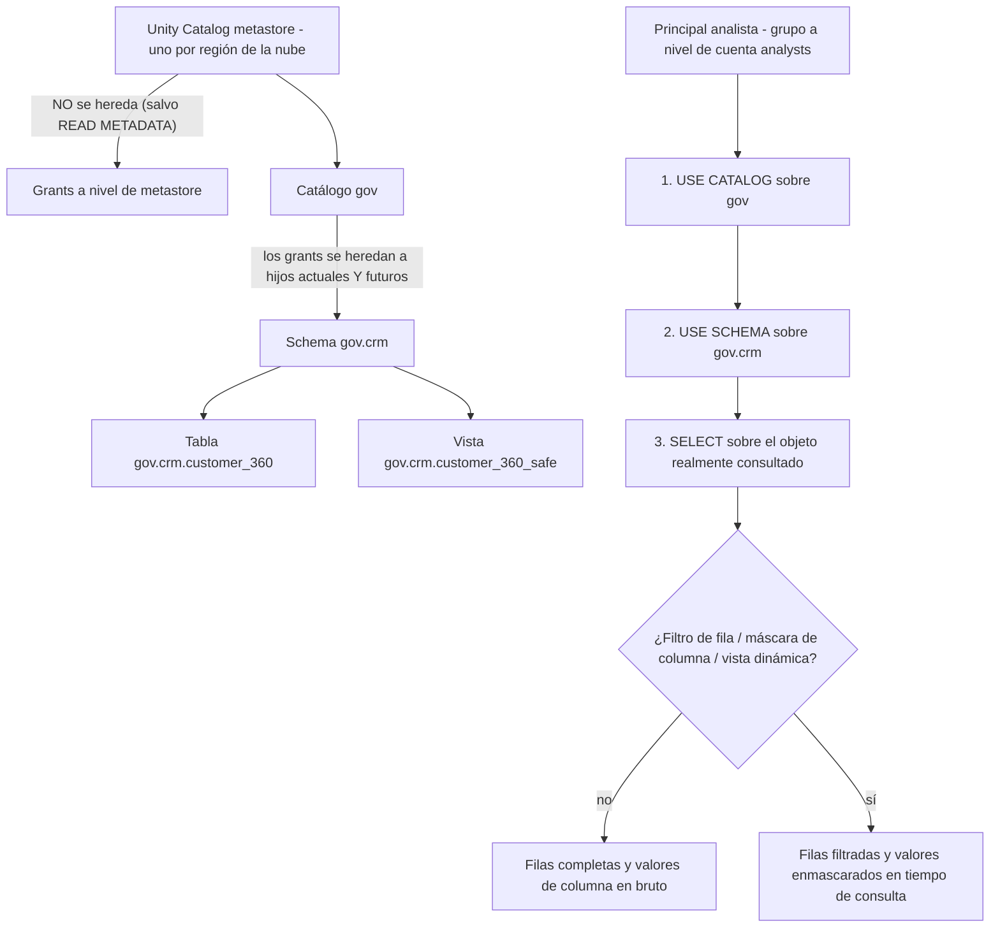
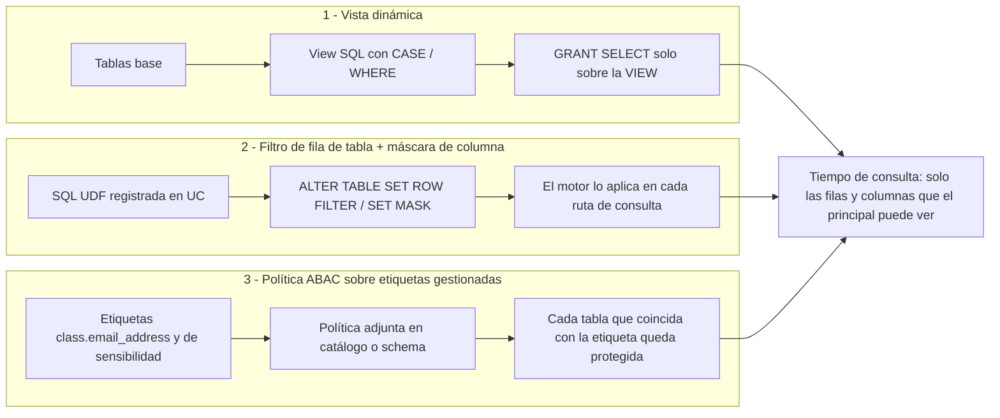
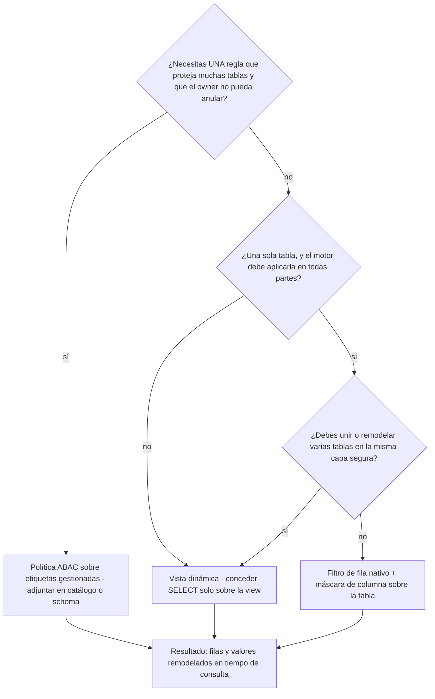
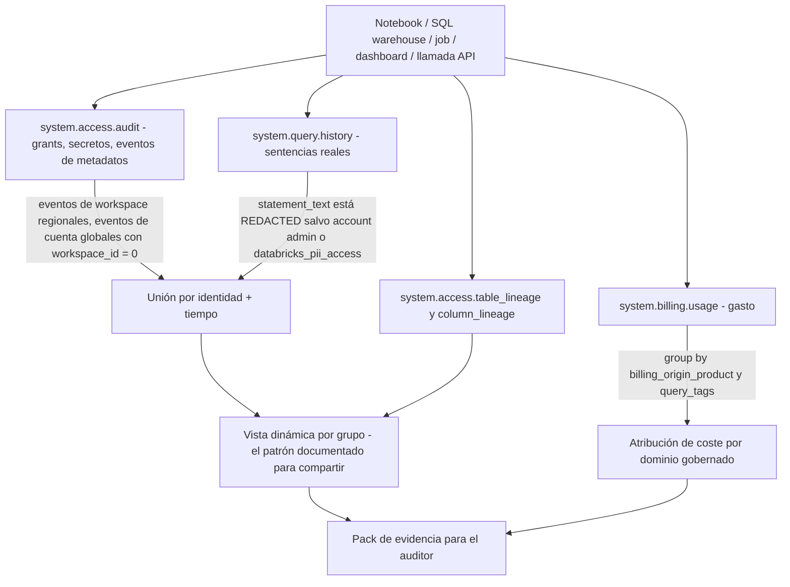
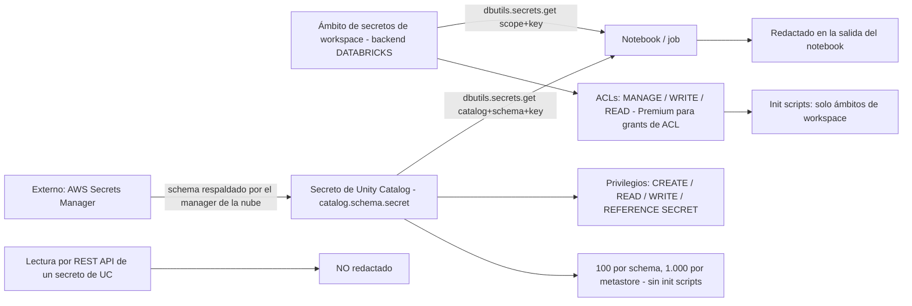
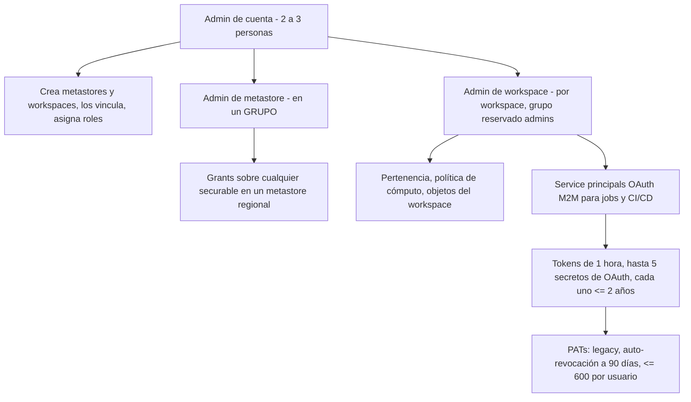

# Seguridad de Unity Catalog: controles de fila y columna, etiquetas, auditoría, lineage y secretos

Las lecciones 01–10 te dieron la máquina: una VPC, un lakehouse Delta respaldado en S3, un metastore con catálogos y pipelines que nunca dejan de escribir. Ese es exactamente el momento en que la gobernanza deja de ser papeleo y se convierte en un problema de ingeniería, porque cada tabla nueva multiplica el número de respuestas que le debes a un auditor. Unity Catalog responde con un modelo de grants deny-by-default — «**Inicialmente, los usuarios no tienen acceso a los datos de un metastore**» (docs .../manage-privileges, consultado 2026-10) — y luego con una segunda capa, separada, de controles que solo puede *restar* del acceso que ya posees: **filtros de fila, máscaras de columna, vistas dinámicas y políticas ABAC**. Esos controles no conceden nada: remodelan lo que devuelve una consulta legítima.

Tres afirmaciones sostienen esta lección. Primero, **los privilegios y los controles de fila/columna son capas distintas** — necesitas `USE CATALOG` + `USE SCHEMA` + `SELECT` *y después* el filtro o la máscara decide qué devuelve tu `SELECT`. Segundo, **la evidencia es una superficie de producto**: `system.access.audit`, `system.query.history`, el par de lineage y `system.billing.usage` son tablas consultables con retención y latencia documentadas, no archivos de log que suplicas al equipo de plataforma. Tercero, **los secretos, los tokens y los bordes de red forman parte de la misma historia de gobernanza** — un modelo de grants perfecto se filtra a través de un personal access token pegado en un notebook.

```text
 =============================================================
  MAPA DE LA LECCIÓN 11 - seguridad de Unity Catalog en AWS,
  a oct 2026
 ------------------------------------------------------------
  GRANTS        deny by default; la herencia fluye HACIA ABAJO
                desde el catálogo; los grants del metastore NO
                se heredan
                cadena de lectura: USE CATALOG + USE SCHEMA +
                SELECT
                los owners tienen todos los privilegios sobre
                su objeto
  FILA/COLUMNA  3 mecanismos (solo restan):
                  1 vistas dinámicas  portables, concede sobre
                                      la VIEW
                  2 filtro de fila    ALTER TABLE SET ROW
                    + máscara         FILTER, ALTER COLUMN SET
                    de columna        MASK, una máscara por
                                      columna, SQL UDF
                  3 políticas ABAC    dirigidas por etiquetas
                                      gestionadas, adjuntas en
                                      catálogo/schema/tabla
  IDENTIDAD     session_user()          actual (email)
                current_user()          alias OBSOLETO
                is_account_group_member grupos a nivel de cuenta
                is_member()             era workspace/Hive -
                                        evítalo
  ETIQUETAS     gestionadas: 1.000/cuenta, 500 valores, ligadas
                a políticas
                Data Classification -> autoetiquetas class.*
                límites: 50 etiquetas/objeto, 1.000 etiquetas
                de columna por tabla
  EVIDENCIA     system.access.audit   365 d, actualizada
                                      durante el día
                system.query.history  365 d, ~1 hora
                system.billing.usage  365 d, ~12 horas
                table_lineage/column_lineage 365 d, ventana
                móvil de 1 año
  SECRETOS      ámbitos de workspace (init scripts) ->
                secretos de UC (catalog.schema.secret) ->
                externos: respaldados por AWS Secrets Manager
  BORDE         listas de acceso por IP (Enterprise) Y
                ingreso basado en contexto; IPs privadas de
                PrivateLink -> AWS Network Firewall; FedRAMP
                Moderate en 4 regiones de AWS
  TRAMPAS       grant SELECT sobre la tabla base, is_member(),
                DBR < 12.2 LTS con cero filas en silencio, el
                mito del tiempo real
 =============================================================
```

En esta lección vas a:

- leer correctamente un fallo de permisos con la **cadena de tres privilegios** y las reglas de herencia que se detienen en el catálogo;
- elegir entre los **tres mecanismos de fila/columna** y decir con precisión cuándo gana cada uno;
- escribir la **política resuelta de vista dinámica** sobre `gov.crm.customer_360` con `session_user()` e `is_account_group_member()`, y concederla de forma segura;
- vincular **filtros de fila nativos y máscaras de columna** con SQL UDFs, y predecir qué devuelve un runtime antiguo en lugar de un error;
- aplicar **DDL de etiquetas** (`SET TAGS` / `SET TAG`) y enchufar las etiquetas `class.*` de **Data Classification** al ciclo clasificar → etiquetar → política;
- ejecutar el **pack de SQL de auditoría** sobre `system.access.audit`, `system.query.history` y las tablas de lineage, con las cifras de retención y latencia que hacen honesta la consulta;
- elegir la **generación de secretos** adecuada para cada trabajo en AWS, desde los ámbitos de init script hasta los secretos externos respaldados por AWS Secrets Manager;
- sopesar el **TACL heredado de `hive_metastore` frente a Unity Catalog** en un veredicto comparativo, estudiar **Block, Amgen y nCino** en AWS, leer el **recuadro de actualización de octubre de 2026** y practicar con **doce preguntas** más cuatro comprobaciones interactivas.

---

## 1. El modelo de grants en el que se apoya esta lección

Unity Catalog es una jerarquía de **securables** — metastore → catálogo → schema → tabla/vista/volumen/función/secret — y el acceso se concede como **privilegios sobre securables** a **principals** (usuarios, grupos a nivel de cuenta, service principals). Cuatro reglas deciden casi cada ticket de soporte:

1. **La herencia fluye hacia abajo y se detiene en el catálogo.** «Los privilegios concedidos sobre un catálogo se aplican automáticamente a todos los schemas, tablas, vistas, volúmenes y funciones, presentes y futuros, que haya dentro de él» (docs .../securable-objects, 2026-10-08), mientras que «los privilegios concedidos a nivel de metastore no se heredan a los objetos secundarios de la jerarquía» (misma página). `READ METADATA` es la única excepción a nivel de metastore que sí se hereda.
2. **Los privilegios de uso son separados de los privilegios de datos.** «Para leer una tabla, un usuario necesita `SELECT` sobre la tabla, `USE CATALOG` sobre el catálogo padre y `USE SCHEMA` sobre el schema padre» (referencia de privileges, 2026-09-25), y `USE CATALOG` «no concede acceso al propio catálogo ni a ningún objeto concreto dentro de él».
3. **Los owners son todopoderosos sobre su propio objeto.** «Los owners del objeto tienen todos los privilegios sobre ese objeto, incluida la capacidad de conceder privilegios a otros principals» (docs .../manage-privileges, consultado 2026-10) — la propiedad *no* se hereda hacia abajo, y `SHOW GRANTS` muestra la propiedad como una sola fila, no como una lista de privilegios implícitos.
4. **Los controles de fila/columna solo restan.** Los filtros, las máscaras, las vistas dinámicas y las políticas ABAC remodelan los resultados para principals que ya tienen los privilegios; ninguno de ellos puede usarse para *conceder* acceso.



El ejemplo resuelto **E0** es el diagnóstico que reutilizarás toda la lección: un usuario informa de que `SELECT * FROM gov.crm.customer_360` falla, y `SHOW GRANTS ON TABLE gov.crm.customer_360` muestra `SELECT` para su grupo. El grant es real e irrelevante: revisa la cadena en orden — `SHOW GRANTS ON CATALOG gov` y después `SHOW GRANTS ON SCHEMA gov.crm`. Un `USE CATALOG` ausente aparece como un fallo opaco *antes* de que siquiera se resuelva la tabla, y por eso es la primera trampa en la documentación de permisos de Databricks (docs .../access-control, consultado 2026-10).

Un control está *encima* de los privilegios y los gana: **el binding catálogo-workspace**. «Por defecto, un catálogo es accesible desde todos los workspaces adjuntos al mismo metastore. Puedes restringir esto vinculando el catálogo a workspaces concretos, opcionalmente como solo lectura» — y «El workspace binding prevalece sobre los grants individuales de privilegios. Incluso un usuario con un grant explícito de `SELECT` no puede acceder a un objeto de un catálogo que no esté vinculado a su workspace» (docs .../securable-objects, 2026-10-08). El mismo binding existe para storage credentials y external locations, y así se impide que un workspace de producción use la credential de la zona cruda. Ordena tu modelo mental así: **el binding decide *dónde* cuenta un grant, los privilegios deciden *qué* permiten, y los filtros/máscaras deciden *qué filas y valores* vuelven.**

> **📚 ¿Sabías que…?** La palabra `USAGE` es una trampa para quien viene de AWS Lake Formation o Hive: los privilegios de Unity Catalog son `USE CATALOG` y `USE SCHEMA`. `GRANT USAGE ON CATALOG gov TO analysts` no es sintaxis de Unity Catalog — pertenece al vocabulario heredado y es el error de copiar y pegar más común en los scripts de migración (docs .../access-control/privileges-reference, 2026-09-25).

---

## 2. Tres mecanismos que restan: vistas, controles de tabla, ABAC

A octubre de 2026 la documentación sitúa **tres** mecanismos de fila/columna lado a lado, y la manera honesta de enseñarlos es como una escalera: cada peldaño cambia portabilidad por centralización:

| Mecanismo | A qué lo vinculas | Mejor para | Límites duros |
|---|---|---|---|
| **Vista dinámica** | Una view SQL cuya lógica `WHERE` / `CASE` llama a funciones de identidad | Curar un slice, combinar varias tablas, mezclar regex + joins en «una sola capa segura» | Cada tabla base nueva necesita una view nueva; la protección es el `SELECT` *retenido* sobre la tabla base |
| **Filtro de fila de tabla + máscara de columna** | La tabla/la columna en sí, con SQL UDFs (`ALTER TABLE … SET ROW FILTER`, `ALTER COLUMN … SET MASK`) | Una tabla, preciso, aplicado por el motor en SQL, notebooks, jobs y herramientas BI | Una máscara por columna; **no se puede aplicar a una view**; suelos de DBR; lo gestiona el owner |
| **Política ABAC** | Etiquetas gestionadas, adjuntas en catálogo / schema / tabla (a nivel de metastore está en Beta) | Consistencia en muchas tablas — «los owners de la tabla no pueden anular ni eliminar» la política | La gramática exacta de `CREATE POLICY` hay que leerla en las docs, nunca inventarla (docs .../abac, 2026-09-29) |

La propia recomendación de Databricks es explícita: «Databricks recomienda las políticas ABAC cuando necesitas un filtrado de fila y un enmascarado de columna consistentes en muchas tablas» (docs .../filters-and-masks, 2026-09-24). La página de vistas dinámicas enuncia la consecuencia con igual claridad: «Databricks recomienda no conceder a los usuarios la capacidad de leer las tablas y vistas a las que hace referencia la view» (docs .../views/dynamic, 2025-02-14).



Elegir entre ellos es una decisión de tres preguntas, y el orden importa porque la última opción es la más cara de deshacer:



Dos invariantes viajan con los tres. **La aplicación es del lado del motor en tiempo de consulta**: en un filtro o una máscara, «el usuario no puede ver los valores de la tabla base antes de que se aplique el filtrado o el enmascarado» — y cuando el optimizador tiene que elegir entre velocidad y no-fuga, «siempre elige la opción segura, lo que puede afectar al rendimiento de la consulta» (docs .../filters-and-masks, 2026-09-24). **Y ninguno de ellos arregla un grant equivocado**: una vista dinámica se derriba con un solo `GRANT SELECT` descuidado sobre la tabla base, y por eso la siguiente sección escribe los grants antes de escribir el SQL.

---
## 3. Ejemplo resuelto E1 — la política de vista dinámica

El ejemplo que recorre esta lección es `gov.crm.customer_360` en S3 (gestionado detrás de una storage credential y una external location según la Lección 03), con tres grupos de audiencia: `pii-analysts`, `finance` y todo el resto. Requisitos verificados en las docs: un SQL warehouse o un modo de acceso estándar (el modo de acceso dedicado necesita DBR 15.4 LTS+), cómputo serverless habilitado para la ruta de filtrado avanzado en DBR 15.4 LTS y superiores, y los grants colocados sobre la view (docs .../views/dynamic, 2025-02-14).

```sql
CREATE OR REPLACE VIEW gov.crm.customer_360_safe
COMMENT 'Row-filtered + masked projection; base-table SELECT deliberately not granted'
AS
SELECT
  customer_id,
  region,
  -- identity hook: session_user() returns the current user's email address
  CASE WHEN session_user() LIKE '%@acme-corp.com'
       THEN customer_id ELSE -1 END AS customer_id_visible_to_internal,
  CASE
    WHEN is_account_group_member('pii-analysts') THEN email
    ELSE concat(substr(email, 1, 2), '***@', split_part(email, '@', 2))
  END AS email,
  CASE
    WHEN is_account_group_member('pii-analysts')
      OR is_account_group_member('finance') THEN ssn
    ELSE '***-**-****'
  END AS ssn,
  CASE
    WHEN is_account_group_member('finance') THEN lifetime_value
    ELSE CAST(ROUND(lifetime_value, -3) AS DECIMAL(12,2))   -- coarse bucket for everyone else
  END AS lifetime_value
FROM gov.crm.customer_360
WHERE region = 'EU'
   OR is_account_group_member('global-analysts');           -- row filter by account group
```

Luego los grants — la parte que de verdad asegura el diseño:

```sql
GRANT USE CATALOG ON CATALOG gov     TO `analysts`;
GRANT USE SCHEMA  ON SCHEMA gov.crm  TO `analysts`;
GRANT SELECT      ON VIEW gov.crm.customer_360_safe TO `analysts`;
-- deliberately NO: GRANT SELECT ON TABLE gov.crm.customer_360 TO `analysts`;
SHOW GRANTS ON VIEW gov.crm.customer_360_safe;
```

Tres datos de identidad que enseñar junto a este SQL:

- `session_user()` «Devuelve la dirección de correo electrónico del usuario actual» — la función que hay que usar en las políticas nuevas (docs .../views/dynamic, 2025-02-14).
- `current_user()` es un alias **obsoleto**: «Esta función está obsoleta. El estándar SQL reserva `CURRENT_USER` para el usuario autorizado, pero en Databricks devuelve el usuario de la sesión, lo que puede inducir a error. Usa `session_user` en su lugar» (docs .../functions/current_user, 2026-09-11). Los notebooks antiguos siguen funcionando con ella.
- `is_account_group_member('<grupo>')` devuelve true cuando el usuario de la sesión es «miembro directo o indirecto del grupo especificado a nivel de cuenta» y la página lo marca como «solo Unity Catalog» (docs .../functions/is_account_group_member, 2026-09-11). Su hermano `is_member()` está limitado al workspace y pertenece a la era del metastore de Hive: «Evita usarlo con views sobre datos de Unity Catalog, porque no evalúa la pertenencia a grupos a nivel de cuenta» (docs .../views/dynamic, 2025-02-14).

> ⚠️ **WARNING — tres formas en que esta política se amplía en silencio hasta el acceso completo.** (1) Alguien ejecuta `GRANT SELECT ON TABLE gov.crm.customer_360 TO analysts` «solo para desbloquear una fecha límite»: la view se vuelve decoración. (2) Llega una tabla base nueva y nadie crea la view, así que el equipo concede sobre la tabla en su lugar — el patrón de views no escala por sí solo, que es exactamente el hueco que rellena ABAC. (3) Lógica `CASE` escrita contra `is_member()` en lugar de `is_account_group_member()` evalúa grupos a nivel de workspace, de modo que los grupos de cuenta sincronizados desde el IdP caen en silencio en la rama `ELSE` — o peor, en la rama permisiva.

La verificación es un diff de tres principals: ejecuta el mismo `SELECT` desde el warehouse como miembro de `pii-analysts`, como miembro de `finance` y como analista normal, y compara los recuentos de filas *y* los valores de columna. Una política que funciona produce tres conjuntos de resultados visiblemente distintos; una rota produce la misma salida para todos.

---

## 4. Ejemplo resuelto E2 — filtros de fila nativos y máscaras de columna

El patrón de views tiene un gemelo nativo: registra una SQL UDF en Unity Catalog y luego vincúlala a la tabla o a la columna. «Las máscaras de columna a nivel de tabla se vinculan a una columna con `ALTER TABLE ... ALTER COLUMN ... SET MASK` y las gestiona el owner de la tabla» (docs .../filters-and-masks, 2026-09-24).

```sql
-- 1) The UDFs (registered in Unity Catalog, DETERMINISTIC where possible)
CREATE FUNCTION gov.crm.mask_email(s STRING) RETURNS STRING
DETERMINISTIC
RETURN CASE WHEN is_account_group_member('pii-analysts') THEN s
            ELSE concat(substr(s, 1, 2), '***@', split_part(s, '@', 2)) END;

CREATE FUNCTION gov.crm.eu_only(region STRING) RETURNS BOOLEAN
DETERMINISTIC
RETURN region = 'EU' OR is_account_group_member('global-analysts');

-- 2) Bind them (documented DDL forms, docs .../filters-and-masks/manually-apply)
ALTER TABLE gov.crm.customer_360 ALTER COLUMN email SET MASK gov.crm.mask_email;
ALTER TABLE gov.crm.customer_360 SET ROW FILTER gov.crm.eu_only ON (region);

-- 3) Inspect and reverse
DESCRIBE TABLE gov.crm.customer_360;
ALTER TABLE gov.crm.customer_360 DROP ROW FILTER;
```

También puedes declarar el filtro al crear la tabla: `CREATE TABLE sales (region STRING, id INT) WITH ROW FILTER us_filter ON (region);`. Para asignar una función necesitas `EXECUTE` sobre la función más `USE SCHEMA` y `USE CATALOG` en sus padres (docs .../manually-apply, consultado 2026-10). Dos reglas estructurales: **cada columna puede tener una sola máscara** — una segunda máscara que se solape falla con `COLUMN_MASKS_FEATURE_NOT_SUPPORTED.MULTIPLE_MASKS` — y «no se puede aplicar seguridad a nivel de fila ni máscaras de columna a una view»; enmascara una view desde *dentro* de su definición (docs .../filters-and-masks, 2026-09-24).

> [!IMPORTANT]
> ⚠️ **Los runtimes antiguos fallan en silencio, no en voz alta.** «Las versiones de Databricks Runtime por debajo de 12.2 LTS no admiten filtros de fila ni máscaras de columna. Estos runtimes fallan de forma segura» — que en la práctica significa cero filas, sin error (docs .../filters-and-masks, 2026-09-24). Los suelos de cómputo documentados: modo de acceso estándar y SQL warehouses en **DBR 12.2 LTS+**, modo de acceso dedicado en **DBR 15.4 LTS+** — y un cómputo dedicado en 15.3 LTS o inferior no puede leer filtros/máscaras en absoluto. Y para empeorarlo: «Con el modo ANSI desactivado, los valores que no se pueden convertir se convierten en NULL de forma silenciosa, lo que puede hacer que el filtro produzca resultados incorrectos sin lanzar un error» (misma página). Cuando una tabla filtrada no devuelve nada, comprueba el modo de acceso y la versión de DBR *antes* de depurar el SQL.

---

## 5. Etiquetas, Data Classification y el ciclo ABAC

Las etiquetas son la capa de atributos que evalúan las políticas ABAC. Importan dos poblaciones: **etiquetas gestionadas** — «etiquetas a nivel de cuenta con reglas integradas para la consistencia y el control. Cuando creas una etiqueta gestionada, también defines una política de etiquetas» (docs .../admin/governed-tags, 2026-09-11) — y las etiquetas corrientes. Aplicarlas es DDL a secas (DBR 13.3 LTS+ para `SET TAGS`, DBR 16.1+ para `SET TAG`), y necesita `APPLY TAG` sobre el objeto más `USE SCHEMA` y `USE CATALOG`; las etiquetas gestionadas exigen además `ASSIGN` sobre la etiqueta (docs .../database-objects/tags, 2026-10-08).

```sql
-- Worked example E3 - tag DDL, then the classify -> tag -> policy loop
-- 3a) manual tagging: table level, then column level (one column per statement)
ALTER TABLE gov.crm.customer_360
  SET TAGS ('sensitivity' = 'restricted', 'domain' = 'crm');
ALTER TABLE gov.crm.customer_360
  ALTER COLUMN ssn SET TAGS ('pii' = 'ssn');
ALTER TABLE gov.crm.customer_360
  ALTER COLUMN email SET TAGS ('pii' = 'email');
-- DBR 16.1+ equivalent forms
SET TAG ON TABLE gov.crm.customer_360 cost_center = `crm`;
SET TAG ON COLUMN gov.crm.customer_360.ssn pii;

-- 3b) read the tags back from the per-catalog information schema
--     (view names per the tags page; inspect the column list before narrowing)
SELECT * FROM gov.information_schema.column_tags
WHERE table_name = 'customer_360'
LIMIT 100;

-- 3c) read the governed-tag definitions (Beta system table)
SELECT * FROM system.tags.governed_tags;
```

**Data Classification** cierra el ciclo sin que nadie etiquete cada columna a mano: «Databricks Data Classification usa un agente para clasificar y etiquetar automáticamente las tablas de tu catálogo», escribiendo detecciones como `class.email_address`, `class.credit_card` y `class.us_ssn` sobre las columnas que coinciden, con los resultados en `system.data_classification.results` (docs .../data-classification, consultado 2026-10; blog **2025-10-27**). Los marcos a los que se mapea se publican como lista: «PII, PCI DSS, GDPR, HIPAA, GLBA, FCRA, India DPDPA, Canada PIPEDA, Mexico LFPDPPP, Swiss FADP, Israel PPL, UAE PDPL» (docs .../data-classification-tags, 2026-09-18). La recompensa cabe en una frase: **clasificar → etiquetar → política** — la etiqueta `class.*` se convierte en la condición `WHEN` de una política ABAC de filtro de fila o máscara de columna, de modo que una columna de PII nueva queda protegida sin que nadie escriba una view.

Límites documentados que vale la pena citar literalmente cuando diseñes un estándar de etiquetado: **1,000 etiquetas gestionadas por cuenta**, **500 valores permitidos por etiqueta**, claves/valores con máximo de **256 caracteres**, distinción de mayúsculas, con `* . / < > % & ? \ =` prohibidos (etiquetas gestionadas, 2026-09-11); las etiquetas corrientes permiten **50 etiquetas por objeto securable** y **1,000 etiquetas de columna por tabla**, con `. , - = / :` vetados en las claves (página de tags, 2026-10-08). La herencia tiene un filo muy afilado: las etiquetas gestionadas de un catálogo o de un schema las hereda todo lo que está debajo «excepto las columnas individuales de las tablas» — y la herencia implícita se aplica «solo al evaluar políticas ABAC» (página de tags, 2026-10-08).

> **📚 ¿Sabías que…?** Los metadatos de las etiquetas no son metadatos secretos. «Los datos de las etiquetas se guardan en texto plano y pueden replicarse globalmente. No uses nombres, valores o descriptores de etiquetas que puedan comprometer la seguridad de tus recursos» (governed-tags, 2026-09-11). Y relacionado: eliminar una columna que lleva etiquetas gestionadas *falla* hasta que las elimines primero con `UNSET` — una regla de orden deliberada, anti-fuga de datos, en la documentación de tags (página de tags, 2026-10-08).

---
## 6. System tables: el pack de auditoría

Las system tables viven en el catálogo `system` y son «un almacén analítico alojado por Databricks de los datos operativos de tu cuenta» (docs .../admin/system-tables, 2026-10-08). Las cuatro que necesitas para el trabajo de seguridad, con las cifras que deciden qué pueden afirmar honestamente tus consultas:

| Tabla | Responde | Retención gratuita | Frescura |
|---|---|---|---|
| `system.access.audit` (Public Preview) | Quién tocó qué securable vía API/UI — grants, secretos, cambios de política | 365 días | «actualizada a lo largo del día»; **sin monitorización en tiempo real** |
| `system.query.history` | Quién ejecutó qué SQL: `executed_by`, `statement_type`, `client_application`, `query_tags` | 365 días | normalmente en menos de **una hora** |
| `system.billing.usage` | Gasto por `billing_origin_product`, `usage_type`, por dominio gobernado | 365 días | `record_type = 'ORIGINAL'` normalmente en menos de **12 horas** |
| `system.access.table_lineage` + `column_lineage` | Radio de impacto: qué leyó o escribió esta tabla/columna | 365 días (ventana móvil de 1 año) | admite streaming; DBR 16.4+ para transmitirlo |

El acceso también está gobernado: los admins lo tienen por defecto, todos los demás necesitan `USE CATALOG` sobre `system` más `USE SCHEMA` y `SELECT` en los schemas de sistema relevantes. Y «Las system tables son gratuitas de usar. Solo se te cobra por el cómputo usado para consultarlas» (misma página, 2026-10-08).



### Ejemplo resuelto E4 — «¿quién consultó la tabla de PII esta semana?»

```sql
-- (a) Control-plane: permission and secret events. ALWAYS filter event_date.
SELECT event_time, user_identity.email AS who, service_name, action_name,
       request_params['full_name_arg'] AS securable, source_ip_address, audit_level
FROM system.access.audit
WHERE event_date BETWEEN DATE '2026-10-01' AND DATE '2026-10-07'
  AND service_name = 'unityCatalog'
  AND action_name LIKE '%Permission%'
ORDER BY event_time DESC;

-- (b) Query-plane: the SELECTs themselves
--     compute = WAREHOUSE | SERVERLESS_COMPUTE | CLASSIC_COMPUTE
--     query_source = notebook / job / dashboard / alert / Genie ids
SELECT executed_by, executed_as, start_time, statement_type, client_application,
       compute, query_source
FROM system.query.history
WHERE start_time >= TIMESTAMP '2026-10-01 00:00:00'
  AND statement_type = 'SELECT'
ORDER BY start_time DESC;

-- (c) Blast radius: downstream consumers of the table
SELECT source_table_full_name, target_table_full_name, entity_type, created_by, event_time
FROM system.access.table_lineage
WHERE source_table_full_name = 'gov.crm.customer_360';

-- (d) Cost evidence: governed-domain spend for September
SELECT billing_origin_product, usage_type,
       SUM(usage_quantity) AS dbus, COUNT(*) AS records
FROM system.billing.usage
WHERE ingestion_date BETWEEN DATE '2026-09-01' AND DATE '2026-09-30'
GROUP BY billing_origin_product, usage_type
ORDER BY dbus DESC;
```

Etiquetar las propias consultas hace que (d) sea atribuible a un dominio gobernado en lugar de a un warehouse: `SET QUERY_TAGS = '{"team":"crm","cost_center":"701","env":"prod"}';` al inicio de la sesión, o mediante parámetros de configuración de sesión, y agrupar después `system.query.history` por su mapa `query_tags` (referencia de query history, 2026-10-06). Combínalo con `system.billing.usage` agrupada por `billing_origin_product` y podrás responder a la pregunta de seguimiento del auditor — *qué dominio gobierna cuánto gasto* — con el mismo vocabulario SQL de esta lección.

Notas de enseñanza que hacen que este pack sea correcto y no meramente ejecutable: `event_date` es la partición de rendimiento documentada — «Para mejorar el rendimiento de la consulta, filtra por `event_date` en lugar de `event_time`» (audit-logs, 2026-07-01); `statement_text` es `<REDACTED>` salvo que seas admin de cuenta o miembro de `databricks_pii_access` (query history, 2026-10-06); una consulta que no es suficientemente selectiva se rechaza en seco con «`System Table query returned too much data. Please repeat query with more selective predicates.`» (system tables, 2026-10-08); y la forma documentada de compartir cualquiera de esto con un grupo de analistas es, una vez más, una **vista dinámica por usuario o grupo** — la página de query history lo dice directamente.

> ⚠️ **WARNING — el mito del tiempo real.** Las system tables son un almacén de evidencia, no un SIEM: «No hay soporte para monitorización en tiempo real. Los datos se actualizan a lo largo del día. Si no ves un registro de un evento reciente, vuelve a comprobarlo más tarde» (system tables, 2026-10-08). Los suelos de latencia son ~1 hora (query history), ~12 horas (billing), «a lo largo del día» (audit). Cuida también la geografía: las filas de audit son regionales para los eventos de workspace y globales para los de cuenta (`workspace_id = 0`), billing es global, y lineage/query history son regionales — una cuenta multirregión debe consultar por región.

---

## 7. Lineage: a nivel de columna, con vacíos con nombre

«Unity Catalog captura el lineage automáticamente para las consultas ejecutadas en Databricks, **hasta el nivel de columna**, y lo agrega en todos los workspaces adjuntos al metastore» (docs .../data-governance/unity-catalog/data-lineage, 2026-08-06). El billete de entrada para *ver* lineage es `BROWSE` sobre el catálogo padre — «`BROWSE` permite a los usuarios ver metadatos … No concede acceso a los datos» (best practices, 2026-07-27) — lo que lo convierte en el grant de descubribilidad ideal para un estate con deny-by-default.

La versión honesta de «a nivel de columna» incluye sus vacíos documentados:

- **Las lecturas por ruta pierden el lineage de columna:** `select * from delta."s3://<bucket>/<path>"` no se captura a nivel de columna.
- **El lineage de UDF es solo a nivel de tabla:** «No se captura el lineage de columna de las UDF», y las SQL UDFs son invisibles en `INSERT`, `UPDATE` y `MERGE`.
- **Las columnas sin origen nunca aparecen:** un `INSERT` con valores literales explícitos no se registra en la tabla de columnas — las lecturas se capturan escribas o no el resultado.
- **Los renombres pierden el lineage**, y no existe nada en absoluto para los eventos capturados antes del **2024-09-01**.
- **Dos relojes distintos:** el lineage de system table es una ventana móvil de **1 año**, mientras que Catalog Explorer y la API de lineage «retienen indefinidamente el lineage capturado después del 1 de septiembre de 2024».
- `statement_id` en `table_lineage` se une con `system.query.history`, pero «solo se establece cuando la consulta se ejecuta desde un SQL warehouse».

Leerlo es un ejercicio de dos tablas — primero el radio de impacto a nivel de tabla, luego el detalle a nivel de columna y, opcionalmente, la sentencia que hay detrás:

```sql
-- who reads or writes the table, across every workspace on the metastore
SELECT event_time, target_table_full_name, created_by, entity_type, statement_id
FROM system.access.table_lineage
WHERE source_table_full_name = 'gov.crm.customer_360'
ORDER BY event_time DESC;

-- column-level detail: read the column list from the lineage system-table
-- reference first (schema headers verified, source/target column-name fields
-- not quoted here), then narrow it the same way
SELECT *
FROM system.access.column_lineage
WHERE source_table_full_name = 'gov.crm.customer_360'
ORDER BY event_time DESC
LIMIT 100;

-- the statement behind a lineage row, when it came from a SQL warehouse
SELECT executed_by, statement_type, start_time, client_application
FROM system.query.history
WHERE statement_id = '<statement_id from the lineage row>';
```

Esa es la historia de cumplimiento que venden las docs — «Para auditorías de cumplimiento, ve dónde se originan los datos regulados, cómo se transforman y qué activos aguas abajo los consumen» (docs de lineage, 2026-08-06) — junto a los límites que un auditor debería oír en voz alta.

---

## 8. Ejemplo resuelto E5 — secretos, tres generaciones

Los secretos son donde la gobernanza se sostiene o se fuga, y AWS te ofrece tres generaciones documentadas entre las que elegir:

| Generación | Forma en AWS | Privilegios / ACLs | Úsala para | Límites |
|---|---|---|---|---|
| **Ámbitos de secretos de workspace** | Backend `DATABRICKS`, `dbutils.secrets.get(scope=…, key=…)` | ACLs de ámbito: `MANAGE` / `WRITE` / `READ` (los grants de ACL necesitan plan Premium) | Contraseñas JDBC y **la única ruta que funciona en init scripts** | El nombre del ámbito lo puede leer cualquier usuario; ≤1,000 secretos por ámbito; valores ≤128 KB |
| **Secretos de Unity Catalog** | securable `catalog.schema.secret`, entre workspaces | `CREATE` / `READ` / `WRITE` / `REFERENCE SECRET` | Material gobernado, auditable, cifrable con CMK | ≤100 secretos por schema, ≤1,000 por metastore; **sin init scripts**; entorno serverless 4+ o DBR 17.3 LTS+ |
| **Secretos externos** | Un schema de UC respaldado por **AWS Secrets Manager** | Los mismos privilegios de UC, los valores siguen en tu cuenta de AWS | Credenciales de larga duración que te niegas a almacenar en Databricks | Las lecturas por REST no se redactan |

```sql
-- (i) workspace scope - CLI + notebook
--   databricks secrets create-scope jdbc
--   databricks secrets put-secret jdbc password
--   databricks secrets put-acl jdbc datascience READ      (Premium plan or above)
--   notebook: dbutils.secrets.get(scope="jdbc", key="password")   -> output redacted

-- (ii) Unity Catalog secret (docs .../security/secrets/unity-catalog-secrets, 2026-10-06)
GRANT CREATE SECRET, USE SCHEMA ON SCHEMA gov.ops TO `etl-sp`;
CREATE SECRET gov.ops.api_key;                    -- value written with WRITE SECRET / API
GRANT READ SECRET ON SECRET gov.ops.api_key TO `etl-sp`;
--   notebook: dbutils.secrets.get(catalog="gov", schema="ops", key="api_key")

-- (iii) audit every secret event
SELECT event_time, user_identity.email AS who, action_name, request_params
FROM system.access.audit
WHERE event_date = DATE '2026-10-20'
  AND service_name = 'unityCatalog'
  AND action_name LIKE '%Secret%';
```

La advertencia honesta, directamente de las docs: los administradores, los creadores de secretos y los usuarios con permisos *pueden* leer los valores de los secretos — «no es posible impedir que esos usuarios lean los secretos» — así que los controles reales son privilegios estrechos, rotación y la consulta de auditoría de arriba. `REFERENCE SECRET` existe precisamente para que un pipeline haga referencia a un secret sin tener acceso a su valor (referencia de privileges, 2026-09-25).



Una checklist de higiene de secretos que cabe en una página, cada línea rastreable hasta un hecho documentado:

1. **Clasifica el secreto antes de elegir una generación** — init script ⇒ ámbito de workspace (los secretos de UC están vetados); valor gobernado entre workspaces ⇒ secreto de UC; valor que te niegas a almacenar en Databricks ⇒ schema externo respaldado por **AWS Secrets Manager**.
2. **Concede de forma estrecha y concede a service principals, no a personas** — `REFERENCE SECRET` permite que un pipeline nombre un secreto sin tener su valor (referencia de privileges, 2026-09-25).
3. **Lee a través de `dbutils.secrets.get`** — «Databricks recomienda `dbutils` para leer secretos, porque aplica la redacción de secretos» (UC secrets, 2026-10-06); las lecturas por REST de los secretos de UC no se redactan.
4. **Rota con un calendario que puedas demostrar** — los secretos de OAuth duran como máximo dos años; los PAT mueren tras 90 días sin uso; los *nombres de ámbito* de secretos son legibles por todo el workspace, así que nunca codifiques la sensibilidad en un nombre.
5. **Audita el radio de impacto cada mes** — la consulta `action_name LIKE '%Secret%'` de E5 es el punto de partida documentado, y recuerda que aterriza en `system.access.audit`, que se actualiza «a lo largo del día».

> **📚 ¿Sabías que…?** Las duraciones de los tokens son números sobre los que puedes diseñar: los tokens de acceso OAuth M2M son válidos durante **una hora**, un service principal tiene como máximo **cinco secretos de OAuth**, cada uno válido hasta **dos años** (docs .../oauth-m2m, 2026-09-11). Los personal access tokens están etiquetados como **(legacy)** en el propio título de la documentación, se revocan automáticamente tras **90 días** sin uso y están limitados a **600 por usuario por workspace** — y no pueden automatizar operaciones a nivel de cuenta en absoluto (docs .../auth/pat, 2026-09-11).

---
## 9. Identidad, service principals y quién administra qué

### 9.1 Las cuatro funciones de identidad, decididas

| Función | Devuelve | Estado |
|---|---|---|
| `session_user()` | Dirección de correo del usuario actual | **Actual** — úsala en views, filtros y máscaras nuevos |
| `current_user()` | Alias de `session_user()`; los service principals devuelven un **UUID** | **Obsoleto** (2026-09-11) — sigue funcionando |
| `is_account_group_member('g')` | TRUE para pertenencia directa o indirecta a un grupo **a nivel de cuenta** | **Actual**, «solo Unity Catalog» |
| `is_member('g')` | Pertenencia a nivel de workspace (compatibilidad con el metastore de Hive) | **Evítalo sobre datos de UC** |

El UUID del service principal es la trampa que rompe las expresiones `CASE` de identidad: un job que se ejecuta como service principal no coincide con ninguna rama de email, así que toda política de identidad debe decidir explícitamente qué hace con las sesiones que no son humanas.

Los grupos en sí vienen de tu proveedor de identidad: los usuarios, grupos y service principals a nivel de cuenta se federan en la cuenta de Databricks (SCIM a nivel de cuenta), y eso es lo que convierte a `is_account_group_member()` en una *entrada de política* en lugar de una lista mantenida a mano — añade a alguien a `pii-analysts` en el IdP y la comprobación de pertenencia lo sigue, sin editar ningún grant del lado de Databricks. Los service principals participan en la gobernanza como los usuarios: pueden ser owners de securables, tener privilegios de Unity Catalog y ejecutar jobs «como» un principal — y cada una de sus acciones aterriza en el mismo pack de auditoría que la de una persona.

### 9.2 Ejemplo resuelto E6 — la matriz de verificación de tres principals

Una consulta, tres principals, cuatro aserciones:

| Principal | Filas esperadas | `email` | `ssn` | `lifetime_value` |
|---|---|---|---|---|
| Miembro de `pii-analysts` | filas EU + `global-analysts` | en bruto | en bruto | en bruto (solo finance lo agrupa) |
| Miembro de `finance` | filas EU + `global-analysts` | enmascarado | en bruto | en bruto |
| Analista normal | solo filas EU | enmascarado | `***-**-****` | redondeado al millar más cercano |

Cualquier otra cosa significa que los *grants* están mal (la misma salida para los tres ⇒ alguien tiene `SELECT` sobre la tabla base) o que las *funciones* están mal (`is_member()` contra grupos de cuenta).

### 9.3 Ámbitos de administración

«Desde la perspectiva de permisos de Unity Catalog, los tres más importantes son **admins de cuenta, admins de workspace y admins de metastore**. Se requieren admins de cuenta y de workspace en todos los despliegues, y el rol de admin de metastore es opcional» (docs .../admin-privileges, consultado 2026-10). El admin de cuenta crea y vincula metastores y workspaces; el admin de workspace opera dentro de un workspace a través del grupo reservado `admins` (asignable a usuarios y service principals, **no** a un grupo); el admin de metastore gobierna catálogos, conexiones y external locations para un metastore por región de la nube. Los admins de funciones — Marketplace, facturación — completan el cuadro. La forma recomendada: **el admin de cuenta en dos o tres personas, el admin de metastore en un grupo.**



---

## 10. El borde de red y la superficie de cumplimiento

Los controles perimetrales en AWS se apilan en lugar de reemplazarse:

- **Listas de acceso por IP** (nivel de precio Enterprise, la lista de bloqueo se evalúa antes que la de permitidos, ≤**1,000** valores IP/CIDR combinados) controlan la aplicación web y los endpoints REST — pero «si usas PrivateLink, las listas de acceso por IP solo se aplican a las peticiones por internet»; el tráfico privado debe controlarse con **AWS Network Firewall** (docs .../ip-access-list, consultado 2026-10).
- **Los controles de ingreso basados en contexto** son el mecanismo más nuevo a nivel de cuenta que combina identidad, tipo de petición y origen de red en reglas de permitir/denegar: «Databricks recomienda usar los controles de ingreso basados en contexto como tu método principal para gestionar el acceso», y «una petición debe ser permitida por ambos controles para tener éxito» (misma fuente).
- **Las denegaciones entrantes son observables** en `system.access.inbound_network` (30 días de retención gratuita).
- **Alcance de cumplimiento, enunciado como lo enuncian las páginas de confianza:** FedRAMP **Moderate** en las regiones comerciales de AWS us-east-1, us-east-2, us-west-1, us-west-2; FedRAMP **High** en AWS GovCloud us-gov-west-1; opciones HIPAA en AWS multitenant «disponible en todas las regiones», con el informe SOC 2 Type II + HIPAA de tu equipo de cuenta (páginas databricks.com/trust, consultado 2026-10). Las certificaciones son atestaciones de plataforma — tu BAA, tus políticas de IAM y de claves KMS y tu diseño de red siguen siendo decisiones tuyas.

El cifrado es el último perímetro y, en AWS, tiene tres puntos de contacto que tú posees: la **política de la clave KMS** debe permitir el uso de la clave a través de S3 (`kms:ViaService: s3.<region>.amazonaws.com`), la **política de IAM de la storage credential** debe llevar `kms:Decrypt` / `kms:Encrypt` / `kms:GenerateDataKey*` sobre esa clave, y la **external location** debe declarar su algoritmo de cifrado (SSE-S3 o SSE-KMS) cuando la política del bucket exige cabeceras de cifrado (docs .../security/keys/kms-s3 y .../cloud-storage/s3, consultado 2026-10). Las claves gestionadas por Databricks son el valor por defecto; las **claves gestionadas por el cliente para Unity Catalog** — que protegen el almacenamiento gestionado por defecto/facilitado por Databricks por catálogo — «requieren el **nivel Enterprise**» y un grant al ARN raíz de Databricks en tu clave KMS (docs .../keys/cmek-unity-catalog, consultado 2026-10). La regla que mantiene calmados a los auditores: *los grants deciden quién puede pedir, las claves deciden si los bytes son legibles si se los llevan, y ambas se documentan por separado.*

---

## 11. Veredicto comparativo: TACL de tabla heredado de `hive_metastore` frente a Unity Catalog

> **Veredicto comparativo — control de acceso a tablas heredado de `hive_metastore` frente a Unity Catalog (a octubre de 2026)**
> - **Alcance de identidad.** Los permisos de TACL «definidos dentro del catálogo `hive_metastore` siempre se refieren a las identidades locales del workspace»; Unity Catalog «los permisos siempre se refieren a identidades a nivel de cuenta» (blog de Databricks, *Data Privilege Model in Unity Catalog*, 2023-05-05). Un metastore, una región, todos los workspaces adjuntos ven los mismos grants.
> - **Herencia.** Los grants de UC heredan hacia abajo desde el catálogo a «todos los actuales y futuros» hijos, y la excepción se declara de entrada: los grants a nivel de metastore no se heredan (salvo `READ METADATA`). Eso te da una regla que puedes auditar con `SHOW GRANTS` — el lado heredado de las fuentes de este curso no documenta ninguna jerarquía declarada comparable.
> - **Controles de fila/columna.** UC tiene los tres mecanismos documentados de las secciones 2–5 (vistas dinámicas, filtros de fila de tabla + máscaras de columna, ABAC dirigido por etiquetas). Para el modelo heredado, la propia documentación de administración de Databricks afirma simplemente «el control de acceso a tablas de Hive metastore es un modelo de gobernanza de datos heredado. Databricks recomienda que uses Unity Catalog en su lugar por su simplicidad y su modelo de gobernanza centrado en la cuenta» (docs .../manage-instance-profiles, 2026-04-22).
> - **Evidencia.** UC te da `system.access.audit`, `system.query.history`, el lineage de tablas/columnas agregado en el metastore y las tablas de etiquetas gestionadas/clasificación — consultables, con retención publicada. El lado heredado de las fuentes de este curso no ofrece ningún almacén de evidencia consultable equivalente.
> - **Identidad en la nube.** UC adjunta la identidad de AWS a los *securables* (storage credentials + external locations + grants); el patrón heredado adjunta un **instance profile** de IAM al *cómputo*, de modo que todo el que está en el cluster lo hereda — por eso las docs llaman a las service credentials «la alternativa de Unity Catalog a los instance profiles» (docs .../service-credentials, consultado 2026-10).
> - **Operaciones destructivas.** El `DROP` de una tabla gestionada de Hive borra los archivos subyacentes de inmediato; Unity Catalog admite `UNDROP` durante 7 días con eliminación permanente dentro de los 30 días (docs .../database-objects/hive-metastore, consultado 2026-10).
> - **Veredicto en una línea:** *mantén `hive_metastore` solo como el catálogo de compatibilidad aditivo que se declara que es («El metastore de Unity Catalog es aditivo»), migra primero las identidades a nivel de cuenta y luego mueve las tablas con federate-then-upgrade o UCX — y nunca diseñes una política de fila/columna nueva contra TACL, porque el motor de políticas que quieres vive en el catálogo al que todavía no has migrado.*

---

## 12. Doce trampas que esta lección no te dejará conservar

1. **`GRANT USAGE ON CATALOG`** — no es sintaxis de UC. Es `USE CATALOG` / `USE SCHEMA`.
2. **«Concedí `SELECT` sobre el catálogo, así que ya pueden consultar.»** Los privilegios de uso son separados; la cadena es `USE CATALOG` → `USE SCHEMA` → `SELECT`.
3. **«Los grants del metastore lo cubren todo.»** No se heredan — solo `READ METADATA`.
4. **`is_member()` en una vista dinámica de UC.** Limitado al workspace, era Hive; usa `is_account_group_member()`.
5. **`current_user()` en políticas nuevas.** Obsoleto desde 2026-09-11; usa `session_user()` — y maneja el UUID del service principal.
6. **Conceder `SELECT` sobre la tabla base** bajo una vista dinámica. La view deja de proteger nada.
7. **Aplicar un filtro de fila a una view.** «No se puede aplicar seguridad a nivel de fila ni máscaras de columna a una view.»
8. **Segunda máscara en una columna.** Una máscara por columna; las máscaras ABAC que se solapan fallan con `COLUMN_MASKS_FEATURE_NOT_SUPPORTED.MULTIPLE_MASKS`.
9. **DBR por debajo de 12.2 LTS.** Las tablas filtradas/enmascaradas «fallan de forma segura» — cero filas, sin error.
10. **Esperar auditoría en tiempo real.** El audit se actualiza «a lo largo del día», query history ~1 hora, billing ~12 horas; particiona siempre por `event_date`.
11. **Asumir que el lineage de columna está completo.** Las lecturas por ruta, los inserts literales, los internos de UDF, los renombres y el historial anterior a 2024-09-01 quedan fuera de alcance.
12. **Tratar las etiquetas como almacén secreto.** Los datos de las etiquetas «se guardan en texto plano y pueden replicarse globalmente».

### Actualizaciones 2026 (a octubre de 2026)

> [!NOTE]
> **Qué se movió en la capa de gobernanza de la que depende esta lección:**
> - **2026-10-09 — guía de autenticación e ingreso actualizada:** OAuth M2M con client id + secret es la ruta declarada «para workflows sin supervisión, automatizados y de CI/CD»; el ingreso basado en contexto se recomienda como *método principal* de acceso, evaluado junto a las listas de acceso por IP (docs .../dev-tools/auth; .../security/network).
> - **2026-10-08 — referencia de system tables:** tabla de retención (365 días para audit, billing, lineage y query history; 13 meses para `system.data_classification.results`; 30 días para `system.access.inbound_network`), la afirmación «no hay soporte para monitorización en tiempo real» y los suelos de streaming DBR 16.4+ (docs .../admin/system-tables).
> - **2026-10-06 — página de secretos de Unity Catalog:** securables `catalog.schema.secret` con `CREATE/READ/WRITE/REFERENCE SECRET`, cuotas de 100 por schema y 1,000 por metastore, y **secretos externos respaldados por AWS Secrets Manager** en AWS (docs .../security/secrets/unity-catalog-secrets).
> - **2026-09-29 — página ABAC:** políticas de filtro de fila, máscara de columna, GRANT y DENY (Beta) dirigidas por etiquetas, adjuntas en metastore (Beta), catálogo, schema o tabla — la respuesta recomendada para controles consistentes en muchas tablas (docs .../unity-catalog/abac).
> - **2026-09-24 / 2026-09-11 — filtros, máscaras e identidad:** filtros de fila y máscaras de columna documentados como controles a nivel de tabla con una máscara por columna y suelos de DBR 12.2 LTS / 15.4 LTS; `current_user` formalmente obsoleto en favor de `session_user` (docs .../filters-and-masks; .../functions/current_user).
> - **2025-10-27 — Data Classification en Public Preview en AWS, Azure y GCP:** «hasta un 60% más de precisión que las herramientas basadas solo en regex» y costes de escaneo reducidos «hasta un 75%» desde la Beta, con todos los resultados almacenados en system tables (blog de Databricks, 2025-10-27).

---

## Casos de estudio del mundo real

> **📋 Caso A — Block (Square, Cash App, TIDAL) (servicios financieros, nube: AWS)**
> **Reto.** 12PB de datos de grafos y analítica fragmentados entre unidades de negocio, obligaciones de PII GDPR/CCPA, y un doloroso flujo de dos pasos que adjuntaba políticas de IAM a roles y luego a buckets de S3.
> **Stack en AWS.** Databricks, Delta Lake, **Unity Catalog**, Spark Declarative Pipelines y Delta Sharing, con S3 como almacenamiento colocado — `Cloud: AWS` en la página del caso (https://www.databricks.com/customers/block/unity-catalog, página sin fecha, consultada 2026-10).
> **Resultado reportado.** «**12X Reduction in compute cost · 20% Reduction in data egress cost · 12PB Of data managed and governed**», el tiempo de permisos de intercambio de datos reducido «de días a segundos», unos 70 equipos y 500 usuarios activos avanzados (misma URL, sin fecha, consultada 2026-10).
> **Cita.** «Introduction to Databricks coincided with the launch of Unity Catalog, eliminating the need for evaluating alternative data governance tools.» — Joseph Kesting (misma URL).
> **Encaja con esta lección.** Secciones 2, 5 y 6: una capa de gobernanza que reemplaza tanto una herramienta aparte *como* parte de la fontanería IAM/S3, que es la versión específica de AWS del argumento de que «la gobernanza se paga sola».
> ⏳ *Nota temporal: página sin fecha, consultada oct 2026 — trata cada cifra como lo que Block reportó, no como una garantía de la plataforma.*

> **📋 Caso B — Amgen (biofarmacia, estate AWS)**
> **Reto.** AWS Glue como catálogo empresarial más la proliferación de roles de AWS IAM por caso de uso — auditar significaba parsear políticas de IAM.
> **Stack en AWS.** Unity Catalog sobre un estate de AWS: la historia nombra **AWS Glue** como el catálogo anterior y **AWS IAM** como la capa RBAC anterior (blog de Databricks, **mayo de 2023**, https://www.databricks.com/blog/how-databricks-unity-catalog-helped-amgen-enable-data-governance-enterprise-scale).
> **Resultado reportado.** «no tuvimos que crear ni gestionar al menos más de 120 roles de IAM … pasamos de cientos de roles de IAM a uno o dos roles principales de IAM»; «Esto reduce el esfuerzo de auditoría de la función en un 50%»; «alrededor de unos 500 objetos mapeados en Unity Catalog»; «el 90 por ciento de nuestros casos de uso están en Databricks» (misma URL, mayo de 2023).
> **Encaja con esta lección.** Secciones 1, 6 y 9 — el número de roles *es* la métrica que los auditores entienden, y el pack de auditoría de E4 es lo que reemplaza a la arqueología de documentos de políticas.
> ⏳ *Nota temporal: cifras de mayo de 2023 de un blog fechado — lo que Amgen reportó entonces, no una afirmación actual de la plataforma.*

> **📋 Caso C — nCino (software bancario, nube: AWS)**
> **Reto.** Consolidar 13 años de datos bancarios y «billones en historial de préstamos» manteniendo la información financiera sensible bajo control total.
> **Stack en AWS.** Databricks en AWS con **Unity Catalog** gobernando el acceso y **AI/BI Genie** para la entrega de insights — `Cloud: AWS`, con los casos de uso «Analytics and BI, AI, Data Warehousing, Governance and Security» (https://www.databricks.com/customers/ncino, página sin fecha, consultada 2026-10).
> **Cita.** «Mantener los datos dentro de un único ecosistema AWS reduce la complejidad, refuerza el cumplimiento y da a los equipos control total sobre la información financiera sensible.» (misma URL.)
> **Encaja con esta lección.** Secciones 10 y 11 — el argumento del «límite de una sola cuenta AWS» es el encuadre de cumplimiento que puedes reutilizar literalmente al justificar diseños de metastore por región y con PrivateLink.
> ⏳ *Nota temporal: página sin fecha, consultada oct 2026.*

---

> [!SUCCESS]
> **Conclusiones Clave (Key Takeaways):**
> 1. **Deny by default, hereda desde el catálogo.** «Inicialmente, los usuarios no tienen acceso a los datos de un metastore»; los grants heredan desde el catálogo hacia los hijos actuales *y futuros*; los grants a nivel de metastore no se heredan (salvo `READ METADATA`); cada lectura necesita `USE CATALOG` + `USE SCHEMA` + `SELECT`.
> 2. **Tres mecanismos que restan, una escalera.** Vistas dinámicas (concede sobre la view, nunca sobre la tabla base) → filtros de fila nativos + máscaras de columna (SQL UDFs, una máscara por columna, DBR 12.2 LTS estándar / 15.4 LTS dedicado, nunca sobre una view) → políticas ABAC sobre etiquetas gestionadas (lo que recomiendan las docs cuando importa la consistencia en muchas tablas). Ninguno de ellos concede acceso.
> 3. **Las funciones de identidad tienen un conjunto actual.** `session_user()` e `is_account_group_member()` son las que hay que escribir; `current_user()` está obsoleto (2026-09-11) y `is_member()` es de la era workspace/Hive; los service principals vuelven como UUID.
> 4. **Las etiquetas son entradas de política, no notas.** Etiquetas gestionadas: 1,000/cuenta, 500 valores, ligadas a política, ASSIGN obligatorio, la herencia salta las columnas; Data Classification autoetiqueta `class.*` en los marcos PII/PCI/GDPR/HIPAA; el ciclo ganador es clasificar → etiquetar → política.
> 5. **La evidencia es un conjunto de tablas.** `system.access.audit` (365 días, actualizada a lo largo del día), `system.query.history` (~1 hora, `statement_text` redactada para `databricks_pii_access`), `system.billing.usage` (~12 horas), el par de lineage (365 días / 1 año móvil), todas gratuitas de almacenar y facturadas solo como cómputo — y compartidas a través de una vista dinámica por grupo.
> 6. **El lineage es a nivel de columna, con vacíos con nombre.** Faltan lecturas por ruta, inserts literales, internos de UDF, renombres y el historial anterior a 2024-09-01; `statement_id` solo se rellena en consultas de SQL warehouse; `BROWSE` es el grant seguro de descubribilidad.
> 7. **Los secretos vienen en tres generaciones y el borde sigue importando.** Ámbitos de workspace (la única ruta de init script), secretos de UC (`catalog.schema.secret`, 100/schema), secretos externos respaldados por AWS Secrets Manager; OAuth M2M para máquinas (tokens de 1 hora, ≤5 secretos), PAT heredados con auto-revocación a 90 días; las listas por IP y el ingreso basado en contexto tienen que permitir ambos una petición, y las IPs privadas de PrivateLink necesitan AWS Network Firewall.

---

## Preguntas de Práctica (Practice Questions)

```question
{
  "id": "dbl-11-q1",
  "type": "multiple-choice",
  "question": "Un analista tiene SELECT sobre la tabla gov.crm.customer_360, pero cada consulta falla durante el análisis, antes de leer la tabla. ¿Qué cadena falta?",
  "options": [
    "USE CATALOG sobre gov más USE SCHEMA sobre gov.crm - leer una tabla necesita los tres privilegios, y USE CATALOG «no concede acceso al propio catálogo ni a ningún objeto concreto dentro de él»",
    "MODIFY sobre el schema, porque SELECT es un hijo de MODIFY",
    "BROWSE sobre el metastore, porque el descubrimiento siempre precede al análisis",
    "MANAGE sobre la tabla, porque solo los managers pueden resolver los metadatos de la tabla"
  ],
  "correct": 0,
  "explanation": "La cadena de lectura documentada es USE CATALOG + USE SCHEMA + SELECT (referencia de privileges, 2026-09-25); un privilegio de uso ausente falla antes de la resolución de la tabla, y por eso se lee como un error de análisis opaco. B invierte la jerarquía: SELECT no es un hijo de MODIFY (INSERT/UPDATE/DELETE sí lo son). C confunde descubrimiento con acceso - BROWSE nunca concede acceso a datos. D inventa un requisito: MANAGE es el privilegio de delegación, no un prerrequisito de lectura."
}
```

```question
{
  "id": "dbl-11-q2",
  "type": "true-false",
  "question": "Los privilegios concedidos sobre el metastore de Unity Catalog los hereda cada catálogo, schema y tabla que hay debajo, así que un único GRANT a nivel de metastore puede abrir todo el estate.",
  "options": ["Verdadero", "Falso"],
  "correct": 1,
  "explanation": "Falso - «los privilegios concedidos a nivel de metastore no se heredan a los objetos secundarios de la jerarquía. Los grants a nivel de metastore están limitados a operaciones a nivel de metastore» (página de securable-objects, 2026-10-08), con READ METADATA como excepción documentada. La herencia empieza en el catálogo. La trampa es la frase «concede arriba y fluye hacia abajo», que es cierta para catálogos y falsa para el metastore."
}
```

```question
{
  "id": "dbl-11-q3",
  "type": "multiple-choice",
  "question": "Cuarenta tablas llevan PII y el equipo quiere un solo control que mantenga el enmascarado consistente e impida que los owners individuales de cada tabla lo relajen. ¿Qué mecanismo recomiendan las docs?",
  "options": [
    "Una política ABAC dirigida por etiquetas gestionadas, adjunta a nivel de catálogo o schema - Databricks recomienda ABAC «cuando necesitas un filtrado de fila y un enmascarado de columna consistentes en muchas tablas», y la política no puede ser anulada por los owners de las tablas",
    "Una vista dinámica por tabla, porque las views son el único mecanismo documentado",
    "Una máscara de columna aplicada al catálogo, ya que las máscaras se propagan desde los contenedores",
    "REVOKE SELECT en cada tabla, porque denegarlo todo equivale a enmascarar"
  ],
  "correct": 0,
  "explanation": "La página filters-and-masks (2026-09-24) enuncia la recomendación ABAC literalmente y sitúa las políticas adjuntas para que los owners de las tablas no puedan anularlas; las políticas se adjuntan en metastore (Beta), catálogo, schema o tabla (página ABAC, 2026-09-29). B no escala - una tabla nueva necesita una view nueva. C es falsa: una máscara se vincula a una columna de una tabla, no a un catálogo, y no puede aplicarse a una view. D elimina el acceso en lugar de remodelarlo, así que incumple el requisito (la consulta debe seguir funcionando)."
}
```

```question
{
  "id": "dbl-11-q4",
  "type": "multiple-choice",
  "question": "¿Qué par de funciones de identidad debe usar una vista dinámica nueva de Unity Catalog en octubre de 2026?",
  "options": [
    "session_user() para el correo de quien llama e is_account_group_member() para la pertenencia a grupos a nivel de cuenta",
    "current_user() para el correo de quien llama e is_member() para la pertenencia a grupos, porque ambos son más antiguos y por tanto más estables",
    "session_user() con is_member(), ya que los grupos de workspace es lo que aprovisiona SCIM",
    "current_user() con is_account_group_member(), porque current_user() es el nombre del estándar SQL"
  ],
  "correct": 0,
  "explanation": "session_user() «Devuelve la dirección de correo electrónico del usuario actual» y is_account_group_member() evalúa la pertenencia directa o indirecta a nivel de cuenta y está marcada como «solo Unity Catalog» (páginas de vista dinámica y de funciones, 2025-02-14 / 2026-09-11). B atrapa con dos funciones obsoletas o erróneas: current_user() está obsoleto y is_member() debe evitarse explícitamente sobre datos de UC. C está medio mal - aquí SCIM sincroniza grupos a nivel de cuenta. D tiene la razón al revés: CURRENT_USER es el nombre del estándar SQL que las propias docs de Databricks dicen que induce a error aquí, y por eso se deprecó."
}
```

```matching
{
  "question": "Haz coincidir cada primitiva de identidad o de descubrimiento con su estado verificado a octubre de 2026:",
  "pairs": [
    {"left": "session_user()", "right": "Actual - devuelve la dirección de correo de quien llama; el gancho de identidad para las vistas dinámicas y los filtros de fila nuevos"},
    {"left": "current_user()", "right": "Alias obsoleto de session_user(); devuelve el UUID de un service principal en lugar de un nombre legible"},
    {"left": "is_account_group_member('pii-analysts')", "right": "Actual, solo Unity Catalog - pertenencia directa o indirecta a un grupo a nivel de cuenta"},
    {"left": "is_member('pii-analysts')", "right": "A nivel de workspace, compatibilidad con el metastore de Hive - documentado como «evitar» sobre datos de Unity Catalog"},
    {"left": "BROWSE sobre un catálogo", "right": "Descubribilidad sin acceso - búsqueda, Catalog Explorer, information_schema y el grafo de lineage, pero ningún dato"}
  ],
  "explanation": "Los cuatro estados de funciones provienen de la página de vistas dinámicas (2025-02-14), la página de current_user (2026-09-11) y la de is_account_group_member (2026-09-11); BROWSE se describe en las mejores prácticas de Unity Catalog (2026-07-27) como visibilidad solo de metadatos. Las dos trampas son asumir que current_user() está bien porque todavía funciona, y asumir que is_member() funciona con los grupos a nivel de cuenta que sincroniza tu proveedor de identidad."
}
```

```question
{
  "id": "dbl-11-q5",
  "type": "multiple-choice",
  "question": "Tu vista dinámica gov.crm.customer_360_safe está desplegada con SELECT concedido solo sobre la view. ¿Qué cambio la derriba de forma más directa?",
  "options": [
    "GRANT SELECT ON TABLE gov.crm.customer_360 TO analysts - la view solo protege los datos porque la lectura de la tabla base se retuvo, y las docs recomiendan no conceder lectura sobre las tablas referenciadas",
    "Conceder USE CATALOG sobre gov a todos los usuarios de la cuenta, algo que las docs prohíben",
    "Ejecutar la view en un SQL warehouse en lugar de un cluster de notebook",
    "Añadir una segunda rama de CASE que enmascare lifetime_value para finance"
  ],
  "correct": 0,
  "explanation": "La página de vistas dinámicas (2025-02-14) dice que Databricks recomienda «no conceder a los usuarios la capacidad de leer las tablas y vistas a las que hace referencia la view» - la protección es el grant retenido, no el SQL. B es falsa: que todos los usuarios reciban USE CATALOG (sobre main, o sobre el catálogo del workspace por defecto) concede navegación, no datos. C es lo contrario de un problema - los SQL warehouses son el cómputo soportado. D es un cambio de apriete, no una evasión."
}
```

```question
{
  "id": "dbl-11-q6",
  "type": "true-false",
  "question": "Un filtro de fila o una máscara de columna puede adjuntarse a una view para que la propia view aplique la restricción, además de la cláusula WHERE dentro de su definición.",
  "options": ["Verdadero", "Falso"],
  "correct": 1,
  "explanation": "Falso - «no se puede aplicar seguridad a nivel de fila ni máscaras de columna a una view» (filters-and-masks, 2026-09-24). Enmascarar una view se hace dentro de la definición de la view (sección 3), o sobre la tabla subyacente con filtros/máscaras nativos (sección 4). La confusión es natural porque los mecanismos parecen intercambiables; las docs marcan la línea en las views para ambos."
}
```

```fillblank
{
  "question": "Rellena exactamente los números que octubre de 2026 publica:",
  "template": "La retención gratuita es de {{1}} días para system.access.audit, system.query.history y las tablas de lineage; las filas de facturación con record_type ORIGINAL aparecen normalmente en {{2}} horas; las filas de query history suelen estar disponibles en aproximadamente {{3}} hora; y los secretos de Unity Catalog están limitados a {{4}} secretos por schema.",
  "answers": {
    "1": "365",
    "2": "12",
    "3": "1",
    "4": "100"
  },
  "distractors": ["30", "90", "395", "730", "6", "24", "48", "168", "500", "1000"],
  "explanation": "La referencia de system tables (2026-10-08) da una retención gratuita de 365 días para audit, billing, lineage y query history más la advertencia de «sin tiempo real»; la página de billing (2026-09-15) dice que los registros están «disponibles normalmente en 12 horas»; la página de query history (2026-10-06) dice «disponibles normalmente en una hora»; UC secrets (2026-10-06) permite «hasta 100 secretos por schema y 1,000 por metastore». Los distractores son los números de retención vecinos (30 días de red entrante, 90 días de uso de endpoints, valor por defecto configurable de 395 días, techo de token de 730 días) y otros valores redondos plausibles."
}
```

```question
{
  "id": "dbl-11-q7",
  "type": "multiple-choice",
  "question": "Un auditor pide «todos los cambios de permiso de la última semana, en tiempo real». ¿Cuál es la respuesta de ingeniería correcta a octubre de 2026?",
  "options": [
    "Las system tables no son tiempo real: los datos de audit se «actualizan a lo largo del día», así que consulta system.access.audit particionada por event_date y declara la latencia - y luego mantén la exportación al SIEM como una conversación aparte y honesta",
    "Transmitir system.access.audit con Trigger.Continuous, porque las filas de audit se emiten cuando ocurren",
    "Usar solo system.query.history, ya que captura cada cambio del plano de control con un retraso menor a un minuto",
    "Exportar las filas de audit a S3 cada hora con VACUUM, porque las system tables no pueden ser consultadas por los no admins en absoluto"
  ],
  "correct": 0,
  "explanation": "La página de system tables (2026-10-08) afirma «No support for real-time monitoring. Data is updated throughout the day» y también rechaza las consultas poco selectivas con «System Table query returned too much data» - así que filtrar por event_date más una latencia declarada es la respuesta profesional. B exagera: transmitir system tables necesita DBR 16.4+ y aun así no las hace tiempo real. C es falsa en los dos puntos - query history cubre SQL, no eventos de grants, y llega en aproximadamente una hora. D es falsa: los admins tienen acceso por defecto y a los demás se les puede conceder USE CATALOG/USE SCHEMA/SELECT, aunque Databricks desaconseja exportar estos datos."
}
```

```dragdrop
{
  "question": "Ordena el flujo de auditoría de PII exactamente como lo exigen las tablas documentadas y sus latencias:",
  "items": [
    "Filtra por event_date con una ventana estrecha para que la consulta supere la guarda de selectividad de «demasiados datos»",
    "Consulta system.access.audit para los eventos del plano de control: cambios de permisos, eventos de secretos, cambios de política",
    "Consulta system.query.history para los SELECT - executed_by, statement_type, client_application - recordando que statement_text está REDACTED salvo que seas admin de cuenta o estés en databricks_pii_access",
    "Une las dos tablas por identidad y tiempo para responder «quién consultó qué, cuándo»",
    "Consulta system.access.table_lineage y column_lineage para el radio de impacto aguas abajo",
    "Envuelve el resultado en una vista dinámica por grupo antes de compartirlo - el patrón documentado para abrir las system tables a los no admins"
  ],
  "correctOrder": [
    "Filtra por event_date con una ventana estrecha para que la consulta supere la guarda de selectividad de «demasiados datos»",
    "Consulta system.access.audit para los eventos del plano de control: cambios de permisos, eventos de secretos, cambios de política",
    "Consulta system.query.history para los SELECT - executed_by, statement_type, client_application - recordando que statement_text está REDACTED salvo que seas admin de cuenta o estés en databricks_pii_access",
    "Une las dos tablas por identidad y tiempo para responder «quién consultó qué, cuándo»",
    "Consulta system.access.table_lineage y column_lineage para el radio de impacto aguas abajo",
    "Envuelve el resultado en una vista dinámica por grupo antes de compartirlo - el patrón documentado para abrir las system tables a los no admins"
  ],
  "explanation": "El orden importa: la guarda de selectividad va primero (system tables, 2026-10-08), luego la evidencia del plano de control (audit, 2026-07-01), luego la evidencia del plano de consultas (query history, 2026-10-06), luego la unión, luego el radio de impacto (lineage, 2026-08-06) y por último el patrón de compartir que la página de query history recomienda explícitamente - una vista dinámica por usuario o grupo. Invertir los pasos 2 y 3 hace perder el contexto de grants detrás de un SELECT sospechoso; saltarte el paso 1 hace que la consulta sea rechazada; compartir filas en bruto salta la frontera de redacción."
}
```

```question
{
  "id": "dbl-11-q8",
  "type": "multiple-choice",
  "question": "Un job de Lakeflow en AWS debe leer una contraseña JDBC desde un init script, y un segundo job necesita una API key gobernada por privilegios de Unity Catalog y auditada entre workspaces. ¿Cuál es el emparejamiento correcto?",
  "options": [
    "Init script: un ámbito de secretos de workspace con dbutils.secrets.get(scope=..., key=...) - los secretos de UC no pueden usarse en init scripts. API key: un secreto de UC en catalog.schema.secret con READ SECRET concedido al service principal del job",
    "Init script: un secreto de Unity Catalog, porque los secretos de UC son entre workspaces. API key: un ámbito de workspace con ACLs para el equipo",
    "Ambos: una clave de AWS Secrets Manager externa leída directamente por el init script y por un notebook, saltándose Databricks por completo",
    "Ambos: personal access tokens almacenados en notebooks, ya que los PAT son el valor por defecto documentado"
  ],
  "correct": 0,
  "explanation": "La página de UC secrets (2026-10-06) declara «No init scripts. You cannot use Unity Catalog secrets in global or cluster init scripts», lo que deja los ámbitos de workspace como la única ruta de init script - mientras que los secretos de UC son el securable gobernado, entre workspaces, con privilegios CREATE/READ/WRITE/REFERENCE SECRET, cuotas de 100 por schema y auditoría vía system.access.audit. B invierte los dos. C salta la capa de gobernanza (privilegios de UC y auditoría) que el escenario exige. D es falsa dos veces: los PAT están etiquetados como heredados y los secretos no deben vivir nunca en el código fuente de un notebook."
}
```

```question
{
  "id": "dbl-11-q9",
  "type": "multiple-choice",
  "question": "Un pipeline de CI se autentica con un service principal. ¿Qué configuración encaja con la postura documentada de OAuth M2M y PAT en octubre de 2026?",
  "options": [
    "OAuth M2M client id + secret, tokens válidos durante una hora, hasta cinco secretos de OAuth por service principal cada uno válido hasta dos años - la ruta declarada para los workflows sin supervisión y de CI/CD",
    "Un personal access token por desarrollador, porque los PAT se recomiendan sobre OAuth para la automatización",
    "Un único token de larga duración acuñado una sola vez a nivel de cuenta, ya que las operaciones de cuenta aceptan PAT",
    "OAuth M2M con un token de acceso de 24 horas, para que los pipelines no refresquen nunca"
  ],
  "correct": 0,
  "explanation": "Los docs de autenticación (2026-10-09) dicen «For unattended, automated, and CI/CD workflows, use the M2M flow with a client ID and secret», y la página de OAuth M2M (2026-09-11) da el límite de token de una hora, los cinco secretos y los dos años. B invierte la guía: los PAT están titulados «(legacy)» y las docs recomiendan OAuth en su lugar. C es falsa: «You can't use personal access tokens to automate Databricks account-level functionality». D inventa una vida de 24 horas - la vida documentada es de una hora, con refresco automático."
}
```

```question
{
  "id": "dbl-11-q10",
  "type": "multiple-choice",
  "question": "¿Qué afirmación contrasta correctamente el control de acceso a tablas heredado de hive_metastore con Unity Catalog?",
  "options": [
    "Los grants de TACL se refieren a identidades locales del workspace, mientras que los permisos de Unity Catalog se refieren a identidades a nivel de cuenta vigentes en cada workspace adjunto al metastore",
    "Los grants de TACL son a nivel de cuenta y los de Unity Catalog son locales del workspace, porque el metastore es por workspace",
    "Ambos modelos heredan grants desde el metastore hacia abajo hasta cada tabla",
    "Ambos modelos adjuntan la identidad de la nube al cómputo, de modo que los instance profiles son como Unity Catalog llega a S3"
  ],
  "correct": 0,
  "explanation": "El blog del modelo de privilegios de Databricks (2023-05-05) lo declara directamente: «Unity Catalog permissions always refer to account-level identities, while TACL permissions defined within the hive_metastore catalog always refer to the local identities in the workspace». B lo invierte. C es falsa en las dos formulaciones de UC: los grants de metastore no se heredan, y la herencia empieza en el catálogo. D es falsa en el lado de UC - las storage credentials adjuntan un rol de IAM a un securable gobernado por grants, y las service credentials se describen como «la alternativa de Unity Catalog a los instance profiles»."
}
```

```question
{
  "id": "dbl-11-q11",
  "type": "multiple-choice",
  "question": "¿Qué emparejamiento de resultados de gobernanza publica la página del caso de Unity Catalog de Block (Cloud: AWS, sin fecha, consultada 2026-10)?",
  "options": [
    "12x de reducción en el coste de cómputo, 20% de reducción en el coste de salida de datos, 12PB de datos gestionados y gobernados, y el tiempo de permisos de intercambio de datos recortado de días a segundos",
    "El esfuerzo de auditoría reducido un 50% tras colapsar más de 120 roles de IAM a uno o dos",
    "456 casos de uso migrados y más de 1,200 usuarios habilitados en Databricks SQL",
    "Una reducción de 10x en los costes globales de cómputo junto con la sustitución de 640 máquinas por 64"
  ],
  "correct": 0,
  "explanation": "Esas cuatro cifras son el bloque de titulares de la propia página de Block (https://www.databricks.com/customers/block/unity-catalog, sin fecha, consultada 2026-10). B es el blog de Unity Catalog de Amgen (mayo 2023); C es la página de Databricks SQL de NAB; D es la página de caso de Comcast (de 2019). La alfabetización de evidencia - métrica, fuente y fecha - es el hábito que los casos de estudio de este curso existen para construir."
}
```

```plot
{
  "type": "bar",
  "title": "Techos de etiquetas documentados a octubre de 2026 (recuentos, no caracteres)",
  "data": [
    {"limit": "Governed tags per account", "max_count": 1000},
    {"limit": "Allowed values per governed tag", "max_count": 500},
    {"limit": "Tags per securable object", "max_count": 50},
    {"limit": "Column tags per table", "max_count": 1000}
  ],
  "xKey": "limit",
  "dataKeys": ["max_count"],
  "xLabel": "Límite de etiqueta documentado",
  "yLabel": "Recuento máximo"
}
```

```question
{
  "id": "dbl-11-q12",
  "type": "multiple-choice",
  "question": "Una consulta de cumplimiento informa de «no hay lineage de columna» para una tabla que claramente se usa aguas abajo. ¿Qué vacío documentado lo explica con más probabilidad?",
  "options": [
    "Las lecturas aguas abajo referencian la tabla por ruta - no se puede capturar lineage de columna cuando la fuente o el destino se referencia como delta.\"s3://...\", así que existe lineage a nivel de tabla pero no a nivel de columna",
    "El lineage de columna solo existe para tablas etiquetadas con class.email_address",
    "El lineage se calcula de noche, así que todo lo más reciente que siete días falta",
    "El lineage de columna requiere SELECT WITH GRANT OPTION en ambas tablas"
  ],
  "correct": 0,
  "explanation": "Las limitaciones de lineage son explícitas: «Column lineage cannot be captured if the source or the target is referenced as path» (data-lineage, 2026-08-06), junto con renombres, historial anterior a 2024-09-01, vacíos de columna en UDF y inserts literales sin fuente. B inventa una dependencia de etiquetas - las etiquetas de clasificación no controlan el lineage. C confunde la ventana móvil de 1 año de las system tables con la propia captura. D confunde lineage con grants: lineage necesita BROWSE para verse, nunca grant-option."
}
```
