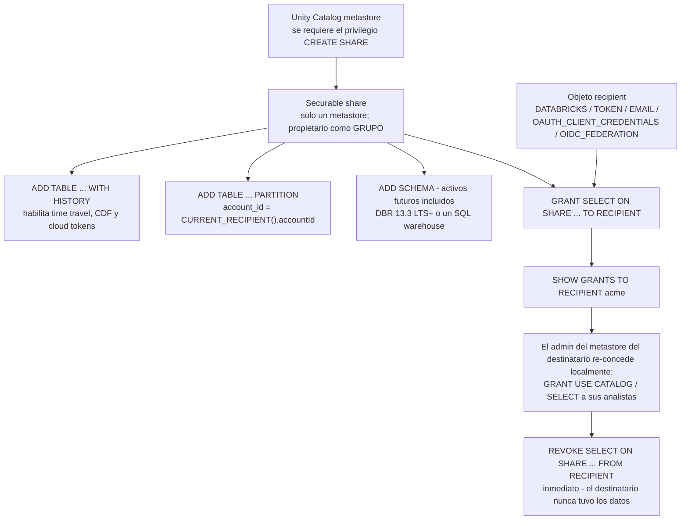
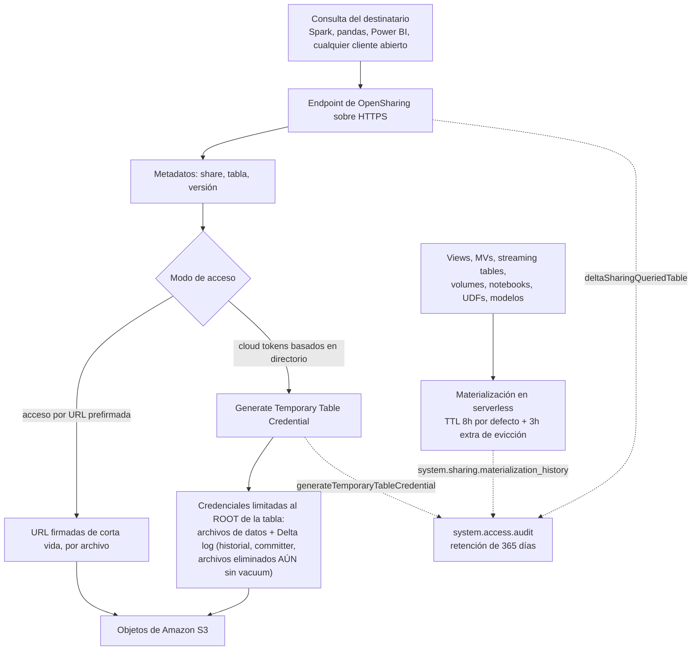
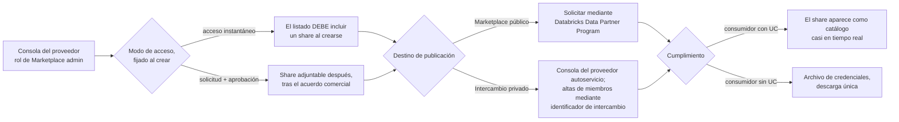
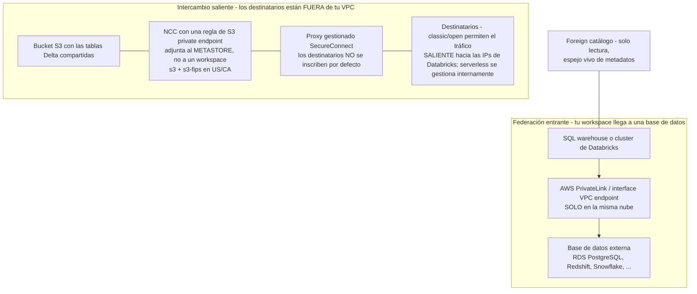

# Intercambio de datos en Databricks sobre AWS: OpenSharing, Marketplace y Lakehouse Federation

Las lecciones 01–11 construyeron y gobernaron un lakehouse que aloja *tus* datos. En el momento en que una segunda organización necesita leer esos datos — un socio, un cliente, una filial, un regulador, un suscriptor de pago — aparecen tres superficies distintas de la plataforma dispuestas a ayudar, y rutinariamente se confunden entre sí. **OpenSharing** (el producto; el protocolo abierto se llamó Delta Sharing hasta junio de 2026) entrega una *vista viva* de tablas seleccionadas a alguien que no eres tú. **Databricks Marketplace** es un escaparate situado encima de esa entrega que añade descubrimiento, aprobación y adquisición. **Lakehouse Federation** hace lo contrario con el mismo vocabulario: permite que *tu* SQL llegue a la base de datos o el catálogo vivo de otra persona sin copiar un solo byte. Cada uno se gobierna mediante securables de Unity Catalog, cada uno tiene su propia historia de red en AWS y cada uno falla de una manera característica.

La regla de enseñanza de esta lección, y la frase que hay que conservar cuando la sintaxis se difumina: **un share es un puntero vivo, un foreign catalog es una dependencia viva, un listado del Marketplace es un escaparate sobre el puntero — y solo una copia ETL es algo que posees.** Ordena bien eso y cada función de abajo caerá en su lugar.

```text
=====================================================================
 MAPA DE LA LECCIÓN 12 - superficies de colaboración en AWS,
 a oct 2026
---------------------------------------------------------------------
 SUPERFICIE 1 - OpenSharing (protocolo: Linux Foundation; producto: DBX)
   modelos ...... Databricks-to-Databricks  (identificador de
                                             intercambio, sin archivo
                                             de credenciales, conjunto
                                             de activos más rico)
                  Databricks-to-Open        (token u federación OIDC,
                                             activos tabulares, sin UC
                                             necesaria en el
                                             destinatario)
                  Open-to-Databricks        (servidor OSS -> recipient DBX)
   securables .. share (un metastore), recipient, grants ON SHARE
   bytes ....... URL prefirmadas  O  cloud tokens basados en
                  directorio (elegibles: WITH HISTORY, sin filtro de
                  partición; D2O también solo Delta gestionado/externo)
   auditoría ... system.access.audit (365 días) + historial de
                 materialización (365 días)
   corte ....... tokens bearer máx 1 año; tokens emitidos antes de
                 2025-12-08 con caducidad larga/nula caducan solos
                 2026-12-08
 SUPERFICIE 2 - Marketplace (construido SOBRE OpenSharing)
   listado ..... instantáneo (share obligatorio al crear) vs
                 solicitud (share adjuntable después)
   destino ..... Marketplace público (Data Partner Program) vs
                 intercambio privado (autoservicio, identificadores
                 de intercambio)
   dinero ...... sin cuota de listado, sin recorte de ingresos;
                 Universal Commit drawdown <= 10%, contrato después
                 de 2026-06-15
 SUPERFICIE 3 - Lakehouse Federation (entrante, solo lectura)
   securables .. connection -> foreign catalog -> grants ordinarios
   sabores ..... query federation (JDBC pushdown, 11 fuentes)
                 catalog federation (rastreo de metadatos, 7 fuentes)
   creds ....... secret() scope/keys, o service credential de UC +
                 rol AWS IAM (RDS Postgres IAM, DBR 18 LTS+)
   red ......... PrivateLink / interface endpoint, SOLO en la misma
                 nube
 RED AWS - dos problemas distintos, no resuelvas uno dos veces
   saliente .... proxy SecureConnect + regla de NCC private endpoint
                 adjunta al METASTORE (no a un workspace)
   entrante .... PrivateLink entre la VPC del workspace y la VPC de
                 la base de datos
 TRAMPA DE LA LECCIÓN - un share es un PUNTERO VIVO:
   el DELETE del proveedor se propaga en la siguiente lectura del
   destinatario; VACUUM (retención de archivos de 7 días por
   defecto) rompe el time travel y el streaming del destinatario
   sobre shares con WITH HISTORY; los tokens de directorio exponen
   el Delta log, pasado sin vacuum incluido
=====================================================================
```

En esta lección vas a:

- distinguir las **tres superficies** — OpenSharing, Marketplace, Lakehouse Federation — y enrutar seis peticiones de colaboración realistas a la correcta (y saber cuándo la respuesta correcta es una copia deliberada);
- aplicar correctamente el **cambio de nombre de junio de 2026**: el producto y las docs dicen **OpenSharing**, la superficie SQL sigue diciendo `CREATE SHARE` / `GRANT ... ON SHARE`, el cliente OSS sigue siendo `delta_sharing`, y los eventos de auditoría siguen empezando por `deltaSharing*`;
- construir un share tal como lo especifican las docs de octubre de 2026: `CREATE SHARE` en el metastore, `ALTER SHARE ... ADD TABLE ... WITH HISTORY`, parametrizado por partición con `CURRENT_RECIPIENT()`, `CREATE RECIPIENT`, `GRANT SELECT ON SHARE`, verificado con `SHOW GRANTS TO RECIPIENT`;
- elegir una historia de autenticación sobre evidencia — **Databricks-to-Databricks** (ningún artefacto), **federación OIDC** (ningún secreto emitido por Databricks) o **token bearer** (archivo de credenciales de un solo uso, IP ACL, rotación programada) — y explicar el **corte de tokens de 2026-12-08** a quien todavía dependa de uno;
- leer la capa de red: **acceso por URL prefirmada** frente a **cloud tokens basados en directorio**, qué activos son elegibles para cada uno y por qué las credenciales de directorio entregan al destinatario el **Delta log incluyendo los datos eliminados aún sin vacuum**;
- gobernar shares como cualquier otro securable de Unity Catalog: quién puede crearlos, qué responde `SHOW GRANTS TO RECIPIENT`, cómo funciona la **revocación inmediata** y cómo ejecutar una **revisión trimestral de acceso** contra `system.access.audit`;
- publicar en **Databricks Marketplace**: listados instantáneos frente a por solicitud, Marketplace público frente a intercambio privado, la economía de **sin cuota / sin recorte** para el proveedor y la aritmética del **10% de Universal Commit Drawdown**;
- montar **Lakehouse Federation** con `CREATE CONNECTION` y `CREATE FOREIGN CATALOG`, usando `secret()` (o una service credential de UC más un rol de AWS IAM en RDS PostgreSQL), y decir exactamente dónde empuja el **join pushdown**;
- mantener separados los dos problemas de red: **intercambio saliente** (SecureConnect, NCC private endpoints sobre el metastore, IP ACLs de destinatarios) frente a **federación entrante** (PrivateLink, solo en la misma nube);
- situar **clean rooms**, un **veredicto comparativo de Delta Sharing frente a Lake Formation entre cuentas sobre S3 frente a copias ETL**, tres casos de estudio nombrados en AWS, un **recuadro de actualización de octubre de 2026 con fuentes**, **ocho ejemplos resueltos**, **cinco diagramas**, **cuatro comprobaciones interactivas** y **doce preguntas de práctica**.

---

## 1. Tres superficies, una pregunta: ¿cómo salen — o llegan — los datos sin moverse?

### 1.1 El mapa de superficies

| Superficie | Dirección | Objeto central | Lo que necesita la otra parte | Modo de fallo que heredas |
|---|---|---|---|---|
| **OpenSharing** (antes Delta Sharing) | **fuera** | `share` + `recipient` + `GRANT ... ON SHARE` | workspace de Databricks UC (D2D), o cualquier cliente abierto / Power BI / Tableau (D2O) | la caída del proveedor, el borrado accidental y un VACUUM agresivo se propagan al destinatario |
| **Databricks Marketplace** | **fuera + comercio** | `listado` → apunta a un `share` | un cliente de Databricks para un intercambio privado; cualquiera para un listado público | un listado sin un share gobernado correctamente es un escaparate sin mercancía |
| **Lakehouse Federation** | **dentro** | `connection` + `foreign catalog` | un SQL warehouse o cluster de Databricks | una **dependencia viva**: la latencia y las caídas de la fuente ahora son tuyas |
| **Copia ETL** (archivos, `COPY INTO`, extracto de proveedor) | fuera | archivos en la cuenta del consumidor | absolutamente cualquiera, sin conexión | obsolescencia, sin revocación, sin saber quién sigue teniendo una copia |

«OpenSharing es la plataforma de intercambio de datos segura de Databricks que te permite compartir datos y activos de IA con usuarios fuera de tu organización, independientemente de si usan Databricks. OpenSharing es también la base de Databricks Marketplace, un foro abierto para intercambiar productos de datos, y de Clean Rooms» (docs, *What is OpenSharing?*, AWS, consultado 2026-10). Esa frase es la arquitectura en miniatura: **Marketplace y Clean Rooms están construidos sobre la capa de intercambio**, y por eso una lección que cubre las tres empieza con el objeto share y no con el escaparate.

Dos límites que conviene fijar antes de que aparezca cualquier sintaxis:

- Los workspaces en el **mismo metastore de Unity Catalog** no usan OpenSharing en absoluto — Unity Catalog ya gobierna el acceso entre ellos. «El intercambio Databricks-to-Databricks entre metastores de Unity Catalog en la misma cuenta está siempre habilitado»; el intercambio **fuera** de la cuenta requiere que un administrador de cuenta o de metastore marque «Allow OpenSharing with parties outside your organization» y fije la duración predeterminada del token del destinatario (misma página de docs).
- La federación no es intercambio. La federación es *tu* cómputo consultando *su* base de datos por JDBC (o escaneando *su* object storage tras un rastreo de metadatos); no se concede nada a una parte externa, y no se comparte nada hacia fuera.

### 1.2 Ejemplo resuelto E1 — enrutar seis peticiones de colaboración

```text
PETICIONES SOBRE LA MESA DEL EQUIPO DE PLATAFORMA (a oct 2026)
 1. "Nuestro banco socio ejecuta Databricks en otra cuenta de AWS y
     necesita los ingresos gold de ayer."
    -> Share Databricks-to-Databricks. Ellos te envían su
       identificador de intercambio del metastore ::aws:us-east-1:<uuid>;
       no existe ningún archivo de credenciales en todo el flujo.

 2. "Nuestro cliente de hedge fund no tiene Databricks en absoluto.
     Sus analistas viven en Power BI."
    -> Databricks-to-Open. Federación OIDC si su IdP puede emitir
       tokens (recomendado); token bearer + IP ACL + rotación si no
       puede. El conjunto de activos se reduce a Delta / Iceberg
       tabulares.

 3. "Filial adquirida el trimestre pasado; cuenta de Databricks
     separada, UC en ambos lados; los directivos quieren un solo
     dashboard."
    -> Databricks-to-Databricks otra vez - esta vez entre CUENTAS.
       Misma mecánica que (1); el identificador de intercambio es
       lo único nuevo.

 4. "Los analistas necesitan las órdenes de RDS PostgreSQL unidas a
     gold.customers en una sola consulta."
    -> Lakehouse Federation. CREATE CONNECTION + CREATE FOREIGN
       CATALOG; solo lectura; el pushdown hace el join en la fuente.

 5. "El regulador quiere un archivo fijo a fin de trimestre,
     air-gapped."
    -> Copia ETL deliberada. Un share es la herramienta equivocada:
       es vivo, es revocable, y el regulador quiere un artefacto
       inmutable con una fecha de caducidad.

 6. "Producto quiere VENDER un producto de datos de tráfico
     peatonal públicamente."
    -> Listado de Databricks Marketplace (instantáneo si es
       gratuito, por solicitud si es comercial), apuntando a un
       share gobernado; Marketplace público requiere el Data
       Partner Program.
```

**Lectura:** cuatro de las seis peticiones son intercambio, una es federación y una es una copia. El error más caro de esa lista es responder (4) con un share o (5) con un share — ambos «funcionan» en una demo y ambos incumplen el requisito real (una dependencia viva donde se quería un snapshot; un puntero revocable donde se quería un artefacto inmutable).

- **📚 ¿Sabías que…?** Databricks informa de la adopción del protocolo cinco años después de su lanzamiento en 2021 como «**más de 28.000 destinatarios de datos y el 33% de los shares que fluyen entre plataformas** mediante conectores abiertos» (blog de Databricks, *Introducing OpenSharing: the Next Evolution of Delta Sharing for the Agentic Era*, **2026-06-16**). El tercio entre plataformas es la cifra que importa para este curso: un tercio de los shares los consume algo que no es Databricks, y por eso mismo el protocolo abierto — no una API de plataforma — es lo que ahora aloja la Linux Foundation.

---

## 2. OpenSharing: el protocolo, el producto y el cambio de nombre de junio de 2026

### 2.1 Dos capas, un nombre cada una

Delta Sharing se lanzó en 2021 como subproyecto de Delta Lake. El **2026-06-10** Databricks anunció **OpenSharing**, «Alojado por la Linux Foundation … la siguiente evolución de Delta Sharing» (comunicado de prensa de Databricks, 2026-06-10), y el blog técnico del 2026-06-16 dibujó el pastel por capas explícitamente: «OpenSharing existe en dos capas. El protocolo de código abierto — ahora alojado por la Linux Foundation — es la especificación publicada… Databricks OpenSharing es la implementación empresarial del protocolo abierto, construida sobre otras funciones de Databricks como Unity Catalog para la gobernanza y el registro de auditoría, Marketplace para la descubribilidad, y más.»

| Capa | Qué es | Quién lo ejecuta |
|---|---|---|
| **Protocolo OpenSharing** (código abierto, Linux Foundation) | la especificación publicada; cualquier proveedor puede implementar el servidor y los clientes; el sitio de la especificación lleva la etiqueta «Formerly Delta Sharing» | cualquiera — incluido un proveedor que no sea Databricks |
| **Databricks OpenSharing** (producto) | la implementación empresarial sobre Unity Catalog: shares y recipients como securables, registro de auditoría, Marketplace, Clean Rooms, SecureConnect | Databricks, sobre el metastore de tu cuenta de AWS |

El alcance creció con el cambio de nombre: de datos tabulares a **Agent Skills, modelos de IA y datos no estructurados**, más **clientes de Iceberg REST catalog (IRC)** y socios de almacenamiento on-premises, de modo que «los clientes ahora pueden conectar sus activos on-premises directamente a plataformas en la nube sin movimiento de datos» (comunicado de prensa, 2026-06-10).

### 2.2 Medio obsoleto, medio vivo: la tabla de vocabulario que de verdad necesitarás

| Concepto | Nombre actual (docs, oct 2026) | Superficie heredada que todavía se distribuye |
|---|---|---|
| Producto / docs | **OpenSharing** — toda la página bajo `/aws/en/opensharing/` | «Delta Sharing Console → Shares tab» de los tutoriales antiguos es incorrecto; es **Catalog → gear → OpenSharing** |
| Superficie SQL | sin cambios | `CREATE SHARE`, `ALTER SHARE ... ADD TABLE`, `GRANT ... ON SHARE`, `SHOW GRANTS TO RECIPIENT` |
| Librerías cliente OSS | sin cambios | Python `delta_sharing`, conector Spark `delta-sharing-spark` **3.1+** |
| Eventos de auditoría | sin cambios | `deltaSharingQueriedTable`, `deltaSharingQueriedTableChanges`, `generateTemporaryTableCredential`, `generateTemporaryVolumeCredential` |
| Sitio de la especificación | opensharing.io | con la marca «Formerly Delta Sharing» |

Para este curso: di **OpenSharing** para el producto, **Delta Sharing** solo cuando te refieras al linaje del protocolo, a las librerías cliente o a los nombres de eventos de auditoría — y nunca confíes en la ruta de UI de un tutorial antiguo.

### 2.3 Los tres modelos de intercambio

| Modelo | Lado del destinatario | Autenticación | Conjunto de activos | Artefacto de credenciales |
|---|---|---|---|---|
| **Databricks-to-Databricks** | workspace con UC, metastore *distinto* (otra cuenta, nube o región) | el **identificador de intercambio** del metastore `::<cloud>:<region>:<uuid>` | el más rico — tablas, views, volumes, modelos, notebooks, agents | **ninguno** — «no se requiere ningún archivo de credenciales… los datos compartidos son automáticamente descubribles en tu workspace de Databricks» (docs, 2026-07-13) |
| **Databricks-to-Open** | cualquiera: Spark, pandas, Power BI, Tableau, cualquier cliente abierto | **token bearer** (archivo de credenciales) o **federación OIDC** contra el IdP del destinatario | tabular — Delta e Iceberg gestionado | token: archivo de credenciales de un solo uso; OIDC: ninguno por parte de Databricks |
| **Open-to-Databricks** | workspace con UC | archivo de credenciales del servidor OSS OpenSharing del proveedor *que no es Databricks* | lo que implemente el servidor OSS | archivo de credenciales subido por el destinatario |

### 2.4 Unity Catalog: obligatorio y no obligatorio — la nuance verificada

Las docs responden esto como una FAQ, literalmente: «**No, no necesitas Unity Catalog para compartir (como proveedor) ni para consumir datos compartidos (como destinatario). Sin embargo, Unity Catalog ofrece ventajas como soporte para la compartición de activos no tabulares y de IA, gobernanza lista para usar, simplicidad y rendimiento de consultas**» (docs, *What is OpenSharing?*, consultado 2026-10). Descompuesto, porque ambos extremos son error de examen:

1. **El intercambio alojado por Databricks requiere UC en la práctica** — un share *es* un securable de UC, los recipients son securables de UC, y la configuración significa «Enable OpenSharing on a Unity Catalog metastore».
2. **El servidor OSS OpenSharing puede ejecutarlo cualquiera, en cualquier plataforma, sin Databricks** — esa es la ruta de implementación gestionada por el cliente, y es lo que hace verdadero «no necesitas UC» en general.
3. **Los recipients nunca necesitan UC** en Databricks-to-Open.
4. **Databricks-to-Databricks necesita un metastore de UC en ambos lados.**
5. **Los workspaces en el mismo metastore de UC no usan OpenSharing en absoluto.**

---

## 3. Un share es un securable de Unity Catalog

### 3.1 El objeto y sus privilegios

«Un share es un **objeto securable en Unity Catalog** que representa una colección de datos y activos de IA que quieres compartir con uno o más recipients» (docs, *Create shares for OpenSharing*, pie de página **2026-10-09**). De ahí siguen tres reglas, y cada una ha roto una integración en producción:

- **Crear** un share necesita `CREATE SHARE` en el metastore. Las docs recomiendan poseer los shares como **grupo**, no como persona — la gente se va, los grupos no.
- **Añadir activos** requiere la propiedad del share *más* `USE CATALOG` + `USE SCHEMA` + `SELECT` sobre cada activo. La advertencia de las docs es explícita: «**Debes conservar ese privilegio para que el activo siga compartido. Si lo pierdes, el destinatario no podrá acceder al activo a través del share.**» Transferencias de propiedad, reestructuraciones de grupos y limpiezas de grants rompen shares en vivo de esta manera.
- **Delegar** usa `USE SHARE` + `SET SHARE PERMISSION` sobre el share; el lado del destinatario necesita `USE RECIPIENT` (o la propiedad del recipient), y los flujos de aprobación de Marketplace necesitan además `CREATE RECIPIENT` / `USE RECIPIENT`. Un share puede contener activos de **un solo metastore de Unity Catalog**.

### 3.2 Qué puede entrar en un share (lista verificada a oct 2026)

Tablas **y particiones de tabla** (sí — `PARTITION(...)` y particiones basadas en propiedades con `CURRENT_RECIPIENT()`), **schemas** completos (`ADD SCHEMA`, que también concede activos futuros), **views incluidas las dynamic views** (el mecanismo de restricción fila/columna para recipients abiertos), **materialized views**, **metric views**, **streaming tables**, **tablas Iceberg gestionadas**, **tablas Iceberg foráneas**, **tablas Delta foráneas**, **schemas y tablas foráneos**, **volumes**, **UDFs de Python**, **notebooks**, **modelos de IA**, **Genie Agents** y **`FeatureSpecs`** — la lista de activos compartibles en la página de creación de share (docs, 2026-10-09). Lo que *no* viaja gratis: los comentarios de tabla/columna y las restricciones de clave primaria solo fluyen en shares Databricks-to-Databricks compartidos a partir del **2024-07-25**; los grants más antiguos deben revocarse y concederse de nuevo.

### 3.3 Los flags de historial deciden lo que pueden hacer los destinatarios

| Flag / función | Requisito (docs, 2026-10-09) | Lo que pierdes sin él |
|---|---|---|
| `WITH HISTORY` / `WITHOUT HISTORY` | DBR **12.2 LTS+** | — |
| Flag por defecto | `WITH HISTORY` en DBR **16.2+**; `WITHOUT HISTORY` en versiones anteriores | — |
| `ADD SCHEMA` | DBR **13.3 LTS+** o un SQL warehouse | solo adds por tabla |
| Creación de share desde un notebook | DBR **11.3 LTS+** | usa SQL/CLI en su lugar |
| Particiones por propiedad del recipient | DBR **12.2+** | sin split de partición multitenant |
| Tablas con deletion vector / column mapping legibles por el destinatario | DBR **14.1+** (batch), **14.2+** (CDF, streaming) o `delta-sharing-spark` **3.1+** | el destinatario no puede leer esas tablas |
| Change data feed a recipients | **CDF habilitado en la tabla antes** de compartir `WITH HISTORY` | sin lecturas de CDF, nunca, hasta re-compartir |
| Acceso basado en directorio (cloud token) | `WITH HISTORY` + sin filtro de partición (D2D); D2O además Delta gestionado/externo, no CCv2, no almacenamiento por defecto | el destinatario recurre a URL prefirmadas |

La trampa de las dos últimas filas: la configuración «más barata» (`WITHOUT HISTORY`, o un share con filtro de partición) desactiva en silencio el **time travel, el streaming y el CDF** del destinatario — y *también* descalifica la ruta rápida de cloud tokens. «`WITHOUT HISTORY` está bien» es una decisión que hay que volver a tomar cada vez que cambian los requisitos del destinatario.

### 3.4 Ejemplo resuelto E2 — el proveedor construye un share (SQL real, a oct 2026)

```sql
-- Provider metastore M1 on AWS (S3-backed Delta tables), us-west-2
-- Requires: CREATE SHARE on the metastore; ownership of the assets
--           plus USE CATALOG / USE SCHEMA / SELECT on each asset added.

CREATE SHARE IF NOT EXISTS finance_q3
  COMMENT 'Q3 revenue for Acme - WITH HISTORY so they can time travel';

-- One metastore per share. WITH HISTORY (default on DBR 16.2+) is
-- what makes recipient time travel, CDF and cloud-token access possible.
ALTER SHARE finance_q3 ADD TABLE corp.gold.revenue WITH HISTORY;

-- Multi-tenant variant: ONE share, N recipients, each pinned to the
-- partition matching a recipient property. Default properties:
-- databricks.accountId, databricks.metastoreId, databricks.name.
ALTER SHARE finance_q3 ADD TABLE corp.raw.events
  PARTITION (account_id = CURRENT_RECIPIENT().accountId);

-- Whole schema, future assets included (DBR 13.3 LTS+ or a warehouse).
-- Tables carrying UC row filters / column masks / ABAC are EXCLUDED
-- when you share an entire schema - design row policy INTO the
-- shared object (dynamic views + CURRENT_RECIPIENT()), not around it.
ALTER SHARE finance_q3 ADD SCHEMA corp.silver;

-- Recipient object: the recipient's metastore sends its sharing
-- identifier ::aws:us-east-1:<uuid>; DATABRICKS type, no token exists.
CREATE RECIPIENT IF NOT EXISTS acme DATABRICKS SYNCED
  COMMENT 'Acme bank - cross-account, Databricks-to-Databricks';

-- Open the tap. This is the grant the recipient's reads ride on.
GRANT SELECT ON SHARE finance_q3 TO RECIPIENT acme;

-- Verify what a recipient can actually read (docs-verified command).
SHOW GRANTS TO RECIPIENT acme;
```

**Cifras a octubre de 2026:** el `WITH HISTORY` por defecto requiere **DBR 16.2+**; ambos flags de historial necesitan **12.2 LTS+**; `ADD SCHEMA` necesita **13.3 LTS+** o un SQL warehouse; el share contiene activos de **un** metastore; revocarlo después es un solo `REVOKE` porque el destinatario nunca tuvo los datos.



---
## 4. Recipients: cinco tipos de autenticación, tres historias

### 4.1 El enum `authentication_type`

`CREATE RECIPIENT` produce un objeto cuyo `authentication_type` es uno de **`DATABRICKS`**, **`TOKEN`**, **`EMAIL`** (Beta; envuelve un hijo `DATABRICKS` o `TOKEN` y requiere que un administrador de cuenta habilite OpenSharing por correo desde la página Previews de la consola de cuenta), **`OAUTH_CLIENT_CREDENTIALS`** u **`OIDC_FEDERATION`** (docs, *Manage data recipients*, 2026-06-23). Los recipients también llevan **listas de acceso por IP**, estado de activación, duración del token y — para OIDC — el endpoint del IdP más el endpoint mTLS. `SHOW GRANTS TO RECIPIENT` lista los shares que un destinatario puede leer.

### 4.2 Ejemplo resuelto E3 — Databricks-to-Databricks, el flujo sin artefactos

```text
PROVEEDOR (metastore M1, AWS us-west-2)     DESTINATARIO (metastore M2, us-east-1)
-----------------------------------------  ------------------------------------
CREATE RECIPIENT acme DATABRICKS SYNCED;   -> te envían su identificador
GRANT SELECT ON SHARE finance_q3              de intercambio
           TO RECIPIENT acme;                 ::aws:us-east-1:b0c978c8-...
SHOW GRANTS TO RECIPIENT acme;               (sin token, sin archivo de
                                              credenciales, nada que rotar
                                              ni que filtrar)
                                             el catálogo finance_q3 aparece
                                              como catálogo casi en tiempo
                                              real
                                             su admin de metastore:
                                               GRANT USE CATALOG ON CATALOG
                                                 finance_q3 TO analysts;
                                               GRANT SELECT ON SCHEMA
                                                 finance_q3.default TO analysts;
                                             SELECT region, sum(amount)
                                               FROM finance_q3.default.revenue
                                               GROUP BY region;
```

El acceso persiste «mientras el token subyacente sea válido **y el proveedor siga compartiendo los datos**» (docs, 2026-07-13) — en este modelo no hay token, así que persiste exactamente mientras conserves el grant. Los recipients «pueden leer y hacer copias de los datos compartidos, pero… no pueden modificar los datos de origen».

### 4.3 Ejemplo resuelto E4 — Databricks-to-Open: token bearer y después el lado del cliente

```text
RUNBOOK DEL PROVEEDOR (forma derivada de las docs, oct 2026)
 1. CREATE RECIPIENT partner_bearer ...  -- authentication_type = TOKEN
    duración del token: 90 días (configurada por el proveedor; la
    duración PREDETERMINADA del token del recipient del metastore se
    fija cuando se habilita OpenSharing - «Databricks recomienda que
    configures los tokens para que caduquen»)
 2. Copia la URL de activación UNA VEZ; entrégala por un canal fuera
    de banda (el intercambio por correo está en Beta - aún no
    construyas sobre él)
 3. El destinatario descarga partner.share - el archivo de
    credenciales «solo puede descargarse una vez»; los tokens «son
    válidos como máximo un año tras su creación»
 4. Cliente del lado del destinatario (protocolo abierto, sin
    necesidad de Databricks):
```

```python
import delta_sharing

client = delta_sharing.SharingClient("partner.share")
print(client.list_all_tables())
# "partner.share#finance_q3.default.revenue" is the
# profile#share.schema.table address form every open client uses
df = delta_sharing.load_as_pandas(
    "partner.share#finance_q3.default.revenue", limit=1000
)
```

```text
 5. OPERACIONES
    - como la tabla está con WITH HISTORY y sin filtro de
      partición, las respuestas usan CLOUD TOKENS BASADOS EN
      DIRECTORIO (sección 5) y la auditoría del proveedor muestra
      filas generateTemporaryTableCredential
    - pon una IP ACL sobre el objeto recipient: 198.51.100.0/24
    - rota en el día 80; haz seguimiento de ambas URLs de
      activación; REVOKE el objeto recipient antiguo cuando
      confirmes que el archivo de credenciales nuevo está activo
 6. EL CORTE - cita esto a quien todavía dependa de tokens de larga
    vida:
    «Todos los tokens de destinatario de intercambio
     Databricks-to-Open emitidos antes del 8 de diciembre de 2025,
     con fechas de caducidad posteriores al 8 de diciembre de 2026,
     o sin fecha de caducidad, caducan automáticamente el
     8 de diciembre de 2026.» (docs, consultado 2026-10)
```

### 4.4 Federación OIDC: el flujo en el que Databricks no emite ningún secreto

«Este flujo de autenticación usa federación OIDC, que permite JSON Web Tokens (JWT) emitidos por el IdP del destinatario como tokens OAuth de corta vida autenticados por Databricks… **Databricks no genera ni gestiona ningún token ni credencial.** En su lugar, el IdP del destinatario genera un JWT con reclamaciones de identidad» (docs, *Enable OIDC federation for OpenSharing recipients*, consultado 2026-10). El proveedor escribe una **política de federación** contra el IdP *del destinatario* — nombre de política, URL del issuer, reclamación del subject (`oid` / `groups` / `azp` en Entra ID), subject, audiences — y Databricks devuelve una **URL de portal**. El destinatario descarga un perfil `oauth_config.share` y se lo da al cliente abierto:

```json
{
  "shareCredentialsVersion": 2,
  "endpoint": "https://sharing.cloud.databricks.com/api/2.0/delta-sharing/open-sharing/1",
  "tokenEndpoint": "https://login.microsoftonline.com/<tenant>/oauth2/v2.0/token",
  "type": "oauth_client_credentials",
  "clientId": "<recipient-owned client id>",
  "clientSecret": "<recipient-owned secret - never leaves the recipient>",
  "scope": "<api-scope>"
}
```

Dos flujos documentados: **U2M** (Power BI / Tableau mediante el OAuth Authorization Code Grant contra la app multitenant de Entra de Databricks `64978f70-f6a6-4204-a29e-87d74bfea138`, consentimiento único del administrador del tenant) y **M2M** (OAuth Client Credentials con un service principal registrado en el IdP del destinatario — la ruta Python/Spark). «No se intercambian secretos ni credenciales entre Databricks, el proveedor y el destinatario. Toda la gestión de secretos permanece interna en cada organización.» Los grants siguen usando el mismo SQL `GRANT ... ON SHARE`.

**La escalera de postura, en orden:** destinatario de Databricks → **Databricks-to-Databricks** (ningún artefacto); socio que no es Databricks → **federación OIDC** (ningún secreto emitido por Databricks); solo cuando el destinatario no tiene un IdP utilizable → **token + IP ACL + rotación programada** — y revisa el corte de 2026-12-08 antes de construir sobre cualquier token emitido antes de 2025-12-08.

- **📚 ¿Sabías que…?** Tres hechos sobre las credenciales bearer que sorprenden: el archivo de credenciales «solo puede descargarse **una vez**» — si lo pierdes, reemites el objeto recipient, no el archivo; el proveedor debe «configure el valor por defecto de duración del token del destinatario cuando habilite OpenSharing para tu metastore de Unity Catalog», así que existe un valor predeterminado a nivel de organización antes que cualquier recipient individual; y también hay **federación OIDC para recipients de Iceberg REST**, entregada mediante un enlace de portal de generación de perfiles — la misma postura de sin secreto emitido por Databricks, apuntada al cliente Iceberg REST en lugar del cliente tabular (docs, consultado 2026-10).

---

## 5. Cómo se mueven realmente los bytes: URL prefirmadas frente a cloud tokens

### 5.1 Dos modos de acceso sobre la red

| Modo | Qué recibe el destinatario | Evento de auditoría | Elegibilidad |
|---|---|---|---|
| **Acceso por URL prefirmada** | URL firmadas de corta vida por archivo, devueltas por el servidor de intercambio | `deltaSharingQueriedTable` (y `deltaSharingQueriedTableChanges` para el CDF) | todo lo elegible |
| **Acceso basado en directorio (cloud tokens)** | «la ubicación del almacenamiento en la nube de la tabla junto a credenciales temporales de la nube (cloud tokens)»; el destinatario llama a *Generate Temporary Table Credential* y lee el almacenamiento directamente, `accessModes: ["url","dir"]` | `generateTemporaryTableCredential` | D2D: `WITH HISTORY` + sin filtro de partición; D2O además Delta gestionado/externo, no CCv2, no almacenamiento por defecto |

Views, materialized views, streaming tables, volumes, notebooks, UDFs y modelos son **explícitamente no elegibles para cloud tokens**, así que se entregan por **materialización**: la página de configuración del proveedor documenta el TTL de la materialización de datos — «Por defecto, el TTL es de **ocho horas**. La caché en sí misma será evacuada por materialización después de **tres horas** adicionales» — y cada materialización aterriza en la tabla **`system.sharing.materialization_history`** (retención de 365 días). Las materializaciones ocurren «cuando un destinatario consulta dynamic views, materialized views, streaming tables y foreign tables compartidos».

### 5.2 La exposición del Delta log: la sorpresa de privacidad del modo directorio

Las docs de creación de share afirman que las credenciales de cloud token están limitadas al **directorio raíz de la tabla** — archivos de datos *y el Delta log*, que «contiene el historial de commits de cada versión de la tabla, información sobre quien hizo el commit, y **datos eliminados aún no vaciados con VACUUM**». Dos consecuencias sobre las que debes diseñar:

1. Un destinatario con acceso de directorio puede ver más que «las filas actuales» — puede ver el **pasado sin vacuum** del proveedor, hasta la ventana de retención de VACUUM (archivos de datos: **7 días** por defecto; el propio log: **30 días** vía `delta.logRetentionDuration`, docs.delta.io, consultado 2026-10).
2. Si tu historia de privacidad asumía «solo ven lo que muestra la view», usa **acceso por URL prefirmada**, comparte una **dynamic view** en lugar de la tabla base, o limpia con VACUUM *antes* de que el share salga — no después.

### 5.3 Ejemplo resuelto E5 — leer la capa de red desde la pista de auditoría

```sql
-- Prerequisite: an account admin has ENABLED SYSTEM TABLES.
-- Retention: system.access.audit keeps 365 days of rows.
SELECT event_time, user_identity.email, action_name, request_params
FROM system.access.audit
WHERE action_name IN (
  'deltaSharingQueriedTable',            -- pre-signed URL path
  'deltaSharingQueriedTableChanges',     -- CDF, pre-signed path
  'generateTemporaryTableCredential',    -- directory/cloud-token path
  'generateTemporaryVolumeCredential'    -- volumes (STS)
)
ORDER BY event_time DESC
LIMIT 100;

-- What each row tells you:
--   deltaSharingQueriedTable          -> response.result shows what was
--                                        returned on the URL path
--   generateTemporaryTableCredential  -> request_params shows the table
--                                        and the STS-scoped credential
-- Provider audit logs "record actions taken by the provider and
-- actions taken by recipients on the provider's shared data" (docs,
-- 2026-06-23). The error string to grep runbooks for:
--   DatabricksServiceException: FEATURE_DISABLED:Delta Sharing is not
--   enabled   (sharing not enabled on the metastore)
```

**Lectura:** la mezcla de modos de esta consulta es en sí una señal de seguridad. Un destinatario que pretendías estar en URL prefirmadas y que aparece de golpe en `generateTemporaryTableCredential` significa que cambió la elegibilidad de su share (se añadió el flag de historial, se quitó el filtro de partición) — que puede ser exactamente lo que configuraste, o exactamente lo que no.



---

## 6. Gobernar shares: grants, auditoría, revocación — y la trampa del puntero vivo

### 6.1 El modelo de privilegios, comprimido

| Acción | Privilegio necesario |
|---|---|
| Crear un share | `CREATE SHARE` en el metastore |
| Añadir activos a un share | propiedad del share **y** `USE CATALOG` + `USE SCHEMA` + `SELECT` sobre el activo — y **debes conservar** `SELECT` |
| Delegar la concesión | `USE SHARE` + `SET SHARE PERMISSION` sobre el share |
| Tocar el objeto recipient | `USE RECIPIENT` o la propiedad del recipient; `CREATE RECIPIENT` para los flujos de aprobación de Marketplace |
| Ver qué lee un destinatario | `SHOW GRANTS TO RECIPIENT <name>` |
| Cerrar el grifo | `REVOKE SELECT ON SHARE <name> FROM RECIPIENT <name>` |

La revocación es instantánea y total por la frase que sostiene todo el modelo: el destinatario nunca tuvo los datos, solo el derecho a leerlos. Esa es la propiedad que las copias ETL no pueden ofrecer, y la razón por la que un share gana a una bucket policy siempre que «puede que necesitemos retirar esto» sea un requisito real.

### 6.2 Ejemplo resuelto E6 — la revisión trimestral de acceso

```text
ENTRADAS (todo nativo de Databricks, a oct 2026)
  a. SHOW GRANTS TO RECIPIENT partner;      -- para cada recipient
  b. system.access.audit filtrada por los cuatro eventos de
     intercambio (action_name)
  c. las tablas autorizadas del contrato (un registro que
     mantienes tú)

MÉTODO
  1. Lista cada objeto recipient y sus shares (a)
  2. LEFT JOIN contra la actividad de auditoría de los últimos
     90 días (b)
  3. Compara la membresía de shares con las tablas autorizadas
     del contrato (c)
  4. Compartido pero nunca consultado  -> revisar para revocar
  5. Consultado pero no autorizado  -> incidente
  6. Revoca grants obsoletos:
       REVOKE SELECT ON SHARE finance_q3 FROM RECIPIENT old_partner;
  7. Rota cualquier recipient TOKEN cerca de su vida útil;
     confirma que las políticas OIDC siguen apuntando a un IdP vivo
```

```sql
-- Step 2's core query (365-day retention on system.access.audit)
SELECT
  request_params AS what_was_shared,
  count(*)       AS reads,
  max(event_time) AS last_read
FROM system.access.audit
WHERE action_name IN ('deltaSharingQueriedTable',
                      'generateTemporaryTableCredential')
  AND event_time >= current_date() - INTERVAL 90 DAYS
GROUP BY 1, 3
ORDER BY last_read DESC;
```

### 6.3 ⚠️ ADVERTENCIA: un share es un PUNTERO VIVO — y el VACUUM está apuntado a tus destinatarios

> [!WARNING]
> ⚠️ **«El acceso persiste mientras… el proveedor siga compartiendo los datos» — y todo lo que el proveedor haga con la tabla se propaga.** Cuatro formas documentadas (y una contractual) de que esto te muerda:
> - **Los borrados y las actualizaciones se propagan en la siguiente lectura del destinatario.** Un `DELETE` o `UPDATE` accidental sobre la tabla del proveedor es visible para cada destinatario de inmediato — no hay área de staging ni puerta de aprobación.
> - **`VACUUM` rompe el time travel y el streaming del destinatario.** Un share `WITH HISTORY` promete a los destinatarios time travel, lecturas de CDF y streaming — todos necesitan archivos antiguos. La retención de archivos de datos de VACUUM es de **7 días** por defecto (`delta.logRetentionDuration` es **30 días** para el log); ejecuta VACUUM de forma agresiva y «la capacidad de volver en el tiempo a una versión anterior al período de retención se pierde» — para ti *y* para cada destinatario a mitad de un stream. Coordina la ventana de retención con el objetivo de recuperación del destinatario más lento, o comparte una **dynamic view** con su propio TTL de materialización en lugar de la tabla base.
> - **En el modo basado en directorio, las credenciales temporales del destinatario exponen todo el Delta log**, incluidos «los datos eliminados aún no vaciados con VACUUM» (sección 5.2) — una sorpresa de privacidad si el share se justificaba como «solo filas actuales».
> - **Los cambios de schema fluyen sin puerta de revisión.** Una columna nueva, un tipo ampliado, una columna eliminada aparece en el siguiente plan de consulta de los destinatarios. Usa `ADD SCHEMA` deliberadamente y avisa a los destinatarios — o comparte una view que controles.
> - **Perder `SELECT` sobre el origen mata el share**: «Si lo pierdes, el destinatario no podrá acceder al activo a través del share.» Transferencias de propiedad y limpiezas de grants han terminado integraciones de esta manera.

**Reglas de diseño que se derivan:** (1) nunca apuntes un share `WITH HISTORY` a una tabla que alguien vacuumee con un temporizador corto sin acordar la ventana de retención; (2) prefiere compartir **views** (incluidas dynamic views con lógica de fila `CURRENT_RECIPIENT()`) cuando el contrato del destinatario sea más estrecho que la tabla base; (3) trata la ruta de lectura del destinatario como una **dependencia de producción de las operaciones de ciclo de vida de tu tabla** — la misma disciplina que aplicarías a un job aguas abajo que no controlas, porque exactamente eso es.

---
## 7. Databricks Marketplace: el escaparate encima del share

### 7.1 Anatomía de un listado

Un **listado** apunta a un **share**. Dos opciones de acceso, **fijadas al crear**: «los activos de datos son accesibles instantáneamente» frente a «los consumidores deben solicitar acceso al listado». Dos destinos de publicación: **Marketplace público** o un **intercambio privado**. Tipos de activo: **tablas · archivos (Volumes) · modelos · notebooks · servidores MCP** — más **apps** desde junio de 2026 (Public Preview). El asistente te permite adjuntar hasta **10 notebooks de muestra** por listado.

| Tipo de listado | Requisito de share | Forma comercial | Quién puede verlo |
|---|---|---|---|
| **Instantáneo** | «Un listado instantáneo debe incluir un share cuando se crea» | gratuito, solo aceptación de los ToS | quien sea el destino de publicación |
| **Por solicitud** | «Un listado por solicitud puede dejar el share fuera y añadirlo después» — adjúntalo tras el acuerdo comercial | requiere aprobación; puede implicar una transacción | igual |
| **Marketplace público** | como arriba | transacciones entre consumidor y proveedor directamente | el público; requiere el **Databricks Data Partner Program** |
| **Intercambio privado** | como arriba | escaparate con acceso por membresía | «los listados de intercambio privado no aparecen en el marketplace público»; los miembros «deben ser clientes de Databricks y tener acceso a un workspace adjunto a un metastore de Unity Catalog», dados de alta introduciendo «el **identificador de intercambio** de su metastore» |

El cumplimiento es la capa de intercambio haciendo lo que ya sabe hacer: «Si el consumidor está en un workspace de Databricks con Unity Catalog habilitado, obtiene acceso a ese share como catálogo en su workspace de Databricks **casi en tiempo real**. Si el consumidor no está en un workspace de Databricks con Unity Catalog habilitado, se genera un **archivo de credenciales** y se pone a su disposición para descarga» (docs, 2026-06-23).

### 7.2 Convertirse en proveedor, y las políticas que te condicionan

«Para ser un **proveedor solo de intercambio privado**, puedes registrarte usando la consola del proveedor. **Para crear listados públicos, solicita el acceso mediante el Databricks Data Partner Program**» (docs, 2026-04-09). Tras la aprobación «debes conceder al menos a un usuario el **rol de Marketplace admin**» — lo concede un administrador de cuenta de Databricks — y los listados que requieren aprobación necesitan además `CREATE RECIPIENT` / `USE RECIPIENT`. La página de políticas del proveedor (2023-10-10) es corta y absoluta: cada listado debe indicar la frecuencia de actualización y los términos de uso del proveedor y del consumidor, y «si tu Producto incluye Datos Personales, debes estar legalmente autorizado para compartir tales Datos Personales. Sin embargo, **un Producto nunca debe incluir Datos Personales Sensibles.**»

### 7.3 El dinero: sin recorte y un drawdown del 10% del commit

- **Economía del listado:** «No hay cuota para que los proveedores publiquen sus activos en Databricks Marketplace. Alojamos tanto listados gratuitos como de pago, pero **no nos llevamos ninguna parte de los ingresos que reciben los proveedores**. Las transacciones de los listados de pago ocurren directamente entre consumidores y proveedores» (blog de Databricks, *Top 10 Marketplace Questions, Answered*, **2024-11-11**).
- **Economía de la adquisición (nueva, junio de 2026):** el programa **Universal Commit Drawdown** permite a los consumidores usar «hasta el **10%** de sus Universal Commits para comprar productos de socios de terceros elegibles a través de Databricks Marketplace» (docs, consultado 2026-10). Condiciones: el contrato «debe firmarse después del **15 de junio de 2026**»; la factura «no debe tener más de **45 días**» y «debe estar denominada en USD»; el socio «valida la transacción en **10 días hábiles**»; y «**No hay comisiones de transacción**» en esta ruta. La propia aritmética de las docs: «Universal Commit de $50M = hasta $5M de drawdown en Marketplace».
- **Todavía roadmap, no GA:** la **transactabilidad** dentro de la plataforma — el gasto prepago como checkout, «menos una pequeña comisión (estándar del sector)» — se anunció para «más adelante en 2026» (blog, **2026-06-17**). No se publica ningún porcentaje; no modeles una comisión que no puedas citar.

### 7.4 Ejemplo resuelto E7 — runbook del listado y la aritmética del drawdown

```text
RUNBOOK DEL PROVEEDOR - listado comercial, por solicitud (oct 2026)
 1. Consola del proveedor -> Create listing
 2. Access = "Consumers must request access to the listing"
    Publish target = Marketplace público (solicita antes mediante el
    Data Partner Program) O un intercambio privado (autoservicio)
 3. Assets = tablas + volumes + hasta 10 notebooks de muestra;
    indica la frecuencia de actualización y los ToS; NUNCA incluyas
    Datos Personales Sensibles
 4. NO adjuntes el share todavía - por solicitud permite adjuntarlo
    después del acuerdo comercial; un listado INSTANTÁNEO habría
    forzado el share al crearse
 5. El consumidor solicita -> pendiente; tú apruebas (necesita
    CREATE RECIPIENT / USE RECIPIENT); el estado es irreversible
    una vez cumplido/denegado
 6. Al cumplir: el consumidor con UC recibe el share como catálogo
    casi en tiempo real; el consumidor sin UC recibe un archivo de
    credenciales de un solo uso
 7. Analítica del proveedor: system tables de Marketplace (Public
    Preview) + el Provider Analytics Dashboard para views,
    solicitudes e instalaciones

LADO DEL CONSUMIDOR - aritmética del commit drawdown (ejemplo de
las docs, a oct 2026)
  Universal Commit ................. $50,000,000
  Drawdown cap (10%) .............. $ 5,000,000   <- techo duro
  Contrato firmado ................. debe ser DESPUÉS de 2026-06-15
  Antigüedad de la factura ......... <= 45 días, solo USD
  Ventana de validación del socio .. 10 días hábiles
  Comisión de transacción en esta
    ruta ........................... $0
  Cualquier cosa POR ENCIMA del
    techo del 10% .................. no es "Eligible Databricks
                                     Marketplace Purchases" según los
                                     términos legales publicados
```



```plot
{
  "type": "bar",
  "title": "Techo del Universal Commit drawdown en función del tamaño del commit (regla del 10%, ejemplo de docs, a oct 2026)",
  "data": [
    {"Universal Commit": "$10M", "Maximum Marketplace drawdown": 1},
    {"Universal Commit": "$25M", "Maximum Marketplace drawdown": 2.5},
    {"Universal Commit": "$50M", "Maximum Marketplace drawdown": 5},
    {"Universal Commit": "$100M", "Maximum Marketplace drawdown": 10}
  ],
  "xKey": "Universal Commit",
  "dataKeys": ["Maximum Marketplace drawdown"],
  "xLabel": "Tamaño del Universal Commit (USD, millones)",
  "yLabel": "Techo de gasto elegible en Marketplace (USD, millones)"
}
```

Pasa el cursor sobre una barra: el techo es **lineal y duro** — el 10% del Universal Commit, el 10% completo disponible desde el primer día del commit, contrato firmado después del **2026-06-15**, factura ≤ **45 días** de antigüedad, el socio valida en **10 días hábiles**, sin comisiones de transacción en la ruta de factura. La cifra resuelta de las docs es la tercera barra: un Universal Commit de **$50M** equivale a hasta **$5M** de drawdown en Marketplace.

- **📚 ¿Sabías que…?** Marketplace tiene dos historias de adquisición que la gente confunde. La ruta de **drawdown** se basa en la factura y hoy no tiene comisiones; la ruta de **transactabilidad** (checkout dentro de la plataforma contra gasto prepago, «menos una pequeña comisión estándar del sector») se anunció el 2026-06-17 para «más adelante en 2026» y es un elemento de roadmap — modela la primera, no presupuestes la segunda. Mientras tanto, **Apps on Databricks Marketplace** están en **Public Preview** (2026-06-16): las apps del proveedor se distribuyen como contenedores de código cerrado, el egress controlado por el consumidor se gobierna con la política del **Serverless Egress Gateway** del workspace, y cada app se ejecuta en cómputo serverless dedicado.

---

## 8. Lakehouse Federation: consultar sin mover

### 8.1 Dos sabores, tres securables

Lakehouse Federation son **consultas de solo lectura** sobre un sistema externo vivo, expresadas mediante tres objetos de Unity Catalog: una **connection** («un objeto securable en Unity Catalog que especifica una ruta y credenciales para acceder a un sistema de base de datos externo»), un **foreign catalog** («un objeto securable en Unity Catalog que refleja una base de datos en un sistema de datos externo, permitiéndote realizar consultas de solo lectura»), y **grants** ordinarios sobre ese foreign catalog «a nivel de catálogo, schema o tabla, igual que harías con securables normales» (docs, consultados 2026-06-16 / 2026-06-29).

| Sabor | Qué se federó | Quién ejecuta el escaneo | Centro de coste |
|---|---|---|---|
| **Query federation** | JDBC hacia un DBMS vivo; predicados, proyecciones, joins y agregaciones con pushdown | en su mayoría la base de datos externa; un SQL warehouse o cluster de Databricks lo impulsa | la propia capacidad de la base de datos externa, más las DBUs de tu warehouse |
| **Catalog federation** | los metadatos de una *plataforma de catálogos* externa (Glue, metastore Hive externo/heredado, Snowflake Horizon, Palantir Foundry, Workday Data Connect, Salesforce Data 360) | **el cómputo de Databricks escaneando el object storage directamente** — «más rentable y optimizado para el rendimiento» porque solo se federan metadatos | siempre tu cómputo de Databricks |

«Databricks mantiene la definición de los schemas del catálogo y sus relaciones **en sincronía** con la fuente externa» — un foreign catalog es un **espejo vivo de metadatos de solo lectura**, no un snapshot. Cada consulta golpea la fuente; no hay capa de caché salvo que construyas una (`CREATE TABLE AS SELECT` hacia una tabla Delta).

### 8.2 Las listas de fuentes verificadas de octubre de 2026 — enséñalas como listas

**Query federation (11):** MySQL · PostgreSQL · Teradata · Oracle · **Amazon Redshift** · Salesforce Data 360 · Snowflake · Microsoft SQL Server · Azure Synapse (SQL Data Warehouse) · Google BigQuery · Databricks.

**Catalog federation (7):** Legacy Databricks Hive metastore · External Hive metastore · **AWS Glue metastore** · Salesforce Data 360 · Snowflake · Palantir Foundry · Workday Data Connect.

Tres observaciones de nivel examen, cada una sacada de las propias listas: **Amazon Athena no aparece en ninguna de las dos** — no enseñes federación de Athena; **AWS Glue es una fuente de catalog federation, no de query federation**; y **Amazon Redshift está en la query federation** mientras la propia página de Redshift arrastra su restricción de que «You cannot run federated queries on Amazon Redshift external data». `CREATE CONNECTION` admite exactamente **8** valores de `TYPE`: `DATABRICKS`, `HTTP`, `MYSQL`, `POSTGRESQL`, `REDSHIFT`, `SNOWFLAKE`, `SQLDW`, `SQLSERVER`.

### 8.3 Ejemplo resuelto E8 — catálogo federado de PostgreSQL (DDL real, AWS)

```sql
-- Prerequisites: metastore admin OR CREATE CONNECTION; CREATE CATALOG
-- on the metastore + connection owner OR CREATE FOREIGN CATALOG.
-- Docs recommend Databricks secrets instead of plaintext strings.

CREATE CONNECTION pg_conn TYPE POSTGRESQL OPTIONS (
  host     'postgres-demo.lb123.us-west-2.rds.amazonaws.com',
  port     '5432',
  user     secret('secrets.r.us', 'pgUser'),
  password secret('secrets.r.us', 'pgPassword'),
  userProvidedServerCertificate '<pem>'   -- vs trustServerCertificate;
                                         -- sslmode=verify-full checks hostname
);

CREATE FOREIGN CATALOG IF NOT EXISTS pg_catalog
  USING CONNECTION pg_conn
  OPTIONS (database 'postgresdb');

-- Delegation surface, exactly like any other securable:
GRANT CREATE FOREIGN CATALOG ON CONNECTION pg_conn TO data_engineer;
GRANT USE CONNECTION ON CONNECTION pg_conn TO pipeline_svc;
GRANT SELECT ON CATALOG pg_catalog TO analysts;

-- The query. Predicates, the join and the aggregation are pushed to
-- Postgres where the connector supports it; only needed rows return.
SELECT p.category, count(*)
FROM pg_catalog.public.products p
JOIN corp.gold.orders o ON o.product_id = p.id
WHERE o.dt >= current_date() - INTERVAL 7 DAYS
GROUP BY 1;
```

**Variante nativa de AWS (verificada):** «Run federated queries on Amazon RDS for PostgreSQL (IAM authentication)» está «available on **Databricks on AWS only**, because it relies on an AWS IAM role referenced by a **service credential**»; requiere **DBR 18 LTS o superior** y modo de acceso Standard o Dedicated, un rol de IAM en la cuenta del RDS con una política de confianza autoasumible que lleve el external ID de la service credential, y la conexión añade `aws_region '<region>'` más `credential '<service-credential-name>'` en lugar de una contraseña (docs, 2026-08-19). Snowflake admite además **OAuth** (`client_id`, `client_secret`).

### 8.4 Semántica del pushdown — qué le pasa de verdad a tu SQL

Las consultas se ejecutan en cómputo de Databricks (SQL warehouse o cluster). Los predicados, las proyecciones, los joins y las agregaciones se empujan hacia la fuente foránea cuando el conector lo admite, y solo vuelven las filas necesarias. El **join pushdown** lo admiten «Oracle, PostgreSQL, MySQL, SQL Server, Teradata, Redshift, Snowflake, BigQuery», y «Esta función está **disponible en GA y habilitada de forma predeterminada para Redshift, Snowflake y BigQuery**» (docs, 2026-03-26). La catalog federation no empuja nada de ese tipo — el escaneo ocurre en Databricks contra S3. Consecuencias: la latencia de la federación = latencia de la consulta en la fuente + transferencia; una fuente lenta o caída significa consultas lentas o caídas en Databricks; y un catálogo federado es una **dependencia viva**, no un snapshot.

### 8.5 Red: dos problemas que se parecen y no lo son

> «**Private Link (solo cuando la base de datos externa está en la misma nube que el cómputo de Databricks)**» (docs, *Networking recommendations for Lakehouse Federation*, consultado 2026-10).

| | **Entrante: federación** | **Saliente: intercambio** |
|---|---|---|
| Dirección | la VPC de tu workspace → la base de datos externa | destinatarios externos → tu almacenamiento |
| Mecanismo | AWS PrivateLink / endpoint VPC de interfaz entre las dos VPCs; la federación con Glue «can traverse the public internet, but private connectivity is recommended»; el egress de PrivateLink de Snowflake es una función **preview** en AWS | **SecureConnect**: «SecureConnect simplifica el red de datos para el intercambio, permitiendo a los proveedores compartir con distintos destinatarios **sin hacer allowlisting de cada destinatario** en sus reglas de red de almacenamiento… Databricks enruta entonces las peticiones de los destinatarios a través de un **proxy gestionado**» |
| Detalles de AWS | solo en la misma nube | para el almacenamiento detrás de un private endpoint, adjunta un **NCC con una regla de S3 private endpoint al metastore (no a un workspace)**; crea reglas para `s3` y `s3-fips` en las regiones de US/CA |
| Valores por defecto | construyes el endpoint tú | «Por defecto, los destinatarios nuevos y existentes **no están inscritos** en SecureConnect» |
| Deberes del destinatario | n/a | los recipients classic y open «must allow outbound connections to Databricks IP addresses»; SecureConnect nunca inicia tráfico entrante; los recipients serverless se enrutan internamente |
| Vacíos residuales | — | las **listas de acceso por IP** de los destinatarios existen solo para recipients Databricks-to-Open y, sin SecureConnect, cubren solo el endpoint — las URLs de almacenamiento siguen alcanzables desde cualquier IP de cliente; como mucho **cinco proveedores** usan SecureConnect con conectividad privada para lecturas serverless de la misma región |

Resolver uno no resuelve el otro. Un PrivateLink entre tu workspace y RDS no le hace nada a un destinatario que pega contra el firewall de tu bucket de S3; un proxy SecureConnect no le hace nada a tu conexión federada con Postgres.



- **📚 ¿Sabías que…?** Las credenciales de la federación tienen exactamente tres hogares documentados, y solo uno de ellos es idiomático en AWS: la función `secret('<scope>','<key>')` dentro de `CREATE CONNECTION` («Te recomendamos que uses los secretos de Databricks en lugar de cadenas de texto en claro para los valores sensibles»); una **service credential de Unity Catalog** apuntando a un rol de AWS IAM para la autenticación IAM de RDS PostgreSQL (DBR **18 LTS+**, Standard/Dedicated, solo AWS); y — para Snowflake — **OAuth** con `client_id` / `client_secret`. Nunca una contraseña literal en un notebook, en una entrada del historial de consultas, en `system.access.audit.request_params` ni en el estado de Terraform. También conviene saber: `CREATE CONNECTION` es la API de Lakehouse Federation; **las ingestion connections son otra API** (`databricks connections create`, la familia Lakeflow Connect) — misma palabra, producto distinto.

---

## 9. Clean rooms en una página

Databricks Clean Rooms es «una función de Databricks que usa **OpenSharing y cómputo serverless** para proporcionar un entorno seguro y protector de la privacidad donde múltiples partes pueden trabajar juntas sobre datos empresariales sensibles **sin acceso directo a los datos de los demás**» (docs, 2026-10-08) — un *consumidor de la capa de intercambio*, no un protocolo aparte. Cada parte posee un securable de clean room en su propio metastore de UC, más un entorno **central** efímero gestionado por Databricks donde corre el cómputo; los activos llegan mediante OpenSharing bajo alias; los colaboradores ven nombres y tipos de columna, pero no las filas de los demás.

| Propiedad | Límite verificado (docs, 2026-10-08 / 2026-07-13) |
|---|---|
| Modelos de colaboración | **Approval-based** (por defecto: todos los colaboradores revisan y aprueban los análisis antes de poder ejecutarlos) · **Packaged** (un colaborador aporta código y activos ocultos para que el otro los ejecute) |
| Colaboradores | **≤ 10 por room** |
| Nombre | inmutable una vez guardado; sin espacios, puntos ni barras inclinadas; único en todos los metastores de los colaboradores |
| Membresía | «Una vez creada una clean room, se **bloquea** para impedir que se unan nuevos colaboradores» |
| Eliminación | si cualquier colaborador elimina la room, la room central queda anulada para todos |
| Permisos | `CREATE CLEAN ROOM` o administrador del metastore |
| Observabilidad | una **tabla de sistema de eventos de clean room** registra las ejecuciones |
| Materialización | el mismo TTL de 8 horas + ventana de evicción de 3 horas que el resto de activos de share materializados |

El punto de enseñanza honesto: la garantía de privacidad descansa sobre la **aprobación humana del notebook**, no sobre una cota matemática. Aprobar código que no has leído es el modo de fallo — y es el único que la plataforma no puede atrapar por ti.

---

## 10. Las trampas que esta lección no te deja conservar

1. **«Delta Sharing» como si nada hubiera cambiado.** Junio de 2026: el producto y las docs dicen **OpenSharing**; el SQL, el cliente OSS y los eventos de auditoría conservan los nombres antiguos. Los tutoriales antiguos además tienen mal la ruta de UI.
2. **Creer que un share es una copia.** Es un puntero vivo (sección 6.3): los borrados se propagan, VACUUM rompe a los destinatarios, los cambios de schema llegan sin puerta, los tokens de directorio exponen el Delta log sin vacuum.
3. **Asumir que `WITHOUT HISTORY` «está bien».** Sin time travel, sin streaming, sin CDF, sin la ruta rápida de cloud tokens — la configuración de share más barata desactiva en silencio la mayoría de las funciones del destinatario.
4. **Compartir un schema entero esperando que los filtros de fila/columna de UC aguanten.** La restricción del lado del destinatario es **dynamic views + `CURRENT_RECIPIENT()`** o filtros de partición; las tablas con filtros de fila de UC, máscaras de columna o ABAC quedan **excluidas** de los shares por schema.
5. **Perder `SELECT` sobre el origen.** «Debes conservar ese privilegio» — las limpiezas de grants, las transferencias de propiedad y las reorganizaciones de equipo rompen shares en vivo de esta manera.
6. **Tratar un archivo de credenciales bearer como un adjunto casual.** Descarga única, secreto bearer, con IP ACL, rotable — y si se filtra, quien lo tiene lee todo lo que el share concede hasta que lo revokes. Prefiere D2D > OIDC > token.
7. **Ignorar el corte de tokens de 2026-12-08.** Los tokens emitidos antes de 2025-12-08 con caducidad larga o nula dejan de funcionar ese día.
8. **Esperar que la federación sea una copia o una caché.** Un foreign catalog es un espejo vivo de metadatos de solo lectura; la latencia es la de la fuente; construye una tabla Delta si necesitas un snapshot.
9. **Poner las contraseñas de la federación en la SQL de la conexión como literales.** Acaban en el historial de consultas, en los `request_params` de auditoría y en el estado de Terraform. Usa `secret()` o una service credential de UC + rol de IAM.
10. **Asumir que Athena se puede federar porque es de AWS.** Las listas de oct 2026 **no contienen ninguna entrada de Athena**; Glue es catalog federation; Redshift es query federation con su propia restricción de datos externos.
11. **Confundir el red de la federación con el red del intercambio.** PrivateLink entrante (misma nube) frente a SecureConnect/NCC/IP ACLs salientes — resolver uno no resuelve el otro.
12. **Pensar que Marketplace se lleva un recorte de ingresos.** No lo hace ni en los listados ni en las transacciones de listados de pago, y la ruta de drawdown no lleva comisiones de transacción; la «pequeña comisión» anunciada pertenece a una futura función de transactabilidad.
13. **Confundir un listado privado con un intercambio privado.** Un listado privado es invisible fuera de su intercambio; un intercambio privado es un escaparate con acceso por membresía cuyos miembros son clientes de Databricks con metastores de UC. Ninguno de los dos sustituye a OpenSharing hacia un socio que no es Databricks.
14. **Confiar demasiado en las clean rooms.** ≤10 colaboradores, nombres inmutables, membresía bloqueada, cualquier eliminación anula la room — y la garantía de privacidad es la aprobación humana de un notebook.

---

> **Veredicto comparativo — OpenSharing (Delta Sharing) frente a Lake Formation entre cuentas sobre S3 frente a copias ETL (AWS, a oct 2026)**
> - **OpenSharing / Delta Sharing — el puntero abierto, sin copias y revocable.** La única opción de aquí que es un **protocolo abierto** (Linux Foundation desde 2026-06-10) con clientes que funcionan fuera de la plataforma: el 33% de los shares ya fluye entre plataformas (blog, 2026-06-16). Cero copias, revocación inmediata (el destinatario nunca tuvo los datos, solo el derecho a leerlos), el conjunto de activos más rico en Databricks-to-Databricks (views, volumes, modelos, notebooks) y sin coste de egress en lecturas de la misma región. El precio de ese poder es el contrato de puntero vivo de la sección 6: tu política de VACUUM, tus borrados y tus cambios de schema son ahora el incidente de otra persona. Elígelo cuando el destinatario no pueda estar en tu plataforma, cuando la revocabilidad gane a un snapshot offline garantizado y cuando «un solo grant, sin ningún job de entrega que pueda fallar» gane a una landing zone.
> - **S3 entre cuentas + AWS Lake Formation — el grant nativo de AWS, dentro de la burbuja AWS.** Lake Formation «uses the AWS Resource Access Manager (AWS RAM) to share the resource»; los shares dentro de la misma organización se aplican inmediatamente, los de fuera necesitan una invitación; **LF-TBAC es el método de grant recomendado**; y «Integrated services such as Athena and Amazon Redshift Spectrum require resource links» (docs de AWS, consultados 2026-10). Obtienes granularidad de fila/columna/celda, escalado por atributos LF-Tag y $0 en permisos — pero el consumidor necesita una **cuenta de AWS**, el catálogo es **Glue**, y nada de esto alcanza a una casa que vive en Power BI y nunca ha oído hablar de IAM. Elígelo dentro del perímetro de AWS, cuando los consumidores sean tus propias cuentas o socios que de todos modos viven en AWS.
> - **Copias ETL — lo que posees, y lo que dejas de seguir.** Los extractos funcionan con absolutamente todo el mundo (incluido el regulador air-gapped del E1-5), le dan al consumidor un snapshot estable y propio, y sobreviven a tus caídas. Pero el extracto no se puede revocar, nadie sabe quién lo sigue teniendo, pagas dos veces (construir + conciliar) y la obsolescencia va de serie. Elígelo de forma deliberada, con una fecha de caducidad y un responsable — nunca por defecto.
> - **Nota al margen — Snowflake Secure Data Sharing** es igualmente sin copias e igualmente cerrado: «Data sharing is only supported between Snowflake accounts»; cualquier otra cosa significa que el proveedor posee una **reader account** (≤ **75** por defecto, las eliminadas cuentan durante 7 días) y paga sus créditos de warehouse (docs de Snowflake, consultados 2026-10).
> - **Veredicto en una línea:** *destinatario de Databricks → Databricks-to-Databricks; socio que no es Databricks → OpenSharing con OIDC (token solo si te obligan); consumidores del mismo estate de AWS → Lake Formation entre cuentas; nadie en línea y un regulador quiere un archivo → una copia ETL, deliberada, con una fecha de caducidad.*

---

### Actualizaciones de 2026 (en octubre de 2026)

> [!NOTE]
> **Qué ha cambiado en la pila de intercambio / Marketplace / federación de la que depende esta lección — cada línea comprobada contra una fuente primaria:**
> - **2026-06-10 — Delta Sharing se convirtió en OpenSharing, bajo la Linux Foundation.** «Alojado por la Linux Foundation, OpenSharing es la siguiente evolución de Delta Sharing… usado por Amadeus, Atlassian, LSEG, SAP, Stripe, TheTradeDesk»; nuevo soporte para **clientes de Iceberg REST catalog** y socios de almacenamiento on-premises que «conectan sus activos on-premises directamente a plataformas en la nube sin movimiento de datos» (comunicado de prensa de Databricks, 2026-06-10).
> - **2026-06-15/16 — los anuncios de plataforma llegan juntos.** **Commit Drawdown** de Marketplace («usar sus universal commits existentes de Databricks»); **Apps on Databricks Marketplace** en Public Preview (contenedores de código cerrado, egress controlado por el consumidor mediante el Serverless Egress Gateway); y el blog de OpenSharing informando de «**más de 28.000 destinatarios de datos y el 33% de los shares que fluyen entre plataformas**» (blogs de Databricks, 2026-06-15 y 2026-06-16).
> - **2026-06-17 — el drawdown por factura está vivo; la transactabilidad no.** Los clientes «con un Universal Commit pueden enviar facturas para soluciones de socios elegibles»; la transactabilidad dentro de la plataforma con «una pequeña comisión (estándar del sector)» se anuncia para «más adelante en 2026» — todavía roadmap a oct 2026, y **no se publica ningún porcentaje** (blog de Databricks, 2026-06-17).
> - **2026-08-13 / 2026-08-31 — SecureConnect es ahora una primitiva de red documentada para el intercambio.** Páginas de recipient y proveedor: proxy gestionado, sin allowlisting por destinatario, NCC con una regla de S3 private endpoint adjunta al **metastore** (`s3` + `s3-fips` en US/CA), destinatarios **no inscritos por defecto**, recipients classic/open permiten el tráfico saliente hacia las IPs de Databricks, y «Databricks is expanding SecureConnect networking billing to include charges for recipients accessing shared data across regions or clouds» (docs, 2026-08-13 / 2026-08-31).
> - **2026-10-08 / 2026-10-09 — las páginas de referencia actuales.** Clean Rooms (límite de 10 colaboradores, approval-based frente a packaged, membresía bloqueada) y Create Shares (lista completa de activos, `WITH HISTORY` por defecto en DBR 16.2+, particiones con `CURRENT_RECIPIENT()`) llevan estas fechas de pie de página; la página de tokens bearer todavía trae el corte: los tokens emitidos antes de **2025-12-08** con caducidad larga o nula «**automatically expire on December 8, 2026.**»
> - **2026-10-12 — la ponderación de certificación que paga esta lección.** La guía del examen Data Engineer Professional lista **Data Sharing & Federation con el 5%** de la puntuación — el dominio más pequeño, y el que los ejemplos resueltos de esta lección están diseñados para cubrir (páginas de certificación y guía del examen de Databricks, verificadas 2026-10-12).

---

## Casos Reales

> **📋 Caso A — Block (Square, Cash App, TIDAL) (servicios financieros, nube: AWS)**
> **Reto.** 12PB de datos de grafo y analítica fragmentados entre unidades de negocio, más un doloroso flujo IAM de dos pasos — adjuntar políticas IAM a roles y después a buckets de S3 — que convertía el acceso entre equipos en una cola de tickets.
> **Stack en AWS.** Databricks, Delta Lake, **Unity Catalog**, Spark Declarative Pipelines, **Delta Sharing** (con clean rooms planificadas), S3 como almacenamiento co-localizado — `Cloud: AWS` en la página del caso (https://www.databricks.com/customers/block/unity-catalog, página sin fecha, consultada 2026-10).
> **Resultado reportado.** «**12X Reduction in compute cost · 20% Reduction in data egress cost · 12PB Of data managed and governed**», ~70 equipos, 500 usuarios activos intensivos — y el tiempo de permisos de intercambio de datos reducido «**from days to seconds**» (misma URL, sin fecha, consultada 2026-10).
> **Cita.** «Introduction to Databricks coincided with the launch of Unity Catalog, eliminating the need for evaluating alternative data governance tools.» — Joseph Kesting (misma URL).
> **Encaja con esta lección.** Secciones 6 y 9 — «de días a segundos» es exactamente el delta entre una cola de permisos IAM/S3 y un `GRANT ... ON SHARE` sobre un securable de UC, y las clean room planificadas son el modelo de aprobación de notebook de la sección 9 a una escala en la que 12PB no pueden moverse físicamente.
> ⏳ *Nota temporal: página sin fecha, consultada oct 2026 — trata cada cifra como lo que Block reportó, no como una garantía de la plataforma.*

> **📋 Caso B — nCino (software bancario, nube: AWS)**
> **Reto.** Consolidar 13 años de datos bancarios y «trillions in loan history» manteniendo la postura de cumplimiento ajustada y la información financiera sensible bajo control total.
> **Stack en AWS.** Databricks en AWS, **Unity Catalog**, **AI/BI Genie** — `Cloud: AWS` en la página del caso; los casos de uso listan explícitamente Analytics and BI, AI, Data Warehousing, Governance and Security (https://www.databricks.com/customers/ncino, página sin fecha, consultada 2026-10).
> **Cita.** «Keeping data within a single AWS ecosystem reduces complexity, strengthens compliance and gives teams full control over sensitive financial information.» (misma URL).
> **Encaja con esta lección.** Sección 1 — nCino es el contraejemplo que hace honesto el mapa de superficies: cuando el argumento de cumplimiento es «permanecer dentro del límite de una sola cuenta AWS», la respuesta es Lakehouse Federation (sección 8) para las bases de datos externas y grants al estilo de Lake Formation para las cuentas de dentro, **no** un share externo. Saber cuándo *no* compartir también es parte del diseño.
> ⏳ *Nota temporal: página sin fecha, consultada oct 2026.*

> **📋 Caso C — Atlassian, y los adoptantes nombrados del protocolo (software, multindustria)**
> **Reto.** Desbloquear el acceso a datos críticos en la nube para clientes que no están todos en una misma plataforma — el problema entre plataformas exactamente para el que existe un protocolo abierto.
> **Evidencia.** El comunicado de prensa de OpenSharing de Databricks (**2026-06-10**) nombra a **Amadeus, Atlassian, LSEG, SAP, Stripe y The Trade Desk** como usuarios del estándar (https://www.databricks.com/company/newsroom/press-releases/databricks-announces-opensharing, 2026-06-10); la página de producto (consultada 2026-10) nombra además Shell, Nasdaq, Deutsche Börse, SafeGraph y YipitData. Atlassian: «Atlassian Analytics launched data shares, leveraging OpenSharing from Databricks, to unlock access to critical cloud data for our customers at scale» (opensharing.io, consultado 2026-10).
> **Encaja con esta lección.** Sección 2 — estos son los nombres pegados a la estadística del «33% de los shares que fluyen entre plataformas», y son la razón por la que el protocolo (Linux Foundation) y no la API del producto es lo duradero contra lo que diseñar.
> ⏳ *Nota temporal: las afirmaciones de adopción las reporta el proveedor con respecto a los anuncios de 2026-06.*

---

> [!SUCCESS]
> **Conclusiones Clave (Key Takeaways):**
> 1. **Tres superficies, tres direcciones.** OpenSharing envía un *puntero vivo* hacia fuera; Marketplace es un escaparate sobre ese puntero; Lakehouse Federation trae *consultas vivas* hacia dentro por JDBC o mediante un rastreo de metadatos. Una copia ETL es lo único que posee el consumidor — y lo único que no puedes revocar.
> 2. **El cambio de nombre está medio vivo.** El producto y las docs dicen **OpenSharing** (protocolo alojado por la Linux Foundation desde **2026-06-10**); el SQL sigue diciendo `CREATE SHARE` / `GRANT ... ON SHARE`; el cliente sigue siendo `delta_sharing`; los eventos de auditoría siguen empezando por `deltaSharing*`; la ruta de UI es Catalog → gear → OpenSharing.
> 3. **Un share es un securable de UC, un metastore por share.** `CREATE SHARE` en el metastore; propiedad (poseerlo como grupo) más `USE CATALOG` / `USE SCHEMA` / `SELECT` para añadir activos — y **debes conservar `SELECT`** o el destinatario pierde el activo. `SHOW GRANTS TO RECIPIENT` verifica; `REVOKE ... ON SHARE` es inmediato porque el destinatario nunca tuvo los datos.
> 4. **`WITH HISTORY` es el interruptor de funciones.** `WITH HISTORY` por defecto en **DBR 16.2+**; ambos flags necesitan **12.2 LTS+**; `ADD SCHEMA` necesita **13.3 LTS+** o un warehouse; el CDF debe habilitarse *antes* de compartir `WITH HISTORY`; las tablas con DV/column-mapping necesitan **14.1+/14.2+** o el conector **3.1+**; el acceso por cloud token necesita `WITH HISTORY` sin filtro de partición.
> 5. **Escalera de autenticación:** destinatario de Databricks → **Databricks-to-Databricks** (identificador de intercambio, ningún artefacto); socio sin Databricks con IdP → **federación OIDC** («Databricks no genera ni gestiona ningún token ni credencial»); en otro caso **TOKEN** — archivo de credenciales descargado **una vez**, vida máxima de **1 año**, IP ACL, rotación programada — y cada token emitido antes de **2025-12-08** con caducidad larga o nula muere el **2026-12-08**.
> 6. **La ruta de bytes decide la historia de privacidad.** URL prefirmadas (`deltaSharingQueriedTable`) frente a cloud tokens basados en directorio (`generateTemporaryTableCredential`): estos últimos están limitados al **raíz** de la tabla, así que exponen el Delta log incluyendo **datos eliminados aún sin vacuum**. Views/MVs/streaming/volumes/modelos nunca son elegibles para cloud tokens — se **materializan** (TTL **8h** + **3h** de evicción, registrado en `system.sharing.materialization_history`).
> 7. **⚠️ Un share es un puntero vivo.** Los borrados del proveedor se propagan en la siguiente lectura; **VACUUM** (retención de archivos de 7 días, retención de log de 30 días por defecto) rompe el time travel y el streaming del destinatario; los cambios de schema llegan sin puerta; perder el `SELECT` del origen mata el share. Comparte views cuando el contrato sea más estrecho que la tabla, y acuerda las ventanas de retención con los destinatarios.
> 8. **El dinero de Marketplace es simple hoy.** Sin cuota de listado, sin recorte de ingresos, transacciones entre consumidor y proveedor; el **Universal Commit Drawdown** permite a los consumidores gastar **≤10%** de un commit (contrato después de **2026-06-15**, factura ≤45 días, USD, validación en 10 días hábiles, sin comisiones de transacción) — «Universal Commit de $50M = hasta $5M». La transactabilidad dentro de la plataforma sigue siendo roadmap.
> 9. **Federación = connection + foreign catalog + grants, solo lectura.** La query federation tiene **11** fuentes verificadas (Redshift dentro, **Athena fuera**); la catalog federation tiene **7** (AWS Glue dentro, como fuente de catálogo); `CREATE CONNECTION` tiene **8** valores de TYPE; usa `secret()` o una service credential de UC + rol de IAM (RDS Postgres IAM: **DBR 18 LTS+**, solo AWS); el join pushdown es GA y está activo por defecto para **Redshift, Snowflake, BigQuery**.
> 10. **Dos problemas de red.** Federación entrante: PrivateLink / interface endpoint, **solo en la misma nube**. Intercambio saliente: proxy **SecureConnect** + regla de NCC private endpoint sobre el **metastore** (`s3` + `s3-fips` en US/CA), destinatarios no inscritos por defecto, recipients classic/open permiten el tráfico saliente hacia las IPs de Databricks. Resolver uno no resuelve el otro.
> 11. **Las clean rooms descansan en la aprobación humana.** OpenSharing + cómputo serverless, ≤**10** colaboradores, approval-based (por defecto) o packaged, membresía bloqueada, nombre inmutable, cualquier eliminación anula la room — y la garantía de privacidad es una persona leyendo un notebook antes de aprobarlo.
> 12. **Anclas de caso en AWS:** **Block** — «12X compute cost · 20% egress · 12PB governed», permisos de intercambio «from days to seconds» (sin fecha, consultada 2026-10); **nCino** — «Keeping data within a single AWS ecosystem» como razón para *no* compartir hacia fuera (sin fecha, consultada 2026-10); **Atlassian** entre los adoptantes de OpenSharing nombrados en el comunicado del **2026-06-10**.

---

## Preguntas de Práctica (Practice Questions)
```question
{
  "id": "dbl-12-q1",
  "type": "multiple-choice",
  "question": "Después del rebranding de junio de 2026, ¿qué afirmación sobre la nomenclatura es correcta?",
  "options": [
    "El producto y las docs son OpenSharing y el protocolo abierto está alojado por la Linux Foundation, mientras que la superficie SQL (CREATE SHARE, GRANT ... ON SHARE), el cliente OSS (delta_sharing) y los eventos de auditoría (deltaSharingQueriedTable, ...) conservan los nombres de Delta Sharing",
    "Delta Sharing se retiró por completo; cada sentencia SQL, librería cliente y evento de auditoría se renombró a opensharing* en la misma versión",
    "El cambio de nombre aplica solo a Azure; los workspaces de AWS todavía marcan la función como Delta Sharing en todas partes, incluido SQL",
    "OpenSharing es un producto de pago aparte con su propio protocolo, sin relación con la especificación de Delta Sharing"
  ],
  "correct": 0,
  "explanation": "El blog del 2026-06-16 y la FAQ de las docs afirman que OpenSharing es la siguiente evolución de Delta Sharing, con el protocolo de código abierto alojado ahora por la Linux Foundation y Databricks OpenSharing como implementación empresarial - mientras que las páginas de create-share, recipient y auditoría consultadas siguen mostrando CREATE SHARE, GRANT ... ON SHARE y eventos deltaSharing*. La opción B inventa un renombrado completo de la superficie SQL/telemetría; C contradice las docs con alcance en AWS; D separa el protocolo del producto, algo que el blog explícitamente no hace."
}
```

```question
{
  "id": "dbl-12-q2",
  "type": "true-false",
  "question": "Una organización destinataria que no tiene ningún workspace de Databricks puede consumir un share de OpenSharing con los clientes del protocolo abierto (Spark, pandas, Power BI) - no se requiere Unity Catalog en el lado del destinatario.",
  "options": ["Verdadero", "Falso"],
  "correct": 0,
  "explanation": "Verdadero. La FAQ de las docs responde literalmente: «No, no necesitas Unity Catalog para compartir (como proveedor) ni para consumir datos compartidos (como destinatario). Sin embargo, Unity Catalog ofrece ventajas como soporte para la compartición de activos no tabulares y de IA, gobernanza lista para usar, simplicidad y rendimiento de consultas.» En el intercambio Databricks-to-Open el destinatario se autentica con un token bearer o federación OIDC y lee con cualquier cliente abierto - UC es un requisito del lado del proveedor (y del destinatario en D2D), no un requisito del protocolo."
}
```

```question
{
  "id": "dbl-12-q3",
  "type": "multiple-choice",
  "question": "Una limpieza trimestral de grants quita SELECT sobre corp.gold.revenue al service principal del equipo de plataforma. Los destinatarios del share que contiene esa tabla reportan de inmediato errores de acceso. ¿Qué ocurrió?",
  "options": [
    "Añadir un activo a un share requiere USE CATALOG + USE SCHEMA + SELECT, y «Debes conservar ese privilegio para que el activo siga compartido. Si lo pierdes, el destinatario no podrá acceder al activo a través del share»",
    "Los shares capturan el grant como snapshot al hacer ADD TABLE, así que la revocación no debería haber importado - es un bug de la plataforma",
    "Los destinatarios solo pierden acceso cuando se elimina el propio objeto SHARE, no cuando se revoca un privilegio sobre la tabla de origen",
    "Los identificadores de intercambio de los destinatarios caducaron y deben reemitirse tras cualquier cambio de grant del lado del proveedor"
  ],
  "correct": 0,
  "explanation": "La página de create-share (pie de página 2026-10-09) afirma que el privilegio debe conservarse para que el activo siga compartido. B es la trampa de la ilusión de la copia: un share es un puntero vivo, y la elegibilidad se reevalúa, no se captura. C confunde privilegios de nivel de share con privilegios de nivel de activo. D inventa un TTL de identificador - el identificador de intercambio es la identidad del metastore, no una credencial."
}
```

```question
{
  "id": "dbl-12-q4",
  "type": "multiple-choice",
  "question": "Un proveedor comparte una tabla con WITHOUT HISTORY a un destinatario de Databricks para «mantenerlo todo mínimo». ¿Qué capacidades pierde el destinatario?",
  "options": [
    "Time travel, lecturas de streaming y CDF - y la tabla además queda inelegible para el acceso de cloud token basado en directorio, así que el destinatario se limita a URL prefirmadas",
    "Solo se pierde el CDF; el time travel sigue funcionando 30 días a través del Delta log",
    "No se pierde nada; WITHOUT HISTORY solo afecta a la facturación del lado del proveedor",
    "Solo se pierde el streaming; el time travel por batch y el CDF siguen funcionando"
  ],
  "correct": 0,
  "explanation": "La matriz de funciones de las docs vincula el time travel del destinatario, las consultas de time travel de Delta Lake, el CDF y el streaming al intercambio con historial, y la elegibilidad de cloud token (basada en directorio) requiere explícitamente WITH HISTORY más ningún filtro de partición. C inventa un efecto de facturación. B y D mantienen vivas la mitad de las funciones; la posición documentada es que WITHOUT HISTORY desactiva todo el conjunto de funciones que dependen del historial - y por eso la configuración de share «más barata» es la que rompe en silencio a los destinatarios."
}
```

```question
{
  "id": "dbl-12-q5",
  "type": "true-false",
  "question": "En el modo de acceso basado en directorio (cloud token), las credenciales temporales de un destinatario están limitadas solo a los archivos de datos individuales, así que nunca pueden ver filas eliminadas - ni siquiera filas eliminadas pero aún sin vacuum.",
  "options": ["Verdadero", "Falso"],
  "correct": 1,
  "explanation": "Falso. Las docs de create-share afirman que las credenciales de cloud token están limitadas al DIRECTORIO RAÍZ DE LA TABLA - archivos de datos más el Delta log, que «contiene el historial de commits de cada versión de la tabla, información sobre quien hizo el commit, y datos eliminados aún no vaciados con VACUUM». Esa es la sorpresa de privacidad del modo de directorio: un share justificado como «solo filas actuales» expone igualmente el pasado sin vacuum. El acceso por URL prefirmada, una dynamic view compartida o un VACUUM deliberado antes de compartir son las mitigaciones documentadas."
}
```

```question
{
  "id": "dbl-12-q6",
  "type": "multiple-choice",
  "question": "Un destinatario hace streaming de un share con WITH HISTORY. Las operaciones del proveedor ejecutan VACUUM con los valores documentados (retención de archivos de datos de 7 días, retención de log de 30 días). ¿Cuál es el riesgo documentado?",
  "options": [
    "El time travel y las lecturas de streaming del destinatario a versiones anteriores a la ventana de retención se rompen - «la capacidad de volver en el tiempo a una versión anterior al período de retención se pierde tras ejecutar vacuum» - y los lectores concurrentes pueden fallar o las tablas pueden corromperse si la retención es demasiado agresiva",
    "VACUUM no afecta a los destinatarios porque los shares fijan la versión que leyeron primero",
    "Los destinatarios se cambian automáticamente a copias materializadas cuando se ejecuta VACUUM",
    "VACUUM solo afecta al proveedor; los destinatarios leen desde una restauración de snapshot de AWS"
  ],
  "correct": 0,
  "explanation": "La página de utility-commands de Delta (consultada 2026-10) documenta el valor por defecto de retención de archivos de datos de 7 días, la retención de log de 30 días y exactamente esa consecuencia de pérdida de time travel, advirtiendo que una retención demasiado corta puede fallar lectores concurrentes o corromper tablas. B es de nuevo la ilusión de la copia. C y D inventan comportamientos de la plataforma (auto-materialización, restauración de snapshot) que ninguna página consultada describe."
}
```

```question
{
  "id": "dbl-12-q7",
  "type": "multiple-choice",
  "question": "Estás creando un listado INSTANTÁNEO de Marketplace (acceso instantáneo, gratuito). ¿Qué exige la documentación en el momento de la creación?",
  "options": [
    "Un listado instantáneo debe incluir un share cuando se crea; un listado por solicitud puede dejar el share fuera y adjuntarlo después, tras el acuerdo comercial",
    "Ambos tipos de listado pueden crearse sin share y completarse en cualquier momento",
    "Un listado instantáneo requiere un contrato de marketplace firmado antes de adjuntar ningún share",
    "Un listado instantáneo se limita a archivos (Volumes) y no puede incluir tablas"
  ],
  "correct": 0,
  "explanation": "La página de create-listing (2026-09-28) fija la elección de acceso al crear y afirma que el listado instantáneo debe incluir un share en la creación, mientras que un listado por solicitud puede adjuntar el share más tarde. B borra la asimetría documentada; C confunde la ruta comercial (por solicitud/aprobación) con la instantánea; D contradice la lista verificada de tipos de activo (tablas, archivos, modelos, notebooks, servidores MCP)."
}
```

```question
{
  "id": "dbl-12-q8",
  "type": "multiple-choice",
  "question": "¿Qué afirmación sobre la economía de Marketplace es correcta a octubre de 2026?",
  "options": [
    "No hay cuota por listar ni recorte de los ingresos del proveedor; las transacciones de listados de pago ocurren directamente entre consumidor y proveedor - y el Universal Commit Drawdown permite a los consumidores gastar hasta el 10% de un Universal Commit en productos de socios elegibles, sin comisiones de transacción en esa ruta de factura",
    "Marketplace retiene el 15% de los ingresos de los listados de pago, y el techo del drawdown es el 25% del Universal Commit",
    "El drawdown se aplica a contratos firmados antes del 15 de junio de 2026, y las facturas pueden tener cualquier antigüedad",
    "La transactabilidad dentro de la plataforma con una pequeña comisión está disponible generalmente y sustituye la ruta de drawdown por factura"
  ],
  "correct": 0,
  "explanation": "La FAQ Top-10 (2024-11-11) afirma que no hay cuota de listado y «we don't take a cut of the revenue that providers receive»; la guía de facturación y los términos legales (consultados 2026-10) fijan el techo del 10%, la regla de contrato posterior al 2026-06-15, las reglas de factura de 45 días/USD, la validación del socio en 10 días hábiles y las cero comisiones de transacción. B inventa ambos porcentajes; C invierte la regla de fechas; D promociona un elemento de roadmap - la transactabilidad se anunció el 2026-06-17 para «later in 2026» y no está GA."
}
```

```question
{
  "id": "dbl-12-q9",
  "type": "multiple-choice",
  "question": "Usando las listas verificadas de octubre de 2026, ¿qué par es correcto?",
  "options": [
    "La query federation incluye Amazon Redshift; la catalog federation incluye AWS Glue; Amazon Athena aparece en NINGUNA de las dos listas",
    "Amazon Athena es una fuente de query federation, y AWS Glue es una fuente de query federation",
    "AWS Glue es una fuente de query federation y Amazon Redshift es una fuente de catalog federation",
    "Amazon Athena es una fuente de catalog federation y Redshift no puede usarse con federación en absoluto"
  ],
  "correct": 0,
  "explanation": "Las páginas de docs consultadas el 2026-10 listan 11 fuentes de query federation (incluida Amazon Redshift) y 7 fuentes de catalog federation (incluida AWS Glue); Athena falta en ambas - enseña la lista como lista. B, C y D reorganizan la membresía verificada. La página de Redshift sí añade su propia restricción - «You cannot run federated queries on Amazon Redshift external data» - pero el propio Redshift está en la lista de query federation."
}
```

```question
{
  "id": "dbl-12-q10",
  "type": "multiple-choice",
  "question": "¿Para qué conectores está el join pushdown Generally Available y habilitado por defecto en Lakehouse Federation?",
  "options": [
    "Redshift, Snowflake y BigQuery - en total ocho conectores admiten join pushdown (se añaden Oracle, PostgreSQL, MySQL, SQL Server y Teradata) con limitaciones adicionales para esos cinco",
    "Las once fuentes de query federation, de forma uniforme y por defecto",
    "Solo PostgreSQL y MySQL, porque el join pushdown todavía está en preview en el resto",
    "El join pushdown aplica solo a la catalog federation, no a la query federation"
  ],
  "correct": 0,
  "explanation": "La página de performance-recommendations (2026-03-26) nombra los ocho conectores compatibles y afirma que la función «is Generally Available and enabled by default for Redshift, Snowflake, and BigQuery». B generaliza en exceso a toda la lista; C inventa un estado de preview y descarta el conjunto documentado; D confunde los dos sabores - la catalog federation no empuja trabajo JDBC porque el propio Databricks escanea el object storage."
}
```

```question
{
  "id": "dbl-12-q11",
  "type": "multiple-choice",
  "question": "Un equipo quiere ambas cosas: (a) que su SQL warehouse consulte RDS PostgreSQL de forma privada, y (b) que destinatarios externos lean shares respaldados en S3 sin hacer allowlisting de las IPs de cada destinatario. ¿Qué par es correcto?",
  "options": [
    "(a) AWS PrivateLink / un interface VPC endpoint entre la VPC del workspace y la VPC de la base de datos - solo en la misma nube; (b) SecureConnect, con un NCC que lleva una regla de S3 private endpoint adjunta al METASTORE (no a un workspace), con los destinatarios no inscritos por defecto",
    "(a) SecureConnect para la ruta entrante de la base de datos; (b) PrivateLink para el acceso saliente de los destinatarios",
    "(a) y (b) se resuelven ambos con un único PrivateLink entre el workspace y la VPC del destinatario",
    "(a) requiere internet público sin opción de PrivateLink; (b) requiere hacer allowlisting manual de cada IP de destinatario sin proxy disponible"
  ],
  "correct": 0,
  "explanation": "Las páginas de red separan los dos problemas: la federación recomienda «Private Link (only when the external database is on the same cloud as Databricks compute)»; el intercambio saliente usa el proxy gestionado de SecureConnect más una regla de NCC private endpoint en el metastore (s3 y s3-fips en US/CA), con los destinatarios no inscritos por defecto y los classic/open permitiendo el tráfico saliente hacia las IPs de Databricks. B intercambia las direcciones; C colapsa dos mecanismos distintos; D contradice ambas rutas documentadas."
}
```

```question
{
  "id": "dbl-12-q12",
  "type": "multiple-choice",
  "question": "¿Qué conjunto de propiedades de Databricks Clean Rooms es correcto según las docs del 2026-10-08?",
  "options": [
    "Como máximo diez colaboradores; modelos approval-based (por defecto) o packaged; la room se bloquea tras la creación; el nombre es inmutable; si cualquier colaborador elimina la room, esta queda anulada para todos - y los análisis se ejecutan en notebooks que deben revisarse y aprobarse antes de la ejecución",
    "Colaboradores ilimitados con un plan de pago; las rooms pueden renombrarse; la eliminación solo afecta a la copia de quien elimina",
    "Las clean rooms usan un protocolo aparte de OpenSharing y no implican cómputo serverless",
    "La garantía de privacidad se impone matemáticamente, así que la aprobación del notebook es opcional"
  ],
  "correct": 0,
  "explanation": "Las páginas de clean rooms (2026-10-08, 2026-07-13) afirman el límite de diez colaboradores, los dos modelos de colaboración con approval-based por defecto, la membresía bloqueada, los nombres inmutables y que la eliminación por parte de cualquier parte anula la room central; la función «uses OpenSharing and serverless compute», y el trabajo ocurre en notebooks que los colaboradores deben aprobar - la aprobación humana ES el mecanismo de privacidad, y por eso confiar en exceso en las clean rooms figura como trampa en la sección 10."
}
```

```fillblank
{
  "question": "Rellena los cuatro números de gobernanza que debe llevar un runbook de operaciones de OpenSharing, exactamente como los define la documentación de octubre de 2026:",
  "template": "Los tokens bearer son válidos como máximo durante {{1}} tras su creación, y cada token de destinatario Databricks-to-Open emitido antes del 8 de diciembre de 2025 con una caducidad posterior al 8 de diciembre de 2026 - o sin caducidad en absoluto - caduca automáticamente el {{2}}. Las views, materialized views y streaming tables compartidos se entregan por materialización con un TTL por defecto de {{3}} horas más una ventana de evicción de tres horas, y la pista de auditoría del intercambio en system.access.audit se conserva durante {{4}} días.",
  "answers": {
    "1": "un año",
    "2": "8 de diciembre de 2026",
    "3": "8",
    "4": "365"
  },
  "distractors": [
    "90 días",
    "dos años",
    "seis meses",
    "8 de enero de 2027",
    "8 de diciembre de 2025",
    "15 de junio de 2026",
    "4",
    "24",
    "72",
    "30",
    "180",
    "730"
  ],
  "explanation": "La página de recipient tokens afirma que los tokens «are valid for a maximum of one year after creation» y trae literalmente el corte de caducidad automática del 8 de diciembre de 2026; la página de configuración del proveedor documenta el TTL de materialización: «By default, the TTL is eight hours. The cache itself will be evicted by materialization after an additional three hours»; las páginas de system tables y audit logs dan 365 días de retención para system.access.audit y system.sharing.materialization_history. Los distractores son números vecinos plausibles - 90 días es la vida útil elegida en el ejemplo resuelto, 30 días es la retención por defecto del Delta log y 730 días es el doble del máximo del token."
}
```

```matching
{
  "question": "Haz coincidir cada securable de colaboración con lo que realmente es en la plataforma de octubre de 2026:",
  "pairs": [
    {"left": "Share", "right": "Un securable de Unity Catalog que contiene una colección de datos y activos de IA de UN metastore; los activos se añaden con ALTER SHARE ... ADD TABLE/SCHEMA, con o sin HISTORY, opcionalmente particionados por propiedades con CURRENT_RECIPIENT()"},
    {"left": "Recipient", "right": "Un securable de UC cuyo authentication_type es DATABRICKS, TOKEN, EMAIL, OAUTH_CLIENT_CREDENTIALS u OIDC_FEDERATION; lleva listas de acceso por IP y duración del token; los grants ON SHARE se conceden sobre él y se verifican con SHOW GRANTS TO RECIPIENT"},
    {"left": "Listado", "right": "Un objeto escaparate de Marketplace que apunta a un share; el modo de acceso (instantáneo vs solicitud) se fija al crear; los listados instantáneos deben incluir el share al crearse; el destino de publicación es Marketplace público o un intercambio privado"},
    {"left": "Connection", "right": "Un securable de UC que especifica una ruta y credenciales para un sistema de base de datos externo; se crea con CREATE CONNECTION (8 valores de TYPE); los secretos van por secret() o una service credential de UC, nunca literales"},
    {"left": "Foreign catalog", "right": "Un securable de UC que refleja una base de datos en un sistema de datos externo para consultas de solo lectura, mantenido en sincronía con la fuente; se crea con CREATE FOREIGN CATALOG ... USING CONNECTION; una dependencia viva, no un snapshot"},
    {"left": "Clean room", "right": "Un securable más un entorno central efímero gestionado por Databricks construido sobre OpenSharing y cómputo serverless; máximo diez colaboradores; la aprobación del notebook es el mecanismo de privacidad"}
  ],
  "explanation": "Los seis son securables de UC con trabajos distintos: el share es el paquete de activos, el recipient es la identidad sobre la que cae el grant, el listado es comercio, la connection es la ruta de credenciales, el foreign catalog es el espejo vivo de solo lectura y la clean room es el límite de cómputo multiparte. Las trampas son tratar un listado como un share (un listado instantáneo debe INCLUIR uno), tratar un foreign catalog como una copia (se mantiene en sincronía - cada consulta golpea la fuente) y asumir que la privacidad de una clean room es matemática en lugar de una aprobación humana del notebook."
}
```

```dragdrop
{
  "question": "Ordena el flujo Databricks-to-Databricks desde un metastore en frío hasta la primera consulta de un analista destinatario, terminando con el paso de auditoría:",
  "items": [
    "El administrador de cuenta habilita OpenSharing para compartir fuera de la organización y fija la duración predeterminada del token del destinatario - el intercambio metastore a metastore DENTRO de una cuenta ya está habilitado",
    "El proveedor ejecuta CREATE SHARE finance_q3, y después ALTER SHARE finance_q3 ADD TABLE corp.gold.revenue WITH HISTORY",
    "El destinatario envía su identificador de intercambio de metastore ::aws:us-east-1:<uuid> al proveedor por un canal fuera de banda",
    "El proveedor ejecuta CREATE RECIPIENT acme DATABRICKS SYNCED y después GRANT SELECT ON SHARE finance_q3 TO RECIPIENT acme",
    "El proveedor verifica con SHOW GRANTS TO RECIPIENT acme",
    "El catálogo finance_q3 aparece en el workspace del destinatario casi en tiempo real; su administrador de metastore concede USE CATALOG y SELECT a sus analistas",
    "El analista destinatario consulta finance_q3.default.revenue - no existe ningún archivo de credenciales en todo el flujo",
    "El proveedor audita la actividad del destinatario en system.access.audit, filtrando por los nombres de acción de intercambio"
  ],
  "correctOrder": [
    "El administrador de cuenta habilita OpenSharing para compartir fuera de la organización y fija la duración predeterminada del token del destinatario - el intercambio metastore a metastore DENTRO de una cuenta ya está habilitado",
    "El proveedor ejecuta CREATE SHARE finance_q3, y después ALTER SHARE finance_q3 ADD TABLE corp.gold.revenue WITH HISTORY",
    "El destinatario envía su identificador de intercambio de metastore ::aws:us-east-1:<uuid> al proveedor por un canal fuera de banda",
    "El proveedor ejecuta CREATE RECIPIENT acme DATABRICKS SYNCED y después GRANT SELECT ON SHARE finance_q3 TO RECIPIENT acme",
    "El proveedor verifica con SHOW GRANTS TO RECIPIENT acme",
    "El catálogo finance_q3 aparece en el workspace del destinatario casi en tiempo real; su administrador de metastore concede USE CATALOG y SELECT a sus analistas",
    "El analista destinatario consulta finance_q3.default.revenue - no existe ningún archivo de credenciales en todo el flujo",
    "El proveedor audita la actividad del destinatario en system.access.audit, filtrando por los nombres de acción de intercambio"
  ],
  "explanation": "El orden documentado es: habilitar el intercambio externo (omítelo si es la misma cuenta) -> construir el share con el flag de historial -> recibir el identificador de intercambio -> crear el recipient DATABRICKS -> conceder SELECT ON SHARE -> verificar -> grants internos del lado del destinatario -> consulta -> auditoría. Los pasos que la gente se salta son la verificación (SHOW GRANTS TO RECIPIENT es la única verdad sobre lo que un destinatario puede leer) y la re-concesión del lado del destinatario: el share que llega como catálogo no concede nada a sus analistas hasta que su administrador lo haga. Ten en cuenta también que WITH HISTORY en DBR 16.2+ es el valor por defecto que hace posible el time travel, el CDF y el acceso por cloud token para el destinatario."
}
```

```plot
{
  "type": "bar",
  "title": "Techo de capacidades del destinatario según la configuración del share (modelo didáctico derivado de las docs, a oct 2026)",
  "data": [
    {"Configuration": "WITHOUT HISTORY", "Capabilities unlocked": 1},
    {"Configuration": "WITH HISTORY + partition filter", "Capabilities unlocked": 2},
    {"Configuration": "WITH HISTORY, no filter (pre-signed URLs)", "Capabilities unlocked": 4},
    {"Configuration": "WITH HISTORY, no filter (directory cloud tokens)", "Capabilities unlocked": 5}
  ],
  "xKey": "Configuration",
  "dataKeys": ["Capabilities unlocked"],
  "xLabel": "Configuración del share",
  "yLabel": "Techo relativo de capacidades del destinatario (escala didáctica)"
}
```

Pasa el cursor sobre una barra: `WITHOUT HISTORY` deja solo lecturas batch básicas (1); añadir historial con un filtro de partición recupera el time travel pero sigue bloqueando el acceso por cloud token (2); un `WITH HISTORY` completo sin filtro de partición desbloquea lecturas por URL prefirmada más time travel, CDF y streaming (4); el mismo share además se vuelve elegible para **cloud tokens basados en directorio** (5) — con la exposición del Delta log que la sección 5.2 y la ⚠️ ADVERTENCIA adjuntan a ese modo. La escala es un modelo didáctico de la matriz de funciones documentada, no una métrica de la plataforma.
