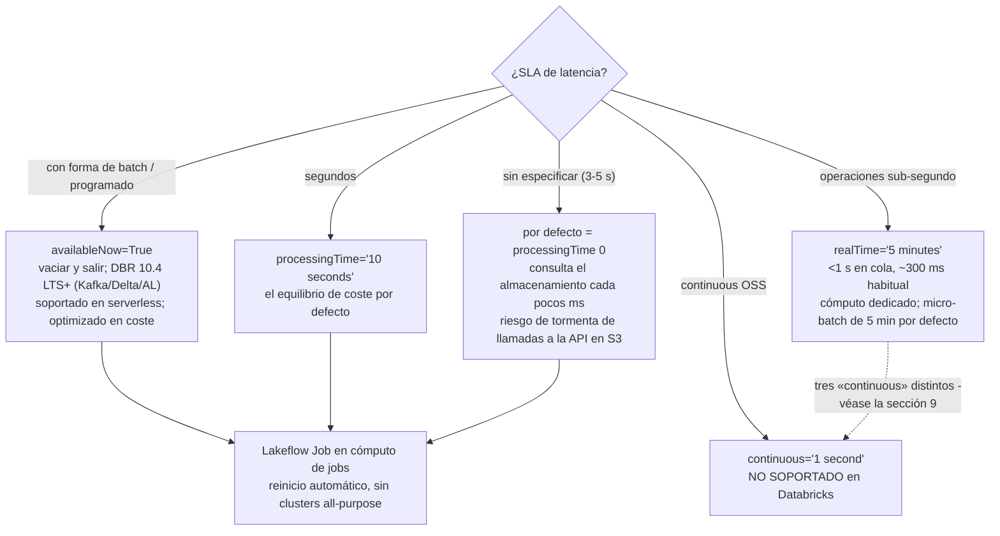
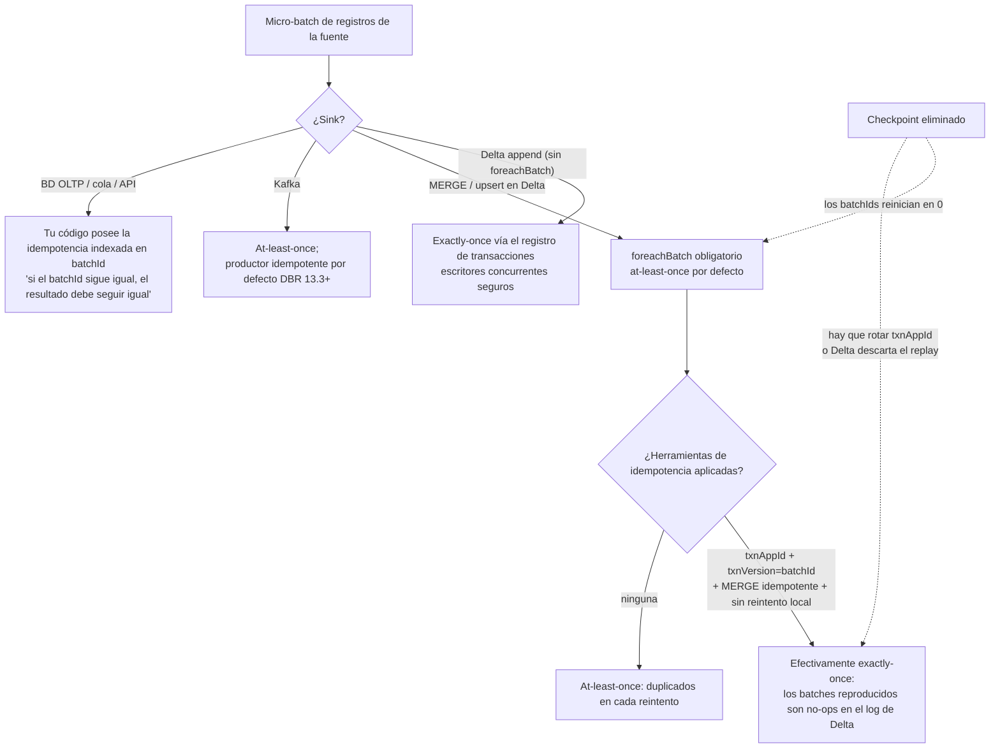
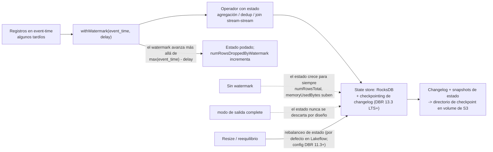

# Structured Streaming en el lakehouse de AWS: triggers, checkpoints, foreachBatch y exactly-once

Una consulta de streaming en Databricks es una tabla no acotada y un plan al estilo batch que el motor vuelve a ejecutar sobre el siguiente trozo de entrada. Ese modelo es la razón por la que «convertir jobs de batch existentes en jobs de streaming exige cambios mínimos de código» (blog de Databricks, 2026-04-20) — y también es la razón por la que cada incidente de producción en este espacio vuelve a cuatro objetos: el **trigger** que decide cuándo se ejecuta un micro-batch, el **checkpoint** que recuerda qué se leyó y qué se confirmó, el **contrato del sink** que decide si un batch reproducido duplica filas, y el **watermark** que decide cuándo se puede descartar el estado. Acierta esos cuatro y el lakehouse se rellena solo casi en tiempo real; falla en uno y reprocesas una semana, duplicas una tabla silver o ves crecer el estado hasta que el cluster muere.

Esta lección es la mitad de streaming del curso. La lección 05 te enseñó cómo *llegan* los datos (Auto Loader, autenticación de MSK, eventos de archivos); esta lección enseña cómo *siguen llegando correctamente* — triggers y su física de coste en AWS, higiene de checkpoints sobre volumes respaldados por S3, `foreachBatch` MERGE con `txnAppId`/`txnVersion`, fan-out de change data feed, estado acotado por watermark, exactly-once de extremo a extremo y la postura de producción (Lakeflow Jobs, no clusters all-purpose) que Databricks documenta hoy.

Cada dato de abajo procede de la documentación de Databricks sobre AWS — los triggers (pie de página **2026-10-08**), checkpoints (**2026-09-11**), foreach, Delta streaming (ambos **2026-08-24**), CDF, Kafka (**2026-09-11**), api-options (**2026-10-05**), stream-monitoring (**2026-09-23**), watermarks (**2026-09-11**), stateful-streaming (**2026-10-09**), production, schema-evolution (**2026-08-05**) y las páginas de streaming/dashboards de Databricks SQL — más blogs fechados de Databricks, todos consultados o fechados en **octubre de 2026**. El alcance de la plataforma es **Databricks on AWS**: Amazon MSK, S3, Kinesis y los volumes de Unity Catalog son el sustrato; Azure Event Hubs no existe aquí y queda fuera de alcance.

```text
 =============================================================
  STRUCTURED STREAMING EN DATABRIKS/AWS - FORMA (oct 2026)
 -------------------------------------------------------------
  Triggers (docs .../triggers, pie de página 2026-10-08)
    por defecto         latencia ~3-5 s; processingTime 0;
                        consulta el almacenamiento cada pocos ms
                        (¡coste de API!)
    processingTime='10 seconds'   el equilibrio de coste
    availableNow=True   vacía todo lo disponible y sale;
                        reemplaza al Trigger.Once obsoleto (11.3+);
                        único trigger soportado en serverless
                        (con el obsoleto Once); DBRs mínimos:
                        archivos 9.1 LTS, Delta/AL/Kafka 10.4 LTS,
                        Kinesis 13.1
    realTime='5 minutes'  modo sub-segundo; la cadena = longitud
                        del micro-batch (5 min por defecto);
                        <1 s en cola, ~300 ms habitual,
                        hasta 5 ms de extremo a extremo
    continuous='1 second'  NO SOPORTADO (experimental en OSS);
                        usa el modo real-time en su lugar
  Checkpoint (uno por consulta, S3 vía volume de UC, sin ciclo de vida)
    offsets | commits | estado | metadata
  Garantías
    sink Delta      -> exactly-once (registro de transacciones)
    foreachBatch    -> at-least-once; exactly-once con
                       txnAppId + txnVersion (= batchId)
    sink Kafka      -> at-least-once; productor idempotente DBR 13.3+
  Estado
    el watermark acota el estado; dropDuplicatesWithinWatermark
    (DBR 13.3 LTS+, requiere watermark); RocksDB + checkpointing
    de changelog DBR 13.3+ recomendado para TODAS las
    consultas con estado; transformWithState DBR 16.2+
 =============================================================
```

En esta lección:

- configurar **todos los triggers soportados** y defender la elección frente a la latencia, el coste y las restricciones de serverless — incluyendo por qué el trigger `continuous` de OSS está muerto en Databricks y cuáles de las tres funciones distintas llamadas «continuous» se confunden;
- diseccionar un **checkpoint** (offsets, commits, estado, metadata), colocarlo en una ruta de volume de Unity Catalog sobre S3 y recitar la matriz de cambios en el reinicio — qué puedes alterar en una consulta viva frente a lo que fuerza en silencio un inicio desde cero;
- escribir el **job de streaming protagonista**: Amazon MSK → parseo → watermark + `dropDuplicatesWithinWatermark` → `foreachBatch` **MERGE** en una tabla silver de Delta con `txnAppId`/`txnVersion`, más una ruta de dead-letter;
- llevar **change data feed** a gold — `readChangeFeed=true`, semántica de `_change_type`, `startingVersion` y el replay batch de `table_changes()` para backfill y auditoría;
- acotar la **agregación con estado** con watermarks: append frente a update frente a complete, el watermark obligatorio en los outer joins, la política global con mínimo para los múltiples watermarks, y el modo de fallo por inflación del estado con su remedio en RocksDB;
- observar un stream como un operador: campos de progreso (`numInputRows`, `batchDuration`, `stateOperators`), la pestaña **Streaming** de la Spark UI, `StreamingQueryListener` y `df.observe`;
- construir con honestidad el **stack de dashboards casi en tiempo real**: streaming tables de DBSQL en pipelines serverless y por qué una caché de Lakeview de hasta 24 horas no es «tiempo real»;
- estudiar **tres historias nombradas de streaming de clientes de AWS** (Burberry, Shell, Asurion), leer el **recuadro de actualizaciones de 2026** y practicar con **14 preguntas de estilo examen** más cuatro comprobaciones interactivas.

---

## 1. El modelo de micro-batch y el menú de triggers

Structured Streaming planifica tus transformaciones de DataFrame una sola vez y las ejecuta de forma incremental. En el motor de **micro-batch** por defecto, el driver pregunta repetidamente a la fuente «¿qué hay de nuevo desde el último offset?», planifica un batch, lo ejecuta en el cluster, confirma el offset y la escritura del sink, y deja constancia del progreso en el checkpoint. El **modo real-time** es la ruta de ejecución separada y soportada de baja latencia de Databricks — no el experimento de procesamiento continuo de OSS. Batch y streaming comparten una sola superficie de API; solo cambian el lector, el trigger y el checkpoint. Esa es la lección de unificación que la lección 05 usó para ejecutar el mismo código bronze como job nocturno y como stream de baja latencia.

### 1.1 La tabla verificada de triggers (docs, pie de página 2026-10-08)

| Trigger | Cómo configurarlo | Comportamiento documentado | Cuándo usarlo |
|---|---|---|---|
| **Por defecto (sin especificar)** | omite `.trigger(...)` | «Streaming de propósito general con latencia de **3–5 segundos**. Equivalente a un trigger processingTime con intervalos de **0 ms**.» Consulta datos nuevos cada pocos milisegundos — «puede generar un gran volumen de llamadas a la API del almacenamiento en la nube al día y resultar en cargos inesperados» | Solo para prototipos; nunca como valor por defecto de producción que cuide el coste |
| **Intervalo fijo** | `.trigger(processingTime='10 seconds')` | Un micro-batch por intervalo; la latencia está acotada por el intervalo | El valor por defecto que equilibra el coste para ETL casi en tiempo real en cómputo classic |
| **Available-now** | `.trigger(availableNow=True)` | «Procesa tantos datos como haya disponibles en el momento en que se activa el job de streaming», a lo largo de tantos micro-batches como exijan los límites de tasa, y después sale. Reemplaza a `Trigger.Once`, **obsoleto en DBR 11.3 LTS+**. DBRs mínimos: fuentes de archivos **9.1 LTS**; Delta / Auto Loader / Kafka **10.4 LTS**; Kinesis **13.1** | Ingesta casi en tiempo real programada (jobs horarios/diarios); **la única** historia de triggers en serverless además del `Once` obsoleto («On serverless compute, only `Trigger.AvailableNow()` and `Trigger.Once()` are supported. Databricks recommends `Trigger.AvailableNow()`») |
| **Modo real-time** | `.trigger(realTime='5 minutes')` | «Cargas operativas de latencia ultra baja que requieren procesamiento sub-segundo»; «'5 minutes' indicates the length of a micro-batch». Latencia «as low as **five milliseconds**» de extremo a extremo (página de conceptos, 2026-09-11); «under 1 second at the tail, and in common cases around 300 ms» (triggers, 2026-10-08). Necesita cómputo dedicado | Bloqueo de fraude, personalización en tiempo real — los propios ejemplos de la página |
| **Procesamiento continuo** | `.trigger(continuous='1 second')` | «**Not supported.** This is an experimental feature included in Spark OSS. Use real-time mode instead.» «Databricks doesn't support or recommend this mode.» | Nunca, en Databricks |



### 1.2 Ejemplo resuelto E1 — elegir un trigger, con la factura de AWS de por medio

Escenario: una zona de aterrizaje en S3 recibe archivos en ráfagas; la especificación del producto dice «casi en tiempo real, con minutos de sobra». Tres configuraciones candidatas, valoradas en dos ejes: **cómputo** (job cluster) y **coste de peticiones de S3** (el multiplicador oculto del trigger por defecto).

```python
# E1 - three ways to run the same bronze Auto Loader query
# (checkpoint and schema paths on UC volumes; S3-backed, no lifecycle policy)

# A. Default trigger - fastest to write, most expensive to operate
(brz.writeStream.format("delta")
   .option("checkpointLocation", "/Volumes/lake/ops/ckpt/orders_bronze")
   .toTable("lake.bronze.orders"))          # implicit processingTime = 0

# B. Fixed interval - the cost-balancing production default
(brz.writeStream.format("delta")
   .option("checkpointLocation", "/Volumes/lake/ops/ckpt/orders_bronze")
   .trigger(processingTime="10 seconds")
   .toTable("lake.bronze.orders"))

# C. Available-now as a scheduled job - cheapest shape for hourly arrival
(brz.writeStream.format("delta")
   .option("checkpointLocation", "/Volumes/lake/ops/ckpt/orders_bronze")
   .trigger(availableNow=True)              # DBR 10.4 LTS+; serverless-recommended
   .toTable("lake.bronze.orders"))
```

Boceto de cómputo (nuestro, sobre la semántica documentada): la ejecución horaria de `availableNow` vacía en **20 minutos** sobre un job cluster de 4 nodos — **12 DBU/h × 0,33 h = 4 DBU/ejecución**; con **Jobs Compute a $0.15/DBU** (forma de lista Premium de AWS a oct 2026, la misma base documental que el E7 de la lección 05 — revisa siempre `system.billing.list_prices` en tu cuenta) eso son **$0.60/ejecución → $14.40/mes**. Un stream con `processingTime='10 seconds'` en el mismo cluster corre de forma continua: 720 h/mes × 12 DBU = **8,640 DBU ≈ $1,296/mes**, lleguen o no datos. El trigger por defecto (consulta «cada pocos milisegundos») multiplica el volumen de `LIST`/`GET` de S3 contra la misma tarifa de $0.005 por cada 1.000 `LIST` que la lección 05 calculó — sobre un prefijo de 2M de archivos, el modo de listado de directorios con triggers de nivel de segundo cuesta **$2,592–$25,920/mes** solo en `LIST` frente a **$28.80** con un `availableNow` de 15 minutos. El trigger es una decisión de coste, no una preferencia de latencia.

- **📚 ¿Sabías que…?** `Trigger.Once` está obsoleto desde **DBR 11.3 LTS** — «Use `Trigger.AvailableNow` for all incremental batch processing workloads» (triggers, 2026-10-08) — pero `Once` sigue apareciendo en la frase de soporte de serverless porque los notebooks antiguos todavía lo llaman. `AvailableNow` es la mejora estricta: la misma semántica de vaciar y salir, más **limitación de tasa** entre micro-batches (`maxFilesPerTrigger`, `maxOffsetsPerTrigger`), algo que `Once` no tenía. Cualquier tutorial que enseñe `Once` como vigente está enseñando una API de 2022.

---

## 2. Checkpoints: la memoria de la consulta, en S3

### 2.1 Anatomía

«A checkpoint directory contains **Offsets**, **Commits**, **State**, and **Metadata**» (checkpoints, 2026-09-11):

| Entrada | Qué almacena | Por qué importa |
|---|---|---|
| **Offsets** | Los offsets de la fuente procesados en cada micro-batch | Punto de reanudación tras una falla; el límite del replay |
| **Commits** | Qué micro-batches han confirmado escritura en el sink | El libro mayor del exactly-once — un batch está «hecho» solo cuando aterrizan tanto el commit del sink como la entrada del commit log |
| **State** | Metadatos del operador con estado, esquema del estado, contenidos del state store | Ventanas de watermark, claves de dedup, estado de agregación; respaldado por RocksDB en los DBRs modernos |
| **Metadata** | ID único de la consulta y su configuración | La identidad de la consulta para la UI y las comprobaciones de reinicio |

En AWS el checkpoint vive en almacenamiento duradero — el ejemplo documentado escribe `checkpointLocation` bajo una ruta de **volume de Unity Catalog** (`/Volumes/catalog/schema/volume/path`), que aterriza en S3 a través de tu storage credential. «Give each query its own checkpoint directory in durable cloud storage» (página de producción). Nunca DBFS local `/tmp`, nunca el prefijo de aterrizaje, nunca una ruta con política de ciclo de vida.

```mermaid
sequenceDiagram
  participant LB as Lakeflow Job (reinicio automático)
  participant Q as Consulta de streaming
  participant CP as Checkpoint en S3 (/Volumes/.../ckpt)
  participant S as Fuente (MSK / archivos S3 / Delta CDF)
  participant D as Sink Delta (silver)
  LB->>Q: start(query config)
  Q->>CP: lee offsets + estado + metadata
  Q->>S: busca registros después del último offset
  Note over Q: planifica el micro-batch N (determinista)
  Q->>D: escribe el batch N (append o MERGE de foreachBatch)
  D-->>Q: commit (txn N de Delta)
  Q->>CP: escribe la entrada de commit N + offsets nuevos (+ changelog del estado)
  Note over Q,D: ¿falla DESPUÉS del commit del sink, ANTES de escribir el commit log?<br/>el reinicio reproduce el batch N; txnAppId/txnVersion de Delta lo convierte en no-op
  Note over Q,D: ¿falla ANTES del commit del sink?<br/>el reinicio reproduce el batch N; el MERGE se vuelve a ejecutar (idempotente por clave)
  Q-->>LB: consulta terminada / caída
  LB->>Q: reinicio automático con backoff (mismo checkpoint)
  Note over CP: borra o caduca por ciclo de vida este directorio<br/>= la consulta empieza DESDE CERO (reproceso total, estado reconstruido)
```

### 2.2 La matriz de cambios en el reinicio

No todo cambio de código es seguro ante un reinicio sobre un checkpoint existente. Las reglas de la página de checkpoints, comprimidas:

| Cambio a través del reinicio | ¿Permitido? |
|---|---|
| Filtros, proyecciones, cambios de intervalo del trigger, límites de tasa (`maxFilesPerTrigger`, `maxOffsetsPerTrigger`) | Generalmente seguro |
| Añadir/quitar/reordenar **fuentes**, cambiar el número o el tipo de fuente | **No** — se requiere un checkpoint nuevo (DBR **18.2+** permite la evolución de fuentes con nombre vía `.name()` + `spark.sql.streaming.queryEvolution.enableSourceEvolution`, irreversible por checkpoint) |
| Cambiar el **esquema del estado** (claves de agregación distintas, tipo distinto de la columna del watermark) | **No** — checkpoint nuevo |
| Cambiar el **tipo de sink** (p. ej., de sink Kafka a file no está permitido; de file a Kafka sí) | Depende de la matriz; muchos cambios de sink son de un solo sentido |
| Cambiar el **backend del state store** (HDFS ↔ RocksDB) | **No** — no se puede intercambiar entre reinicios |
| Cambiar el número de particiones de shuffle en una consulta con estado | **No** en los DBRs antiguos (congelado al crearse el checkpoint); **DBR 18 LTS+** puede reparticionar mediante repartición de estado bajo demanda sin un checkpoint nuevo |
| Cambiar el **modo de acceso** del cómputo con `dropDuplicates`/`dropDuplicatesWithinWatermark` presentes | Puede hacer fallar una **comprobación de compatibilidad del esquema del estado** — fija el modo de acceso durante toda la vida de la consulta |

> [!WARNING]
> **⚠️ Borrar un checkpoint es una puerta de un solo sentido — y la inflación del estado es la versión a cámara lenta del mismo desastre.** «When you delete the files in a checkpoint directory or change to a new checkpoint location, the next run of the query begins fresh» (doc de checkpoints): Kafka reproduce según `startingOffsets` (por defecto **latest** — el backlog que acumulaste puede saltarse), Auto Loader vuelve a listar el prefijo, el watermark se reinicia y cada clave de dedup/agregación se reconstruye desde cero. Peor: si la consulta escribe en Delta con marcadores de idempotencia, un checkpoint nuevo reinicia los IDs de batch en **0** — y Delta **descartará en silencio** los batches reproducidos a menos que también cambies `txnAppId` (docs .../structured-streaming/delta-lake, 2026-08-24). El fallo opuesto es la inflación del estado: sin watermark en un dedup o una agregación, `stateOperators.numRowsTotal` y `memoryUsedBytes` suben y suben hasta que el executor muere — y en el modo de salida `complete` «el estado de agregación no se descarta» por diseño. Los checkpoints además nunca deben estar bajo una política de ciclo de vida de objetos en la nube: la página de producción de Auto Loader es tajante — si las reglas de ciclo de vida limpian el checkpoint, «the stream state is corrupted», y reinicias desde cero. Trata `/_checkpoints` (el guion bajo sobrevive a `VACUUM`) y las rutas de volumes de UC como datos de producción, con un responsable, una política de acceso y una sentencia de IAM que prohíba el borrado.

---

## 3. Fuentes en AWS: Kafka/MSK en profundidad, Delta CDF dentro

La lección 05 cubrió Auto Loader de extremo a extremo; esta sección añade lo que necesita un *operador* de streaming: los controles de tasa de Kafka, la tabla Delta como fuente y el CDF como ruta de cambios recomendada.

### 3.1 Kafka / Amazon MSK: las cuatro opciones que deciden tu semana

La lectura mínima es `spark.readStream.format("kafka")` con `kafka.bootstrap.servers` y `subscribe` — y después las opciones que importan (api-options, 2026-10-05; doc de Kafka, 2026-09-11):

| Opción | Por defecto | Comportamiento |
|---|---|---|
| `startingOffsets` | **`latest`** (streaming) / `earliest` (batch) | Aplica **solo a una consulta nueva**; «Resumed queries always use the checkpoint.» Una trampa de pérdida silenciosa de backlog en la primera ejecución |
| `maxOffsetsPerTrigger` | ninguno | Máximo de registros por micro-batch, «distributed proportionally across topic partitions» — el limitador de tasa para ponerse al día |
| `minOffsetsPerTrigger` + `maxTriggerDelay` | ninguno / **`15m`** | Acumula el tráfico pequeño; cuando se alcanza `maxTriggerDelay`, el micro-batch se ejecuta sea como sea |
| `failOnDataLoss` | **`true`** | Falla con topics eliminados o offsets truncados en lugar de saltárselos en silencio; «Databricks estimates conservatively… this might cause false alarms» |

El lector devuelve `key` y `value` como **binario** — haz siempre `cast`/`from_json`/`from_avro` de forma explícita. Autenticación en AWS, en el orden recomendado por Databricks: **service credentials de Unity Catalog** (`databricks.serviceCredential`, **DBR 16.1+**, preferido para clusters compartidos y serverless — *no* configures también `sasl.*` tú mismo), después **MSK IAM** por instance profile (`AWS_MSK_IAM` + clases enmascaradas `shadedmskiam.*`, `SASL_SSL`, puerto **9098**), después JAAS basado en roles (`awsRoleArn=`), después SASL/PLAIN/SCRAM y por último mTLS con el material en un volume de UC y las contraseñas en un secret scope. Los security groups de MSK deben permitir el SG del cómputo de Databricks en **9092** (PLAINTEXT) / **9094** (SASL/SSL) / **9098** (IAM); VPC peering o PrivateLink une las dos VPC.

### 3.2 Ejemplo resuelto E2 — MSK → Delta bronze, con límite de tasa y deduplicación

```python
# E2 - Amazon MSK (IAM via UC service credential) -> Delta bronze
# DBR 15.4 LTS jobs cluster; checkpoint on a UC volume (S3-backed)

from pyspark.sql.functions import from_json, col, expr
from pyspark.sql.types import StructType, StructField, StringType, DoubleType, TimestampType

schema = StructType([
    StructField("event_id", StringType()),
    StructField("order_ts", TimestampType()),
    StructField("customer_id", StringType()),
    StructField("amount", DoubleType()),
])

raw = (spark.readStream.format("kafka")
       .option("kafka.bootstrap.servers", "b-1.msk.acme.amazonaws.com:9098")
       .option("subscribe", "orders")
       .option("databricks.serviceCredential", "msk-orders-cred")   # DBR 16.1+; no sasl.* below
       .option("startingOffsets", "earliest")   # FIRST run only; checkpoint wins after
       .option("maxOffsetsPerTrigger", 500_000) # ~16,600 msg/s at a 30 s interval
       .option("failOnDataLoss", "true")
       .load())

parsed = (raw.select(col("value").cast("string").alias("json"), col("timestamp").alias("ingest_ts"))
          .select(from_json(col("json"), schema).alias("e"), col("ingest_ts"))
          .select("e.*", "ingest_ts"))

deduped = (parsed
           .withWatermark("order_ts", "1 hour")                       # lateness bound
           .dropDuplicatesWithinWatermark(["event_id"]))              # DBR 13.3 LTS+

(deduped.writeStream.format("delta")
   .option("checkpointLocation", "/Volumes/lake/ops/ckpt/orders_bronze")
   .trigger(processingTime="30 seconds")
   .toTable("lake.bronze.orders"))
```

Dos trampas documentadas viven en esas veinte líneas. `startingOffsets=latest` es el valor por defecto de streaming — con un checkpoint de nueva planta la consulta se salta en silencio todo lo que ya hay en el topic; pon `earliest` en la primera ejecución y después confía en el checkpoint para siempre. Y en **DBR 17.1+** los offsets más recientes de Kafka se obtienen *después* de que cada micro-batch termine, así que las métricas de backlog (`avgOffsetsBehindLatest` y demás) «may show small, persistent non-zero values. This is expected behavior» — no despiertes a nadie a las 03:00 por un «lag» de 12 offsets.

### 3.3 Delta como fuente, y CDF como ruta de cambios recomendada

«Structured Streaming only accepts **append** inputs and throws an exception if any modifications occur on the source Delta Lake table» (docs .../structured-streaming/delta-lake, 2026-08-24) — y por eso «Databricks recommends streaming from the CDC feed of a Delta Lake table rather than directly from the table whenever possible». El change data feed automático «uses the same `table_changes()` and `readChangeFeed` APIs as legacy change data feed and works with batch queries, Structured Streaming…» (página de CDF). Actívalo **al crear la tabla** (`delta.enableChangeDataFeed=true`) — nada se captura antes de ese momento. La sección 5 construye el fan-out completo.

- **📚 ¿Sabías que…?** El proyecto «Spark Streaming» de la era de las DStreams «is now a legacy project and new streaming applications should use Structured Streaming instead» (blog de Databricks, 2026-04-20). Si tu CV o tu runbook todavía dicen «Spark Streaming» o `Dstream`, estás anunciando una tecnología que su propio creador retiró. El blog de Structured Streaming de la misma fecha señala que la API «became production-ready in Spark 2.2» — el modelo que estás aprendiendo aquí lleva siendo el valor por defecto durante la mayor parte de una década.

---

## 4. foreachBatch y la historia del exactly-once

### 4.1 El contrato

«**You must use `foreachBatch` for Delta Lake merge operations in Structured Streaming**» — MERGE es una operación de batch, así que un upsert desde un stream solo puede ocurrir dentro del callback del micro-batch (docs .../structured-streaming/foreach, 2026-08-24). La misma página fija la garantía: «`foreachBatch()` provides only **at-least-once** write guarantees. However, you can use the `batchId` provided to the function as way to deduplicate the output and get an exactly-once guarantee.» En **DBR 14.0+** la ruta de Delta exige la API explícita de idempotencia: «**You must use the `txnAppId` and `txnVersion` write options, binding `txnVersion` to `batchId`**» — y «Do not catch and retry exceptions locally»; deja que los errores se propaguen para que el orquestador reintente el micro-batch completo de forma limpia. Para destinos personalizados o externos (BD OLTP, cola, API HTTP): «Implement your own idempotency» — si el `batchId` es el mismo, tu efecto secundario tiene que ser el mismo.

Tres corolarios que las docs enuncian y que los ingenieros junior incumplen constantemente:

1. **Checkpoint nuevo ⇒ `txnAppId` nuevo.** «If you delete the streaming checkpoint and restart the query with a new checkpoint, you must provide a different `txnAppId`.» Los checkpoints nuevos empiezan en el batch ID 0; con el appId antiguo, Delta trata el replay como duplicado y lo descarta.
2. **Una escritura de streaming por sink.** «Databricks recommends configuring a separate streaming write for each sink you want to update instead of using `foreachBatch`. Writes to multiple sinks in foreachBatch reduces parallelization and increases overall latency because writes to multiple tables are serialized.»
3. **MERGE idempotente.** «Verify that your `merge` statement inside `foreachBatch` is **idempotent**. Otherwise, restarts of the streaming query can apply the operation on the same batch of data multiple times.» Estrecha la cláusula `ON` a las claves del batch.

### 4.2 Ejemplo resuelto E3 — el job protagonista: MSK → MERGE en silver con ruta de dead-letter

```python
# E3 - foreachBatch MERGE into Delta silver, idempotent, with DLQ
# At-least-once callback + txnAppId/txnVersion = effectively exactly-once

from delta.tables import DeltaTable

APP_ID = "orders-silver-msk"   # change IFF you intentionally start a NEW checkpoint

def upsert_to_silver(batch_df, batch_id):
    if batch_df.isEmpty():
        return
    # batch_df is consumed twice (valid + rejects): persist, or you re-read the source
    batch_df.persist()

    valid = batch_df.filter("order_id IS NOT NULL AND amount >= 0")
    rejects = batch_df.filter("order_id IS NULL OR amount < 0")

    (DeltaTable.forName(spark, "lake.silver_orders")
       .merge(valid.alias("s"), "s.order_id = t.order_id")     # pruned ON clause
       .whenMatchedUpdateAll(condition="s.order_ts > t.order_ts")
       .whenNotMatchedInsertAll()
       .execute())                                             # must be idempotent

    (rejects.write.format("delta").mode("append")
       .option("txnAppId", f"{APP_ID}-dlq").option("txnVersion", batch_id)
       .saveAsTable("lake.quarantine.orders_rejects"))

    # if you also plain-append rows from foreachBatch, stamp them:
    # valid.write.format("delta").mode("append") \
    #   .option("txnAppId", APP_ID).option("txnVersion", batch_id)...

    batch_df.unpersist()   # never catch/retry inside this function - let the job retry the batch

(deduped.writeStream.format("delta")
   .option("checkpointLocation", "/Volumes/lake/ops/ckpt/orders_silver")
   .outputMode("update")            # accepted by foreachBatch; the table itself gets append/complete
   .foreachBatch(upsert_to_silver)
   .trigger(processingTime="30 seconds")
   .start())
```

### 4.3 El árbol de decisión del exactly-once



---

## 5. Change data feed hacia fuera: el fan-out a gold

### 5.1 El patrón

Crea la tabla silver con el CDF activado; cada consumidor aguas abajo que necesite *cambios* hace streaming del feed CDC en lugar de releer la tabla. Cada registro de CDF lleva `_change_type` ∈ `insert` / `update_preimage` / `update_postimage` / `delete`. El replay batch usa `table_changes('tbl', v1, v2)` para backfill y auditoría — la misma mecánica que el propio blog de CDF de Databricks (2021-06-09) usó para construir el patrón de CDC con medallion.

### 5.2 Ejemplo resuelto E4 — stream de CDF a gold más un replay batch

```python
# E4a - silver created with CDF enabled (forward-looking only)
spark.sql("""
  CREATE TABLE lake.silver_orders (
    order_id STRING, order_ts TIMESTAMP, customer_id STRING,
    amount DOUBLE, updated_at TIMESTAMP
  ) USING DELTA
  TBLPROPERTIES (delta.enableChangeDataFeed = true)
""")

# E4b - gold consumer streams the change feed (serverless-friendly: availableNow)
changes = (spark.readStream.format("delta")
           .option("readChangeFeed", "true")
           .option("startingVersion", 70)      # skip history you already backfilled
           .table("lake.silver_orders"))

(gold_df.writeStream.format("delta")
   .option("checkpointLocation", "/Volumes/lake/ops/ckpt/orders_gold")
   .trigger(availableNow=True)                 # deterministic nightly replay
   .toTable("lake.gold.orders_daily"))
```

```python
# E4c - batch replay / audit via table_changes (mirrors the docs' recovery example)
replay = spark.read.format("delta")
  .option("readChangeFeed", "true")
  .option("startingVersion", 70)
  .option("endingVersion", 75)
  .table("lake.silver_orders")
# or the SQL form: SELECT * FROM table_changes('silver_orders', 70, 75)
```

«You must use Structured Streaming for Databricks to automatically track versions for your table's change data feed» — el seguimiento de versiones es un comportamiento del consumidor de streaming, y por eso emparejar el CDF con `availableNow` en una programación es el patrón de replay determinista documentado. Los pipelines de Lakeflow añaden **AUTO CDC** (el Applier) para DB→Delta y Delta→Delta sin MERGE escrito a mano — cubierto en la lección 07; esta sección es la versión de notebook sin procesar que ahora entiendes desde dentro.

---

## 6. Watermarks, estado y el modo de fallo por inflación

### 6.1 Para qué sirve un watermark

«Watermarks automatically remove old state data to prevent memory errors and increased processing latency» (watermarks, 2026-09-11). Tú afirmas una puntualidad máxima — `withWatermark("event_time", "10 minutes")` — y el motor avanza un watermark global más allá de `max(event_time) − delay`. «Queries always process records that arrive within the threshold. Queries might still process records that arrive outside the threshold, but this isn't guaranteed.» El modo de salida cambia lo que ves:

| Modo de salida | Emisiones | Estado | ¿Sink Delta? |
|---|---|---|---|
| **append** (por defecto) | Solo las filas finalizadas, después de que pase el watermark | Acotado por el watermark | Soportado |
| **update** | Las filas cambiadas en cada trigger | Podado por el watermark cuando avanza | **No soportado por Delta** — usa MERGE en `foreachBatch` |
| **complete** | Cada fila que el operador produjo jamás | «El estado de agregación no se descarta» — sin acotar por diseño | Soportado, pero «puede tener un rendimiento deficiente a medida que crecen los datos» |

Los joins stream-stream «only support append mode»; «For outer joins, watermarking is mandatory»; para inner joins se recomienda encarecidamente. Con múltiples watermarks «Structured Streaming uses the minimum as the global watermark» por defecto; `spark.sql.streaming.multipleWatermarkPolicy=max` baja la latencia pero «drops data from the slowest streams… apply with caution». Las duraciones de ventana van «from microseconds up to days. Month durations and longer are not supported.»



### 6.2 Ejemplo resuelto E5 — agregación por ventanas con las matemáticas del estado a la vista

```python
# E5 - 5-minute tumbling windows per ad, append mode, watermark 10 minutes
clicks = spark.readStream.format("kafka") \
  .option("kafka.bootstrap.servers", "...").option("subscribe", "clicks") \
  .option("maxOffsetsPerTrigger", 200_000).load()

parsed = clicks.select(from_json(col("value").cast("string"), click_schema).alias("e")).select("e.*")

windowed = (parsed
  .withWatermark("event_time", "10 minutes")
  .groupBy(window(col("event_time"), "5 minutes"), col("ad_id"))
  .count())

query = (windowed.writeStream.format("delta")
  .outputMode("append")                                   # finalized windows only
  .option("checkpointLocation", "/Volumes/lake/ops/ckpt/clicks_5m")
  .trigger(processingTime="1 minute")
  .toTable("lake.silver.clicks_5m"))

# Inspect the state after a few batches:
# query.lastProgress["stateOperators"][0]["numRowsTotal"]
# query.lastProgress["stateOperators"][0]["numRowsDroppedByWatermark"]
# query.lastProgress["eventTime"]["watermark"]
```

Lógica de dimensionado (nuestra, sobre la semántica documentada): claves vivas ≈ anuncios × ventanas dentro del watermark = 5.000 anuncios × 3 ventanas (watermark de 10 min ÷ ventana de 5 min) ≈ **15.000 filas de estado** — trivial. Quita el watermark y el estado retiene cada `(window, ad_id)` para siempre; añade el modo `complete` y cada fila histórica se vuelve a emitir en cada trigger. La variante de dedup importa igual: un `dropDuplicates(["event_id"])` simple retiene estado de **cada clave para siempre**; `dropDuplicatesWithinWatermark(["event_id"])` (DBR **13.3 LTS+**, **requiere un watermark**) solo retiene las claves dentro de la ventana de puntualidad — «the correct default for idempotent event ingestion when duplicates arrive close in event time».

### 6.3 Ejemplo resuelto E6 — valores por defecto del estado en producción y estado personalizado

Para todas las consultas con estado en los DBRs actuales, la postura documentada de Databricks es: **state store de RocksDB + checkpointing de changelog** (DBR 13.3 LTS+) — «Databricks recommends enabling changelog checkpointing for all Structured Streaming stateful queries»; async state checkpointing y async progress tracking en la página de producción; **sin autoscaling** para los job clusters de Structured Streaming puro («Compute auto-scaling has limitations scaling down»); y rebalanceo de estado en el resize (activado por defecto en los pipelines de Lakeflow; config `spark.sql.streaming.statefulOperator.stateRebalancing.enabled` desde DBR 11.3+). Estado con clave personalizado más allá de agregación/dedup/joins: `transformWithState` (**DBR 16.2+**) sustituye al heredado `mapGroupsWithState`/`flatMapGroupsWithState` en el código nuevo. El número de particiones de shuffle queda congelado al crearse el checkpoint para los operadores con estado (la repartición bajo demanda llega en **DBR 18 LTS+**) — una trampa silenciosa cuando alguien «solo sube la paralelidad» en una consulta existente.

- **📚 ¿Sabías que…?** `VACUUM` «skips any directories that begin with `_`», y por eso las docs de Delta streaming sugieren guardar los checkpoints «using a directory structure such as `/_checkpoints`». Una convención de nombres de un solo carácter separa un comando de mantenimiento rutinario de un estado de streaming borrado — combínala con una ruta de volume de UC y una política de IAM que prohíba `s3:DeleteObject` sobre el prefijo del checkpoint, y borrar un checkpoint deja de ser una posibilidad de las 3 de la mañana.

---

## 7. Schema evolution en streams: planes bloqueados, sinks aditivos

«A streaming query's schema is **locked in during the planning phase**… If the source schema changes mid-execution, the query fails, and the user must restart the streaming query» (schema-evolution, 2026-08-05) — y por eso los streams de producción deben correr bajo un job con reinicio automático. En el lado del sink, Delta solo acepta cambios aditivos: `.option("mergeSchema", "true")` en la escritura de streaming «only supports adding new columns». Prefiere la opción por escritura (o `WITH SCHEMA EVOLUTION` en SQL) a `spark.databricks.delta.schema.autoMerge.enabled` de sesión, que es heredado. En el lado de la fuente: las columnas nuevas fluyen con `mergeSchema`; los renombres y borrados necesitan `spark.databricks.delta.streaming.allowSourceColumnRename` / `…allowSourceColumnDrop`; la ampliación de tipos es **DBR 16.4 LTS+**; «Other type changes: Not supported.» Y el dato nuclear — «Updating a table schema terminates any streams reading from that table» (update-schema, 2026-08-19). El propio bucle de evolución de Auto Loader (fallar con `UnknownFieldException` y después reiniciar, `schemaEvolutionMode=addNewColumns` / `rescue`) fue la serie E de la lección 05; la historia de la fuente Delta aquí es la misma disciplina dirigida por reinicios, en otra capa.

---

## 8. Observabilidad y el dashboard casi en tiempo real

### 8.1 Tres capas de monitorización de streams (stream-monitoring, 2026-09-23)

1. **Progreso de la consulta** — el `StreamingQuery` devuelto por el notebook, la pestaña **Streaming** de la Spark UI (`.queryName()` para desambiguar) y el JSON de progreso. Campos clave: `numInputRows`, `inputRowsPerSecond`, `processedRowsPerSecond`, `batchId`, `batchDuration`, el desglose de `durationMs` (`getBatch`, `addBatch`, `commitOffsets`, `walCommit`), `eventTime.watermark` y `stateOperators` (`numRowsTotal`, `memoryUsedBytes`, `numRowsDroppedByWatermark`, `customMetrics` de RocksDB). Las métricas de la fuente incluyen `numBytesOutstanding` / `numFilesOutstanding` de Delta/Auto Loader; `reservoirId` corresponde al `id` de `DESCRIBE DETAIL <table>`.
2. **`StreamingQueryListener`** (Python y Scala, **DBR 11.3 LTS+**; suelos por modo de acceso de UC **15.1+** dedicado, **16.1+** estándar de Scala) — envío a Prometheus/Grafana/Kafka. Mantén los callbacks diminutos: «Processing latency with listeners can significantly affect query processing speeds.»
3. **`df.observe(name, agg…)`** — agregados arbitrarios por epoch emitidos en `observedMetrics` (p. ej., una proporción de filas malformadas que alerta antes de que lo haga la frescura aguas abajo).

### 8.2 Dashboards: por demanda, con caché, honestos

Los dashboards de DBSQL/Lakeview son **por demanda (pull-based)**: los datasets se ejecutan en un SQL warehouse y los resultados aterrizan en una caché que «can return results that are up to 24 hours old even when the underlying data has changed» — solo una programación explícita (o un fallo de caché) la refresca, y «Serving results from the dashboard cache does not start the SQL warehouse» (dashboards caching, 2026-07-16). La forma casi en tiempo real soportada en AWS es, por tanto: el stream escribe en Delta en segundos; una **streaming table independiente** en Databricks SQL (`CREATE OR REFRESH STREAMING TABLE … SCHEDULE EVERY …` / `TRIGGER ON UPDATE AT MOST EVERY INTERVAL 5 MINUTES`, intervalo mínimo de `TRIGGER ON UPDATE` de **1 minuto**, corriendo en un pipeline serverless creado automáticamente) mantiene fresca la tabla; el dashboard consulta esa tabla con su propio cron. El *push* de dashboard por debajo de un minuto no es una función documentada de DBSQL — no lo prometas en una revisión de diseño.

```sql
-- Worked example E7 - SQL-native streaming table feeding a scheduled dashboard
CREATE OR REFRESH STREAMING TABLE orders_5m
TRIGGER ON UPDATE AT MOST EVERY INTERVAL 5 MINUTES AS
SELECT window(event_time, '5 minutes') AS w, count(*) AS orders, sum(amount) AS revenue
FROM STREAM(main.bronze.orders)
GROUP BY window(event_time, '5 minutes');
```

---

## 9. Postura de producción: Lakeflow Jobs y los tres «continuous»

La página de producción de Databricks es inusualmente directa: «Run production Structured Streaming workloads as scheduled Lakeflow Jobs on Databricks»; «Don't run Structured Streaming workloads using all-purpose compute»; «Schedule Lakeflow Jobs using Continuous mode. This refers to the Databricks Jobs scheduling feature, not the Structured Streaming trigger interval»; «Don't enable autoscaling for compute for Structured Streaming jobs» (compensado con estado en RocksDB, async state checkpointing y async progress tracking). Y la recomendación de la plataforma: «Databricks recommends using Lakeflow pipelines for new Structured Streaming pipelines.»

La trampa de nombres que hace fracasar las revisiones de arquitectura — tres cosas distintas llamadas «continuous»:

| Nombre | Qué es en realidad | Estado (oct 2026) |
|---|---|---|
| `Trigger.Continuous` de OSS | El trigger de procesamiento continuo de Spark | «**Not supported**… experimental… Use real-time mode instead» |
| **continuous mode** de Lakeflow pipelines | El refresco continuo gestionado por Databricks de los pipelines declarativos | Soportado; la ruta de *streaming* continuo recomendada (lección 07) |
| Programación **continuous** de Jobs | Un modo de programación de Workflows que evita ejecuciones concurrentes y reinicia la tarea automáticamente | Sin relación con ningún trigger; el *vehículo de ejecución* recomendado en la página de producción para los streams |

Dos incompatibilidades más de las mismas páginas: async progress tracking «isn't compatible with the `AvailableNow` or `Once` triggers» — no puedes combinar el trigger optimizado en coste con esa optimización de latencia; y «If you try to recover from a query failure with an incremental batch, a trigger interval change doesn't solve the problem» — un micro-batch fallido y atascado tiene que completarse igualmente; escala hacia arriba o empieza un checkpoint nuevo.

---

## 10. Las trampas: catorce confusiones que esta lección no te deja conservar

1. **El trigger por defecto como valor por defecto de producción.** Latencia de 3–5 s con comprobaciones de almacenamiento cada pocos milisegundos — el escenario documentado de «cargos inesperados». Configura un trigger explícito; prefiere `availableNow` para la ingesta programada.
2. **Borrar un checkpoint para «arreglar el retraso».** Inicio desde cero, replay completo, watermark reiniciado — y Delta descarta en silencio el replay a menos que rotes `txnAppId`.
3. **Compartir un checkpoint entre consultas.** Prohibido explícitamente: «Each query must have a different checkpoint location.»
4. **El mismo `txnAppId` después de un checkpoint nuevo.** Los batch IDs reinician en 0; Delta ignora las escrituras. Documenta el appId por stream y rótalo de forma deliberada.
5. **Capturar excepciones dentro de `foreachBatch`.** Rompe la contabilidad de at-least-once; deja que el orquestador reintente el batch completo.
6. **Fan-out dentro de `foreachBatch`.** Varios sinks se serializan; prefiere una escritura de streaming por sink.
7. **Omitir `persist()` en `foreachBatch`.** Lee el DataFrame del micro-batch dos veces sin él y releerás la fuente.
8. **`dropDuplicates` sin una cota.** Estado de cada clave para siempre; usa `dropDuplicatesWithinWatermark` (DBR 13.3 LTS+) con un watermark.
9. **Modo `complete` en una agregación que crece.** El estado nunca se descarta por diseño; «can perform poorly as data scales.»
10. **La primera ejecución de Kafka con `startingOffsets` por defecto.** `latest` se salta en silencio el backlog; pon `earliest` una vez y después confía en el checkpoint.
11. **Tratar las métricas pequeñas de backlog de Kafka (DBR 17.1+) como un incidente.** Un `*OffsetsBehindLatest` no cero persistente es esperado por diseño.
12. **Los tres «continuous».** Trigger de OSS no soportado ≠ modo continuous de Lakeflow ≠ programación continuous de Jobs.
13. **Serverless + un trigger que no es `availableNow`.** Solo `AvailableNow`/`Once` arrancan en serverless — planifica el cómputo por trigger.
14. **«El dashboard es en tiempo real porque lo es el stream.»** La caché tiene hasta 24 horas de antigüedad; es la programación — o una streaming table de DBSQL debajo — lo que la mantiene fresca.

> **Veredicto comparativo — notebooks sin procesar de Structured Streaming frente a pipelines declarativos de Lakeflow (a oct 2026)**
> - **Notebooks `writeStream` sin procesar (el código de esta lección) — la opción transparente.** Control total sobre triggers, checkpoints, MERGE con `foreachBatch`, la disciplina de `txnAppId` y los límites de tasa; la herramienta didáctica correcta y la elección adecuada para jobs únicos, sinks a medida (upserts OLTP, colas, APIs) y personalización máxima. Databricks todavía los soporta por completo — *cuando* corren como «scheduled Lakeflow Jobs on Databricks» con reinicio automático, en cómputo de jobs y sin autoscaling. El precio de ese control es tuyo: tú posees la ubicación del checkpoint, la configuración del state store (RocksDB + changelog), el cableado de reinicio ante cambios de esquema y cada línea de código de idempotencia.
> - **Pipelines declarativos de Lakeflow (antes Delta Live Tables; lección 07) — la ruta de producción recomendada.** «Databricks recommends using Lakeflow pipelines for new Structured Streaming pipelines» (página de producción). Tú declaras fuentes, sinks y expectations; Databricks gestiona checkpoints y estado, ejecuta el modo continuo para streaming realmente continuo (incluido serverless), aplica **AUTO CDC** en lugar de MERGE escrito a mano, rebalancea el estado por defecto en el resize y ofrece un autoscaling mejorado que los jobs de streaming puro no deberían usar. La contrapartida: menos control fino sobre el bucle de micro-batch, un modelo de desarrollo por pipeline (no por notebook) y otro concepto que gobernar.
> - **La ingesta con Auto Loader (lección 05) se divide del mismo modo:** «Lakeflow Spark Declarative Pipelines is the recommended way to run Auto Loader for most production ingestion… If your workload doesn't have low-latency requirements and your priority is minimizing compute cost, you can instead schedule Auto Loader as a triggered batch job that uses `Trigger.AvailableNow`.»
> - **Veredicto en una línea:** *pipelines de streaming nuevos → Lakeflow; sinks a medida, laboratorios didácticos y jobs por lotes con `availableNow` ajustado al céntimo → Structured Streaming puro sobre Lakeflow Jobs con la higiene de esta lección — y en ningún caso un cluster all-purpose.*

---

### Actualizaciones de 2026 (a octubre de 2026)

> [!NOTE]
> **Qué ha cambiado en la plataforma de streaming de la que depende esta lección — cada línea comprobada contra una fuente primaria:**
> - **2026-10-08 — la página de triggers, redacción actual.** Latencia por defecto ≈ **3–5 s**; `realTime` documentado con «under 1 second at the tail, and in common cases around 300 ms»; `continuous` «**Not supported**… Use real-time mode instead»; en serverless solo se soportan `AvailableNow`/`Once`; `Trigger.Once` obsoleto desde **11.3 LTS**; suelos de availableNow: archivos **9.1 LTS**, Delta/Auto Loader/Kafka **10.4 LTS**, Kinesis **13.1** (docs .../structured-streaming/triggers, pie de página 2026-10-08).
> - **2026-10-09 — la página de stateful streaming.** RocksDB + checkpointing de changelog «recommended for all Structured Streaming stateful queries» (DBR 13.3 LTS+); `transformWithState` en **DBR 16.2+**; rebalanceo de estado por defecto en los pipelines de Lakeflow; repartición de estado bajo demanda en **DBR 18 LTS+**; las particiones de shuffle quedan congeladas al crearse el checkpoint en caso contrario (docs .../structured-streaming/stateful-streaming, pie de página 2026-10-09).
> - **2026-10-05 — la página de opciones de límite de tasa.** `maxFilesPerTrigger` con **1000** por defecto para Delta/Auto Loader; `maxBytesPerTrigger` blando, los archivos nunca se parten; `maxTriggerDelay` de Kafka con **15m** por defecto; `failOnDataLoss` con **true** por defecto; límites de tasa de Auto Loader configurados dinámicamente en **DBR 18.0+** (docs .../spark/api-options, fecha de página 2026-10-05).
> - **2026-09-23 — la página de monitorización.** Pestaña Streaming de la Spark UI, suelos de `StreamingQueryListener` (Python/Scala **11.3 LTS+**; UC dedicado **15.1+**, estándar de Scala **16.1+**), campos de progreso incluyendo `stateOperators` y el desglose de `durationMs`, `df.observe` como tercera capa (docs .../structured-streaming/stream-monitoring, pie de página 2026-09-23).
> - **2026-09-11 — las páginas de checkpoints y watermarks.** «Each query must have a different checkpoint location»; evolución de fuentes (fuentes con nombre) en **DBR 18.2+** e irreversible por checkpoint; `dropDuplicatesWithinWatermark` en **DBR 13.3 LTS+** y requiriendo un watermark; duraciones de ventana de microsegundos a días, sin meses (docs, pies de página 2026-09-11).
> - **2026-08-24 — las páginas de foreach y Delta streaming.** `foreachBatch` at-least-once; DBR 14.0+ exige `txnAppId`/`txnVersion` para destinos Delta; «Do not catch and retry exceptions locally»; se prefiere una escritura de streaming separada por sink; los reinicios con checkpoint nuevo exigen un `txnAppId` nuevo (docs, fechadas 2026-08-24).
> - **2026-10-12 — la ponderación de certificación que paga esta lección.** El blueprint del Data Engineer Associate (guía de examen en vivo desde el 4 de mayo de 2026) lista **Data Ingestion and Loading con el 21%** — el segundo dominio con más peso, y el que los ejemplos resueltos de triggers, checkpoints y exactly-once de esta lección están diseñados para cubrir (páginas de certificación de Databricks, verificadas 2026-10-12).

---

## Casos de la vida real

> **📋 Caso A — Burberry (venta minorista de lujo, cloud: AWS)**
> **El reto.** Lotes diarios de clickstream que llegaban «anywhere between **2:00 and 7:00 PM GMT**», y un almacén en la nube que preagregaba el detalle que Customer 360 necesitaba.
> **Stack en AWS.** Databricks Data Intelligence Platform con Snowplow Behavioral Data Platform para Customer 360 en tiempo real — la página del caso lleva la propia etiqueta `Cloud: AWS` de Databricks (https://www.databricks.com/customers/burberry, página sin fecha, consultada **2026-10**).
> **Resultado reportado.** «**99% Reduction in latency** for customer clickstream data · **52x Increase in cookie duration**»; «we've broken free from daily data batches and formed an accurate real-time view of our customers' digital activity» (misma URL, consultada 2026-10; origen del caso 2023).
> **Encaja con esta lección.** Secciones 1 y 9 — un SLA de latencia de clickstream es un requisito de *negocio*; la solución de Burberry fue una ruta de lakehouse dirigida por eventos, no una ventana nocturna más grande. La elección del trigger (`availableNow` con la llegada de archivos, o un stream de intervalo en segundos desde un bus) es exactamente la decisión del E1, y la promesa de frescura del dashboard pertenece a la honestidad de la caché de la sección 8.
> ⏳ *Nota temporal: una cifra con origen en 2023 que todavía se muestra en 2026 — cítala como lo que Burberry reportó en su momento, no como una garantía de la plataforma.*

> **📋 Caso B — Shell (energía, cloud: AWS, Azure — historia multicloud)**
> **El reto.** Millones de tags de series temporales industriales, infraestructura heredada, crecimiento exponencial de los datos y escasez de perfiles de ingeniería de datos — ETL a escala de IoT.
> **Stack.** La plataforma de Shell.ai sobre Databricks: «**Delta Live Tables**» (hoy *Lakeflow / Spark Declarative Pipelines*), Delta Lake e ingesta de structured streaming a través del framework de código abierto **RTDIP**; la página del caso lista **AWS y Azure**, así que enseñamos la mitad de AWS como Delta respaldado por S3 más ingesta de streaming (https://www.databricks.com/customers/shell, sin fecha, consultada 2026-10).
> **Resultado reportado.** «**1.3 trillion rows of sensor data processed** with Delta Live Tables · Millions of dollars saved with data-driven operations» (PDF de Shell sobre DLT, **agosto de 2021**); «Real-time data consumption has increased **15-fold** over the last 5 years at Shell»; RTDIP «downloaded 25,000+ times/month» (https://www.databricks.com/blog/developing-time-series-lakehouse-shell, **2023-10-09**).
> **Encaja con esta lección.** Secciones 6 y 9 — un estate de sensores de un billón de filas solo sobrevive con estado acotado por watermark y pipelines declarativos continuos; las habilidades de notebook sin procesar de esta lección son las que te permiten depurar el pipeline gestionado cuando se porta mal.
> ⏳ *Nota temporal: las cifras del PDF de DLT son de 2021 bajo el nombre histórico del producto; los números de RTDIP son de 2023. La historia abarca AWS y Azure — solo el patrón de streaming es portable entre nubes.*

> **📋 Caso C — Asurion (seguros y protección de dispositivos, cloud: AWS)**
> **El reto.** 8.000 tablas, 10.000 vistas y ~600 data marts con mapeos ETL por tabla y una capa batch/speed duplicada que no podía absorber nuevas fuentes de forma barata.
> **Stack en AWS.** Spark **Structured Streaming**, **Auto Loader** y **`foreachBatch`** hacia Delta, ingiriendo «database CDC feeds, APIs and flat files to streams from Kinesis, Kafka, SNS and SQS» — un data lake de producción explícitamente «on AWS» (https://www.databricks.com/blog/2021/09/16/large-scale-etl-and-lakehouse-implementation-at-asurion.html, **2021-09-16**).
> **Resultado reportado.** «The Asurion data lake executes **4,000+ streaming jobs** and hosts over 4,000 tables in a production data lake on AWS» (https://www.databricks.com/blog/2021/05/10/aws-guide-to-data-ai-summit-featuring-disney-comcast-capital-one-and-mcdonalds.html, **2021-05-10**).
> **Encaja con esta lección.** Secciones 4 y 10 — con más de 4.000 streaming jobs, la arquitectura *es* un framework de `foreachBatch`/checkpoint parametrizado (un patrón idempotente, muchos feeds), y la lista de fuentes nativas de AWS (Kinesis, SNS, SQS, MSK) es la razón por la que este curso enseña la autenticación MSK IAM y la higiene de checkpoints en S3 como habilidades de primera clase.
> ⏳ *Nota temporal: cifras de 2021 reportadas en su momento; revisa cualquier afirmación sobre concurrencia de ese blog contra la documentación actual antes de reutilizarla.*

---

> [!SUCCESS]
> **Conclusiones Clave (Key Takeaways):**
> 1. **Cinco triggers, cuatro decisiones reales.** Por defecto ≈ **3–5 s** (processingTime 0 — una tormenta de llamadas a la API en S3); `processingTime='10 seconds'` como equilibrio de coste; `availableNow=True` vaciar y salir (DBR 10.4 LTS+ para Kafka/Delta/Auto Loader; el trigger recomendado en serverless; reemplaza al `Once` obsoleto); `realTime='5 minutes'` para operaciones sub-segundo (<1 s en cola, ~300 ms habitual, cómputo dedicado); `continuous` **no está soportado** — «use real-time mode instead».
> 2. **El checkpoint es la consulta.** Offsets + commits + estado + metadata en una ruta de volume de UC (S3); uno por consulta; sin políticas de ciclo de vida; seguro de cambiar en el reinicio = filtros, límites de tasa y triggers; inseguro = conjunto de fuentes, esquema del estado, backend y tipo de sink — y el borrado significa inicio desde cero, replay completo y una rotación obligatoria de `txnAppId` o Delta descarta las escrituras.
> 3. **El exactly-once es una cadena:** offsets con checkpoint → replay determinista → sink idempotente. Los append de Delta lo dan vía el registro de transacciones; `foreachBatch` solo da at-least-once hasta que vincules `txnAppId`/`txnVersion=batchId`, mantengas el MERGE idempotente, nunca reintentes localmente y prefieras una escritura de streaming por sink.
> 4. **CDF es la ruta de cambios.** `delta.enableChangeDataFeed=true` al crear; streaming con `readChangeFeed=true` y `startingVersion`; filas con `_change_type`; `table_changes()` para el replay batch; «Databricks recommends streaming from the CDC feed… rather than directly from the table.»
> 5. **Los watermarks acotan el estado; su ausencia es inflación del estado.** Append espera a que pase el watermark; update emite deltas; complete nunca descarta el estado. Los outer joins exigen watermarks; los múltiples watermarks se combinan con **min** por defecto; `dropDuplicatesWithinWatermark` (DBR 13.3 LTS+) es el dedup acotado por defecto; RocksDB + checkpointing de changelog es recomendado para **todas** las consultas con estado (DBR 13.3 LTS+).
> 6. **⚠️ Vigila `stateOperators`.** Que `numRowsTotal` y `memoryUsedBytes` suban con un `numRowsDroppedByWatermark` plano significa que el watermark está mal o falta — arregla el watermark, no borres el checkpoint.
> 7. **Los streams bloquean su esquema.** Bloqueo en la fase de planificación; los cambios en la fuente hacen fallar la consulta (se requiere un job con reinicio automático); los sinks aceptan columnas nuevas solo vía `mergeSchema=true`; un ALTER TABLE sobre una fuente termina a sus lectores; la ampliación de tipos es DBR 16.4 LTS+.
> 8. **Opera a partir del JSON de progreso.** `numInputRows`, `batchDuration`, el desglose de `durationMs`, `eventTime.watermark`, `stateOperators`; pestaña Streaming de la Spark UI; `StreamingQueryListener` hacia Prometheus (mantén los callbacks diminutos); `df.observe` para métricas personalizadas por epoch.
> 9. **Los dashboards son por demanda.** Caché de hasta **24 horas**, refrescada solo por programación o por un fallo; las streaming tables de DBSQL en pipelines serverless (`TRIGGER ON UPDATE` mínimo de **1 minuto**) son el sustrato casi en tiempo real documentado — el push por debajo del minuto no es una función de DBSQL.
> 10. **Postura de producción:** Lakeflow Jobs con programación *continua* y reinicio automático, cómputo de jobs (nunca all-purpose), sin autoscaling en streaming puro, estado en RocksDB, async progress tracking (incompatible con `availableNow`) y — con las propias palabras de Databricks para los pipelines nuevos — «Databricks recommends using Lakeflow pipelines for new Structured Streaming pipelines.»
> 11. **Anclas de caso en AWS:** **Burberry** — 99% de reducción de latencia de clickstream, 52x de duración de cookies (sin fecha, consultada 2026-10); **Shell** — 1,3 billones de filas de sensores vía DLT/RTDIP (2021/2023, multicloud); **Asurion** — más de 4.000 streaming jobs en un lago «on AWS» con `foreachBatch` (2021-05-10 / 2021-09-16).

---

## Preguntas de Práctica (Practice Questions)

```question
{
  "id": "dbl-13-q1",
  "type": "multiple-choice",
  "question": "Un stream de notebook en cómputo classic omite .trigger(...). Según la página de triggers de octubre de 2026, ¿cuál es el comportamiento documentado?",
  "options": [
    "Streaming de propósito general con latencia de 3-5 segundos, equivalente a un trigger processingTime con intervalos de 0 ms, que busca datos nuevos cada pocos milisegundos - lo que puede generar un gran volumen de llamadas a la API del almacenamiento en la nube y cargos inesperados en la nube",
    "El stream espera una llamada explícita a .awaitTermination() antes de planificar el primer micro-batch, con una latencia por defecto de 30 minutos",
    "El valor por defecto es la semántica de availableNow: se vacía una sola vez todo lo disponible y la consulta sale",
    "En cómputo classic el valor por defecto es el modo realTime con latencia sub-segundo y sin coste adicional"
  ],
  "correct": 0,
  "explanation": "El doc de triggers (pie de página 2026-10-08) documenta el valor por defecto sin especificar como «General-purpose streaming with 3-5 second latency. Equivalent to processingTime trigger with 0 ms intervals» y advierte que «checks for new data every few milliseconds. This can generate a high volume of cloud storage API calls per day and result in unexpected charges from your cloud provider.» La opción B inventa un valor por defecto de 30 minutos; la opción C describe availableNow, que tienes que configurar explícitamente; la opción D confunde el valor por defecto con el modo realTime, que requiere .trigger(realTime=...) y cómputo dedicado."
}
```

```question
{
  "id": "dbl-13-q2",
  "type": "true-false",
  "question": "Configurar .trigger(continuous='1 second') en una consulta de streaming de Databricks activa el procesamiento continuo de OSS para lograr una latencia menor que la de los micro-batches.",
  "options": ["Verdadero", "Falso"],
  "correct": 1,
  "explanation": "Falso. La página de triggers marca continuous como «**Not supported.** This is an experimental feature included in Spark OSS. Use real-time mode instead» y añade: «Databricks doesn't support or recommend this mode.» La ruta de baja latencia soportada en Databricks es el modo realTime (por ejemplo .trigger(realTime='5 minutes')), cuyo parámetro de cadena es la longitud del micro-batch, no un interruptor de ejecución continua. La trampa es la propia palabra «continuous» - véase la desambiguación de tres vías en la sección 9."
}
```

```question
{
  "id": "dbl-13-q3",
  "type": "multiple-choice",
  "question": "¿Qué afirmación sobre las cuatro cosas que hay dentro de un directorio de checkpoint de Structured Streaming es correcta a octubre de 2026?",
  "options": [
    "Contiene offsets (qué se leyó), commits (qué micro-batches confirmaron en el sink - el libro mayor del exactly-once), state (datos y esquema del operador con estado) y metadata (ID y configuración de la consulta); cada consulta debe tener una ubicación de checkpoint distinta y las políticas de ciclo de vida nunca deben limpiarlo",
    "Contiene solo los offsets de la fuente; commits y estado se reconstruyen desde el _delta_log de la tabla Delta en cada reinicio",
    "Es seguro compartir un directorio de checkpoint entre todas las consultas de streaming de un workspace para ahorrar espacio en S3",
    "Puede estar bajo una regla de ciclo de vida de 30 días siempre que el state store sea RocksDB, porque RocksDB reproduce desde S3"
  ],
  "correct": 0,
  "explanation": "La página de checkpoints (2026-09-11) enumera exactamente: Offsets, Commits, State, Metadata, y afirma «Each query must have a different checkpoint location. Multiple queries should never share the same location.» La página de producción de Auto Loader añade que la limpieza por ciclo de vida corrompe el estado del stream. La opción B invierte el diseño: el punto de reanudación es el checkpoint, no la tabla. La opción C viola la regla explícita de ubicación única. La opción D inventa una exención de RocksDB que no aparece en ningún doc - el checkpointing de changelog almacena MÁS estado en S3, no hace seguras las reglas de ciclo de vida."
}
```

```question
{
  "id": "dbl-13-q4",
  "type": "multiple-choice",
  "question": "Un equipo elimina el checkpoint de una consulta foreachBatch que escribe en Delta con txnAppId/txnVersion y la reinicia sin cambiar nada. ¿Qué ocurre?",
  "options": [
    "El checkpoint nuevo reinicia los batch IDs en 0, y Delta identifica las escrituras reproducidas como duplicadas del appId antiguo y las descarta en silencio - la tabla silver pierde los datos reproducidos hasta que el equipo proporcione un txnAppId distinto",
    "La consulta falla al arrancar porque txnAppId no se puede reutilizar con ningún checkpoint",
    "Delta añade automáticamente el sufijo del checkpoint nuevo al appId, de modo que las escrituras aterrizan con normalidad",
    "El stream reprocesa todo, pero foreachBatch omite el MERGE para cualquier batchId por debajo del máximo anterior, que lee de la tabla Delta"
  ],
  "correct": 0,
  "explanation": "Docs .../structured-streaming/delta-lake (2026-08-24): «If you delete the streaming checkpoint and restart the query with a new checkpoint, you must provide a different txnAppId. New checkpoints start with a batch ID of 0.» Delta registra (txnAppId, txnVersion) en el log de la tabla e ignora los duplicados reproducidos - así que el mismo appId con batchIds reiniciados convierte tus escrituras «idempotentes» en datos descartados. La opción B está del revés (reutilizar es el bug, no el fallo); C y D inventan comportamientos que no aparecen en ninguna página de Databricks."
}
```

```fillblank
{
  "question": "Completa los datos de trigger y estado exactamente como los definen las docs de octubre de 2026:",
  "template": "Trigger.Once está obsoleto desde Databricks Runtime {{1}} LTS en favor de availableNow; en cómputo serverless solo se soportan Trigger.AvailableNow y el obsoleto Trigger.{{2}}; el parámetro del modo realTime (por ejemplo realTime='5 minutes') es la longitud de un micro-batch, con una latencia de extremo a extremo documentada por debajo de 1 segundo en la cola, alrededor de {{3}} ms en los casos habituales y hasta 5 ms; dropDuplicatesWithinWatermark requiere DBR {{4}} LTS o superior y un watermark existente; y en Databricks el procesamiento continuo de OSS está {{5}}.",
  "answers": {
    "1": "11.3",
    "2": "Once",
    "3": "300",
    "4": "13.3",
    "5": "sin soporte"
  },
  "distractors": [
    "10.4",
    "13.3",
    "14.0",
    "15.4",
    "16.2",
    "18.2",
    "AvailableNow",
    "RealTime",
    "ProcessingTime",
    "50",
    "3000",
    "1000",
    "5",
    "1",
    "soportado",
    "experimental pero soportado en cómputo de jobs",
    "obsoleto"
  ],
  "explanation": "Los cinco valores salen directamente de las docs: Once obsoleto en DBR 11.3 LTS con «Use Trigger.AvailableNow»; serverless soporta solo AvailableNow y Once; realTime «~300 ms common case» y «under 1 second at the tail» (triggers, 2026-10-08; concepts, 2026-09-11); dropDuplicatesWithinWatermark DBR 13.3 LTS+ y requiriendo un watermark (watermarks, 2026-09-11); continuous «Not supported». Los distractores son números de DBR adyacentes de otros puntos de este curso (10.4 = suelo de availableNow para Kafka/Delta, 14.0 = opciones de txn de foreachBatch, 16.2 = transformWithState, 18.2 = evolución de fuentes) y dígitos de latencia plausibles - la trampa es citar un suelo de DBR de la función equivocada."
}
```

```question
{
  "id": "dbl-13-q5",
  "type": "multiple-choice",
  "question": "Un join stream-stream entre un stream de pedidos y un stream de pagos debe emitir una fila por cada pedido en 30 minutos aunque su pago nunca llegue. ¿Qué exigen las docs de watermarks de octubre de 2026?",
  "options": [
    "El watermarking es obligatorio en los outer joins, y los joins solo admiten el modo de salida append - así que aplicas watermark a ambos streams en event time y aceptas que los pedidos sin coincidencia solo se finalizan después de que el watermark pase la cota de puntualidad",
    "Los outer joins prohíben los watermarks; usa en su lugar el modo complete para que no se descarte nada",
    "Un solo watermark en cualquiera de los dos streams siempre basta porque el motor toma el máximo de todos los watermarks por defecto",
    "Configura multipleWatermarkPolicy en max para que el stream más lento nunca pierda datos"
  ],
  "correct": 0,
  "explanation": "La página de watermarks (2026-09-11): «Joins between multiple streams only support append mode» y «For outer joins, watermarking is mandatory.» Por defecto el watermark global es el MÍNIMO de los watermarks por stream; la política max «drops data from the slowest streams... apply with caution» - lo contrario de lo que afirma la opción D. La opción B inventa una ruta de join en modo complete; la opción C invierte la política min/max por defecto."
}
```

```question
{
  "id": "dbl-13-q6",
  "type": "multiple-choice",
  "question": "Una pipeline de ingesta deduplica por event_id porque los productores de Kafka aguas arriba reintentan. ¿Qué configuración es el valor por defecto documentado y con estado acotado a oct de 2026?",
  "options": [
    "withWatermark('event_time', '1 hour').dropDuplicatesWithinWatermark(['event_id']) - DBR 13.3 LTS+; el estado queda proporcional a la ventana del watermark en lugar de cada clave para siempre",
    "dropDuplicates(['event_id']) a secas - el estado de dedup siempre lo acota el motor, con independencia de los watermarks",
    "dropDuplicatesWithinWatermark sin un watermark - el requisito de watermark se eliminó en DBR 15 LTS",
    "modo de salida complete con dropDuplicates para que todo el historial de claves se re-emita en cada batch con fines de auditoría"
  ],
  "correct": 0,
  "explanation": "La página de watermarks documenta dropDuplicatesWithinWatermark (DBR 13.3 LTS+, watermark requerido) como dedup por clave dentro de la ventana del watermark con un estado mucho menor; dropDuplicates simple retiene el estado de las claves hasta que un watermark sobre event time pueda retirarlas - sin watermark, para siempre. El modo complete re-emite todas las filas y nunca descarta el estado, que es el modo de fallo por inflación, no una función de auditoría. La opción C elimina exactamente la precondición que imponen las docs."
}
```

```matching
{
  "question": "Empareja cada trigger o concepto de ejecución con su propiedad verificada de octubre de 2026:",
  "pairs": [
    {"left": "Trigger por defecto sin especificar", "right": "Latencia de 3-5 segundos, equivalente a processingTime 0 ms, consulta el almacenamiento cada pocos milisegundos - riesgo de coste de llamadas a la API en S3, solo para prototipos"},
    {"left": "Trigger.AvailableNow", "right": "Vacía todo lo disponible al inicio (limitado por tasa entre micro-batches) y después sale; reemplaza al obsoleto Once; único trigger (junto con Once) soportado en serverless; DBR 10.4 LTS+ para Kafka/Delta/Auto Loader"},
    {"left": "Trigger.realTime='5 minutes'", "right": "Modo operativo sub-segundo: por debajo de 1 s en la cola, ~300 ms habitual, hasta 5 ms; la cadena es la longitud del micro-batch (recomendación por defecto de 5 minutos); necesita cómputo dedicado"},
    {"left": "Trigger.Continuous (OSS)", "right": "No soportado en Databricks; experimental en Spark desde la 2.3; las docs dicen usar el modo real-time en su lugar"},
    {"left": "Programación «continuous» de Jobs", "right": "Una función de Workflows - sin ejecuciones concurrentes, con reinicio automático - sin relación con ningún trigger de Structured Streaming; el vehículo de ejecución recomendado para los streams de producción"},
    {"left": "Lakeflow pipelines continuous mode", "right": "La ruta de streaming continuo gestionado y soportado por Databricks (con rebalanceo de estado por defecto); el hogar recomendado para los pipelines de streaming NUEVOS"}
  ],
  "explanation": "Seis conceptos, tres de los cuales se llaman «continuous» en el lenguaje corriente - y solo dos de ellos están soportados como lo que son (continuous mode de Lakeflow, programación continuous de Jobs). El trigger continuous de OSS no está soportado; realTime es el trigger de baja latencia; availableNow es la forma programada optimizada en coste; el por defecto es la trampa silenciosa de la factura de S3. Las revisiones de arquitectura suspenden a los candidatos que fusionan la programación continuous de Jobs con la semántica de los triggers - la página de producción los separa explícitamente."
}
```

```question
{
  "id": "dbl-13-q7",
  "type": "multiple-choice",
  "question": "¿Qué afirmación sobre el change data feed de streaming es correcta según las docs de octubre de 2026?",
  "options": [
    "Activa delta.enableChangeDataFeed al crear la tabla (antes no se captura nada), y después consume con readChangeFeed=true y _change_type en (insert, update_preimage, update_postimage, delete); Databricks recomienda hacer streaming desde el feed CDC en lugar de directamente desde la tabla, y el seguimiento de versiones funciona automáticamente cuando usas Structured Streaming",
    "El CDF captura automáticamente todas las versiones históricas en cuanto consultas table_changes en un notebook, sin necesidad de ninguna propiedad de tabla",
    "Las lecturas de streaming de una tabla Delta con CDF activado ven las filas de cambio fusionadas automáticamente en la tabla principal, así que readChangeFeed es innecesario",
    "Debes usar foreachBatch para leer el CDF, porque table_changes es una API solo para batch"
  ],
  "correct": 0,
  "explanation": "La página del CDF: activa la propiedad al crearla (solo mira hacia adelante), las mismas APIs table_changes()/readChangeFeed para batch y streaming, los registros llevan _change_type; la página de Delta streaming añade «Databricks recommends streaming from the CDC feed of a Delta Lake table rather than directly from the table whenever possible» y «You must use Structured Streaming for Databricks to automatically track versions for your table's change data feed.» Las opciones B-D contradicen cada una de esas frases - el CDF se activa al crear, se activa al leer y se puede usar desde un readStream normal."
}
```

```question
{
  "id": "dbl-13-q8",
  "type": "multiple-choice",
  "question": "Se arranca una consulta de streaming de Kafka completamente nueva con todos los valores por defecto para hacer backfill de un topic. ¿Cuál es el riesgo documentado?",
  "options": [
    "startingOffsets tiene por defecto 'latest' en streaming, así que la consulta se salta en silencio el backlog que ya está en el topic; pon 'earliest' (o una marca de tiempo) en la primera ejecución - las consultas reanudadas usan después siempre el checkpoint",
    "startingOffsets tiene por defecto 'earliest', reproduciendo el topic entero y duplicando los datos que ya están en la tabla Delta",
    "La consulta falla hasta que failOnDataLoss se configura explícitamente en false, porque el true por defecto falla con cualquier offset preexistente",
    "Las particiones nuevas de Kafka se leen desde el offset más reciente en cada trigger, saltándose datos de forma continua para siempre"
  ],
  "correct": 0,
  "explanation": "Opciones de Kafka (api-options 2026-10-05; doc de Kafka 2026-09-11): startingOffsets por defecto «latest (streaming), earliest (batch)», aplicando «only when a new query starts. Resumed queries always use the checkpoint.» failOnDataLoss=true falla con topics eliminados y offsets truncados - no falla simplemente porque existan datos. Las particiones nuevas SÍ arrancan en earliest durante una consulta (la opción D está a medio equivocada). La trampa de 'latest' en la primera ejecución es la historia de pérdida silenciosa de datos más común en la ingesta con Kafka."
}
```

```question
{
  "id": "dbl-13-q9",
  "type": "multiple-choice",
  "question": "En Amazon MSK con autenticación IAM y sin service credential de Unity Catalog, ¿qué configuración de cliente es correcta según la página de autenticación de Kafka de octubre de 2026?",
  "options": [
    "kafka.security.protocol=SASL_SSL, kafka.sasl.mechanism=AWS_MSK_IAM, kafka.sasl.jaas.config=shadedmskiam.software.amazon.msk.auth.iam.IAMLoginModule required, kafka.sasl.client.callback.handler.class=shadedmskiam.software.amazon.msk.auth.iam.IAMClientCallbackHandler, puerto de bootstrap 9098; la política de IAM necesita kafka-cluster:Connect y kafka-cluster:ReadData",
    "security.protocol=SASL_SSL sin el prefijo kafka., mecanismo AWS_MSK_IAM, la clase sin enmascarar software.amazon.msk.auth.iam.IAMLoginModule, puerto 9092",
    "kafka.security.protocol=SSL con un truststore solo de certificados en el puerto 9098 - IAM no usa SASL",
    "kafka.sasl.mechanism=AWS_MSK_IAM con credenciales PLAIN de dbutils.secrets en el puerto 9094"
  ],
  "correct": 0,
  "explanation": "El doc de autenticación (2026-09-11) especifica los nombres de clase enmascarados, el prefijo kafka. en cada propiedad del cliente, SASL_SSL + AWS_MSK_IAM, el puerto 9098 para IAM (9092 PLAINTEXT, 9094 SASL/SSL) y los permisos kafka-cluster:Connect/ReadData; las clases sin enmascarar lanzan RESTRICTED_STREAMING_OPTION_PERMISSION_ENFORCED. La opción B falla tanto en el prefijo como en el enmascarado; la opción C confunde mTLS SSL con IAM; la opción D mezcla IAM con PLAIN - y cuando SÍ se usa una service credential de UC (DBR 16.1+), no debes configurar estas opciones sasl en absoluto."
}
```

```dragdrop
{
  "question": "Ordena la respuesta al incidente después de detectar que una consulta de MERGE silver en streaming está descartando en silencio batches reproducidos (a oct de 2026):",
  "items": [
    "Síntoma: los recuentos de filas de silver van por detrás de la auditoría de replay de bronze; el registro de Delta muestra entradas SetTransaction que ignoran las escrituras nuevas",
    "Causa raíz: alguien borró el checkpoint para arreglar el retraso; los batchIds reiniciaron a 0 mientras el txnAppId antiguo seguía en el código",
    "Corrección inmediata: detén la consulta; asigna un txnAppId NUEVO y único (y documéntalo en el runbook del stream) antes de reiniciar",
    "Reparación de datos: reconcilia la brecha con un backfill por lotes (replay con table_changes o un MERGE por lotes desde bronze) - los batches descartados no aparecerán solos",
    "Preventivo: mueve el checkpoint a una ruta de volume de UC sin política de ciclo de vida y con una denegación de IAM sobre DeleteObject; activa el reinicio automático del job para que los reinicios por schema o por fallo sean rutina",
    "Preventivo: cambia el dedup a dropDuplicatesWithinWatermark con un watermark y activa el checkpointing de changelog con RocksDB (DBR 13.3 LTS+) para que el estado siga acotado",
    "Verifica: compara stateOperators.numRowsTotal y numRowsDroppedByWatermark entre batches y después comprueba DESCRIBE HISTORY en silver"
  ],
  "correctOrder": [
    "Síntoma: los recuentos de filas de silver van por detrás de la auditoría de replay de bronze; el registro de Delta muestra entradas SetTransaction que ignoran las escrituras nuevas",
    "Causa raíz: alguien borró el checkpoint para arreglar el retraso; los batchIds reiniciaron a 0 mientras el txnAppId antiguo seguía en el código",
    "Corrección inmediata: detén la consulta; asigna un txnAppId NUEVO y único (y documéntalo en el runbook del stream) antes de reiniciar",
    "Reparación de datos: reconcilia la brecha con un backfill por lotes (replay con table_changes o un MERGE por lotes desde bronze) - los batches descartados no aparecerán solos",
    "Preventivo: mueve el checkpoint a una ruta de volume de UC sin política de ciclo de vida y con una denegación de IAM sobre DeleteObject; activa el reinicio automático del job para que los reinicios por schema o por fallo sean rutina",
    "Preventivo: cambia el dedup a dropDuplicatesWithinWatermark con un watermark y activa el checkpointing de changelog con RocksDB (DBR 13.3 LTS+) para que el estado siga acotado",
    "Verifica: compara stateOperators.numRowsTotal y numRowsDroppedByWatermark entre batches y después comprueba DESCRIBE HISTORY en silver"
  ],
  "explanation": "La cadena de fallo documentada es: checkpoint borrado -> los batchIds reinician en 0 -> el mismo txnAppId -> Delta descarta las escrituras como duplicadas. La reparación es un backfill por lotes, no un reinicio. Las dos medidas preventivas son la higiene del checkpoint (ruta de volume, sin ciclo de vida, sin borrado) y el estado acotado (watermark + dropDuplicatesWithinWatermark + changelog con RocksDB). Los pasos que la gente salta son la reparación de datos - los batches descartados nunca reaparecen solos - y la rotación del appId, que vuelve a provocar en silencio la misma pérdida si se olvida."
}
```

```question
{
  "id": "dbl-13-q10",
  "type": "multiple-choice",
  "question": "¿Qué postura de producción recomienda la página de consideraciones de producción de Databricks para Structured Streaming a octubre de 2026?",
  "options": [
    "Ejecutar los streams como Lakeflow Jobs programados en cómputo de jobs, con programación continua de jobs y reinicio automático; no usar cómputo all-purpose; no activar autoscaling para los jobs de streaming; configurar en su lugar estado en RocksDB, async state checkpointing y async progress tracking",
    "Ejecutar los streams en clusters all-purpose para que los ingenieros puedan adjuntarlos de forma interactiva; activar autoscaling para minimizar el coste; usar AvailableNow y async progress tracking a la vez",
    "Programar cada stream con la programación continua de Jobs Y el trigger continuo de OSS para un rendimiento máximo",
    "Activar autoscaling en los jobs de streaming y compensarlo fijando un número mayor de particiones de shuffle tras cada reinicio"
  ],
  "correct": 0,
  "explanation": "La página de producción enuncia cada elemento: Lakeflow Jobs (no all-purpose), el modo continuo como función de PROGRAMACIÓN de jobs (no un trigger), sin autoscaling para los streams, y RocksDB/async state checkpointing/async progress tracking como las compensaciones recomendadas - y por separado, async progress tracking «isn't compatible with the AvailableNow or Once triggers», lo que mata la combinación de la opción B. La opción C confunde la programación continua de Jobs con el trigger continuo no soportado de OSS. La opción D repite el consejo de autoscaling que la página rechaza, más la trampa de re-fijar las particiones de shuffle (las particiones quedan congeladas al crearse el checkpoint en las consultas con estado salvo la repartición bajo demanda de DBR 18 LTS+)."
}
```

```question
{
  "id": "dbl-13-q11",
  "type": "multiple-choice",
  "question": "¿Cuál es el modelo de frescura documentado para un dashboard de Databricks SQL / Lakeview encima de una tabla Delta escrita por streaming?",
  "options": [
    "Los dashboards son por demanda: los resultados se sirven desde una caché que puede tener hasta 24 horas; solo una programación explícita (o un fallo de caché) la refresca; los aciertos de caché no arrancan el warehouse - así que una UX casi en tiempo real necesita un cron fino de dashboard, una streaming table de DBSQL debajo, o una ruta de servicio distinta",
    "Los dashboards invalidan automáticamente su caché siempre que la tabla Delta subyacente recibe un commit de streaming, con frescura sub-segundo",
    "Los datasets del dashboard se ejecutan de forma continua en segundo plano como una consulta de streaming con el trigger por defecto",
    "Las escrituras de streaming en Delta actualizan los tiles de Lakeview mediante notificaciones push - nunca hace falta un warehouse"
  ],
  "correct": 0,
  "explanation": "Dashboards caching (2026-07-16): «The dashboard cache can return results that are up to 24 hours old even when the underlying data has changed... To reliably refresh the dashboard cache, configure a dashboard schedule» y «Serving results from the dashboard cache does not start the SQL warehouse.» El patrón casi en tiempo real soportado es una streaming table de DBSQL (TRIGGER ON UPDATE con mínimo de 1 minuto, pipeline serverless) más un dashboard programado - no frescura por push. Las opciones B-D son la ilusión de «el dashboard es en tiempo real porque lo es el stream» que la sección 8 de esta lección existe para matar."
}
```

```plot
{
  "type": "bar",
  "title": "Latencia frente a postura de coste operativo por trigger (modelo didáctico basado en la semántica documentada, a oct 2026)",
  "data": [
    {"Trigger": "availableNow (hourly job, 20 min run)", "Relative cost": 1},
    {"Trigger": "processingTime 10 s (continuous while data arrives)", "Relative cost": 36},
    {"Trigger": "default processingTime 0 (3-5 s, storage polled every few ms)", "Relative cost": 60},
    {"Trigger": "realTime 5-min micro-batch (dedicated compute)", "Relative cost": 80},
    {"Trigger": "continuous OSS (NOT SUPPORTED on Databricks)", "Relative cost": 0}
  ],
  "xKey": "Trigger",
  "dataKeys": ["Relative cost"],
  "xLabel": "Trigger (mismo pipeline, misma forma de cluster)",
  "yLabel": "Coste relativo - horas de cómputo x intensidad de API de almacenamiento (escala didáctica)"
}
```

Pasa el cursor sobre una barra: `availableNow` ejecuta ~20 minutos por cada programación horaria (**1** en la escala — se apaga solo); un stream con `processingTime='10 seconds'` está activo siempre que fluyan datos (**36** — más o menos un mes entero de uptime frente a un job de 20 minutos); el valor por defecto sin especificar añade una comprobación del almacenamiento cada pocos milisegundos encima del cómputo continuo (**60** — el multiplicador documentado de llamadas a la API, que la lección 05 calculó en **$2,592–$25,920/mes** solo en `LIST` sobre un prefijo de 2M de archivos frente a **$28.80** con un `availableNow` de 15 minutos); el modo real-time necesita cómputo dedicado y checkpoints menos frecuentes (**80** — el precio de la latencia sub-segundo, y la razón por la que está reservado al fraude y a la personalización); el trigger continuo de OSS es gratis porque no puedes ejecutarlo (**0** — «Not supported»). La escala es un modelo didáctico de la semántica documentada, no una métrica de la plataforma — haz la aritmética de DBU con tu propia forma de cluster y `system.billing.list_prices`.
