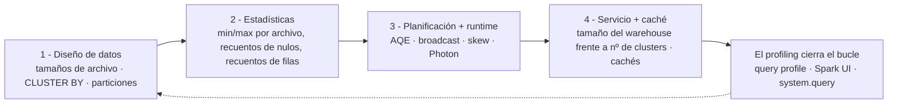
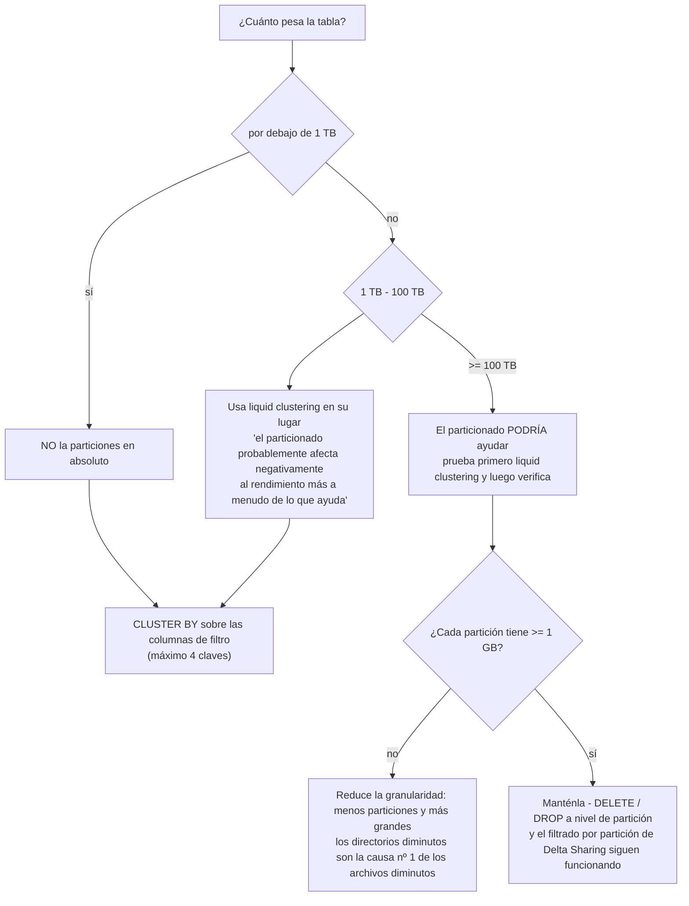
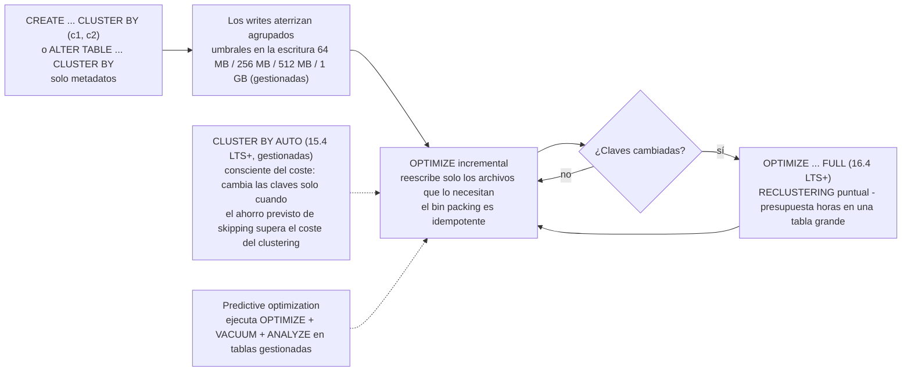
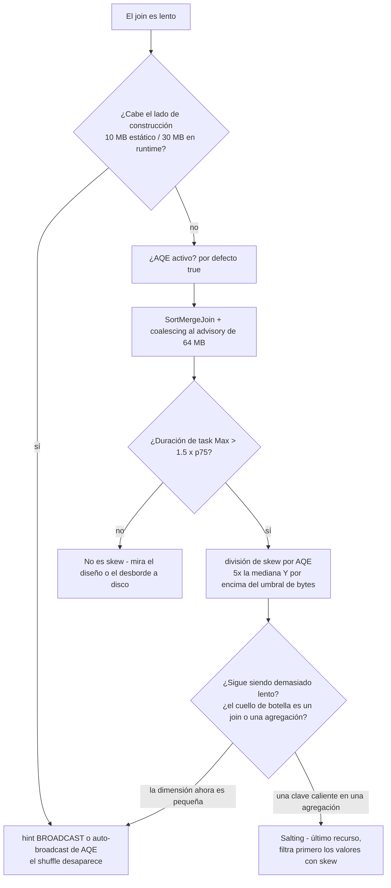
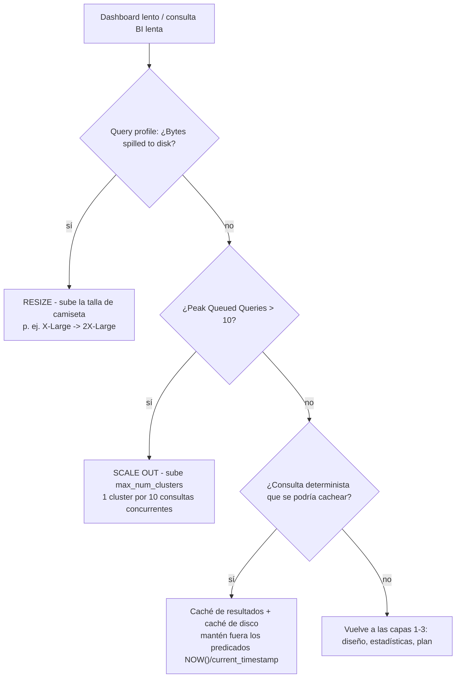
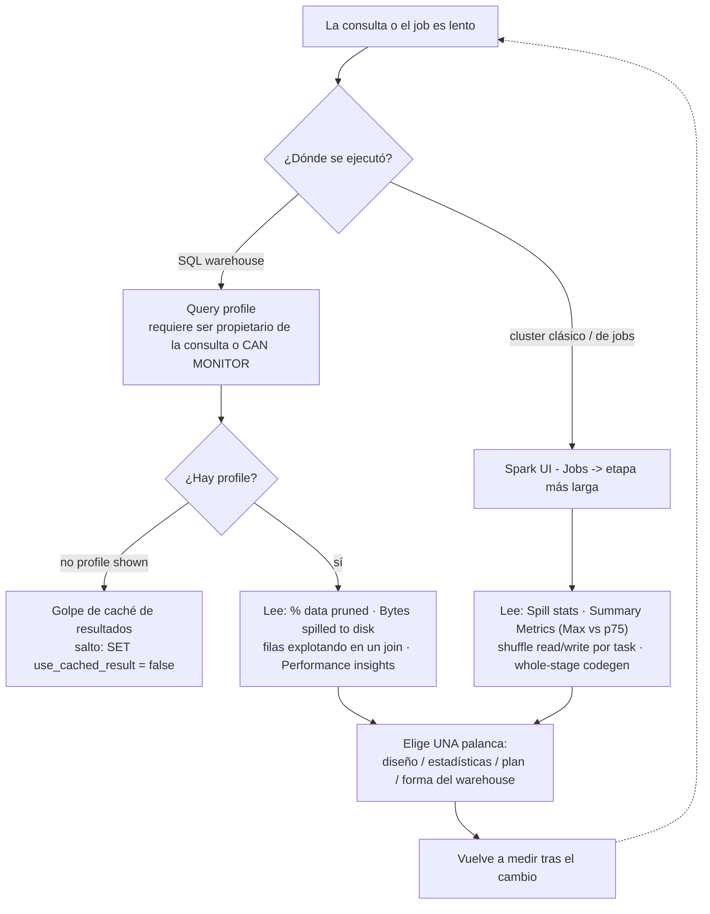

# Optimización del rendimiento en Databricks/AWS: liquid clustering, diseño de archivos, skew y ajuste de warehouses

Las consultas lentas del lakehouse casi nunca son «Spark es lento». Son una capa concreta que se comporta mal: demasiados archivos pequeños en S3, una columna de filtro cuyos rangos min/max se solapan en todos los archivos, una única clave de join caliente que arrastra el 38% de las filas, o un warehouse con el *tamaño* correcto y el *número* de clusters equivocado. Esta lección enseña la pila en el orden en que debes arreglarla — **diseño → estadísticas → planificación/runtime → servicio** — y enseña la versión de 2026 de esa pila, no la de 2019.

Esa distinción importa más que cualquier perilla. La documentación actual de Databricks es tajante: «Databricks recomienda usar liquid clustering en lugar de particiones, `ZORDER` u otros enfoques de diseño de datos» (docs .../tables/operations/optimize, última actualización **2026-03-31**, réplica **2026-09-11**), y «Las recomendaciones de ajuste manual no se aplican a las tablas gestionadas de Unity Catalog, que usan el ajuste automático del tamaño de archivo» (docs .../tables/tune-file-size, **2026-09-11**). Mientras tanto, la capa de motor sigue autotuneándose: AQE está activado por defecto desde DBR 7.3, Photon es el motor de ejecución por defecto en los warehouses de Databricks SQL, y Databricks informa de que «en 2025, Databricks SQL ofreció hasta un 40% más de rendimiento en cargas de trabajo de producción, con mejoras aplicadas automáticamente» (blog, **2026-01-28**).

Así que el planteamiento honesto para octubre de 2026 es: **el ajuste manual vale más en tablas externas, en cargas de trabajo heredadas de hive-metastore y en clusters que no son los por defecto** — y en entender *qué* capa está rota antes de tocar nada. Cada dato de esta lección procede de las páginas de documentación de Databricks sobre AWS de optimize, tamaño de archivo, particiones, clustering, data skipping, AQE, hints, predictive optimization, caching, comportamiento del warehouse y query profile (todas consultadas o fechadas en **octubre de 2026**), más blogs fechados de ingeniería de Databricks. Aquí no aparecen tarifas de DBU: el coste es el tema de la lección 15.

```text
 =============================================================
  LA PILA DE RENDIMIENTO - arréglala de arriba abajo, mide tras cada paso
 -------------------------------------------------------------
  1. DISEÑO DE DATOS ..... tamaños de archivo, CLUSTER BY, particiones
  2. ESTADÍSTICAS ........ min/max por archivo -> data skipping
  3. PLANIFICACIÓN + RUNTIME  AQE, broadcast, skew, Photon
  4. SERVICIO + CACHÉ .... tamaño del warehouse frente a nº de clusters, cachés
  El bucle se cierra con: DBSQL query profile (warehouses)
                          Spark UI (clusters clásicos / de jobs)
  Realidad de las tablas gestionadas: predictive optimization ejecuta
  OPTIMIZE + VACUUM + ANALYZE por ti; el ajuste automático del tamaño
  de archivo elige las bandas de 256 MB / 1 GB; el trabajo de diseño es
  sobre todo para tablas EXTERNAS y para entornos heredados.
  Valores por defecto verificados en oct 2026, sin precios en esta lección.
 =============================================================
```

En esta lección vas a:

- recorrer la **pila de cuatro capas** y aprender qué síntoma pertenece a qué capa antes de tocar una sola configuración;
- dimensionar archivos contra los **tres objetivos oficiales** — 128 MB de auto-optimize, la banda de autotune de 256 MB → 1 GB y el techo manual de `OPTIMIZE` de 1 GiB — y calcular a mano los recuentos de archivos;
- aplicar la **escalera de particionado** (< 1 TB nunca · 1–100 TB clustering · ≥ 100 TB tal vez) y la **guarda de ≥ 1 GB por partición**, y ver cómo fracasa aritméticamente el antipatrón de alta cardinalidad;
- profundizar en **liquid clustering**: `CLUSTER BY`, `CLUSTER BY AUTO`, ≤ 4 claves, umbrales de clustering en la escritura, `OPTIMIZE` incremental frente a `OPTIMIZE FULL`, claves jerárquicas, idempotencia del bin packing y los suelos de DBR con sus fechas;
- ejecutar un **ejemplo resuelto de comparación OPTIMIZE frente a CLUSTER BY** — la misma tabla de 8 TB, el SQL heredado de partición+`ZORDER` al lado del SQL de liquid — y leer la gráfica de latencia antes/después;
- diagnosticar **skew de join** a partir de evidencia real de perfiles y subir la escalera documentada: hint de broadcast → división de skew por AQE → salting, con el raíl de arreglos equivocados al lado;
- configurar **AQE** con sus valores por defecto verificados (200 particiones de shuffle, broadcast de runtime de 30 MB, advisory de 64 MB, factor de skew 5×);
- juzgar **Photon** por carga de trabajo — dónde gana, dónde las Python UDF lo derrotan — y dimensionar un **Databricks SQL warehouse** con la doctrina de resize frente a scale más las capas de caché;
- perfilar como operador: el **query profile** para los warehouses, la **Spark UI** para los clusters, y un cálculo de particiones de shuffle que puedes hacer en papel;
- estudiar **tres historias de rendimiento de clientes con nombre en AWS**, leer el **recuadro de actualización de 2026** y practicar con **doce preguntas tipo examen** más cuatro controles interactivos.

---

## 1. La pila de cuatro capas, y cómo elegir una capa

Cada latencia de consulta de este curso se decide en cuatro capas, en este orden. Arréglalas de arriba abajo y vuelve a medir tras cada cambio — nunca dos cambios a la vez, o no podrás atribuir la mejora.



| Capa | La pregunta que responde | La evidencia que lees | La palanca |
|---|---|---|---|
| 1. Diseño de datos | ¿Están las filas correctas en los mismos archivos? | recuento de archivos, tamaño medio, `% < 20 MB`, `DESCRIBE DETAIL` | `OPTIMIZE`, `CLUSTER BY`, cadencia de compactación |
| 2. Estadísticas | ¿Puede el motor *demostrar* que un archivo es irrelevante? | el icono «% of data pruned» del query profile | columnas de stats, claves de clustering, predicados sargables |
| 3. Planificación + runtime | ¿Están sanos el plan y el shuffle? | métricas de etapa de la Spark UI, `SortMergeJoin (isSkew=true)` | AQE, hints, salting, Photon, reescritura de UDF |
| 4. Servicio + caché | ¿Tiene la forma correcta el cómputo? | «Bytes spilled to disk», Peak Queued Queries | tamaño del warehouse, `max_num_clusters`, cachés |

Dos realidades de 2026 rehacen esa tabla. Primero, **las capas 3 y 4 se autotunean cada vez más**: AQE está activo por defecto (`spark.databricks.optimizer.adaptive.enabled` = **true**), Photon se ejecuta por defecto en los warehouses de Databricks SQL, y las tablas gestionadas reciben ajuste automático del tamaño de archivo. Segundo, **la capa 2 no tiene techo en las tablas gestionadas**: en las tablas *externas* de Unity Catalog se recopilan estadísticas de las primeras 32 columnas; en las tablas *gestionadas* de UC, «predictive optimization recopila estadísticas de omisión de archivos en las columnas que tus filtros de consulta usan con más frecuencia, en lugar de un conjunto fijo de columnas, de modo que estas tablas **no tienen límite de 32 columnas**» (docs .../tables/data-skipping, **2026-06-18**).

El resto de esta lección es esa pila, capa por capa.

---

## 2. Capa 1 — dimensionamiento de archivos y el problema de los archivos pequeños en S3

Los archivos pequeños duelean porque cada archivo cuesta un ida y vuelta `LIST`/GET de S3, una tarea de Spark y el parseo del footer de Parquet. Como dice la propia guía de Databricks, parte del coste es sencillamente «el tiempo dedicado solo a abrir y cerrar esos archivos diminutos» (guía discover, **2026-05-06**). En S3 no hay capa de bloques: **el archivo es la unidad de paralelismo, la unidad de estadísticas y la unidad que `VACUUM` recupera.**

### 2.1 Tres objetivos oficiales, una banda sana

Tres números distintos son todos «oficiales», y enseñarlos como si fueran uno solo es el error clásico del tutorial desactualizado:

| Mecanismo | Tamaño de archivo objetivo | Fuente (fecha) |
|---|---|---|
| Techo de salida de `OPTIMIZE` manual | **1,073,741,824 B = 1 GiB** (`spark.databricks.delta.optimize.maxFileSize`) | manual de lenguaje Delta `OPTIMIZE`; guía discover (**2026-05-06**) |
| Auto-optimize a `true` (`autoOptimize.optimizeWrite` + `autoCompact`) | **128 MB** | docs .../tables/tune-file-size (**2026-09-11**) |
| Objetivo con autotune (comportamiento por defecto en tablas gestionadas de UC) | **< 2.56 TB → 256 MB** · **2.56–10 TB → lineal 256 MB → 1 GB** · **> 10 TB → 1 GB** | misma (**2026-09-11**) |
| Banda de recomendación sana | **«entre 16 MB y 1 GB»** | guía discover (**2026-05-06**) |

Dos corolarios que previenen los dos errores de diseño más comunes:

1. **1 GiB es un techo, no una meta para tablas pequeñas.** Compactar una tabla de 300 GB en archivos de 1 GiB deja ~300 archivos y destruye el paralelismo del escaneo podado.
2. **Subir un objetivo nunca fusiona nada por sí solo.** «Cuando el tamaño de archivo objetivo de una tabla crece, los archivos existentes no se reoptimizan en archivos más grandes mediante el comando `OPTIMIZE`» (tune-file-size, **2026-09-11**) — tienes que ejecutar `OPTIMIZE` después.

### 2.2 Ejemplo resuelto E1 — a qué se parece la salida de 8 TB de Auto Loader

```text
Ejemplo resuelto E1 - aritmética de archivos para una tabla de eventos de 8 TB en S3 (a oct 2026)

ANTES (24 streams de Auto Loader, uno por flota de dispositivos)
  Recuento de archivos ........... 19,000
  Media ......................... 8 TB / 19,000 ~= 440 MB   <- ENGAÑOSO
  Forma ......................... 60% de archivos por debajo de 20 MB (micro-lotes de streaming)
  Consulta de servicio .......... 12,000 archivos escaneados tras la poda por min/max
  p95 ........................... ~9.5 min en un warehouse X-Large, desborde visible en el profile

EL OBJETIVO (banda de autotune 2.56 - 10 TB -> lineal 256 MB -> 1 GB)
  8 TB interpola a unos 768 MB por archivo
  Techo de OPTIMIZE manual ............... 1 GiB (1,073,741,824 B)
  Banda sana ............................. 16 MB - 1 GB
  Recuentos de archivo de referencia de la tabla de docs:
    1 TB  @ 256 MB ....... 4,096 archivos
    10 TB @ 1 GB ......... 24,437 archivos
    100 TB @ 1 GB ........ 114,437 archivos

DESPUÉS (diseño arreglado - véase el ejemplo resuelto E4 para el SQL)
  Recuento de archivos ........... ~10,000 archivos cerca del objetivo
  Poda ................... > 95% de archivos excluidos por los filtros customer_id / event_date
  p95 ........................... ~25-40 s  (banda ilustrativa, coherente con las ganancias de
                                 lectura de 2-12x que informa Databricks y un informe de 12x
                                 en consultas puntuales, blog 2024-05-22 - no es un benchmark
                                 medido de esta tabla)
```

La lección de E1 no es la banda de 15–25×, sino que **el recuento de archivos y la *forma* de los archivos son números distintos**. Una media de 440 MB con una mediana de 20 MB significa que el motor sigue pagando la sobrecarga de tarea por archivo en la mayor parte de la tabla.

### 2.3 Tres mecanismos combaten los archivos pequeños, en orden creciente de autoridad

1. **Escrituras optimizadas** (`autoOptimize.optimizeWrite` / `spark.databricks.delta.optimizeWrite.enabled`) hacen un shuffle antes de escribir para que cada partición emita archivos de ~128 MB. Están activas por defecto en `MERGE`, en `UPDATE`/`DELETE` con subconsultas, en CTAS/INSERT sobre warehouses de SQL, y «en Databricks Runtime 13.3 LTS y superior, todas las tablas registradas en Unity Catalog tienen las escrituras optimizadas activadas para las sentencias CTAS y para las operaciones INSERT en tablas particionadas». El coste es real: «Escribir menos archivos grandes es más eficiente … pero es posible que sigas viendo un aumento de la latencia de escritura, porque los datos se mezclan (shuffle) antes de escribirse».
2. **Auto compaction** (`autoOptimize.autoCompact`) «se ejecuta **de forma síncrona en el cluster que realiza la escritura, después de que esta tenga éxito**, y solo compacta los archivos que aún no se han compactado antes». En el historial de la tabla aparece como una operación `OPTIMIZE` con `operationParameters.auto` = `true`. Para `MERGE`, `UPDATE` y `DELETE` es obligatoria: «No puedes desactivar esta funcionalidad».
3. **`OPTIMIZE` programado o predictivo**: «Para tablas mayores de **1 TB**, Databricks recomienda ejecutar `OPTIMIZE` de forma programada», clásicamente **diariamente**, de preferencia por la noche cuando los precios spot son bajos, y en un **cluster de job separado** — y para tablas con liquid clustering activo, «programar un job `OPTIMIZE` **cada una o dos horas**» (docs de clustering, **2026-09-25**), porque el clustering es incremental y la mayoría de las ejecuciones son rápidas.

Auto compaction y las escrituras optimizadas «**no son un sustituto completo** de `OPTIMIZE`» (tune-file-size, **2026-09-11**), y si predictive optimization está activado, «Databricks recomienda desactivar cualquier job `OPTIMIZE` programado» para que dejes de pagar dos veces (docs de clustering).

```fillblank
{
  "question": "Rellena los valores de diseño de archivos y de AQE exactamente como los declara la documentación de octubre de 2026:",
  "template": "Auto-optimize a {{1}} tiene como objetivo archivos de 128 MB; el techo de salida de OPTIMIZE manual es de {{2}} GiB; las tablas por debajo de 2.56 TB reciben autotune a un objetivo de {{3}} MB; y el valor por defecto de spark.sql.shuffle.partitions es {{4}}.",
  "answers": {
    "1": "true",
    "2": "1",
    "3": "256",
    "4": "200"
  },
  "distractors": ["false", "auto", "2", "4", "64", "128", "512", "1000"],
  "explanation": "Los cuatro son literales de la documentación consultada en 2026-10: auto-optimize 'true' significa 'Use 128 MB as the target file size'; spark.databricks.delta.optimize.maxFileSize tiene por defecto 1,073,741,824 bytes = 1 GiB; autotune da 256 MB por debajo de 2.56 TB; y spark.sql.shuffle.partitions tiene por defecto 200 (el valor 'auto' activa en su lugar el shuffle auto-optimizado - es un distractor aquí porque es una configuración válida, no el valor por defecto). 64 MB es el tamaño advisory de partición de AQE, 128 MB es la regla práctica de shuffle por tarea, y 1,000 es el tope de cola del warehouse: tres números distintos que viven en capas distintas."
}
```

> ⚠️ **ADVERTENCIA — no pelees tú solo con la ruta de escritura.** «Si usas escrituras optimizadas, Databricks recomienda que **no ejecutes `coalesce(n)` ni `repartition(n)` justo antes de una escritura** para controlar la cantidad de archivos escritos» (tune-file-size, **2026-09-11**) — pagas dos shuffles para un solo trabajo. Del mismo modo: nunca desactives auto compaction a nivel de sesión y te olvides de ella. No se puede desactivar para `MERGE`/`UPDATE`/`DELETE`, pero un `false` a nivel de sesión *sí* la desactiva en silencio para los appends y los CTAS de esa carga de trabajo.

- **📚 ¿Sabías que…?** `OPTIMIZE` es seguro por construcción: «Bin-packing optimization is *idempotent*, meaning that if it is run twice on the same dataset, the second run has no effect», y «Como `OPTIMIZE` no realiza cambios de datos en la tabla, una lectura antes y después de un `OPTIMIZE` da los mismos resultados. Ejecutar `OPTIMIZE` en una tabla que es fuente de streaming no afecta a ningún stream actual ni futuro que tenga esta tabla como fuente» (docs .../operations/optimize, **2026-03-31**). ZORDER, en cambio, nunca fue idempotente — era incremental y requería re-ejecuciones.

---

## 3. Capa 1 — particionado: la escalera y la guarda de ≥ 1 GB

La recomendación actual de particionado es más reciente que la mayoría de los tutoriales y más tajante de lo que la mayoría de los equipos esperan: «La mayoría de las tablas de Databricks con menos de **100 TB** de datos no necesitan particionado» (docs .../tables/partitions, **2026-07-01**).



La segunda guarda es por partición: «verify that each partition contains **at least 1 GB** of data. Tables with fewer, larger partitions tend to outperform tables with many smaller partitions» (misma página). El recuento de particiones es igual al de directorios en tu bucket, así que cada nivel extra de cardinalidad multiplica las llamadas `LIST`, las entradas de `_delta_log`, los escaneos de planificación de `OPTIMIZE` y la superficie de conflictos de `MERGE`.

**No particiones cuando:** la tabla sea inferior a 1 TB; la columna de filtro tenga alta cardinalidad (`user_id`, `event_id` — haz clustering en su lugar); los patrones de acceso cambien (el particionado «is static and manifests itself as a filesystem hierarchy. There is no easy way to change partitions», página de mejores prácticas); la columna sea un timestamp que explotaría en millones de instantes (haz clustering del timestamp sin procesar, en su lugar); o fueras a particionar por un campo struct (`PARTITIONED BY` trata un struct como expresión, no como referencia de columna).

### 3.1 Ejemplo resuelto E2 — el antipatrón de alta cardinalidad, en aritmética

```text
Ejemplo resuelto E2 - particionar la misma tabla de eventos de 8 TB por customer_id

PARTITIONED BY (customer_id) con ~200,000 clientes distintos
  Directorios ................ 200,000
  Bytes medios por partición . 8 TB / 200,000 ~= 40 MB
  Guarda ..................... >= 1 GB por partición  -> VIOLADA por 25x
  Síntoma .................... miles de archivos diminutos al día, la compactación
                               nunca da la altura, el listado de _delta_log crece,
                               cada OPTIMIZE y MERGE paga 200k listados de directorios

CLUSTER BY (customer_id, event_date) en su lugar
  Directorios ................ ninguno (particionado oculto, protocolo 3/7)
  Coste de reescritura ....... solo metadatos al declarar; OPTIMIZE FULL una vez
  Poda ....................... a granularidad de archivo, guiada por las stats min/max por archivo
  Cambio de opinión .......... ALTER TABLE ... CLUSTER BY (nuevas columnas) - sin reescritura
```

El particionado conserva en 2026 exactamente dos papeles legítimos: **movimientos de ciclo de vida a nivel de partición** (`DELETE`/`DROP PARTITION` sobre una columna de fecha a escala ≥ 100 TB) y **el filtrado por partición de Delta Sharing** en tablas compartidas — que es también la razón por la que convertir a clustering una tabla compartida y particionada está bloqueada.

---

## 4. Liquid clustering en profundidad

«Liquid clustering es una técnica de optimización del diseño de datos que **reemplaza el particionado de tablas y `ZORDER`**» (docs .../tables/clustering, última actualización **2026-09-25**), y «puedes redefinir las claves de clustering **sin reescribir los datos existentes**». Esa última cláusula es todo el diseño: el particionado hornea una jerarquía de sistema de archivos que no puedes cambiar de forma barata; el clustering almacena un conjunto de claves declaradas en los metadatos de la tabla y deja que `OPTIMIZE` coloque físicamente los rangos de forma incremental.

### 4.1 La superficie de declaración y los suelos de DBR

```sql
-- Declare at CREATE time (metadata only - no data is touched)
CREATE TABLE main.silver.events (
  customer_id STRING,
  event_date  DATE,
  event_type  STRING,
  payload     STRING
) USING DELTA
CLUSTER BY (customer_id, event_date);

-- Or attach clustering to an existing table
ALTER TABLE main.silver.events CLUSTER BY (customer_id, event_date);

-- Let the platform pick and evolve keys (15.4 LTS+, UC managed + predictive optimization)
ALTER TABLE main.silver.events CLUSTER BY AUTO;

-- Remove clustering
ALTER TABLE main.silver.events CLUSTER BY NONE;
```

Lleva estos números de versión **con sus fechas** — son los números que preguntan los exámenes y las revisiones de arquitectura:

| Dato | Valor | Fuente (fecha) |
|---|---|---|
| Disparo / clustering en la escritura | DBR **13.3 LTS+** | docs de clustering (**2026-09-25**) |
| Anuncio de GA | «disponible generalmente en Databricks desde DBR **15.2**» | blog (**2024-05-22**) |
| Declaración GA actual | «GA para tablas Delta Lake con **DBR 15.4 LTS o superior**»; Iceberg en Public Preview desde **16.4 LTS+** | docs de clustering (**2026-09-25**) |
| Recomendado para `OPTIMIZE` en tablas grandes | **DBR 17.3 LTS+** | docs de clustering (**2026-09-25**) |
| `OPTIMIZE … FULL` (reclustering forzado) | **DBR 16.4 LTS+** | docs de clustering (**2026-09-25**) |
| `OPTIMIZE … FULL WHERE …` (reclustering parcial) | **DBR 18.1+** | docs de clustering (**2026-09-25**) |
| `CLUSTER BY AUTO` | **DBR 15.4 LTS+**, tablas gestionadas de UC + predictive optimization | docs de clustering (**2026-09-25**) |
| Clustering jerárquico | **DBR 17.1+** (`delta.liquid.hierarchicalClusteringColumns`) | docs de clustering (**2026-09-25**) |
| `REPLACE PARTITIONED BY WITH CLUSTER BY` | **DBR 18.1+** (lee desde 13.3 LTS+) | docs de clustering (**2026-09-25**) |
| Máximo de claves de clustering | **4** — por debajo de 10 TB, más claves «pueden degradar el rendimiento al filtrar sobre una sola columna» | docs de clustering (**2026-09-25**) |
| Estadísticas requeridas en las claves | sí — primeras **32 columnas** por defecto | docs de clustering + data-skipping (**2026**) |
| Protocolo de la tabla | lector **3** / escritor **7** («particionado oculto») | docs de compatibilidad de funciones (**2026-09-11**) |
| ¿Compatible con particionado o `ZORDER`? | **No** — «el clustering no es compatible con el particionado ni con `ZORDER`» | docs de clustering (**2026-09-25**) |

### 4.2 Clustering en la escritura: cómo aterriza el streaming ya agrupado

No tienes que esperar a un job nocturno. Cuando una escritura es lo bastante grande, el clustering se ejecuta **durante la escritura**, según el número de claves (tablas gestionadas de UC / otras tablas Delta):

| Claves de clustering | Umbral en tablas gestionadas de UC | Otras tablas Delta |
|---|---|---|
| 1 | **64 MB** | 256 MB |
| 2 | **256 MB** | 1 GB |
| 3 | **512 MB** | 2 GB |
| 4 | **1 GB** | 4 GB |

Por eso un CTAS o un micro-lote de streaming puede aterrizar físicamente agrupado sin ningún mantenimiento programado — y por eso `OPTIMIZE` sobre una tabla agrupada suele ser rápido: solo reescribe lo que todavía necesita clustering.

### 4.3 El ciclo de vida, incluidos los dos momentos caros



Dos momentos de ese diagrama cuestan dinero real y tiempo de calendario real:

> ⚠️ **ADVERTENCIA — declarar claves es gratis; hacer que los datos antiguos las cumpla, no.** «The default behavior does not apply clustering to previously written data» — tienes que ejecutar `OPTIMIZE <table> FULL`, lo cual «might take hours» en una tabla grande sin agrupar (docs de clustering, **2026-09-25**). Presupuéstalo como un job de migración puntual en su propio cluster (instancias compute-optimized, spot por la noche), no como un paso de una pipeline de release. Y nunca digas «activar clustering reescribió mi tabla» — `ALTER TABLE … CLUSTER BY` es metadatos; `OPTIMIZE FULL` es la reescritura.

> ⚠️ **IMPORTANTE — `OPTIMIZE` reescribe archivos, así que alimenta a `VACUUM`.** Cada reclustering borra y añade archivos; las versiones antiguas solo sobreviven durante `delta.deletedFileRetentionDuration` (por defecto **7 días**). Fija esa propiedad **antes** de activar predictive optimization — «If you set `delta.deletedFileRetentionDuration` to less than 7 days, predictive optimization still retains data files for a **minimum of 7 days** when it runs `VACUUM FULL`» (docs de predictive-optimization, **2026-09-11**) — y nunca ejecutes `VACUUM` en el mismo paso de job que lectores o streams de larga duración.

### 4.4 Ejemplo resuelto E3 — adoptar clustering en una tabla en producción

```sql
-- Worked example E3 - adopt liquid clustering on main.silver.events (8 TB, external on S3)
-- Step 1 - declare the keys your filters actually use (metadata only)
ALTER TABLE main.silver.events CLUSTER BY (customer_id, event_date);
-- correlated columns? one is enough: "If two columns are highly correlated,
-- you only need to include one of them in the clustering columns"

-- Step 2 - one-off full recluster, on its own job cluster, at night (DBR 16.4 LTS+)
OPTIMIZE main.silver.events FULL;

-- Step 3 - verify what actually ran (history disambiguates the operation type)
DESCRIBE HISTORY main.silver.events LIMIT 5;
--   operationParameters.clusterBy  -> liquid clustering
--   operationParameters.zOrderBy   -> legacy ZORDER
--   operationParameters.auto       -> auto compaction
SHOW TBLPROPERTIES main.silver.events;
--   delta.clusteringColumns -> [customer_id, event_date]

-- Step 4 - incremental maintenance: hot table, every one or two hours
OPTIMIZE main.silver.events WHERE event_date >= current_date() - 2;

-- Step 5 - per-quarter deep maintenance on older data, still incremental
OPTIMIZE main.silver.events WHERE event_date < current_date() - 90;
```

¿Por qué un predicado en los pasos 4/5? `OPTIMIZE <table> WHERE <predicate>` acota la compactación o el reclustering a un subconjunto — más barato, y reduce la ventana de conflicto con escritores concurrentes, la misma razón por la que las mejores prácticas empujan los predicados de poda dentro de `MERGE ... ON`.

- **📚 ¿Sabías que…?** `DESCRIBE HISTORY` es también tu **rastro de auditoría del mantenimiento**: auto compaction, liquid clustering y Z-ordering «all appear in table history as `OPTIMIZE` operations», y solo los distingues a través de `operationParameters.{auto, clusterBy, zOrderBy, predicate}` (docs .../tables/history, **2026-09-11**). Un dashboard que cuente «ejecuciones de `OPTIMIZE`» sobrecuenta por tanto auto compaction — filtra con `auto = 'false'` para quedarte solo con las ejecuciones manuales.

---

## 5. Ejemplo resuelto E4 — OPTIMIZE frente a CLUSTER BY, lado a lado

Misma tabla, mismos 8 TB, dos generaciones de doctrina de diseño. Esta es la comparación para la que existe el curso.

```sql
-- ============================================================
-- PATH A - legacy: Hive partitioning + ZORDER (pre-2024)
-- ============================================================
CREATE TABLE main.silver.events (
  customer_id STRING, event_date DATE, event_type STRING, payload STRING
) USING DELTA
PARTITIONED BY (event_date);              -- date cardinality "seems" safe

-- props you had to remember to set yourself
ALTER TABLE main.silver.events SET TBLPROPERTIES (
  'autoOptimize.optimizeWrite' = 'true',
  'autoOptimize.autoCompact'    = 'true',
  'delta.targetFileSize'        = '536870912'   -- 512 MB, manual guess
);

-- ZORDER the column your dashboards filter on (non-partitioned, stats required)
OPTIMIZE main.silver.events
  WHERE event_date >= DATE'2026-10-01'
  ZORDER BY (customer_id);

-- and because ZORDER "is not idempotent but is incremental", and because MERGE
-- rewrites blunt it (low shuffle merge helps but does not remove the need),
-- you re-run it on a schedule, forever, inside the date partition.

-- ============================================================
-- PATH B - liquid clustering (Oct 2026 recommendation)
-- ============================================================
CREATE TABLE main.silver.events (
  customer_id STRING, event_date DATE, event_type STRING, payload STRING
) USING DELTA
CLUSTER BY (customer_id, event_date);     -- no PARTITIONED BY, no ZORDER

-- one-off, after keys are first set or changed (DBR 16.4 LTS+)
OPTIMIZE main.silver.events FULL;

-- incremental maintenance from then on; bin packing happens in the same command
OPTIMIZE main.silver.events WHERE event_date >= current_date() - 2;

-- managed tables: skip the cron job entirely and let predictive optimization
-- run OPTIMIZE/VACUUM/ANALYZE for you (serverless-billed), then delete yours.
```

Qué cambió entre los dos caminos:

| Dimensión | Camino A: partición + `ZORDER` | Camino B: `CLUSTER BY` |
|---|---|---|
| Se declara en | jerarquía de sistema de archivos + un comando de reescritura | metadatos de la tabla (protocolo 3/7) |
| Cambiar la clave | es en la práctica reconstruir la tabla; «no hay una forma fácil de cambiar particiones» | `ALTER TABLE … CLUSTER BY`, sin reescritura |
| Mantenimiento | re-ejecutar `ZORDER` (no idempotente), dentro de las particiones | `OPTIMIZE` incremental, bin packing idempotente |
| Predictive optimization | «does not run `ZORDER` … ignores Z-ordered files» | totalmente soportado — las operaciones `CLUSTERING` aparecen en el historial |
| Columna de alta cardinalidad | prohibida como clave de partición | la *mejor* candidata a clave de clustering |
| Benchmark (carga de trabajo de warehouse de 1 TB) | el particionado al estilo Hive ~un **orden de magnitud más lento** que liquid; el Z-order en medio | **clustering 2.5× más rápido que Z-order** (blog, **2023-06-29**) |
| Resultados de campo | — | consultas puntuales hasta **12×** en una empresa de fabricación; rendimiento de lectura **2–12×** informado en GA (blog, **2024-05-22**) |

```plot
{
  "type": "bar",
  "title": "Latencia p95 de la consulta de servicio en cuatro estados de diseño, tabla de eventos de 8 TB (ejemplo resuelto E1/E4 - banda ilustrativa de arquitectura de referencia, no un benchmark medido)",
  "xLabel": "Estado del diseño de la tabla",
  "yLabel": "Latencia p95 de la consulta (segundos)",
  "xKey": "layout_state",
  "dataKeys": ["p95_seconds"],
  "data": [
    {"layout_state": "Raw: 19k files, 60% under 20 MB, no clustering", "p95_seconds": 570},
    {"layout_state": "Optimized writes only (~128 MB files)", "p95_seconds": 420},
    {"layout_state": "+ OPTIMIZE bin packing (fewer, larger files)", "p95_seconds": 180},
    {"layout_state": "+ CLUSTER BY (customer_id, event_date) + FULL", "p95_seconds": 32}
  ]
}
```

Lee esa gráfica como una *escalera causal*: las escrituras optimizadas y el bin packing (capa 1, tamaño de archivo) te compran una mejora sólida pero acotada, porque la poda todavía no puede demostrar nada; `CLUSTER BY` (capa 1 y capa 2 a la vez) es lo que hace que el filtro `customer_id` excluya >95% de los archivos. La última barra está etiquetada como ilustrativa porque es un boceto de arquitectura de referencia constreñido por la banda publicada de 2–12× de Databricks, no una cifra de tu tabla — mide la tuya en el query profile.

### 5.1 Capa 2 — por qué el clustering es lo que hace que el skipping funcione

Delta escribe estadísticas por archivo en el momento del commit: «minimum and maximum values, null counts, and total records» (docs de data-skipping, **2026-06-18**), y en el momento de la consulta el motor omite cualquier archivo cuyas estadísticas demuestren que el predicado no puede casar. El clustering no cambia *qué* se puede omitir — «the engine prunes at file granularity. There is no directory-level shortcut to lose» (blog de Databricks, **2026-01-06**) — cambia *cuánto* se omite, al hacer que los rangos de la clave sean físicamente contiguos.

El skipping falla en silencio cuando: el predicado no es sargable (`WHERE lower(col) = …`, `WHERE date_add(col, 1) = …`); la columna de filtro no tiene estadísticas; los valores están distribuidos de forma uniforme entre todos los archivos; o combinas columnas de un modo que min/max no puede demostrar. Perillas de estadísticas: `delta.dataSkippingNumIndexedCols` (posicional) y `delta.dataSkippingStatsColumns` (DBR 13.3 LTS+, lista explícita, reemplaza a la numérica) — y «Updating these properties does not automatically recompute statistics for existing data». Por último: «Databricks recomienda que no uses `ZORDER BY` en columnas que no tengan estadísticas recopiladas, porque es inefectivo y consume recursos de cómputo innecesarios».

---

## 6. Capa 3 — joins: AQE, broadcast, skew y salting

### 6.1 Los valores por defecto de AQE con los que realmente estás ejecutando

AQE está activo por defecto y hace cuatro cosas: convertir el sort-merge join en broadcast en runtime, coalescer las particiones posteriores al shuffle, dividir (y replicar si hace falta) las particiones con skew, y propagar relaciones vacías (docs de AQE, página fechada el **2023-10-12**, todavía vigente en oct 2026).

| Configuración | Por defecto | Significado |
|---|---|---|
| `spark.databricks.optimizer.adaptive.enabled` | **true** | interruptor maestro de AQE |
| `spark.sql.shuffle.partitions` | **200** (valor `auto` = shuffle auto-optimizado) | recuento inicial de particiones de shuffle |
| `spark.databricks.adaptive.autoBroadcastJoinThreshold` | **30 MB** | conmutador en runtime a broadcast join |
| `spark.sql.autoBroadcastJoinThreshold` | **10 MB** | umbral estático de planificación (Spark upstream) |
| `spark.sql.adaptive.advisoryPartitionSizeInBytes` | **64 MB** | objetivo de coalescing tras el shuffle |
| `spark.sql.adaptive.skewJoin.enabled` | **true** | división automática de skew |
| `spark.sql.adaptive.skewJoin.skewedPartitionFactor` | **5** | con skew si es > 5× la mediana **y** supera el umbral de bytes |
| Umbral de bytes de skew | **256 MB** (por defecto de Spark — verifica en tu DBR) | segunda condición del test de skew |
| `spark.sql.broadcastTimeout` | **300 s** | tiempo de espera de construcción del broadcast |

Regla práctica para dimensionar el shuffle: «cada tarea debería procesar aproximadamente **de 128 MB a 200 MB** de datos» (guía discover, **2026-05-06**). Y mantén AQE activo — «It is recommended to **keep AQE enabled**» (best-practices, **2026-09-11**).

### 6.2 Ejemplo resuelto E5 — un join nocturno de 52 minutos, diagnosticado

```text
Ejemplo resuelto E5 - skew en un join, cuatro jugadas, de la evidencia al arreglo
Configuración . orders 400 GB, customers 2 GB, join sobre cust_id
               una clave (cust_id = 'ANON') sostiene el 38% de todas las filas
Evidencia ..... Spark UI etapa más larga: 200 tasks, mediana 12 s, Max 41 min
                "Si la duración de Max es un 50% mayor que la duración
                 del percentil 75, puede que estés sufriendo skew"
                 -> 41 min >> 1.5 x p75  => SKEW
                una task lee 180 GB de shuffle; la task mediana lee 0.4 GB
                plan: dos nodos Exchange + SortMergeJoin (AQE no hizo broadcast:
                customers filtrados = 40 MB, por encima del umbral runtime de 30 MB)
```

```sql
-- Move 1 - REMOVE the shuffle (always the best outcome if it fits)
SELECT /*+ BROADCAST(customers) */ c.region, SUM(o.amount) AS revenue
FROM main.silver.orders o
JOIN main.gold.customers c ON o.cust_id = c.cust_id
GROUP BY c.region;
-- hint priority: BROADCAST > MERGE > SHUFFLE_HASH > SHUFFLE_REPLICATE_NL
-- aliases: MAPJOIN, BROADCASTJOIN for BROADCAST; result: job 52 min -> ~6 min

-- Move 2 - dimension too big to broadcast (4 GB): let AQE split the hot partition
--   plan marker: SortMergeJoin (isSkew=true)  ->  job 52 min -> ~18 min
SET spark.sql.adaptive.skewJoin.enabled = true;                 -- default true
SET spark.sql.adaptive.skewJoin.skewedPartitionFactor = 5;      -- default 5
-- Databricks' own recommendation: "rely on AQE skew join handling rather than
-- use the skew join hint ... completely automatic and in general performs better"

-- Move 3 - the documented DataFrame escape hatch when AQE cannot see it
--   df_orders.hint("skew", "cust_id", "ANON")
--   df_orders.hint("skew", ["cust_id", "store_region_id"])

-- Move 4 - LAST RESORT: salting (hand-rolled, maintenance cost, query rewrite)
--   fact side : cust_id || '_' || CAST(FLOOR(RAND() * 16) AS INT)  for the hot key
--   dim side  : replicate the 'ANON' dimension row 16 times, one per salt value
--   join on the salted key, then GROUP BY partials and collapse
```

El **raíl de arreglos equivocados** — estos tres aparecen en código de producción y ninguno de ellos ayuda:

- `SET spark.sql.shuffle.partitions = 2000` — no divide *nada*; la clave caliente sigue aterrizando en exactamente una partición.
- `.repartition("cust_id")` — el mismo fallo, más un shuffle extra.
- Un hint de skew cuando AQE ya se disparó — sobrecarga para un arreglo que ya ocurrió; «La optimización de skew join tiene cierta sobrecarga, así que conviene usarla solo cuando sea necesaria» (docs retiradas de skew-join, página actualizada el **2024-05-13**).



- **📚 ¿Sabías que…?** Puedes leer las decisiones de AQE directamente del plan físico: `CustomShuffleReader` con la propiedad `Coalesced` significa que las particiones se fusionaron después del shuffle, `SortMergeJoin` con `isSkew=true` significa que AQE dividió una partición caliente, y un `LocalTableScan` significa que AQE demostró que un lado del join estaba vacío y lo saltó (docs de AQE, **2023-10-12**). Tres cadenas que merece la pena buscar en el plan de cualquier consulta lenta antes de cambiar una sola configuración.

---

## 7. Photon: evalúalo por carga de trabajo, no por eslogan

Photon es el motor vectorizado en C++ que procesa datos en lotes columnares, y «Photon is used by **default in Databricks SQL warehouses**» (best-practices, **2026-09-11**). La evidencia publicada, con sus advertencias incluidas:

| Afirmación | Cifra | Fuente (fecha) |
|---|---|---|
| Aceleraciones SQL de clientes | media **3×**, máximo **más de 10×** | artículo SIGMOD 2022 de Photon |
| TPC-DS / ETL frente a la línea base sin Photon | hasta **5.3×** analítico, **4.4×** ETL | blog (**2025-10-16**) — *instancias de Azure, benchmark de la era de DBR 11.2: evidencia del efecto de Photon, no una afirmación sobre precios de AWS* |
| Databricks SQL, 5 años de trabajo en el motor | **5×** desde 2022, **+25%** en la versión de 2025 (Photon Vectorized Shuffle = **1.5×** de rendimiento de shuffle) | blog (**2025-06-17**) |
| Cargas de trabajo de producción de 2025 | hasta un **40% más rápido** en total: exploratorio ~**40%**, BI ~**20%**, ETL ~**10%**, espacial hasta **17×** | blog (**2026-01-28**) |
| Feature engineering de ML (ML Runtime 15.2+) | **~2×**; joins point-in-time **2.0–2.4×** en AWS `r6id.xlarge` | blog (**2026-02-13**) |

Los veredictos por carga de trabajo:

- **SQL intenso / BI / dashboards** — las mayores ganancias (escaneos, joins y agregaciones vectorizados). Ya activo por defecto en los warehouses de SQL.
- **ETL / Spark por lotes** — sólidas pero menores; los caminos intensivos en MERGE están dominados en cambio por el **low shuffle merge** (GA desde DBR 10.4 LTS, «up to 5x … average on the order of 2-3x»).
- **Código intenso en Python con UDFs** — Photon no puede acelerar la ejecución de Python UDFs: «Serialization is required to transfer data between Python and Spark. This significantly slows down queries» (best-practices). La jugada ganadora es reescribir a SQL nativo (o a pandas UDFs si una UDF es inevitable) *primero*, Photon después. (Esto es razonamiento a partir de la guía documentada de UDFs, no un benchmark publicado de Python.)
- **Bucles de entrenamiento de ML construidos sobre RDDs, gráficos o código a medida** — Photon es en su mayor parte irrelevante ahí.

---

## 8. Capa 4 — dimensionamiento del warehouse y las capas de caché

### 8.1 Resize frente a scale out: dos síntomas, dos perillas

La doctrina de dimensionamiento de Databricks (docs de warehouse-behavior, consultadas **2026-10**; blog de alta concurrencia, **2025-02-09**): **resize** cuando las consultas necesitan más memoria por consulta (agregaciones, joins de varias tablas — vigila el desborde a disco); **scale out** cuando las consultas esperan (vigila el encolamiento). «If queries are spilling to disk, increase the cluster size. Check for spills in the query profile.» Los warehouses classic y pro tienen «a fixed limit of **one cluster per 10 concurrent queries**», la profundidad de la cola está limitada con dureza a **1,000** consultas para todo tipo de warehouse, y un umbral práctico de alerta es **peak queued queries > 10** que no se resuelve cuando se dispara el autoscaling.



### 8.2 Ejemplo resuelto E6 — dimensionar un warehouse de 60 analistas

```text
Ejemplo resuelto E6 - 60 analistas concurrentes en un warehouse de dashboards (a oct 2026)
Evidencia ..... query profile: "Bytes spilled to disk" en la agregación principal
                monitoreo del warehouse: Peak Queued Queries = 27

Paso 1 TAMAÑO ....... desborde => aumenta el tamaño del cluster: X-Large -> 2X-Large
                      (el desborde es un problema de memoria/disco por consulta, no de recuento)
Paso 2 NÚMERO ....... 60 concurrentes / 10 por cluster = 6 clusters
                      27 en cola >> heurística de alerta de 10 => max_num_clusters >= 6
                      recordatorio del tope duro: la cola admite como máximo 1,000 consultas
Paso 3 INACTIVIDAD .. auto-stop: serverless por defecto 10 min (mín. 5 en la UI, 1 en la API);
                      pro/classic por defecto 45 min (mín. 10) - fíjalo deliberadamente
Paso 4 ARRANQUE ...... serverless reinicia en 2-6 s; pro/classic ~4 min;
                      los clusters se reciclan a las 24 h de todos modos
Paso 5 RE-ABRIR ...... perfila de nuevo: ¿desborde fuera? ¿cola vacía? Si no, el
                      cuello de botella nunca fue el servicio - son las capas 1-3
```

Para la mayoría de las cargas de trabajo «Databricks recommends using a **serverless** SQL warehouse», y su consejo de dimensionamiento es contraintuitivo pero correcto: «Start with a single larger warehouse and let serverless features manage concurrency and performance. It is usually more efficient to **size down** if necessary than to start small and scale up.»

### 8.3 Cuatro cachés, cuatro vidas útiles

| Caché | Qué almacena | Vida útil / invalidación |
|---|---|---|
| **Caché local de resultados** | resultados de consultas, en memoria | vida útil del cluster o hasta llenarse; se vacía al detener/reiniciar |
| **Caché remota de resultados** | resultados de consultas, persistidos como datos de sistema del workspace (solo serverless) | sobrevive al stop/restart del warehouse, se comparte entre warehouses; se invalida cuando las tablas subyacentes se actualizan |
| **Caché de disco** (antes «Delta cache») | copias de los archivos de datos remotos en el SSD local | gestionada automáticamente, «como máximo la mitad» del SSD de los workers; se invalida cuando los archivos cambian; se pierde al retirar un worker |
| **Spark cache** (`df.cache()`/`persist()`) | DataFrames arbitrarios | ciclo de vida manual; se desactualiza entre commits |

Reglas que previenen los bugs clásicos de caché: el caché de resultados necesita consultas **deterministas** — un predicado al estilo `NOW()` nunca le da; `SET use_cached_result = false` lo salta (solo para pruebas y benchmarks); la caché de disco «funciona de forma predeterminada con todos los tipos de instancia que tienen **SSD locales**», y en cómputo classic eso significa elegir workers con SSD; «En los warehouses de SQL y en Databricks Runtime 14.2 o superior, el comando `CACHE SELECT` se ignora» — se usa en su lugar la caché de disco mejorada.

> ⚠️ **ADVERTENCIA — la Spark cache es la trampa, no el valor por defecto.** «using incorrect locations in a query can consume all available memory and significantly slow down queries. **As a rule of thumb, avoid Spark caching**» (best-practices, **2026-09-11**), y la página de mejores prácticas de Delta dice sin rodeos «**No uses la caché de Spark con Delta Lake**» (actualizada **2026-09-11**). Los DataFrames en caché se comen la memoria de los executors que luego hacen shuffle y se desbordan a disco — la firma inconfundible es *un desborde que sube mientras la pestaña Storage muestra grandes bloques en caché*. Los usos legítimos son estrechos: un dataset no-Delta verdaderamente inmutable y escaneado repetidamente dentro de una misma sesión, siempre acompañado de `unpersist()`; más el **precalentamiento** de un cluster frío antes de la mañana punta.

- **📚 ¿Sabías que…?** La caché de disco es la Delta cache renombrada: «The disk cache (**formerly known as 'Delta cache'**) stores copies of remote data on the local disks (for example, SSD) of the virtual machines… The recommended (and easiest) way to use disk caching is to choose a worker type with SSD volumes» (best-practices, **2026-09-11**). Y como el autoscaling retira workers, «si **el autoscaling está activado, hay cierta inestabilidad en la caché**» — los clusters de job sensibles a la caché quieren un scale-down conservador o pools.

---

## 9. Profiling: el query profile y la Spark UI

El profiling es lo que convierte la pila en un bucle y no en una lista de verificación. Elige la herramienta según el tipo de cómputo: **query profile** para warehouses de SQL y serverless, **Spark UI** para clusters clásicos y de jobs.



Qué te dice cada señal, y la única respuesta documentada:

| Señal | Dónde | Capa | Respuesta |
|---|---|---|---|
| «% of data pruned» bajo | nodo de escaneo del query profile | 1–2 | claves de clustering / columnas de stats / predicado sargable |
| «Bytes spilled to disk» | shuffle/sort del query profile | 4 | aumentar el tamaño del cluster del warehouse |
| Task Max ≫ 1.5× p75 | Summary Metrics de la Spark UI | 3 | broadcast → división de skew por AQE → salting |
| Una task leyendo 10× los bytes de shuffle de la mediana | métricas por task de la Spark UI | 3 | clave caliente — escalera de skew |
| Peak Queued Queries > 10 | monitoreo del warehouse | 4 | subir `max_num_clusters` |
| «Query profile is not available» | query profile | — | golpe de caché de resultados, no un bug |

Dos detalles de acceso que te ahorran un ticket de soporte: el acceso al profile requiere ser propietario de la consulta «or at least **CAN MONITOR** permission on the SQL warehouse», y «El query profile **no está disponible para consultas que se ejecutan desde la caché de resultados**. Para saltarte la caché de resultados, haz un cambio trivial en la consulta, como cambiar o quitar el `LIMIT`.»

### 9.1 Ejemplo resuelto E7 — dimensionar `spark.sql.shuffle.partitions` en papel

```text
Ejemplo resuelto E7 - cuántas particiones de shuffle para un shuffle de 400 GB en 16 cores?
Regla ......... 128 - 200 MB por task (guía discover, 2026-05-06)
Volumen ....... 400 GB = 409,600 MB ; cores = 16
Cota superior . 409,600 / (128 MB x 16) = 200 particiones   <- 128 MB por task
Cota inferior . 409,600 / (200 MB x 16) = 128 particiones   <- 200 MB por task
Decisión ...... mantén 200 (el valor por defecto), o SET spark.sql.shuffle.partitions = 'auto'
                y deja que AQE coalesce hacia el objetivo advisory de 64 MB
Movimiento malo ... 2000 particiones => ~2 MB por task => gana la sobrecarga de programación
También malo ...... coalesce/repartition justo antes de una escritura con las escrituras
                    optimizadas activas - dos shuffles, un job (tune-file-size, 2026-09-11)
Nota de tasa de lectura: Spark lee ~128 MB por task por core desde Parquet/Delta, y por eso
                    128 MB es el suelo de la banda y no un número arbitrario
```

Una salvedad de streaming: `spark.sql.shuffle.partitions` «no se puede cambiar entre reinicios de la consulta desde la misma ubicación del checkpoint» (docs de AQE) — elígelo antes del primer arranque de una consulta de streaming.

- **📚 ¿Sabías que…?** Una consulta servida desde la caché de resultados **no tiene query profile en absoluto** — «Query profile is not available» en la UI suele significar *tu consulta fue rápida porque estaba en caché*, no que el profiling esté roto. Durante benchmarks, `SET use_cached_result = false` (docs .../query-caching, consultadas **2026-10**), y mantén fuera de las consultas de BI que quieras en caché en producción cualquier no-determinismo al estilo `NOW()`.

---

## 10. La capa de automatización: predictive optimization y materialized views

Dos funciones de 2026 te quitan trabajo del runbook — pero solo si sabes qué es lo que reemplazan.

**Predictive optimization** «automatically runs `OPTIMIZE`, `VACUUM`, and `ANALYZE` on Unity Catalog managed tables (Delta Lake and Iceberg)», está «enabled by default for accounts created on or after **November 11, 2024**» con el despliegue gradual de las cuentas existentes «expected to complete by **August 2026**», se ejecuta en cómputo **serverless** facturado como un SKU de jobs serverless, y — la trampa — «**`OPTIMIZE` does not run `ZORDER` when executed by predictive optimization. On tables that use Z-order, predictive optimization ignores Z-ordered files.**» Se aplica **solo a tablas gestionadas**; con las tablas externas sigues en la escalera manual de las secciones 2–4. Obsérvalo con `DESCRIBE TABLE EXTENDED … AS JSON` → `predictive_optimization_evaluations`, con el filtro «Automatic runs» del History del Catalog Explorer, o con `system.storage.predictive_optimization_operations_history`.

**Materialized views** son la contraparte de la capa de servicio: «una vista donde los resultados precalculados están disponibles para la consulta y pueden actualizarse para reflejar cambios en la entrada. **Todas las materialized views están respaldadas por una pipeline de ETL**», creadas «using a **Pro or Serverless SQL warehouse**, or within a pipeline», refrescadas por **pipelines de Lakeflow serverless**, con la salida en caché materializada en almacenamiento en la nube. La elegibilidad para el refresco *incremental* es comprobable antes de comprometerte: `EXPLAIN CREATE MATERIALIZED VIEW …` (DBR 17.3+) informa «La materialized view puede refrescarse de forma incremental» o no — un filtro, una proyección o una agregación sobre Delta califica; `LIMIT` y las fuentes que no son Delta (`INPUT_NOT_IN_DELTA`) no, y una expectation dentro de la definición fuerza un refresco **completo**. Tanto las materialized views como las streaming tables admiten liquid clustering: «Liquid clustering applies to both streaming tables and materialized views.»

---

## 11. Las trampas: dieciséis confusiones que esta lección no te dejará conservar

1. **«El tamaño de archivo objetivo es 1 GiB.»** El `OPTIMIZE` manual se limita a 1 GiB; auto-optimize apunta a 128 MB; autotune elige 256 MB por debajo de 2.56 TB. Compactar una tabla de 300 GB en archivos de 1 GiB *perjudica* el paralelismo del escaneo podado.
2. **Dar por sentado que las tablas gestionadas necesitan rituales manuales de `OPTIMIZE`.** Autotune + predictive optimization las poseen; un cron nocturno paga dos veces.
3. **Particionar una tabla de 50 GB «para mejorar el rendimiento».** Por debajo de 1 TB no deberías particionar en absoluto, y cada partición necesita ≥ 1 GB.
4. **`ZORDER` sobre una columna sin estadísticas**, o esperar que las tablas con ZORDER sigan mantenidas bajo predictive optimization («ignores Z-ordered files»).
5. **Cambiar las claves de clustering y esperar resultados instantáneos.** Necesitas `OPTIMIZE FULL`, y «might take hours» en una tabla grande sin agrupar.
6. **Demasiadas claves de clustering o de cardinalidad demasiado alta.** Máximo **4**; por debajo de 10 TB las claves extra degradan los filtros de una sola columna; las claves jerárquicas deberían ser de baja cardinalidad.
7. **El intercambio `VACUUM` ↔ clustering.** Cada reclustering borra y añade; fija `delta.deletedFileRetentionDuration` **antes** de activar predictive optimization (suelo de 7 días), y nunca hagas vacuum junto a lectores de larga duración.
8. **`coalesce(n)`/`repartition(n)` justo antes de una escritura** con las escrituras optimizadas activas — dos shuffles, un job.
9. **Un `autoOptimize.autoCompact = false` a nivel de sesión** del que te olvidaste: obligatorio para `MERGE`/`UPDATE`/`DELETE`, silenciosamente desactivado en tus appends.
10. **`spark.sql.shuffle.partitions = 2000` «porque el valor por defecto es demasiado bajo».** La regla es 128–200 MB por tarea; con AQE prefiere `auto` o empieza alto y deja que el coalescing fusione.
11. **Llegar a un hint de skew cuando AQE ya lo gestiona, o hacer salting antes de probar el broadcast.** Si un lado cabe en 10/30 MB, un hint `BROADCAST` elimina el shuffle — estrictamente mejor que dividirlo.
12. **Abuso de la Spark cache.** «As a rule of thumb, avoid Spark caching»; «No uses la caché de Spark con Delta Lake».
13. **Confusión con la caché de resultados durante la depuración.** Una consulta en caché no tiene profile; la latencia del dashboard puede ser latencia de caché.
14. **Leer el skew solo con el tiempo de pared.** El test es Max > 1.5× p75 en Summary Metrics, no «el job se sintió lento».
15. **Dar por sentado que Photon arregla las pipelines de Python UDF.** La serialización manda; reescribe a SQL nativo primero.
16. **Ejecutar `OPTIMIZE … ZORDER BY` sobre doce columnas, a mitad del día, en el cluster interactivo.** Técnica heredada, hora equivocada, cluster equivocado — usa clustering, un job cluster de spot separado y un horario.

---

> **Veredicto comparativo — particionado tradicional + ZORDER frente a liquid clustering (AWS, a oct 2026)**
> - **Particionado tradicional + ZORDER — el manual de 2019–2023, hoy heredado.** Declaras una jerarquía de directorios al estilo Hive (`PARTITIONED BY (event_date)`) para la poda, y después ejecutas periódicamente `OPTIMIZE … ZORDER BY (hot_col)` para colocalizar una columna no particionada entre archivos. Funciona, y a ≥ 100 TB con una clave de fecha genuinamente de baja cardinalidad, el particionado todavía puede compensar en los `DELETE`/`DROP` a nivel de partición y en el filtrado por partición de Delta Sharing. Los costes: la jerarquía es «static … no easy way to change partitions»; ZORDER es una reescritura que «is not idempotent but is incremental» y la rompe `MERGE` (el low shuffle merge la amortigua, pero no la elimina); ZORDER necesita estadísticas o es «ineffective and a waste of resources»; las columnas de alta cardinalidad no pueden ser claves de partición en absoluto; y — el clavo operativo — **predictive optimization nunca ejecuta `ZORDER` y «ignores Z-ordered files»**, así que las tablas heredadas con ZORDER dejan de mantenerse en silencio.
> - **Liquid clustering — el valor por defecto documentado para todas las tablas nuevas.** `CLUSTER BY` (hasta 4 claves, estadísticas requeridas, protocolo 3/7) es solo metadatos al declararlo o cambiarlo; el clustering en la escritura hace que el tráfico de CTAS y de streaming aterrice pre-agrupado con umbrales de 64 MB/256 MB/512 MB/1 GB (gestionadas); `OPTIMIZE` hace después el clustering *y* el bin packing juntos, de forma incremental, idempotente, con una cadencia de 1–2 horas para tablas activas; `CLUSTER BY AUTO` deja que la plataforma elija las claves con conciencia del coste; y predictive optimization lo mantiene por ti. Evidencia: **clustering 2.5× más rápido que Z-order** en una carga de trabajo de warehouse de 1 TB con el particionado Hive «an order of magnitude slower» (blog, 2023-06-29), consultas puntuales hasta **12×** y lecturas **2–12×** en GA (blog, 2024-05-22). Los costes: un `OPTIMIZE FULL` puntual cuando las claves se declaran o cambian (horas en una tabla grande), incompatibilidad con el particionado y el ZORDER existentes, y un techo de 4 claves.
> - **Veredicto en una línea:** *tabla nueva → `CLUSTER BY` (o `CLUSTER BY AUTO` en una tabla gestionada) con predictive optimization activado; tabla existente particionada o con ZORDER → migra con `ALTER TABLE … REPLACE PARTITIONED BY WITH CLUSTER BY` (18.1+) más un `OPTIMIZE FULL`, conservando el particionado solo donde una tabla ≥ 100 TB necesite genuinamente movimientos de ciclo de vida a nivel de partición o sharing filtrado por partición.* Cada número de versión de esa frase está fechado en la sección 4.1; lleva las fechas, no solo los números.

---

### Actualizaciones de 2026 (en octubre de 2026)

> [!NOTE]
> **Qué cambió en la pila de rendimiento de la que depende esta lección — cada línea verificada contra una fuente primaria:**
> - **2026-09-25 — la página de clustering es el manual de reglas actual.** «Liquid clustering es una técnica de optimización del diseño de datos que reemplaza el particionado de tablas y `ZORDER`»; GA «para tablas Delta Lake con Databricks Runtime **15.4 LTS o superior**»; hasta cuatro claves; `CLUSTER BY AUTO` (15.4 LTS+); clustering jerárquico (17.1+); `OPTIMIZE FULL` (16.4 LTS+) y `OPTIMIZE FULL WHERE` (18.1+); `REPLACE PARTITIONED BY WITH CLUSTER BY` (18.1+); umbrales de clustering en la escritura de 64 MB/256 MB/512 MB/1 GB para tablas gestionadas (docs .../aws/en/tables/clustering, actualizada **2026-09-25**).
> - **2026-09-11 — las páginas de autotune de tamaño de archivo y de predictive optimization se actualizaron juntas.** Bandas de autotune **< 2.56 TB → 256 MB**, **2.56–10 TB → lineal 256 MB → 1 GB**, **> 10 TB → 1 GB**; auto compaction y escrituras optimizadas «always enabled for `MERGE`, `UPDATE`, and `DELETE`»; predictive optimization activado por defecto para cuentas creadas **el 2024-11-11 o después**, con un despliegue «expected to complete by **August 2026**», facturado como serverless y explícitamente sin ejecutar `ZORDER` (docs .../tables/tune-file-size y .../optimizations/predictive-optimization, actualizadas **2026-09-11**).
> - **2026-07-01 — la escalera de particionado se volvió explícita.** «La mayoría de las tablas en Databricks con menos de **100 TB** … no necesitan particionado»; por debajo de 1 TB no particiones, 1–100 TB usa liquid clustering, ≥ 100 TB «partitioning might improve performance, but Databricks recommends using liquid clustering first»; **≥ 1 GB por partición** (docs .../tables/partitions, fechadas **2026-07-01**).
> - **2026-06-18 — las páginas de data skipping y de hints llevan la redacción actual.** Las estadísticas por archivo son «minimum and maximum values, null counts, and total records»; las tablas gestionadas de UC **no tienen límite de 32 columnas**; `delta.dataSkippingStatsColumns` reemplaza a `dataSkippingNumIndexedCols`; la gramática de hints cubre `BROADCAST`/`MERGE`/`SHUFFLE_HASH`/`SHUFFLE_REPLICATE_NL` más `REBALANCE` (ignorado si AQE está desactivado) (docs .../tables/data-skipping y .../sql-ref-syntax-qry-select-hints, fechadas **2026-06-18**).
> - **2026-05-06 — la guía de ajuste se re-fechó conservando la regla por tarea.** Tamaño de archivo sano «between 16MB and 1GB»; ajuste de shuffle «each task should approximately be processing **128MB to 200MB**»; «Always run OPTIMIZE command on a separate job cluster»; se recomiendan instancias compute-optimized para `OPTIMIZE` (databricks.com/discover/pages/optimize-data-workloads-guide, fechada **2026-05-06**).
> - **2026-01-28 — las ganancias del lado del motor llegaron sin ajuste manual.** «In 2025, Databricks SQL delivered **up to 40% faster** performance across production workloads, with improvements applied automatically» — exploratorio ~40%, BI ~20%, ETL ~10%, espacial hasta 17×, gracias a Predictive Query Execution y Photon Vectorized Shuffle (blog, **2026-01-28**; blog complementario del 5×/25%, **2025-06-17**).

---

## Estudios de caso reales

> **📋 Caso A — Comcast (comunicaciones y medios, Cloud: AWS)**
> **El reto.** Petabytes de telemetría y miles de millones de interacciones de voz de más de 20M de mandos de voz, con pipelines frágiles, dolor de ingestión por archivos pequeños y cientos de modelos a desplegar en la nube, on-prem y edge.
> **Stack en AWS.** Databricks, Delta Lake para ingest/enrich/**optimize small files**, MLflow gestionado, autoscaling + **spot instances**, notebooks, Tableau aguas abajo — `Cloud: AWS` en la página de la historia.
> **Resultado informado.** «**10x Reduction in overall compute costs to process data · 90% Reduction in required DevOps resources**»; «Delta Lake has enabled Comcast to optimize data ingestion, **replacing 640 machines with 64 while improving performance**»; el despliegue de modelos pasó de «weeks to minutes» (https://www.databricks.com/customers/comcast, página sin fecha, consultada 2026-10). Comcast también aparece entre los clientes «already leveraging Databricks on AWS» en el comunicado de prensa de Databricks sobre AWS Marketplace (2022-05-10), y su telemetría RDK se describe como «petabytes of data, collected every 15 minutes from 70 million devices» (databricks.com/blog, 2021-05-10).
> **Qué mapea a esta lección.** Secciones 2 y 8 — el titular es una ganancia *estructural*: el manejo de archivos de Delta hundió 640 máquinas a 64 **antes** de cualquier ajuste de consultas, que es exactamente el orden de «primero la capa 1» que enseña esta lección, más spot instances para la ventana de compactación.
> ⏳ *Nota temporal: origen de la historia 2019, página sin fecha consultada en oct 2026 — un resultado de cliente informado, no una garantía de 2026.*

> **📋 Caso B — Rivian (vehículos eléctricos, Cloud: AWS)**
> **El reto.** Más de 70,000 vehículos en circulación «generating terabytes of data every day», con herramientas heredadas que «struggled to scale pipelines cost-effectively», alimentando el ML de mantenimiento predictivo y de predicción de carga.
> **Stack en AWS.** Databricks SQL, Delta Lake, Unity Catalog — y, explícitamente, «**Liquid Clustering for data layout**» junto a «Unity Catalog for data governance, Delta Tables for storage» para el ML de predicción de carga en tiempo real (databricks.com/blog, **2025-07-09**); `Cloud: AWS` en la página de la historia.
> **Resultado informado.** «**50% better runtime performance**» (https://www.databricks.com/your-ai/customers/rivian, **2024-05-30**); «1,000+ platform users, a 75% increase from a year ago» (https://www.databricks.com/customers/rivian, sin fecha, consultada 2026-10).
> **Qué mapea a esta lección.** Secciones 4 y 5 — Rivian es el ejemplo con nombre en AWS de la palanca exacta que ejercita el ejemplo resuelto E4 de esta lección: la telemetría de vehículos es de alta cardinalidad, crece rápido y se consulta por columnas de filtro, que es la lista de mejor encaje documentada para el clustering («Consultas que filtran por columnas de alta cardinalidad», «Fast growing tables», «Tables with varied or changing access patterns»).
> ⏳ *Nota temporal: la cifra del 50% es de 2024-05-30; la mención del stack con liquid clustering es de 2025-07-09.*

> **📋 Caso C — Punchh (fidelización de retail / tecnología de restauración, Cloud: AWS)**
> **El reto.** Había crecido más allá de su AWS MySQL, un almacén de datos demasiado costoso de mantener, y los informes de Tableau lentos por joins ejecutados de cero en cada informe: «Cuando haces join de 12 tablas sobre la marcha cada vez que un cliente ejecuta un informe, el costo de generar el informe puede ser alto.»
> **Stack en AWS.** Databricks SQL, Delta Lake bronze/silver/gold, notebooks, Tableau encima — `Cloud: AWS` en la página de la historia.
> **Resultado informado.** «**10x Faster time-to-insight · 30% Lower operational costs · 12% Increase in customer satisfaction**» (https://www.databricks.com/customers/punchh, página sin fecha, consultada 2026-10; origen de la historia 2021).
> **Qué mapea a esta lección.** Secciones 8 y 10 — el join más barato es el que no ejecutas: una tabla gold pre-joinada (o una materialized view con refresco incremental) gana tanto a un join de 12 vías en el momento del informe como a cualquier resize de warehouse que lo habría forzado a pulso.
> ⏳ *Nota temporal: historia de 2021 que sigue mostrándose en 2026 — enseña el mecanismo y fecha las métricas.*

---

> [!SUCCESS]
> **Conclusiones Clave (Key Takeaways):**
> 1. **Arréglalo de arriba abajo y mide tras cada cambio:** diseño → estadísticas → planificación/runtime → servicio. El query profile te dice en qué capa estás: «% data pruned» bajo = capas 1–2, skew o desborde en el plan = capa 3, «Bytes spilled to disk» o encolamiento = capa 4.
> 2. **Tres números de tamaño de archivo, tres trabajos:** auto-optimize `true` = **128 MB**; autotune = **256 MB por debajo de 2.56 TB → 1 GB por encima de 10 TB**; techo manual de `OPTIMIZE` = **1 GiB** (1,073,741,824 B). Banda sana **16 MB–1 GB**; 1 GiB es un techo, no una meta para tablas pequeñas; subir un objetivo nunca fusiona los archivos existentes — ejecuta `OPTIMIZE` después.
> 3. **El particionado es ahora la excepción:** < 1 TB → nunca; 1–100 TB → liquid clustering («el particionado probablemente afecta negativamente al rendimiento más a menudo de lo que ayuda»); ≥ 100 TB → tal vez, verifica; y nunca por debajo de **1 GB por partición**.
> 4. **Liquid clustering reemplaza al particionado y a `ZORDER`:** `CLUSTER BY` en el create o en un `ALTER TABLE`, ≤ **4** claves, estadísticas requeridas, protocolo **3/7**, incompatible con particiones y ZORDER, GA en **DBR 15.4 LTS+** (disparo **13.3 LTS+**, `FULL` **16.4 LTS+**, `AUTO` **15.4 LTS+**). Declarar claves es metadatos; `OPTIMIZE FULL` es la reescritura puntual — presupuesta horas.
> 5. **`OPTIMIZE` es incremental e idempotente:** el bin packing no tiene efecto en la segunda ejecución, las lecturas antes/después son idénticas, los streaming sources no se ven afectados; las tablas agrupadas activas quieren una ejecución **cada 1–2 horas**, las tablas > 1 TB una programación, y predictive optimization debería sustituir tu cron (desactiva el duplicado).
> 6. **Escalera de skew:** detecta con **Max > 1.5× p75**, luego `BROADCAST` (10 MB estático / 30 MB en runtime), luego la división automática de AQE (5× la mediana **y** por encima del umbral de bytes, 256 MB por defecto en Spark), y solo entonces DataFrame `.hint("skew")` o salting. Nunca arregles el skew con `shuffle.partitions`.
> 7. **Photon gana por carga de trabajo:** SQL/BI/ETL sí (5× desde 2022, +25% en 2025, hasta un 40% más rápido en las cargas de trabajo de producción de 2025); código con muchas Python UDFs no — reescribe a SQL nativo primero. AQE se queda activo; las particiones de shuffle apuntan a **128–200 MB por tarea**.
> 8. **El dimensionamiento del warehouse son dos perillas:** desborde → sube la talla; encolamiento (pico en cola **> 10**) → sube `max_num_clusters` con **1 cluster por 10 consultas concurrentes** (tope de cola **1,000**). Cachear con criterio — una consulta en caché no tiene profile, la caché de disco necesita SSD locales, y la Spark cache sobre Delta está explícitamente desaconsejada.

---

## Preguntas de Práctica (Practice Questions)

```question
{
  "id": "dbl-14-q1",
  "type": "multiple-choice",
  "question": "Una tabla de 8 TB sirve un dashboard cuyo query profile muestra el 94% de datos podados pero «Bytes spilled to disk» en la agregación principal, y el monitoreo del warehouse no muestra encolamiento. ¿Cuál es la capa que hace de cuello de botella y cuál es la primera medida documentada?",
  "options": [
    "Capa de servicio — aumentar el tamaño del cluster del warehouse: «Si las consultas se desbordan a disco, aumenta el tamaño del cluster»",
    "Capa de diseño — añadir dos claves de clustering más para que se poden más archivos",
    "Capa de estadísticas — fijar delta.dataSkippingStatsColumns a cada columna de la tabla",
    "Capa de runtime — desactivar AQE para que las particiones de shuffle dejen de coalescear"
  ],
  "correct": 0,
  "explanation": "Una poda del 94% significa que las capas 1 y 2 ya están haciendo su trabajo; el desborde es presión de memoria/disco por consulta, y la página de warehouse-behavior (oct 2026) lo responde con 'increase the cluster size. Check for spills in the query profile.' La opción B lee un síntoma de la capa 4 como un problema de la capa 1 (y el clustering llega como máximo a 4 claves); C no arreglaría el desborde y 'Updating these properties does not automatically recompute statistics for existing data'; D está al revés — las docs recomiendan mantener AQE activado, y el coalescing no es lo que provoca los desbordes."
}
```

```question
{
  "id": "dbl-14-q2",
  "type": "multiple-choice",
  "question": "¿Qué conjunto de valores de tamaño de archivo es correcto según la documentación de octubre de 2026?",
  "options": [
    "Auto-optimize a true apunta a 128 MB; autotune apunta a 256 MB por debajo de 2.56 TB, subiendo linealmente a 1 GB por encima de 10 TB; la salida de OPTIMIZE manual está limitada a 1 GiB (1,073,741,824 bytes)",
    "Toda tabla Delta de Databricks debería compactarse a exactamente 1 GiB, sin importar el tamaño de la tabla",
    "Auto-optimize apunta a 1 GiB, mientras que el OPTIMIZE manual apunta a 128 MB; autotune es solo para tablas Iceberg",
    "Autotune apunta a 512 MB para cualquier tamaño de tabla, y el límite del OPTIMIZE manual es configurable sin techo"
  ],
  "correct": 0,
  "explanation": "Los tres valores son literales de tune-file-size (2026-09-11) y del manual de lenguaje OPTIMIZE: 'true Use 128 MB as the target file size', '<2.56 TB → 256 MB; 2.56–10 TB lineal 256 MB → 1 GB; >10 TB → 1 GB', y spark.databricks.delta.optimize.maxFileSize con valor por defecto 1,073,741,824 bytes. La opción B es la regla de tutorial desactualizado más dañina — 1 GiB en una tabla pequeña destruye el paralelismo del escaneo podado; C invierte los dos mecanismos; D inventa una banda plana y un límite que no existe (solo OPTIMIZE respeta targetFileSize en las tablas gestionadas)."
}
```

```question
{
  "id": "dbl-14-q3",
  "type": "true-false",
  "question": "Una tabla puede declarar claves de clustering con CLUSTER BY y a la vez conservar su cláusula PARTITIONED BY y un ZORDER existente — las tres técnicas se apilan.",
  "options": ["Verdadero", "Falso"],
  "correct": 1,
  "explanation": "Falso. La página de clustering (2026-09-25) lo dice sin rodeos: 'Clustering is not compatible with partitioning or ZORDER' — es un error, no una optimización extra, y el liquid clustering existe precisamente para reemplazar a ambas. El clustering implementa el particionado oculto con protocolo lector 3 / escritor 7, de modo que una jerarquía física de particiones y una reescritura ZORDER serían dos diseños en competencia para los mismos archivos."
}
```

```question
{
  "id": "dbl-14-q4",
  "type": "multiple-choice",
  "question": "Una tabla con liquid clustering recibe muchas escrituras concurrentes. ¿Qué cadencia de mantenimiento recomiendan las docs de Databricks y por qué es barata?",
  "options": [
    "Cada una o dos horas, porque el liquid clustering es incremental y la mayoría de los jobs OPTIMIZE sobre tablas agrupadas se ejecutan rápido",
    "Una vez por semana, porque el clustering solo surte efecto en las fronteras de mes",
    "Tras cada escritura individual, porque el clustering nunca es incremental",
    "Solo diariamente — las ejecuciones horarias no están soportadas en tablas mayores de 10 TB"
  ],
  "correct": 0,
  "explanation": "Docs de clustering (2026-09-25): 'For tables experiencing many updates or inserts, Databricks recommends scheduling an OPTIMIZE job every one or two hours. Because liquid clustering is incremental, most OPTIMIZE jobs for clustered tables run quickly.' La opción B inventa una regla de calendario; C contradice el diseño incremental ('OPTIMIZE only rewrites data as necessary'); D invierte la recomendación — las tablas activas reciben la cadencia de 1–2 horas, mientras que el consejo clásico para las tablas ordinarias es diario por la noche, y la cifra de 10 TB pertenece a la guía del número de claves, no a un tope de ejecuciones."
}
```

```question
{
  "id": "dbl-14-q5",
  "type": "multiple-choice",
  "question": "En las Summary Metrics de la Spark UI para una etapa larga, la duración de tarea del percentil 75 es de 12 s. ¿Qué lectura dispara la sospecha de skew documentada?",
  "options": [
    "Una duración Max de 41 minutos — muy por encima de 1.5× el percentil 75",
    "Una duración Max de 14 s — justo por encima de la mediana",
    "Una duración mediana de 12 s sin Max informado",
    "Un shuffle write de 400 GB repartido por igual entre 200 tasks"
  ],
  "correct": 0,
  "explanation": "La guía de skew y desborde (2026-09-11): 'If the Max duration is 50% more than the 75th percentile duration, you may be suffering from skew' — es decir, Max > 1.5× p75. 41 min frente a 12 s supera esa barra en tres órdenes de magnitud; 14 s solo es 1.17× y queda por debajo del umbral; un reparto uniforme de 400 GB entre 200 tasks (~2 GB cada una) es un volumen de shuffle sano, lo cual es una pregunta de dimensionamiento (los 128–200 MB por task aplican por core, no al total), no una pregunta de skew."
}
```

```question
{
  "id": "dbl-14-q6",
  "type": "multiple-choice",
  "question": "AQE convierte un sort-merge join en broadcast join en runtime cuando un lado cae por debajo de qué umbral documentado?",
  "options": [
    "10 MB — spark.sql.autoBroadcastJoinThreshold, que también es el umbral de runtime",
    "64 MB — spark.sql.adaptive.advisoryPartitionSizeInBytes",
    "30 MB — spark.databricks.adaptive.autoBroadcastJoinThreshold (el conmutador de runtime), mientras que el umbral estático de planificación sigue en 10 MB",
    "256 MB — el umbral de bytes de skew"
  ],
  "correct": 2,
  "explanation": "La página de AQE (2023-10-12, vigente en oct 2026) documenta spark.databricks.adaptive.autoBroadcastJoinThreshold con valor por defecto 30MB como 'The threshold to trigger switching to broadcast join at runtime'; spark.sql.autoBroadcastJoinThreshold se mantiene en los 10 MB de Spark para la planificación estática. La opción A colapsa los dos; B es el objetivo de coalescing posterior al shuffle; D es el umbral de bytes de skew (256 MB por defecto en Spark) — una capa completamente distinta. Recuerda también que AQE puede negarse a hacer broadcast si las particiones vacías diluyen la estimación (nonEmptyPartitionRatioForBroadcastJoin)."
}
```

```question
{
  "id": "dbl-14-q7",
  "type": "true-false",
  "question": "Ejecutar OPTIMIZE dos veces seguidas sobre el mismo dataset duplica el beneficio de la compactación, y OPTIMIZE cambia los resultados de las consultas porque reescribe archivos.",
  "options": ["Verdadero", "Falso"],
  "correct": 1,
  "explanation": "Falso en ambos casos. La página de optimize (2026-03-31) dice que el bin-packing 'optimization is idempotent, meaning that if it is run twice on the same dataset, the second run has no effect', y 'Because OPTIMIZE makes no data changes to the table, a read before and after an OPTIMIZE has the same results' — tampoco afecta a los streams actuales o futuros que usan la tabla como fuente. Reescribir archivos no es cambiar datos: el registro de transacciones anota el cambio de diseño, y los lectores siguen viendo filas idénticas."
}
```

```question
{
  "id": "dbl-14-q8",
  "type": "multiple-choice",
  "question": "Una pipeline intensiva en Python con varias Python UDFs se ejecuta en un cluster con Photon y sigue siendo lenta. ¿Qué dice la guía de octubre de 2026 que hagas primero?",
  "options": [
    "Subir spark.sql.shuffle.partitions, porque la lentitud de las UDF es siempre un problema de shuffle",
    "Reescribe las UDFs a funciones SQL nativas (o a pandas UDFs si es inevitable) — la serialización entre Python y Spark es lo que manda, y Photon acelera los operadores de Spark, no el código Python",
    "Desactiva Photon, porque Photon ralentiza las cargas de trabajo de Python",
    "Pon en caché cada DataFrame de entrada con df.cache() para que las UDFs vean datos en caliente"
  ],
  "correct": 1,
  "explanation": "Best-practices (2026-09-11): 'Don't use Python or Scala UDFs if a native function exists: Serialization is required to transfer data between Python and Spark. This significantly slows down queries' — con pandas UDFs como recurso cuando una UDF es inevitable. Las ganancias publicadas de Photon tienen forma SQL/ETL/BI; esto es razonamiento a partir de la guía documentada de UDFs, no un benchmark publicado de Python. A no hace nada por una frontera de serialización; C es incorrecto (Photon está activo por defecto en los warehouses SQL y no ralentiza Python); D entra en conflicto con 'Do not use Spark caching with Delta Lake'."
}
```

```question
{
  "id": "dbl-14-q9",
  "type": "multiple-choice",
  "question": "Un warehouse de dashboards muestra Peak Queued Queries = 27 que no se resuelve cuando se dispara el autoscaling, y los query profiles no muestran desborde a disco. ¿Cuál es la respuesta documentada?",
  "options": [
    "Aumentar max_num_clusters — el encolamiento es un problema del número de clusters, y classic/pro están limitados a un cluster por 10 consultas concurrentes",
    "Aumentar el tamaño del cluster del warehouse, porque las tallas más grandes de camiseta vacían las colas",
    "Activar auto-stop, porque un warehouse inactivo es lo que causa el encolamiento",
    "Subir spark.sql.shuffle.partitions a 2,000 para que las consultas terminen más rápido"
  ],
  "correct": 0,
  "explanation": "Dos síntomas, dos perillas (warehouse-behavior, oct 2026; blog de dimensionamiento, 2025-02-09): resize para el desborde, scale out para el encolamiento — el blog señala 'peak queued queries are >10' como la alerta, y las docs dan 'a fixed limit of one cluster per 10 concurrent queries' con un tope de cola de 1,000 consultas. La opción B es la respuesta correcta para el síntoma equivocado (el desborde es lo que dice 'aumenta la talla'); el auto-stop no tiene ninguna relación causal con una cola viva; D es una configuración a nivel de consulta sin efecto sobre la concurrencia a nivel de warehouse."
}
```

```question
{
  "id": "dbl-14-q10",
  "type": "multiple-choice",
  "question": "Un equipo propone PARTITIONED BY (user_id) sobre una tabla Delta de 300 GB en S3 para acelerar los dashboards por usuario. ¿Qué dice la guía actual?",
  "options": [
    "No particiones en absoluto — la tabla es inferior a 1 TB, y las columnas de alta cardinalidad deberían ser claves de clustering",
    "Particiona de inmediato, porque toda tabla Delta por debajo de 100 TB se beneficia de la poda por particiones",
    "Particiona solo si cada partición contendría al menos 1 MB, algo que 300 GB garantiza",
    "Primero ZORDER BY (user_id) y después añade PARTITIONED BY (user_id) en la misma sentencia"
  ],
  "correct": 0,
  "explanation": "Docs de particionado (2026-07-01): 'For tables: With less than 1 TB of data, don't partition'; 1–100 TB → usa liquid clustering en su lugar; y cada partición debe contener 'at least 1 GB' de datos — no 1 MB. user_id es exactamente el caso de alta cardinalidad para el que se diseñó el clustering ('Queries that filter on high cardinality columns'). La opción D falla dos veces: ZORDER y el particionado no pueden coexistir con el clustering, y un ZORDER sobre una columna sin estadísticas se señala como ineficaz."
}
```

```question
{
  "id": "dbl-14-q11",
  "type": "true-false",
  "question": "En una tabla gestionada de Unity Catalog, predictive optimization mantendrá una tabla heredada con ZORDER ejecutando ZORDER por ti.",
  "options": ["Verdadero", "Falso"],
  "correct": 1,
  "explanation": "Falso. La página de predictive-optimization (2026-09-11) es explícita: 'OPTIMIZE does not run ZORDER when executed by predictive optimization. On tables that use Z-order, predictive optimization ignores Z-ordered files.' Predictive optimization ejecuta OPTIMIZE, VACUUM y ANALYZE (facturado como serverless) sobre las tablas gestionadas — y sobre las tablas agrupadas ejecuta operaciones CLUSTERING. Las tablas heredadas con ZORDER dejan por tanto de mantenerse en silencio, y esa es la razón operativa para migrar las columnas con ZORDER a claves de clustering."
}
```

```question
{
  "id": "dbl-14-q12",
  "type": "multiple-choice",
  "question": "¿Qué predicado derrota con más fiabilidad el data skipping de Delta, aunque la columna tenga estadísticas por archivo?",
  "options": [
    "WHERE event_date >= DATE'2026-10-01'",
    "WHERE customer_id = 'C-4821'",
    "WHERE lower(event_type) = 'click'",
    "WHERE amount BETWEEN 10 AND 50"
  ],
  "correct": 2,
  "explanation": "El skipping funciona con min/max por archivo, así que necesita una comparación sargable que las estadísticas puedan refutar. Envolver la columna en lower() vuelve no sargable al predicado — el motor no puede comparar 'click' con el min/max almacenado de event_type —, que es la forma clásica de que el skipping falle en silencio. A, B y D son predicados de rango o igualdad sobre columnas con estadísticas, que es exactamente el caso que el clustering está diseñado para explotar al colocalizar rangos (y, en las tablas gestionadas, las estadísticas se recopilan sin límite de 32 columnas)."
}
```

```matching
{
  "question": "Haz coincidir cada síntoma con la capa a la que pertenece y con la palanca documentada:",
  "pairs": [
    {"left": "Miles de archivos diminutos, con una media muy por debajo de 20 MB", "right": "Capa 1 (diseño) — escrituras optimizadas a 128 MB, auto compaction después de la escritura y luego OPTIMIZE programado en un job cluster separado"},
    {"left": "El query profile muestra un porcentaje bajo de datos podados", "right": "Capa 2 (estadísticas) — CLUSTER BY sobre las columnas de filtro, revisa delta.dataSkippingStatsColumns y haz sargable el predicado"},
    {"left": "Una task tarda 41 minutos mientras la task mediana tarda 12 segundos", "right": "Capa 3 (runtime) — primero el hint de broadcast, luego la división de skew por AQE (5x la mediana), el salting solo como último recurso"},
    {"left": "Bytes spilled to disk en una agregación del warehouse", "right": "Capa 4 (servicio) — aumentar el tamaño del cluster del warehouse, no el número de clusters"},
    {"left": "Peak Queued Queries = 27 y ningún desborde en ninguna parte", "right": "Capa 4 (servicio) — sube max_num_clusters con un cluster por 10 consultas concurrentes (tope de cola 1,000)"}
  ],
  "explanation": "La pila de cuatro capas (sección 1) existe para que dejes de adivinar: cada síntoma tiene exactamente una capa y una primera respuesta documentada. Las trampas son las suposiciones entre capas — añadir claves de clustering para arreglar un desborde, hacer resize de un warehouse para arreglar la poda, o subir las particiones de shuffle para arreglar el skew. Dos números que debes mantener separados: 10 consultas concurrentes por cluster (capacidad) frente a la heurística de pico en cola > 10 (alertas); y ten en cuenta que una consulta en caché no muestra ningún profile, así que «profile ausente» es una señal de caché, no un fallo de la herramienta."
}
```

```dragdrop
{
  "question": "Ordena la secuencia de depuración de skew en un join exactamente como la construye esta lección (primero la evidencia, luego el arreglo más barato y al final la reescritura):",
  "items": [
    "Lee la evidencia: Summary Metrics de la Spark UI, donde la duración de Max es más de 1.5x la del percentil 75, más una task que lee muchísimos más bytes de shuffle que la mediana",
    "Comprueba el plan y los umbrales: AQE no hizo broadcast porque la dimensión filtrada superaba el umbral de auto-broadcast de 30 MB en runtime",
    "Prueba el arreglo que elimina el shuffle: SELECT /*+ BROADCAST(customers) */ ... — si un lado cabe, eliminar el shuffle gana a dividirlo",
    "Deja que AQE lo gestione: skewJoin.enabled tiene por defecto true, dividiendo las particiones por encima de 5x la mediana y del umbral de bytes (SortMergeJoin isSkew=true en el plan)",
    "Si AQE no lo ve: DataFrame .hint('skew', 'cust_id', 'ANON') como vía de escape documentada",
    "Solo como último recurso: salta la clave caliente, replica la fila de la dimensión entre los valores de sal, haz join sobre la clave con sal y después colapsa las agregaciones parciales",
    "Vuelve a medir en el profile y nunca 'arregles' el skew con spark.sql.shuffle.partitions o repartition() — la clave caliente sigue aterrizando en una sola partición"
  ],
  "correctOrder": [
    "Lee la evidencia: Summary Metrics de la Spark UI, donde la duración de Max es más de 1.5x la del percentil 75, más una task que lee muchísimos más bytes de shuffle que la mediana",
    "Comprueba el plan y los umbrales: AQE no hizo broadcast porque la dimensión filtrada superaba el umbral de auto-broadcast de 30 MB en runtime",
    "Prueba el arreglo que elimina el shuffle: SELECT /*+ BROADCAST(customers) */ ... — si un lado cabe, eliminar el shuffle gana a dividirlo",
    "Deja que AQE lo gestione: skewJoin.enabled tiene por defecto true, dividiendo las particiones por encima de 5x la mediana y del umbral de bytes (SortMergeJoin isSkew=true en el plan)",
    "Si AQE no lo ve: DataFrame .hint('skew', 'cust_id', 'ANON') como vía de escape documentada",
    "Solo como último recurso: salta la clave caliente, replica la fila de la dimensión entre los valores de sal, haz join sobre la clave con sal y después colapsa las agregaciones parciales",
    "Vuelve a medir en el profile y nunca 'arregles' el skew con spark.sql.shuffle.partitions o repartition() — la clave caliente sigue aterrizando en una sola partición"
  ],
  "explanation": "El orden es evidencia -> umbrales -> eliminar el shuffle -> arreglo automático -> hint explícito -> reescritura a mano -> volver a medir, lo que refleja el menú de remediación documentado (filtrar/inspeccionar, hints de skew, optimización de skew de AQE, salting), dejando en primer lugar la propia preferencia de Databricks: 'rely on AQE skew join handling rather than use the skew join hint, because AQE skew join is completely automatic and in general performs better than the hint counterpart.' Los dos errores de orden más comunes son hacer salting antes de probar el broadcast (un lado de 10/30 MB hace desaparecer el shuffle por completo) y ajustar las particiones de shuffle para arreglar el skew — eso cambia el número de tareas, nunca la partición en la que aterriza una clave caliente."
}
```
