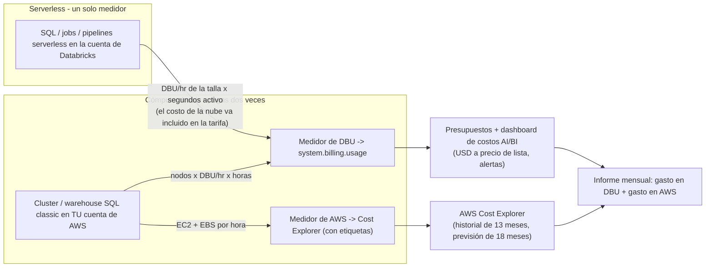
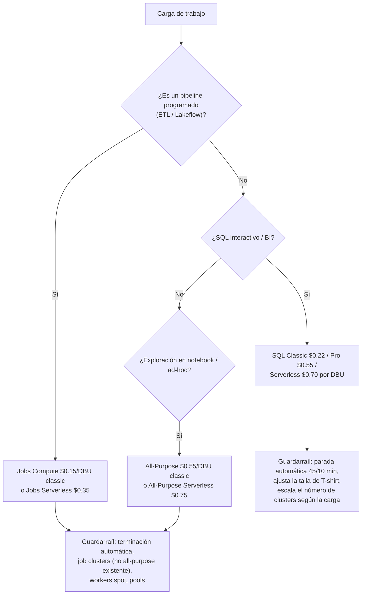
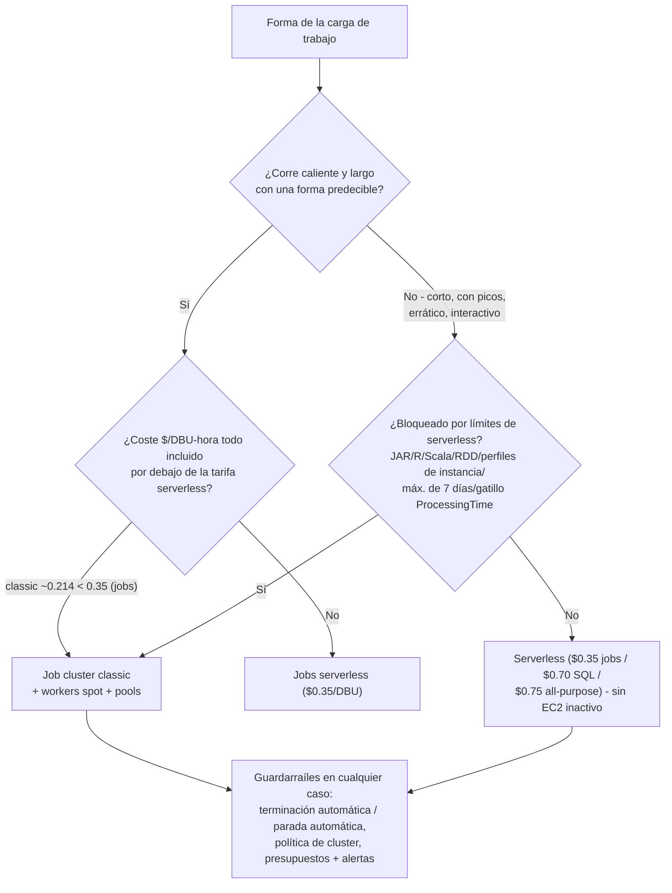
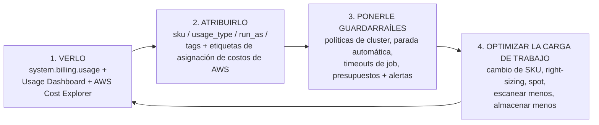

# Optimización de costos y economía de los DBU en AWS

Las demás lecciones de este curso construyen algo; esta lección mantiene honesta la factura. Un lakehouse de datos de Databricks en AWS genera **dos facturas independientes**: Databricks te factura en **DBUs** (Databricks Units, la licencia de la plataforma, medida por segundo) y AWS te factura por el EC2, EBS, S3, NAT y CloudWatch que hay debajo. Olvida cualquiera de los dos medidores y tu «optimización de costos» es ficción: el lado de los DBU puede estar perfectamente ajustado mientras un NAT Gateway añade en silencio $0.045 por GB de tráfico hacia S3, y el lado de AWS puede ser todo spot mientras un cluster all-purpose pasa inactivo todo el fin de semana a $0.55/DBU.

La buena noticia es que el costo de Databricks es *aritmética*, no intuiciones. Cada tarifa de esta lección está fechada en **octubre de 2026** y trazada hasta una fuente primaria o documental: las páginas de precios de Databricks y los archivos de datos de página (leídos 2026-10), el registro de proveedor UK G-Cloud 15 para las tarifas de lista de Jobs/All-Purpose (capturado 2026-09-25), la documentación de Databricks sobre las tablas de facturación y la parada automática (actualizada 2026-09-11 / 2026-10-08), la lista de precios de AWS para EC2/S3 (leída 2026-10-12) y las páginas de precios de AWS para NAT, Spot y CloudWatch (leídas 2026-10). Haz tú mismo la cuenta: es la única forma de operar un lakehouse que siga siendo asequible en el tercer año.

En esta lección vas a:

- leer la **tarjeta de tarifas de DBU de oct-2026 por SKU de cómputo**, jobs, all-purpose, SQL Classic/Pro/Serverless, pipelines de Lakeflow, con la procedencia de cada número explicada;
- aplicar las **dos ecuaciones** (clusters: nodos × emisión × tarifa × horas; warehouses: tarifa por tamaño × tiempo activo) en cinco ejemplos resueltos calculados a mano;
- tomar la decisión del **punto de equilibrio entre serverless y classic** con aritmética en lugar de doctrina;
- configurar **parada automática, terminación automática, workers spot, pools de instancias y políticas de cluster** como controles de costo, con los valores documentados y sus mínimos;
- atribuir cada dólar con **`system.billing.usage`**, presupuestos y etiquetas, y saber exactamente qué costos *nunca* aparecen ahí;
- ejecutar el **caso de TCO mensual resuelto** para un equipo de cinco personas (tres pipelines, un warehouse de BI, S3/NAT/logs) y recortarlo un **34.1%** con tres palancas;
- sopesar el **Veredicto comparativo**: DBUs frente a créditos de Snowflake frente a los $5/TB escaneados de Athena;
- estudiar **casos documentados de costos de clientes de AWS** (Addepar, Nubank, Comcast), leer el **recuadro de actualizaciones de 2026** y practicar con **doce preguntas** y cinco comprobaciones interactivas.

---

## 1. Dos facturas, no una: el modelo de costos de Databricks en AWS

### 1.1 Qué es un DBU

La propia definición de Databricks: *"Databricks factura según las unidades de Databricks (DBUs), que son unidades de capacidad de procesamiento por hora según el tipo de instancia de VM"* (docs.databricks.com/aws/en/getting-started/concepts, fecha del documento 2026-09-25). La página de precios lo dice al revés: *"Una unidad de Databricks (DBU) es una unidad normalizada de potencia de procesamiento en la plataforma Lakehouse de Databricks, usada con fines de medición y fijación de precios"* y *"Paga solo por los productos que usas, con granularidad de segundo"* (databricks.com/product/pricing, leído 2026-10).

Tres consecuencias deciden todo lo que sigue:

1. **Para el cómputo de clusters, el consumo de DBUs = (nodos) × (DBU/h de ese tipo de nodo) × horas**: el blog de gestión de costos de 2022 lo dice sin rodeos: *"Con la excepción de un SQL Warehouse, la cantidad de DBUs consumida se basa en el número de nodos y la potencia de cálculo de los tipos de instancia VM subyacentes"* (databricks.com/blog/best-practices-cost-management-databricks, 2022-10-18; la aritmética sigue vigente con las tarifas de oct-2026).
2. **Para los warehouses SQL, el consumo de DBUs = (los DBU/h fijos de la talla) × horas que el warehouse está activo**: esté ejecutando o no, el medidor gira mientras el warehouse está activo (documentación de precios, leída 2026-10).
3. **El medidor es por segundo y no sabe si estás trabajando.** Un cluster all-purpose inactivo y uno a plena carga emiten DBUs a la misma tarifa. Por eso el *tiempo inactivo*, y no la *velocidad de las consultas*, es el problema central de optimización de costos en el cómputo classic.

### 1.2 Los dos medidores



**Serverless pliega el costo de la máquina dentro de una tarifa de DBU más alta.** SQL Serverless a **$0.70/DBU** frente a SQL Classic a **$0.22/DBU** (databricks.com/product/pricing/databricks-sql, instantánea de página 2026-10) es una prima de **$0.48 por DBU-hora** que paga la flota, las operaciones y el tiempo inactivo que ya no controlas. Jobs Serverless **$0.35** menos Jobs Classic **$0.15** es el mismo cuadro con **$0.20 por DBU-hora**. Classic no es gratis: solo mueve media factura a AWS, donde puedes atacarla con spot y con el right-sizing.

> ⚠️ **`system.billing.usage` no es tu factura total.** Databricks es explícito: *"El `system.billing.usage` solo contiene costos de Databricks. Esto significa que, en cualquier caso en que se use cómputo no serverless, el gasto de infraestructura de la nube no está incluido y habría que revisarlo en la consola de nube correspondiente (cómputo, redes, almacenamiento, etc.)"* (databricks.com/blog/top-5-system-table-queries-understanding-your-databricks-costs, 2026-09-22). Un presupuesto que solo mira Databricks subestima la cifra real por toda la columna de AWS.

- **📚 ¿Sabías que…?** Databricks mide los DBUs **por segundo** (FAQ de precios, leída 2026-10), mientras que Snowflake factura créditos *"per second with a 60-second minimum"* (resumen de warehouses de Snowflake + tabla de consumo del servicio, leída 2026-10). En jobs cortos y frecuentes, esa diferencia de 55 segundos es una línea real de la factura: una de las razones silenciosas por las que las cargas de trabajo con picos prefieren los jobs serverless de Databricks a una flotta classic siempre reanudada.

### 1.3 La tarjeta de tarifas de oct-2026 (AWS, regiones de EE. UU., nivel Premium, lista)

| SKU de cómputo | Classic $/DBU | Serverless $/DBU | Notas | Fuente (fecha) |
|---|---|---|---|---|
| **Jobs Compute** (Lakeflow Jobs) | **0.15** | **0.35** | Nivel Enterprise: 0.20 / 0.45 | Registro de proveedor UK G-Cloud 15 (Databricks Inc., capturado 2026-09-25); corroborado por seis lecturas independientes (Flexera, licenseware 2026-10-06, costanalist, lakesentry, agentsql, hejlsvig) |
| **All-Purpose Compute** | **0.55** | **0.75** | Nivel Enterprise: 0.65 / 0.95 | mismo conjunto documental que arriba (2026-09-25 / 2026-10) |
| **SQL Classic / Pro / Serverless** | **0.22 / 0.55** | **0.70** | Nota al pie de serverless: "Includes cloud instance cost" | instantánea de página de databricks.com/product/pricing/databricks-sql, 2026-10 (corroborada por la instantánea del digest L08) |
| **Lakeflow Pipelines (DLT), nivel Standard heredado** | **0.20 Core / 0.25 Pro / 0.36 Advanced** |, | nivel heredado, aún en la página | archivo page-data de precios (HTTP 200, 2026-10-12) |
| **DLT serverless** |: | **0.35** | | lecturas de licenseware + Flexera, 2026-10 |
| **Jobs "Standard" (retirado)** | ~~0.10~~ |: | fin de vida del nivel Standard: AWS/GCP **2025-10-01**, Azure **2026-10-01** | databricks.com/product/pricing/lakeflow-jobs, leído 2026-10 |

**Lee la columna de procedencia antes de citar una tarifa.** Las cifras de SQL y Lakeflow Pipelines provienen de las propias superficies de precios de Databricks (instantáneas de página y el archivo de datos de página del sitio de precios). Las cifras de Jobs y All-Purpose son *documentales y corroboradas*, el registro público de proveedor UK G-Cloud 15 (una presentación legal de Databricks Inc.) más seis lecturas independientes de 2026 que coinciden, porque databricks.com renderiza esas tarjetas en el cliente. Trata cada cifra como **lista de EE. UU., nivel Premium**: la FAQ de precios afirma *"Databricks prices and Cloud Infrastructure prices may vary based on geographic region and cloud service provider"* (leída 2026-10), y la verdad dentro de la cuenta vive en `system.billing.list_prices` (el precio de tu contrato).

Dos reglas prácticas con respaldo oficial:

- **Misma pipeline, all-purpose frente a jobs = 3.7× la tarifa por DBU** ($0.55 ÷ $0.15 ≈ 3.7): antes de contar un solo minuto inactivo.
- **Serverless cuesta ~1.3×: 2.3× más por DBU que classic** para la misma familia de SKU, y de paso elimina la factura de EC2, la gestión de pools y el tiempo inactivo.

**Efecto de la región:** las tarifas classic son planas en todas las regiones de AWS *porque pagas el precio local de EC2 por separado*; **las tarifas serverless siguen la infraestructura regional**: SQL Serverless **$0.70** en us-east-1 frente a **$0.91** en eu-central-1 (lectura de hejlsvigconsulting.com del archivo de datos de la página de precios, 2026-08-07). Una cotización de EE. UU. nunca se traslada a Fráncfort.

### 1.4 Ejemplo resuelto E1: la ecuación básica y una factura combinada

El patrón resuelto del propio blog de gestión de costos de 2022, repricado con la tarifa Premium de Jobs actual (blog, 2022-10-18; lista de precios de EC2, us-east-1, leída 2026-10-12):

```text
Ejemplo resuelto E1 - un cluster de jobs de 4 nodos, una hora (a oct 2026)
  nodos ................... 4
  emisión (ilustrativa) ... 3 DBU/hr por nodo  (el tipo de nodo del ejemplo del blog)
  DBU/hr .................. 4 x 3 = 12 DBU/hr
  coste DBU, Premium Jobs . 12 x $0.15/DBU = $1.80 / h
  coste DBU, Enterprise ... 12 x $0.20/DBU = $2.40 / h  (la cifra del propio blog)
  coste AWS ............... 4 x m5.xlarge @ $0.192/h = $0.768 / h
  total classic combinado . $1.80 + $0.768 = $2.568 / h  (Premium)
  todo incluido por DBU emitido ... $2.568 / 12 = $0.214 por DBU-hora
```

Esa última línea es el número que vas a reutilizar en toda la lección: **$0.214 todo incluido por DBU-hora en jobs classic** frente a **$0.35** de los jobs serverless, por eso classic gana en formas calientes, largas y predecibles, y serverless gana en las cortas, con picos o erráticas (sección 3). La salvedad que el propio blog implica: combina la tasa de emisión de *tu* tipo de nodo con el precio de EC2 de *ese* tipo de nodo, y lee ambas en la calculadora de precios o en `system.billing.list_prices`, el par 3 DBU/hr + m5.xlarge de arriba es ilustrativo, no una forma emparejada.

---

## 2. La escalera de SKU: tu palanca de precios más poderosa

Antes de ajustar una sola consulta, comprueba que la carga de trabajo esté en el SKU correcto. Elegir SKU es gratis, instantáneo y, según los propios informes de campo de Databricks, vale más que la mayoría del trabajo de rendimiento.



### 2.1 Los tres crímenes de la escalera

1. **Una pipeline sobre cómputo all-purpose.** Un job apuntado a un cluster all-purpose *existente* se factura con las tarifas de **All-Purpose** y se marca como carga de trabajo **interactiva** (Jobs API 2.0; digest 06, leído 2026-10). Databricks *"no recomienda esta configuración para jobs de producción."* Solo la diferencia de tarifa es de **$0.55 → $0.15** por DBU.
2. **El nivel Standard retirado en tu runbook.** Jobs a $0.10/DBU era Standard; los workspaces Standard de AWS/GCP se actualizaron a Premium el **2025-10-01** (Azure **2026-10-01**) según la página de precios (leída 2026-10). Cualquier tabla de tarifas anterior a 2025 que copies está desactualizada en un 50%.
3. **Confusión entre Premium y Enterprise entre nubes.** El "Premium" de AWS/GCP es la tarjeta "Enterprise" de Azure: AWS Jobs es **$0.15 Premium / $0.20 Enterprise** (un 33% de diferencia) y cada SKU serverless se mueve con él (registro G-Cloud 2026-09-25; licenseware 2026-10-06). Etiqueta siempre la nube *y* el nivel.

### 2.2 Ejemplo resuelto E2: una pipeline, un mes, all-purpose frente a jobs

La misma pipeline de 12 DBU/hr, 400 horas de cluster al mes, los mismos 4 × m5.xlarge en el lado de AWS (tarifas a oct 2026):

```text
Ejemplo resuelto E2 - coste de la pipeline por SKU, un mes (a oct 2026)
  All-Purpose Compute:
    DBU .... 12 DBU/hr x 400 h x $0.55 ....... = $2,640.00
    AWS .... 4 x $0.192/h x 400 h ............ = $  307.20
    total .................................... = $2,947.20
  Jobs Compute (nuevo job cluster):
    DBU .... 12 DBU/hr x 400 h x $0.15 ....... = $  720.00
    AWS .... 4 x $0.192/h x 400 h ............ = $  307.20
    total .................................... = $1,027.20
  AHORRO ................................. = $1,920.00 / mes
       (65% de la factura combinada, 73% del lado de los DBU)
```

Una pipeline. Un desplegable en la definición del job. El resumen propio de Databricks de la versión a escala de toda la finca: *"We've seen customers who have saved tens of thousands of dollars by simply moving just ten percent of their workloads from all-purpose clusters to jobs clusters"* (blog de gestión de costos, 2022-10-18: fuente antigua, aritmética sin cambios).

```matching
{
  "question": "Relaciona cada SKU de cómputo o regla de facturación con su economía de lista de oct-2026 en AWS (nivel Premium):",
  "pairs": [
    {"left": "Jobs Compute, classic (nuevo job cluster)", "right": "$0.15 por DBU: el SKU más barato de la escalera; los job clusters terminan automáticamente cuando la ejecución termina"},
    {"left": "All-Purpose Compute, classic", "right": "$0.55 por DBU: unas 3.7× Jobs por el mismo trabajo; la tarifa que paga un job cuando corre en un cluster all-purpose existente"},
    {"left": "SQL Classic / Pro / Serverless", "right": "$0.22 / $0.55 / $0.70 por DBU: serverless incluye el costo de la instancia en la nube dentro de la tarifa, classic no"},
    {"left": "Jobs Serverless / All-Purpose Serverless", "right": "$0.35 / $0.75 por DBU: unos $0.20 / $0.20 por DBU-hora de máquina+ops absorbidos frente a classic"},
    {"left": "Lakeflow Pipelines en el nivel Standard heredado", "right": "$0.20 Core / $0.25 Pro / $0.36 Advanced por DBU: un nivel retirado que aún aparece en el archivo de datos de la página de precios (2026-10-12)"},
    {"left": "Jobs Compute 'Standard' a $0.10 por DBU", "right": "Desaparecido: los workspaces de nivel Standard se actualizaron a Premium el 2025-10-01 (AWS/GCP) y el 2026-10-01 (Azure)"},
    {"left": "Nodos de pool de instancias inactivos en el pool", "right": "$0 DBUs de Databricks: pero los cargos de instancia y EBS de AWS continúan mientras el nodo exista"}
  ],
  "explanation": "La escalera va de Jobs 0.15 -> SQL Classic 0.22 -> SQL Pro / ancla all-purpose 0.55 -> Jobs Serverless 0.35 (incluido) -> SQL Serverless 0.70 (incluido) -> All-Purpose Serverless 0.75 (incluido), con los niveles DLT Standard heredados entre jobs y SQL Classic. Las trampas: tratar $0.15 frente a $0.70 como una brecha de costo total de 4.7× (no lo es: classic arrastra una segunda factura de EC2); fiarte de una tabla anterior a 2025 que aún muestra $0.10 Standard; y creer que los pools son gratis (gratis de DBUs, nada más: el medidor de AWS sigue girando)."
}
```

- **📚 ¿Sabías que…?** Las actualizaciones de vistas materializadas se facturan como uso de **pipeline serverless**, no como uso de warehouse: así que una pestaña de costos de 'warehouse' no las mostrará (blog de Databricks, 2026-10-07). La optimización predictiva está **activada por defecto en las cuentas creadas el 2024-11-11 o después**, y también se factura bajo registros de uso serverless. Si tus consultas de atribución solo agrupan por warehouse, estos dos SKU son fugas invisibles.

---

## 3. Serverless frente a classic: la aritmética del punto de equilibrio

"Serverless es 4× más caro" es la frase más cara de las discusiones sobre costos de Databricks, porque compara tarifas de DBU e ignora la columna de AWS del lado classic. La comparación honesta es el costo todo incluido por DBU-hora emitido.

```text
Ejemplo resuelto E3 - dónde cae la línea classic/serverless (a oct 2026)
  Deltas Premium (máquina + ops absorbidos por serverless):
    SQL ....... $0.70 - $0.22 = $0.48 por DBU-hora
    Jobs ...... $0.35 - $0.15 = $0.20 por DBU-hora
  Cluster classic de jobs, todo incluido (desde E1):
    ($1.80 DBU + $0.768 AWS) / 12 DBU = $0.214 por DBU-hora
  Decisión:
    $0.214 (classic, caliente y largo)  <  $0.35 (jobs serverless)  -> gana classic
    con picos / corto / errático / interactivo -> gana serverless
      (sin EC2 inactivo, sin administración de pools, sin los 4 minutos de arranque del warehouse classic)
  Prueba de punto de equilibrio que puedes correr en cualquier forma:
    (EC2 $/h + DBU $/h) / emisión  vs  serverless $/DBU
```



Tres lecturas prácticas:

- **Gana classic** cuando el cluster corre caliente y largo con una forma predecible: ventanas de ETL por lotes, backfills nocturnos grandes, entrenamiento de ML con un número de nodos conocido. Ya estás pagando ~$0.192/h por un m5.xlarge (lista de precios de EC2, leída 2026-10-12); classic pliega eso en una licencia de $0.15/DBU en lugar de un paquete de $0.35/DBU.
- **Gana serverless** en trabajo corto, con picos, interactivo o impredecible, dashboards con huecos entre actualizaciones, notebooks ad-hoc, jobs dirigidos por eventos, porque *"no se te cobra mientras está inactivo"* (Databricks Answers, 2026-08-27) y la flota, el parcheo y la planificación de capacidad desaparecen.
- **Las restricciones operativas pesan tanto como el precio.** Los jobs serverless tienen un **máximo de 7 días de ejecución** documentado, no admiten tareas JAR/Spark-Submit, ni notebooks R/Scala, ni APIs RDD, ni perfiles de instancia, y los gatillos de Structured Streaming están limitados a `Trigger.AvailableNow()` (recomendado); mientras que classic existe precisamente donde esas restricciones aprietan (digest 06, docs leídas 2026-10). Migra el *patrón* (volúmenes en lugar de DBFS, la API DataFrame en lugar de RDDs) antes de cambiar de SKU.

```fillblank
{
  "question": "Completa la aritmética serverless frente a classic con las cifras de oct-2026 (AWS, nivel Premium de lista):",
  "template": "SQL Serverless menos SQL Classic son {{1}} por DBU-hora de máquina y operaciones absorbidas, y Jobs Serverless menos Jobs Classic son {{2}} por DBU-hora. Un cluster classic de jobs de 4 nodos que emite 12 DBU/hora a $0.15/DBU más 4 x m5.xlarge a $0.192/hora cuesta ${{3}} por hora todo incluido, es decir, unos ${{4}} por DBU-hora emitido: por debajo de la tarifa de $0.35 de jobs serverless, y por eso las formas calientes, largas y predecibles se quedan en classic. Las tarifas de SQL Serverless también varían por región: $0.70 en us-east-1 frente a ${{5}} en eu-central-1.",
  "answers": {
    "1": "0.48",
    "2": "0.20",
    "3": "2.568",
    "4": "0.214",
    "5": "0.91"
  },
  "distractors": ["0.35", "0.55", "0.22", "2.40", "2.400", "0.2140", "0.70", "0.81", "0.45"],
  "explanation": "Los deltas son $0.70-$0.22=$0.48 y $0.35-$0.15=$0.20 por DBU-hora (páginas de precios, leídas 2026-10). El cluster classic de E1 es 12 x 0.15 = $1.80 DBU más 4 x 0.192 = $0.768 AWS = $2.568/h, es decir $2.568/12 = $0.214 por DBU-hora emitido. SQL Serverless es $0.70 en us-east-1 y $0.91 en eu-central-1 (archivo de datos de la página de precios leído 2026-08-07) porque las tarifas serverless siguen la infraestructura regional mientras las classic son planas (pagas el EC2 local por separado). Los distractores son el peldaño vecino de la escalera ($0.22/$0.35/$0.45/$0.55), la cifra de hora Enterprise del blog ($2.40) y una versión con el decimal desplazado del número de punto de equilibrio."
}
```

---

## 4. Tiempo inactivo: parada automática, terminación automática y la regla de facturarse mientras está activo

La frase propia de Databricks sobre los warehouses: *"Idle SQL warehouses continue to accumulate DBU and cloud instance charges until they are stopped"* (docs.databricks.com/aws/en/compute/sql-warehouse/create, última actualización 2026-09-11). No hay forma más suave de decirlo: **un warehouse que está activo es un warehouse que se factura.** Diez horas dejadas activas para cuarenta minutos de dashboards se facturan como diez horas.

### 4.1 Los valores por defecto documentados (a oct 2026)

| Recurso | Valor por defecto de parada automática / terminación automática | Mínimo | Fuente (fecha) |
|---|---|---|---|
| Warehouse SQL, **Pro / Classic** | **45 minutos** de inactividad | **10 minutos** | blog 2026-10-07; doc de creación de warehouse 2026-09-11 |
| Warehouse SQL, **Serverless** | **10 minutos** | **5 minutos** (UI) / **1 minuto** (API) | las mismas dos fuentes |
| **Cluster all-purpose** | una ventana de inactividad que tú defines (`autotermination_minutes`; rango de API 10 to 10,000, **0 = desactivado**) | 10 minutos | referencia de bundle-schema / política, leída 2026-10; norma histórica de unas hora (blog 2022-10-18) |
| **Job clusters / DLT clusters** | terminan **al completarse** la ejecución |: | blog 2022-10-18; docs de Jobs |

Dos matices. Primero, los valores por defecto de la parada automática difieren por un factor de 4.5 entre classic/Pro (45 min) y serverless (10 min): si tus dashboards se actualizan cada 20 minutos, el valor classic por defecto te *garantiza* pagar 25 minutos inactivos después de cada sesión. Segundo, `autotermination_minutes = 0` (desactivado) es un valor legal de la API y la fuente número uno de gasto descontrolado de fin de semana; una política aplicada gana a un barrido manual semanal (sección 6.3).

### 4.2 Ejemplo resuelto E4: aritmética de parada automática en el warehouse de BI

Del caso de TCO mensual de la sección 9: un warehouse SQL serverless que sirve BI está activo **10 horas al día** durante 21 días laborables (210 horas, 2,520 DBU con una emisión asumida de 12 DBU/h según la talla). El uso medido muestra que los dashboards consultan de verdad en una ventana de **6 horas**:

```text
Ejemplo resuelto E4 - ajustando la parada automática de BI de 10 h a 6 h/día (a oct 2026)
  horas eliminadas ...... (10 - 6) h/día x 21 días = 84 h/mes
  DBU eliminados ........ 84 h x 12 DBU/h ......... = 1,008 DBU
  ahorro ................ 1,008 x $0.70/DBU ....... = $705.60 / mes
  coste de BI restante .. (2,520 - 1,008) x $0.70 . = $1,058.40 / mes
  -> un recorte del 40% en la línea de BI con un solo ajuste del warehouse
```

No se reescribió ninguna consulta. No se movió ningún dato. Simplemente no se dejó el warehouse encendido. (La cifra de 12 DBU/h es la emisión de la talla Small que asume este caso: los tamaños de medición por talla de warehouse no se publican como tabla oficial, así que lee los tuyos en `system.billing.list_prices` en tu cuenta antes de reutilizar la aritmética.)

### 4.3 Ejemplo resuelto E5: una política de parada automática / terminación automática aplicada

Las políticas de cluster son conjuntos de reglas JSON administradas por administradores sobre atributos de la API de Clusters cuyos beneficios incluyen *"cost control via price-driving attributes"* (docs, leídas 2026-10). La referencia de políticas (leída oct 2026) documenta la ruta del atributo `autotermination_minutes` y un rango virtual de `dbus_per_hour` que hace de techo duro de DBU; la restricción de tipo de nodo es igualmente una capacidad de la política. Una política mínima de guardarraíl de costos para un workspace de equipo:

```json
{
  "name": "team-analytics-cost-guardrail",
  "description": "Enforced idle kill + node allowlist + DBU ceiling (verify keys in your workspace)",
  "spark_version": {
    "type": "fixed",
    "value": "auto:latest-lts"
  },
  "autotermination_minutes": {
    "type": "fixed",
    "value": 60
  },
  "node_type_id": {
    "type": "allowlist",
    "defaultValue": "m5.xlarge",
    "values": ["m5.xlarge", "m5.2xlarge", "r5.xlarge"]
  },
  "num_workers": {
    "type": "range",
    "min": 1,
    "max": 10,
    "defaultValue": 2
  },
  "dbus_per_hour": {
    "type": "range",
    "min": 0,
    "max": 24
  }
}
```

La mecánica que convierte esto en un *guardarraíl* y no en una sugerencia: una limitación por atributo; el cómputo creado por API **ignora los valores por defecto de la política salvo que se establezca `apply_policy_default_values: true`**; `spark_version: auto:latest-lts` solo se resuelve cuando el cómputo se *edita*, no de forma continua; y el derecho **Unrestricted** lo salta todo, por lo que *"debería suprimirse para los usuarios que no son administradores"* (guía de incorporación de políticas, blog 2025-04-17). Las grafías de las claves de atributo varían entre superficies de API: confírmalas en el editor de políticas de tu workspace antes de fiarte de este JSON literalmente.

> ⚠️ **Los presupuestos y las políticas monitorizan y restringen; no detienen a un gastador determinado.** Los presupuestos son *"monitoreo y alertas, no un límite duro"* (doc de presupuestos, actualizada 2026-10-07): un usuario con permisos suficientes todavía puede crear un warehouse que corra demasiado tiempo o se quede escalado más allá de lo esperado. El marco propio de Databricks: *"Buenos controles mediante políticas de cómputo, configuraciones de tiempo de espera de jobs y presupuestos ayudan a los administradores de la plataforma Databricks a mantener el gasto dentro de los límites, pero siempre existe la posibilidad de que un usuario con permisos suficientes cree un job o un warehouse que corra demasiado tiempo o se quede escalado más allá de lo esperado y cause un pico inesperado de gasto"* (blog de las cinco consultas de system tables, 2026-09-22). Los guardarraíles son por capas o son teatro.

```dragdrop
{
  "question": "Ordena la escalera de control del tiempo inactivo desde la palanca más barata y automatizada hasta la más manual: el orden en que esta lección la construye:",
  "items": [
    "Job clusters: se crean por ejecución y terminan al completarse: el tiempo inactivo es estructuralmente cero",
    "Parada automática en warehouses SQL: por defecto 45 min en Pro/Classic, 10 min en serverless; ajústala a tu hueco real de actualización (mínimo 10 / 5 min en UI, 1 min en API)",
    "Terminación automática en clusters all-purpose: autotermination_minutes 10-10,000; 0 la desactiva y es el típico gasto descontrolado de fin de semana",
    "Políticas de cluster aplicadas: terminación fija, lista permitida de tipos de nodo, techo de num_workers, rango de dbus_per_hour: más apply_policy_default_values true desde la API",
    "Pools de instancias: los nodos calientes reducen el arranque, $0 DBUs mientras están en el pool: pero la facturación de instancia y EBS de AWS continúa en los nodos inactivos del pool",
    "Barrido humano semanal del workspace: aún necesario como red de seguridad, nunca como control principal"
  ],
  "correctOrder": [
    "Job clusters: se crean por ejecución y terminan al completarse: el tiempo inactivo es estructuralmente cero",
    "Parada automática en warehouses SQL: por defecto 45 min en Pro/Classic, 10 min en serverless; ajústala a tu hueco real de actualización (mínimo 10 / 5 min en UI, 1 min en API)",
    "Terminación automática en clusters all-purpose: autotermination_minutes 10-10,000; 0 la desactiva y es el típico gasto descontrolado de fin de semana",
    "Políticas de cluster aplicadas: terminación fija, lista permitida de tipos de nodo, techo de num_workers, rango de dbus_per_hour: más apply_policy_default_values true desde la API",
    "Pools de instancias: los nodos calientes reducen el arranque, $0 DBUs mientras están en el pool: pero la facturación de instancia y EBS de AWS continúa en los nodos inactivos del pool",
    "Barrido humano semanal del workspace: aún necesario como red de seguridad, nunca como control principal"
  ],
  "explanation": "La escalera va primero por la automatización porque la automatización no puede olvidar: los job clusters hacen que lo inactivo sea estructuralmente imposible; la parada automática y la terminación automática matan el inactivo residual del cómputo compartido; las políticas convierten esos ajustes en obligatorios; los pools intercambian un pequeño costo siempre encendido de AWS por cero DBU inactivos y arranques más rápidos; y el barrido humano es la capa que añades al final, no al principio. Los dos errores que este orden evita: fiarse de los barridos (dejan de ocurrir en semanas de presión) y tratar los pools como gratis (trasladan el costo de la columna de DBU a la columna de AWS: digests 06 y 15, leídos 2026-10)."
}
```

---

## 5. Spot en AWS: lo que ahorra y lo que nunca toca

Las Spot Instances de AWS *"save up-to 90% on On-Demand prices"* (aws.amazon.com/ec2/spot, leído 2026-10), y AWS emite un **aviso de interrupción de dos minutos** antes de detener o terminar una instancia Spot (docs de AWS EC2, leídos 2026-10). En Databricks la regla de topología es fija: cuando marcas spot, *"driver node is always on-demand, subsequent instances will be spot"* (doc de configuración de cómputo, actualizada 2026-10-06).

### 5.1 Ejemplo resuelto E6: aritmética de spot, y la columna que nunca toca

Cinco workers m5.xlarge durante 200 horas al mes (lista de EC2, us-east-1, leída 2026-10-12):

```text
Ejemplo resuelto E6 - spot en 5 workers, 200 h/mes (a oct 2026)
  Columna AWS bajo demanda .. 5 x $0.192/h x 200 h = $192.00
  Spot al -60% .............. 5 x $0.0768/h x 200 h = $ 76.80   -> ahorra $115.20/mes
  Spot al -90% (máximo) .... 5 x $0.0192/h x 200 h = $ 19.20   -> ahorra $172.80/mes
  Columna de DBU ............ SIN CAMBIOS
    ($/DBU y la emisión de DBU del nodo son idénticas en spot y bajo demanda)
  -> spot es una palanca del lado de AWS, punto y aparte
```

Cuatro hechos operativos que hay que meter en el diseño: el driver se queda bajo demanda (docs de cómputo 2026-10-06); el desalojo de dos minutos llega a mitad de tarea, así que las pipelines necesitan etapas reiniciables e idempotentes (docs de AWS 2026-10), el gatillo `AVAILABLE_NOW` y el Structured Streaming con checkpoint de las lecciones 05 y 13 son los patrones compatibles; **los pools son todo spot o todo bajo demanda** (la API añade `SPOT_WITH_FALLBACK`), y la guía de Databricks es *"No uses un pool con instancias spot como tu tipo de driver"*; y spot **no ahorra nada en serverless**, serverless va incluido en la tarifa, y ninguna fuente afirma que los descuentos de EC2 spot se trasladen a las tarifas de DBU serverless.

- **📚 ¿Sabías que…?** Spot puede ahorrar hasta un 90% y *sigue* siendo la decisión equivocada para un job de 20 minutos con SLA estricto: la guía actual de Databricks combina **pools spot para cargas de trabajo que toleran el costo** con **pools bajo demanda para jobs cortos y de SLA estricto**, y recomienda **serverless en lugar de pools** siempre que la carga de trabajo lo permita (docs, leídas 2026-10). Spot es una decisión de *carga de trabajo*, no un interruptor de ahorro de toda la cuenta.

---

## 6. Right-sizing, autoscaling, pools y el rendimiento como costo

### 6.1 Right-sizing del warehouse (la palanca proporcional)

En un warehouse, el costo en DBU es **tarifa por tamaño × tiempo activo**, así que **bajar una talla de T-shirt es un recorte proporcional de DBU por cada hora que el warehouse está activo**: el ahorro lineal más limpio de la plataforma. La escalera classic/Pro se construye sobre workers i3.2xlarge (2X-Small = 1 worker, doblando hasta X-Large = 32, y hasta 4X-Large = 256) con *"a cluster for every 10 concurrent queries"* como regla de concurrencia (docs, leídas 2026-10). Dimensiona a la concurrencia que sirves, no al pico que viste una vez; añade clusters (autoscaling a nivel de warehouse) en lugar de inflar la T-shirt para una cola que se limpia en minutos.

### 6.2 Autoscaling, pools y `AVAILABLE_NOW`

- **El autoscaling encoge el pico.** El autoscaling optimizado (Premium+) va de min a max en **≤2 eventos de redimensionamiento**, y escala a la baja con una ventana de subutilización de **40 segundos** en el cómputo de jobs y **150 segundos** en all-purpose (docs, actualizadas 2026-10-06). Nunca lo combines con `spark.dynamicAllocation.enabled`: la documentación advierte de churn de executors y `NODES_LOST`.
- **Los pools cuestan cero DBUs mientras están inactivos, y AWS completo mientras están inactivos.** *"Databricks no cobra DBUs mientras las instancias están inactivas en el pool. La facturación del proveedor de instancias sí se aplica"* (mejores prácticas de costos, 2026-09-11). Dimensiona `min_idle_instances` e `idle_instance_autotermination_minutes` con criterio; mantén el tamaño máximo del cluster ≤ `max_capacity` del pool o el escalado fallará con `INSTANCE_POOL_MAX_CAPACITY_FAILURE`.
- **`AVAILABLE_NOW` da forma a la pipeline.** Ejecuta una pipeline disparada (`Trigger.AvailableNow()`) en un job cluster que termina al completarse en lugar de un cluster continuo que pasa inactivo entre micro-batches: la lista oficial de palancas lo recomienda (mejores prácticas, 2026-09-11).

### 6.3 Photon como palanca de costo (con cuidado)

Photon es el motor vectorizado en C++ que *"replaces the JVM-based Spark SQL execution engine"* mientras Catalyst sigue planificando la consulta (docs de Photon, actualizadas 2026-09-11). Su historia de costo son **segundos facturables, no descuento**: terminar antes significa menos segundos medidos por segundo, pero Photon también *"consume[s] DBUs at a different rate than the same instance type running the non-Photon runtime"*, así que *"Photon is faster"* nunca implica *"Photon is cheaper"* (docs; haz tu propio benchmark de la carga de trabajo). Acelera SQL, ETL con DataFrame y streaming **sin estado**, y **no** acelera cuerpos de UDF de Python, RDDs, Datasets ni streaming con estado, las consultas de menos de ~2 segundos no ven una mejora significativa (docs, 2026-09-11). Photon está activado por defecto en serverless, warehouses SQL y la UI; **los clusters creados por API deben fijar `runtime_engine: "PHOTON"` explícitamente** (lección 06).

### 6.4 El ciclo de cuatro etapas

El propio marco de Databricks para controlar el gasto (Databricks Answers, leído 2026-10):



La mayoría de los equipos invierte este orden y empieza por la etapa 4: reescribiendo consultas mientras un cluster all-purpose inactivo factura $0.55/DBU en una esquina. Las etapas 1 y 2 son baratas (los datos del medidor ya están en tu cuenta); la etapa 3 es configuración; solo la etapa 4 es ingeniería.

---

## 7. Atribución de costos: system tables, presupuestos y la consola de AWS

### 7.1 `system.billing.usage`: cada DBU tiene una dirección

La system table de facturación (docs, actualizadas 2026-10-08) trae, entre otras: `account_id`, `workspace_id`, `workspace_name`, `region`, `billable_usage_timestamp`, `billing_origin_time`, `billing_month`, `cloud`, `sku`, `usage_type`, `product_feature`, `record_type`, `run_as`, `metered_quantity`, `list_price`, `unblended_cost`, `databricks_contract_quantity`, `aws_public_list_price` y `tags`. Las tres que hacen el trabajo en cada consulta de atribución:

- **`sku` / `usage_type` / `product_feature`**: *qué tipo* de cómputo (jobs frente a all-purpose frente a SQL frente a pipelines serverless);
- **`run_as`**: *si* la ejecución fue interactiva, un job, serverless, y así sucesivamente;
- **`tags` / `workspace_name`**: *de quién* es.

`record_type` separa las filas de uso de las filas de precios, y Databricks trae joins prefabricados con `system.billing.list_prices` y `system.compute.clusters`, más instrucciones para publicar el resultado en un dashboard AI/BI y lanzar una alerta (docs, 2026-09-11). También existe un **Usage Dashboard** prefabricado (blog, 2026-09-22): empieza ahí antes de escribir SQL.

### 7.2 Ejemplo resuelto E7: la auditoría de «recortar la factura» en SQL

```sql
-- Worked example E7a - what did we spend, by SKU, this month?
-- (system.billing.usage, docs updated 2026-10-08)
SELECT  sku,
        usage_type,
        product_feature,
        SUM(metered_quantity) AS dbus,
        SUM(unblended_cost)   AS cost_usd
FROM    system.billing.usage
WHERE   billing_month = DATE_FORMAT(CURRENT_DATE, 'yyyy-MM')
  AND   record_type = 'USAGE'
GROUP BY 1, 2, 3
ORDER BY cost_usd DESC;
```

```sql
-- Worked example E7b - which clusters are the whales?
-- join the usage meter to the cluster dimension (sample queries, docs 2026-09-11)
SELECT  u.tags['cluster_id']        AS cluster_id,
        c.cluster_name,
        c.owner_id,
        SUM(u.unblended_cost)       AS cost_usd,
        SUM(u.metered_quantity)     AS dbus
FROM    system.billing.usage u
JOIN    system.compute.clusters c
  ON    u.tags['cluster_id'] = c.cluster_id
WHERE   u.billing_month = DATE_FORMAT(CURRENT_DATE, 'yyyy-MM')
GROUP BY 1, 2, 3
ORDER BY cost_usd DESC
LIMIT 20;
```

Ordena la salida y trabaja **de arriba abajo** por la lista de palancas: (1) clusters all-purpose inactivos y su ajuste de terminación automática → (2) warehouses con parada automática en «never» o 45 minutos que sirven dashboards de 20 minutos → (3) cargas de trabajo sentadas en All-Purpose que en realidad son jobs → (4) bajar una talla / autoscaling → (5) spot para los workers → (6) poner en pool los nodos calientes → (7) ciclo de vida de S3 + un gateway endpoint → (8) presupuestos + alertas para que no vuelva a crecer. Dos tablas de apoyo cierran el ciclo: `system.billing.list_prices` (los precios de tu contrato: el sustituto dentro de la cuenta de cualquier tabla pública de tarifas) y `system.compute.warehouse_events` para la forense del ciclo de vida de los warehouses.

### 7.3 Presupuestos, etiquetas y el lado de AWS

Presupuestos (doc, actualizada 2026-10-07): hasta **1,000 presupuestos por cuenta**, cada uno con hasta **4 umbrales (%)**, expresados en **USD a precio de lista incluidos los add-ons** (sin aplicar descuentos/créditos), con alcance por equipo/proyecto/workspace y filtros, creados por administradores de cuenta (administradores de workspace para los presupuestos con alcance de UC). Otra vez: los presupuestos **monitorizan, no limitan**.

Las etiquetas son la articulación entre las dos facturas, con una trampa. Las etiquetas de Databricks y *las etiquetas personalizadas aplicadas mediante políticas de cluster y políticas de uso serverless* llegan a `system.billing.usage` (blog, 2026-09-22), y la propagación de etiquetas a los recursos en la nube es el camino documentado para la atribución del lado de AWS (mejores prácticas, 2026-09-11). Pero una etiqueta `team` puesta solo en un cluster de Databricks **no** se convierta por sí sola en una etiqueta de asignación de costos de AWS; y **las etiquetas no se rellenan hacia atrás**, la dimensión `CostCenter` de la factura de AWS solo existe desde el día en que la creas. En el lado de AWS, **Cost Explorer** conserva *"up to the last 13 months"* de historial y proyecta *"the next 18 months"* (docs de AWS, leídas 2026-10).

```fillblank
{
  "question": "Completa los hechos de atribución de costos con los valores documentados de oct-2026:",
  "template": "La tabla de medición de Databricks es {{1}}; su columna {{2}} te dice si una ejecución fue interactiva, un job o serverless, y metered_quantity x list_price = {{3}}. Los presupuestos permiten hasta {{4}} por cuenta con hasta {{5}} umbrales cada uno, denominados en USD a precio de lista, y {{6}} limitan el uso de forma estricta. AWS Cost Explorer conserva {{7}} meses de historial y proyecta {{8}} meses. En cambio, los cargos de S3, NAT, EBS y CloudWatch aparecen solo en {{9}}.",
  "answers": {
    "1": "system.billing.usage",
    "2": "run_as",
    "3": "unblended_cost",
    "4": "1000",
    "5": "4",
    "6": "no",
    "7": "13",
    "8": "18",
    "9": "AWS Cost Explorer"
  },
  "distractors": ["system.billing.list_prices", "sku", "metered_cost", "100", "10", "12", "24", "la consola de Databricks", "system.query.history"],
  "explanation": "system.billing.usage es el medidor (docs, actualizadas 2026-10-08); run_as lleva la distinción interactiva/job/serverless; metered_quantity x list_price = unblended_cost. Presupuestos: 1,000 por cuenta, 4 umbrales, USD a precio de lista, monitorización y no topes (doc de presupuestos 2026-10-07). Cost Explorer: 13 meses de historial / 18 meses de previsión (docs de AWS 2026-10). La columna de AWS de la factura, S3, NAT, EBS, CloudWatch, nunca aparece en system.billing.usage (blog 2026-09-22). Los distractores son las system tables vecinas y números que parecen plausibles pero están mal."
}
```

- **📚 ¿Sabías que…?** Las nuevas **query tags (Public Preview)** llegan a `system.query.history`, `dbt-databricks` 1.11.0 añade etiquetado automático, y una **Governance Hub Cost page (Beta)** agrega la superficie de gasto (blog de Databricks, 2026-10-07). RBI reconstruyó el monitoreo y la previsión de costos sobre las system tables y reportó que funcionaba **3 to 4× más rápido** que su proceso anterior (mismo blog): los datos del medidor ya están en tu cuenta; el dashboard es la parte barata.

---

## 8. El lado de AWS de la factura: EC2, EBS, S3, NAT, CloudWatch

Las ofertas de AWS Price List (us-east-1; EC2 leído 2026-10-12, oferta de S3 publicada 2026-09-28) y las páginas de precios de AWS (leídas 2026-10):

| Elemento | Precio | Fuente (fecha) |
|---|---|---|
| m5.xlarge / m6i.xlarge bajo demanda | **$0.192/h** | JSON de lista de precios de EC2 (2026-10-12) |
| m5.2xlarge / r5.xlarge / c6i.xlarge | $0.384 / $0.252 / $0.170 por h | JSON de lista de precios de EC2 (2026-10-12) |
| i3.2xlarge / i3.4xlarge (nodos de warehouse SQL classic) | $0.624 / $1.248 por h | JSON de lista de precios de EC2 (2026-10-12) |
| Workers spot | **hasta 90% de descuento** sobre bajo demanda; aviso de 2 minutos | aws.amazon.com/ec2/spot; docs de AWS (2026-10) |
| EBS | facturado mientras el cluster existe (GP3; capacidad por defecto del workspace 50 TiB) | docs de cómputo de Databricks (2026-10-06) |
| S3 Standard | **$0.023/GB-mes** (primeros 50 TB; después 0.022, 0.021) | lista de precios de S3 (pub. 2026-09-28) |
| NAT Gateway | **$0.045/h + $0.045/GB procesados** | aws.amazon.com/vpc/pricing (2026-10) |
| **Gateway endpoint** de S3 / DynamoDB | **$0** | docs de AWS VPC (2026-10) |
| IPv4 público | $0.005/h por dirección | aws.amazon.com/vpc/pricing (2026-10) |
| Ingesta de CloudWatch Logs | **$0.50/GB** (primer nivel de 10 TB) | aws.amazon.com/cloudwatch/pricing (2026-10) |
| Athena (comparador nativo de AWS) | **$5/TB escaneado** en los ejemplos resueltos oficiales | aws.amazon.com/athena/pricing (2026-10) |

En esta tabla viven tres fugas silenciosas. **El procesamiento de datos de NAT en el tráfico de S3**: cada list/put/get de S3 a través de un NAT Gateway cuesta $0.045/GB más $0.045/h, mientras que un **gateway endpoint de S3 es gratis**, la corrección de red más barata de todo AWS (la sección 9 la usa). **CloudWatch a $0.50/GB ingerido** es el precio de dejar que los logs del driver y del cluster corran sin gestión. Y **el desperdicio de almacenamiento se compone en silencio**: la propia guía de costos de Databricks cita un bucket de cliente de 2.5 PB donde solo 800 TB eran datos reales y **1.7 PB eran versiones antiguas de objetos**, a $0.023/GB-mes eso son unos **$39,000 al mes de desperdicio puro**, eliminables con una regla de ciclo de vida de S3 sin tocar un solo DBU (blog de gestión de costos, 2022-10-18; tarifa de S3 de la oferta del 2026-09-28).

---

## 9. El caso de TCO mensual: $3,011 → $1,985 en tres palancas

### 9.1 Supuestos declarados (AWS us-east-1, lista, oct 2026)

Un equipo de datos de cinco personas: **21 días laborables**; un **cluster all-purpose de desarrollo** compartido (4 × m5.xlarge, emisión 12 DBU/h: la aritmética ilustrativa de E1: activo 6 h/día); **3 pipelines en jobs compute** (4 nodos, 0.5 h/día cada uno, 30 días); **BI en un warehouse SQL serverless** medido en **2,520 DBU** para el mes (10 h/día × 21 días con una emisión asumida de 12 DBU/h según la talla: confirma la tarifa por tamaño en `system.billing.list_prices`); **5 TB en S3**; **500 GB de procesamiento de NAT**; **60 GB de logs** a CloudWatch.

### 9.2 El cuadro anterior

```text
Ejemplo resuelto E8 - TCO mensual antes de la optimización (lista, us-east-1, oct 2026)
  Dev/interactivo (DBU) .. All-Purpose 1,512 DBU x $0.55 ........ $  831.60
  Dev/interactivo (AWS) .. 4 x m5.xlarge x 126 h x $0.192 ....... $   96.77
  3 pipelines (DBU) ...... Jobs 540 DBU x $0.15 .................. $   81.00
  3 pipelines (AWS) ...... 4 x m5.xlarge x 45 h x $0.192 ........ $   34.56
  BI (DBU) ............... SQL Serverless 2,520 DBU x $0.70 ..... $1,764.00
  Almacenamiento .......... S3 5,120 GB x $0.023/GB-mes .......... $  117.76
  NAT fijo ................ 730 h x $0.045/h ..................... $   32.85
  Procesamiento de NAT .... 500 GB x $0.045/GB ................... $   22.50
  Logs .................... CloudWatch 60 GB x $0.50/GB .......... $   30.00
  ------------------------------------------------------------------------
  TOTAL .................. DBU $2,676.60 + AWS $334.44 ......... $3,011.04
  Cuota de DBU en la factura ................................. 88.9%
```

### 9.3 Tres palancas con fuente

| Palanca | Mecanismo | Ahorro mensual |
|---|---|---|
| **Parada automática de BI de 10 h → 6 h/día** | 84 h × 12 DBU/h × $0.70 (E4) | **$705.60** |
| **Terminación automática del entorno: solo 4 h/día de uso real** | 504 DBU × $0.55 + 42 h × 4 × $0.192 | **$309.46** |
| **Gateway endpoint de S3 en lugar de NAT para la salida de S3** | divide por dos la línea de procesamiento de NAT ($0.045/GB) | **$11.25** |
| *(ya aplicado)* SKU de jobs para las pipelines, warehouse no dejado activo 24/7 | secciones 2 y 4 |: |
| **Nuevo total** | **DBU $1,693.80 + AWS $290.93** | **$1,984.73** |

```text
Ejemplo resuelto E8 (continuación) - el recorte (a oct 2026)
  antes .......... $3,011.04 / mes
  después ........ $1,984.73 / mes
  RECORTO ........ $1,026.31 / mes  =  34.1%
  -> producido íntegramente por (a) cómputo abandonado en el tiempo y (b) un
     gateway endpoint de S3 - sin descuento, sin contrato, sin reescritura
  -> exactamente dentro de la banda de 'quick wins' del 20-40% que los
     profesionales reportan en facturas sin auditar (afirmaciones de consultores:
     DataLane 25-40% en dos semanas, 2026-04-08; SELECT 20-40% quick wins,
     2026-07-16; Cyfra Dane 15-40% en 30 días, 2026-07-15 - afirmaciones de
     proveedores, no mediciones independientes; los resultados de clientes
     documentados son las cifras de Lumen 30-40% y GetYourGuide ~20% de la sección 11)
```

```plot
{
  "type": "bar",
  "title": "Costo mensual por segmento antes y después de la optimización (ejemplo resuelto E8, lista de AWS us-east-1, a oct 2026)",
  "xLabel": "Segmento de costo",
  "yLabel": "Costo mensual (USD)",
  "xKey": "segment",
  "dataKeys": ["before_usd", "after_usd"],
  "data": [
    {"segment": "Dev / interactive (DBU + EC2)", "before_usd": 928.37, "after_usd": 618.91},
    {"segment": "3 pipelines on jobs compute", "before_usd": 115.56, "after_usd": 115.56},
    {"segment": "BI on serverless SQL", "before_usd": 1764.0, "after_usd": 1058.4},
    {"segment": "S3 + NAT + CloudWatch", "before_usd": 203.11, "after_usd": 191.86},
    {"segment": "TOTAL", "before_usd": 3011.04, "after_usd": 1984.73}
  ]
}
```

Lee el gráfico de arriba abajo y la estrategia aparece: la **línea de BI** es la ballena (59% de la factura original) y cae un 40% con un solo ajuste de parada automática; el **cluster de desarrollo** cae un 33% con la terminación automática; las **pipelines** apenas se mueven porque ya estaban en el SKU más barato (jobs) con un tiempo inactivo estructuralmente nulo. El gráfico de cada cuenta es distinto, y por eso el paso de atribución de la sección 7 viene antes que cualquier optimización.

---

## 10. Almacenamiento, diseño y escaneo: las palancas que no tocan ninguna tarifa de DBU

- **Higiene del ciclo de vida y del versionado en S3**: el ejemplo del desperdicio por versiones de $39,000/mes de la sección 8 es la plantilla: las reglas de ciclo de vida borran o cambian de nivel las versiones antiguas de objetos a tarifas de S3 ($0.023/GB-mes, oferta 2026-09-28) y nunca tocan un DBU.
- **`OPTIMIZE`, liquid clustering y particionado** (lecciones 04 y 14): menos bytes escaneados por consulta significa menos segundos facturables en un medidor por segundo, y el autoscaling basado en carga ve menos picos.
- **Propagación de etiquetas a los recursos en la nube** (mejores prácticas, 2026-09-11); sin ella, el lado de AWS de la factura no se puede dividir por equipo.
- **NAT → gateway endpoint para S3** (sección 9) y right-sizing de la retención de logs de CloudWatch, a $0.50/GB ingerido.
- **El anti-patrón de BI:** la intuición por TB no aplica en Databricks: el warehouse factura *tiempo × forma*, de modo que un `SELECT *` que reescanea 400 GB cien veces al día factura los mismos DBU por ventana de escaneo… hasta que el trabajo extra alarga la ejecución, dispara el autoscaling basado en carga hacia más clusters y voltea el warehouse a una T-shirt más grande. El costo aparece como *forma*, no como bytes.

---

## 11. Prueba en el mundo real: lo que las palancas entregaron a los clientes

Resultados documentados de clientes (todos del blog de presupuestos/alertas de Databricks, **2026-10-07**, salvo indicación):

- **Lumen** trasladó los informes basados en Looker a **warehouses SQL serverless** y reportó costos de cómputo un **30 to 40%** más bajos con consultas **~90% más rápidas** contra ~7 GB escaneados cada 10 minutos: el ahorro vino de eliminar el tiempo inactivo del warehouse classic y la factura de EC2, no de un descuento.
- **GetYourGuide** ejecutó el mismo patrón de migración sirviendo BI y reportó costos un **~20%** más bajos con consultas **~35% más rápidas**.
- **RBI** reconstruyó el monitoreo y la previsión de costos sobre las system tables y reportó **3 to 4× más rápido** que su proceso anterior.

Las bandas de profesionales alrededor de estas cifras son consistentes: las victorias rápidas de configuración (migración a jobs compute, terminación automática, workers spot, apagar warehouses inactivos) se reportan en el rango del **20 to 40%** en semanas (DataLane, 2026-04-08; SELECT, 2026-07-16; Cyfra Dane, 2026-07-15: artículos escritos por consultores, es decir, afirmaciones de proveedores). Todo lo que supera esa banda es rediseño de la carga de trabajo, no configuración.

> **Veredicto comparativo: Databricks (DBU) frente a Snowflake (créditos) frente a AWS nativo (Athena, $/TB escaneado)**
> - **Medidores.** Databricks factura **DBU/h de forma y, en classic, la factura de EC2**, dos medidores, las palancas más expuestas (jobs 0.15 · all-purpose 0.55 · SQL 0.22/0.55/0.70 por DBU, lista de oct 2026). Snowflake factura **créditos con la máquina incluida**, X-Small = 1 crédito/hora, doblando con la talla (Small 2, Medium 4, Large 8, X-Large 16), por segundo con un mínimo de 60 segundos, a **$2.00 Standard / $3.00 Enterprise / $4.00 Business Critical por crédito** en AWS US East (tabla de consumo del servicio de Snowflake + FAQ de la calculadora, leída 2026-10). El nativo de AWS, representado por **Athena**, factura **dólares por TB escaneado**, los ejemplos resueltos oficiales ponen las consultas a **$5/TB** con un mínimo de 10 MB por consulta (aws.amazon.com/athena/pricing, 2026-10), cero costo inactivo, pero la orquestación, el estado y la gobernanza son tuyos.
> - **Inactividad.** Databricks classic factura EC2 (y DBUs) mientras está activo: la defensa es la parada automática de 45/10 min, la terminación automática y los pools. Snowflake se auto-suspende a cero. Athena no tiene inactividad alguna. *Si dejas el cómputo de Databricks activo, es el más caro de los tres; si lo vigías, el cómputo de jobs es el medidor de ingeniería de ejecución larga más barato.*
> - **Ilustración (168 h = 8 h × 21 d; tamaños de medición asumidos como T-shirts, confírmalos en tu cuenta):** SQL Serverless Small 12 × 168 × $0.70 = **$1,411.20**; SQL Classic 2X-Small 4 × 168 × $0.22 = **$147.84 + máquina**; Snowflake X-Small 168 × $2 = **$336** (Standard) y Large 168 × 8 × $2 = **$2,688**; Athena 1 TB/día × 30 = 30 TB × $5 = **$150**. Mismo equipo, mismos datos, tres medidores: la cifra depende de qué medidor te olvides de vigilar.
> - **Veredicto.** **Athena** gana en cargas de trabajo raras, de poco escaneo y forma serverless, y pierde en cuanto necesitas estado de ETL, streaming o ML. **Snowflake** tiene la factura más simple (un medidor que se detiene solo) y es difícil de batir para BI elástico en tallas X-Small: Large. **Databricks** es el más caro *si se deja inactivo* y el más económico para ingeniería + ML de ejecución larga en job compute, porque las palancas: elección de SKU, terminación automática, spot, pools, atribución con system tables: están expuestas a nivel de carga de trabajo. Elige el medidor que estés dispuesto a operar.

### Actualizaciones de 2026 (en octubre de 2026)

> [!NOTE]
> **Qué cambió en la gestión de costos de Databricks de lo que esta lección depende:**
> - **2026-10-07: los controles de costo se volvieron superficie de plataforma.** Valores por defecto de parada automática reafirmados (45 min Pro/Classic, 10 min Serverless, hasta 5 en la UI y 1 vía API); se confirmó que las actualizaciones de vistas materializadas son uso de **pipeline serverless** y no de warehouse; **query tags (Public Preview)** llegan a `system.query.history`; **Governance Hub Cost page (Beta)**; etiquetado automático de `dbt-databricks` 1.11.0; optimización predictiva activada por defecto en cuentas creadas el **2024-11-11** o después; publicación de los resultados de Lumen 30 to 40%, GetYourGuide ~20% y RBI 3 to 4× (blog de Databricks, *Set budgets and alerts for cloud data warehouse costs*, 2026-10-07).
> - **2026-10-08: la documentación de la tabla de facturación está al día**: lista de columnas de `system.billing.usage` incluyendo `record_type`, `run_as`, `unblended_cost`, `aws_public_list_price` y `tags` (docs.../admin/system-tables/billing, actualizada 2026-10-08).
> - **2026-10-07: semántica de presupuestos sin cambios pero reafirmada**: hasta 1,000 presupuestos por cuenta, 4 umbrales cada uno, USD a precio de lista incluidos los add-ons, monitorización y **no** un tope estricto (doc de presupuestos, actualizada 2026-10-07).
> - **2026-09-22: se publicó el playbook de atribución de cinco consultas**: gasto diario por producto, tendencias de costos de warehouse, atribución basada en etiquetas, una banda de anomalía rodante de 14 días y una proyección a 30 días con `AI_FORECAST`; más el recordatorio de que las etiquetas personalizadas pueden **imponerse mediante políticas de cluster y políticas de uso serverless** (blog de Databricks, 2026-09-22).
> - **2025-10-01: el nivel Standard terminó en AWS/GCP** (Azure 2026-10-01): toda cifra de Jobs a $0.10/DBU en tutoriales antiguos está obsoleta; Premium es hoy la tarjeta mínima (página de precios, leída 2026-10).
> - **2026-10-06: topología de spot fijada en la documentación**: driver siempre bajo demanda, las instancias siguientes spot; capacidad por defecto de EBS del workspace 50 TiB GP3 (doc de configuración de cómputo, actualizada 2026-10-06).

---

## Casos Reales

> **📋 Caso A: Addepar (gestión de patrimonios, Nube: AWS): $2 millones menos de infraestructura, entrega 5× más rápida**
> **Desafío.** Equipos de ingeniería y de datos en silos; entrega de pipelines lenta; costo de infraestructura creciente en una plataforma que modela más de $8 trillion en inversiones.
> **Stack en AWS.** Databricks corriendo en AWS, Unity Catalog, notebooks compartidos, Databricks SQL: `Cloud: AWS` en la página de la historia.
> **Resultado reportado.** *"Addepar models over $8 trillion in investments on Databricks running on AWS. Shared notebooks, Unity Catalog and collaborative data access bring engineering and data teams together in one place, accelerating pipeline delivery by 5x and cutting infrastructure costs by $2 million."* (https://www.databricks.com/customers/addepar/aws, página sin fecha, consultada 2026-10).
> **Ángulo de la lección.** La historia clásica de «la unificación es la estrategia de costos»: una plataforma compartida en una sola escalera de SKU reemplazó stacks duplicados, y la métrica de colaboración y la métrica de gasto se movieron juntas. Mapeo principal: esta lección (L15), secundaria L11.

> **📋 Caso B: Nubank (fintech de LATAM, almacenamiento en AWS S3): +40% de ahorro anual de costos mientras el volumen de consultas se duplicaba**
> **Desafío.** Una finca muy regulada y en rápido crecimiento (más de 100 millones de clientes) que necesitaba eficiencia de costos y continuidad durante una migración de plataforma de warehouses de 12 meses.
> **Stack.** Databricks SQL y Unity Catalog; la capa de almacenamiento *"mostly is based on AWS in S3"* (transcripción de Databricks Answers, 2026-08-27).
> **Resultado reportado.** *"Zero-downtime throughout the 12-month migration period … Successfully scaling platform to handle 100% query growth (20MM to 40MM monthly queries) … 17k users globally … +40% annual cost savings … Leverage of UC for centralized data governance in highly regulated FSI industry"* (https://www.databricks.com/dataaisummit/session/how-nubank-migrated-databricks-sql-reducing-costs-40-and-doubling, página de sesión sin fecha, consultada 2026-10).
> **Ángulo de la lección.** **El costo por consulta, y no el gasto total, es la métrica honesta**: un gasto total más o menos plano mientras el volumen se duplicó es una reducción de costo unitario de nivel 50% lograda migrando al medidor correcto (Databricks SQL) con gobernanza (UC) acoplada. Mapeo principal: L15; secundarias L08 y L11.

> **📋 Caso C: Comcast (comunicaciones y medios, Nube: AWS): reducción de 10× en costos de cómputo, 640 máquinas → 64**
> **Desafío.** Petabytes de telemetría y miles de millones de interacciones de voz desde más de 20M de mandos de voz; pipelines frágiles; dolor de ingesta de archivos pequeños; cientos de modelos desplegados en la nube, on-prem y edge.
> **Stack en AWS.** Databricks, Delta Lake (ingesta/enriquecimiento/optimización de archivos pequeños), MLflow gestionado, autoscaling + **spot instances**, notebooks; Tableau aguas abajo: `Cloud: AWS` en la página de la historia; listado entre clientes *"already leveraging Databricks on AWS"* (nota de prensa, 2022-05-10).
> **Resultado reportado.** *"10x Reduction in overall compute costs to process data · 90% Reduction in required DevOps resources"*; *"Delta Lake has enabled Comcast to optimize data ingestion, replacing 640 machines with 64 while improving performance"*; despliegue de modelos de *"weeks to minutes"* (https://www.databricks.com/customers/comcast, página sin fecha, origen de la historia 2019, consultada 2026-10).
> **Ángulo de la lección.** La optimización más barata es **estructural**: el manejo de archivos de Delta colapsó la flota 10× *antes* de cualquier ajuste de tarifa o de tiempo inactivo, y las spot instances atacaron después la columna de AWS que quedaba. Enseña las métricas como *lo que Comcast reportó en su momento* (historia de 2019), no como capacidad actual de la plataforma. Mapeo principal: L14; secundaria esta lección.

> **📋 Caso D: Lumen y GetYourGuide (de la sección 11): serverless SQL como recorte de costos**
> El salto de Looker a serverless de Lumen recortó el cómputo SQL un **30 to 40%** con consultas ~90% más rápidas; GetYourGuide recortó el servicio de BI un **~20%** con consultas ~35% más rápidas (blog de Databricks, 2026-10-07). Ambos ahorros son historias de *tiempo inactivo y eliminación de flota*: la misma aritmética que el ejemplo resuelto E4, a escala empresarial.

> [!WARNING]
> ⚠️ **Trampas de costo de esta lección: comprueba cada una en tu workspace esta semana:**
> - **Comparar tarifas de DBU como si fueran el costo total.** $0.15 de Jobs frente a $0.70 de SQL Serverless no significa nada sin la columna de EC2 del lado classic: classic es DBU *más* máquina; serverless es máquina *dentro* del DBU.
> - **Un warehouse que está activo es un warehouse que se factura.** Los valores por defecto de parada automática son 45 min (Pro/Classic) y 10 min (Serverless); diez horas dejadas activas para 40 minutos de consultas se facturan como diez horas.
> - **`autotermination_minutes = 0` es legal y letal.** La API acepta 10 to 10,000, y 0 desactiva el fin del inactivo: el clásico gasto descontrolado de GPU del fin de semana.
> - **All-purpose para pipelines.** Misma carga de trabajo, ~3.7× la tarifa por DBU, y además eres tú quien asume el tiempo inactivo; un job en un cluster all-purpose *existente* se factura y se marca como interactivo.
> - **Spot ahorra solo del lado de AWS**: la columna de DBU es idéntica; el driver siempre es bajo demanda; un desalojo de 2 minutos cae a mitad de tarea.
> - **Los pools no son gratis.** $0 DBUs mientras están en el pool, pero los cargos de instancia y EBS de AWS continúan: los pools trasladan la factura entre columnas, no la borran.
> - **`system.billing.usage` ≠ factura total** (sin S3/NAT/EBS/CloudWatch), y las actualizaciones de MV + la optimización predictiva se facturan bajo SKU de *pipeline* serverless que tu pestaña de warehouse no mostrará.
> - **Los presupuestos no son topes**: monitoreo y alertas a precio de lista (sin descuentos/créditos), hasta 1,000 presupuestos y 4 umbrales cada uno.
> - **Las etiquetas no se rellenan hacia atrás, y las etiquetas de Databricks ≠ etiquetas de asignación de costos de AWS** salvo que configures la propagación.
> - **La nomenclatura Premium vs Enterprise cambia según la nube** (AWS Jobs $0.15 Premium frente a $0.20 Enterprise), y el **nivel Standard de $0.10 está retirado** (AWS/GCP 2025-10-01).
> - **Las tarifas serverless son regionales** ($0.70 en us-east-1 frente a $0.91 en eu-central-1 para SQL Serverless); las classic son planas porque pagas el EC2 local por separado.
> - **Las tablas de tarifas envejecen rápido**: vuelve a leer la página de precios o, mejor, tu `system.billing.list_prices` dentro de la cuenta antes de citar una cifra a nadie.

---

## Preguntas de Práctica (Practice Questions)

```question
{
  "id": "dbl-15-q1",
  "type": "multiple-choice",
  "question": "En octubre de 2026, ¿cuál es la tarifa de DBU de lista de EE. UU. (nivel Premium) de Jobs Compute, classic, en AWS, y cuál es la tarifa de All-Purpose Compute para la carga de trabajo idéntica?",
  "options": [
    "Jobs $0.15/DBU frente a All-Purpose $0.55/DBU: unas 3.7× por el mismo trabajo",
    "Jobs $0.10/DBU frente a All-Purpose $0.45/DBU: unas 4.5× por el mismo trabajo",
    "Jobs $0.22/DBU frente a All-Purpose $0.70/DBU: unas 3.2× por el mismo trabajo",
    "Ambos $0.55/DBU: las tarifas de DBU no varían según el tipo de cómputo"
  ],
  "correct": 0,
  "explanation": "Jobs Compute es $0.15/DBU y All-Purpose $0.55/DBU en AWS Premium (registro de proveedor UK G-Cloud 15 capturado 2026-09-25, corroborado por seis lecturas independientes de 2026), de modo que la misma pipeline cuesta ~3.7× más por DBU en all-purpose antes de contar el tiempo inactivo. La opción B cita el nivel Standard retirado ($0.10, fin de vida 2025-10-01 en AWS/GCP); la opción C cita el par SQL Classic/Serverless; la opción D es la creencia más común de quien empieza y volvería irrelevante toda elección de SKU."
}
```

```question
{
  "id": "dbl-15-q2",
  "type": "multiple-choice",
  "question": "Un cluster de jobs de 4 nodos corre 400 horas en un mes, con cada nodo emitiendo 3 DBU/hora (la emisión ilustrativa del blog de gestión de costos de Databricks). Con las tarifas AWS Premium de oct-2026 ($0.15/DBU jobs, m5.xlarge $0.192/h), ¿cuál es la factura combinada mensual?",
  "options": [
    "$1,027.20: DBU $720.00 + AWS $307.20",
    "$2,947.20: DBU $2,640.00 + AWS $307.20",
    "$1,027.20: DBU $192.00 + AWS $835.20",
    "$720.00: solo DBUs; los costos de AWS van incluidos en la tarifa de DBU en el cómputo classic"
  ],
  "correct": 0,
  "explanation": "Emisión 4 x 3 = 12 DBU/h; DBU = 12 x 400 x $0.15 = $720; AWS = 4 x $0.192 x 400 = $307.20; total $1,027.20 (ejemplo resuelto E2). La opción B es la cifra del SKU all-purpose ($0.55): el contrafactual exacto que convierte la elección de SKU en la palanca más barata ($1,920 al mes de ahorro). La opción C revuelve los dos lados. La opción D describe la facturación serverless, no la classic: en classic siempre pagas la columna de EC2 por separado (lista de precios de EC2, leída 2026-10-12)."
}
```

```question
{
  "id": "dbl-15-q3",
  "type": "multiple-choice",
  "question": "Con las tarifas de oct-2026, SQL Serverless cuesta $0.70/DBU y SQL Classic $0.22/DBU en AWS. ¿Qué representa la diferencia de $0.48 por DBU-hora?",
  "options": [
    "El costo de la máquina y de las operaciones que serverless absorbe dentro de la tarifa: compara el costo todo incluido en $/DBU-hora, no las tarifas de lista, antes de juzgar",
    "Un recargo puro de Databricks sin carga de trabajo detrás: classic siempre es más barato",
    "El descuento de AWS Spot aplicado al cómputo serverless",
    "El recargo regional que se aplica a todos los warehouses classic"
  ],
  "correct": 0,
  "explanation": "El delta ($0.70 − $0.22 = $0.48 en SQL; $0.35 − $0.15 = $0.20 en jobs) es el paquete de máquina + ops que arrastra serverless: la tarjeta de SQL Serverless hasta pone al pie «Includes cloud instance cost» (página de precios, 2026-10). Classic mueve ese costo a la factura de EC2/EBS de AWS, donde spot y el right-sizing pueden atacarlo. La opción B es la trampa que existe para matar E3 (un cluster classic a plena carga puede rondar $0.214 todo incluido por DBU-hora, por debajo de la tarifa de $0.35 de jobs serverless). La opción C es falsa: ninguna fuente afirma que los precios de EC2 spot se trasladen a las tarifas de DBU serverless. La opción D confunde la variación regional de serverless ($0.70 en us-east-1 frente a $0.91 en eu-central-1) con las tarifas classic, que son planas en todas las regiones de AWS."
}
```

```question
{
  "id": "dbl-15-q4",
  "type": "true-false",
  "question": "Un warehouse SQL Pro con la parada automática en su valor por defecto de 45 minutos sirve dashboards que corren 20 minutos, cuatro veces al día. Como el medidor factura mientras el warehouse está activo, ajustar la parada automática a ~25 minutos o menos elimina de la factura de DBU hasta tres colas inactivas al día.",
  "options": ["Verdadero", "Falso"],
  "correct": 0,
  "explanation": "Verdadero. «Idle SQL warehouses continue to accumulate DBU and cloud instance charges until they are stopped» (doc de creación de warehouse, 2026-09-11), y el valor por defecto de parada automática en Pro/Classic es 45 minutos (mínimo 10): de modo que una sesión de dashboard de 20 minutos paga 25+ minutos inactivos después de cada uso a menos que se ajuste la ventana (blog, 2026-10-07). La trampa de «Falso» es creer que el medidor solo cuenta tiempo de consulta: los DBU del warehouse se facturan por tiempo activo, no por filas ni por segundos de ejecución de la consulta."
}
```

```question
{
  "id": "dbl-15-q5",
  "type": "multiple-choice",
  "question": "Cinco workers spot m5.xlarge corren 200 horas en un mes con un 60% de descuento sobre bajo demanda ($0.192/h). ¿Cuánto ahorra spot, y en qué factura?",
  "options": [
    "$115.20/mes, solo en la columna AWS EC2; la columna de DBU no cambia",
    "$115.20/mes, en la columna de DBU; Databricks aplica descuento en DBUs por spot",
    "$172.80/mes en la columna de AWS, garantizado en el máximo del 90%",
    "$307.20/mes, repartido por igual entre ambas columnas"
  ],
  "correct": 0,
  "explanation": "Bajo demanda 5 x $0.192 x 200 = $192; spot al −60% = $76.80; ahorro $115.20 (ejemplo resuelto E6). Spot cambia el precio de la instancia, nunca la emisión de DBU: la tarifa por DBU y los DBU/hora del nodo son idénticos en spot y bajo demanda (aws.amazon.com/ec2/spot «up to 90%», 2026-10; el 90% es un techo, no una garantía). La opción B es la confusión clásica; C trata el máximo de marketing como suelo; D inventa un descuento de DBU que no existe."
}
```

```question
{
  "id": "dbl-15-q6",
  "type": "multiple-choice",
  "question": "Tu equipo mantiene un cluster all-purpose de desarrollo activo entre sesiones y un analista crea clusters personales para sus notebooks. ¿Qué conjunto de controles aborda esta clase de desperdicio, en el orden en que esta lección lo enseña?",
  "options": [
    "terminación automática (autotermination_minutes) aplicada por una política de cluster, más job clusters para el trabajo programado: los job clusters terminan al completarse",
    "Aumentar el tamaño del warehouse y activar Photon: la velocidad elimina el costo inactivo",
    "Comprar un descuento por uso comprometido mayor: la inactividad es un problema de precios",
    "Activar dynamic allocation junto al autoscaling de Databricks: más executors encogen la ventana inactiva"
  ],
  "correct": 0,
  "explanation": "El cómputo all-purpose inactivo se mata con la terminación automática (rango de API 10 to 10,000 minutos; 0 la desactiva) hecha obligatoria por una política, y el trabajo programado se mueve a job clusters que terminan cuando la ejecución termina (docs, leídas 2026-10). La opción B confunde el rendimiento con la inactividad: un motor más rápido sigue facturando cada segundo inactivo. La opción C negocia la tarifa mientras el medidor gira. La opción D está expresamente desaconsejada en las docs de cómputo: dynamic allocation más el autoscaling de Databricks causa churn de executors y errores NODES_LOST, y ninguno de los dos ajustes apaga los clusters inactivos."
}
```

```question
{
  "id": "dbl-15-q7",
  "type": "multiple-choice",
  "question": "Consultas system.billing.usage para construir un informe de costos por equipo. ¿Qué afirmación sobre su cobertura es correcta según la documentación de oct-2026?",
  "options": [
    "Contiene solo los costos de Databricks: los cargos de S3, NAT, EBS y CloudWatch hay que leerlos en AWS Cost Explorer",
    "Contiene la factura completa, incluidos EC2 y S3, porque las etiquetas se propagan automáticamente",
    "Contiene los costos de Databricks más los de AWS solo para serverless",
    "Contiene solo el uso de los warehouses SQL; los costos de jobs y all-purpose quedan excluidos"
  ],
  "correct": 0,
  "explanation": "Databricks es explícito: «The system.billing.usage only contains Databricks costs… cloud infrastructure spend is not included and would need to be reviewed via the relevant cloud console» (blog, 2026-09-22; docs de la lista de columnas actualizadas 2026-10-08). La opción B es la trampa de la propagación de etiquetas: una etiqueta de Databricks no se convierte en una etiqueta de asignación de costos de AWS salvo que configures la propagación, y aun así el gasto de AWS sigue en AWS. La opción C confunde el paquete de serverless (sin línea de EC2 para ese cómputo) con la cobertura de la factura completa. La选项 D contradice las dimensiones sku/usage_type/product_feature de la tabla, que incluyen SKU de jobs, all-purpose y serverless."
}
```

```question
{
  "id": "dbl-15-q8",
  "type": "multiple-choice",
  "question": "En el caso de TCO mensual resuelto (E8), el equipo recorta $3,011.04 a $1,984.73, 34.1%, con tres palancas. ¿Cuál es el conjunto?",
  "options": [
    "Parada automática de BI de 10 h a 6 h/día, terminación automática del entorno hasta el uso real, y un gateway endpoint de S3 en lugar de NAT para la salida de S3",
    "Un descuento por uso comprometido del 50%, migrar todos los jobs a spot y borrar la mitad de las tablas",
    "Reducir la talla del warehouse de BI, activar Photon en todos los clusters y mover S3 a Deep Archive",
    "Convertir cada pipeline a serverless, comprar Savings Plans y llevar la retención de logs a cero"
  ],
  "correct": 0,
  "explanation": "Las tres palancas son el tiempo inactivo (BI $705.60 + entorno $309.46) y el gateway endpoint gratuito de S3 ($11.25 en la línea de procesamiento de NAT): todo configuración, sin descuento y sin reescritura (ejemplos resueltos E4 y E8). La opción B supone descuentos que se negocian en contrato y no se pueden verificar, y spot nunca toca los DBU. La palanca de Photon de la opción C es real como segundos facturables, pero no es lo que produjo este recorte, y Deep Archive incumple los requisitos de acceso por consulta de los datos de BI. La opción D invierte la decisión de serverless (las pipelines de este caso se dejaron correctamente en jobs classic de $0.15) y llevar la retención de logs a cero no es una palanca documentada."
}
```

```question
{
  "id": "dbl-15-q9",
  "type": "multiple-choice",
  "question": "¿Qué afirmación sobre los presupuestos de Databricks (docs, actualizadas 2026-10-07) es correcta?",
  "options": [
    "Hasta 1,000 presupuestos por cuenta, 4 umbrales cada uno, denominados en USD a precio de lista: monitoreo y alertas, no un tope estricto",
    "Presupuestos ilimitados que detienen de forma estricta todo el cómputo cuando se supera un umbral",
    "Los presupuestos se miden solo en DBUs y no pueden usar USD",
    "Los presupuestos aplican primero los créditos de AWS y después el precio de lista"
  ],
  "correct": 0,
  "explanation": "La página de presupuestos dice: hasta 1,000 presupuestos por cuenta, hasta 4 umbrales (%) cada uno, USD a precio de lista incluidos los add-ons (sin aplicar descuentos/créditos), creados por administradores de cuenta (administradores de workspace para los presupuestos con alcance de UC), y explícitamente monitorización, no un tope. La opción B es la expectativa que provoca cortes cuando no ocurren y sobrecostos cuando nadie mira; la opción C confunde los presupuestos con el propio medidor de DBU; la opción D contradice la base de «sin aplicar descuentos/créditos»."
}
```

```question
{
  "id": "dbl-15-q10",
  "type": "true-false",
  "question": "En Databricks sobre AWS, las tarifas classic son planas en todas las regiones mientras que las tarifas serverless varían por región: SQL Serverless se lista a $0.70/DBU en us-east-1 y a $0.91/DBU en eu-central-1 según las lecturas de la página de precios de 2026.",
  "options": ["Verdadero", "Falso"],
  "correct": 0,
  "explanation": "Verdadero. Las tarifas de DBU classic son planas porque pagas el precio local de EC2 por separado; serverless pliega la infraestructura regional dentro de la tarifa, así que la sigue ($0.70 frente a $0.91, archivo de datos de la página de precios leído 2026-08-07; FAQ de precios «prices and Cloud Infrastructure prices may vary based on geographic region», leída 2026-10). La trampa de «Falso» es aplicar una cotización serverless de EE. UU. a un caso de negocio de Fráncfort: el error de costing regional más común de todos."
}
```

```question
{
  "id": "dbl-15-q11",
  "type": "multiple-choice",
  "question": "¿Qué combinación de datos de costos nativos de AWS (todos a oct 2026) es correcta?",
  "options": [
    "NAT Gateway $0.045/h + $0.045/GB procesados; gateway endpoint de S3/DynamoDB $0; S3 Standard $0.023/GB-mes; ingesta de CloudWatch Logs $0.50/GB",
    "NAT Gateway $0.045/h con procesamiento de datos gratis; S3 Standard $0.046/GB-mes",
    "Los gateway endpoints de S3 se facturan $0.045/GB; la ingesta de CloudWatch Logs es gratis durante los primeros 10 TB",
    "Las direcciones IPv4 públicas son gratis; el procesamiento de NAT se cobra solo por hora"
  ],
  "correct": 0,
  "explanation": "Las cuatro cifras son los precios de lista de AWS usados en toda esta lección (aws.amazon.com/vpc/pricing y cloudwatch/pricing leídos 2026-10; oferta de S3 publicada 2026-09-28): NAT $0.045/h + $0.045/GB, gateway endpoints gratis, S3 Standard $0.023/GB-mes, CloudWatch $0.50/GB ingerido. La opción B duplica la tarifa de S3 y deja gratis el procesamiento de NAT (la fuga que el ejemplo resuelto E8 elimina con un gateway endpoint); la opción C invierte tanto el endpoint como la tarifa de ingesta de logs; la opción D olvida la IPv4 pública a $0.005/h y el cargo por GB de NAT."
}
```

```question
{
  "id": "dbl-15-q12",
  "type": "multiple-choice",
  "question": "¿Qué resultado de costos informa la historia de cliente de Addepar en AWS junto con su ganancia de velocidad de entrega (databricks.com/customers/addepar/aws, página sin fecha, consultada 2026-10)?",
  "options": [
    "Costos de infraestructura recortados en $2 millones, con la entrega de pipelines acelerada 5×",
    "Gasto en DBU reducido un 40% mientras el volumen de consultas se duplicaba",
    "Costos de cómputo reducidos 10× al reemplazar 640 máquinas por 64",
    "Costos de cómputo SQL reducidos un 30 to 40% con consultas 90% más rápidas tras mover BI a serverless"
  ],
  "correct": 0,
  "explanation": "La página de Addepar dice $8 trillion en inversiones modeladas en Databricks sobre AWS, «accelerating pipeline delivery by 5x and cutting infrastructure costs by $2 million» (consultada 2026-10). La opción B es la de Nubank (+40% de ahorro anual mientras las consultas iban de 20MM a 40MM); la opción C es la historia de Comcast de 2019 (640 → 64 máquinas, reducción de 10× en costos de cómputo); la opción D es el resultado de serverless SQL de Lumen del 2026-10-07. Las cuatro son hechos reales de la lección: la habilidad de examen es enganchar la cifra a la empresa correcta."
}
```

> [!SUCCESS]
> **Conclusiones Clave (Key Takeaways):**
> 1. **Dos facturas, siempre.** El cómputo classic = licencia de DBU **más** EC2/EBS de AWS (y el S3/NAT/CloudWatch de la cuenta); serverless pliega la máquina dentro de una tarifa de DBU más alta. `system.billing.usage` cubre solo la mitad de Databricks (blog, 2026-09-22); AWS Cost Explorer (historial de 13 meses, previsión de 18 meses) cubre la otra.
> 2. **La tarjeta de tarifas de oct-2026 (AWS, EE. UU., lista Premium):** Jobs **$0.15** classic / **$0.35** serverless · All-Purpose **$0.55** / **$0.75** · SQL Classic **$0.22** / Pro **$0.55** / Serverless **$0.70** · DLT Standard heredado **$0.20/$0.25/$0.36** · Jobs Standard retirado $0.10 (fin de vida AWS/GCP 2025-10-01). Tarifas de SQL de la página de precios de Databricks (2026-10); Jobs/All-Purpose del registro G-Cloud 15 (2026-09-25) más seis lecturas de 2026 que lo corroboran. Verifícalas de nuevo en `system.billing.list_prices`.
> 3. **La elección de SKU es la palanca gratis:** la misma pipeline en all-purpose cuesta ~**3.7×** por DBU frente a jobs; el ejemplo resuelto E2 convierte eso en **$1,920/mes** en una sola pipeline de 400 horas. Un job en un cluster all-purpose *existente* se factura a tarifas de all-purpose y se marca como interactivo.
> 4. **La prima de serverless = máquina absorbida:** SQL **$0.48**/DBU-hora, Jobs **$0.20**/DBU-hora. El cluster classic de jobs de E1 es **$2.568/h** todo incluido ≈ **$0.214 por DBU-hora emitido**: por debajo de jobs serverless ($0.35), así que lo caliente/largo/predecible se queda en classic; lo corto/con picos/errático va a serverless. Las tarifas serverless son regionales ($0.70 en us-east-1 frente a $0.91 en eu-central-1); las classic son planas.
> 5. **El tiempo inactivo es el enemigo:** los valores por defecto de parada automática del warehouse son **45 min** (Pro/Classic, mín. 10) y **10 min** (Serverless, mín. 5 en UI / 1 en API); el rango de `autotermination_minutes` de all-purpose es **10 to 10,000** (**0 = desactivado**); los job/DLT clusters terminan al completarse. E4: ajustar BI de 10 h a 6 h/día ahorra **$705.60/mes** a $0.70/DBU.
> 6. **Spot ahorra solo la columna de AWS** (hasta 90% de descuento, aviso de 2 minutos; driver siempre bajo demanda; E6: **$115.20/mes** al −60% en cinco workers). **Los pools cobran $0 DBUs mientras están inactivos pero AWS sigue facturando.** Nunca combines dynamic allocation con el autoscaling de Databricks.
> 7. **Guardarraíles, no buenas intenciones:** las políticas de cluster pueden imponer terminación automática, listas permitidas de tipos de nodo, techos de workers y un rango de `dbus_per_hour` (confirma las claves dentro de la cuenta); recuerda `apply_policy_default_values: true` desde la API y suprime el salto Unrestricted para no administradores. Presupuestos: **1,000 por cuenta, 4 umbrales, USD a precio de lista: monitoreo, nunca un tope.**
> 8. **El caso de TCO protagonista (E8):** $3,011.04 → **$1,984.73**/mes (**−34.1%**) con parada automática, terminación automática y un gateway endpoint de S3 gratuito: dentro de la banda de victorias rápidas del 20 to 40% de los profesionales, con resultados documentados de clientes de Lumen **30 to 40%**, GetYourGuide **~20%** (blog, 2026-10-07), Addepar **$2M** menos de infraestructura (página consultada 2026-10) y Nubank **+40%** de ahorro anual con el doble de volumen de consultas (página de sesión consultada 2026-10).
> 9. **Las fugas del lado de AWS:** NAT **$0.045/h + $0.045/GB** frente a los gateway endpoints gratis; CloudWatch **$0.50/GB** ingerido; S3 **$0.023/GB-mes** con desperdicio por versiones (el ejemplo de 1.7 PB ≈ **$39,000/mes**); EBS facturado mientras los clusters existen (50 TiB GP3 por defecto en el workspace).
> 10. **El Veredicto comparativo en una frase:** Snowflake tiene la factura más simple (un medidor de créditos que se detiene solo, X-Small 1 crédito/h a $2 to $4/crédito en AWS US), Athena es lo más barato para trabajo raro y de poco escaneo ($5/TB, cero inactivo, tú posees el ETL), y Databricks es el más caro si se deja inactivo pero el más económico para ingeniería + ML de ejecución larga en job compute: porque cada palanca está expuesta a nivel de carga de trabajo.
