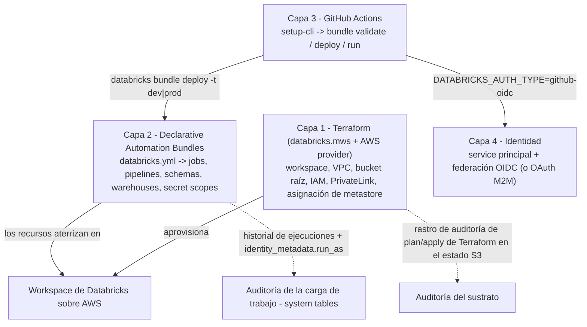
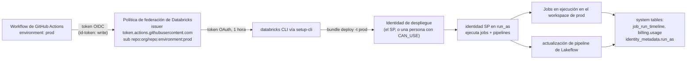
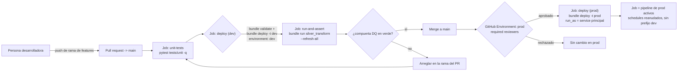
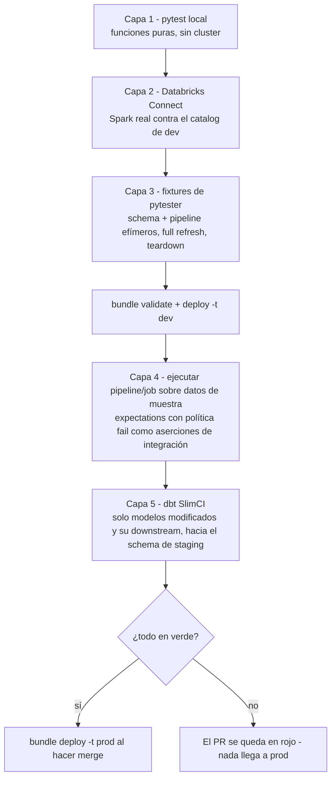
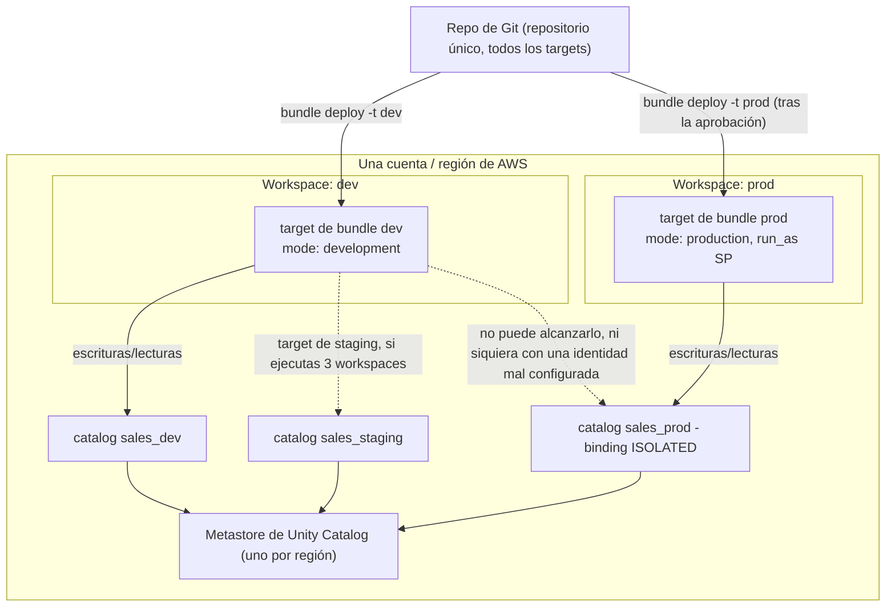
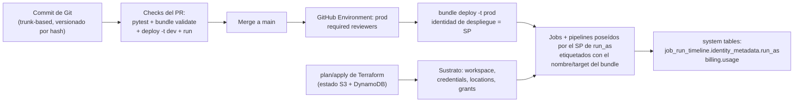

# CI/CD para el lakehouse de Databricks en AWS: Declarative Automation Bundles, Terraform y GitHub Actions

Todo lakehouse de este curso acaba chocando contra el mismo precipicio: los notebooks funcionan, las pipelines están en verde, y entonces alguien crea un job a mano en el workspace de producción una tarde de viernes, o peor, la salida de alguien de la empresa se lleva consigo el schedule de las 3 de la mañana. El precipicio es la **costura de despliegue**, y la solución es aburrida a propósito: todo lo que vive en el workspace se declara en Git, se revisa en un pull request, se valida en CI y se despliega con un service principal que no es ningún ser humano.

Esa es hoy la posición documentada, no folclore. «Declarative Automation Bundles son el **enfoque recomendado de CI/CD en Databricks**» (docs.databricks.com/aws/en/dev-tools/ci-cd, **2026-07-10**), y el flujo específico de **AWS** de esa misma página dice «**GitHub Actions y Declarative Automation Bundles o Terraform**». Observa el nombre que debes aprender: el producto antes llamado **Databricks Asset Bundles** se documenta desde 2026 como **Declarative Automation Bundles** (página general de bundles, última actualización **2026-09-11**): mismos verbos de CLI, mismo `databricks.yml`, nombre nuevo. Y el nombre del archivo importa más de lo que crees: «Un bundle debe contener **uno (y solo uno)** archivo de configuración llamado **`databricks.yml`** en la raíz de la carpeta del proyecto del bundle» (bundles settings, **2026-03-16**). No existe `bundle.yaml`. Nunca.

Cada dato de esta lección lleva su fuente de Databricks o de AWS fechada en **octubre de 2026**; lo que las docs no dicen se deja fuera en lugar de adivinarse.

```text
 =============================================================
  MAPA DE LA LECCIÓN 16 - CI/CD + IaC para Databricks en AWS, oct 2026
 ------------------------------------------------------------
  Capa 1  IaC del sustrato - Terraform, alias de provider databricks.mws
           databricks_mws_credentials | _networks |
           _storage_configurations | _vpc_endpoint |
           _private_access_settings | _workspaces
           + AWS provider: VPC, endpoints, bucket raíz S3, IAM
  Capa 2  carga de trabajo como código - Declarative Automation Bundles
           (antes Databricks Asset Bundles)
           exactamente UN databricks.yml + include globs ->
           jobs, pipelines, schemas, sql_warehouses, dashboards,
           secret_scopes, catalogs ... targets dev / staging / prod
  Capa 3  orquestación CI - GitHub Actions
           databricks/setup-cli -> bundle validate|deploy|run
           pull_request -> target dev ; push a main -> prod
           (+ GitHub Environment con required reviewers como compuerta)
  Capa 4  identidad - service principals, nunca un PAT humano
           federación de identidad de carga de trabajo (OIDC) preferida
           OAuth M2M (tokens de 1 hora) en segundo lugar ; token de SP al final
           SP en run_as desacopla la identidad de despliegue de la de ejecución
  Números  token de acceso OAuth 1 h | <= 5 secretos por SP
           validez del secreto <= 730 días | CLI 0.218.0 = DAB GA
           clave engine CLI 0.295.0, por defecto direct
           provider v1.137.0 (2026-10-06), ~ varios releases/mes
           jobs classic desde $0.15/DBU (página de precios, 2026-10)
 =============================================================
```

En esta lección vas a:

- separar las **cuatro capas** de la pila de entrega de Databricks sobre AWS y asignar exactamente un dueño a cada clase de recurso (ningún job definido dos veces);
- leer un **`databricks.yml`** completo, nombre del bundle, `include`, `artifacts`, `variables`, `workspace`, `run_as`, `permissions`, `resources`, `targets`, y desplegarlo a través del bucle **validate → deploy → run**;
- aplicar la semántica de **modo development** frente a **modo production**, los **presets** que la anulan, el vocabulario de sustituciones y la **precedencia de resolución de variables en cinco pasos** exacta;
- separar la **identidad de despliegue** de la **identidad de ejecución** con service principals en `run_as`, incluida la regla de «solo se admiten jobs y pipelines» cuando las dos identidades difieren;
- aprovisionar el sustrato de AWS con **Terraform**: el módulo con el alias `databricks.mws` (credentials, networks, storage configuration, objetos PrivateLink, workspace) mantenido en un **módulo separado** de los recursos a nivel de workspace (storage credentials, external locations, grants), con estado remoto en S3 + DynamoDB;
- construir el **pipeline de PR en GitHub Actions** con `databricks/setup-cli`, `bundle validate` (la validación se ejecuta como parte de cada deploy) y **federación de identidad de carga de trabajo (OIDC)** para que ningún personal access token entre jamás en CI;
- probar en cinco capas: pytest local, Databricks Connect, fixtures de `databricks-labs-pytester`, el **framework de pruebas en pipeline de DBR 18.1+** y **dbt SlimCI**;
- diseñar la topología de entornos, **un metastore por región, 3 to 10 catalogs, binding `ISOLATED` de producción, 2 to 3 workspaces**, y calcular a mano un boceto mensual de DBU de CI a los suelos publicados de oct 2026;
- estudiar **tres casos nombrados de AWS** (NAB, Addepar, Mastercard), leer el **recuadro de actualizaciones de 2026** y responder **doce preguntas de estilo examen** más cuatro comprobaciones interactivas.

---

## 1. La pila de cuatro capas: un dueño por clase de recurso

El error de CI/CD más caro sobre Databricks no es una prueba que falta: es definir el mismo job en dos sistemas y dejar que se peleen. Antes de cualquier YAML, arregla el modelo de propiedad. La pila documentada de Databricks tiene cuatro capas que deben permanecer distintas:

| Capa | Herramienta | Propiedad | Cadencia |
|---|---|---|---|
| **1. Sustrato de la nube** | Terraform (alias `databricks.mws` + AWS provider) | Workspace, VPC, subnets, security groups, endpoints de VPC, bucket raíz de S3, rol IAM de cuenta cruzada, objetos PrivateLink, asignación de metastore | Cambios semanales/mensuales; se revisan como plan/apply |
| **2. Config. del workspace y cargas de trabajo** | **Declarative Automation Bundles** (`databricks.yml`) | Jobs, pipelines de Lakeflow, schemas, catalogs, SQL warehouses, dashboards, secret scopes, alertas, endpoints de model serving, permisos, `run_as` | Cambios diarios; se revisan como PR sobre YAML |
| **3. Orquestación de CI** | GitHub Actions (y la action oficial `databricks/setup-cli`) | El pipeline: tests unitarios, `bundle validate`, `bundle deploy`, `bundle run`, aprobaciones | Cada PR y cada merge |
| **4. Identidad y secretos** | Consola de cuenta + GitHub Environments | Service principals, políticas de federación, secretos OAuth M2M, secretos cifrados de GitHub, secret scopes de Databricks | Rotados por política, nunca a mano en YAML |



Dos reglas sostienen el diagrama. Primero, **un dueño por clase de recurso**: los jobs, pipelines y dashboards pertenecen a los bundles; el workspace, las storage credentials, las external locations y los grants de metastore pertenecen a Terraform. Definir un `databricks_job` en Terraform *y* el mismo job en un bundle crea peleas de importación/propiedad que aparecen como diffs misteriosos, no como errores limpios. Segundo, **los bundles son la recomendación para todo lo que vive dentro del workspace**, mientras Terraform es el instrumento documentado para aprovisionar: «You use the Databricks Terraform provider to provision Databricks workspaces as well as the AWS Provider to provision required AWS resources for these workspaces» (docs del proveedor de Terraform, **2026-09-11**).

> **📚 ¿Sabías que…?** La propia configuración del bundle puede declarar `bundle.engine: terraform | direct`, y «**The default value is `direct`**» (referencia de configuración, **2026-08-18**, añadido en la CLI **0.295.0**), con las notas de la versión confirmando «**Direct deployment engine is GA**» y «**Deploy without Terraform**». Ese motor interno es tubería *solo para deploys de bundle*: enfáticamente no es el estado de Terraform de tu infraestructura, y confundir los dos es un antipatrón de equipo documentado (trampa 5 del digest de CI/CD). Las CLIs antiguas usaban el motor de Terraform por defecto; las CLIs actuales no.

---

## 2. Anatomía del bundle: el único archivo, sus claves y el mapa de resources

### 2.1 El nombre del archivo es una compuerta de validación

Copia esta frase en la wiki de tu equipo: **la raíz de un bundle contiene exactamente un `databricks.yml`** (bundles settings, **2026-03-16**). La configuración adicional se incorpora mediante el array `include` de globs, y «los globs de `include` son relativos al `databricks.yml` que los declara». `bundle validate` falla al instante con el clásico copy-paste de otras herramientas que asume `bundle.yaml`: no hay ningún alias documentado, ni ahora ni históricamente.

### 2.2 Claves de nivel superior (toda la superficie, a oct 2026)

| Clave | Función |
|---|---|
| `bundle` | Obligatoria; porta `bundle.name`, el nombre lógico usado en rutas y sustituciones |
| `include` | Lista de globs de archivos YAML extra (p. ej. `resources/*.yml`): la única forma de repartir la configuración entre archivos |
| `sync` | `include`/`exclude`/`paths`: archivos extra sincronizados al workspace; «especially useful when you have a single repository that hosts multiple bundles» |
| `artifacts` | Binarios construidos: `type: whl|jar|maven|...`, comando `build` (p. ej. `poetry build`), `path`, `files[].source`, `dynamic_version` |
| `variables` | Variables personalizadas con `description`, `default`, `lookup`, `type: complex` |
| `workspace` | `host`, `root_path`, `state_path`, `artifact_path`, `resource_path`, `profile`: «Databricks recommends that you use the `host` mapping instead of the `default` mapping wherever possible, as this makes your bundle configuration files more portable» |
| `permissions` | Entradas de ACL por recurso o a nivel de bundle (nivel + user/group/SP) |
| `run_as` | Identidad de ejecución a nivel de bundle/target: `user_name` **o** `service_principal_name` |
| `resources` | Mapa tipado de todo lo que el bundle posee: **jobs, pipelines, dashboards, sql_warehouses, catalogs, schemas, secret_scopes, model_serving_endpoints, apps, alerts, quality_monitors, registered_models, volumes, clusters** y más |
| `targets` | Una colección por entorno (`dev`, `staging`, `prod`), exactamente una con `default: true`; cada target puede anular `artifacts`, `bundle`, `git`, `mode`, `permissions`, `presets`, `resources`, `sync`, `variables`, `workspace`, `run_as` |
| `scripts` | Hooks del ciclo de vida que la CLI ejecuta alrededor de las operaciones |

Los tipos de objetos con `lookup` admitidos (obtener por nombre un objeto existente del workspace en lugar de declararlo) son: alert, cluster_policy, cluster, dashboard, instance_pool, job, metastore, notification_destination, pipeline, query, service_principal, warehouse (docs de variables, **2026-03-16**).

Un diseño sano de proyecto para un repositorio que aloja un proyecto (mejores prácticas de desarrollo de Databricks, **2026-06-11**: «usa un **único repositorio para todo tu código**… Si tienes varios bundles para ciclos de despliegue separados, mantenlos en un solo repositorio»):

```text
sales-lakehouse/                      # un repo de Git
├── databricks.yml                    # el ÚNICO archivo raíz del bundle
├── resources/
│   ├── silver_transform.job.yml      # los jobs viven aquí
│   ├── medallion_pipeline.pipeline.yml
│   └── schemas.yml
├── src/
│   ├── build_silver.py               # se sincroniza al workspace
│   └── my_lib/                       # fuente del wheel, construida por artifacts
├── tests/
│   ├── unit/                         # pytest local, sin necesidad de Databricks
│   └── integration/                  # pytester + Databricks Connect
└── .github/workflows/
    └── lakehouse-cicd.yml            # Capa 3
```

### 2.3 Ejemplo resuelto E1: el bundle mínimo con forma de producción

Este es el esqueleto del patrón de las docs de bundles de Databricks (páginas de settings + deployment-modes + run-as, todas consultadas en oct 2026): un job, un schema, dos targets y una identidad de ejecución SP en prod.

```yaml
# databricks.yml - the ONLY valid bundle root filename
bundle:
  name: sales_lakehouse

include:
  - resources/*.yml

variables:
  catalog:
    description: Target catalog for this environment
  schema:
    description: Schema (database) name
    default: silver

workspace:
  root_path: /Workspace/Users/${workspace.current_user.userName}/.bundle/${bundle.name}/${bundle.target}

resources:
  jobs:
    silver_transform:
      name: "Silver transform (${bundle.target})"
      schedule:
        quartz_cron_expression: "0 0 3 * * ?"
        timezone_id: UTC
        pause_status: PAUSED          # dev mode pauses anyway; explicit is safer
      email_notifications:
        on_failure: ["data-eng@example.com"]
      tasks:
        - task_key: build_silver
          job_cluster_key: default
          notebook_task:
            notebook_path: ./src/build_silver.py
          libraries:
            - whl: ./dist/my_lib-*.whl
      job_clusters:
        - job_cluster_key: default
          new_cluster:
            spark_version: 15.4.x-scala2.12
            node_type_id: m5.xlarge
            num_workers: 2
  schemas:
    silver_schema:
      name: ${var.schema}
      catalog_name: ${var.catalog}
      comment: "Silver tables (managed by bundle ${bundle.name})"

targets:
  dev:
    default: true
    mode: development
    variables:
      catalog: sales_dev
      schema: ${workspace.current_user.short_name}
  prod:
    mode: production
    git:
      branch: main
    workspace:
      host: https://dbc-a1b2345c-d6e7.cloud.databricks.com   # prod workspace
      root_path: /Workspace/Users/ci-deployer/.bundle/${bundle.name}/${bundle.target}
    run_as:
      service_principal_name: 68ed9cd5-8923-4851-a0c1-c7536c67ff99
    permissions:
      - level: CAN_MANAGE
        service_principal_name: 68ed9cd5-8923-4851-a0c1-c7536c67ff99
    variables:
      catalog: sales_prod
```

El bucle local son tres comandos, y es el mismo bucle que ejecuta CI:

```bash
databricks bundle validate -t dev          # schema/syntax gate (also runs inside deploy)
databricks bundle deploy  -t dev           # sync files + create/update resources
databricks bundle run silver_transform -t dev --refresh-all
```

Tres detalles de E1 que encantan a las preguntas de examen: `notebook_path` es **relativo al bundle** (nunca hard-codees rutas `/Workspace/Users/...` desde tu laptop, se rompen bajo un `root_path` distinto); el wheel se declara donde el job lo consume (`libraries: - whl:`), mientras el comando `build` vive bajo `artifacts:`; y la variable `schema` de prod deliberadamente *no* se fija por usuario, los schemas de prod vienen de las `variables` del target, no de quien desplegó.

> **📚 ¿Sabías que…?** `databricks bundle init` crea el andamiaje de un proyecto a partir de una plantilla, y las notas de la versión registran que «la plantilla default-python ahora usa **uv**» y «The default-python template defaults to use **serverless**» (notas de la versión de bundles, **2026-04-29**). Dos verbos compañeros ahorran días de migración: `bundle generate` genera el YAML a la inversa a partir de recursos que ya existen en la UI («bundle generate job --as-code» contra un job construido a base de clics), y `bundle deployment bind` enlaza tu configuración con un objeto del workspace preexistente cuando los nombres colisionan. `bundle schema` (CLI ≥ **0.218.0**) emite el JSON schema que tu IDE usa para autocompletado y validación en línea.

---

## 3. Targets, modes, presets, variables: los guardarraíles

### 3.1 Modo development frente a modo production

Todo bundle práctico declara `targets.dev` y `targets.prod` (opcionalmente `staging`), con exactamente uno marcado `default: true`. El `mode:` de cada target no es decoración: los dos modos tienen semánticas de seguridad opuestas (docs de deployment-modes, última actualización **2026-09-11**):

| Comportamiento | `mode: development` | `mode: production` |
|---|---|---|
| Nombres de recursos | Prefijados `[dev ${workspace.current_user.short_name}]` | Sin prefijo: los nombres declarados |
| Etiquetas de job/pipeline | Se añade la etiqueta dev de Databricks | Sin etiqueta dev |
| Pipelines de Lakeflow | Marcadas `development: true` | Validadas para ser `development: false` |
| Schedules y triggers | «**Pauses all schedules and triggers** on deployed resources» | Activos según lo declarado |
| Ejecuciones concurrentes | «**Enables concurrent runs on all deployed jobs**» | Por defecto (`max_concurrent_runs` según esté fijado) |
| Overrides de cluster | Permitidos al estilo `--cluster-id` | **No permitidos**; sin anular definiciones de cluster existentes |
| Deployment lock | «**Disables the deployment lock** for faster iteration» | Lock impuesto |
| Comprobación de rama Git | ninguna | Si el target fija `git.branch`, la rama actual debe coincidir (override: `--force`, que es en sí mismo una bandera roja de auditoría) |
| Rutas e identidad | Rutas con alcance de usuario válidas | Valida que `artifact_path`/`file_path`/`root_path`/`state_path` **no** se anulen a un usuario concreto; `run_as` y `permissions` deben especificarse salvo que se despliegue como SP |

El modo production también «recomienda desplegar tu bundle en una **carpeta inmutable, de solo lectura**» (la configuración `immutable_folder`). La promoción, en una frase: **el mismo commit inmutable de Git se redespliega al siguiente target**: no se reconstruye nada, y la promoción de datos ocurre ejecutando el job contra el catalog de ese target.

### 3.2 Los presets ajustan el modo; los resources anulan los presets

Los presets personalizan los valores por defecto del modo: `name_prefix`, `pipelines_development`, `trigger_pause_status`, `jobs_max_concurrent_runs`, `tags` y (notas de la versión, **2026-04-29**) `artifacts_dynamic_version`. La precedencia dentro de la plataforma cabe en una frase: «**si se definen `mode` y `presets`, los presets anulan el comportamiento por defecto del modo, y la configuración de recursos individuales anula los presets**» (deployment-modes, **2026-09-11**).

### 3.3 Sustituciones, variables y el orden de resolución

Las sustituciones integradas se resuelven en el momento del deploy: `${bundle.name}`, `${bundle.target}` (usa esta, no la más antigua `${bundle.environment}`), `${workspace.host}`, `${workspace.current_user.userName}`, `${workspace.current_user.short_name}`, `${workspace.file_path}`, `${workspace.root_path}`, e incluso `${resources.jobs.<key>.id}` para referencias cruzadas. Las variables personalizadas son `${var.<name>}` y se resuelven recorriendo esta lista, **deteniéndose en la primera coincidencia** (docs de variables, **2026-03-16**):

1. `--var="name=value"` en la CLI
2. Variables de entorno que empiecen por **`BUNDLE_VAR_`** (p. ej. `BUNDLE_VAR_catalog=sales_prod`)
3. `variable-overrides.json` bajo `.databricks/bundle/<target>/`
4. `targets.<name>.variables`
5. `variables.<name>.default` de nivel superior

```fillblank
{
  "question": "La resolución de variables de un bundle recorre cinco fuentes y se detiene en la primera coincidencia. Completa los dos pasos que faltan: las opciones --var de la CLI, luego {{1}}, luego variable-overrides.json bajo .databricks/bundle/<target>/, luego las variables del target y, por último, el {{2}} de nivel superior.",
  "template": "La resolución de variables de un bundle recorre cinco fuentes y se detiene en la primera coincidencia. Completa los dos pasos que faltan: las opciones --var de la CLI, luego {{1}}, luego variable-overrides.json bajo .databricks/bundle/<target>/, luego las variables del target y, por último, el {{2}} de nivel superior.",
  "answers": {
    "1": "variables de entorno BUNDLE_VAR_*",
    "2": "default"
  },
  "distractors": [
    "variables de entorno TF_VAR_*",
    "el perfil de workspace en .databrickscfg",
    "solo targets.prod.variables",
    "el mensaje del commit de Git"
  ],
  "explanation": "El orden documentado (página de variables, 2026-03-16) es --var > variables de entorno BUNDLE_VAR_* > variable-overrides.json > targets.*.variables > default de nivel superior: se detiene en la primera coincidencia, de modo que aquí gana --var='catalog=sales_ci'. TF_VAR_* es el mecanismo de Terraform y pertenece a una capa completamente distinta; los perfiles de.databrickscfg proveen auth/host, no valores de variables; las variables del target son el paso 4 de 5, no un caso especial; y los metadatos de Git nunca entran en la resolución de un bundle."
}
```

### 3.4 Ejemplo resuelto E2: overrides en la práctica

El mismo bundle que E1, en tres momentos de promoción distintos:

```bash
# Laptop: Alice iterates on her own schema, no schedule, no prod risk
databricks bundle deploy -t dev
databricks bundle run silver_transform -t dev --refresh-all

# CI: a one-off override without editing YAML (highest-precedence source)
BUNDLE_VAR_catalog=sales_staging databricks bundle deploy -t staging

# Prod pipeline: the target's own variables + run_as SP do the work
databricks bundle deploy -t prod
# equivalent one-shot: databricks bundle deploy -t prod --var="catalog=sales_prod"
```

> ⚠️ **ADVERTENCIA: los efectos secundarios del modo dev cortan en ambos sentidos.** Olvidar `mode: development` en el target dev significa que un deploy disparado por un PR puede reanudar schedules reales contra recursos compartidos; esperar que el nombre *exacto* de un job desplegado en dev siga existiendo en prod falla, porque dev renombró todo a `[dev <usuario>]`. Y recuerda qué te compra el modo dev: schedules pausados, pipelines con `development: true` y ejecuciones concurrentes existen para que veinte pull requests puedan desplegarse a un único workspace de dev compartido sin disparar los calendarios de los demás (deployment-modes, **2026-09-11**). Si los PR en paralelo colisionan en las mismas claves de recursos, da a cada PR su propio `root_path`/variables o serializa con un grupo `concurrency:` de GitHub.

---

## 4. Identidad: desplegar como una cosa, ejecutar como otra

### 4.1 Las reglas de `run_as` que deciden lo que tu pipeline puede hacer

`run_as` puede fijarse a un `user_name` o a un `service_principal_name`, y «Los no administradores solo pueden fijar este campo a su propio correo» (docs de run-as, última actualización **2026-10-07**). Cuatro reglas importan en producción:

1. «**Setting a `run_as` identity to a service principal for production targets is the most secure way of running a production workflow**»: «separa el permiso de ejecutar el workflow de producción de la identidad que creó o desplegó el bundle».
2. Si la identidad de despliegue difiere de `run_as`, «**solo se admiten jobs y pipelines**»: cualquier otro tipo de recurso del bundle entonces falla al desplegarse limpiamente.
3. El `run_as` a nivel de job puede aceptar un `group_name`; el `run_as` a nivel de bundle/target **no** puede.
4. Los endpoints de model serving no admiten `run_as` en absoluto.

### 4.2 Ejemplo resuelto E3: la separación de identidades

```yaml
# Top-level default for everyone on the team (dev loop)
run_as:
  user_name: ${workspace.current_user.userName}

targets:
  prod:
    mode: production
    run_as:
      service_principal_name: 68ed9cd5-8923-4851-a0c1-c7536c67ff99   # SP application ID
    permissions:
      - level: CAN_MANAGE
        service_principal_name: 68ed9cd5-8923-4851-a0c1-c7536c67ff99
      - level: CAN_VIEW
        group: data-analysts
```

Qué pasa a las 3 de la mañana cuando el ingeniero de guardia está dormido: el job de prod se ejecuta igual, porque su identidad es el service principal, y la ejecución es auditable como ese SP en `system.lakeflow.job_run_timeline` (sección de linaje del digest de CI/CD; referencia cruzada con la lección 09). Qué pasa cuando Alice deja la empresa: no se rompe nada en prod, porque Alice nunca fue la identidad de prod, solo la de dev.



> **📚 ¿Sabías que…?** Los tokens OAuth machine-to-machine son cortos por diseño: «Cada access token es válido por **una hora**, tras lo cual se solicita automáticamente un token nuevo», un service principal puede mantener **hasta cinco secretos OAuth**, y cada secreto es válido «up to two years (maximum **730 days**)», y los secretos pueden **limitarse** a APIs como `sql` o `jobs` en lugar de `all-apis` (docs de OAuth M2M, consultadas en oct 2026). Limita el secreto de tu CI a las APIs que toca el pipeline; un secreto limitado que se filtra es un incidente menor que uno de `all-apis`.

---

## 5. Terraform para el sustrato: dos providers, dos módulos, estado separado

### 5.1 Ejemplo resuelto E4: el módulo de aprovisionamiento del workspace (`provider = databricks.mws`)

La creación de workspaces en AWS usa recursos a nivel de **cuenta** bajo un alias de provider dedicado. La guía oficial no deja dudas sobre la forma: «Inicializa el provider con `alias = \"mws\"` y usa `provider = databricks.mws` para todos los recursos `databricks_mws_*`. Exigimos que todos los recursos `databricks_mws_*` se creen dentro de un módulo de Terraform dedicado de tu entorno. Normalmente, este módulo también crea el VPC y los roles de IAM» (guía de workspaces en AWS, consultada en oct 2026).

```hcl
# modules/account/main.tf  - creates the workspace (Layer 1, phase A)
terraform {
  required_providers {
    databricks = { source = "databricks/databricks", version = "~> 1.137" }
    aws        = { source = "hashicorp/aws",         version = "~> 5.0" }
  }
  backend "s3" {
    bucket         = "acme-tfstate-prod"
    key            = "databricks/account/terraform.tfstate"
    region         = "us-east-1"
    dynamodb_table = "terraform-locks"
    encrypt        = true
  }
}

provider "databricks" {
  alias      = "mws"
  host       = "https://accounts.cloud.databricks.com"
  account_id = var.databricks_account_id
  # auth via OAuth M2M env vars in CI; username/password acceptable for bootstrap
}

resource "databricks_mws_credentials" "this" {
  provider         = databricks.mws
  account_id       = var.databricks_account_id
  credentials_name = "acme-crossaccount"
  role_arn         = aws_iam_role.crossaccount.arn      # AWS provider creates the role
}

resource "databricks_mws_networks" "this" {
  provider            = databricks.mws
  account_id          = var.databricks_account_id
  network_name        = "acme-vpc"
  vpc_id              = module.vpc.vpc_id                # terraform-aws-modules/vpc/aws
  subnet_ids          = module.vpc.private_subnets
  security_group_ids  = [aws_security_group.databricks.id]
}

resource "databricks_mws_storage_configurations" "this" {
  provider              = databricks.mws
  account_id            = var.databricks_account_id
  storage_configuration_name = "acme-root"
  storage_root_url     = "s3://${aws_s3_bucket.root.id}"  # the workspace root bucket
}

resource "databricks_mws_workspaces" "this" {
  provider           = databricks.mws
  account_id         = var.databricks_account_id
  workspace_name     = "acme-prod"
  credentials_id     = databricks_mws_credentials.this.credentials_id
  network_id         = databricks_mws_networks.this.network_id
  storage_configuration_id = databricks_mws_storage_configurations.this.storage_configuration_id
  # PrivateLink variant adds: private_access_settings_id + pricing_tier = "ENTERPRISE"
}
```

La VPC en sí, subnets privadas/públicas, NAT, el **gateway endpoint de S3** y los **interface endpoints de STS/Kinesis**, viene del **AWS provider** (la guía usa `terraform-aws-modules/vpc/aws` más su módulo de endpoints). Para PrivateLink, el conjunto de ejemplos verificado (`aws-databricks-modular-privatelink` en `databricks/terraform-databricks-examples`, consultado en oct 2026) añade `aws_vpc_endpoint` para el backend REST y el relay, luego `databricks_mws_vpc_endpoint`, `databricks_mws_private_access_settings` (con `public_access_enabled`), y conecta `private_access_settings_id` en `databricks_mws_workspaces` con `pricing_tier = "ENTERPRISE"`.

### 5.2 Ejemplo resuelto E5: el módulo de gestión del workspace (provider a nivel de workspace)

La regla dura de la misma guía: «**Code that creates workspaces and code that manages workspaces must be in separate terraform modules**»: estado separado, aliases de provider separados (`databricks.mws` frente a un provider a nivel de workspace que, en CI, se autentica con las variables de entorno de OAuth M2M `DATABRICKS_HOST` + `DATABRICKS_CLIENT_ID` + `DATABRICKS_CLIENT_SECRET`). Mezclarlos significa que un apply puede autenticarse contra el endpoint equivocado.

```hcl
# modules/workspace/main.tf  - manages resources INSIDE an existing workspace
resource "databricks_storage_credential" "ext" {
  name    = aws_iam_role.external_data_access.name
  aws_iam_role {
    role_arn = aws_iam_role.external_data_access.arn
  }
  comment = "Managed by TF"
}

resource "databricks_external_location" "silver" {
  name            = "silver-external"
  url             = "s3://${aws_s3_bucket.silver.id}/silver"   # s3://[bucket]/[dir] on AWS
  credential_name = databricks_storage_credential.ext.id
  # workspace-level only! also: skip_validation, fallback, read_only,
  # access_point (S3 access point ARN), isolation_mode
}

resource "databricks_grants" "silver_eng" {
  external_location = databricks_external_location.silver.id
  grant {
    principal  = "data-engineers"
    privileges = ["CREATE_EXTERNAL_TABLE", "READ_FILES", "WRITE_FILES"]
  }
}
```

Datos que debes sacar de ese bloque: `databricks_external_location` «solo puede usarse con un provider a nivel de workspace» y «requires databricks_storage_credential»; `databricks_storage_credential` en AWS es la forma `aws_iam_role { role_arn = ... }`, importable por nombre a nivel de workspace o `<metastore_id>|<name>` a nivel de cuenta; y las credentials/locations llevan un `isolation_mode` (`ISOLATION_MODE_ISOLATED` / `OPEN`) que interactúa con el binding del workspace (lecciones 02 y 03).

> ⚠️ **ADVERTENCIA, `databricks_grants` es autoritativo y borrará en silencio los grants de otras personas.** «Este recurso es **autoritativo** para los grants sobre securables. Configurar este recurso para un securable **SOBRESCRIBIRÁ cualquier grant existente**, y los cambios hechos fuera de Terraform se reiniciarán» (Registry de Terraform, resources/grants, publicado **2026-10-06**). Si alguien concedió accesos desde la UI o desde Unity Catalog SQL después del último apply, el siguiente apply los elimina. Usa el singular `databricks_grant` para la gestión incremental cuando otros actores comparten la propiedad, y recuerda que los recursos compañeros a nivel de cuenta `databricks_metastore` + `databricks_metastore_assignment` (un metastore por región) pertenecen al módulo de cuenta, no al módulo de workspace.

### 5.3 Versiones y estado: dos reglas de higiene con evidencias

El provider avanza rápido: «several releases per month» (página de releases del Registry, consultada en oct 2026): **v1.137.0 (2026-10-06)**, v1.136.0 (2026-10-05), v1.135.0 (2026-09-28), v1.134.0 (2026-09-23), v1.128.0 (2026-08-19), con v1.65.0 (2025-02-04) como regla útil de hasta dónde se ha movido la superficie en 20 meses. Fija con una restricción pesimista (`version = "~> 1.137"`); nunca flotes a `latest`. Higiene del estado, del propio repositorio de ejemplos de Databricks: «**We recommend using remote storage, like S3, for state storage, instead of using default local backend**» con `backend "s3"` { bucket, key, region, `dynamodb_table` para los locks, `encrypt = true` }, y «Debes crear la infraestructura del backend remoto en **otro proyecto de Terraform**» (`aws-remote-backend-infra`). Un `terraform.tfstate` local en una laptop es deriva irrecoverable *y* una fuga de secretos, porque el estado almacena atributos de los recursos.

---

## 6. GitHub Actions: el pipeline de PR y la federación que lo protege

### 6.1 El patrón documentado

La página oficial de GitHub Actions (fechada **2026-03-16**) lista exactamente una action oficial: **`databricks/setup-cli`**, «A composite action that sets up the Databricks CLI in a GitHub Actions workflow», seguida de verbos crudos de la CLI. El flujo que documenta: PR contra main → el job «Deploy bundle» ejecuta `databricks bundle deploy` con `DATABRICKS_BUNDLE_TARGET: dev` → el job «Run pipeline update» ejecuta el job/pipeline. «**Bundle validation is automatically performed as part of this deployment. If validation fails, this workflow fails.**» Producción tiene la misma forma sobre `push` a main con target `prod`, serializado con `concurrency: 1`. El trunk-based branching con versionado por hash de commit es la postura de Git recomendada (página de flujos de CI/CD, **2026-07-10**).



### 6.2 Ejemplo resuelto E6: el workflow completo de PR + prod con OIDC

```yaml
# .github/workflows/lakehouse-cicd.yml
name: lakehouse-cicd
concurrency: ${{ github.ref }}
on:
  pull_request: { branches: [main] }
  push: { branches: [main] }
permissions:
  id-token: write        # REQUIRED for workload identity federation
  contents: read
jobs:
  unit-tests:
    runs-on: ubuntu-latest
    steps:
      - uses: actions/checkout@v4
      - uses: actions/setup-python@v5
        with: { python-version: "3.11" }
      - run: pip install pytest "pyspark>=4.0.0,<5.0.0" && pytest tests/unit -q
  deploy:
    needs: unit-tests
    runs-on: ubuntu-latest
    environment: ${{ github.event_name == 'push' && 'prod' || 'dev' }}
    env:
      DATABRICKS_AUTH_TYPE: github-oidc
      DATABRICKS_HOST: ${{ vars.DATABRICKS_HOST }}
      DATABRICKS_CLIENT_ID: ${{ vars.DATABRICKS_CLIENT_ID }}
      DATABRICKS_BUNDLE_TARGET: ${{ github.event_name == 'push' && 'prod' || 'dev' }}
    steps:
      - uses: actions/checkout@v4
      - uses: databricks/setup-cli@main       # pin to a tag in regulated environments
      - run: databricks bundle validate        # explicit gate (deploy also validates)
      - run: databricks bundle deploy
  run-and-assert:
    needs: deploy
    runs-on: ubuntu-latest
    environment: ${{ github.event_name == 'push' && 'prod' || 'dev' }}
    env:
      DATABRICKS_AUTH_TYPE: github-oidc
      DATABRICKS_HOST: ${{ vars.DATABRICKS_HOST }}
      DATABRICKS_CLIENT_ID: ${{ vars.DATABRICKS_CLIENT_ID }}
      DATABRICKS_BUNDLE_TARGET: ${{ github.event_name == 'push' && 'prod' || 'dev' }}
    steps:
      - uses: actions/checkout@v4
      - uses: databricks/setup-cli@main
      - run: databricks bundle run silver_transform --refresh-all
      # CLI non-zero exit fails the job; add a DQ gate notebook or dbt test step after
```

Los entornos Java/Scala sustituyen un paso por la subida de un artefacto versionado a un **Unity Catalog Volume** antes del deploy: la forma documentada: `mvn clean verify` → `databricks fs cp target/my-app-1.0.jar dbfs:/Volumes/artifacts/my-app-${{ github.sha }}.jar --overwrite` → `bundle validate` → `bundle deploy --target prod`, con el deploy compuerteado por `if: github.event_name == 'push' && github.ref == 'refs/heads/main'` (docs de GitHub Actions, **2026-03-16**). Los Volumes, no los montajes heredados `dbfs:/mnt`, son el almacén de artefactos gobernado (lección 12).

### 6.3 Federación de identidad de carga de trabajo: ningún secreto en la bóveda

«Databricks OAuth token federation, also known as OpenID Connect (OIDC), allows your automated workloads running outside of Databricks to securely access Databricks **without Databricks secrets**» (docs de provider-github, **2026-10-02**), y «Databricks strongly recommends using workload identity federation to authenticate to Databricks from automated workloads whenever possible» (oauth-federation-provider, **2026-06-16**). IdP admitidos más allá de GitHub Actions: Azure DevOps, GitLab CI/CD, CircleCI, **AWS IAM workloads**, Jenkins, Terraform Cloud, Bitbucket Pipelines.

La conexión verificada: una **política de federación** de un SP con issuer `https://token.actions.githubusercontent.com` y un subject para el que Databricks «recommends using **Environment**», p. ej. `repo:my-github-org-or-user/my-repo:environment:Prod` (los workflows reutilizables usan `subject_claim: job_workflow_ref`); el workflow necesita entonces solo tres variables de entorno: `DATABRICKS_AUTH_TYPE: github-oidc`, `DATABRICKS_HOST`, `DATABRICKS_CLIENT_ID` (el application ID del SP): más `permissions: id-token: write`. Y las docs señalan la trampa explícitamente: «Define `permissions: id-token: write` en el workflow **que llama**, no en el workflow reutilizable.» Los SDK y la CLI intercambian el token OIDC por un token OAuth de Databricks automáticamente: nada que rotar, nada en el almacén de secretos del repo, y un subject de federación que debe coincidir *exactamente* con el claim `sub` del token (una política escrita para `environment:Prod` rechaza tokens de workflows sin `environment: Prod`).

> ⚠️ **ADVERTENCIA: nunca pongas un personal access token en CI, y nunca pegues ningún token en el YAML de un workflow.** Un PAT acopla los deploys de producción al ciclo de vida de la cuenta de un empleado y sobreprivilegia el pipeline; cuando esa persona se va, el pipeline muere con su cuenta, y el rastro de auditoría apunta a una persona en lugar de a un servicio. La propia guía de Databricks: «As a security best practice, Databricks recommends that you do not enter a Databricks access token directly into the body of a GitHub Actions file. You should register the Databricks access token with GitHub Actions by using **GitHub encrypted secrets**» (docs de service-principals, **2026-01-24**), y ese es el *suelo* de la escalera (token de SP como `DATABRICKS_TOKEN`), no el techo. Prefiere la federación OIDC; cae a OAuth M2M (`DATABRICKS_CLIENT_ID`/`DATABRICKS_CLIENT_SECRET` en secretos cifrados de GitHub); trata el token de acceso de un SP como último recurso. Y depura los fallos de autenticación antes de reescribir el YAML: «No conflicting variables set such as `DATABRICKS_TOKEN`, `DATABRICKS_USERNAME`. Run `env | grep DATABRICKS` and unset conflicts» (docs de OAuth M2M): una variable de entorno de token obsoleta en un runner autoalojado eclipsa a OIDC/M2M cada vez.

La variante heredada documentada de E6 sustituye el bloque de federación `env:` por `DATABRICKS_TOKEN: ${{ secrets.SP_TOKEN }}` (un token de acceso generado por un SP en un secreto cifrado de GitHub): todavía en las docs, todavía un secreto de larga duración, y el valor por defecto equivocado para una revisión de diseño de 2026. Para la compuerta de aprobación humana, los **Environments** de GitHub portan los vars y «lets you **require manual approval before deployments run**»: configura el environment `prod` con required reviewers (Deployment protection rules) y fija la clave `environment:` del workflow por target, exactamente como hace E6 (página de CI de Databricks Apps, consultada en oct 2026, mismo patrón).

> **📚 ¿Sabías que…?** `databricks bundle deploy` realiza la validación por ti, «Bundle validation is automatically performed as part of this deployment. If validation fails, this workflow fails» (docs de GitHub Actions, **2026-03-16**), y por eso el paso explícito `bundle validate` de E6 es cinturón y tirantes, no estructural. Mantenlo de todos modos: falla más rápido, antes de que empiece cualquier sync, y ofrece a los revisores una compuerta con nombre en la UI de checks.

---

## 7. Pruebas: cinco capas, una pirámide, todo en el pipeline

CI/CD sobre un lakehouse es solo tan bueno como lo que puede demostrar. La pila verificada (sección 9 del digest de CI/CD, fuentes fechadas 2023 to 2026):

| Capa | Herramientas | Dónde se ejecuta | Pines / restricciones verificados |
|---|---|---|---|
| 1. Tests unitarios locales | `pytest` a secas + PySpark local | Runner de CI, sin Databricks | `pytest>=8.3.4`, `pyspark>=4.0.0,<5.0.0` (blog de la comunidad, **2026-07-28**) |
| 2. Integración remota | `databricks-connect` reemplaza al grupo local de pyspark | Runner de CI → workspace | pin de ejemplo `databricks-connect==17.1.0` |
| 3. Fixtures efímeras | `databricks-labs-pytester` (`make_schema`, `make_pipeline`, `make_job`, `env_or_skip`, `ws`) | CI → workspace, con teardown automático | pin del README `~=0.7.5` + `databricks-sdk~=0.30`; fixtures «incubated within the Unity Catalog Automated Migrations project» |
| 4. Tests unitarios en pipeline | `from pyspark.pipelines.testing import TestPipeline, test_spark` | Editor web de Lakeflow Pipelines | **modo triggered (no continuo) + DBR 18.1+**, solo Python, solo editor |
| 5. Tests SQL/dbt | `dbt build --select state:modified+` (SlimCI) + `dbt lint` | CI, schema de staging, identidad `dbt_test_sp` | docs de CI de dbt **2026-10-06**; el estado se publica de vuelta en el PR |



Dos restricciones impiden que los equipos mal usen la capa 4 como gancho de CI. El framework de pruebas en pipeline «must run on **Databricks Runtime 18.1 or above**», solo en modo **triggered**, «Editor-only execution», «Python tests only»: CI no puede invocarlo sin cabeza hoy, así que CI usa en su lugar el patrón externo de pytester (docs de unit-testing, consultadas en oct 2026; el blog de la comunidad **2026-07-28** señala que el framework «está actualmente en preview y se encamina hacia beta»: comprueba su estado actual antes de apostarle el CI de prod). Y su aislamiento tiene agujeros que vale la pena conocer antes de confiar en un run en verde: `test_spark` «redirects table operations to a temporary test schema» **por nombre**: «reads or writes by path or connector… act on production data», la función de tabla `event_log()` está vetada para los tests, y «Mock data does not inherit row filters or column masks», de modo que tests en verde no demuestran comportamiento gobernado.

El patrón de integración más antiguo pero todavía canónico para Delta Live Tables/Lakeflow es distinto: añade **expectations con `fail`** adicionales para que la propia pipeline sea la aserción: «recommended approach… no additional compute resources» (blog de DevOps para DLT, **2023-04-28**). Los equipos de dbt obtienen el equivalente del lado SQL en SlimCI: «dbt rastrea el estado de lo que se ejecuta en tu entorno de producción… solo los activos de datos modificados en tu pull request y sus dependencias descendientes se construyen y prueban en un **schema de staging**», con un catalog de pruebas dedicado y un service principal `dbt_test_sp` (docs de dbt, **2026-08-19** y **2026-10-06**).

### 7.1 Ejemplo resuelto E7: lo que cuesta un mes de cómputo de CI

Databricks no publica ninguna línea de recargo por deploys de bundle ni por el uso de GitHub Actions; lo que el pipeline *dispara* es cómputo regular medido en DBUs. A los suelos publicados (databricks.com/pricing, instantánea **2026-10**: jobs classic **desde $0.15/DBU**, DBSQL **desde $0.22/DBU**):

```text
 =============================================================
  BOCETO DE CÓMPUTO DE CI - un mes, aritmética ilustrativa
 ------------------------------------------------------------
  40 ejecuciones de validación de PR x 1.5 DBU cada una =  60 DBU  x $0.15
                                          = $  9.00
  30 ejecuciones nocturnas de prod x 30 DBU cada una = 900 DBU  x $0.15
                                          = $135.00
  DBSQL de compuerta DQ (warehouse pequeño)        =   25 DBU  x $0.22
                                          = $  5.50
                                          -------------
  Cómputo mensual disparado por el CI                      $149.50
  + sesiones interactivas de smoke de dev (suelo de DBU $0.40, lección 15)
  Nota: aritmética a partir de los suelos publicados a oct 2026 -
  tus DBU/ejecución dependen del volumen de datos. Trata la ejecución
  del PR como el costo que pagas por NO encontrar el bug en prod.
 =============================================================
```

Dos palancas de costo pertenecen al diseño del pipeline en sí: los schedules pausados del modo dev significan que un deploy de PR nunca duplica un calendario de prod, y el «running and testing only modified models… reduces compute spend» de dbt SlimCI (docs de dbt, **2026-08-19**) mantiene las ejecuciones de PR proporcionales al diff, no al conjunto.

```plot
{
  "type": "bar",
  "title": "Gasto ilustrativo mensual en DBU disparado por el CI, por etapa del pipeline (aritmética del ejemplo resuelto E7 a los suelos publicados de oct 2026: no es una factura medida)",
  "xLabel": "Etapa del pipeline",
  "yLabel": "DBUs por mes",
  "xKey": "stage",
  "dataKeys": ["dbu_per_month"],
  "data": [
    {"stage": "PR validation runs (40 x 1.5 DBU)", "dbu_per_month": 60},
    {"stage": "Prod nightly job (30 x 30 DBU)", "dbu_per_month": 900},
    {"stage": "DBSQL data-quality gate", "dbu_per_month": 25},
    {"stage": "dbt SlimCI (modified models only)", "dbu_per_month": 40}
  ]
}
```

Lee las alturas de las barras como un argumento de diseño, no como un presupuesto: la ejecución nocturna de prod eclipsa por un orden de magnitud a las de PR, y por eso la parada automática, la política de escalado y el right-sizing (lección 15) importan muchísimo más a la factura que recortar minutos de la validación de PR: mientras que las ejecuciones de PR son lo que impide que la nocturna envíe una regresión.

---

## 8. Entornos: un metastore, catalogs ISOLATED, 2 to 3 workspaces

Los bundles te dan targets; Unity Catalog le da a esos targets algo a lo que apuntar. La guía documentada (mejores prácticas de UC **2026-06-03**, mejores prácticas de desarrollo **2026-06-11**, guía de despliegue de lakehouse **2026-06-26**):

- «**Solo puedes tener un metastore por región.** Todos los workspaces de esa región comparten ese metastore», y «Metastores provide regional isolation but are not intended as default units of data isolation. **Data isolation typically begins at the catalog level.**»
- Usa **catalogs** separados por alcance de SDLC (`dev` / `staging` / `prod`, o híbrido `sales_dev`/`sales_prod`), manteniendo «typically **3 to 10 per metastore**»; «Usa tu metastore de una sola región para **todos los alcances del ciclo de vida del software**.»
- «**Bind the production catalog in `ISOLATED` mode** to the production workspace only… ensures that production data is unreachable from development or staging environments, even if an identity is misconfigured.»
- «Always assign ownership of production catalogs and schemas to **groups, not individual users**.»
- «Cada bundle debe cubrir **todos los entornos** de un proyecto dado… en lugar de usar bundles separados por entorno.»
- La topología de workspaces escala con el tamaño del equipo: ≤5 ingenieros de datos → **2 workspaces** (dev, prod); 5+ → **3** (añade staging); industrias reguladas → «Physically isolate workspaces and cloud accounts». «One metastore per environment» existe pero es «less common».



La costura bundle-to-catalog es un par de variables: `catalog: sales_dev` en el target dev, `catalog: sales_prod` en prod, referenciadas en todas partes como `${var.catalog}`: el mismo YAML, el mismo código, dos destinos gobernados. La promoción es entonces literalmente un redespliegue: mismo commit, siguiente target, catalog distinto.

---

## 9. Linaje de código → jobs: la cadena de auditoría que puedes consultar

La cadena que los auditores deberían poder recorrer de punta a punta (sección 12 del digest de CI/CD):

1. **Commit de Git** (trunk-based, artefactos versionados por hash de commit).
2. **Checks del PR**: tests unitarios, `bundle validate`, deploy a dev, `bundle run` sobre datos de muestra; el estado se publica de vuelta en el PR (dbt publica el suyo del mismo modo).
3. **Merge** → aprobación opcional de GitHub Environment (required reviewers sobre `prod`).
4. **`bundle deploy -t prod`** como identidad de despliegue, con `run_as` fijado al service principal de prod.
5. **Objetos de job/pipeline** en el workspace de prod, poseídos por ese SP, etiquetados con el nombre/target del bundle mediante presets, con sus ejecuciones registradas con `identity_metadata.run_as` en **`system.lakeflow.job_run_timeline`** y su cómputo medido en **`system.billing.usage`**.
6. **Historial de plan/apply de Terraform** en el backend S3+DynamoDB cubriendo el sustrato, que se mueve más despacio: workspace, storage credentials, external locations, grants.



Si falta cualquier eslabón, un job sin etiqueta de bundle, una ejecución cuya identidad es una persona que ya se fue, un cambio de grants sin plan de Terraform, el arreglo es de proceso, no de herramientas: añade la capa que falta, no añadas un segundo dueño.

---

## 10. Las trampas: trece confusiones que esta lección no te deja conservar

1. **`bundle.yaml` no existe.** Exactamente un `databricks.yml` en la raíz del bundle; los globs de `include` son relativos a él.
2. **Un personal access token en CI.** Nunca; en el mejor de los casos un token de SP en un secreto cifrado; prefiere la federación OIDC.
3. **Variables de entorno de auth obsoletas.** Un `DATABRICKS_TOKEN` residual en un runner autoalojado eclipsa a OIDC/M2M: `env | grep DATABRICKS` antes de depurar cualquier otra cosa.
4. **Amnesia del modo dev.** Sin `mode: development` en dev → los deploys de PR pueden reanudar schedules de prod; esperar que prod conserve los nombres `[dev user]` de dev → referencias rotas.
5. **Dos «Terraforms» distintos.** El motor interno del bundle (por defecto `direct`) no es tu estado de infraestructura; y un job definido *a la vez* en Terraform y en un bundle es una pelea de propiedad, no redundancia.
6. **Estado de Terraform en la laptop.** Backend S3 remoto + lock de DynamoDB + `encrypt = true`, con la infraestructura del backend en su propio proyecto.
7. **El clobber de `databricks_grants`.** Sobrescritura autoritativa de cada grant del securable; usa `databricks_grant` para la propiedad incremental.
8. **Desajustes de host/subject.** URL del workspace (sin `/api`) para las APIs del workspace, `https://accounts.cloud.databricks.com` para las APIs de cuenta; el `sub` de la federación debe coincidir exactamente con la claim del token.
9. **Alcance de las external locations.** Solo a nivel de workspace; crea storage credentials y locations solo después de la asignación del metastore, y cuida el `isolation_mode`.
10. **Rutas `dbfs:` para artefactos.** Los ejemplos de CI de las docs suben a **UC Volumes** (`/Volumes/...`); los montajes heredados no se gobiernan igual, y los `notebook_path` absolutos de dev se rompen bajo el `root_path` de prod.
11. **Ilusiones del modo de prueba de pipelines.** Solo redirección por nombre; las lecturas por ruta/conector y `event_log()` siguen tocando producción; solo editor, así que CI usa pytester.
12. **Concurrencia del PR hacia dev compartido.** El modo dev suelta el deployment lock y habilita ejecuciones concurrentes para la velocidad de iteración: los PR en paralelo sobre el mismo bundle/target necesitan rutas por PR o un grupo `concurrency:`.
13. **Huecos de `run_as`.** Desplegar como Alice/ejecutar como SP funciona solo para jobs y pipelines; otros tipos de recursos fallan; los no administradores solo pueden fijar `run_as` a sí mismos.

---

> **Veredicto comparativo: Declarative Automation Bundles frente a solo Terraform frente a solo Git folder (AWS, a oct 2026)**
> - **Declarative Automation Bundles, la recomendación documentada para todo lo que vive dentro del workspace.** «Declarative Automation Bundles are the recommended approach to CI/CD on Databricks» (docs, **2026-07-10**). Un `databricks.yml` más los globs de `include` declaran jobs, pipelines de Lakeflow, SQL warehouses, schemas, catalogs, secret scopes, dashboards, alertas y permisos, cosas que un Git folder estructuralmente *no puede* declarar, con targets dev/prod, guardarraíles de `mode`, identidades de `run_as`, etiquetado basado en presets, sustitución de variables, construcción de artefactos y validación integrados en cada deploy. El motor de despliegue direct (predeterminado desde la CLI **0.295.0**, GA según las notas de la versión **2026-04-29**) eliminó la fricción del antiguo motor de Terraform. Debilidad: no aprovisiona workspaces, VPCs, buckets raíz ni asignaciones de metastore, la Capa 1 queda simple y llanamente fuera de su alcance.
> - **Solo Terraform: el rey del sustrato, el rezagado de las cargas de trabajo.** El módulo `databricks.mws` más el AWS provider es la forma verificada de crear credentials, networks, storage configurations, objetos PrivateLink y el propio workspace, con historial de plan/apply en estado S3 cifrado; los recursos a nivel de workspace (`databricks_storage_credential`, `databricks_external_location`, `databricks_grant(s)`, políticas de cluster) son igualmente de primera clase. Debilidad para las cargas de trabajo: cada edición de un notebook se convierte en un ciclo de Terraform, las rutas de notebook y los artefactos son más torpes, las comodidades del modo dev (schedules pausados, prefijos `[dev]`, schemas por usuario) no existen, y un bloque autoritativo `databricks_grants` borrará los grants que otros equipos hicieron desde la UI. Úsalo donde la auditoría y la infraestructura idempotente importan más; no lo uses como tu bucle interno.
> - **Solo Git folder, el fallback documentado, y solo un fallback.** «Usa este enfoque cuando no tengas acceso a pipelines externos de CI/CD» (docs, **2026-07-10**): un repo reflejado en el workspace más `databricks repos update /Workspace/<path> --branch <branch>` en cada push (autenticado con WIF). Excelente para el desarrollo interactivo con la extensión del IDE/Databricks. Versiona *archivos*, no *recursos*, sin warehouse, sin política de cluster, sin secret scope, sin permisos, sin `run_as`, sin promoción multi-entorno. El propio consejo híbrido de Databricks: Git folders para la iteración rápida, bundles para cualquier cosa que llegue a staging o prod, en «**a single repository**» que aloje todos tus bundles.
> - **Veredicto en una frase:** *Terraform es dueño del sustrato (workspace, credentials, external locations, grants) → Declarative Automation Bundles son dueños de todo lo declarado dentro del workspace (jobs, pipelines, schemas, warehouses) → los Git folders son el fallback del bucle de dev*, con exactamente un dueño por clase de recurso, identidades de service principal en todo, y federación OIDC para que no exista ningún secreto de larga duración en CI.

---

### Actualizaciones de 2026 (en octubre de 2026)

> [!NOTE]
> **Qué cambió en la capa de CI/CD e IaC de la que depende esta lección: cada línea verificada contra una fuente primaria:**
> - **2026-10-07: la página de run-as reenuncia la separación de identidades.** `run_as` acepta `user_name` o `service_principal_name`; los no administradores solo a sí mismos; cuando la identidad de despliegue ≠ la de ejecución «solo se admiten jobs y pipelines»; el `run_as` a nivel de job puede usar `group_name` pero el de bundle/target no; «setting a `run_as` identity to a service principal for production targets is the most secure way of running a production workflow» (docs.../dev-tools/bundles/run-as).
> - **2026-10-02, la federación OIDC de GitHub Actions documentada de punta a punta.** Issuer `https://token.actions.githubusercontent.com`; Databricks «recommends using Environment» para los subjects (`repo:<org>/<repo>:environment:<env>`); los workflows reutilizables usan `subject_claim: job_workflow_ref`; el workflow necesita `DATABRICKS_AUTH_TYPE: github-oidc`, `DATABRICKS_HOST`, `DATABRICKS_CLIENT_ID` más `permissions: id-token: write`, «en el workflow que llama, no en el workflow reutilizable» (docs.../dev-tools/auth/provider-github).
> - **2026-09-11: la visión general de bundles, los modos de despliegue y las docs del proveedor de Terraform se refrescaron juntos.** Los bundles siguen siendo «the recommended approach to CI/CD on Databricks»; el modo development todavía «pauses all schedules and triggers» y «enables concurrent runs»; el modo production todavía valida pipelines `development: false`, coincidencia de rama, rutas con alcance de usuario, `run_as`/`permissions` explícitos; las docs del proveedor reenuncian la separación `databricks.mws` + AWS provider para el aprovisionamiento de workspaces.
> - **2026-08-18: la referencia de configuración fija el engine.** Valores de `bundle.engine` `terraform|direct`, «**The default value is `direct`**», añadido en la CLI **0.295.0**; `bundle.uuid` añadido en **0.236.0**; `sync.paths` confirmado para monorepos con varios bundles; `include` sigue siendo obligatorio más allá del archivo raíz.
> - **2026-10-06: se publica el proveedor de Terraform v1.137.0** (Registry, publicado 2026-10-06), el más reciente de varios releases por mes (v1.136.0 el 10-05, v1.135.0 el 09-28, v1.134.0 el 09-23); la advertencia de sobrescritura autoritativa de `databricks_grants` y la restricción de `databricks_external_location` solo a nivel de workspace siguen en las páginas de recursos actuales. Fija `~> 1.137`, no flotes.
> - **2026-07-10: la landing de CI/CD fija el emparejamiento de la cadena de herramientas.** «Declarative Automation Bundles are the recommended approach to CI/CD on Databricks»; flujo de AWS: «**GitHub Actions and Declarative Automation Bundles or Terraform**»; los Git folders siguen siendo el fallback documentado; se recomiendan trunk-based branching y versionado por hash de commit, con workspaces escalados a 2 (≤5 ingenieros) → 3 (5+) → aislamiento físico (industrias reguladas).

---

## Casos Reales

> **📋 Caso A: National Australia Bank (banca, nube: AWS)**
> **El desafío.** Un **warehouse de Teradata de 26 años** con ~1,000 casos de uso y 140 suites de reporting, más ETL escritos a mano en Spark/SQL heredado con «5,000 to 8,000-line DML and up to 64 `union-all` per pipeline», mantenidos de forma inconsistente por 300 to 400 ingenieros.
> **Pila en AWS.** Databricks SQL, **Auto Loader**, Spark Declarative Pipelines sobre **Lakeflow**, Unity Catalog (lineage, masking, control de acceso), y, listados explícitamente en la página de la historia, **asset bundles para CI/CD**, `Cloud: AWS` en la página del caso de cliente.
> **Resultado reportado.** «**26-year-old Teradata warehouse decommissioned · 456 Use cases migrated to Databricks SQL · 1,200+ Users enabled**» (https://www.databricks.com/customers/nab/dbsql, sin fecha, consultada 2026-10); «**1,800 Spark Declarative Pipelines running on Databricks Lakeflow · 99.6% Job success rate · 80% Less transformation complexity**», latencia extremo a extremo «under 15 minutes», calidad de datos «+38%» (https://www.databricks.com/customers/national-australian-bank-nab, sin fecha, consultada 2026-10).
> **Mapeo con esta lección.** Secciones 2 to 4 y 6: NAB es el ejemplo nombrado de AWS de toda la pila funcionando en conjunto: miles de pipelines solo pueden operarse con una **tasa de éxito del 99.6%** cuando cada una se declara en un bundle, se revisa en un PR y se ejecuta con un service principal, no a base de click-ops. La cifra de 80% menos de complejidad es lo que se ve la estandarización cuando la unidad de despliegue es un repo, no un notebook.
> ⏳ *Nota temporal: páginas de caso de cliente sin fecha, consultadas en oct 2026: resultados reportados en el momento de la historia, no una garantía de 2026.*

> **📋 Caso B: Addepar (gestión de patrimonios, nube: AWS)**
> **El desafío.** Equipos de ingeniería y de datos en silos sobre una plataforma que modela más de 8 billones de dólares en inversiones, con entregas de pipeline lentas y costos de infraestructura al alza, necesitando una base de IA gobernada.
> **Pila en AWS.** Databricks sobre AWS, Unity Catalog, notebooks compartidos, Databricks SQL: `Cloud: AWS` en la página del caso.
> **Resultado reportado.** «Addepar models over **$8 trillion** in investments on Databricks running on AWS… accelerating **pipeline delivery by 5x** and cutting **infrastructure costs by $2 million**» (https://www.databricks.com/customers/addepar/aws, sin fecha, consultada 2026-10).
> **Mapeo con esta lección.** Secciones 6 y 9: una **aceleración de 5× en la entrega** es la firma clásica del bucle del pipeline de PR reemplazando el despliegue a mano: el pipeline es el mecanismo de entrega, y los $2M de reducción es lo que la unificación más la atribución (bundles etiquetados con centros de costo, cómputo medido en `system.billing.usage`) produce en una factura.
> ⏳ *Nota temporal: página sin fecha, consultada en oct 2026: las cifras de entrega y de costo son el resultado reportado por el cliente, no benchmarks de la plataforma.*

> **📋 Caso C: Mastercard (servicios financieros, nube: AWS)**
> **El desafío.** Un marco de gobernanza que debe demostrar confianza, accesibilidad y cumplimiento en los sistemas de datos, mientras las aplicaciones de IA generativa pasan a producción.
> **Pila en AWS.** Plataforma de datos + IA de Databricks sobre AWS con gobernanza de Unity Catalog; dos sesiones de AWS re:Invent 2024: «Gobernanza unificada y abierta para datos e IA» y «Build and Deploy Production-Ready Generative AI Applications».
> **Resultado reportado.** «**Databricks was highlighted in 4 of the 5 keynotes**» en re:Invent 2024 (https://www.databricks.com/blog/databricks-and-aws-partnership-took-reinvent-2024-storm, **2024-12-11**). **No se publica ninguna métrica numérica de cliente en esa página: cita las sesiones, no inventes cifras.**
> **Mapeo con esta lección.** Secciones 4 y 9: la IA gobernada sobre AWS necesita la misma cadena de identidad que construye esta lección: un `run_as` de SP, un CI autenticado por OIDC y un rastro de auditoría a través de system tables. Es también el caso de alfabetización evidencial: los títulos de las sesiones son evidencia cualitativa, y una lección puede decir lo que las sesiones *cubrieron*, nunca lo que *midieron*.
> ⏳ *Nota temporal: resumen de la conferencia fechado 2024-12-11: evidencia de sesiones, no una página de métricas.*

---

> [!SUCCESS]
> **Conclusiones Clave (Key Takeaways):**
> 1. **Un dueño por clase de recurso:** Terraform es dueño del sustrato (workspace, VPC, bucket raíz, credentials, external locations, grants); **Declarative Automation Bundles** son dueños de todo dentro del workspace (jobs, pipelines, schemas, warehouses, secret scopes); los Git folders son el fallback del bucle de dev. Nunca definas el mismo job dos veces.
> 2. **El archivo de configuración es `databricks.yml`, exactamente uno, en la raíz del bundle**, no existe `bundle.yaml`, con globs de `include` para los archivos repartidos, `resources` como el mapa tipado (jobs, pipelines, schemas, sql_warehouses, secret_scopes…) y cada proyecto cubriendo todos los targets en un único repositorio.
> 3. **Los modes son guardarraíles:** el modo development antepone `[dev user]`, pausa schedules, habilita ejecuciones concurrentes y suelta el lock; el modo production valida pipelines `development: false`, coincidencia de rama, rutas que no son de usuario, `run_as`/`permissions` explícitos. Los presets anulan los valores por defecto del modo; la configuración individual de un recurso anula a los presets.
> 4. **La resolución de variables se detiene en la primera coincidencia:** `--var` > entorno `BUNDLE_VAR_*` > `variable-overrides.json` > `variables` del target > `default` de nivel superior; sustituciones como `${bundle.target}` y `${workspace.current_user.short_name}` se resuelven en el momento del deploy.
> 5. **Separa la identidad de despliegue de la de ejecución:** `run_as` con un service principal en los targets de prod (lo más seguro); cuando las identidades difieren, «solo se admiten jobs y pipelines»; los no administradores solo pueden fijar `run_as` a sí mismos.
> 6. **Higiene de Terraform:** `alias = "mws"` para todos los recursos de aprovisionamiento `databricks_mws_*` en un módulo dedicado, separado del módulo que gestiona el workspace; estado remoto S3 + DynamoDB con `encrypt = true` en su propio proyecto; fija `~> 1.137` (v1.137.0, 2026-10-06); `databricks_grants` es autoritativo y lo sobrescribe todo: usa `databricks_grant` para grants incrementales.
> 7. **El pipeline de PR es `setup-cli` + `bundle validate|deploy|run`:** PR → target dev, push a main → target prod detrás de un GitHub Environment con required reviewers; la validación se ejecuta como parte de cada deploy; los artefactos van a UC Volumes, versionados por hash de commit.
> 8. **Nunca un PAT en CI.** Prefiere la federación de identidad de carga de trabajo (OIDC, `DATABRICKS_AUTH_TYPE=github-oidc`, `id-token: write` en el workflow *que llama*); cae a OAuth M2M (tokens de 1 hora, ≤5 secretos por SP, secretos de ≤730 días, APIs limitadas); trata los tokens de acceso de SP como último recurso y depura con `env | grep DATABRICKS`.

---

## Preguntas de Práctica (Practice Questions)

```question
{
  "id": "dbl-16-q1",
  "type": "multiple-choice",
  "question": "Un compañero añade un segundo archivo de configuración llamado `bundle.yaml` en la raíz del repo y ejecuta `databricks bundle validate`. ¿Qué dice la documentación de octubre de 2026 que ocurre, y por qué?",
  "options": [
    "La validación falla: un bundle debe contener un (y solo un) archivo de configuración llamado databricks.yml en la raíz de la carpeta del proyecto del bundle",
    "La validación tiene éxito: bundle.yaml es un alias documentado que se acepta por compatibilidad hacia atrás",
    "La validación solo tiene éxito si la versión de la CLI es 0.295.0 o superior, cuando el engine direct pasó a ser el predeterminado",
    "La validación solo falla en Azure; en AWS se acepta cualquier archivo raíz *.yml"
  ],
  "correct": 0,
  "explanation": "La página de bundles settings (2026-03-16) enuncia textualmente el requisito del nombre de archivo, y no existe alias documentado ni históricamente ni actualmente: 'bundle.yaml' es una trampa importada de otras herramientas. La opción B inventa un alias de compatibilidad nunca documentado; C confunde la introducción de la clave engine (CLI 0.295.0, referencia de configuración 2026-08-18) con la compuerta del nombre de archivo, que no tiene nada que ver con versiones de la CLI; D es falsa: la regla del nombre de archivo es independiente de la nube, y la página de docs usada aquí es la de AWS."
}
```

```question
{
  "id": "dbl-16-q2",
  "type": "multiple-choice",
  "question": "¿Qué conjunto de comportamientos aplica `mode: development` a cada recurso desplegado?",
  "options": [
    "Antepone prefijos de nombre [dev <short_name>], etiqueta jobs/pipelines con una etiqueta dev, marca las pipelines development: true, pausa todos los schedules y triggers, habilita ejecuciones concurrentes y desactiva el deployment lock",
    "Pausa schedules solo en los jobs, deja las pipelines activas y exige un git.branch coincidente",
    "Renombra los recursos con un sufijo UUID, habilita overrides por cluster-id e impone una carpeta inmutable de solo lectura",
    "Marca las pipelines development: false, valida la rama de Git y reanuda todos los triggers para pruebas más rápidas"
  ],
  "correct": 0,
  "explanation": "Los seis comportamientos se listan juntos en la página de deployment-modes (última actualización 2026-09-11). La opción B exime erróneamente a las pipelines (se les marca development: true, no se dejan activas) e importa la comprobación de rama del modo production; C inventa un esquema de UUID y traslada la recomendación de la carpeta inmutable (una pista del modo production) a dev; D es la imagen especular del modo production: production valida las pipelines como development: false y comprueba la rama."
}
```

```question
{
  "id": "dbl-16-q3",
  "type": "multiple-choice",
  "question": "Un job de producción debe seguir ejecutándose cuando el ingeniero que lo desplegó deja la empresa. ¿Qué configuración logra esto y cuál es la restricción documentada?",
  "options": [
    "run_as.service_principal_name fijado en el target prod; es la opción más segura para workflows de producción; cuando la identidad de despliegue difiere de run_as, solo se admiten jobs y pipelines",
    "run_as.user_name con el correo del ingeniero de guardia, porque los no administradores solo pueden fijar run_as a sí mismos, lo cual se exige para los jobs",
    "Un personal access token guardado en un secreto cifrado de GitHub, de modo que el job hereda los permisos de quien lo desplegó",
    "run_as.group_name fijado a nivel de bundle, porque el run_as a nivel de target acepta grupos en todas partes"
  ],
  "correct": 0,
  "explanation": "La página de run-as (2026-10-07) llama a un run_as de service principal 'the most secure way of running a production workflow' y enuncia la regla de la brecha de identidad: 'only jobs and pipelines are supported' cuando las identidades de despliegue y de ejecución difieren. La opción B invierte la restricción para no administradores (es una limitación, no un requisito, y acopla prod al ciclo de vida de una persona); C es el antipatrón que esta lección prohíbe de plano: los PAT mueren con el empleado; D se equivoca dos veces: el run_as a nivel de job puede usar group_name, pero el run_as a nivel de bundle/target no puede."
}
```

```question
{
  "id": "dbl-16-q4",
  "type": "true-false",
  "question": "Un bloque `databricks_grants` de Terraform sobre una external location fusiona de forma aditiva los grants que los ingenieros han concedido desde la UI de Unity Catalog desde el último apply.",
  "options": ["Verdadero", "Falso"],
  "correct": 1,
  "explanation": "Falso. La página del Registry de Terraform (publicada 2026-10-06) es explícita: databricks_grants 'is authoritative for grants on securables. Configuring this resource for a securable will OVERWRITE any existing grants and changes made outside of Terraform will be reset.' La co-gestión incremental, el caso en el que humanos u otras herramientas también conceden accesos, es exactamente para lo que existe el recurso singular databricks_grant. Tratar el recurso plural como aditivo es un bug silencioso de eliminación de accesos que se manifiesta como una caída del servicio, no como un error de plan."
}
```

```question
{
  "id": "dbl-16-q5",
  "type": "multiple-choice",
  "question": "¿Qué configuración de workflow satisface los requisitos documentados de federación OIDC de GitHub Actions de Databricks?",
  "options": [
    "permissions: id-token: write y contents: read en el workflow que llama, más las variables de entorno DATABRICKS_AUTH_TYPE=github-oidc, DATABRICKS_HOST y DATABRICKS_CLIENT_ID (el application ID del service principal)",
    "permissions: id-token: write únicamente en el workflow reutilizable, más DATABRICKS_TOKEN de un secreto del repositorio",
    "Un DATABRICKS_CLIENT_SECRET guardado en los Actions secrets del repositorio con DATABRICKS_AUTH_TYPE=oauth-m2m, sin permiso id-token",
    "DATABRICKS_USERNAME y DATABRICKS_PASSWORD como variables del repositorio, con la política de federación limitada solo a la claim de la rama predeterminada"
  ],
  "correct": 0,
  "explanation": "La página de provider-github (2026-10-02) documenta exactamente esas tres variables de entorno más id-token: write, y advierte 'Set permissions: id-token: write on the calling workflow, not the reusable workflow' (el modo de fallo de la opción B). La opción C describe OAuth M2M, un fallback válido pero no federación, y M2M entra en conflicto con un DATABRICKS_TOKEN obsoleto; D usa autenticación de usuario interactivo, que nunca es una identidad de CI, y las docs recomiendan específicamente los subjects basados en environment sobre la entidad de la rama predeterminada."
}
```

```question
{
  "id": "dbl-16-q6",
  "type": "multiple-choice",
  "question": "¿Por qué exige Databricks que el código que crea workspaces y el código que gestiona workspaces vivan en módulos de Terraform separados?",
  "options": [
    "Porque todos los recursos databricks_mws_* deben usar el alias de provider databricks.mws, mientras que los recursos dentro del workspace usan un provider a nivel de workspace: mezclarlos en un módulo hace que los apply se autentiquen contra el endpoint equivocado",
    "Porque Terraform Cloud no puede ejecutar más de un tipo de recurso por archivo de estado",
    "Porque el provider de AWS no puede usarse en el mismo módulo que el provider de Databricks",
    "Porque la creación del workspace siempre debe ejecutarse en una cuenta de AWS distinta de la gestión del workspace"
  ],
  "correct": 0,
  "explanation": "La guía de workspaces en AWS requiere el alias de provider alias = 'mws' para todos los recursos databricks_mws_* y establece que crear frente a gestionar workspaces 'must be in separate terraform modules' para evitar la confusión entre las dos configuraciones de provider: el modo de fallo es un apply hablando con el endpoint de cuentas cuando pretendía el endpoint de workspace (o al revés). Las opciones B, C y D inventan restricciones: los módulos multiprovider son Terraform normal, y la guía no exige cuentas de AWS separadas (solo las aisla físicamente para diseños de industrias reguladas)."
}
```

```question
{
  "id": "dbl-16-q7",
  "type": "multiple-choice",
  "question": "La variable `catalog` de un bundle tiene un default de nivel superior, un valor a nivel de target, y la pipeline exporta BUNDLE_VAR_catalog=sales_staging mientras una persona desarrolladora también pasa --var=\"catalog=sales_ci\". ¿Qué valor gana y en qué orden se consultan las fuentes?",
  "options": [
    "sales_ci: --var vence a las variables de entorno BUNDLE_VAR_*, que vencen a variable-overrides.json, que vence a las variables del target, que vencen al default de nivel superior",
    "sales_staging: la variable de entorno BUNDLE_VAR_* es la fuente de mayor precedencia",
    "sales_ci solo si el target es prod; en dev gana el valor del target",
    "El default de nivel superior gana siempre que se declara, porque los defaults son inmutables"
  ],
  "correct": 0,
  "explanation": "La página de variables (2026-03-16) documenta el orden: opciones --var, luego variables de entorno BUNDLE_VAR_*, luego variable-overrides.json, luego targets.*.variables, y por último el default de nivel superior, deteniéndose en la primera coincidencia, de modo que aquí gana --var='catalog=sales_ci'. La opción B promueve la variable de entorno un rango demasiado alto; C inventa una precedencia que depende del modo (los targets fijan valores, no reordenan la escalera); D está al revés, los defaults son el fallback de prioridad más baja por diseño."
}
```

```question
{
  "id": "dbl-16-q8",
  "type": "multiple-choice",
  "question": "¿Qué clase de recurso pertenece a qué herramienta, según la regla de propiedad que enseña esta lección?",
  "options": [
    "SQL warehouses, pipelines de Lakeflow y secret scopes -> Declarative Automation Bundles; workspace, storage credentials, external locations y asignación de metastore -> Terraform",
    "Todos los jobs y warehouses -> recursos databricks_job y databricks_sql_warehouse de Terraform; todos los notebooks -> solo Git folders",
    "Todo -> bundles, incluida la creación de la VPC y las políticas del bucket raíz",
    "Todo -> Git folders, usando Terraform solo para la tabla de locks de DynamoDB"
  ],
  "correct": 0,
  "explanation": "El mapa de resources documentado de los bundles incluye jobs, pipelines, sql_warehouses, schemas, secret_scopes y más (página de settings, 2026-03-16), mientras que las docs del proveedor de Terraform (2026-09-11) reservan para Terraform el aprovisionamiento del workspace, credentials/networks/storage configs/workspaces de mws, asignación de metastore, y los objetos del sustrato. La opción B crea la clásica pelea de propiedad (el mismo job en dos sistemas); C mete el trabajo de VPC de la Capa 1 en una herramienta que no toca el networking de AWS; D colapsa toda la pila en un mecanismo de sincronización de archivos que no puede declarar un warehouse ni un grant."
}
```

```question
{
  "id": "dbl-16-q9",
  "type": "true-false",
  "question": "Los deploys en modo production fallan cuando la rama de Git consultada no coincide con el git.branch configurado del target, a menos que se indique --force; y usar --force es en sí mismo una bandera roja en una auditoría.",
  "options": ["Verdadero", "Falso"],
  "correct": 0,
  "explanation": "Verdadero en ambos sentidos. La página de deployment-modes (2026-09-11) dice que el modo production 'validates that the current Git branch is equal to the Git branch that is specified in the target... can be overridden by specifying --force'. La lectura de auditoría es la de esta lección: la comprobación existe para que prod solo reciba lo que contiene main; --force es precisamente el salto que un auditor debería cuestionar, y por eso la postura recomendada en su lugar es el trunk-based branching con versionado por hash de commit (página de flujos de CI/CD, 2026-07-10)."
}
```

```question
{
  "id": "dbl-16-q10",
  "type": "multiple-choice",
  "question": "¿Cuáles son los límites verificados de OAuth M2M para un service principal de CI, según las docs de Databricks (consultadas en oct 2026)?",
  "options": [
    "Tokens de acceso válidos 1 hora; hasta 5 secretos OAuth por service principal; cada secreto válido hasta 730 días; los secretos pueden limitarse a APIs como jobs o sql",
    "Tokens de acceso válidos 24 horas; secretos ilimitados; secretos válidos 10 años; sin posibilidad de limitar el alcance",
    "Tokens de acceso válidos 12 horas; hasta 2 secretos por SP; secretos válidos 90 días",
    "Los tokens de acceso nunca caducan cuando se emiten a un service principal; 1 secreto por SP"
  ],
  "correct": 0,
  "explanation": "La página de OAuth M2M dice que cada access token 'is valid for one hour', que un SP 'can have up to five OAuth secrets', que cada secreto es 'valid for up to two years (maximum 730 days)', y que los secretos pueden limitarse a APIs seleccionadas: desaconsejando el alcance all-apis para la automatización de rutina. Cada alternativa de aquí contradice al menos uno de esos cuatro números, y la vida de 1 hora es exactamente la razón por la que los SDK/CLI refrescan automáticamente y por la que la federación OIDC (que elimina por completo los secretos almacenados) es el modo de CI preferido."
}
```

```question
{
  "id": "dbl-16-q11",
  "type": "multiple-choice",
  "question": "CI debe ejecutar tests unitarios sobre la lógica de tablas de una pipeline de Lakeflow, pero el framework de pruebas en pipeline no puede invocarse de forma headless. ¿Qué prescribe la guía verificada?",
  "options": [
    "Usar el patrón externo de pytester: desplegar el bundle en dev, crear con las fixtures de databricks-labs-pytester un schema y una pipeline efímeros de UC a partir de la spec ya desplegada, ejecutar un full refresh, hacer assert con Databricks Connect y hacer teardown",
    "Llamar a TestPipeline.active() desde el runner de GitHub Actions: el framework es totalmente invocable desde CI en DBR 18.1+",
    "Omitir por completo los tests de integración: las expectations de DLT/Lakeflow hacen redundantes las pruebas",
    "Instalar el plugin oficial de pytest de Databricks, que viene con los runners de CI"
  ],
  "correct": 0,
  "explanation": "El framework de pruebas unitarias de pipelines requiere modo triggered, DBR 18.1+, solo Python y 'Editor-only execution' (docs de unit-testing, consultadas en oct 2026), de modo que CI usa el patrón externo documentado en el blog de la comunidad de 2026-07-28: las fixtures make_schema/make_pipeline de pytester crean recursos efímeros a partir de la spec ya desplegada, Databricks Connect lee las salidas, y todo se destruye al terminar. La opción B contradice la ejecución solo desde el editor; C es falsa: las expectations son una compuerta adicional útil, no un reemplazo de los tests unitarios; D nombra un paquete de terceros que no es oficial de Databricks (el paquete oficial de Labs es databricks-labs-pytester)."
}
```

```question
{
  "id": "dbl-16-q12",
  "type": "multiple-choice",
  "question": "¿Qué topología de entornos recomiendan las docs de Databricks para un equipo en crecimiento (5+ ingenieros) en AWS, y por qué un solo metastore?",
  "options": [
    "Tres workspaces (dev, staging, prod) en una región, unidos al único metastore regional, con catalogs dev/staging/prod separados y el catalog de prod con binding ISOLATED: porque solo hay un metastore por región y el aislamiento de datos empieza en el catalog",
    "Un metastore por entorno (dev, staging, prod) para el máximo aislamiento, porque los metastores son la unidad de aislamiento de datos",
    "Un único catalog compartido con grants a nivel de tabla como única separación, porque la dispersión de catalogs siempre es preferible",
    "Cuatro workspaces como mínimo, porque cada target de bundle requiere su propio metastore"
  ],
  "correct": 0,
  "explanation": "Las mejores prácticas de UC (2026-06-03) afirman 'You can have only one metastore per region' y que 'Data isolation typically begins at the catalog level'; las mejores prácticas de desarrollo (2026-06-11) prescriben 2 workspaces para <=5 ingenieros, 3 para 5+, y el binding ISOLATED del catalog de producción; la guía de despliegue (2026-06-26) llama a los metastores por entorno 'less common' y limita los catalogs a roughly 3-10 por metastore. La opción B invierte la unidad de aislamiento (los metastores son regionales, los catalogs son la frontera); C se salta la separación de entornos que las docs tratan como por defecto; D es físicamente imposible en una región y contradice la regla de un metastore por región."
}
```

```matching
{
  "question": "Emparecha cada artefacto de CI/CD con su único dueño bajo la regla de propiedad (un dueño por clase de recurso):",
  "pairs": [
    {"left": "databricks_mws_workspaces + mws_networks + root S3 bucket", "right": "Módulo de cuenta de Terraform (alias de provider databricks.mws + AWS provider), estado en S3 con lock de DynamoDB"},
    {"left": "databricks_external_location + databricks_storage_credential + grants", "right": "Módulo de workspace de Terraform (provider a nivel de workspace): las external locations son solo a nivel de workspace"},
    {"left": "Job multi-tarea con schedule, reintentos, run_as SP", "right": "Declarative Automation Bundles: resources.jobs en databricks.yml o en un archivo de include"},
    {"left": "SQL warehouse, secret scope, schema dev/prod por target", "right": "Declarative Automation Bundles: resources.sql_warehouses, resources.secret_scopes, resources.schemas con ${var.catalog}"},
    {"left": "Bucle de iteración en notebook mientras escribes código", "right": "Git folder (sync de repos del workspace): el fallback documentado y el acelerador de dev; versiona archivos, no recursos"},
    {"left": "El despliegue en sí: validate, deploy -t dev/prod, run, aprobaciones", "right": "GitHub Actions con databricks/setup-cli, federación OIDC y un Environment de prod con required reviewers"}
  ],
  "explanation": "La regla que hace verdaderas las seis filas es 'un dueño por clase de recurso': objetos del sustrato a Terraform, recursos declarados en el workspace a los bundles, la iteración interactiva a los Git folders y la orquestación de deploys a GitHub Actions. Las dos violaciones más comunes son definir el mismo job en Terraform y en un bundle a la vez (peleas de importación/propiedad) y declarar warehouses o secret scopes en un Git folder (imposible: los folders sincronizan archivos, no recursos). Recuerda también que databricks_grants es autoritativo: si Terraform es dueño de los grants de una external location, un grant hecho desde la UI se restablecerá en el siguiente apply."
}
```

```dragdrop
{
  "question": "Ordena el pipeline de pull request exactamente como esta lección lo construye (evidencia y tests primero, deploy a dev después, prod con compuerta al final):",
  "items": [
    "La persona desarrolladora empuja una rama de features y abre un PR contra main (trunk-based, versionado por hash de commit)",
    "Job 1: unit-tests: pytest local con pyspark fijado en el runner, sin tocar recursos de Databricks",
    "Job 2: deploy a dev: actions/checkout, databricks/setup-cli, y luego bundle validate + bundle deploy con DATABRICKS_BUNDLE_TARGET=dev vía OIDC (environment: dev)",
    "Aterrizan los efectos secundarios del modo dev: prefijos de nombre [dev user], schedules pausados, pipelines marcadas development: true, ejecuciones concurrentes habilitadas",
    "Job 3: run-and-assert: bundle run <job> --refresh-all; una salida no nula de la CLI hace fallar el PR; opcionalmente una compuerta DQ o un paso de dbt test",
    "Merge a main tras checks en verde",
    "Job 4: deploy a prod: environment prod con required reviewers, mismo patrón de identidad OIDC, bundle deploy -t prod como el service principal de run_as",
    "Se disparan las validaciones del modo production: pipelines development: false, coincidencia de rama en main, root_path que no es de usuario, run_as y permissions explícitos"
  ],
  "correctOrder": [
    "La persona desarrolladora empuja una rama de features y abre un PR contra main (trunk-based, versionado por hash de commit)",
    "Job 1: unit-tests: pytest local con pyspark fijado en el runner, sin tocar recursos de Databricks",
    "Job 2: deploy a dev: actions/checkout, databricks/setup-cli, y luego bundle validate + bundle deploy con DATABRICKS_BUNDLE_TARGET=dev vía OIDC (environment: dev)",
    "Aterrizan los efectos secundarios del modo dev: prefijos de nombre [dev user], schedules pausados, pipelines marcadas development: true, ejecuciones concurrentes habilitadas",
    "Job 3: run-and-assert: bundle run <job> --refresh-all; una salida no nula de la CLI hace fallar el PR; opcionalmente una compuerta DQ o un paso de dbt test",
    "Merge a main tras checks en verde",
    "Job 4: deploy a prod: environment prod con required reviewers, mismo patrón de identidad OIDC, bundle deploy -t prod como el service principal de run_as",
    "Se disparan las validaciones del modo production: pipelines development: false, coincidencia de rama en main, root_path que no es de usuario, run_as y permissions explícitos"
  ],
  "explanation": "El orden refleja el flujo de GitHub Actions documentado (2026-03-16): deploy disparado por PR al target dev, luego run-and-assert, y detrás de una compuerta los deploys de prod disparados por push a main: con los schedules pausados del modo dev garantizando que el deploy del PR no dispare dos veces un calendario de producción. Los dos errores de secuenciación clásicos son ejecutar el deploy de prod en el mismo job del PR (anulando la compuerta del environment) y tratar la validación como un sistema distinto del deploy (está integrada en deploy, pero mantener el paso explícito de validate falla más rápido y muestra un check con nombre a los revisores). El último paso es una propiedad del target, no un pipeline aparte: el modo production revalida identidad, rama y rutas en cada deploy de prod."
}
```
