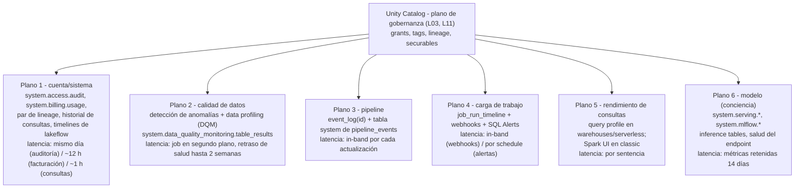
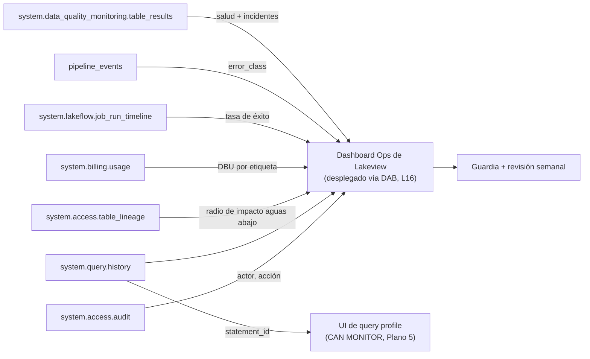
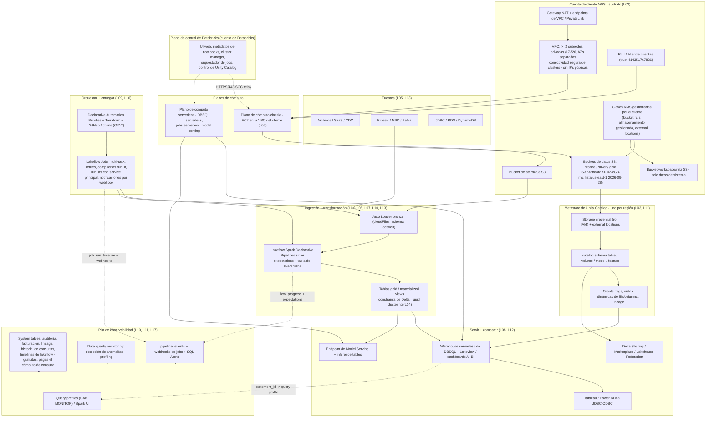
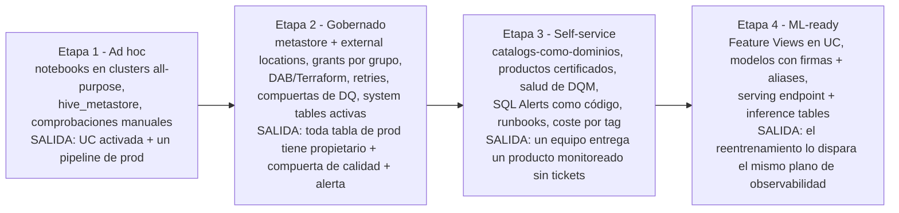
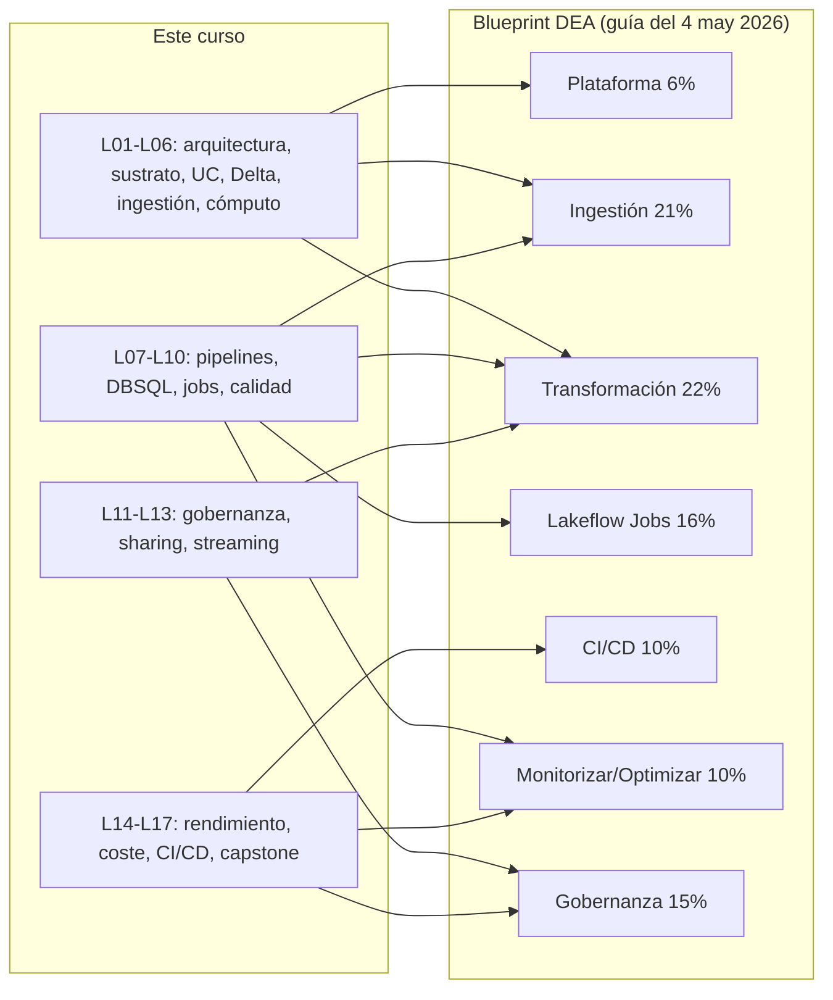

# Arquitectura de referencia del capstone: observabilidad, activación de ML y el plan de 90 días para Databricks en AWS

Dieciséis lecciones construyeron la máquina. La lección 01 te dio el concepto de lakehouse y la separación entre plano de control y plano de cómputo en AWS; la lección 02, el sustrato de VPC, bucket raíz, KMS y PrivateLink; la lección 03, el metastore de Unity Catalog y los external locations; la lección 04, el registro de transacciones de Delta y el liquid clustering; la lección 05, Auto Loader; la lección 06, DBR, Photon y la economía de los clusters; la lección 07, los pipelines declarativos de Lakeflow con expectations; la lección 08, los SQL warehouses de Databricks SQL y Lakeview; la lección 09, Lakeflow Jobs; la lección 10, los quality gates y la cuarentena; la lección 11, grants, vistas dinámicas y auditoría; la lección 12, Delta Sharing y Marketplace; la lección 13, Structured Streaming; la lección 14, rendimiento; la lección 15, coste en DBU; la lección 16, Declarative Automation Bundles y Terraform. Este capstone hace una sola cosa: **esas dieciséis capas se ensamblan en una única arquitectura de referencia y después se añaden las dos capas que las lecciones anteriores solo esbozaron — la pila de observabilidad y una sección de ML gobernada — y se te entrega un plan secuenciado para construirlas de verdad.**

La capa de observabilidad merece un cuidado especial, porque es donde los lakehouses de producción fallan en silencio. «System tables provide a Databricks-hosted analytical store of your account's operational data found in the `system` catalog» — y «Las system tables son de uso gratuito; solo se te cobra por el cómputo que usas para consultarlas» (docs.databricks.com/aws/en/admin/system-tables, pie de página **8 oct 2026**). Gratis no es lo mismo que automático: la retención se acumula desde la activación, el historial nunca se rellena hacia atrás, y las docs dicen sin rodeos que hay «**No support for real-time monitoring. Data is updated throughout the day.**» Cada dato de esta lección lleva su fuente de Databricks o de AWS y una fecha de octubre de 2026; todo lo que las docs no confirman se deja fuera o se marca explícitamente como elaborado por el curso.

```text
 =============================================================
  MAPA DE LA LECCIÓN 17 - Capstone en AWS, a oct 2026
 ------------------------------------------------------------
  Plano 1  cuenta/sistema  - catálogo system: auditoría,
           facturación, lineage, historial de consultas,
           timelines de lakeflow, pipeline_events,
           table_results, alert.*, mlflow.*, serving.*
           (tablas gratuitas, tú pagas el cómputo de consulta)
  Plano 2  calidad de datos - DQM = detección de anomalías
           (Public Preview, a nivel de schema) + data
           profiling (antes Lakehouse Monitoring)
  Plano 3  pipeline        - event_log(<id>) + system.
           lakeflow_pipeline_events_preview.pipeline_events
  Plano 4  carga de trabajo - job_run_timeline + notificaciones
           (email/Slack/Teams/PagerDuty/webhook, máx 3 por
           tipo de evento) + SQL Alerts (GA, 2026-05-19)
  Plano 5  rendim. consulta - query profile (CAN MONITOR) frente
           a Spark UI en classic
  Plano 6  modelo (aware)  - modelos en UC, aliases, serving
           endpoint, inference tables, system.serving.*
  Plan     30/60/90 días (elaborado por el curso) sobre las 10
           fases de planificación de producción de Databricks;
           Fase 9 = Observabilidad cae en los días 61-90
  Cifras   system tables gratuitas | historial de consultas ~1 h
           | facturación ~12 h | retención gratis de 365 d (la
           mayoría de tablas) | 3 destinos/evento de job |
           perfil snapshot 4 TB | serving >25K QPS, <50 ms de
           sobrecarga | DEA 45 preguntas / 90 min / $200 / 2 años
 =============================================================
```

En esta lección:

- modela **la observabilidad como cinco planos distintos que se apoyan todos en Unity Catalog**, más un sexto plano de conciencia del modelo, y aprende exactamente qué latencia carga cada plano;
- inventaría **los nombres actuales de las system tables** (referencia del 8 oct 2026), sus retenciones gratuitas y su latencia por tabla, y ejecuta un **dashboard de auditoría de seis consultas** sobre ellas;
- usa la **monitorización de calidad de datos** — detección de anomalías más data profiling, la familia de producto que absorbió «Lakehouse Monitoring» — con sus indicadores de salud, incidentes y reglas de alerta;
- cierra el circuito con un **runbook de alerta → incidente → replay**, conectado mediante webhooks de jobs, reglas de alerta de DQM y SQL Alerts como código;
- dibuja el **diagrama completo del capstone de extremo a extremo**: VPC/S3/KMS de AWS, ambos planos de Databricks, Unity Catalog, pipelines de Lakeflow, serving de DBSQL, Delta Sharing y la pila de observabilidad en una sola página;
- secuencia una **hoja de ruta de 30/60/90 días elaborada por el curso** frente a las 10 fases de planificación de producción de Databricks, con una tarjeta de hitos que nombra la system table que prueba cada hito;
- sitúa a tu equipo en un **modelo de madurez de cuatro etapas** (ad hoc → gobernado → self-service → ML-ready) con criterios de salida;
- activa una **sección de ML gobernada** — modelos de MLflow en Unity Catalog, firmas, aliases, observabilidad de serving y de inference tables — respetando la frontera entre este curso y un curso dedicado de ML;
- estudia **Rivian, Block y NAB en AWS**, lee el **recuadro de actualizaciones de octubre de 2026**, mapea el curso sobre el **blueprint de Data Engineer Associate** y responde **doce preguntas de estilo examen** más cuatro comprobaciones interactivas.

---

## 1. Cinco planos de observabilidad, un plano de gobernanza

El error arquitectónico más común en esta capa es tratar la observabilidad como un producto que se «enciende». No lo es: son cinco planos con responsables distintos, privilegios distintos y — de manera crítica — **latencias distintas**. Los cinco se apoyan en Unity Catalog, y las propias system tables son securables gobernados por UC: «Los usuarios con los roles de account admin y metastore admin tienen acceso a las system tables por defecto… `USE CATALOG` sobre el catálogo system, `USE SCHEMA` sobre los schemas system y `SELECT` sobre los schemas system» (referencia de system tables, **2026-10-08**). Todo el resto necesita esos grants de forma explícita, o una vista dinámica. **La observabilidad se concede, no es ambiental.**



Se siguen tres consecuencias, y cada una ha mordido a equipos de producción:

1. **Los planos no se sustituyen entre sí.** Las expectations y las constraints de Delta *previenen* escrituras malas en el momento de escribir (lección 10); la detección de anomalías *detecta* deriva a lo largo de un schema; el profiling *mide* y almacena métricas de deriva; las alertas de SQL y de jobs *notifican*. Privilegios distintos también: `MANAGE` sobre un schema para activar la detección de anomalías, `SELECT` sobre las tablas de métricas para construir alertas, `CAN MONITOR` sobre un warehouse para abrir el query profile de otro. Mezclarlo todo en «ya tenemos DQ» oculta qué capa falta.
2. **La reacción a escala de minutos debe ser in-band.** Las system tables se actualizan «throughout the day» — todo lo que deba dispararse en minutos es una política `fail` de expectations, un webhook de job, una regla de alerta de DQM o una SQL Alert dentro de un job, no un escaneo de `system.access.audit`.
3. **La latencia es un dato de diseño, no trivia.** Los registros del historial de consultas están «typically available within one hour» (referencia de historial de consultas, **2026-10-06**); el uso facturable «typically available within 12 hours» para `record_type = 'ORIGINAL'` (referencia de facturación, **2026-09-15**). Un dashboard de «anomalía horaria de coste» sobre `system.billing.usage` es un error de categoría — la tabla no puede sostenerlo.

> **📚 ¿Sabías que…?** Los schemas antiguos `system.operational_data` y `system.lineage` están «descontinuados y contendrán tablas vacías» (referencia de system tables, 2026-10-08). Cualquier runbook, notebook o dashboard de un proveedor que siga apuntando a ellos está leyendo nada en silencio. Los hogares actuales son `system.lakeflow.*` para los timelines de jobs/pipelines y `system.access.table_lineage` / `system.access.column_lineage` para el lineage.

```fillblank
{
  "question": "Las system tables son gratuitas: solo pagas por el {{1}} que usas para consultarlas. Los registros del historial de consultas suelen estar disponibles en aproximadamente {{2}} hora(s), y los registros de uso facturable en aproximadamente {{3}} horas.",
  "template": "Las system tables son gratuitas: solo pagas por el {{1}} que usas para consultarlas. Los registros del historial de consultas suelen estar disponibles en aproximadamente {{2}} hora(s), y los registros de uso facturable en aproximadamente {{3}} horas.",
  "answers": {
    "1": "cómputo",
    "2": "una",
    "3": "12"
  },
  "distractors": [
    "almacenamiento",
    "memoria",
    "24",
    "5 minutos",
    "tiempo real",
    "48"
  ],
  "explanation": "La referencia de system tables (2026-10-08) dice que las tablas en sí son gratuitas y «You are only charged for the compute used to query them»; la página de historial de consultas (2026-10-06) dice que los registros están «typically available within one hour»; la página de facturación (2026-09-15) dice «typically available within 12 hours» para los registros ORIGINAL. Trampas: «almacenamiento» invierte el modelo de facturación (el almacén analítico es gratuito); 24 y 48 inventan números redondos; «tiempo real» lo niega explícitamente el propio eslogan de las docs «No support for real-time monitoring»; «5 minutos» confunde las system tables con señales in-band como los webhooks."
}
```

---

## 2. Plano 1: las system tables como plano de cuenta

### 2.1 El inventario que importa (verificado el 2026-10-08)

No necesitas todas las tablas del catálogo `system` el primer día — necesitas estas, con sus retenciones, para que tus dashboards y tus políticas de retención coincidan con la realidad:

| Tabla | Retención gratuita | Ámbito | Latencia / notas |
|---|---|---|---|
| `system.access.audit` | 365 días | Regional (workspace) + global (cuenta; `workspace_id` = 0) | «updated throughout the day»; Public Preview |
| `system.billing.usage` | 365 días | **Global** | ~12 h para `record_type = 'ORIGINAL'` |
| `system.billing.list_prices` | Indefinida | Global | consulta de precios para la aritmética de coste |
| `system.access.table_lineage` + `column_lineage` | 365 días | Regional | ventana continua de 1 año; historial más profundo vía Catalog Explorer / API de lineage |
| `system.query.history` | 365 días | Regional | ~1 h; `statement_text` es `<REDACTED>` para no administradores |
| `system.lakeflow.jobs`, `job_tasks`, `job_run_timeline`, `job_task_run_timeline` | 365 días | Regional | streams; nombres actuales (no `system.workflow.*`) |
| `system.lakeflow.pipelines`, `pipeline_update_timeline` | 365 días | Regional | streams |
| `system.lakeflow_pipeline_events_preview.pipeline_events` | 365 días | Regional | **Beta**; «the recommended way to query events» |
| `system.data_quality_monitoring.table_results` | 13 meses | Regional | Public Preview; resultados de escaneo de anomalías |
| `system.alert.alerts`, `alert_evaluation_history` | 365 días | Regional | preview — el estado difiere entre el blog de mayo de 2026 y la referencia de oct 2026; consulta las docs actuales |
| `system.compute.warehouses`, `warehouse_events` | 365 días | Regional | streams; `node_timeline` solo 90 días |
| `system.mlflow.experiments_latest`, `runs_latest`, `run_metrics_history` | 180 días | Regional | Public Preview |
| `system.serving.served_entities` | 365 días | Regional | `endpoint_usage` solo 90 días; el seguimiento de uso debe activarse |
| `system.ai_gateway.usage` | 365 días | Regional | gobernanza de tokens/peticiones |

Fuentes: referencia de system tables (2026-10-08); referencia de audit-logs (2026-07-01); referencia de historial de consultas (2026-10-06); referencia de facturación (2026-09-15); referencia de lineage (consultada 2026-10). La **retención configurable** existe en Beta — opt-in, 395 días por defecto, configurable de 30 a 3,650 días — pero «does not apply to `system.data_classification`, `system.data_quality_monitoring`, `system.lakebase`» (2026-10-08). Y ten en cuenta las advertencias de streaming si quieres *hacer stream* de las system tables hacia tus propias tablas Delta: DBR **16.4+** para hacer stream, **17.3+** para CDF, `Trigger.AvailableNow` en **18.0+**, y los schemas de sistema usan «the default 7 days retention for `VACUUM`».

### 2.2 Ejemplo resuelto E1 — el dashboard de auditoría de seis consultas

Este es el corazón de la lección: un solo dashboard de Lakeview, seis consultas, todas válidas frente a los schemas de arriba, desplegado como código mediante un bundle (lección 16). Ejecútalo cada semana; publícalo para un grupo `platform-ops` con `USE CATALOG` / `USE SCHEMA` / `SELECT` concedidos — o mejor, una **vista dinámica por grupo** (la propia recomendación de la página de historial de consultas).

```sql
-- Q1: Who changed grants / securables in the last 7 days?
--     Always predicate on event_date (audit-logs page, 2026-07-01).
SELECT event_date,
       user_identity.email AS actor,
       service_name,
       action_name,
       request_params['name'] AS target
FROM   system.access.audit
WHERE  event_date >= current_date() - 7
  AND  service_name = 'unityCatalog'
  AND  action_name RLIKE 'Grant|Revoke|Update|Create|Delete'
ORDER  BY event_date DESC, actor;

-- Q2: What did humans and service principals actually run?
--     statement_text is <REDACTED> unless account admin / databricks_pii_access.
SELECT executed_by,
       executed_as,
       statement_type,
       compute.type           AS compute_type,
       client_application,
       count(*)               AS statements,
       round(sum(total_duration_ms)/1000/60, 1) AS total_minutes
FROM   system.query.history
WHERE  start_time >= current_timestamp() - INTERVAL 7 DAYS
GROUP  BY 1,2,3,4,5
ORDER  BY total_minutes DESC
LIMIT  25;

-- Q3: Expensive / queue-bound warehouse statements (the FLEET view).
SELECT statement_id,
       executed_by,
       round(total_duration_ms/1000,1)               AS total_s,
       round(waiting_for_compute_duration_ms/1000,1) AS wait_compute_s,
       round(waiting_at_capacity_duration_ms/1000,1) AS wait_queue_s,
       read_bytes, written_rows,
       query_tags['team']                            AS team
FROM   system.query.history
WHERE  start_time >= current_timestamp() - INTERVAL 1 DAY
  AND  compute.type = 'WAREHOUSE'
ORDER  BY total_duration_ms DESC
LIMIT  20;   -- statement_id -> "See query profile" in Query History UI

-- Q4: Blast radius - who reads the sensitive gold table?
SELECT source_table_full_name, created_by, event_time, statement_id
FROM   system.access.table_lineage
WHERE  event_time >= current_timestamp() - INTERVAL 30 DAYS
  AND  source_table_full_name = 'acme.sales.orders_daily'
ORDER  BY event_time DESC;

-- Q5: Cost attribution by domain/team (DBUs only; AWS spend is elsewhere).
SELECT billing_origin_product,
       coalesce(tags['team'],'(untagged)') AS team,
       coalesce(workspace_name,'-')        AS workspace,
       round(sum(metered_quantity),1)      AS dbus,
       round(sum(unblended_cost),2)        AS usd
FROM   system.billing.usage
WHERE  billing_month = date_format(current_date(), 'yyyy-MM')
  AND  record_type   = 'ORIGINAL'
GROUP  BY 1,2,3
ORDER  BY usd DESC;

-- Q6: Job reliability - success rate per production job, last 14 days.
SELECT j.name AS job_name,
       count(*)                                             AS runs,
       sum(CASE WHEN r.state = 'SUCCESS' THEN 1 ELSE 0 END) AS ok,
       round(100.0*sum(CASE WHEN r.state='SUCCESS' THEN 1 ELSE 0 END)/count(*),1) AS pct_ok,
       round(avg(r.duration)/1000/60,1)                     AS avg_min
FROM   system.lakeflow.job_run_timeline r
JOIN   system.lakeflow.jobs j ON j.job_id = r.job_id
WHERE  r.start_time >= current_timestamp() - INTERVAL 14 DAYS
GROUP  BY 1
ORDER  BY pct_ok ASC, avg_min DESC;
```

Notas didácticas, cada una ganada a partir de una trampa documentada. **Q1** es tu consulta de evidencia de cumplimiento — siempre predicada por `event_date`, porque la página de auditoría dice «To improve query performance, filter on `event_date` rather than `event_time`». **Q3** es el puente desde la vista de *flota* hasta la vista de *una sola consulta*: haz clic en cualquier `statement_id` en la UI de Query History y aterrizarás en el **query profile** de esa sentencia. **Q5** tiene que combinarse con una pieza de AWS Cost Explorer, porque `system.billing.usage` contiene **cero** gasto de AWS — ni EC2, ni S3, ni NAT (lección 15). Los escaneos sin filtro de cualquiera de estas tablas pueden chocar con la salvaguarda documentada: «System Table query returned too much data. Please repeat query with more selective predicates.». Y Databricks «highly discourages» exportar las system tables fuera de la plataforma — los datos «pueden exponer datos sensibles y poner tu despliegue en riesgo».



> **⚠️ ADVERTENCIA — la observabilidad añadida al final es observabilidad que empieza vacía.** La retención se acumula **desde la activación**, y el historial nunca se rellena hacia atrás: un dashboard construido el día 200 tiene 200 días de datos; construido el día 400 sigue teniendo 200 días. La propia mejor práctica de la página de system tables (llevada a la Fase 9 de la guía de despliegue, **2026-09-11**) es «Enable system tables for all metastores to capture comprehensive usage data» durante la cimentación — que es exactamente por lo que la hoja de ruta de 30/60/90 de la sección 8 pone la activación en **los días 1–30**, no en el día 89.

---

## 3. Plano 2: monitorización de calidad de datos (el producto que se comió a «Lakehouse Monitoring»)

### 3.1 Los nombres, de una vez por todas

Si un tutorial de 2024, una presentación de un proveedor o incluso un post del blog de Databricks de septiembre de 2026 dicen **Lakehouse Monitoring**, la respuesta de octubre de 2026 es: esa capacidad ahora es **data profiling**, una de las dos capacidades bajo **data quality monitoring** en Unity Catalog, siendo la otra la **detección de anomalías** (página de data-quality-monitoring, **2026-09-11**: «Data profiling was formerly known as Lakehouse Monitoring»; página de producto, consultada 2026-10). Enseña el nombre nuevo, reconoce el antiguo, y sabe que incluso el material actual de Databricks se desvía — la guía de despliegue todavía titula una sección «**Lakehouse Monitoring** capabilities» (2026-09-11).

### 3.2 Detección de anomalías: a nivel de schema, aprendida y paciente

La detección de anomalías se activa en un **schema o catálogo** — «up to 50 schemas at a time» desde la UI del catálogo, requiriendo `MANAGE` — y «Databricks creates a background job that monitors tables for *freshness* and *completeness*» (página de anomaly-detection, **2026-10-09**, Public Preview). Frescura: «If a commit is unusually late, the table is marked as stale.» Completitud: «Si el número de filas confirmadas en las últimas 24 horas es menor que el límite inferior de este rango, la tabla se marca como incompleta.» Los resultados aterrizan en `system.data_quality_monitoring.table_results`; los indicadores de salud (Healthy / Unhealthy / Training / Error / Excluded / Not enabled) aparecen en las páginas de tabla y en los nodos de lineage; y «Intelligent scanning prioritizes high-impact tables as determined by popularity and downstream usage» — apoyándose en el lineage y la certificación de UC, de modo que **una organización que nunca certifica nada obtiene una monitorización más débil**. Espera «Smart scanning might delay the population of health indicators for some tables by up to two weeks», incidentes que pueden asignarse («Assign to me» persiste 7 días) o descartarse («Not an issue»), y el pie de arma irreversible: «Cuando desactivas la detección de anomalías, el job de detección de anomalías y todas las tablas e información de detección de anomalías se eliminan. Esta acción no se puede deshacer.»

### 3.3 Data profiling: dos tablas de métricas, tres tipos de perfil

El profiling es por tabla y produce exactamente lo que un dashboard de deriva necesita: «Profiling creates two metric tables and a dashboard… The profile metric table contains summary statistics… The drift metrics table contains statistics related to the data's drift over time» (página de data-profiling, **2026-09-11**). Las tablas de métricas son tablas Delta en un schema de UC que tú eliges. Tres tipos de perfil: **time series** (métricas a lo largo de ventanas basadas en el tiempo), **inference** (logs de peticiones del modelo) y **snapshot** («La tabla completa se procesa en cada refresco. El tamaño máximo de tabla de un perfil snapshot es de **4 TB**»). Los perfiles de time series e inference «solo calculan métricas de los últimos 30 días». El profiling se ejecuta en cómputo serverless «pero no requiere que tu cuenta esté habilitada para el cómputo serverless», se factura como DBU serverless bajo `billing_origin_product = 'DATA_QUALITY_MONITORING'` (resultados desde febrero de 2026 en adelante) y — un alivio para conjuntos regulados — «Data quality monitoring **does not** modify any tables it monitors, nor does it add overhead to any jobs that populate these tables.»

### 3.4 Ejemplo resuelto E2 — conectar la capa de alertado de extremo a extremo

Tres planos de entrada, un único vocabulario de destinos. (i) **Webhook de job** — un administrador configura un destino del sistema una vez (email, Slack, Microsoft Teams, PagerDuty o cualquier webhook); después cada job fija `notifications.on_failure`, con el tope de «a maximum of **three system destinations** for each notification event type» por job o por task (página de notificaciones de jobs, **2026-10-09**). La carga útil es JSON estable:

```json
{
  "event_type": "jobs.on_failure",
  "workspace_id": "1234567890123456",
  "run": { "run_id": "987654321" },
  "job": { "job_id": "42", "name": "orders_prod" }
}
```

(ii) **Regla de alerta de DQM** (Beta) — con alcance `catalog.acme` o `catalog.acme.sales`, requiriendo `MANAGE`, entregando al mismo vocabulario de destinos cuando una tabla pasa a Unhealthy. (iii) **SQL Alert como código** — «Databricks SQL Alerts is Generally Available (GA), with more than 4,000 customers already using Alerts in production» (blog de Databricks, **2026-05-19**); una alerta empaqueta «a SQL query, an evaluation condition, a schedule, and a set of notification destinations», es versionable en Git y desplegable mediante bundles/Terraform, y puede ejecutarse como una **task SQL Alert de Lakeflow Job** (Public Preview) cuyo resultado `OK` / `TRIGGERED` / `ERROR` compuerta la siguiente task vía `run_if`. Una comprobación de coste de monitorización que de verdad vas a ejecutar:

```sql
SELECT sku_name, sum(usage_quantity) AS dbus
FROM   system.billing.usage
WHERE  billing_origin_product = 'DATA_QUALITY_MONITORING'
GROUP  BY 1;
```

- **📚 ¿Sabías que…?** La propia pila interna de fiabilidad de Databricks, **RADAR**, son los cuatro planos de esta lección ejecutándose en producción: métricas de fiabilidad → detección de anomalías SPOT (un modelo de streaming no supervisado que aprende «lo normal» de los últimos **14 días**) → alertado → dashboards de causa raíz. Resultado publicado: «**95% reduction in incident-discovery time, at over 90% precision**» (blog de Databricks, **2026-09-19**). El mapa de construcción de ese post — métricas en Delta, un detector entrenado con MLflow servido en un endpoint de Model Serving, recurrencias de Workflows, SQL Alerts, Genie para la causa raíz, todo desplegado como un único DAB — es este capstone, por dentro.

---

## 4. Planos 3–5: pipelines, cargas de trabajo y rendimiento de consultas

### 4.1 El event log del pipeline — y el borrado que rompe Auto Loader

Los pipelines de Lakeflow exponen tres superficies de observabilidad anidadas: la UI (página de monitoring, grafo, métricas del dataset, pestaña Data quality); el **event log por pipeline**, una tabla Delta oculta legible vía `SELECT * FROM event_log(<pipelineId>)` y publicable hacia una tabla de UC con nombre; y la **`system.lakeflow_pipeline_events_preview.pipeline_events`** de ámbito regional (Beta), a la que las docs ahora llaman «the recommended way to query events», con un JSON de dashboard de Lakeview listo para importar en la página de monitoring (fechada **2026-10-09**). Los resultados de las expectations viajan en los eventos `flow_progress`: `details:flow_progress.data_quality.expectations` es un `array<struct<name: string, dataset: string, passed_records: int, failed_records: int>>`. Atribución de coste de un pipeline: `SELECT sku_name, sum(usage_quantity) FROM system.billing.usage WHERE usage_metadata.dlt_pipeline_id = :pipeline_id GROUP BY 1`.

> **⚠️ IMPORTANTE — nunca borres el event log de un pipeline.** «La ubicación del event log también sirve como ubicación del schema para las consultas de Auto Loader de la pipeline… No borres el event log ni el catálogo o schema padre» (página de event log del pipeline, 2026-10-09). Borrarlo no solo hace perder el historial — rompe las futuras actualizaciones, porque el estado exactly-once de Auto Loader vive ahí (lección 05).

Un matiz operativo que merece entrar en tus runbooks: las actualizaciones por trigger iniciadas desde la UI/API usan «fast-start, debugging-focused behavior», mientras que «Las actualizaciones iniciadas desde **Jobs o la API de Pipelines, y todas las actualizaciones de pipelines continuas**, usan **reintentos y reinicios automáticos**» — que es exactamente por lo que los pipelines de producción deben lanzarse desde un job (lección 09), no desde la UI.

### 4.2 Notificaciones de jobs: la capa de paginación, con dos trampas documentadas

Las notificaciones de jobs cubren inicio, finalización correcta, fallo, umbral de duración, umbral de backlog de streaming y eventos de mantenimiento continuo, entregadas a email o a destinos del sistema configurados por el administrador (Slack, Teams, PagerDuty, webhook), con un máximo de **tres destinos por tipo de evento por job o por task**. Los códigos `event_type` de los webhooks son estables: `jobs.on_start`, `jobs.on_success`, `jobs.on_failure`, `jobs.on_duration_warning_threshold_exceeded`. Las alertas de backlog de streaming evalúan «average backlog over a **10-minute period**» y vuelven a notificar después de **30 minutes**. Las trampas: «**Job-level notifications aren't sent when failed tasks are retried**» (silenciado hasta el último retry, o usa notificaciones a nivel de task), y «Succeeded with failures» cuenta como éxito. Para poner escala: un workspace está limitado a **2,000 task runs concurrentes**, puede guardar hasta **12,000 jobs**, crear **10,000 jobs por hora**, y un solo job puede contener hasta **1,000 tasks** (visión general de Lakeflow Jobs, **2026-10-09**).

### 4.3 Query profiles: el plano por sentencia

Para los SQL warehouses y el cómputo serverless, el **query profile** es el diagnóstico por sentencia: DAG de operadores con Time spent / Memory peak / Rows, un panel de Top operators, Performance insights ordenados «by their projected effect on total task duration», y reescrituras asistidas por Genie Code presentadas para tu aprobación (página de query-profile, **2026-09-11**). El acceso es un hecho de permisos con consecuencias reales de organización: «debes ser el propietario de la consulta o tener al menos el permiso **CAN MONITOR** sobre el SQL warehouse que ejecutó la consulta». No existen perfiles para consultas de cache-hit, y la exportación/importación del JSON del perfil no persiste. Las cargas de trabajo en clusters classic usan la **Spark UI** en su lugar — la Fase 9 de la guía de despliegue enuncia la división sin rodeos: «Para cómputo serverless y warehouses de SQL, usa el query profile… Para clusters de cómputo clásicos, usa la Spark UI». La Q3 de E1 es la vista de flota en `system.query.history`; el profile es la vista de una sola consulta; `statement_id` las une.

```mermaid
stateDiagram-v2
    [*] --> Healthy
    Healthy --> Detected: la detección de anomalías marca la tabla Unhealthy / SQL Alert TRIGGERED / webhook jobs.on_failure del job
    Detected --> Triaged: la guardia abre un incidente (UI de incidentes DQM: «Assign to me»)
    Triaged --> RootCaused: lineage de UC -> job/pipeline aguas arriba; error.exceptions[0].error_class en pipeline_events
    RootCaused --> Repaired: fix de código/config fusionado (PR de DAB, primero target dev, L16)
    Repaired --> Replayed: repair run del job / replay dirigido del pipeline / re-drive idempotente por lotes
    Replayed --> Validated: expectations en verde + perfil/deriva dentro de banda + salud Healthy
    Validated --> Closed: incidente «Not an issue» o auto-resuelto; runbook actualizado
    Detected --> FalsePositive: umbral ajustado, alerta silenciada
    FalsePositive --> Healthy
```



El cuerpo del runbook, cada paso nombrando su herramienta: **1. Detectar** desde cualquiera de los tres planos. **2. Clasificar** frescura frente a completitud frente a pico de `failed_records` en expectations frente a fallo de cómputo. **3. Delimitar** con `system.access.table_lineage` / `column_lineage`. **4. Causa raíz** en `pipeline_events` (`error.exceptions[0].error_class`) y en el array de expectations. **5. Reparar** en dev mediante un PR de DAB (lección 16). **6. Replay** de forma idempotente — el **repair** de un job re-ejecuta solo los subconjuntos fallidos/saltados; Auto Loader reproduce desde el prefijo de aterrizaje exactamente una vez. **7. Validar y cerrar**, dejando espacio para hasta dos semanas de retraso en el escaneo de indicadores de salud, y escribe el nuevo umbral de vuelta en el runbook (Fase 9: «Document runbooks for common operational scenarios», **2026-09-11**).

---

## 5. Plano 6: la sección de ML — la gobernanza primero, los algoritmos en otra parte

### 5.1 La línea divisoria, dicha una sola vez

Este curso es dueño **del sustrato de lakehouse sobre el que corre el ML**: UC como plano de gobernanza para modelos y features (nombres de tres niveles, grants, aliases, lineage), la observabilidad de inference tables y de serving endpoints como el mismo patrón de observabilidad aplicado a los modelos, y dónde se sitúan los artefactos de ML en la arquitectura de referencia. Un curso dedicado de ML es dueño de los algoritmos, la metodología de entrenamiento y de hiperparámetros, AutoML, la disciplina de experiment tracking, el diseño de feature engineering, el desarrollo de LLM/agentes, la redacción de políticas de AI Gateway y el ajuste del rendimiento en despliegue. La división limpia: **enseñamos la gobernanza y la observabilidad de los modelos, no cómo construirlos.**

### 5.2 Modelos en Unity Catalog — la mecánica verificada

«Models in Unity Catalog, which Databricks recommends» (página de model-lifecycle, **2026-10-09**) es «a hosted version of MLflow Model Registry in Unity Catalog… including centralized access control, auditing, lineage, and model discovery across workspaces». Mecánica que hay que tener dominada:

- el URI de registro por defecto en MLflow 3 es **`databricks-uc`**; los modelos reciben nombres de tres niveles `<catalog>.<schema>.<model>`;
- los modelos son un **subtipo del securable `FUNCTION`** — se conceden con `GRANT ON FUNCTION`, se crean con `GRANT CREATE MODEL ON SCHEMA`, se usan con `EXECUTE`;
- «Las nuevas versiones de modelos ML en UC deben tener una **signature** de modelo» — sin ella pierdes la validación de entrada, el uso de funciones de AI y los ejemplos de entrada de serving autogenerados;
- **los aliases reemplazan a los stages**: «Los stages no se admiten para modelos en Unity Catalog» — una referencia nombrada mutable como `Champion` es el mecanismo de promoción;
- la promoción entre entornos se hace «by deploying ML pipelines as code» (preferido) o `copy_model_version()` (MLflow 2.8.0+);
- el lineage tabla→modelo vía `mlflow.log_input` (MLflow 2.11.0+) se muestra en la pestaña Lineage de la versión del modelo en Catalog Explorer;
- no soportado en modelos de UC: webhooks, notificaciones por email, hilos de comentarios, el registro de actividad — usa audit logs y compuertas de CI en su lugar.

Emparejamiento de versiones de MLflow por runtime (notas de versión, **2026-09-11**): DBR **19** → MLflow **3.12.0**; **18 LTS** → **3.8.1**; **17.3 LTS** → **3.0.1**; **16.4 LTS** → **2.21.3**.

### 5.3 Ejemplo resuelto E3 — la sección de activación de ML con la gobernanza primero

Veinte líneas que cumplen cada regla de UC de arriba, y después observa el modelo como si fuera datos:

```python
import mlflow
mlflow.set_registry_uri("databricks-uc")          # default in MLflow 3 anyway
mlflow.sklearn.log_model(
    sk_model=clf, name="model",
    input_example=X.iloc[[0]],                    # signature inferred -> required in UC
    registered_model_name="acme.ml.churn_model")
# promote by alias, not stage (stages unsupported in UC)
from mlflow import MlflowClient
MlflowClient().set_registered_model_alias(
    "acme.ml.churn_model", "Champion", version=v)
# consume by alias in batch or on a serving endpoint
m = mlflow.pyfunc.load_model("models:/acme.ml.churn_model@Champion")
```

Grants: `GRANT CREATE MODEL ON SCHEMA acme.ml TO` el principal de entrenamiento; `GRANT EXECUTE ON FUNCTION acme.ml.churn_model TO` los consumidores. Observabilidad: una **inference table** registra predicciones para el análisis de deriva; `system.serving.endpoint_usage` (retención de 90 días, el seguimiento de uso debe activarse) y `system.serving.served_entities` dan la vista de flota; `system.mlflow.runs_latest` / `run_metrics_history` (180 días) llevan la telemetría de entrenamiento. El propio Model Serving es una superficie REST serverless que «puede soportar más de **25K consultas por segundo** con una latencia adicional de **menos de 50 ms**» (página de model-serving, **2026-10-06**) — con dos advertencias para las que debes diseñar: los datos de métricas solo se retienen **14 días** (logs de construcción de contenedores, 30 días), y «Model Serving does not provide security patches to existing model images because of the risk of destabilization to production deployments». **Feature Store** está actual y es UC-first: las Feature Views (declarativas, **Public Preview**, recomendadas) y las feature tables se publican ambas en el Online Feature Store con joins point-in-time que matan el desajuste entre entrenamiento y serving; Workspace Feature Store está obsoleto.

> **📚 ¿Sabías que…?** Databricks anunció **Genie ZeroOps** el **2026-06-16** — «an autonomous background agent that monitors your data and AI assets… and takes action before or when things go wrong», con validación de las correcciones propuestas mediante shallow clone sobre datos reales sin tocar producción. Su disponibilidad declarada en el anuncio era «entering **private preview** in the coming weeks»; esta lección lo cita solo como una dirección anunciada de viaje para la capa de runbook, nunca como una capacidad de la que puedas depender hoy.

---

## 6. El capstone completo: AWS + Databricks de extremo a extremo

Aquí está todo el curso en una sola página. Léela de arriba abajo: las fuentes a la izquierda de tu mente, el almacenamiento en la cuenta de AWS del cliente, la gobernanza en Unity Catalog, los pipelines medallion en el centro, el serving y el sharing a la derecha, la observabilidad envolviendo todo — y los dos medidores de facturación (la factura de AWS frente a los DBU) que la lección 15 te enseñó a no confundir jamás.



### 6.1 Ejemplo resuelto E4 — la lista de comprobación de 17 componentes

Cada componente de abajo se construyó en una lección anterior; la columna de «prueba» nombra la system table o el artefacto que demuestra que existe. Esta es la tabla que revisas en el día 90.

| # | Componente | Construido en | Artefacto de prueba |
|---|---|---|---|
| 1 | Workspaces dev/prod, Premium, SSO | L01, L02 | consola de cuenta / Terraform `databricks_mws_workspaces` |
| 2 | VPC del cliente, SCC, endpoints/PrivateLink | L02 | plan de Terraform; sin IPs públicas en el cómputo |
| 3 | Bucket raíz + buckets de datos externos, KMS | L02, L03 | políticas de bucket; ARN de CMK |
| 4 | Metastore de UC por región, workspaces adjuntos | L03 | página de metastore de la consola de cuenta |
| 5 | Storage credential + external location por prefijo | L03 | `CREATE EXTERNAL LOCATION` + grants |
| 6 | Auto Loader bronze con schema location | L05 | tabla bronze + directorio de checkpoint |
| 7 | Lakeflow SDP silver, expectations + cuarentena | L07, L10 | métricas de expectations en `flow_progress` |
| 8 | Tablas/MVs gold con constraints de Delta | L04, L10 | `DESCRIBE DETAIL`; violaciones de constraint = 0 |
| 9 | Liquid clustering + higiene de OPTIMIZE/VACUUM | L04, L14 | claves de clustering; log de retención de VACUUM |
| 10 | Warehouses serverless de DBSQL, auto-stop, Lakeview | L08 | `system.compute.warehouses` |
| 11 | Lakeflow Jobs: retries, `run_if`, `run_as` con SP, webhooks | L09 | `system.lakeflow.job_run_timeline` |
| 12 | DABs + Terraform + GitHub Actions (OIDC) | L16 | comprobaciones de PR; deploys de bundle |
| 13 | Delta Sharing / Marketplace / Federation | L12 | shares, recipients, catalogs federados |
| 14 | Pila de observabilidad (planos 1–5) | L11, L17 | el dashboard de esta lección |
| 15 | Gobernanza de coste: tags, budgets, auto-stop/spot | L15 | `system.billing.usage` por tag |
| 16 | Capa de ML: modelos en UC, serving, inference tables | L17 | `system.serving.*`; pestaña Lineage del modelo |
| 17 | Runbooks + SLAs (alerta → incidente → replay) | L09, L10, L17 | runbook publicado + evidencia de game day |

---

## 7. 30/60/90 días: una hoja de ruta del curso sobre las 10 fases de Databricks

> **📌 Nota de procedencia.** No existe ningún calendario de adopción de «30/60/90 días» publicado por Databricks; el calendario de abajo es una **síntesis del curso** anclada a la secuencia oficial de planificación de producción de 10 fases (página de deployment-guide, **2026-09-11** — cuya propia página introductoria dice 9 fases en otro lugar; nosotros enseñamos la tabla de 10 fases, la página que de verdad enumera las fases). Los *nombres* de las fases son de Databricks; los *días* son nuestros.

```mermaid
gantt
    title Hoja de ruta de adopción 30/60/90 (elaborada por el curso) sobre las fases de planificación de producción de Databricks
    dateFormat  X
    axisFormat %s
    section Días 1-30 Cimentación
    Fases 1-5: cuenta, workspace, UC, red, almacenamiento :done, a1, 0, 30
    section Días 31-60 Pipeline + calidad
    Fases 6-8: Delta, IaC, cómputo + DQM + CI/CD :active, a2, 30, 30
    section Días 61-90 Operar + extender
    Fase 9 Observabilidad + Fase 10 HA/DR : a3, 60, 30
```

**Días 1–30 — Cimentación (fases 1–5: cuenta, estrategia de workspace, Unity Catalog, red, almacenamiento).** Cuenta + metastore en pie; SSO/SCIM; un metastore por región; buckets S3 raíz + externos con KMS; storage credential + external location para el prefijo de aterrizaje; workspaces dev/prod; un módulo de Terraform para los recursos a nivel de cuenta; **system tables activadas**; `USE CATALOG` / `USE SCHEMA` / `SELECT` concedidos a un grupo `platform-ops`. *Hito:* una primera tabla bronze de Auto Loader aterriza en S3 a través de una external location, es consultable en UC, y `system.access.audit` devuelve filas para ella.

**Días 31–60 — Pipeline + calidad (fases 6–8: Delta Lake, IaC, cómputo).** Pipeline de Lakeflow bronze→silver→gold con expectations y una tabla de cuarentena; constraints de Delta en silver; job multi-task con compuertas `run_if`, retries, `run_as` con service principal; DABs desplegando targets `dev`/`prod`; cluster policies + instance pools + auto-stop; un warehouse serverless de DBSQL con auto-stop; **detección de anomalías activada en el schema silver** y un perfil time series en la tabla gold de KPI; un webhook `jobs.on_failure` al canal del equipo. *Hito:* un archivo corrompido a propósito dispara métricas de expectation → cuarentena → el estado de DQM cambia → se dispara el webhook, de extremo a extremo, en un drill de game day.

**Días 61–90 — Operar + extender (fases 9–10: observabilidad, HA/DR).** Un dashboard «Ops» de Lakeview sobre `system.lakeflow.job_run_timeline`, `system.query.history`, `system.billing.usage` y `pipeline_events`; SQL Alerts para los KPI de frescura/recuento con versionado en Git/DAB; el dashboard de auditoría de E1 revisado cada semana; runbooks publicados (sección 4.3); política de retención de backup/time travel + VACUUM documentada; atribución de coste por tag con <5% de gasto sin etiquetar. *Hito:* la guardia resuelve una página usando solo el dashboard de ops y un runbook.

### 7.1 Ejemplo resuelto E5 — la tarjeta de hitos

| Puerta | Fases de Databricks | Entregable | Hito medible | System table que lo prueba |
|---|---|---|---|---|
| Día 30 | 1–5 | UC + S3 + Auto Loader bronze | La primera lectura de external location funciona; los eventos de grant visibles | `system.access.audit` muestra los eventos de grant/create |
| Día 60 | 6–8 | Pipelines + calidad + CI/CD | Game day: archivo corrompido → cuarentena + DQM Unhealthy + webhook recibido | `table_results` de salud + log de entrega del webhook |
| Día 90 | 9–10 | Observabilidad + HA/DR | La guardia resuelve una página solo con el dashboard de ops + runbook; <5% de gasto DBU sin etiquetar | `system.billing.usage` por tag; tasa de éxito de `job_run_timeline` |

```dragdrop
{
  "question": "Ordena la hoja de ruta de 30/60/90 días elaborada por el curso para un lakehouse de Databricks en AWS, con la cimentación primero y la operación al final:",
  "items": [
    "Días 1-30: cuenta + metastore regional en pie, SSO/SCIM, workspaces dev/prod, Terraform para los recursos a nivel de cuenta",
    "Días 1-30: buckets S3 raíz + externos con KMS; storage credential + external location para el prefijo de aterrizaje",
    "Días 1-30: system tables activadas para todos los metastores; grupo platform-ops con USE CATALOG / USE SCHEMA / SELECT",
    "Días 31-60: pipeline de Lakeflow bronze-silver-gold con expectations + cuarentena; constraints de Delta en silver",
    "Días 31-60: job multi-task con compuertas run_if, retries, run_as con service principal; targets dev/prod de DABs; auto-stop del warehouse",
    "Días 31-60: detección de anomalías activada en el schema silver; perfil time series en la tabla gold de KPI; webhook jobs.on_failure",
    "Días 61-90: dashboard Ops de Lakeview sobre job_run_timeline, historial de consultas, billing.usage y pipeline_events",
    "Días 61-90: SQL Alerts como código, revisión semanal del dashboard de auditoría, runbooks publicados, atribución de coste por tag con <5% sin etiquetar"
  ],
  "correctOrder": [
    "Días 1-30: cuenta + metastore regional en pie, SSO/SCIM, workspaces dev/prod, Terraform para los recursos a nivel de cuenta",
    "Días 1-30: buckets S3 raíz + externos con KMS; storage credential + external location para el prefijo de aterrizaje",
    "Días 1-30: system tables activadas para todos los metastores; grupo platform-ops con USE CATALOG / USE SCHEMA / SELECT",
    "Días 31-60: pipeline de Lakeflow bronze-silver-gold con expectations + cuarentena; constraints de Delta en silver",
    "Días 31-60: job multi-task con compuertas run_if, retries, run_as con service principal; targets dev/prod de DABs; auto-stop del warehouse",
    "Días 31-60: detección de anomalías activada en el schema silver; perfil time series en la tabla gold de KPI; webhook jobs.on_failure",
    "Días 61-90: dashboard Ops de Lakeview sobre job_run_timeline, historial de consultas, billing.usage y pipeline_events",
    "Días 61-90: SQL Alerts como código, revisión semanal del dashboard de auditoría, runbooks publicados, atribución de coste por tag con <5% sin etiquetar"
  ],
  "explanation": "El orden refleja las 10 fases documentadas de planificación de producción de Databricks (guía de despliegue, 2026-09-11) comprimidas por el curso en tres puertas: cuenta/UC/red/almacenamiento (fases 1-5) deben existir antes de que los pipelines puedan aterrizar datos a través de una external location; Delta/IaC/cómputo (fases 6-8) deben existir antes de que los quality gates y las alertas tengan algo que vigilar; la observabilidad y el HA/DR (fases 9-10) llegan al final de la construcción pero dependen de que las system tables se hayan activado el día 1 - la retención se acumula desde la activación y el historial nunca se rellena hacia atrás. El fallo clásico que este ordenamiento previene: construir el dashboard de ops en la semana 12 y descubrir que solo puede ver 12 días de historial."
}
```

### 7.2 Ejemplo resuelto E6 — un boceto del coste mensual de observabilidad

Las system tables son gratuitas; las *consultas y los dashboards* no. Supón un warehouse de ops (serverless, $0.70/DBU de lista, página de precios de SQL consultada 2026-10) ejecutando el dashboard de E1 más triaje ad-hoc 2 horas/día × 20 días/mes a ~4 DBU/hora: **160 DBU × $0.70 = $112/mes** por el lado de Databricks, más cero almacenamiento para las propias tablas. Añade un perfil snapshot sobre una tabla gold de 500 GB (bajo el tope de 4 TB) y detección de anomalías sobre dos schemas — ambos se facturan como DBU serverless bajo `billing_origin_product = 'DATA_QUALITY_MONITORING'`; la *tarifa* no se publica, así que mide las cantidades en `system.billing.usage` y ponles precio frente a tu acuerdo empresarial en lugar de asumir una tarifa de lista. Por el lado de AWS, no añadas nada más allá del almacenamiento de S3 ya contado en la lección 15 ($0.023/GB-mes) y el tráfico de NAT de tu VPC. La lección de diseño: **el plano de observabilidad es un error de redondeo al lado del plano de pipelines — siempre que el auto-stop esté activo y el warehouse del dashboard no se quede con los valores por defecto de 45 minutos sin nadie mirándolo.**

---

## 8. El modelo de madurez: ad hoc → gobernado → self-service → ML-ready

> **📌 Nota de procedencia.** No existe ninguna página oficial de «modelo de madurez» de Databricks; las cuatro etapas son un constructo del curso mapeado sobre funciones verificadas, con las recomendaciones de la Fase 9 y el post de productos de datos de septiembre de 2026 como el lenguaje oficial de apoyo más cercano.



Cada criterio de salida es observable en una system table o en un objeto de UC — que es justo el punto. La etapa 2→3 está bloqueada por el *diseño de organización* (propiedad de los catalogs, `MANAGE` delegado, contratos de datos), no por la falta de funciones; los equipos que instalan DQM sin propietarios reciben alertas que nadie contesta, que es peor que no tener alertas. La etapa 3→4 requiere un lineage que abarque tabla → feature → modelo, que solo existe si el entrenamiento usó `mlflow.log_input` y las features están registradas en UC. El post de productos de datos de Databricks del 2026-09-03 prescribe «data contracts upfront that include quality metrics, schema definitions, usage policies and security parameters» más una fase de «Operate and Govern» — el vocabulario de la Etapa 3, con las propias palabras de Databricks.

---

## 9. Síntesis del curso: lecciones 01–16 mapeadas al blueprint de Data Engineer Associate

El último acto académico del capstone es conectar este curso con la credencia para la que más directamente te prepara. La guía de examen de referencia de la **Databricks Certified Data Engineer Associate** está fechada el **4 may 2026**: **45 preguntas de opción múltiple puntuadas, 90 minutos, $200, válida 2 años**, con el blueprint de siete dominios de abajo (página de certificación y PDF de la guía de examen, consultados 2026-10-12). Observa el cambio de marca que absorbió la guía de 2026: la redacción de audiencia más antigua, «Databricks Workflows», es ahora «**Lakeflow Jobs**».

### 9.1 Ejemplo resuelto E7 — mapeo curso → dominio DEA

| Dominio DEA | Peso | Lecciones del curso | Cobertura |
|---|---|---|---|
| 1. Databricks Intelligence Platform | 6% | L01 (arquitectura, planos en AWS), L02 (VPC/S3), L06 (DBR, Photon, cómputo) | Fuerte |
| 2. Data Ingestion and Loading | 21% | L05 (Auto Loader), L07 (Lakeflow Connect), L13 (fuentes de streaming), L02 (S3) | Fuerte |
| 3. Data Transformation and Modeling | 22% | L04 (registro de transacciones, CDF, constraints, clustering), L05/L07 (medallion), L14 (skew, archivos), L10 (calidad) | Fuerte |
| 4. Working with Lakeflow Jobs | 16% | L09 (jobs multi-task), L07 (pipelines), L16 (jobs definidos por bundle) | Fuerte — responde con el nombre actual, anota el alias |
| 5. Implementing CI/CD | 10% | L16 (DABs, Terraform, pipeline de PR), L09 (job como código) | Bueno |
| 6. Troubleshooting, Monitoring, Optimization | 10% | L14 (profiling, Spark UI), L15 (coste en DBU), L17 (system tables, DQM), L10 (alerta→replay) | Bueno |
| 7. Governance and Security | 15% | L11 (grants, políticas, auditoría), L03 (metastore, external locations), L12 (sharing), L02 (KMS, PrivateLink) | Fuerte — y específico de AWS |



Dónde se detiene el curso y empieza la **Data Engineer Professional** (59 ítems, 120 min, los mismos $200, diez dominios): el dominio más pesado de DEP, «Developing Code for Data Processing» con un 22%, más el triage sistemático de fallos y la teoría de modelado, están aquí a nivel de conciencia — este curso demuestra *patrones* de producción; DEP asume la *propiedad* de producción (guardias, backfills, incidentes de rotura de esquema, sobrecostes). La acreditación gratuita **AWS Platform Architect** (20 preguntas, tiempo ilimitado, 80% para aprobar, válida 1 año) es la contraparte del lado del sustrato y cubre exactamente el terreno de la lección 02: «Customer-managed VPCs · Customer-managed keys · Cloud service integrations». Línea de presupuesto a oct 2026: un intento de certificación = **$200**, sin repeticiones gratuitas, espera de **14 días** entre intentos; las insignias (Fundamentals, acreditaciones) son gratuitas, 10–25 preguntas, **80%** para aprobar, vía **Accredible** — no Credly.

---

> **Veredicto comparativo — Databricks-on-AWS frente a AWS nativa frente a Snowflake (final, a oct 2026)**
> - **Databricks en AWS — convergencia.** Una capa de almacenamiento (S3 + Delta, lección 04), una capa de gobernanza (UC, lecciones 03/11), una capa de observabilidad (system tables + DQM + logs de eventos, esta lección), una capa de orquestación (Lakeflow Jobs, lección 09), un mecanismo de entrega (DABs/Terraform, lección 16), un registro de modelos (modelos en UC). El inventario de panel único más amplio de esta comparación — y las tablas son gratuitas, solo pagas el cómputo de consulta. El coste honesto: un segundo proveedor, el medido de DBU encima de tu factura de AWS, y un inventario de observabilidad que es tan bueno como tus grants, tus etiquetas y tu disposición a ejecutar el dashboard cada semana.
> - **AWS nativa (S3 + Glue + Athena + Lake Formation + QuickSight + CloudWatch/CloudTrail) — ensamblaje.** Cada capacidad de arriba es un servicio aparte que tienes que cablear: Glue Catalog y crawlers ($0.44/DPU-hora), Athena SQL serverless ($5.00/TB escaneado, mínimo de 10 MB por consulta), Lake Formation para los grants, CloudTrail como plano de auditoría. Encaja con tiendas solo SQL, mayormente batch, que no quieren un proveedor de plataforma y quieren control de facturación por servicio. Debilidades con las que este curso se fue tropezando: ni una historia de MERGE/CDF ACID tan rica como la de Delta, batch y streaming son toolchains distintas, el ML vive en otro producto (SageMaker), y el plano de auditoría es CloudTrail — no tablas de gobernanza consultables en SQL dentro del mismo catálogo que tus datos. La propia AWS documenta la interoperabilidad de Delta (Athena lee Delta registrado en Glue, solo lectura, motor v3, sin time travel), así que la puerta de salida es real.
> - **Snowflake — la abstracción de warehouse.** Formato de almacenamiento propietario, buena concurrencia SQL/BI, operativa mínima, observabilidad en gran medida vía `ACCOUNT_USAGE` más su suite propia de calidad de datos dentro de una sola abstracción de warehouse. Elígelo cuando la carga de trabajo sea SQL/BI puro con concurrencia predecible y quieras la simplicidad del warehouse. Es más débil cuando ML/AI, Python/Spark, ingestión streaming y portabilidad de formatos abiertos son requisitos de primera clase — y ambos proveedores publican cifras de páginas de comparación mutuamente contradictorias (trátalas todas como afirmaciones de marketing selladas en fecha, nunca como hechos).
> - **Veredicto en una línea:** *Databricks-on-AWS es la decisión acertada cuando una única copia gobernada de los datos debe servir a BI, streaming y ML con observabilidad consultable en SQL; AWS nativa es la decisión acertada cuando quieres facturación por servicio y aceptas ensamblar los planos tú mismo; Snowflake es la decisión acertada cuando la carga de trabajo es solo SQL y quieres la superficie operativa más simple posible* — y los casos de estudio de abajo muestran a clientes reales de AWS que eligieron la primera opción precisamente por esa convergencia.

---

### Actualizaciones de 2026 (en octubre de 2026)

> [!NOTE]
> **Qué cambió en las capas de las que depende este capstone — cada línea comprobada contra una fuente primaria:**
> - **2026-10-08 — referencia de system tables actualizada.** Nombres actuales confirmados (`system.lakeflow.*` timelines de jobs/pipelines; `system.lakeflow_pipeline_events_preview.pipeline_events`; `system.data_quality_monitoring.table_results` con retención de 13 meses); retención configurable en Beta con 395 días por defecto / rango 30–3,650, excluyendo data_classification, data_quality_monitoring y lakebase; confirmado que los obsoletos `system.operational_data` / `system.lineage` están vacíos.
> - **2026-10-09 — la página de detección de anomalías (Public Preview) y las páginas de eventos de pipeline fechadas a la vez.** Activación a nivel de schema (≤50 schemas), comprobaciones de frescura + completitud, indicadores de salud con hasta dos semanas de retraso de escaneo, desactivación irreversible; `pipeline_events` reafirmada como «the recommended way to query events» con un JSON de dashboard de Lakeview listo.
> - **2026-05-19 — SQL Alerts GA.** «More than 4,000 customers» en producción; alerts-as-code vía Git/DABs/Terraform; la task SQL Alert dentro de Lakeflow Jobs (Public Preview) exponiendo `OK`/`TRIGGERED`/`ERROR`; nuevas system tables de alertas anunciadas en preview — el estado difiere entre este blog y la referencia del 8 de octubre, así que sella con fecha cualquier afirmación de estado.
> - **2026-02-04 — Data Quality Monitoring en Public Preview (agentic).** Los umbrales aprendidos reemplazan a los estáticos; activación a nivel de schema; priorización basada en lineage y certificación; la causa raíz «surfaced directly in upstream Lakeflow jobs and pipelines» (blog de Databricks).
> - **2026-09-19 — internos de RADAR publicados.** Modelo de anomalías SPOT sobre una ventana de 14 días; «95% reduction in incident-discovery time, at over 90% precision»; la construcción de cuatro etapas (métricas → detección → alertado → causa raíz) entregada como un único DAB.
> - **2026-05-04 — guía de examen DEA de referencia.** 45 ítems puntuados / 90 min / $200 / vigencia de 2 años; la redacción de audiencia ahora dice «Lakeflow Jobs» (la guía del 30 de julio de 2025 decía «Databricks Workflows»); pesos del blueprint 6/21/22/16/10/10/15 usados en E7.
> - **2026-07-29 — Context Engineer Associate** se convirtió en la credencial con proctor más reciente (~45 ítems, 90 min, inglés); la **AI Prep Guide** gratuita (junio de 2026) formaliza el estudio asistido por IA anclado en la guía de examen + docs — exactamente la postura de este curso.
> - **2026-06-16 — Genie ZeroOps anunciado** como entrada en private preview: un agente autónomo (Detect → Assess → Remediate → Verify) con validación de correcciones por shallow clone. Cítalo solo como dirección anunciada; la disponibilidad no se volvió a verificar a oct 2026.

---

## Casos Reales

> **📋 Caso A — Rivian (vehículos eléctricos, fabricación, Cloud: AWS)**
> **Desafío.** Terabytes de datos de vehículos y de campo al día a través de más de 70,000 vehículos; herramientas de nube heredadas que «struggled to scale pipelines cost-effectively and spent significant resources on maintenance»; equipos en silos que bloqueaban el ML de mantenimiento predictivo y de eficiencia de baterías.
> **Stack en AWS.** Databricks SQL, Delta Lake, Unity Catalog, Agent Bricks / Mosaic AI, **Liquid Clustering** — `Cloud: AWS` en la página de historia de cliente.
> **Resultado reportado.** «1,000+ platform users, a 75% increase from a year ago» y «Unity Catalog gives us a truly centralized data catalog across all of our different teams» (https://www.databricks.com/customers/rivian, sin fecha, consultada 2026-10); «50% better runtime performance»; «Más de 70,000 Rivians en circulación, generando terabytes de datos cada día» (https://www.databricks.com/your-ai/customers/rivian, **2024-05-30**); «Unity Catalog for data governance, Delta Tables for storage, and Liquid Clustering for data layout» para el ML de predicción de carga en tiempo real (https://www.databricks.com/blog/data-intelligence-action-100-data-and-ai-use-cases-databricks-customers, **2025-07-09**).
> **Encaja con esta lección.** Secciones 5–6 — Rivian es el ejemplo nombrado de AWS en el capstone: un lakehouse gobernado que alimenta dashboards *y* ML de producción, con liquid clustering (lecciones 04/14) bajo las feature tables y UC (lección 11) como catálogo único para todos los equipos.
> ⏳ *Nota temporal: las cifras de la página de historia se consultaron en oct 2026; las métricas de los posts de 2024 y 2025 son resultados reportados en su momento, no garantías de 2026.*

> **📋 Caso B — Block (Square, Cash App, TIDAL — servicios financieros, Cloud: AWS)**
> **Desafío.** 12PB de datos de grafo + analítica fragmentados entre unidades de negocio; un flujo de IAM doloroso de dos pasos (políticas a roles, y después a buckets de S3); gobernanza de PII de GDPR/CCPA.
> **Stack en AWS.** Databricks, Delta Lake, **Unity Catalog**, Spark Declarative Pipelines, Delta Sharing (clean rooms planificadas); S3 como almacenamiento co-localizado — `Cloud: AWS`.
> **Resultado reportado.** «12X Reduction in compute cost · 20% Reduction in data egress cost · 12PB Of data managed and governed»; el tiempo de permiso de intercambio de datos recortado «from days to seconds»; «the adoption of Unity Catalog promoted the collection of data into S3 buckets, resulting in improved latency and the co-location of compute and storage» (https://www.databricks.com/customers/block/unity-catalog, sin fecha, consultada 2026-10).
> **Encaja con esta lección.** Secciones 2 y 6 — Block es la prueba de gobernanza y coste: UC reemplazó a una herramienta de gobernanza *y* a un tramo del cableado de IAM/S3, y el dashboard de auditoría de E1 es la superficie operativa que mantiene respondible a un conjunto de 12PB.
> ⏳ *Nota temporal: página sin fecha, consultada oct 2026 — resultados de cliente reportados, no benchmarks de la plataforma.*

> **📋 Caso C — National Australia Bank (banca, Cloud: AWS)**
> **Desafío.** Un almacén Teradata de 26 años con ~1,000 casos de uso y 140 suites de reporting; ETL escrito a mano con hasta 64 `union-all` por pipeline a través de 300–400 ingenieros.
> **Stack en AWS.** Databricks SQL, **Auto Loader**, Spark Declarative Pipelines sobre **Lakeflow**, Unity Catalog (lineage, enmascaramiento, control de acceso), asset bundles para CI/CD — `Cloud: AWS`.
> **Resultado reportado.** «26-year-old Teradata warehouse decommissioned · 456 Use cases migrated to Databricks SQL · 1,200+ Users enabled» (https://www.databricks.com/customers/nab/dbsql, sin fecha, consultada 2026-10); «1,800 Spark Declarative Pipelines running on Databricks Lakeflow · 99.6% Job success rate · 80% Less transformation complexity», latencia «under 15 minutes», calidad de datos «+38%» (https://www.databricks.com/customers/national-australian-bank-nab, sin fecha, consultada 2026-10).
> **Encaja con esta lección.** Secciones 6–7 — una **tasa de éxito de jobs del 99.6%** a través de 1,800 pipelines es lo que la capa de carga de trabajo (lección 09) más el runbook de alerta→replay (sección 4.3) se ven a escala de banco nacional; es el hito del día 90 de esta hoja de ruta, logrado por un equipo real.
> ⏳ *Nota temporal: páginas de historia de cliente sin fecha, consultadas oct 2026 — resultados reportados en el momento de la historia.*

---

> [!SUCCESS]
> **Conclusiones Clave (Key Takeaways):**
> 1. **La observabilidad son cinco planos sobre un plano de gobernanza:** cuenta/sistema (system tables), calidad de datos (DQM), pipeline (event log + `pipeline_events`), carga de trabajo (timelines de jobs + webhooks + SQL Alerts) y rendimiento de consultas (profiles / Spark UI) — más un plano de conciencia del modelo. Cada uno tiene privilegios distintos *y latencias distintas*: auditoría el mismo día, facturación ~12 h, historial de consultas ~1 h, y «No support for real-time monitoring».
> 2. **Las system tables son gratuitas pero no automáticas.** Solo pagas el cómputo de consulta; la retención se acumula desde la activación y el historial nunca se rellena hacia atrás — actívalas en los días 1–30. Los nombres actuales importan: `system.lakeflow.*` (no el obsoleto `system.workflow.*` ni los vaciados `system.operational_data` / `system.lineage`); `statement_text` es `<REDACTED>` para no administradores; predica siempre las consultas de auditoría por `event_date`.
> 3. **Data quality monitoring = detección de anomalías (a nivel de schema, frescura + completitud, indicadores de salud, hasta 2 semanas de retraso de escaneo) + data profiling (antes Lakehouse Monitoring; time series / inference / snapshot ≤4 TB; dos tablas de métricas Delta).** La prevención sigue siendo expectations + constraints (lecciones 07/10); el DQM detecta, mide y notifica — no confundas las capas.
> 4. **Cierra cada alerta con un runbook:** detectar (regla de DQM / SQL Alert / webhook `jobs.on_failure`) → clasificar → delimitar el radio de impacto vía lineage → causa raíz en `pipeline_events` → reparar vía PR de DAB → replay idempotente → validar y documentar. Nunca borres un event log de un pipeline: hace doble función de schema location de Auto Loader.
> 5. **El ML se gobierna, no se improvisa:** modelos en Unity Catalog con firmas obligatorias, aliases al estilo `Champion` en lugar de stages, mecánica de `GRANT ON FUNCTION`, lineage con `mlflow.log_input`, y observabilidad de serving a través de inference tables y `system.serving.*` — mientras los algoritmos siguen siendo trabajo de un curso dedicado de ML.
> 6. **El capstone son 17 componentes que ya has construido** a lo largo de las lecciones 01–16, secuenciados por una hoja de ruta de 30/60/90 días elaborada por el curso sobre las 10 fases de planificación de producción de Databricks, probados por una tarjeta de hitos cuya cada puerta nombra su system table — y mapeados sobre el blueprint oficial de DEA (45 preguntas / 90 min / $200 / 2 años) para la credencia que filtra exactamente estas habilidades.
> 7. **El veredicto final:** Databricks-on-AWS gana en convergencia (una copia, una capa de gobernanza, un inventario de observabilidad consultable en SQL); AWS nativa gana en control de facturación por servicio para tiendas solo SQL; Snowflake gana en simplicidad de warehouse para BI puro — y Rivian, Block y NAB son los clientes nombrados de AWS que eligieron la convergencia y publicaron las cifras.

---

## Preguntas de Práctica (Practice Questions)

```question
{
  "id": "dbl-17-q1",
  "type": "multiple-choice",
  "question": "Según la referencia de system tables de Databricks (pie de página 8 oct 2026), ¿cuál es el modelo de coste de las system tables?",
  "options": [
    "Las tablas son gratuitas; solo se te cobra por el cómputo que usas para consultarlas",
    "Las system tables cuestan $0.10 por GB-mes de retención, con un tope de 365 días",
    "Las system tables solo son gratuitas en el plan Enterprise; los demás planes pagan por consulta",
    "Las system tables son gratuitas los primeros 30 días y después se facturan como DBU serverless"
  ],
  "correct": 0,
  "explanation": "La página de referencia dice textualmente: «System tables are free to use. You are only charged for the compute used to query them». La opción B inventa una tarifa de tipo almacenamiento; C inventa una barrera de plan (la regla de acceso se basa en roles: administrador de cuenta + administrador de metastore por defecto, si no, grants); D inventa una ventana de prueba: los niveles de retención (365 d, 13 meses, 180 d, 90 d, 30 d) indican cuánto tiempo se conservan los datos de forma gratuita, no cuándo empieza la facturación."
}
```

```question
{
  "id": "dbl-17-q2",
  "type": "multiple-choice",
  "question": "Un responsable exige un dashboard que reaccione a los cambios de grants en 60 segundos usando system tables. ¿Qué te permiten prometer las docs de octubre de 2026?",
  "options": [
    "Nada a escala de minutos: las system tables tienen «No support for real-time monitoring. Data is updated throughout the day» - la reacción a nivel de minuto debe ser una señal in-band (expectations, webhooks, reglas de alerta de DQM, SQL Alerts dentro de un job)",
    "Sí: los audit logs se transmiten en streaming continuo, así que un SLA de 60 segundos es realista sobre system.access.audit",
    "Sí, si activas la retención configurable en su mínimo de 30 días, la latencia baja a casi tiempo real",
    "Sí, pero solo en cómputo serverless, que actualiza las system tables cada 60 segundos"
  ],
  "correct": 0,
  "explanation": "La referencia de system tables (2026-10-08) lleva el eslogan explícito «No support for real-time monitoring. Data is updated throughout the day», y las latencias por tabla lo refuerzan (historial de consultas ~1 h, facturación ~12 h). La opción B confunde «se puede hacer stream» (DBR 16.4+ puede hacer stream de las system tables hacia tus propias tablas) con «fuente en tiempo real»; C confunde retención (cuánto tiempo se conservan los datos) con latencia; D inventa una cadencia de actualización serverless que ninguna página documenta."
}
```

```question
{
  "id": "dbl-17-q3",
  "type": "true-false",
  "question": "Borrar el event log de un pipeline de Lakeflow solo hace perder eventos históricos; las consultas de Auto Loader en el pipeline siguen funcionando porque su estado de esquema se guarda por separado.",
  "options": ["Verdadero", "Falso"],
  "correct": 1,
  "explanation": "Falso. La página del event log del pipeline (2026-10-09) dice: «The event log location also serves as the schema location for any Auto Loader queries in the pipeline… Do not delete the event log or the parent catalog or schema.» El borrado rompe las futuras actualizaciones, no solo el historial: la ubicación exactly-once del esquema/estado de Auto Loader es la misma ruta (la higiene de schema location de la lección 05)."
}
```

```question
{
  "id": "dbl-17-q4",
  "type": "multiple-choice",
  "question": "Un runbook de 2024 le dice al equipo que configure «Lakehouse Monitoring». ¿Cuál es la respuesta correcta de octubre de 2026?",
  "options": [
    "Esa capacidad ahora es data profiling, una de las dos capacidades bajo data quality monitoring en Unity Catalog - la otra es la detección de anomalías",
    "Lakehouse Monitoring se retiró sin sustituto; usa solo SQL Alerts",
    "Lakehouse Monitoring se llama ahora observabilidad de Lakeflow Declarative Pipelines",
    "Lakehouse Monitoring sigue existiendo sin cambios; el runbook de 2024 está vigente"
  ],
  "correct": 0,
  "explanation": "La página de data-quality-monitoring (2026-09-11) dice «Data profiling was formerly known as Lakehouse Monitoring», y la página de producto confirma que data quality monitoring incluye detección de anomalías y data profiling. La opción B es errónea - el conjunto de capacidades se amplió (detección de anomalías, indicadores de salud, reglas de alerta); C confunde otro renombramiento (DLT -> Lakeflow); D ignora el renombramiento documentado - aunque incluso el material actual de Databricks a veces se desvía al nombre antiguo, y por eso la lección enseña ambos."
}
```

```question
{
  "id": "dbl-17-q5",
  "type": "multiple-choice",
  "question": "¿Qué afirmación sobre la detección de anomalías (Public Preview, oct 2026) es correcta?",
  "options": [
    "Se activa en un schema o catálogo (se requiere MANAGE, hasta 50 schemas a la vez), monitoriza frescura y completitud mediante un job en segundo plano, y los resultados aterrizan en system.data_quality_monitoring.table_results - con indicadores de salud que el escaneo inteligente puede retrasar hasta dos semanas",
    "Se activa por tabla por parte del propietario de la tabla, comprueba solo recuentos de filas y actualiza los indicadores de salud en tiempo real",
    "Requiere MANAGE sobre el metastore y escribe filas en cuarentena directamente en las tablas monitorizadas",
    "Desactivarla solo pausa el job; los resultados históricos siguen siendo consultables indefinidamente"
  ],
  "correct": 0,
  "explanation": "Las cuatro cláusulas son de la página de anomaly-detection (2026-10-09): alcance schema/catálogo con MANAGE y el tope de 50 schemas; frescura («if a commit is unusually late… stale») y completitud (recuento de filas de 24 h frente a un rango aprendido); resultados en table_results; «Smart scanning might delay the population of health indicators for some tables by up to two weeks.» La opción B invierte el alcance; C contradice la afirmación de las docs de que la monitorización «does not modify any tables it monitors»; D contradice la advertencia de borrado irreversible: desactivarla «deletes the anomaly detection job and all anomaly detection tables and information»."
}
```

```question
{
  "id": "dbl-17-q6",
  "type": "multiple-choice",
  "question": "Según la página de notificaciones de jobs (2026-10-09), ¿qué par de configuración y trampa es correcto?",
  "options": [
    "Máximo tres destinos del sistema por tipo de evento de notificación por job o por task - y las notificaciones de fallo a nivel de job NO se envían mientras las tasks fallidas siguen en retry",
    "Destinos ilimitados - y las notificaciones de fallo se disparan en cada intento de retry",
    "Máximo tres destinos en total por workspace - y «Succeeded with failures» cuenta como fallo",
    "Destinos limitados solo a email - y las cargas útiles de webhook omiten el run_id"
  ],
  "correct": 0,
  "explanation": "La página documenta el tope de tres destinos por tipo de evento por job o task, el comportamiento de silencio hasta el último retry («Job-level notifications aren't sent when failed tasks are retried»), los códigos de webhook estables (jobs.on_failure, etc.) que incluyen run.run_id, y que existen destinos del sistema Slack/Teams/PagerDuty/webhook. «Succeeded with failures» cuenta como SUCCESS (no como fallo) - la segunda mitad de la opción C es el inverso de la trampa documentada."
}
```

```question
{
  "id": "dbl-17-q7",
  "type": "multiple-choice",
  "question": "¿Qué conjunto de hechos sobre Models in Unity Catalog es correcto según la página de model-lifecycle (2026-10-09)?",
  "options": [
    "El URI de registro databricks-uc es el predeterminado de MLflow 3; las nuevas versiones de modelo deben tener firma; los modelos son un subtipo del securable FUNCTION; los aliases reemplazan a los stages, que no están soportados; la promoción entre catálogos se hace preferiblemente desplegando los pipelines de entrenamiento como código",
    "Los stages siguen siendo el mecanismo de promoción recomendado; las firmas son opcionales; los modelos son un subtipo de SCHEMA",
    "Los webhooks y las notificaciones por email están soportados en modelos de UC; el registro de actividad reemplaza a los audit logs",
    "El registro del workspace es lo que Databricks recomienda para los modelos nuevos; los modelos de UC no pueden compartir lineage con las tablas de entrenamiento"
  ],
  "correct": 0,
  "explanation": "Cada cláusula de A es un hecho documentado: «Models in Unity Catalog, which Databricks recommends»; URI de registro predeterminado databricks-uc en MLflow 3; «New ML model versions in UC must have a model signature»; los modelos son un subtipo de FUNCTION (GRANT ON FUNCTION); «Stages are not supported for models in UC»; promoción primero por código (copy_model_version como alternativa). Las opciones C y D están invertidas: los webhooks, las notificaciones por email, los hilos de comentarios y el registro de actividad NO están soportados (usa audit logs); el lineage de tabla a modelo existe vía mlflow.log_input (MLflow 2.11.0+)."
}
```

```question
{
  "id": "dbl-17-q8",
  "type": "multiple-choice",
  "question": "Un analista necesita abrir el query profile de un compañero desde la UI de Query History. ¿Qué exigen las docs?",
  "options": [
    "El analista debe ser propietario de la consulta o tener al menos CAN MONITOR sobre el SQL warehouse que la ejecutó",
    "Cualquier usuario con SELECT sobre la tabla consultada puede abrir cualquier profile en el workspace",
    "Solo los administradores de cuenta pueden ver los query profiles",
    "Los profiles son públicos para el workspace por defecto; CAN MONITOR solo controla la edición"
  ],
  "correct": 0,
  "explanation": "La página de query-profile (2026-09-11): «To view a query profile, you must either be the owner of the query or you must have at least CAN MONITOR permission on the SQL warehouse that executed the query.» Esta es una restricción real de diseño organizativo (los analistas no necesariamente pueden ver los profiles de los demás). La opción B confunde acceso a datos con acceso diagnóstico; C exagera - la propiedad basta sin ser administrador; D inventa un permiso de edición que la página nunca menciona."
}
```

```question
{
  "id": "dbl-17-q9",
  "type": "multiple-choice",
  "question": "¿Qué emparejamiento de system tables es correcto para las dos consultas más comunes del capstone?",
  "options": [
    "Radio de impacto de una tabla gold -> system.access.table_lineage; gasto DBU atribuido a equipo -> system.billing.usage (con tags, record_type ORIGINAL) - que contiene CERO gasto de AWS EC2/S3/NAT",
    "Radio de impacto -> system.query.history; gasto de AWS -> system.billing.usage",
    "Radio de impacto -> system.access.audit; gasto DBU -> system.mlflow.runs_latest",
    "Ambas consultas deberían ejecutarse sobre system.operational_data, que sigue siendo el schema recomendado"
  ],
  "correct": 0,
  "explanation": "table_lineage «includes a record for each read or write event on a Unity Catalog table or path» (referencia de lineage); billing.usage es el medidor de DBU y, según el alcance verificado de la lección 15, contiene cero gasto del lado de AWS - la vista de coste de dos planos es obligatoria. El historial de consultas de la opción B es para sentencias, no para lineage; la auditoría de C es de quién-hizo-quién, y las tablas de mlflow son telemetría de entrenamiento; D cita el schema obsoleto y vaciado system.operational_data."
}
```

```question
{
  "id": "dbl-17-q10",
  "type": "multiple-choice",
  "question": "Según la guía de examen de referencia de DEA fechada el 4 de mayo de 2026, ¿qué par de formato y blueprint es correcto?",
  "options": [
    "45 preguntas de opción múltiple puntuadas, 90 minutos, $200, válida 2 años; dominios ponderados Plataforma 6% / Ingestión 21% / Transformación 22% / Lakeflow Jobs 16% / CI/CD 10% / Monitorizar-Optimizar 10% / Gobernanza 15%",
    "59 preguntas puntuadas, 120 minutos, $300; siete dominios con Transformación al 30%",
    "45 preguntas, 90 minutos, pero gratuitas con una repetición gratuita incluida",
    "45 preguntas que cubren seis dominios con una nota de aprobación publicada del 70%"
  ],
  "correct": 0,
  "explanation": "La página de certificación y el PDF de la guía de examen del 4 de mayo de 2026 indican 45 ítems puntuados, 90 minutos, $200 (+ impuestos locales), vigencia de 2 años, y el reparto de dominios 6/21/22/16/10/10/15 (ahora dice «Lakeflow Jobs» donde la guía de julio de 2025 decía «Databricks Workflows»). La opción B describe el formato de Data Engineer Professional con una tarifa inventada (la FAQ dice que todos los exámenes de certificación cuestan $200 - no hay una franja de $300); C inventa repeticiones gratuitas («no free retakes», espera de 14 días); D inventa una nota de aprobación publicada - la FAQ dice que las notas de aprobación se «set through statistical analysis» y no se publican."
}
```

```question
{
  "id": "dbl-17-q11",
  "type": "multiple-choice",
  "question": "En el veredicto comparativo final, ¿cuál es la ventaja honesta de panel único de Databricks en AWS frente a la stack nativa de AWS, y cuál es su coste honesto?",
  "options": [
    "Ventaja: un inventario convergido de gobernanza + observabilidad (UC + system tables gratuitas consultables en SQL + Delta + Lakeflow) sobre formatos abiertos; coste: un segundo proveedor y el medido de DBU superpuesto a la factura de AWS, y un inventario tan bueno como tus grants, tus etiquetas y tu disciplina semanal",
    "Ventaja: precios de almacenamiento más bajos que S3 Standard; coste: formato de almacenamiento propietario obligatorio",
    "Ventaja: ninguna factura de AWS en absoluto - todo está incluido en los DBU; coste: más dependencia del proveedor",
    "Ventaja: system tables en tiempo real que AWS CloudWatch no puede igualar; coste: cargos extra de KMS"
  ],
  "correct": 0,
  "explanation": "La síntesis (basada en el digest, secciones 1-6 de arriba): Databricks converge los planos y las tablas son gratuitas (facturación solo de cómputo) sobre Parquet/Delta abiertos en tu S3; los costes son el segundo proveedor, la doble facturación (DBUs + AWS) y la disciplina operativa. La opción B está al revés - el almacenamiento ES tu S3 a tarifas de lista de AWS ($0.023/GB-mes); C es falsa - EC2/NAT/S3 siguen en tu factura de AWS (los DBU serverless empaquetan el coste de instancia, los classic no); D repite el mito del tiempo real que las docs niegan explícitamente."
}
```

```question
{
  "id": "dbl-17-q12",
  "type": "true-false",
  "question": "Databricks recomienda exportar rutinariamente las system tables a un almacén externo o a una herramienta de BI para su análisis, porque el catálogo system es de solo consulta.",
  "options": ["Verdadero", "Falso"],
  "correct": 1,
  "explanation": "Falso en ambas afirmaciones. La referencia de system tables dice que Databricks «highly discourages you from moving this data outside the platform because it can expose sensitive data and put your deployment at risk» - analiza en el sitio, y si la exportación está impuesta trátala como su propio proyecto de clasificación de datos. Y el catálogo system es totalmente consultable en SQL (ese es el producto); los dashboards de Lakeview, las SQL Alerts y las vistas dinámicas por grupo son los patrones de consumo documentados."
}
```

```matching
{
  "question": "Empareja cada system table del capstone con la pregunta que responde:",
  "pairs": [
    {"left": "system.access.audit", "right": "Quién cambió grants, securables o ajustes del workspace, y cuándo (predica por event_date)"},
    {"left": "system.query.history", "right": "Vista de flota de la duración de las sentencias, espera en cola y query_tags; statement_id se une a la UI del query profile"},
    {"left": "system.access.table_lineage", "right": "Radio de impacto aguas abajo de una tabla gold antes de que repliques o revoques"},
    {"left": "system.billing.usage", "right": "Atribución de DBU y USD por tag, workspace y billing_origin_product - el gasto de AWS no está aquí"},
    {"left": "system.data_quality_monitoring.table_results", "right": "Estado de salud de la detección de anomalías y detalle del incidente por tabla monitorizada"},
    {"left": "system.lakeflow_pipeline_events_preview.pipeline_events", "right": "Superficie Beta recomendada para errores de pipeline, recuentos de filas de flow_progress y expectations fallidas"}
  ],
  "explanation": "Cada columna derecha es el propósito documentado según las páginas de referencia de oct 2026 (system tables 2026-10-08, historial de consultas 2026-10-06, auditoría 2026-07-01, facturación 2026-09-15, detección de anomalías 2026-10-09, eventos de pipeline 2026-10-09). Los dos errores de asignación más comunes: esperar que billing.usage incluya el EC2/S3/NAT de AWS (no lo incluye - pórtalo con Cost Explorer), y consultar los schemas obsoletos system.operational_data / system.lineage en lugar de system.lakeflow.* y system.access.*_lineage."
}
```

```plot
{
  "type": "bar",
  "title": "Pesos por dominio del blueprint DEA - guía de examen de referencia del 4 may 2026 (porcentajes oficiales, suma 100)",
  "xLabel": "Dominio DEA",
  "yLabel": "Peso (%)",
  "xKey": "domain",
  "dataKeys": ["weight_pct"],
  "data": [
    {"domain": "Intelligence Platform", "weight_pct": 6},
    {"domain": "Ingestion & Loading", "weight_pct": 21},
    {"domain": "Transformation & Modeling", "weight_pct": 22},
    {"domain": "Lakeflow Jobs", "weight_pct": 16},
    {"domain": "CI/CD", "weight_pct": 10},
    {"domain": "Troubleshoot/Monitor/Optimize", "weight_pct": 10},
    {"domain": "Governance & Security", "weight_pct": 15}
  ]
}
```

Lee las barras como una asignación de estudio, no como trivia: Transformación (22%) más Ingestión (21%) más Lakeflow Jobs (16%) es el **59% del examen** — las lecciones 04, 05, 07, 09, 13 y 14 son tu camino mayoritario — mientras que Gobernanza (15%) es donde la profundidad específica de AWS de este curso (storage credentials frente a instance profiles, KMS, PrivateLink, tablas de auditoría de UC) te diferencia de un candidato genérico de Spark.

```dragdrop
{
  "question": "Ordena el runbook de alerta a cierre que enseña esta lección, con la detección primero y la documentación al final:",
  "items": [
    "Detectar - llega una regla de alerta de DQM, una SQL Alert TRIGGERED o un webhook jobs.on_failure del job",
    "Clasificar - frescura (stale) frente a completitud (filas de 24 h por debajo del rango aprendido) frente a pico de failed_records de expectations frente a fallo de cómputo",
    "Delimitar - system.access.table_lineage / column_lineage para los consumidores aguas abajo; la vista de incidentes de DQM rastrea hasta los jobs de Lakeflow aguas arriba",
    "Causa raíz - pipeline_events: error.exceptions[0].error_class; explode details:flow_progress.data_quality.expectations por dataset",
    "Reparar - fix fusionado vía PR de DAB hacia el target dev primero (mode development) y después promovido a prod al hacer merge",
    "Replay - repair run del job para tasks fallidas/saltadas, o re-drive idempotente por lotes; Auto Loader reproduce exactamente una vez desde el prefijo de aterrizaje",
    "Validar - passed_records de expectations de vuelta al baseline; perfil/deriva dentro de banda; la salud vuelve a Healthy (permite hasta 2 semanas de retraso de escaneo)",
    "Cerrar - incidente marcado como «Not an issue» o resuelto automáticamente; runbook actualizado con el nuevo umbral (Fase 9: documentar runbooks)"
  ],
  "correctOrder": [
    "Detectar - llega una regla de alerta de DQM, una SQL Alert TRIGGERED o un webhook jobs.on_failure del job",
    "Clasificar - frescura (stale) frente a completitud (filas de 24 h por debajo del rango aprendido) frente a pico de failed_records de expectations frente a fallo de cómputo",
    "Delimitar - system.access.table_lineage / column_lineage para los consumidores aguas abajo; la vista de incidentes de DQM rastrea hasta los jobs de Lakeflow aguas arriba",
    "Causa raíz - pipeline_events: error.exceptions[0].error_class; explode details:flow_progress.data_quality.expectations por dataset",
    "Reparar - fix fusionado vía PR de DAB hacia el target dev primero (mode development) y después promovido a prod al hacer merge",
    "Replay - repair run del job para tasks fallidas/saltadas, o re-drive idempotente por lotes; Auto Loader reproduce exactamente una vez desde el prefijo de aterrizaje",
    "Validar - passed_records de expectations de vuelta al baseline; perfil/deriva dentro de banda; la salud vuelve a Healthy (permite hasta 2 semanas de retraso de escaneo)",
    "Cerrar - incidente marcado como «Not an issue» o resuelto automáticamente; runbook actualizado con el nuevo umbral (Fase 9: documentar runbooks)"
  ],
  "explanation": "El orden es la máquina de estados de la sección 4.3, con cada paso nombrado por su herramienta: planos de detección (las reglas de DQM necesitan MANAGE sobre el schema; los webhooks llevan event_type/run_id; las SQL Alerts son GA desde 2026-05-19), delimitación mediante el lineage de UC, causa raíz en la tabla Beta pipeline_events, reparación a través del bucle de PR de DAB de la lección 16, replay idempotente (el repair del job re-ejecuta solo los subconjuntos fallidos/saltados), validación que deja espacio para el retraso documentado de hasta dos semanas en los indicadores de salud, y cierre que escribe el nuevo umbral de vuelta en el runbook. Los dos pecados de secuenciación: hacer replay antes de la causa raíz (reingresas el mismo archivo venenoso), y cerrar sin validar (el indicador de salud puede seguir en Training)."
}
```
