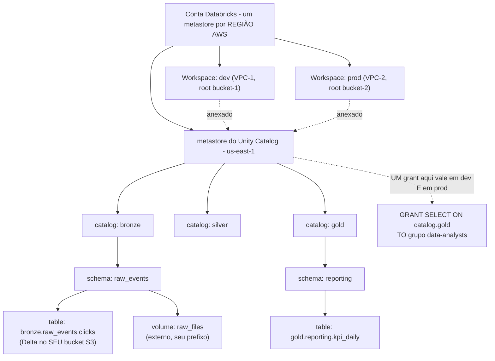
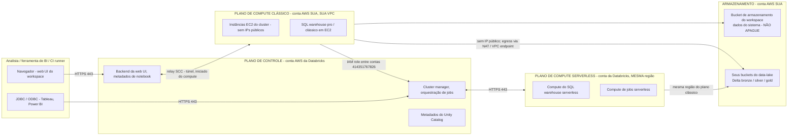
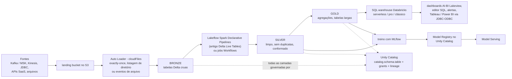
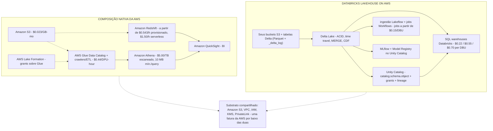
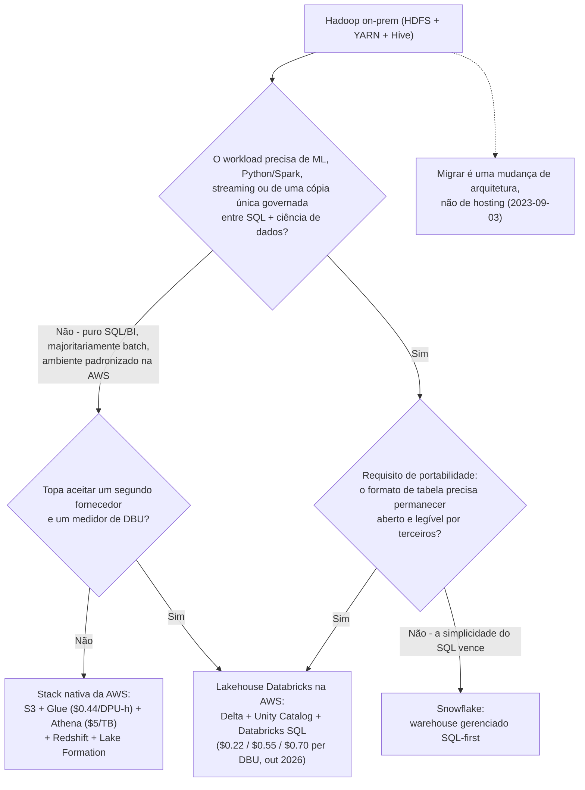

# Arquitetura Lakehouse no Databricks: Planos, Pilares e o Substrato AWS

Todas as outras lições deste curso assumem três coisas que você ainda não provou para si mesmo: que lakehouse é uma categoria arquitetural real e não uma palavra de marketing, que o software Databricks roda em *duas contas da AWS ao mesmo tempo* e que o dinheiro chega em *duas faturas separadas*. Erre qualquer uma das três e você vai desenhar um workspace cujo data lake fica no bucket errado, cujo modelo de ameaça aponta para a conta errada e cujo modelo de custo subconta cerca de metade.

Esta lição prova as três com fontes primárias. Cada fato arquitetural abaixo vem de páginas de `docs.databricks.com` com datas entre 2026-07-28 e 2026-09-25, dos blogs próprios de deployment da Databricks na AWS (2022-09-30, 2023-01-27) e das páginas de preços da AWS acessadas em **outubro de 2026**. Todo preço é preço de tabela em USD, carimbado com a data em que foi lido, porque as taxas de DBU e as taxas da AWS mudam.

```text
 =============================================================
  DATABRICKS LAKEHOUSE ON AWS - o mapa completo, em out 2026
 -------------------------------------------------------------
  PLANO DE CONTROLE  (conta AWS da Databricks, não a sua)
    web UI - metadados de notebook e job - cluster manager -
    orquestração de jobs - metadados do Unity Catalog
        ^  tráfego sempre iniciado DO plano de compute
        |  pela porta HTTPS 443, via o relay SCC
        v
  PLANO DE COMPUTE
    clássico - instâncias EC2 na SUA VPC, SEM IPs públicos,
               criadas por uma IAM role entre contas
    serverless- na conta da Databricks, mesma região AWS
               do seu plano clássico
        |
        v
  ARMAZENAMENTO  (conta AWS SUA)
    bucket de armazenamento do workspace - só dados do sistema: logs de
      cluster, revisões de notebook, resultados de job, planos. NÃO APAGUE.
    buckets do data-lake        - tabelas DELTA bronze/silver/gold,
      governadas pelas storage credentials do Unity Catalog
  -------------------------------------------------------------
  DOIS MEDIDORES, SEMPRE
    A AWS cobra você ........ EC2, S3, NAT gateway, transferência de dados
    A Databricks cobra você  DBU por SKU de compute:
      jobs a partir de $0.15/DBU - SQL clássico $0.22 - SQL pro $0.55
      - SQL serverless $0.70 (custo da instância INCLUSO)
      (taxas de tabela, acesso em 2026-10; variam por região e plano)
 =============================================================
```

Nesta lição você vai:

- definir o **lakehouse** em contraste com o data lake e o data warehouse, usando as três propriedades que a Databricks publicou em 2020 e o padrão medalhão (bronze → silver → gold);
- separar os **dois pilares** — Delta Lake para confiabilidade e formato, Unity Catalog para governança — e mapear cada um ao objeto da AWS que ele toca (seu bucket S3, sua IAM role);
- desenhar a divisão **plano de controle / plano de compute**, incluindo secure cluster connectivity, a IAM role entre contas e a regra de região do plano serverless;
- descobrir **onde os dados realmente ficam**, e por que o bucket de armazenamento do workspace definitivamente não é o seu data lake;
- montar o **mapa de workloads** (ingest → curate → serve → ML) e combinar cada workload ao compute que o executa;
- ler a **tabela de preços de DBU em out 2026** e calcular à mão seis exemplos resolvidos com números reais;
- comparar a plataforma **com a stack nativa da AWS, Snowflake e Hadoop on-prem** sem repetir marketing de fornecedor como fato;
- estudar **três estudos de caso nomeados da AWS**, ler a **caixa de atualizações de 2026** e responder **doze questões no estilo de exame**.

---

## 1. O que é um lakehouse: uma arquitetura, três propriedades

A definição atual da Databricks (databricks.com/blog/what-is-data-lakehouse-article, 2026-06-23) é a que vale decorar:

> "Um lakehouse de dados é uma nova arquitetura aberta de gerenciamento de dados que combina a flexibilidade, a eficiência de custo e a escala dos data lakes com o gerenciamento de dados e as transações ACID dos data warehouses, permitindo business intelligence (BI) e machine learning (ML) em todos os dados."

O post canônico de 2020 que batizou o padrão lista exatamente três propriedades definidoras (databricks.com/blog/2020/01/30/what-is-a-data-lakehouse.html, 2020-01-30):

1. **Suporte a transações** — transações ACID em armazenamento de objetos, de modo que escritores concorrentes e jobs com falha não corrompem uma tabela.
2. **Aplicação de schema e governança** — a camada de armazenamento rejeita dados que violam o schema declarado em vez de aceitá-los silenciosamente.
3. **Abertura** — os formatos de armazenamento são "abertos e padronizados, como Parquet", de modo que motores diferentes daquele que escreveu os dados possam lê-los.

Leia essas três propriedades em contraste com as duas arquiteturas entre as quais o lakehouse se situa:

| Propriedade | Data lake (S3 + arquivos) | Data warehouse (Redshift, Snowflake, Teradata) | **Lakehouse** |
|---|---|---|---|
| Custo e elasticidade de armazenamento | Excelente (S3 Standard $0.023/GB-mês, acesso em 2026-10) | Premium (Redshift provisionado a partir de $0.543/hora, serverless a partir de $1.50/hora, acesso em 2026-10) | **Custo de lake: formatos abertos no seu S3** |
| Transações ACID | Nenhuma sem uma camada de tabela | Nativas | **Nativas, via Delta Lake** |
| Aplicação de schema | Ad hoc, geralmente na leitura | Nativa | **Nativa, na escrita** |
| BI sobre dados estruturados | Fraco | Forte | **Forte (Databricks SQL, ANSI SQL com extensões Delta)** |
| ML / Python / Spark sobre todos os dados | Forte, mas sem governança | Fraco, exige exportação | **Forte e governado (Unity Catalog)** |
| Lock-in de formato | Baixo (Parquet) | Alto (proprietário) | **Baixo (Parquet + log Delta no seu bucket)** |

A frase "permitir BI e ML em todos os dados" é todo o caso de negócio: os warehouses forçam uma escolha entre SQL governado e ML utilizável, os lakes forçam uma escolha entre armazenamento barato e dados confiáveis. O lakehouse remove as duas escolhas ao colocar gerenciamento de tabelas de nível warehouse diretamente sobre o armazenamento de lake.

### 1.1 O padrão medalhão

A Databricks documenta o layout lógico padrão como a **arquitetura medalhão**, "um padrão de design de dados usado para organizar logicamente dados em um lakehouse ... (das tabelas das camadas Bronze ⇒ Silver ⇒ Gold)" (databricks.com/blog/what-is-medallion-architecture, 2022-03-09):

- **Bronze** — cru, apenas append, tudo que chegou, com os metadados de origem intactos.
- **Silver** — limpo, sem duplicatas, conformado, uma linha por entidade do mundo real.
- **Gold** — agregações de nível de negócio e tabelas largas prontas para BI, dashboards e feature stores.

As camadas são *logicamente*. Fisicamente são tabelas Delta comuns em buckets S3 comuns, separadas por nomes de catalog ou schema — é por isso que a lição 03 (Unity Catalog) e a lição 04 (transações Delta) partem desse diagrama.

- **📚 Você sabia?** "Lakehouse" é uma arquitetura, não um produto da Databricks. O próprio post de nomenclatura da Databricks em 2020 admite: "Outros serviços gerenciados como BigQuery e Redshift Spectrum têm algumas das funcionalidades de lakehouse listadas acima" (2020-01-30). Snowflake, Amazon Redshift, Microsoft Fabric e outros agora também reivindicam funcionalidades de lakehouse. O discriminador neste curso nunca é a palavra — é a combinação de um formato de tabela aberto no *seu* armazenamento com uma camada de governança que atravessa todos os motores.

---

## 2. Os dois pilares: Delta Lake e Unity Catalog

Tudo o que a Databricks vende na AWS se apoia em dois projetos open source. O enquadramento próprio da Databricks em 2024 os pareia explicitamente: "Confiabilidade dos dados ... a Databricks fornece Delta Lake" e "Governança facilitada ... com a ajuda do Unity Catalog" (databricks.com/blog/lakehouse-common-language-across-enterprise, 2024-06-21).

### 2.1 Pilar um — Delta Lake: a camada de confiabilidade e formato

Delta Lake é a camada de armazenamento open source que adiciona transações ACID, aplicação de schema, time travel e gerenciamento escalável de metadados ao armazenamento de objetos, e é o **formato de tabela padrão no Databricks** — "a fundação do lakehouse" (databricks.com/blog/what-is-data-lakehouse, 2020-02-11). Fisicamente é simples: um **log de transações write-ahead armazenado ao lado dos arquivos Parquet no seu bucket S3** (databricks.com/blog/2020/09/10/diving-deep-into-the-inner-workings-of-the-lakehouse-and-delta-lake.html, página atualizada em 2024-06-20).

O que isso te compra, tudo coberto na lição 04: commits serializáveis, upserts com `MERGE`, change data feed, time travel por versão ou timestamp, check constraints e evolução de schema sob regras explícitas.

### 2.2 Pilar dois — Unity Catalog: a camada de governança

O Unity Catalog modela "Todo ativo que você governa ... como um **objeto securable**", cobrindo "tabelas, views, volumes, funções, modelos e serviços", todos seguindo "um namespace de três níveis (`catalog.schema.object`)" (docs.databricks.com/aws/en/data-governance/unity-catalog, acesso em 2026-10). Três fatos moldam todo projeto de AWS que você for construir:

- O **metastore é o securable de nível superior** e é escopado a uma região de nuvem: "O metastore é o objeto securable de nível superior ... Um metastore contém todos os objetos securable registrados no Unity Catalog em uma única região de nuvem" (docs .../unity-catalog/securable-objects).
- Você precisa de "um metastore para cada região em que sua organização opera", e "os usuários precisam estar em um workspace anexado a um metastore em sua região" (docs .../unity-catalog/create-metastore).
- Grants viajam entre workspaces: "um privilégio concedido em um workspace é eficaz em todos os outros workspaces que compartilham esse metastore" (mesma fonte).
- Na AWS, uma **storage credential é uma IAM role** — essa é a costura onde a governança encontra a sua conta de nuvem (docs .../securable-objects).

Tabelas e volumes são **gerenciadas** (o Unity Catalog é dono tanto da governança quanto do ciclo de vida dos arquivos) ou **externas** (o Unity Catalog governa; você é dono dos arquivos) (docs .../unity-catalog).



### 2.3 Por que a combinação importa na AWS

Delta responde *"posso confiar nesses bytes?"* sem tirá-los do S3. O Unity Catalog responde *"quem pode ler quais bytes?"* com um único modelo de grants que sobrevive a mudanças de workspace, escopo de região e múltiplas contas da AWS. Nenhum substitui o outro: uma tabela perfeitamente ACID sem grants é um vazamento sem governança, e um catalog perfeitamente governado sobre arquivos descuidados é uma auditoria esperando para falhar.

| Pergunta | Respondida por | O objeto da AWS para o qual ela mapeia |
|---|---|---|
| Esta escrita foi atômica? Um job concorrente a corrompeu? | **Delta Lake** | commits JSON de `_delta_log/` ao lado do Parquet no seu bucket |
| O que acontece com esta tabela se o job cair no meio da execução? | **Delta Lake** | Rollback para o snapshot anterior |
| Os analistas de financeiro podem ler `gold.reporting.kpi_daily`? | **Unity Catalog** | Grant em um securable, verificado em todo workspace anexado ao metastore |
| Qual IAM role pode ler o prefixo subjacente? | **Unity Catalog storage credential** | Uma **IAM role** entre contas ou na mesma conta que você registra |
| Em qual prefixo físico `bronze.raw_events.clicks` aponta? | **Unity Catalog external location** | Um par caminho S3 + credential |

---

## 3. Anatomia do workspace: o plano de controle e o plano de compute

"A Databricks opera a partir de um **plano de controle** e de um **plano de compute**" (docs.databricks.com/aws/en/getting-started/high-level-architecture, página atualizada pela última vez em 2026-09-11). Esta é a frase mais testável da lição 01 — e a mais frequentemente deturpada por engenheiros que só leram os blogs de engenharia mais antigos da Databricks.

### 3.1 Os três planos

- **Plano de controle (conta da Databricks).** "O plano de controle inclui os serviços de backend que a Databricks gerencia na sua conta Databricks. O plano de controle fica na conta da Databricks, não na sua conta de nuvem" (mesma página, 2026-09-11). Ele guarda a web UI, comandos e metadados de notebook, cluster manager, orquestração de jobs e metadados do Unity Catalog — criptografados em repouso (databricks.com/blog/best-practices-and-guidance-cloud-engineers-deploy-databricks-aws-part-1, 2022-09-30).
- **Plano de compute clássico (a sua conta).** Clusters e SQL warehouses pro/clássico rodam como instâncias EC2 "dentro da rede virtual de cada workspace, na conta de AWS do cliente", o que dá ao plano "isolamento natural porque roda na própria conta AWS de cada cliente" (docs .../high-level-architecture, 2026-09-11).
- **Plano de compute serverless (conta da Databricks).** "A Databricks cria um plano de compute serverless na mesma região AWS do plano de compute clássico do seu workspace" e o isola "dentro de um limite de rede do workspace" (mesma página). Mesma região do seu plano clássico — não uma região arbitrária da Databricks.

> Materiais mais antigos — incluindo os próprios blogs de deployment de 2022–2023 da Databricks — dizem **plano de dados** onde a documentação de hoje diz **plano de compute**. Mesmo conceito, vocabulário atual. Se um tutorial diz "plano de dados", ele quer dizer o plano de compute clássico/serverless descrito aqui.

### 3.2 Secure cluster connectivity: sem portas abertas, sem IPs públicos

"Todos os workspaces novos são criados com secure cluster connectivity por padrão. Secure cluster connectivity significa que as VPCs do cliente não têm portas abertas e que os recursos do plano de compute clássico não têm endereços IP públicos" (docs.databricks.com/aws/en/security/network/classic, atualizado em 2026-09-25). Os clusters alcançam o plano de controle por um túnel seguro sobre a **porta HTTPS 443** até um relay SCC, e o tráfego é sempre **iniciado do plano de compute para fora** (databricks.com/blog/...part-1, 2022-09-30). Não existe caminho de entrada para a Databricks abrir, porque não existe caminho de entrada algum.

Consequência que os alunos perdem: **SCC não é "sem egress".** Os clusters ainda precisam de uma rota de saída — NAT gateway, internet gateway ou PrivateLink — para alcançar o plano de controle e as APIs da AWS, e um gateway endpoint de S3 mantém o tráfego do S3 na espinha dorsal da AWS para nunca ser cobrado pelo NAT (databricks.com/blog/optimizing-aws-s3-access-databricks, 2022-08-11). A lição 02 dimensiona isso corretamente.

### 3.3 A IAM role entre contas: como a Databricks pode lançar a sua EC2

A criação de um workspace precisa de três configurações — **credential** (uma IAM role entre contas), **network** (VPC/subnets/security groups) e **storage** (o bucket de armazenamento do workspace) — e pode ser dirigida pelo console de conta, pela Account API ou pelo Terraform (docs.databricks.com/aws/en/admin/workspace, 2026-07-28). A credential é um papel que você cria na *sua* conta cuja política de confiança nomeia a conta AWS da Databricks: "Crie uma nova IAM role entre contas com uma política de acesso ... No campo Account ID, insira o ID da conta Databricks **414351767826**" (docs .../create-uc-workspace; docs .../administration-guide/account-api/iam-role.html, 2026-01-24), com o ID da sua conta Databricks como external ID. Pré-requisitos nessa página: "Tenha uma VPC e um NAT gateway disponíveis na sua conta AWS, na região do workspace."



```matching
{
  "question": "Combine cada plano ou local de armazenamento com o que ele realmente possui na AWS (em out 2026):",
  "pairs": [
    {"left": "Plano de controle (conta AWS da Databricks)", "right": "Backend da web UI, METADADOS de notebook e job, cluster manager, orquestração de jobs, metadados do Unity Catalog - nunca os dados das suas tabelas"},
    {"left": "Plano de compute clássico (sua conta AWS, sua VPC)", "right": "Instâncias EC2 para clusters e SQL warehouses pro/clássico, sem IPs públicos, alcançados apenas pela HTTPS 443 através do relay SCC"},
    {"left": "Plano de compute serverless (conta AWS da Databricks)", "right": "Compute de SQL e jobs serverless, criado na MESMA região AWS do seu plano de compute clássico, isolado em um limite de rede do workspace"},
    {"left": "Bucket de armazenamento do workspace (sua conta AWS)", "right": "Só dados do sistema do workspace - logs de cluster, revisões de notebook, resultados de job, planos de query; apagá-lo é irreversível"},
    {"left": "Seus buckets do data-lake (sua conta AWS)", "right": "Tabelas Delta bronze/silver/gold sobre Parquet, endereçadas pelas storage credentials e external locations do Unity Catalog"}
  ],
  "explanation": "A divisão é de propriedade, não de geografia: metadados e orquestração vivem na conta da Databricks; compute bruto (clássico) e todo armazenamento vivem na sua; compute serverless é o único workload que roda na conta da Databricks e ainda assim na sua região. A armadilha é o bucket de armazenamento do workspace - ele fica na SUA conta, ao lado do seu lake, e parece um bucket de dados, mas guarda apenas dados do sistema do workspace. A Databricks é explícita: 'Não apague nem modifique o armazenamento do workspace na sua conta de nuvem ... Se o armazenamento do workspace for apagado, o workspace não pode ser recuperado' (docs .../high-level-architecture, atualizado em 2026-09-11)."
}
```

> [!WARNING]
> ⚠️ **O bucket de armazenamento do workspace (o antigo "root bucket") não é o seu data lake, e não pode ser apagado.** Três regras, todas oficiais: (1) "Workspaces clássicos exigem que você forneça um bucket S3 e um prefixo para usar como bucket de armazenamento do workspace" (docs .../high-level-architecture, 2026-09-11) — ele guarda logs de cluster, revisões de notebook, resultados de job, planos de query e o estado das bibliotecas. (2) "Não apague nem modifique o armazenamento do workspace na sua conta de nuvem ... Se o armazenamento do workspace for apagado, o workspace não pode ser recuperado" (mesma página). (3) O guia de deployment é direto: "é uma boa prática que este bucket não seja usado para dados de cliente nem para múltiplos workspaces" (databricks.com/blog/...part-2, 2023-01-27). Suas tabelas bronze/silver/gold pertencem a **buckets separados e específicos**, governados pelo Unity Catalog. Dois workspaces compartilhando um root bucket, ou PII de cliente despejado nele, são ambos falhas de projeto que vão morder você na lição 02 e na lição 11.

---

## 4. Onde os dados realmente ficam (e onde não ficam)

Um workspace clássico tem três superfícies de armazenamento na *sua* conta da AWS, e só uma delas é o lake:

| Superfície | Dono | Conteúdo | Regra |
|---|---|---|---|
| **Bucket de armazenamento do workspace** (blogs antigos: "root bucket") | Você | Logs de cluster, revisões de notebook, resultados de execução de job, resultados de query SQL, planos de query | Nunca apague, nunca compartilhe entre workspaces, nunca guarde dados de cliente nele |
| **Workspace file system** | Armazenamento do workspace gerenciado pela Databricks | Notebooks, queries SQL, dashboards, alertas, repos, bibliotecas, arquivos Python/YAML | Colabore aqui; é mais ou menos metadados, não dados analíticos |
| **Seus buckets do data-lake** | Você | Tabelas Delta (Parquet + `_delta_log/`) para bronze/silver/gold e volumes externos | Governados pelas storage credentials e external locations do Unity Catalog |

Duas distinções da documentação oficial evitam os erros clássicos:

1. **Dados do sistema do workspace versus DBFS root.** A documentação os separa explicitamente: "DBFS root é um sistema de arquivos acessível pelo usuário, enquanto os dados do sistema do workspace são usados internamente pelos recursos da Databricks" — mesmo que ambos fiquem no mesmo bucket. DBFS root e mounts de DBFS são **legados e não recomendados** para projetos novos (docs .../high-level-architecture, 2026-09-11).
2. **Tabelas gerenciadas versus externas.** Os arquivos de uma tabela Delta *gerenciada* vivem onde o Unity Catalog os colocou (ainda no seu S3, sob um caminho que o UC gerencia); os arquivos de uma tabela *externa* vivem em um prefixo que você já possui, e o UC governa só os metadados. Ambos são "seus dados" — nenhum fica no bucket de armazenamento do workspace.

Workspaces serverless mudam a história de armazenamento *do workspace* (os dados do workspace vão para o armazenamento padrão gerenciado pela Databricks), mas não mudam a história do lake: as tabelas analíticas continuam nos **seus** buckets S3, alcançados pelo Unity Catalog. A pergunta do plano de dados e a pergunta do armazenamento são perguntas separadas.

- **📚 Você sabia?** A terminologia mudou duas vezes. O blog de deployment de 2023 da Databricks diz **S3 root bucket**; a documentação atual diz **workspace storage bucket**; e o "plano de dados" dos mesmos blogs é hoje o **plano de compute**. Quando você ler um tutorial antigo ou um site de preparação para exame que usa as palavras antigas, traduza: root bucket → workspace storage bucket, plano de dados → plano de compute clássico/serverless. Materiais didáticos que ainda apresentam "plano de dados" como vocabulário atual da Databricks estão citando posts de engenharia de 2022–2023.

---

## 5. O mapa de workloads: ingest → curate → serve → ML

O fluxo de referência deste curso, montado a partir da documentação de Auto Loader, medalhão, Databricks SQL e MLflow:

1. **Fontes** — Kafka/Amazon MSK, Kinesis, JDBC, APIs SaaS e arquivos deixam payloads crus em um **landing bucket no S3**.
2. **Ingestão** — **Auto Loader** (`cloudFiles`) descobre novos arquivos incrementalmente e escreve tabelas Delta **bronze**. Ele "processa incremental e eficientemente novos arquivos de dados à medida que chegam ao armazenamento em nuvem" e seu armazenamento de estado chave-valor "garante que os dados sejam processados exactly once" (docs .../auto-loader, página datada de 2026-04-01).
3. **Curate** — **Lakeflow Spark Declarative Pipelines** (o Delta Live Tables renomeado) ou jobs comuns limpam, removem duplicatas e conformam para **silver**, e depois agregam para **gold**.
4. **Serve** — **Databricks SQL** em um warehouse serverless/pro/clássico alimenta dashboards, o editor SQL, alertas e BI externo via JDBC/ODBC. "O Databricks SQL é um data warehouse de nuvem construído sobre arquitetura lakehouse. Ele roda diretamente no seu data lake, suporta SQL ANSI com extensões do Delta Lake" (docs .../aws/en/sql/, atualizado em 2026-09-11).
5. **Aprender** — **MLflow** rastreia experimentos, e o **Model Registry no Unity Catalog** fornece "controle de acesso centralizado, auditoria, lineage e descoberta de modelos entre workspaces" (docs .../manage-model-lifecycle).
6. **Governar** — Unity Catalog cobre cada camada, com lineage e auditoria disponíveis a partir das system tables.



### 5.1 Mapeamento workload → compute

Esta tabela é o núcleo prático da lição; toda decisão de custo posterior começa aqui.

| Workload | Padrão interativo típico | Compute que você deve usar | Medidor |
|---|---|---|---|
| Exploração, PySpark/SQL ad hoc | Curto, compartilhado, interativo | **Clusters de notebook (all-purpose)** | Taxa de DBU all-purpose + sua EC2 |
| Pipelines de produção, ETL noturno | Agendado, de propósito único, efêmero | **Job clusters (Workflows)** | Taxa de DBU de jobs ("a partir de $0.15/DBU", databricks.com/pricing, acesso em 2026-10) + sua EC2 |
| Dashboards, BI, relatórios SQL | Alta concorrência, elástico, precisa de parada automática | **SQL warehouse — serverless, pro ou clássico** | Taxa de DBU de SQL: $0.22 / $0.55 / $0.70 |
| Transformações declarativas batch/streaming | Grafo de transformações dependentes, expectations | **Lakeflow Spark Declarative Pipelines** | Taxa de DBU de pipeline + compute |
| Treino de ML e serving de modelos | GPU/alta memória, com registry | **Job clusters / ML serverless, Model Serving** | Taxas de DBU de jobs/IA |
| Apps de dados interativos | Backends web de baixa latência | **Databricks Apps** | DBU do SKU de app (SKU de exemplo $0.75/DBU, databricks.com/product/pricing/databricks-apps, acesso em 2026-10) |

- **📚 Você sabia?** O mesmo código PySpark pode custar materialmente menos como job do que como cluster interativo. O guia de gestão de custos da Databricks afirma o mecanismo diretamente: "Melhor desempenho somado às taxas de custo por DBU mais baixas que os job clusters oferecem levam a economias de custo dramáticas" (databricks.com/blog/best-practices-cost-management-databricks, 2022-10-18). Job clusters são efêmeros e de propósito único; clusters all-purpose ficam quentes para humanos. O intervalo exato de taxas entre SKUs varia por região e camada de plano — a Databricks publica apenas valores "a partir de" em suas páginas públicas de preços (acesso em 2026-10), então sempre verifique de novo o seu próprio contrato em vez de decorar uma grade vinda de um site de terceiros.

```dragdrop
{
  "question": "Coloque o fluxo lakehouse de referência na ordem em que os dados realmente o percorrem na AWS:",
  "items": [
    "As fontes deixam arquivos e eventos crus em um landing bucket no S3",
    "O Auto Loader (cloudFiles) descobre novos arquivos e escreve tabelas Delta BRONZE exactly once",
    "Lakeflow Spark Declarative Pipelines ou jobs Workflows limpam e removem duplicatas para SILVER",
    "Agregações constroem tabelas de negócio GOLD",
    "Um SQL warehouse Databricks serve o gold para dashboards, alertas e BI externo via JDBC-ODBC",
    "O MLflow treina em tabelas de features silver/gold e registra modelos no Unity Catalog"
  ],
  "correctOrder": [
    "As fontes deixam arquivos e eventos crus em um landing bucket no S3",
    "O Auto Loader (cloudFiles) descobre novos arquivos e escreve tabelas Delta BRONZE exactly once",
    "Lakeflow Spark Declarative Pipelines ou jobs Workflows limpam e removem duplicatas para SILVER",
    "Agregações constroem tabelas de negócio GOLD",
    "Um SQL warehouse Databricks serve o gold para dashboards, alertas e BI externo via JDBC-ODBC",
    "O MLflow treina em tabelas de features silver/gold e registra modelos no Unity Catalog"
  ],
  "explanation": "Aterragem -> ingest -> curate -> serve -> aprendizado, com o Unity Catalog governando tudo isso. Dois fatos de ordenação importam. Primeiro, o Auto Loader fica entre o landing bucket e o bronze porque é o componente que fornece o estado exactly-once; escrever arquivos crus direto em uma tabela bronze com uma leitura Spark ingênua perde essa garantia. Segundo, serving e ML leem das camadas curadas - gold para BI, silver ou gold para features - é por isso que a ordem do medalhão não é decoração, mas um grafo de dependências. O nome histórico do passo de transformação é Delta Live Tables; a Databricks o renomeou para Lakeflow Spark Declarative Pipelines (docs .../ldp/concepts/where-is-dlt, 2026-01-23)."
}
```

---

## 6. Os dois medidores: taxas de DBU e a fatura da AWS

"Uma Databricks Unit (DBU) é uma unidade normalizada de poder de processamento na Databricks Lakehouse Platform usada para fins de medição e precificação" (databricks.com/product/pricing, acesso em 2026-10), e o glossário a define como "unidades de capacidade de processamento por hora com base no tipo de instância de VM" (docs .../resources/glossary, atualizado em 2026-08-15). Você paga DBUs pelo *processamento*; a AWS cobra separadamente pelo *metal e pelo encanamento*.

### 6.1 A tabela de preços, em outubro de 2026

| SKU | Taxa de tabela | Inclui o custo da instância AWS? | Fonte (acesso em 2026-10) |
|---|---|---|---|
| Databricks SQL **Classic** warehouse | **$0.22 / DBU** | Não — a AWS cobra a EC2 à parte | databricks.com/product/pricing/databricks-sql |
| Databricks SQL **Pro** warehouse | **$0.55 / DBU** | Não — a AWS cobra a EC2 à parte | mesma |
| Databricks SQL **Serverless** warehouse | **$0.70 / DBU** | **Sim** | mesma |
| Lakeflow Jobs (engenharia de dados), "a partir de" | **$0.15 / DBU** | Não | databricks.com/pricing |
| "Data warehousing", "a partir de" | **$0.22 / DBU** | — | databricks.com/pricing |
| "Interactive workloads", "a partir de" | **$0.40 / DBU** | — | databricks.com/pricing |
| "AI", "a partir de" | **$0.07 / DBU** | — | databricks.com/pricing |
| Databricks Apps (SKU de exemplo) | **$0.75 / DBU** | — | databricks.com/product/pricing/databricks-apps |
| Lakehouse//RT (Beta), us-east-1 | **$0.55 Premium / $0.70 Enterprise per DBU**, desconto introdutório de 30% (menos DBUs emitidos) **até 2027-01-31** | Sim (serverless) | docs .../sql-warehouse/real-time-pricing, atualizado em 2026-09-22 |

Preços de tabela, em USD, com acesso em **2026-10**; variam por nuvem, região e camada de plano (AWS: Standard/Premium/Enterprise) e por contrato. A Databricks publica valores "a partir de" para jobs e SKUs interativos — trate qualquer grade completa que você encontre em um site de custos de terceiros como não verificada.

> [!IMPORTANT]
> **Duas faturas, uma plataforma — não duplique a contagem, não subconte.** Em um workspace clássico, **a AWS cobra as instâncias EC2, o NAT gateway, as requisições do S3 e a transferência de dados na sua conta**, enquanto **a Databricks cobra DBUs pelo processamento que aquelas instâncias fizeram**. SQL serverless e jobs serverless embutem o custo da instância *dentro* da taxa de DBU; as taxas clássicas não. "O preço da Databricks se baseia no seu uso de compute. Armazenamento, rede e custos relacionados variarão..." (databricks.com/product/pricing, acesso em 2026-10). Os dois erros mais comuns dos alunos são (a) citar o número de DBU como custo total de um cluster e (b) aplicar uma taxa serverless a um workspace clássico (ou vice-versa) e "descobrir" uma economia fantasma de 30–60%.

### 6.2 Exemplo resolvido E1 — um job cluster de quatro nós, os dois medidores

**Em out 2026.** Um trabalho noturno roda em um cluster de 4 nós cujo tipo de instância é cobrado a **3 DBU/hora** no SKU de jobs.

```text
Exemplo resolvido E1 - cluster de jobs de 4 nós, uma hora, em out 2026
Medidor Databricks:
  4 nós x 3 DBU/h x $0.15/DBU (jobs, "a partir de") = $1.80 / hora
Medidor AWS (sua conta, varia por tipo de instância/região/RI ou spot):
  EC2 para 4 nós .......................... cobrado pela AWS, à parte
  Processamento de dados do NAT gateway .... cobrado pela AWS, à parte
  PUT/GET no S3 na tabela Delta ............ cobrado pela AWS, à parte
TOTAL (apenas o lado Databricks) .......... $1.80 / hora
Execução noturna de 8 h x 30 dias:
  4 x 3 x 8 x 30 = 2,880 DBU x $0.15 ... = $432.00 / mês (lado do DBU)
```

**Leitura:** o lado em DBU de um trabalho noturno de 8 horas é de **$432/mês na taxa publicada de jobs "a partir de"**; o lado da AWS é uma segunda fatura que você precisa somar você mesmo. Mesmo código, SKU diferente: se aquele workload fosse dirigido interativamente na taxa interativa "a partir de" de **$0.40/DBU**, os mesmos 2,880 DBU seriam cobrados como **$1,152** — uma diferença de **2.67×** para um compute que faz a mesma aritmética. É por isso que workloads de produção pertencem a job clusters e que BI pertence a warehouses.

### 6.3 Exemplo resolvido E2 — um mês de warehouse serverless e o imposto de ociosidade

Uma equipe roda um SQL warehouse serverless **8 horas/dia, 20 dias/mês**, com média de **4 DBU/hora** (o serverless faz auto-scale dentro da hora; 4 DBU/h é uma média plausível de equipe pequena — ajuste aos seus próprios números de `system.billing.usage` quando chegar lá).

```text
Exemplo resolvido E2 - SQL warehouse serverless, em out 2026
Tempo de execução ...... 8 h/dia x 20 dias = 160 h
DBUs consumidos ........ 160 h x 4 DBU/h = 640 DBU
Cobrança Databricks .... 640 x $0.70 (SQL serverless) = $448.00 / mês
Cobrança AWS ........... $0 extra (a taxa de DBU serverless inclui o custo da instância)

Cenário contrafactual - o mesmo warehouse deixado ligado 24/7 por 30 dias:
  720 h x 4 DBU/h = 2,880 DBU x $0.70 = $2,016.00 / mês
  prêmio de ociosidade = $2,016 - $448 = $1,568 / mês (um estouro de 4.5x)
```

**Leitura:** a própria documentação da Databricks avisa que "SQL warehouses ociosos continuam a acumular DBU e cobranças de instância de nuvem até serem parados" (docs .../compute/sql-warehouse/create). Padrões de parada automática em out 2026: **pro/clássico 45 minutos** (mínimo 10), **serverless 10 minutos** (mínimo na UI 5; a API pode definir **1 minuto**). Mudar a parada automática de 45 minutos para 10 em um warehouse pro usado em sessões de 30 minutos é uma economia *grátis*; deixar qualquer coisa ligada 24/7 é a maior linha evitável de uma operação de BI.

```plot
{
  "type": "bar",
  "title": "Custo mensal no lado Databricks do mesmo mês de 640 DBU (taxas de tabela, em out 2026)",
  "xLabel": "SKU de compute",
  "yLabel": "Cobrança da Databricks para 640 DBU (USD)",
  "xKey": "sku",
  "dataKeys": ["monthly_usd"],
  "data": [
    {"sku": "SQL Classic $0.22/DBU", "monthly_usd": 140.8},
    {"sku": "SQL Pro $0.55/DBU", "monthly_usd": 352},
    {"sku": "SQL Serverless $0.70/DBU", "monthly_usd": 448},
    {"sku": "Interactive from $0.40/DBU", "monthly_usd": 256}
  ]
}
```

### 6.4 Exemplo resolvido E3 — a fatura de armazenamento sob as mesmas tabelas

O armazenamento do próprio lake, para escala: **1 TB (1,024 GB) mantidos por um mês em S3 Standard** a $0.023/GB-mês (aws.amazon.com/s3/pricing, acesso em 2026-10) = **$23.55/mês**, mais requisições PUT/GET (o GET do S3 Standard custa $0.0004 por 1,000 requisições). Um ambiente gold curado de 10 TiB custa, portanto, cerca de **$235/mês para ser mantido** — aproximadamente metade do que um único warehouse serverless ocioso cobra no mesmo intervalo (E2). Armazenamento é a metade *barata* de um lakehouse; a disciplina de compute é onde está o dinheiro.

```fillblank
{
  "question": "Complete a frase de cobrança de um lakehouse Databricks na AWS, usando as taxas de tabela de outubro de 2026:",
  "template": "A Databricks mede o processamento em {{1}}, o que para um SQL warehouse custa $0.22/DBU no Classic, $0.55/DBU no Pro e $0.70/DBU no {{2}} - o único dos três cuja taxa já inclui o custo da instância AWS - enquanto a AWS cobra separadamente os recursos EC2, {{3}} e S3 que vivem na sua própria conta.",
  "answers": {
    "1": "DBUs",
    "2": "Serverless",
    "3": "NAT gateway"
  },
  "distractors": ["vCPUs", "Data warehouse units", "Glue Data Catalog", "EC2", "Kinesis", "Athena", "Lambda", "internet gateway", "CloudWatch"],
  "explanation": "O DBU é o medidor de processamento da Databricks ('uma unidade normalizada de poder de processamento', databricks.com/product/pricing, acesso em 2026-10); os três níveis de SQL warehouse são $0.22 / $0.55 / $0.70 por DBU (databricks.com/product/pricing/databricks-sql, acesso em 2026-10), e apenas o nível serverless embute o custo da instância de nuvem. O terceiro espaço é o recurso do lado da AWS que mais surpreende as equipes: o egress do plano de compute clássico passa por um NAT gateway, que cobra processamento de dados e horas na sua fatura da AWS - a armadilha 'duas faturas' da seção 6.1. Distratores como 'EC2' ou 'internet gateway' são recursos da AWS, mas não o nomeado nesta frase; 'Data warehouse units' é um termo do Snowflake, não da Databricks."
}
```

---

## 7. A mesma query, três medidores: Databricks versus a stack nativa da AWS

A alternativa nativa da AWS é uma composição, não um produto: **S3** para armazenamento, **Glue Data Catalog** para metadados/crawlers/ETL, **Athena** para SQL serverless, **Redshift** para um warehouse provisionado ou serverless, **Lake Formation** para grants, **QuickSight** para BI. Preços, todos com acesso em 2026-10:

| Componente nativo da AWS | Preço de tabela | Modelo de medição |
|---|---|---|
| Amazon S3 Standard | a partir de **$0.023/GB-mês**; GET **$0.0004/1,000 requisições** | por GB-mês + por requisição |
| AWS Glue (crawlers, ETL, manutenção de tabelas) | **$0.44 por DPU-hour**, cobrado por segundo, mínimo de 1 minuto | por DPU-hour |
| Amazon Athena | **$5.00 por TB escaneado**, arredondado para o MB mais próximo, **mínimo de 10 MB por query** | por byte escaneado |
| Amazon Redshift | provisionado a partir de **$0.543/hora**; serverless a partir de **$1.50/hora**; Spectrum por bytes escaneados (mínimo de 10 MB/query) | por node-hour / por hora / por byte |
| AWS Lake Formation | grants sobre o catalog do Glue | (camada de governança) |
| Databricks SQL (para contraste) | **$0.22 / $0.55 / $0.70 por DBU** | por DBU-hour de processamento |

### 7.1 Exemplo resolvido E4 — Athena versus Databricks SQL para um workload de dashboard

Um dashboard escaneia **20 GB/dia** durante **22 dias/mês**.

```text
Exemplo resolvido E4 - medidor mensal de query, em out 2026
Caminho Athena:
  20 GB/dia x 22 dias = 440 GB = 0.4297 TB
  0.4297 TB x $5.00/TB ............... = ~$2.15 / mês
  (mais o mínimo de 10 MB por query - irrelevante aqui)
Caminho Databricks SQL (ilustrativo):
  um warehouse serverless com média de 4 DBU/h x 60 h de dashboards
  = 240 DBU x $0.70 .................. = $168.00 / mês
```

**Leitura:** para um dashboard de BI leve e pesado em scans, o medidor por TB do Athena é *dramaticamente* mais barato — **~$2.15 vs ~$168**. Esse é um resultado honesto, não uma falha do Databricks: o preço por byte pune *scans pesados repetidos, ETL, joins, MERGE, streaming e ML*, e recompensa *leituras raras, largas e ad hoc*. A pergunta de projeto nunca é "qual motor é mais barato", mas "qual medidor corresponde à forma do workload". É exatamente por isso que a lição 15 ensina atribuição de custo através do `system.billing.usage` em vez de benchmarks de fornecedor.

### 7.2 Exemplo resolvido E5 — dimensionar a landing zone

Uma pipeline deposita **500 GB/dia** de arquivos crus no S3 Standard.

```text
Exemplo resolvido E5 - armazenamento da landing zone, em out 2026
Diário ................ 500 GB
Mensal .............. 500 x 30 = 15,000 GB
Armazenamento ....... 15,000 GB x $0.023/GB-mês = $345.00 / mês
Requisições ......... mais LIST/GET/PUT pelas taxas publicadas por requisição
Escolha de retenção . 30 dias crus + compactação Delta ~= $345 em um mês
                      180 dias crus sem limpeza = ~$2,070 acumulados
```

**Leitura:** $345/mês para *manter* um mês de dados de aterragem. Dois alavancas dominam: **retenção** (limpe os arquivos de origem depois que o Auto Loader fizer o commit; as opções `cleanSource` da documentação existem para exatamente isso) e **tamanho de arquivo** (milhares de arquivos minúsculos inflacionam tanto as cobranças de requisição quanto o planejamento do Delta). Armazenamento é previsível; os lados de requisição e de compute são onde os projetos falham em silêncio.

### 7.3 As duas stacks, lado a lado



| Capacidade | Stack nativa da AWS | Lakehouse Databricks |
|---|---|---|
| Formato de tabela / ACID | Tabelas Glue sobre Parquet/ORC; suporte a Delta no Athena é **somente leitura, só Glue catalog, motor v3, sem time travel** (docs.aws.amazon.com/athena/latest/ug/delta-lake-tables.html) | Delta Lake como padrão, ACID/MERGE/CDF completos |
| Governança | Grants do Lake Formation sobre o Glue | Securables do Unity Catalog entre workspaces e motores |
| Batch + streaming em um motor só | Glue para ETL, Kinesis/MSK para streaming, Glue/Athena para micro-batches | Auto Loader + Structured Streaming + Lakeflow em um único runtime |
| SQL / BI | Athena (por TB), Redshift (por node/hour) | Databricks SQL (por DBU), serverless, dashboards Lakeview |
| ML | SageMaker (plataforma separada, cópias separadas) | MLflow + registry do UC nas mesmas tabelas |
| Superfície de fornecedor | Só AWS, sem segunda fatura | Segundo fornecedor + medidor de DBU |
| Melhor para | Ambientes só-SQL, majoritariamente batch, padronizados na AWS e que não querem um fornecedor de plataforma | SQL misto + Python/Spark + streaming + ML querendo uma cópia única governada |

- **📚 Você sabia?** A própria AWS documenta a interoperabilidade do Delta em vez de tratá-lo como concorrente: o Athena "pode ler tabelas Delta Lake armazenadas no Amazon S3 diretamente, sem precisar gerar arquivos de manifesto nem executar a instrução MSCK REPAIR" (docs.aws.amazon.com/athena/latest/ug/delta-lake-tables.html, acesso em 2026-10) — com os limites honestos de somente leitura, motor v3 e ausência de time travel. Glue, EMR e Redshift Spectrum também podem processar tabelas Delta no S3 (databricks.com/blog/databricks-aws-guide-data-ai-summit-2023-featuring-labcorp-conde-nast-grammarly-vizio-ntt-data, 2023-06-23). Formatos abertos cortam nos dois sentidos: o seu lake é portátil, e os motores dos seus concorrentes podem lê-lo.

---

## 8. O substrato da AWS que você herda (dimensionamento resolvido)

A lição 02 entra fundo; aqui está o quadro. Os requisitos centrais de um deployment padrão são "uma VPC gerenciada pelo cliente, conectividade do plano de dados ao plano de controle, IAM role entre contas e S3 root bucket" (databricks.com/blog/...part-2, 2023-01-27), e "Para cada workspace deve haver um mínimo de duas subnets privadas dedicadas, cada uma com máscara de rede entre /17 e /26, em zonas de disponibilidade separadas" (mesma fonte). O guia bem-arquitetado acrescenta: "Crie uma VPC com bloco CIDR mínimo /18 para deployments de workspace" (docs.databricks.com/aws/en/lakehouse-architecture/security-compliance-and-privacy/best-practices, 2026-07-16).

### 8.1 Exemplo resolvido E6 — dimensionamento de subnet para um workspace

```text
Exemplo resolvido E6 - matemática de subnets do workspace, em out 2026
Requisito ....... >= 2 subnets privadas, netmask /17 .. /26, AZs separadas,
                  dedicadas por workspace (NÃO reutilizadas entre workspaces)
Escolha ......... /24 cada = 251 endereços IPv4 utilizáveis cada
                  (a AWS reserva 5 dos 256 por subnet: rede, roteador,
                  DNS, uso futuro e broadcast - documentação VPC da AWS)
Verificação ..... cada nó consome 1 IP ENI primário (+ IPs ENI secundários
                  por tipo de instância); 254 IPs bastam para um cluster de 20 nós
                  mais as NICs do cluster, mas workspaces concorrentes precisam
                  das próprias subnets => dev e prod NUNCA compartilham subnets
Se precisar ..... /22 = 1,022 IPs utilizáveis por AZ; /20 = 4,094; o teto é
                  /17 = 32,766 IPs utilizáveis, o piso é /26 = 62
Também exigido .. NAT gateway para egress (SCC não é 'sem egress'),
                  VPC endpoints para S3/API onde possível para evitar cobranças
                  de processamento de dados do NAT, e >= 1 AZ por subnet (2 AZs exigidas)
```

**Leitura:** dois `/24` em AZs separadas satisfazem a regra publicada com folga. A restrição que realmente morde é **"dedicadas por workspace"** — subnets não são colocadas em pool entre workspaces, então cada workspace que você cria consome as próprias duas subnets do CIDR da sua VPC. Planeje a VPC como `/18` (segundo o guia bem-arquitetado) e você pode hospedar vários workspaces antes de tocar no roteamento.

Existem três arquiteturas de referência de rede da Databricks em out 2026 — **Managed security**, **Hardened connectivity** e **Isolated environment** — que diferem em profundidade de PrivateLink, listas de acesso por IP, controles de egress serverless e PrivateLink de entrada, enquanto **secure cluster connectivity mais uma VPC gerenciada pelo cliente estão presentes nas três** (docs.databricks.com/aws/en/security/network/deployment-architecture, acesso em 2026-10). Observe também os bloqueios por plano: VPC gerenciada pelo cliente, criação de metastore do UC e SQL serverless todos exigem o **plano Premium ou superior** (docs .../permissions, atualizado em 2026-09-11; docs .../create-metastore; docs .../admin/sql/serverless).

---

## 9. Escolhendo a plataforma: Snowflake e o Hadoop do qual você está saindo

### 9.1 versus Snowflake

Enquadramento neutro, porque ambos os fornecedores publicam páginas de comparação que se contradizem:

| Dimensão | Snowflake (como publicado) | Databricks (como publicado) | Posição didática |
|---|---|---|---|
| Formato | Warehouse proprietário, agnóstico de nuvem | Lakehouse aberto: Delta/Parquet no *seu* S3 | Portabilidade favorece formatos abertos |
| Força em SQL / BI | Força central, concorrência madura | Forte via Databricks SQL (ANSI SQL + extensões Delta) | Ambos são credíveis para ambientes SQL-first |
| ML / Python / Spark | Crescente, geralmente superfície separada | De primeira classe: notebooks, MLflow, registry do UC | Ambientes com muito ML favorecem Databricks |
| Streaming | Focado em micro-batch | Auto Loader, Structured Streaming, Lakeflow | Streaming pesado favorece Databricks |
| Carga de operações | Muito baixa (totalmente gerenciado) | Baixa–média (você é dono de VPC, IAM, subnets) | Snowflake é mais simples de subir |
| Qualidade da evidência | Página de comparação snowflake.com ("em 5 de novembro de 2025") | Página de comparação databricks.com | **Ambos são marketing; nenhum número é fato** |

Ambas as páginas fazem afirmações opostas de desempenho e de preço/desempenho. Este curso trata cada uma delas como uma **afirmação de fornecedor com data**, nunca como fato, e nunca cita um multiplicador head-to-head como algo que um aluno deva decorar. Escolha Snowflake quando o workload for puro SQL/BI com concorrência previsível e você quiser a simplicidade de um warehouse; escolha Databricks quando ML/AI, streaming, Python/Spark e portabilidade de formato aberto forem requisitos de primeira classe; cada vez mais, coexistam — federação e Delta Sharing significam que os dois não se excluem mutuamente (ver lições 12 e 17).

### 9.2 versus Hadoop on-prem (HDFS + YARN + Hive)

O guia de migração da Databricks é direto: "Mesmo que você migre workloads legados de Hadoop on-premises para serviços gerenciados em nuvem como o EMR ... ainda vai esbarrar nos mesmos problemas de confiabilidade e escalabilidade" (databricks.com/solutions/migration/hadoop, 2023-09-03). O mapeamento é mecânico:

| Hadoop on-prem | Lakehouse na AWS |
|---|---|
| HDFS (replicação 3×, desperdício de capacidade) | S3 (durabilidade projetada de 99.999999999%, $0.023/GB-mês) |
| YARN (cluster fixo, capacidade estática) | Clusters elásticos + planos de compute serverless |
| Hive metastore (local ao workspace, proliferação de ACLs) | Unity Catalog (um metastore por região, securables, lineage) |
| Formatos de arquivo só-HDFS / marts proprietários | Parquet + Delta abertos, legíveis por outros motores |
| ETL só-batch | Auto Loader + Structured Streaming + Lakeflow |

Habilidades e investimentos em BI atravessam precisamente *porque* os formatos continuam abertos: o SQL não precisa ser reescrito para sair de tabelas estilo Hive e chegar a tabelas gold sustentadas por Delta, e a lição 03 cobre esse caminho de migração (`hive_metastore` aparece como um catalog legado de nível superior).

### 9.3 A decisão, desenhada



O diagrama codifica três regras práticas desta lição: portabilidade de formato aberto e workloads mistos apontam para o lakehouse; só-SQL mais preferência por um único fornecedor aponta para a stack nativa da AWS; e um ambiente Hadoop não sofre "lift and shift" — ele é redesenhado (é por isso que a lição 03 trata a migração do `hive_metastore` como um caminho de primeira classe).

---

## 10. Por que abertura é requisito de projeto, não slogan

Três fatos concretos de interoperabilidade, todos oficiais e todos datados:

1. **Seus dados são Parquet mais um log de transações Delta no seu bucket S3** — qualquer motor que entenda o formato pode lê-lo sem exportar de um armazenamento proprietário (databricks.com/blog/2020/01/30/what-is-a-data-lakehouse.html).
2. **Leitores do lado da AWS:** o Athena lê tabelas Delta registradas no catalog do AWS Glue (somente leitura, motor v3, sem time travel — docs.aws.amazon.com/athena/latest/ug/delta-lake-tables.html, acesso em 2026-10).
3. **Leitores de terceiros via Unity Catalog:** "Por meio de APIs abertas e credential vending, o Unity Catalog permite que motores externos como Trino, DuckDB, Apache Spark, Daft e motores integrados ao Iceberg REST catalog, como o Dremio, acessem tabelas gerenciadas" (docs .../tables/managed, 2026-08-18), pela **Unity REST API** e pelo **Iceberg REST Catalog (IRC)** (docs .../external-access/unity-rest, 2026-08-26).

O ponto estratégico é o da própria Databricks: um lakehouse proprietário armazena dados "em formatos que apenas um fornecedor consegue ler", enquanto os dados de um lakehouse aberto vivem em "Delta Lake e Apache Iceberg ... em formatos de arquivo abertos como Apache Parquet" (databricks.com/blog/what-open-lakehouse-open-data-standards-explained, 2026-06-16). Na AWS isso importa de uma segunda forma: **você mantém os dados na sua conta**, então uma troca de motor, uma disputa com fornecedor ou uma aquisição não vira um projeto de extração de dados.

- **📚 Você sabia?** Compartilhar também é aberto: **Delta Sharing** é um protocolo aberto (coberto na lição 12), enquanto **Databricks Marketplace** é o catálogo comercial construído sobre ele. Como os arquivos subjacentes são formatos abertos, um share pode ser consumido por motores que não são Databricks — essa é a resposta prática para "o que acontece com o meu lake se um dia sairmos?".

---

## 11. As armadilhas: onze confusões que este curso não vai deixar você manter

1. **"Plano de dados" versus "plano de compute".** A mesma coisa; a documentação desde 2026 diz *plano de compute*, dividido em *clássico* e *serverless*. Blogs antigos dizem plano de dados.
2. **O plano de controle não é a sua conta.** Ele fica na conta AWS da Databricks — mas o bucket de armazenamento do workspace em um workspace clássico fica na *sua* conta. Confundir os dois produz um modelo de ameaça errado.
3. **O bucket de armazenamento do workspace não é o data lake.** Só dados do sistema; não apagável; nunca compartilhado entre workspaces; nunca usado para dados de cliente.
4. **O DBFS root é legado.** Ele pode ficar no mesmo bucket que os dados do sistema do workspace, mas "DBFS root é um sistema de arquivos acessível pelo usuário, enquanto os dados do sistema do workspace são usados internamente pelos recursos da Databricks" (docs .../high-level-architecture, 2026-09-11) — e DBFS root/mounts não são recomendados para projetos novos.
5. **Renomeações são reais; verifique antes de ensinar ou responder.** Delta Live Tables → **Lakeflow Spark Declarative Pipelines** (docs .../ldp/concepts/where-is-dlt, 2026-01-23; nota de release de 2025-11-12) **sem exigir migração de código**, com os SKUs clássicos ainda começando com `DLT`; SQL endpoints → **SQL warehouses** (2023); Model Registry do workspace → **Models in Unity Catalog**.
6. **Duas faturas.** DBUs mais a sua fatura da AWS; taxas serverless embutem instâncias, taxas clássicas não.
7. **Jobs versus SKU all-purpose.** O mesmo código pode custar materialmente menos como job — a orientação oficial diz isso (2022-10-18) — mas o intervalo exato depende de região/contrato, então verifique de novo em vez de decorar.
8. **Athena lendo Delta ≠ suporte total a Delta.** Só Glue catalog, motor v3, **somente leitura, sem time travel**.
9. **O escopo do metastore é regional, não por workspace.** Um metastore por região; `hive_metastore` é um catalog legado de nível de workspace.
10. **Serverless é condicional.** Exige plano Premium, e o compute serverless roda na conta da Databricks **na mesma região AWS** do seu plano clássico.
11. **Benchmarks de fornecedor são marketing nos dois sentidos.** As páginas Databricks-versus-Snowflake e Snowflake-versus-Databricks fazem afirmações mutuamente contraditórias; cite-as apenas como "afirmação de fornecedor, com data".

> [!WARNING]
> ⚠️ **Armadilhas de dia de exame e de dia de projeto desta lição:**
> - **O plano de controle fica na conta da Databricks; o plano de compute clássico fica na sua; o bucket de armazenamento do workspace fica na sua, mas não é o seu lake.** Três respostas diferentes de propriedade — erre uma e o seu diagrama de fluxo de dados está errado.
> - **SCC significa sem IPs públicos e sem portas de entrada abertas, não sem egress.** Você ainda precisa de NAT/VPC endpoints/PrivateLink, e os gateway endpoints de S3 existem para manter o tráfego do S3 (e sua cobrança por NAT) fora do caminho público.
> - **Nunca publique um número de DBU sem seu SKU, região, camada de plano e data.** "A partir de $0.15/DBU" para jobs e a tabela de planos de SQL ($0.22/$0.55/$0.70) são os valores que a Databricks publica abertamente em out 2026; grades completas por SKU circulando em sites de terceiros não são oficiais.
> - **As taxas serverless incluem o custo da instância; as taxas clássicas não.** Compará-las sem somar a EC2 do lado clássico inventa economias.
> - **Delta Live Tables ainda aparece em todos os lugares em tutoriais antigos e históricos de clientes** — significa Lakeflow Spark Declarative Pipelines desde 2026-01-23.

### Atualizações de 2026 (em outubro de 2026)

> [!NOTE]
> **O que mudou na plataforma da qual esta lição depende:**
> - **2026-01-23 — Delta Live Tables agora é Lakeflow Spark Declarative Pipelines.** "O produto antes chamado Delta Live Tables (DLT) foi atualizado para Lakeflow Spark Declarative Pipelines (SDP) ... não há migração necessária" (docs.databricks.com/aws/en/ldp/concepts/where-is-dlt, página datada de 2026-01-23; o aviso anterior de renomeação "Lakeflow Declarative Pipelines" é de 2025-11-12). SKUs clássicos ainda começam com `DLT`.
> - **2026-01-06 — liquid clustering está maduro e rodando em escala.** "Liquid Clustering se tornou geralmente disponível em 2024 ... clientes rodando em escala, incluindo dezenas com **tabelas em escala de petabyte** em produção" (databricks.com/blog/debunking-8-data-layout-myths-why-liquid-clustering-outperforms-partitioning, 2026-01-06). Debates de particionamento/ZORDER em materiais mais antigos estão superados; a lição 14 cobre isso.
> - **2026-09-22 — warehouses Lakehouse Real-Time (Beta) publicam preços na AWS.** SKU `LAKEHOUSE_SERVERLESS_COMPUTE`, us-east-1 **$0.55 Premium / $0.70 Enterprise per DBU**, com "desconto introdutório de 30% até 31 de janeiro de 2027 ... seus workloads consomem 30% menos DBUs" (docs .../sql-warehouse/real-time-pricing, atualizado em 2026-09-22) — status Beta, então verifique de novo depois da janela promocional.
> - **2026-08-18 / 2026-08-26 — o Unity Catalog abre tabelas gerenciadas para motores de fora** por credential vending mais a **Unity REST API** e o **Iceberg REST Catalog**, nomeando Trino, DuckDB, Spark, Daft, Flink e Dremio (docs .../tables/managed, 2026-08-18; docs .../external-access/unity-rest, 2026-08-26). Interoperabilidade agora é uma superfície de API, não uma afirmação de blog.
> - **2026-05-04 — o próprio blueprint de certificação segue o rebrand.** O guia de exame Data Engineer Associate, versão de registro datada de 4 de maio de 2026, diz "trabalhando com **Lakeflow Jobs**" onde a versão de 30 de julho de 2025 dizia "Databricks Workflows" — confirmação oficial de que a nomenclatura Workflows/Lakeflow se estabilizou (PDFs de exam guide, ambas as versões com acesso em 2026-10).

---

## Estudos de Caso do Mundo Real

> **📋 Caso A — Biogen (farmacêutica, Cloud: AWS)**
> **Desafio.** A informática on-premises não conseguia escalar para petabytes de genômica: "um pipeline que antes levava 2 semanas para processar 700,000 variantes".
> **Stack na AWS.** Runtime Databricks for Genomics com Delta Lake, ao lado da plataforma DNAnexus na AWS — a página do caso carrega a própria tag `Cloud: AWS` da Databricks.
> **Resultado relatado.** "2 milhões de variantes genômicas analisadas em 15 minutos · 2 alvos de fármaco descobertos" (https://www.databricks.com/customers/biogen, página sem data, acesso em 2026-10; origem do caso 2020-11).
> **Relação com esta lição.** L01 — migração para um lakehouse de nuvem medida em *semanas de compute removidas*, não apenas em dólares: o conceito de lakehouse e o pilar de formatos abertos tornaram portável um ambiente on-prem.
> ⏳ *Nota temporal: um número de origem de 2020; trate-o como o que a Biogen relatou na época, não como uma garantia de plataforma de 2026.*

> **📋 Caso B — Punchh / fidelidade no varejo (Cloud: AWS)**
> **Desafio.** MySQL da AWS superado, um warehouse caro demais, ferramentas sem ACID, e relatórios do Tableau pagando um join de 12 tabelas a cada refresh.
> **Stack na AWS.** Databricks SQL sobre Delta Lake bronze/silver/gold, notebooks, Tableau por cima — `Cloud: AWS` na página do caso.
> **Resultado relatado.** "10x mais rápido no time-to-insight · 30% menores custos operacionais · 12% de aumento na satisfação do cliente" (https://www.databricks.com/customers/punchh, página sem data, acesso em 2026-10; origem do caso 2021-09).
> **Citação.** "Somos capazes de armazenar dados crus assim como dados refinados no mesmo lakehouse." — Jagan Mangalampalli, Punchh (mesma URL).
> **Relação com esta lição.** L01 secundário — o layout medalhão da seção 5 como controle de *custo*: tabelas gold pré-join vencem joins de 12 vias na hora do relatório.
> ⏳ *Nota temporal: relatado em 2021; as proporções são da Punchh, não um SLA de plataforma.*

> **📋 Caso C — Rivian (veículos elétricos, Cloud: AWS)**
> **Desafio.** Terabytes de dados de veículos por dia de mais de 70,000 veículos, com ferramentas legadas que "luitavam para escalar pipelines com custo eficiente" e times em silos bloqueando o ML de manutenção preditiva.
> **Stack na AWS.** Databricks SQL, Delta Lake, Unity Catalog e liquid clustering — `Cloud: AWS` na página do caso; o compêndio de 100 casos nomeia "Unity Catalog para governança de dados, Delta Tables para armazenamento e Liquid Clustering para layout de dados" para ML de previsão de carga em tempo real.
> **Resultado relatado.** "1,000+ usuários da plataforma, um aumento de 75% em relação a um ano antes" (https://www.databricks.com/customers/rivian, página sem data, acesso em 2026-10); "50% melhor desempenho de tempo de execução" (https://www.databricks.com/your-ai/customers/rivian, 2024-05-30); detalhes da stack em https://www.databricks.com/blog/data-intelligence-action-100-data-and-ai-use-cases-databricks-customers (2025-07-09).
> **Relação com esta lição.** L01 — um lakehouse AWS governado alimentando dashboards *e* ML de produção a partir das mesmas tabelas, o que concretiza a afirmação de "cópia única de dados" da seção 1.
> ⏳ *Nota temporal: as métricas vêm de páginas de 2024–2025; carimbe-as com a data quando as citar.*

> **Veredito Comparativo — lakehouse versus nativo da AWS versus Snowflake versus Hadoop on-prem**
> - **Versus um data lake puro (S3 + Parquet, sem camada de tabela):** você mantém o custo e a elasticidade, mas perde ACID, aplicação de schema e time travel. Se nada jamais falhar, sobrescrever ou rodar de forma concorrente, um lake cru é mais barato; em produção, o log de transações do Delta é o seguro mais barato da stack.
> - **Versus a stack nativa da AWS (S3 + Glue + Athena + Redshift + Lake Formation):** o nativo da AWS vence para ambientes só-SQL, majoritariamente batch, padronizados na AWS, que querem um único fornecedor e medidores por uso ($5.00/TB no Athena, $0.44/DPU-hour no Glue). O Databricks vence quando você precisa de uma cópia única governada para SQL *e* Python/Spark *e* streaming *e* ML — ao preço de um segundo fornecedor, de um medidor de DBU e de um plano Premium para o conjunto completo de recursos. Ambos se apoiam no mesmo S3, e a AWS documenta a interoperabilidade do Delta em vez de isolá-la.
> - **Versus Snowflake:** o Snowflake vence na simplicidade de SQL/BI puro e no zero de trabalho com VPC; o Databricks vence em ML/AI, streaming e portabilidade de formato aberto. Não publique nenhum multiplicador head-to-head em um documento de projeto — as páginas de comparação de ambos os fornecedores são marketing carimbado com data que contradiz o outro lado.
> - **Versus Hadoop on-prem (HDFS + YARN + Hive):** não é uma disputa acirrada em 2026 — o S3 substitui o HDFS, o compute elástico/serverless substitui o YARN, e o Unity Catalog substitui o Hive metastore, enquanto os formatos abertos preservam os seus ativos de SQL e BI. A ressalva honesta: "Mesmo que você migre workloads legados de Hadoop on-premises para serviços gerenciados em nuvem como o EMR ... ainda vai esbarrar nos mesmos problemas de confiabilidade e escalabilidade" (2023-09-03) — o que você está mudando é a arquitetura, não o hosting.

> [!SUCCESS]
> **Pontos Principais (Key Takeaways):**
> 1. **Um lakehouse = economias de lake + gerenciamento de warehouse em formatos abertos.** Três propriedades publicadas (2020-01-30): suporte a transações ACID, aplicação de schema e governança, abertura em formatos padronizados como Parquet — permitindo "BI e ML em todos os dados" (definição datada de 2026-06-23).
> 2. **Dois pilares, dois papéis.** Delta Lake = confiabilidade/formato (log write-ahead ao lado do Parquet no *seu* S3); Unity Catalog = governança (securables `catalog.schema.object`, um metastore **por região**, um privilégio vale em todo workspace anexado, storage credentials são IAM roles na AWS).
> 3. **Os planos.** Plano de controle na conta da Databricks (UI, metadados de notebook/job, cluster manager, metadados do UC); plano de compute clássico como EC2 na *sua* VPC **sem IPs públicos e sem portas abertas** (SCC por padrão, HTTPS 443, egress iniciado do compute); plano de compute serverless na conta da Databricks **na mesma região AWS**.
> 4. **Propriedade do armazenamento.** Bucket de armazenamento do workspace = dados do sistema (logs, revisões, resultados de job, planos) — **não apagável, não compartilhado, não é o seu lake**; suas tabelas Delta bronze/silver/gold vivem nos seus próprios buckets atrás de storage credentials do UC; DBFS root é legado.
> 5. **Mapa de workloads.** Fontes → aterragem no S3 → Auto Loader (exactly-once) → bronze → Lakeflow SDP/jobs → silver → gold → Databricks SQL/AI-BI/BI externo; MLflow treina em silver/gold e registra no UC. Combine o compute: exploração → all-purpose, produção → job clusters, BI → SQL warehouse, transformações → Lakeflow, ML → MLflow/UC.
> 6. **Dois medidores, tabela de out 2026:** SQL **$0.22 Classic / $0.55 Pro / $0.70 Serverless** por DBU (serverless inclui o custo da instância; clássico não), jobs **a partir de $0.15/DBU**, interativo **a partir de $0.40/DBU**, IA **a partir de $0.07/DBU** — mais a sua fatura da AWS para EC2/NAT/S3. Padrões de parada automática: **45 min** pro/clássico, **10 min** serverless.
> 7. **Matemática resolvida que você pode reutilizar:** cluster de jobs de 4 nós a 3 DBU/h = **$1.80/h** (**$432/mês** para um agendamento de 8h × 30d) — E1; mês serverless de 640 DBU = **$448** vs **$2,016** se deixado 24/7 — E2; 1 TiB em S3 Standard = **$23.55/mês** — E3; 440 GB de scans de dashboard no Athena ≈ **$2.15/mês** vs ~$168 de DBUs de warehouse — E4; landing zone de 500 GB/dia = **$345/mês** — E5; duas subnets `/24` dedicadas em AZs separadas satisfazem a regra `/17`–`/26` — E6.
> 8. **Comparações, mantidas com honestidade:** o nativo da AWS (Glue $0.44/DPU-hour, Athena $5.00/TB, Redshift a partir de $0.543/h) atende ambientes só-SQL e majoritariamente batch; o Snowflake atende a simplicidade de SQL/BI puro; o Hadoop mapeia mecanicamente para S3/YARN→elástico/UC. Números de fornecedor contra fornecedor são afirmações com data, nunca fatos.
> 9. **A abertura é estrutural:** seus dados são Parquet + um log Delta no seu bucket; o Athena lê Delta em modo somente leitura via Glue (motor v3, sem time travel); Unity REST API e Iceberg REST Catalog expõem tabelas do UC para Trino, DuckDB, Flink, Spark e Dremio (2026-08-18 / 2026-08-26).
> 10. **Os nomes mudaram:** Delta Live Tables → **Lakeflow Spark Declarative Pipelines** (2026-01-23, sem migração, SKUs `DLT` permanecem); SQL endpoints → **SQL warehouses**; Model Registry do workspace → **Models in Unity Catalog**; "plano de dados" → **plano de compute**.

---

## Perguntas de Prática (Practice Questions)

```question
{
  "id": "dbl-01-q1",
  "type": "multiple-choice",
  "question": "O post de 2020 da Databricks que batizou o padrão lakehouse lista três propriedades definidoras. Qual conjunto está correto?",
  "options": [
    "Suporte a transações ACID, aplicação de schema e governança, e abertura em formatos padronizados como Parquet",
    "Armazenamento colunar, escala elástica e um plano de controle totalmente gerenciado",
    "Replicação zero-copia, schema-on-read e formatos de tabela proprietários",
    "Managed Identity, criptografia em repouso e tiering automático"
  ],
  "correct": 0,
  "explanation": "O post da Databricks de 2020-01-30 nomeia exatamente essas três: suporte a transações, aplicação de schema e governança, e abertura ('os formatos de armazenamento que eles usam são abertos e padronizados, como Parquet'). A alternativa B mistura atributos reais de lakehouse com um detalhe de deployment; a alternativa C está errada porque os formatos de lakehouse são abertos, não proprietários; a alternativa D lista recursos de segurança de nuvem que pertencem a qualquer arquitetura, inclusive um bucket S3 simples."
}
```

```question
{
  "id": "dbl-01-q2",
  "type": "true-false",
  "question": "O plano de controle do Databricks roda na conta AWS da Databricks em vez da conta AWS do cliente, enquanto o compute EC2 de um workspace clássico roda na conta do cliente.",
  "options": ["Verdadeiro", "Falso"],
  "correct": 0,
  "explanation": "Verdadeiro. 'O plano de controle fica na conta da Databricks, não na sua conta de nuvem' e o compute clássico roda 'dentro da rede virtual de cada workspace, na conta de AWS do cliente' (docs .../high-level-architecture, atualizado em 2026-09-11). A armadilha é o bucket de armazenamento do workspace: ele fica na conta do cliente mesmo sendo gerenciado por recursos da Databricks - localização da conta e propriedade não são a mesma pergunta."
}
```

```question
{
  "id": "dbl-01-q3",
  "type": "multiple-choice",
  "question": "Secure cluster connectivity está habilitado por padrão em todos os workspaces novos em out 2026. O que ele realmente garante?",
  "options": [
    "As VPCs do cliente não têm portas abertas e os recursos do plano de compute clássico não têm endereços IP públicos; os clusters alcançam o plano de controle pela porta HTTPS 443",
    "Nenhum tráfego jamais sai da VPC do cliente, então NAT gateways e custos de egress de internet desaparecem",
    "Todo o tráfego do S3 contorna a cobrança da AWS e é cobrado apenas como DBUs",
    "PrivateLink de entrada é obrigatório e as listas de acesso por IP não são mais necessárias"
  ],
  "correct": 0,
  "explanation": "A documentação é literal: 'as VPCs do cliente não têm portas abertas e os recursos do plano de compute clássico não têm endereços IP públicos' (docs .../security/network/classic, atualizado em 2026-09-25), com um túnel seguro sobre HTTPS 443. A alternativa B é a leitura errada clássica - o SCC restringe caminhos de entrada, não o egress; os clusters ainda precisam de NAT/IGW ou PrivateLink, e é por isso que um gateway endpoint de S3 importa (2022-08-11). A alternativa D está errada: PrivateLink de entrada aparece apenas na arquitetura de referência 'Isolated environment'."
}
```

```question
{
  "id": "dbl-01-q4",
  "type": "multiple-choice",
  "question": "Onde ficam as tabelas Delta bronze/silver/gold em um workspace Databricks clássico na AWS?",
  "options": [
    "Nos seus próprios buckets S3, endereçados pelas storage credentials e external locations do Unity Catalog - nunca no bucket de armazenamento do workspace",
    "No bucket de armazenamento do workspace, ao lado dos logs de cluster e das revisões de notebook",
    "No plano de controle do Databricks, criptografados com uma chave gerenciada pela Databricks",
    "No DBFS root, que é o local recomendado para todas as tabelas de produção novas"
  ],
  "correct": 0,
  "explanation": "O bucket de armazenamento do workspace guarda dados do sistema do workspace - 'logs de cluster, revisões de notebook, resultados de job e bibliotecas' - e a Databricks aconselha que ele 'não seja usado para dados de cliente nem para múltiplos workspaces' (2023-01-27), enquanto a documentação avisa que apagá-lo é irreversível (2026-09-11). Tabelas analíticas ficam nos seus buckets sob caminhos gerenciados pelo UC ou externos. A alternativa D falha porque DBFS root/mounts são legados e não recomendados; a alternativa C está errada porque o plano de controle guarda metadados, não dados de tabela."
}
```

```question
{
  "id": "dbl-01-q5",
  "type": "multiple-choice",
  "question": "Sua organização opera em us-east-1 e eu-west-1 e quer governança do Unity Catalog nas duas. Quantos metastores você precisa, e como os grants se comportam?",
  "options": [
    "Dois metastores - um por região - e um privilégio concedido em um workspace é eficaz em todos os outros workspaces que compartilham esse metastore",
    "Um metastore global para a conta inteira, porque catalogs são de âmbito de conta em todo lugar",
    "Um metastore por workspace, para que cada workspace possa ser governado independentemente",
    "Dois metastores, mas os grants precisam ser reaplicados manualmente em cada workspace"
  ],
  "correct": 0,
  "explanation": "'Você deve ter um metastore para cada região em que sua organização opera' (docs .../create-metastore), e 'um privilégio concedido em um workspace é eficaz em todos os outros workspaces que compartilham esse metastore' (docs .../securable-objects). Como 'sua conta Databricks tem um metastore por região, os catalogs são inerentemente isolados por região' (docs .../catalogs). Os distratores invertem as duas regras: metastores por workspace é exatamente o que o Unity Catalog substituiu, e reaplicar grants por workspace descreve o modelo legado hive_metastore/ACL."
}
```

```question
{
  "id": "dbl-01-q6",
  "type": "true-false",
  "question": "Segundo a documentação de janeiro de 2026, Delta Live Tables foi renomeado para Lakeflow Spark Declarative Pipelines, e pipelines existentes exigem migração de código.",
  "options": ["Verdadeiro", "Falso"],
  "correct": 1,
  "explanation": "Falso - a renomeação é real, a migração não. 'O produto antes chamado Delta Live Tables (DLT) foi atualizado para Lakeflow Spark Declarative Pipelines (SDP) ... não há migração necessária' (docs .../ldp/concepts/where-is-dlt, página datada de 2026-01-23); SKUs clássicos ainda começam com DLT. A armadilha é assumir que todo rebrand implica trabalho: este é só de nomenclatura e empacotamento, e é por isso que históricos antigos de clientes citando 'Delta Live Tables' continuam citáveis com o nome moderno entre colchetes."
}
```

```question
{
  "id": "dbl-01-q7",
  "type": "multiple-choice",
  "question": "Uma equipe quer o compute adequado mais barato para um job ETL noturno agendado e para um dashboard de BI de alta concorrência. Qual combinação está correta?",
  "options": [
    "ETL noturno em job clusters do Workflows (jobs a partir de $0.15/DBU); dashboards em um SQL warehouse ($0.22/$0.55/$0.70 por DBU)",
    "ETL noturno em um cluster all-purpose; dashboards no mesmo cluster all-purpose por simplicidade",
    "ETL noturno em um SQL warehouse; dashboards em compute all-purpose interativo",
    "Ambos devem usar Databricks Apps a $0.75/DBU, que é o SKU publicado mais barato"
  ],
  "correct": 0,
  "explanation": "Workloads se mapeiam para compute: execuções de produção agendadas e de propósito único pertencem a job clusters - 'as taxas de custo por DBU mais baixas que os job clusters oferecem levam a economias de custo dramáticas' (2022-10-18) - enquanto BI pertence a SQL warehouses que param automaticamente e escalam para concorrência (taxas de tabela com acesso em 2026-10). A alternativa B paga taxas interativas para um agendamento de máquina; a alternativa C roda relatórios SQL em compute geral e ETL em capacidade de warehouse; a alternativa D cita o SKU do Apps ($0.75/DBU), que é o valor mais caro da tabela, não o mais barato."
}
```

```question
{
  "id": "dbl-01-q8",
  "type": "multiple-choice",
  "question": "Um job cluster de 4 nós faz média de 3 DBU/hora no SKU de jobs. Usando a taxa publicada 'a partir de' de $0.15/DBU (em out 2026), qual é o custo no lado Databricks de uma execução de 8 horas?",
  "options": ["$14.40", "$36.00", "$1.80", "$432.00"],
  "correct": 0,
  "explanation": "4 nós x 3 DBU/h x 8 h = 96 DBU; 96 x $0.15 = $14.40 para a execução (e 2,880 DBU x $0.15 = $432 para um mês de 30 dias cheio de tais execuções - exemplo resolvido E1). A alternativa B é a mesma contagem de DBU a uma taxa de warehouse; a alternativa C é o valor por hora, não a execução de 8 horas; a alternativa D é o valor mensal. Lembre-se também de que este é apenas o medidor Databricks - a AWS cobra a EC2 à parte, e qualquer grade de terceiros com taxas 'oficiais' por SKU além dos valores publicados 'a partir de' não é verificada."
}
```

```question
{
  "id": "dbl-01-q9",
  "type": "multiple-choice",
  "question": "Qual afirmação sobre o preço dos SQL warehouses do Databricks em outubro de 2026 está correta?",
  "options": [
    "SQL Serverless é $0.70/DBU e inclui o custo da instância de nuvem; SQL Classic ($0.22/DBU) e SQL Pro ($0.55/DBU) não incluem, então a AWS ainda cobra a EC2 por eles",
    "Os três tipos de warehouse incluem o custo da instância, então a fatura da AWS é idêntica em todos os casos",
    "SQL Classic é o plano mais caro porque roda na conta do cliente",
    "Warehouses serverless não podem ser parados automaticamente, então sempre cobram menos que os clássicos"
  ],
  "correct": 0,
  "explanation": "A tabela de planos publicada (databricks.com/product/pricing/databricks-sql, acesso em 2026-10) é $0.22 Classic / $0.55 Pro / $0.70 Serverless, com o serverless embutindo explicitamente o custo da instância de nuvem - é por isso que as taxas de DBU de clássico/pro parecem menores, mas chegam com uma segunda fatura da AWS. A alternativa B não duplica nada e perde completamente a divisão; a alternativa C confunde localização da conta com preço; a alternativa D está de trás para frente - o serverless usa parada automática de 10 minutos por padrão (pro/clássico 45 minutos), e um warehouse sem parada 'continua a acumular DBU e cobranças de instância de nuvem' (docs .../compute/sql-warehouse/create)."
}
```

```question
{
  "id": "dbl-01-q10",
  "type": "multiple-choice",
  "question": "Um colega afirma que o Amazon Athena suporta Delta Lake completamente, então a equipe pode descartar o Databricks SQL por completo. O que é preciso em out 2026?",
  "options": [
    "O Athena lê tabelas Delta registradas no AWS Glue catalog, mas o suporte é somente leitura, apenas motor v3 e sem time travel",
    "O Athena lê e escreve tabelas Delta com suporte completo a MERGE, time travel e change data feed",
    "O Athena só pode ler tabelas Delta que foram exportadas para Iceberg primeiro",
    "O suporte do Athena a Delta exige executar uma instrução MSCK REPAIR em toda query"
  ],
  "correct": 0,
  "explanation": "A AWS documenta que o Athena 'pode usar o Amazon Athena para ler tabelas Delta Lake armazenadas no Amazon S3 diretamente, sem precisar gerar arquivos de manifesto nem executar a instrução MSCK REPAIR' - com as limitações declaradas 'Tabelas apenas com AWS Glue catalog', 'Apenas motor V3', 'Sem suporte a time travel' e 'Somente leitura' (docs.aws.amazon.com/athena/latest/ug/delta-lake-tables.html, acesso em 2026-10). A alternativa A é a única que corresponde; a alternativa B descreve o Databricks, não o Athena; a alternativa D inverte a documentação - nenhum MSCK REPAIR é necessário para esse caminho."
}
```

```question
{
  "id": "dbl-01-q11",
  "type": "true-false",
  "question": "Os números de desempenho e de preço/desempenho publicados em databricks.com/databricks-vs-snowflake e snowflake.com/en/snowflake-vs-databricks devem ser citados em documentos de projeto como benchmarks factuais.",
  "options": ["Verdadeiro", "Falso"],
  "correct": 1,
  "explanation": "Falso. Ambas as páginas são marketing de fornecedor e se contradizem (as afirmações da Databricks versus a página do Snowflake, 'em 5 de novembro de 2025'), então este curso trata todo multiplicador head-to-head como 'afirmação de fornecedor, carimbada com data', nunca como fato. O que você pode afirmar como fato são as mecânicas oficiais e com fonte: formatos abertos no seu S3, semântica de grants do Unity Catalog e preços de tabela publicados com data de acesso."
}
```

```question
{
  "id": "dbl-01-q12",
  "type": "multiple-choice",
  "question": "Qual par combina corretamente uma dependência do lado da AWS com o recurso do Databricks que ela habilita na AWS?",
  "options": [
    "IAM role entre contas que confia na conta Databricks 414351767826 -> provisiona compute clássico na sua VPC; duas subnets privadas /17-/26 em AZs separadas -> configuração de rede do workspace",
    "AWS Glue Data Catalog -> o metastore do Unity Catalog; Amazon QuickSight -> SQL warehouses",
    "Um gateway endpoint de S3 -> secure cluster connectivity (ele substitui o relay SCC)",
    "AWS Lambda -> plano de compute serverless; Amazon Kinesis -> o cluster manager do plano de controle"
  ],
  "correct": 0,
  "explanation": "A configuração de credential é uma IAM role entre contas que nomeia o ID da conta AWS da Databricks 414351767826 com a sua conta Databricks como external ID, e a criação de workspace exige 'uma VPC e um NAT gateway disponíveis' mais duas subnets privadas dedicadas com netmask /17 a /26 em zonas de disponibilidade separadas (docs .../iam-role.html, 2026-01-24; blog de deployment, 2023-01-27). A alternativa B confunde o catalog nativo da AWS com o Unity Catalog; a alternativa C confunde uma otimização do caminho de dados do S3 com o túnel SCC do plano de controle; a alternativa D mapeia serviços da AWS para planos que eles não populam - o plano serverless é compute gerenciado pela Databricks, não Lambda."
}
```
