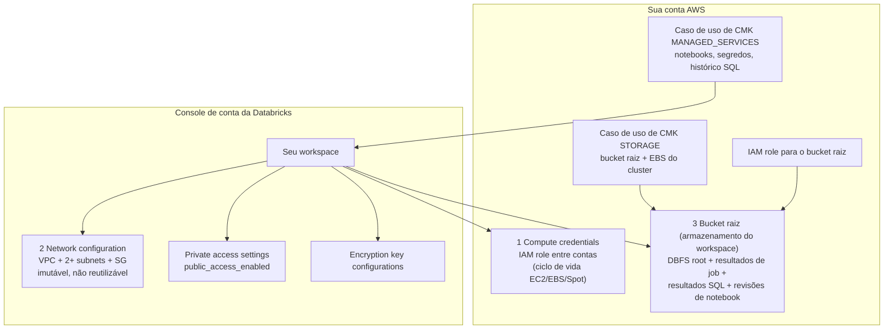
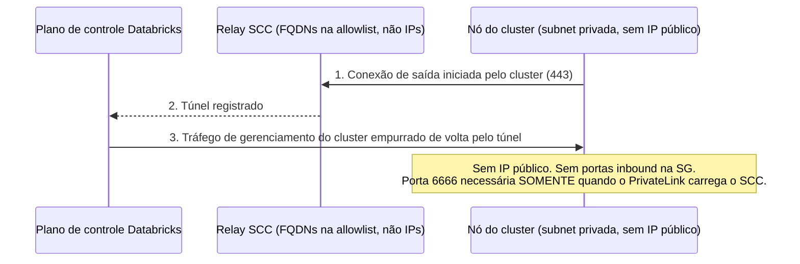
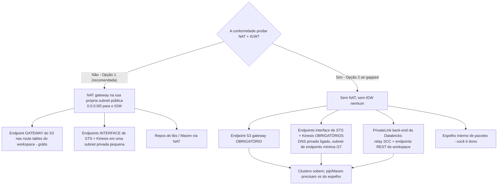
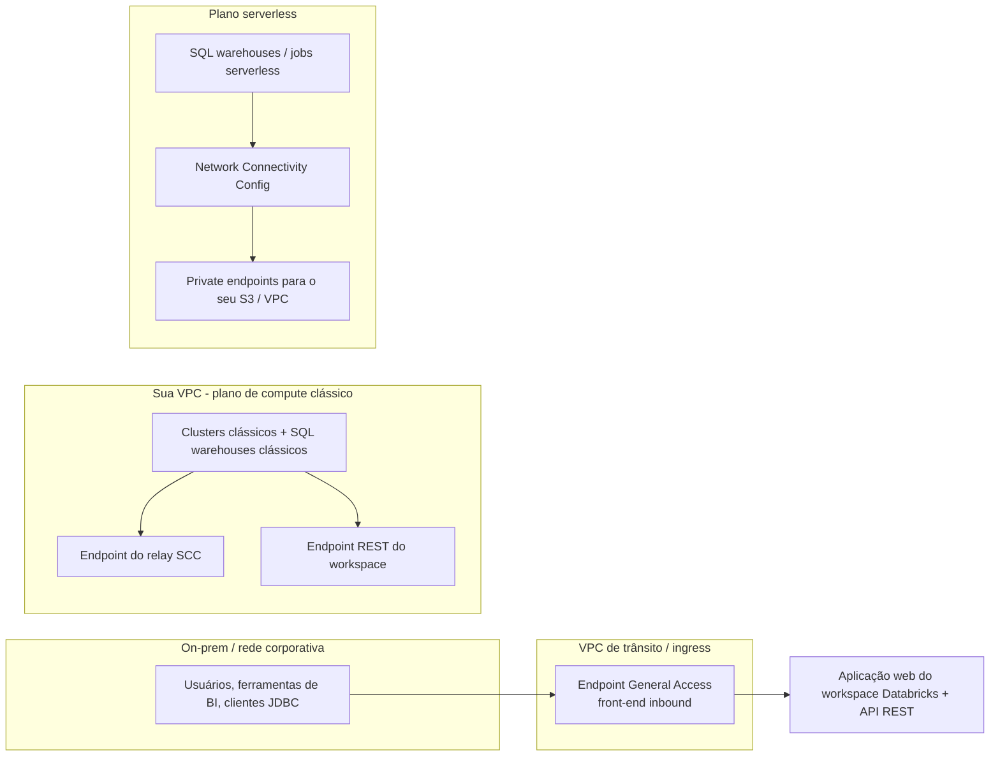
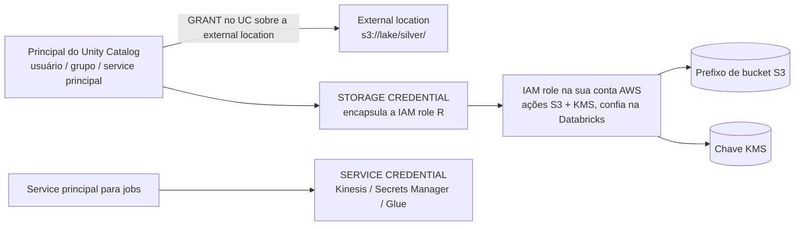
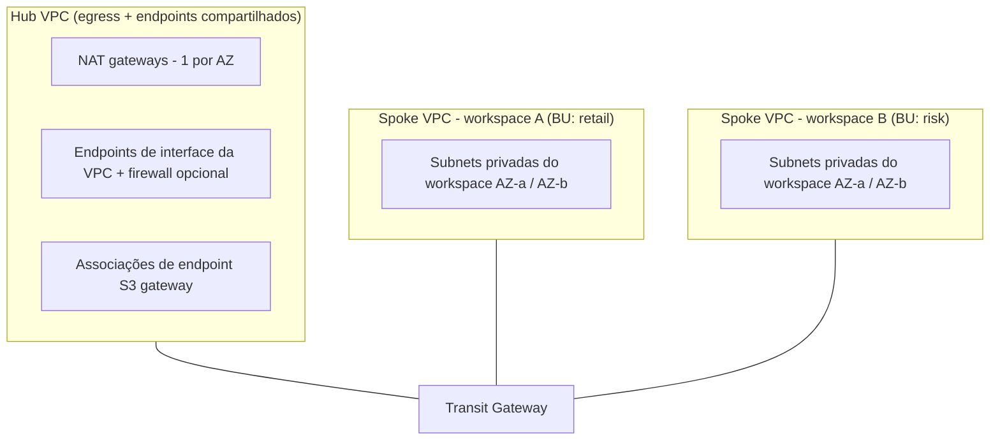

# Fundação AWS para Databricks: Design de VPC, Bucket Raiz, PrivateLink, KMS e IAM

Toda lakehouse Databricks deste curso roda sob uma premissa com formato de AWS: **o plano de dados vive na sua VPC, os dados vivem no seu S3, e o plano de controle conversa com os dois por caminhos que você consegue nomear num quadro-branco**. Erre o substrato e nada a jusante te salva: lançamentos de cluster falham com erros de assume-role crípticos, um cluster de 100 nós não sobe porque uma subnet `/26` ficou sem endereços, uma fatura de S3 dispara porque 1 TB por mês de tráfego do lake dá a volta pelo NAT gateway a $0.045/GB, ou um firewall de inspeção TLS mata silenciosamente todo cluster no momento em que toca nos certificados fixados do plano de controle.

Todo fato abaixo vem da documentação AWS da Databricks (página de VPC gerenciada pelo cliente, *última atualização em 2026-10-08*; fase de rede do well-architected, *2026-09-11*; páginas de PrivateLink, *2026-10-09*), da Databricks Security Reference Architecture e das páginas de preços da AWS: todas acessadas em **outubro de 2026**. Faça a conta você mesmo; é a única maneira de defender um design de rede em uma review.

```text
 =============================================================
  O SUBSTRATO AWS DE RELANCE - em out 2026
 -------------------------------------------------------------
  Plano de controle      Conta Databricks (notebooks, jobs,
                         metadados do metastore, histórico SQL)
  Plano de compute       EC2 na SUA VPC - subnets privadas,
                         sem IPs públicos (padrão SCC)
  Armazenamento          O SEU S3: bucket raiz + locations do UC
  Confiança              Conta Databricks 414351767826 assume
                         roles na SUA conta (external ID)
  Egress obrigatório     STS, S3, Kinesis (+ RDS só p/ HMS legado)
  PrivateLink            inbound / back-end clássico / outbound
  Criptografia           SSE por padrão; CMK STORAGE +
                         MANAGED_SERVICES no Enterprise
  Caminho moderno de IAM UC storage + service credentials
                         (instance profiles = legado)
 =============================================================
```

Nesta lição você vai:

- dissecar **a anatomia do workspace**: os quatro objetos do console de conta a partir dos quais um workspace Databricks na AWS é montado, e a confiança entre contas que os une;
- dimensionar uma **VPC gerenciada pelo cliente** com a regra documentada `(endereços − 5) ÷ 2`, de `/26` (29 nós) a `/17` (16,381 nós), e escolher subnets contra uma meta real de nós;
- operar **secure cluster connectivity (SCC)** corretamente, o que ele remove, o que não remove, e por que a fixação de certificados torna a inspeção de TLS um matador de cluster;
- desenhar **egress** do jeito Databricks: **gateway** endpoints do S3 (grátis), **interface** endpoints de STS + Kinesis, a economia do NAT e a build air-gapped da Opção 2;
- conectar os **três formatos de PrivateLink** (inbound, back-end clássico, outbound/serverless) com os pré-requisitos corretos e os limites do NCC;
- criptografar o **bucket raiz e os artefatos do plano de controle** com os casos de uso certos de KMS, e ler a política da chave linha por linha;
- escrever a **política anotada do bucket raiz**: a condição `aws:PrincipalTag/DatabricksAccountId` e o deny `unity-catalog/*`;
- escolher entre **instance profiles, storage credentials e service credentials**, e ver por que o caminho moderno vincula IAM a *principais*, não a caixas;
- calcular à mão **sete exemplos resolvidos**: capacidade de subnet, a conta de NAT versus endpoints, o custo do inventário de endpoints, o custo mensal de KMS, o JSON da trust policy, a matriz de security groups e a política do bucket raiz;
- estudar **dois casos nomeados de clientes na AWS** (Block e Amgen), ler a **caixa de atualizações de 2026** e praticar com **12 questões no estilo de exame** mais quatro verificações interativas.

---

## 1. Anatomia do workspace: os quatro objetos que você realmente cria

Um workspace Databricks na AWS não é "uma frota de EC2". É um **objeto do console de conta montado a partir de quatro peças**: três fornecidas ou aprovadas por você, uma criada pela Databricks (página de VPC gerenciada pelo cliente, 2026-10-08; guia create-a-workspace, 2026-09-11):

| # | Objeto | Onde vive | O que ele vincula |
|---|---|---|---|
| 1 | **Compute credentials** | Sua conta AWS | Uma IAM role entre contas que a Databricks assume para lançar/gerenciar capacidade EC2, EBS e Spot |
| 2 | **Network configuration** | Console de conta da Databricks | ID da VPC + ≥2 IDs de subnet (um por AZ) + ≥1 ID de security group |
| 3 | **Workspace storage configuration** | Sua conta AWS | O nome do **bucket raiz** + a IAM role que a Databricks assume para ler/escrevê-lo |
| 4 | *(opcional)* **Private access settings**, **encryption key configurations** | Console de conta da Databricks | O comportamento da porta de entrada do PrivateLink; os casos de uso de CMK `MANAGED_SERVICES` e `STORAGE` |



**Criação automatizada versus manual.** O setup automatizado (recomendado) usa delegação temporária de IAM da AWS para você nunca copiar trust policies à mão. O setup manual faz você construir toda role e toda política você mesmo, e é exatamente por isso que o guia manual publica os IDs de conta de confiança e o formato da bucket policy que você vai ver na seção 7 (guia create-a-workspace, 2026-09-11).

- **📚 Você sabia?** Os IDs de conta da AWS da Databricks são públicos e específicos de partição: **`414351767826`** para regiões comerciais, `044793339203` para AWS GovCloud, `170661010020` para GovCloud DoD (guia create-a-workspace, 2026-09-11). A conta de origem da AMI para as imagens de workspace é `601306020600`. Qualquer trust policy que você escrever para a Databricks nomeia uma dessas, e sempre a combina com **`aws:ExternalId` igual ao *seu* ID de conta Databricks**, para que um segundo cliente Databricks não consiga assumir a sua role.

### 1.1 Exemplo resolvido E1: a trust policy entre contas, linha por linha

O setup manual pede uma role na *sua* conta confiada pela Databricks. O formato essencial (padrão do guia create-a-workspace da Databricks e da Databricks Security Reference Architecture, acesso em 2026-10):

```json
{
  "Version": "2012-10-17",
  "Statement": [
    {
      "Effect": "Allow",
      "Principal": {
        "Federated": "arn:aws:iam::414351767826:saml-provider/Databricks-<your-account-id>"
      },
      "Action": "sts:AssumeRole",
      "Condition": {
        "StringEquals": {
          "sts:ExternalId": "<YOUR-DATABRICKS-ACCOUNT-ID>"
        }
      }
    }
  ]
}
```

Três checagens que um revisor precisa rodar nesse JSON: (1) a conta no ARN é a conta comercial da Databricks `414351767826` (ou o ID do GovCloud se você é GovCloud); (2) o **external ID é igual ao seu ID de conta Databricks**, não uma string inventada; (3) a política de permissões da role se limita a ações de EC2/EBS/Spot com tag de Databricks quando os padrões da sua organização exigem: a build de referência SRA usa condições de tag `Vendor=Databricks` para que apenas instâncias lançadas pela Databricks carreguem o perfil.

> [!IMPORTANT]
> ⚠️ **Uma network configuration é imutável e não reutilizável.** Você não pode editar uma network configuration criada nem um registro de VPC endpoint. Mudar subnets ou CIDRs significa: terminar todos os clusters → criar novas subnets → criar uma *nova* network configuration → atualizar o workspace. E "você não pode reutilizar um objeto de network configuration entre workspaces" (página de VPC gerenciada pelo cliente, 2026-10-08): mesmo quando dois workspaces compartilham subnets, cada um recebe o seu próprio registro. Desenhe os CIDRs uma vez, com folga, na seção 2.

---

## 2. A VPC gerenciada pelo cliente: subnets privadas, dimensionamento e a fórmula de capacidade

### 2.1 As regras que são falhas duras, não conselhos

| Requisito | Valor (página de VPC gerenciada pelo cliente, 2026-10-08) |
|---|---|
| Subnets do workspace | **Ao menos duas, privadas, em AZs diferentes** |
| Máscara de rede da subnet | **Entre `/17` e `/26`** |
| Subnets por AZ por workspace | Uma selecionável por AZ (podem existir mais; uma é anexada) |
| DNS da VPC | Hostnames **e** resolução habilitados |
| Tipo da subnet | **Deve ser privada**; egress via NAT+IGW ou endpoints |
| Route tables | As subnets do workspace carregam uma rota `0.0.0.0/0` (para NAT ou appliance): a menos que seja a Opção 2 air-gapped |
| NACLs | Devem permitir `0.0.0.0/0` inbound como a regra de mais alta prioridade; não devem negar portas de egress obrigatórias |
| Security groups | **1 a 5** por workspace; subnets + SGs únicas por workspace recomendadas |
| IPs por nó | **Dois** (um de gerenciamento, um da aplicação Spark) |
| Regra de capacidade | Nós utilizáveis por subnet = **(endereços − 5) ÷ 2** |
| Orientação | "As subnets devem ter no mínimo `/26`, mas a maioria dos casos de uso exige pelo menos `/23`" (fase de rede do well-architected, 2026-09-11) |
| CIDR da VPC | Irrestrito em princípio; **pelo menos `/25`** quando endpoints de PrivateLink são usados; a página de best practice sugere um mínimo de `/18` para deployments de workspace |

A rota `0.0.0.0/0` é a parte que confunde as pessoas: as subnets do *workspace* são privadas, mas na Opção 1 (a configuração padrão recomendada) a route table delas ainda aponta o tráfego padrão para um **NAT gateway na sua própria subnet pública**, que roteia o quad-zero para um internet gateway. Privado significa "sem IPs públicos nos meus nós", não "sem egress".

### 2.2 Exemplo resolvido E2: dimensionando subnets para 450 nós concorrentes por AZ

**Meta:** um time de plataforma quer clusters de até **450 nós por availability zone**, duas AZs, mais folga para instance pools e SQL warehouses. Aplique a fórmula documentada `nós = (endereços − 5) ÷ 2`:

```text
Exemplo resolvido E2 - capacidade de subnet, pela regra documentada da Databricks (2026-09-11)
Fórmula: nós utilizáveis = (2^(32 - prefixo) - 5) // 2

/26 .. (64 - 5) // 2   =   29 nós    FALHA - 450 necessários
/25 .. (128 - 5) // 2  =   59 nós    FALHA
/24 .. (256 - 5) // 2  =  125 nós    FALHA
/23 .. (512 - 5) // 2  =  253 nós    FALHA - e abaixo da orientação
                                      "/23 na maioria dos casos de
                                      uso" em escala
/22 .. (1024 - 5) // 2 =  509 nós    PASSA (509 >= 450, 12% de folga)
/21 .. (2048 - 5) // 2 = 2,045 nós   PASSA (confortável)
/17 .. (16384 - 5) // 2 = 16,381 nós PASSA (limite superior documentado)

Escolhidas: duas subnets de workspace /22, ex.: 10.42.0.0/22 (AZ-a) e
10.42.4.0/22 (AZ-b), dentro de uma VPC 10.42.0.0/18 (16,384 endereços).
Espaço restante da VPC: subnets NAT /24s, uma subnet de endpoints, crescimento.
```

Duas armadilhas vivem nessa aritmética. Primeiro, **o piso de `/26` é legal mas inútil**: 29 nós por AZ morrem no primeiro workload real, ainda que satisfaçam a letra da regra de máscara de rede, então a validação de criação do workspace passa e a falha chega depois como "clusters presos em pending". Segundo, a capacidade é consumida por coisas **ociosas** também: instance pools mantêm capacidade quente, SQL warehouses seguram nós entre queries, e um all-purpose cluster que alguém esqueceu de terminar segura IPs por dias. Dimensione para o pico *mais* a frota ociosa.

```plot
{
  "type": "bar",
  "title": "Nós Databricks por subnet: (endereços - 5) / 2, conforme documentado em set de 2026",
  "data": [
    {"Subnet CIDR": "/26", "Nodes per subnet": 29},
    {"Subnet CIDR": "/25", "Nodes per subnet": 59},
    {"Subnet CIDR": "/24", "Nodes per subnet": 125},
    {"Subnet CIDR": "/23", "Nodes per subnet": 253},
    {"Subnet CIDR": "/22", "Nodes per subnet": 509},
    {"Subnet CIDR": "/21", "Nodes per subnet": 2045}
  ],
  "xKey": "Subnet CIDR",
  "dataKeys": ["Nodes per subnet"],
  "xLabel": "Máscara de rede da subnet do workspace (o intervalo legal é /17-/26)",
  "yLabel": "Nós EC2 utilizáveis por subnet"
}
```

- **📚 Você sabia?** A divisão pela metade não é arbitrária: "A Databricks atribui dois endereços IP por nó, um para o tráfego de gerenciamento e um para as aplicações Spark. O número total de instâncias de cada subnet é igual à metade do número de endereços IP disponíveis" (página de VPC gerenciada pelo cliente, 2026-10-08). Os cinco endereços subtraídos são reservados pela AWS (rede, roteador, DNS, uso futuro). Então uma `/23` não é "512 nós": são **253**, e toda review de capacidade que cita a aritmética crua de CIDR erra por 2×.

### 2.3 Security groups: a matriz dos dois SGs

Um a cinco security groups por workspace; o formato documentado de egress e ingress (página de VPC gerenciada pelo cliente, 2026-10-08):

| SG | Ingress | Egress |
|---|---|---|
| **`sg-workspace`** (anexado à network configuration do workspace) | **Todo TCP e todo UDP vindos dele mesmo** (tráfego interno do cluster) | TCP **443** para `0.0.0.0/0`; **3306** (somente Hive metastore legado); **6666** (SCC, *somente se PrivateLink*); **8443, 8445** (compute → API do plano de controle); **8444** (logging/lineage do Unity Catalog); opcionalmente **2443** (perfil de segurança FIPS), **5432** (Lakebase), **53** (DNS customizado) |
| **`sg-endpoints`** (ENIs de interface endpoint) | TCP **443** de `sg-workspace` | Nenhuma regra necessária: security groups são stateful |

Não copie portas de templates NSG do Azure. **3306 existe apenas para o Hive metastore legado da Databricks** (desabilitado por padrão em novos workspaces Unity Catalog), **6666 é SCC somente com PrivateLink**, **8444 é o stream de lineage/logging do Unity Catalog**, e **2443 é FIPS**. Um conjunto de regras "seguro" que derruba 8443/8444 produz falhas de lançamento que parecem bugs de produto.

---

## 3. Secure cluster connectivity: o padrão, e o que ele não te compra

**O SCC é o modo de deployment padrão e a recomendação padrão** (fase de rede do well-architected, 2026-09-11). O mecanismo inverte a direção da chamada: cada cluster *inicia* uma conexão para fora, até o relay SCC no plano de controle, e o tráfego de gerenciamento do cluster volta por aquele túnel. Resultado: **sem portas inbound abertas e sem endereços IP públicos nos nós do plano de compute clássico**.



Três consequências que engenheiros interpretam errado:

1. **SCC ≠ sem internet.** O SCC remove as necessidades *inbound*. A Databricks ainda exige conectividade de *saída* para os FQDNs do relay SCC, `s3.amazonaws.com:443`, `sts.amazonaws.com:443`, Kinesis e repositórios de bibliotecas. Subnets privadas sem NAT e sem endpoints te entregam clusters que nunca sobem e instalações de `pip`/Maven que travam.
2. **Allowlist de FQDNs, não de endereços IP.** "Sempre coloque os nomes de domínio fornecidos (FQDNs) dos endpoints de relay do secure cluster connectivity (SCC) na allowlist, em vez de endereços IP individuais" (página de endereços IP e domínios, acesso em 2026-10). Os IPs de NAT do plano de controle são publicados por região (por exemplo, us-east-1 `3.237.73.224/28`) e importam para *bucket policies*, não para o egress do SCC.
3. **SCC é pré-requisito para o PrivateLink clássico (back-end).** Se PrivateLink está no seu roadmap, o SCC precisa estar ligado desde o dia um, e um workspace existente sem SCC é conversa de rebuild, não de toggle.

> [!WARNING]
> ⚠️ **Nunca coloque um proxy de interceptação de TLS na frente do plano de controle da Databricks ou do relay SCC.** "As conexões do plano de controle da Databricks e do relay SCC usam TLS com fixação de certificados (certificate pinning). Não habilite a inspeção de TLS (descriptografar e recriptografar) no tráfego entre seus clusters e o plano de controle da Databricks. Fazer isso causa falhas de cluster" (página de arquitetura de segurança gerenciada, acesso em 2026-10). Inspecione outros caminhos de egress. Essa única linha economiza mais horas de review de incidente do que qualquer outra coisa nesta página.

### 3.1 Verificação interativa: associe cada porta de egress à sua função

```matching
{
  "question": "Associe cada porta TCP da lista documentada de egress de security groups à função real dela (página de VPC gerenciada pelo cliente, 2026-10-08):",
  "pairs": [
    {"left": "TCP 443", "right": "Egress HTTPS geral: APIs da AWS, S3, STS, chamadas web"},
    {"left": "TCP 3306", "right": "Somente Hive metastore legado: não necessário em workspaces UC"},
    {"left": "TCP 6666", "right": "Secure cluster connectivity: necessário apenas com PrivateLink"},
    {"left": "TCP 8444", "right": "Logging do Unity Catalog e streaming de lineage para a Databricks"},
    {"left": "TCP 8443 / 8445", "right": "Chamadas internas do plano de compute para a API do plano de controle"},
    {"left": "TCP 2443", "right": "Somente perfil de segurança FIPS / compliance"}
  ],
  "explanation": "O conjunto de armadilhas é deliberado: 3306 é só de HMS legado e não atravessa PrivateLink; 6666 aparece somente quando o PrivateLink carrega o SCC; 8444 é o stream de telemetria do Unity Catalog; 2443 é somente FIPS. Times que copiam regras NSG do Azure ou abrem 'todo egress' reprovam na review de design; times que abrem 443/3306/6666 e esquecem 8443/8444/8445 passam na criação do workspace e depois veem o lineage e as chamadas de API morrerem."
}
```

---

## 4. Arquitetura de egress: gateway endpoints, interface endpoints, NAT

### 4.1 O que uma VPC gerenciada pelo cliente precisa alcançar

"Existem quatro serviços AWS que um workspace Databricks com VPC gerenciada pelo cliente precisa alcançar: **STS, S3, Kinesis e RDS**" (página de VPC gerenciada pelo cliente, 2026-10-08). RDS é somente para o **Hive metastore legado da Databricks**: um workspace Unity Catalog não precisa dele. Então o conjunto moderno obrigatório é **STS + S3 + Kinesis**.

Os mecanismos de tipo de endpoint que decidem a sua fatura:

| Serviço | Tipo de endpoint disponível | Preço (acesso em 2026-10) |
|---|---|---|
| **S3** | **Gateway** (anexado a route tables) | **Grátis**: "Não há cobrança adicional pelo uso de gateway endpoints" (guia do usuário do VPC da AWS) |
| S3 | Interface (PrivateLink) | Por hora por AZ + processamento por GB: Databricks: "Salvo quando estritamente exigido por motivos de conformidade, prefira os gateway endpoints de VPC do S3, que são gratuitos" (2026-09-11) |
| **DynamoDB** | Gateway | Grátis (a SRA lista como *opcional* para a Databricks; documentado especificamente para acesso **serverless** na mesma região) |
| **STS** | Somente interface | ~**$0.01/AZ-hora** (taxa dos EUA comumente publicada: verifique na página de preços da sua região) + $0.01/GB nos primeiros 1 PB |
| **Kinesis** | Somente interface | Mesmo preço de interface endpoint |

Gateway endpoints existem **somente para S3 e DynamoDB** (guia do usuário do VPC da AWS). Todo o resto que você quer fora do caminho público é um interface endpoint cobrado **por AZ, por hora, com ou sem tráfego fluindo**.

### 4.2 Exemplo resolvido E3: a conta de NAT versus endpoints

Cenário da orientação de rede da Databricks: um workspace movendo **1 TB/mês de tráfego de S3** mais **500 GB/mês de tráfego de outras APIs da AWS**, duas AZs, taxas em out 2026 (NAT gateway $0.045/hora + $0.045/GB; interface endpoints ~$0.01/AZ-hora; gateway endpoints grátis):

```text
Exemplo resolvido E3 - plumbing mensal de egress, 2 AZs, em out 2026 (taxas dos EUA)
Workload: 1,000 GB/mês via S3 + 500 GB/mês de outras APIs da AWS

Cenário A - só NAT, sem VPC endpoints
  2 NAT gateways ....... 2 x $0.045/h x 730 h       = $ 65.70
  Processamento de dados do NAT 1,500 GB x $0.045/GB = $ 67.50
  TOTAL .............................................. $133.20 / mês

Cenário B - recomendado: NAT + S3 gateway + interfaces STS/Kinesis
  2 NAT gateways ....... (fixo)                        = $ 65.70
  Endpoint S3 gateway .. grátis, nas rotas do workspace = $  0.00
  Interfaces STS + Kinesis 2 srv x 2 AZ x $0.01 x 730 = $ 29.20
  NAT residual em tráfego sem endpoint ~500 GB x .045  = $ 22.50
  Dados de interface (1ª faixa de 1 PB) ~1,000 GB x $0.01 = $ 10.00
  TOTAL .............................................. $127.40 / mês
  (e o tráfego do S3 já não toca o NAT)

Cenário C - Opção 2 air-gapped: sem NAT, sem IGW
  NAT ................................ nenhum          = $  0.00
  S3 gateway + interfaces STS/Kinesis (como B)         = $ 29.20
  Endpoints de PrivateLink back-end (ver E4)           = $ 29.20
  Espelho interno de libs/repos ....................... você é dono
  TOTAL (só itens de rede) .................. $ 58.40 / mês
```

O ponto didático não é a oscilação de $6: é a **forma**. NAT cobra por hora *e* por GB para sempre; o **gateway** endpoint do S3 é grátis e remove o maior caminho de dados do NAT por completo; os interface endpoints são o jeito de manter STS/Kinesis privados, mas você paga por eles por AZ mesmo ociosos. Nas palavras da própria Databricks: "Se a maior parte do tráfego do seu NAT gateway for para serviços da AWS que suportam interface endpoints ou gateway endpoints, considere criar um interface endpoint ou gateway endpoint para esses serviços" (guia de NAT gateway da AWS). E por GB através do PrivateLink: primeiros 1 PB **$0.01/GB**, próximos 4 PB **$0.006**, acima de 5 PB **$0.004** (preços de PrivateLink da AWS, acesso em 2026-10).

### 4.3 Opção 1 versus Opção 2: a decisão de egress

A página clássica de PrivateLink define as duas configurações oficiais: a **Opção 1 (padrão, recomendada)** mantém um NAT gateway + internet gateway e adiciona endpoints opcionais de S3/STS/Kinesis; a **Opção 2 (totalmente privada / air-gapped)** elimina NAT e IGW e *exige* os endpoints de S3, STS e Kinesis mais o PrivateLink back-end da Databricks (página clássica de PrivateLink, 2026-10-09).



Builds air-gapped ainda devem alcançar por saída `s3.amazonaws.com:443`, `sts.amazonaws.com:443` e os FQDNs do relay SCC: via endpoints, não pela internet. O trade-off é explícito na documentação: a Opção 2 remove o custo de NAT e os caminhos públicos, e entrega *cada* endpoint como uma dependência operacional.

### 4.4 Verificação interativa: ordene uma build air-gapped

```dragdrop
{
  "question": "Coloque a build do workspace air-gapped (Opção 2) na ordem que o fluxo oficial implica (páginas de PrivateLink clássico e de VPC gerenciada pelo cliente, 2026):",
  "items": [
    "Criar duas subnets privadas de workspace em AZs diferentes (/26 a /17) com DNS hostnames + resolução ligados",
    "Anexar um endpoint S3 gateway às route tables do workspace",
    "Criar uma subnet dedicada de endpoints (mínimo /27) para endpoints de interface de serviços AWS",
    "Criar endpoints de interface de STS e Kinesis com DNS privado; ingress 443 da SG do workspace na SG",
    "Criar e registrar os endpoints de PrivateLink back-end da Databricks: relay SCC + API REST do workspace",
    "Criar o workspace, então esperar 20 minutos após o status RUNNING antes de lançar clusters"
  ],
  "correctOrder": [
    "Criar duas subnets privadas de workspace em AZs diferentes (/26 a /17) com DNS hostnames + resolução ligados",
    "Anexar um endpoint S3 gateway às route tables do workspace",
    "Criar uma subnet dedicada de endpoints (mínimo /27) para endpoints de interface de serviços AWS",
    "Criar endpoints de interface de STS e Kinesis com DNS privado; ingress 443 da SG do workspace na SG",
    "Criar e registrar os endpoints de PrivateLink back-end da Databricks: relay SCC + API REST do workspace",
    "Criar o workspace, então esperar 20 minutos após o status RUNNING antes de lançar clusters"
  ],
  "explanation": "A ordem importa: o endpoint S3 gateway vive nas route tables e não precisa de ENI, então vem antes da subnet de endpoints; as interfaces STS/Kinesis vão para a subnet dedicada de /27 ou maior com DNS privado antes da criação do workspace, porque um workspace cujo STS está inacessível falha no lançamento de cluster; os registros de PrivateLink back-end precisam existir e ser referenciados pela network configuration; e a documentação exige esperar 20 minutos extras após RUNNING antes de usar clusters (página clássica de PrivateLink, 2026-10-09)."
}
```

---

## 5. PrivateLink na Databricks: três formatos, uma matriz de pré-requisitos

A Databricks suporta **três tipos de conectividade Private Link** (página de conceitos de Private Link, 2026-10-09):

| Formato | Caminho | Tipos de endpoint | Pré-requisitos |
|---|---|---|---|
| **Inbound (front-end)** | Usuários/BI/on-prem → endpoint de interface da VPC → aplicação web do workspace + API REST | **General Access** | Plano Enterprise; um objeto **private access settings**; com `public_access_enabled=false` o workspace só é alcançável *pelo* PrivateLink |
| **Clássico (back-end)** | Clusters na sua VPC → dois endpoints de interface → plano de controle | **SCC relay** + **workspace (REST APIs)** | Plano Enterprise + **VPC gerenciada pelo cliente** + **SCC**; endpoints registrados como VPC endpoint registrations e referenciados pela network configuration |
| **Outbound (serverless)** | Plano de compute serverless → private endpoints anexados ao NCC → seus buckets S3 ou VPC | Private endpoints via **Network Connectivity Config (NCC)** | NCC na conta; a conectividade privada de S3 estava em **Public Preview** na página de conceitos de 2026-10-09 |

Um quarto tipo, mais estreito, **Service Direct**, existe para serviços intensivos em performance (Zerobus Ingest, Lakebase Autoscaling). A Databricks "recomenda no máximo um endpoint de cada tipo de endpoint" dentro da mesma VPC.



**Limites do NCC que valem memorizar** (página de conceitos de Private Link, 2026-10-09): até **10 NCCs por região por conta**; **50 workspaces por NCC**; **30 private endpoints de S3 por região**; **100 private endpoints por região para recursos de VPC**. VPC endpoint registrations são **imutáveis uma vez criados**. A porta **3306** (HMS legado) **não** atravessa o PrivateLink. E segundo a página de private access settings (2026-05-04), o private access level `ANY` está obsoleto: use **Account** (somente VPC endpoints registrados na sua conta Databricks) ou **Endpoint** (allow list explícita).

### 5.1 Exemplo resolvido E4: inventário de endpoints e custo de ociosidade

Pegue o workspace de duas AZs do E2 acrescentando PrivateLink back-end clássico. Interface endpoints na taxa dos EUA comumente publicada de ~$0.01/AZ-hora (**≈ $7.30 por AZ-mês**; verifique a sua região em aws.amazon.com/privatelink/pricing, acesso em 2026-10):

```text
Exemplo resolvido E4 - inventário de interface endpoints, 2 AZs, em out 2026 (taxa dos EUA; verifique por região)
Obrigatório para STS/Kinesis privados + PrivateLink back-end:
  Interface STS ................. 2 AZ x $7.30    = $14.60 / mês
  Interface Kinesis ............. 2 AZ x $7.30    = $14.60 / mês
  Endpoint relay SCC ............ 2 AZ x $7.30    = $14.60 / mês
  Endpoint REST do workspace .... 2 AZ x $7.30    = $14.60 / mês
  Subtotal de horas ociosas ..... = $58.40 / mês
  Processamento de dados ........ 1ª faixa de 1 PB a $0.01/GB (sobre volumes privados)

Companheiros gratuitos:
  Endpoint S3 gateway (anexado à route table) ..... $ 0.00
  Endpoint DynamoDB gateway (opcional, SRA) ........ $ 0.00

Anti-padrão - endpoint de S3 INTERFACE por reflexo, 3 AZs, sem uso:
  3 AZ x $7.30 = $21.90/mês ociosos pelo que o gateway gratuito faz.
```

O anti-padrão de baixo é o que as reviews de design continuam flagrando: **os interface endpoints de S3 cobram por hora por AZ e por GB, enquanto o gateway endpoint é grátis** e cobre o S3 dentro da VPC. Quatro interface endpoints em três AZs ficam ociosos a ~$87.60/mês; o mesmo acesso ao S3 por um gateway endpoint fica ocioso a $0. A Databricks diz direto: prefira o gateway "salvo quando estritamente exigido por motivos de conformidade" (2026-09-11).

---

## 6. Criptografia: o bucket raiz, os managed services e a política da chave

A Databricks criptografa em repouso por padrão (SSE no bucket raiz; artefatos do plano de controle criptografados na camada gerenciada pela Databricks). As chaves gerenciadas pelo cliente (CMK) no tier **Enterprise** estendem esse controle a dois casos de uso distintos (páginas de chaves gerenciadas pelo cliente, acesso em 2026-10):

| Caso de uso | Valor de configuração | O que ele criptografa |
|---|---|---|
| **Managed services** | `MANAGED_SERVICES` | Dados no plano de controle da Databricks: notebooks, segredos, dados/histórico de query SQL, armazenamento padrão |
| **Armazenamento do workspace** | `STORAGE` | O seu **bucket de armazenamento do workspace** (DBFS root, FileStore, modelos do MLflow, dados de pipeline do Lakeflow, resultados de job, resultados SQL, revisões de notebook) e, opcionalmente, os **volumes EBS** do compute clássico |

O Unity Catalog separadamente "suporta a capacidade de ler e gravar em buckets S3 com criptografia KMS habilitada": a IAM role de cada storage credential recebe as ações `kms:` de que precisa sobre a chave do bucket.

### 6.1 Exemplo resolvido E5: custo de KMS para um conjunto de três chaves

A build de referência da Databricks Security Reference Architecture usa **três chaves KMS**: armazenamento do workspace, managed services e o catálogo do workspace do Unity Catalog. Preços do AWS KMS (acesso em 2026-10): **$1.00 por chave por mês** (rateado por hora) mais **$0.03 por 10,000 requisições**, com um free tier de 20,000 requisições/mês.

```text
Exemplo resolvido E5 - custo mensal de CMK, em out 2026 (aws.amazon.com/kms/pricing)
Chaves ....... 3 (armazenamento do workspace, managed services, catálogo UC)
             3 x $1.00                    = $ 3.00 / mês
Requisições .. o formato do próprio exemplo resolvido da AWS: 2,010,000 requisições
             1,990,000 faturáveis (acima do free tier de 20k)
             x $0.03 / 10,000             = $ 5.97
TOTAL (conjunto ilustrativo) ................. $ 8.97 / mês

Leia a alavanca: o termo de requisições domina apenas em taxas de chamada altas;
a contagem de chaves é um seguro barato. Um sprawl de 30 chaves ainda custa $30/mês
em taxas de chave - o custo de auditabilidade, não a fatura do KMS, é o que mata
o sprawl de chaves.
```

### 6.2 A linha da política de chave que você precisa acertar

O guia de configuração de chaves gerenciadas pelo cliente exige que a política da chave permita o principal da Databricks: com uma **condição de tag**, não com acesso aberto (acesso em 2026-10):

```json
{
  "Sid": "Allow Databricks use of the key",
  "Effect": "Allow",
  "Principal": { "AWS": "arn:aws:iam::414351767826:root" },
  "Action": [
    "kms:Encrypt", "kms:Decrypt", "kms:ReEncrypt*",
    "kms:GenerateDataKey*", "kms:DescribeKey"
  ],
  "Condition": {
    "StringEquals": {
      "aws:PrincipalTag/DatabricksAccountId": "<YOUR-DATABRICKS-ACCOUNT-ID>"
    }
  }
}
```

Mais um statement separado, escopado à sua própria role entre contas, para o uso relacionado a EBS. A condição de tag é a guarda de segurança: ela garante que apenas princípios da Databricks *com tag do seu ID de conta* possam usar a chave: não todo princípio na conta AWS da Databricks. Combine-a com a configuração de caso de uso `MANAGED_SERVICES` versus `STORAGE` para que notebooks-segredos-histórico-SQL e bucket-EBS sejam rotacionáveis de forma independente.

- **📚 Você sabia?** Em trânsito, a Databricks usa TLS 1.2+ entre usuários/APIs/ferramentas de BI e entre os planos de controle e de compute; a criptografia de shuffle de worker para worker é **opt-in** (tier Enterprise: via init script com AES-256/TLS 1.3, ou escolhendo famílias de instância que criptografam o tráfego entre nós nativamente). Então "criptografia em repouso via CMK" e "criptografia em trânsito em tudo" são três checkboxes separados, não um.

---

## 7. O bucket raiz: o que vive nele, e a política que o protege

O **bucket raiz** (armazenamento do workspace) é um bucket S3 **na sua conta AWS** que a Databricks provisiona (setup automatizado) ou que você registra (setup manual: nome do bucket + ARN da IAM role). Ele armazena ativos do workspace "como dados, bibliotecas e logs", o **DBFS root** (FileStore, modelos do MLflow, dados de pipeline do Lakeflow), dados de sistema do workspace (resultados de job, resultados do Databricks SQL, revisões de notebook) e, segundo o guia create-a-workspace (2026-09-11), **"o catálogo padrão do workspace"**.

Dois fatos sobre ele que evitam duas catástrofes clássicas:

1. **Ele é de propriedade do cliente, mas operado pela Databricks.** O plano de controle da Databricks alcança-o como principal `arn:aws:iam::414351767826:root`, o que a sua bucket policy permite *somente* sob a condição de tag da conta.
2. **Ele não é o seu lake de analytics.** DBFS root e mounts de DBFS estão **obsoletos**: "Novas contas são provisionadas sem acesso a esses recursos. A Databricks recomenda usar volumes do Unity Catalog, external locations ou arquivos de workspace" (página de best practices de DBFS + UC, acesso em 2026-10). E na mesma página: **"Você jamais deve carregar uma conta de armazenamento usada como DBFS root como uma external location no Unity Catalog."**

### 7.1 Exemplo resolvido E6: política anotada do bucket raiz

Formato do setup manual do guia create-a-workspace (2026-09-11), anotado:

```json
{
  "Version": "2012-10-17",
  "Statement": [
    {
      "Sid": "AllowDatabricksControlPlane",
      "Effect": "Allow",
      "Principal": { "AWS": "arn:aws:iam::414351767826:root" },
      "Action": ["s3:ListBucket", "s3:GetObject", "s3:PutObject", "s3:DeleteObject"],
      "Resource": [
        "arn:aws:s3:::<YOUR-ROOT-BUCKET>",
        "arn:aws:s3:::<YOUR-ROOT-BUCKET>/*"
      ],
      "Condition": {
        "StringEquals": {
          "aws:PrincipalTag/DatabricksAccountId": ["<YOUR-DATABRICKS-ACCOUNT-ID>"]
        }
      }
    },
    {
      "Sid": "PreventDBFSFromAccessingUnityCatalogPrefix",
      "Effect": "Deny",
      "Principal": "*",
      "Action": ["s3:DeleteObject", "s3:PutObject", "s3:DeleteObjectVersion"],
      "Resource": "arn:aws:s3:::<YOUR-ROOT-BUCKET>/unity-catalog/*",
      "Condition": { "StringNotLike": { "aws:PrincipalArn": "arn:aws:iam::<YOUR-ACCOUNT>:role/<UC-ADMIN-ROLE>" } }
    }
  ]
}
```

Medidas de hardening vistas em designs de produção (padrões da SRA da Databricks e da lista documentada de condition keys): adicione condições `aws:SourceIp` para o intervalo de NAT do plano de controle da sua região (o provisionamento de um workspace totalmente novo falha se o IP de NAT do plano de controle de `us-west` não estiver permitido), e/ou `aws:sourceVpce` vinculado ao seu endpoint S3 gateway, para que o bucket responda apenas de dentro da VPC. A Databricks observa que o acesso ao plano de controle usa **IDs de VPC para S3 na mesma região** e **IPs de NAT para S3 cross-region**: desenhe a condição para o par de regiões em que você realmente roda.

---

## 8. IAM: instance profiles versus storage credentials versus service credentials

Este é o deslocamento conceitual mais importante do material Databricks-on-AWS da era de 2021 para a era do Unity Catalog:

| Mecanismo | Vincula a | Status em out 2026 | Use para |
|---|---|---|---|
| **Instance profile** | A **instância EC2** (e portanto o cluster) | **Legado**: ainda administrável (Settings → Security), útil apenas para mounts legados de DBFS / `fs.s3a` / ACLs do HMS legado | Nada de novo em workspaces UC |
| **Storage credential** (securable do UC) | **Principais**: usuários, grupos, service principals, via grants do UC | **Caminho moderno** | IAM role envelopada como objeto do UC, usada por **external locations** para tabelas e volumes |
| **Service credential** (UC) | **Principais** | **Caminho moderno** | Serviços AWS não ligados a armazenamento: Kinesis, Secrets Manager, Glue |
| **Credential passthrough** | Passagem da identidade por usuário | **Obsoleto a partir do DBR 15.0**, "A Databricks recomenda que você faça upgrade para o Unity Catalog" (página de arquivo, 2024-05-13) | Nada, migre |

A Databricks afirma o deslocamento de forma direta: service credentials são "a alternativa do Unity Catalog aos instance profiles, com a vantagem de que o acesso não fica preso a um recurso de compute específico, mas sim a usuários, grupos ou service principals" (documentação de service credentials, acesso em 2026-10). Uma storage credential é definida como "uma credential do Unity Catalog usada para acessar external locations e tabelas" (referência SQL de storage credential, 2026-09-11).



### 8.1 Exemplo resolvido E7: caminho moderno de acesso a dados, ponta a ponta

```sql
-- 1. The IAM role (your account) trusts Databricks with an external ID,
--    and its policy allows s3 on the lake prefix + kms on the bucket key.

-- 2. Register it as a UC storage credential (account admin):
CREATE STORAGE CREDENTIAL finance_cred
  AWS_IAM_ROLE_ARN 'arn:aws:iam::<ACCOUNT>:role/finance-lake-role'
  COMMENT 'Lake read/write for finance domains';

-- 3. Bind it to a path exactly once:
CREATE EXTERNAL LOCATION finance_loc
  URL 's3://acme-finance-lake/silver/'
  WITH (CREDENTIAL finance_cred);

-- 4. Govern by principal, not by box:
GRANT READ VOLUME, WRITE VOLUME
  ON EXTERNAL LOCATION finance_loc
  TO `data-eng-finance`;

-- Never the legacy move on a UC workspace:
--   spark.conf.set('fs.s3a.path.style.access', ...)  + instance profile
```

A diferença que cai em prova: os grants do passo 4 seguem o **grupo**, então o mesmo notebook funciona em um job cluster, em um SQL warehouse e em um compute serverless sem nenhum anexo de instance profile, e a revogação é um único `REVOKE`, não um patch de cluster mais uma edição de bucket policy.

### 8.2 Verificação interativa: preencha os termos

```fillblank
{
  "question": "Complete a frase com os termos corretos de Unity Catalog / IAM (documentação de service credentials e storage credentials, acesso em 2026-10):",
  "template": "No Unity Catalog, o securable que encapsula uma IAM role para external locations de S3 é uma storage {{1}}; a alternativa para serviços AWS não ligados a armazenamento, como Kinesis, é uma {{2}} {{3}}; ambos substituem o padrão legado de instance {{4}}, e credential passthrough está obsoleto a partir do DBR 15.0.",
  "answers": {
    "1": "credential",
    "2": "service",
    "3": "credential",
    "4": "profile"
  },
  "distractors": ["metastore", "endpoint", "gateway", "passthrough", "namespace", "mount"],
  "explanation": "Storage credentials governam external locations e tabelas; service credentials cobrem acesso no estilo Kinesis/Secrets Manager/Glue; ambos se vinculam a princípios via grants do UC, enquanto instance profiles se vinculam ao compute e sobrevivem apenas para mounts legados. A Databricks posiciona explicitamente service credentials como 'the Unity Catalog alternative to instance profiles'. 'Mount' é a palavra-armadilha: DBFS mounts estão obsoletos e jamais devem apontar para uma external location do UC."
}
```

---

## 9. Padrões entre contas, hub-and-spoke e as armadilhas da network configuration

Três padrões de bucket raiz/conta aparecem no material oficial (baseado em digest, guia create-a-workspace 2026-09-11):

1. **Conta única**: bucket, roles e workspace tudo em uma conta AWS (fluxo automatizado padrão).
2. **Bucket policy condicionada por tag**: bucket na sua conta, allow para `414351767826:root` condicionado a `aws:PrincipalTag/DatabricksAccountId`, mais o deny `unity-catalog/*` (E6).
3. **Bucket restrito por rede**: a mesma política mais condições `aws:SourceIp` (IPs de NAT do plano de controle / VPN corporativa) e/ou `aws:sourceVpce` (o seu endpoint S3 gateway).

Para muitas unidades de negócio, a topologia documentada da Databricks é hub-and-spoke: "Você pode usar uma arquitetura VPC hub-and-spoke, em que todos os endpoints de VPC, NAT gateways, firewalls etc. são instalados na VPC hub. Cada workspace é associado a subnets … em uma VPC diferente, dentro da mesma conta AWS ou de outra. As VPCs spoke são conectadas à VPC hub usando um Transit Gateway" (fase de rede do well-architected, 2026-09-11). Lembre-se da restrição da seção 1: **cada workspace ainda registra a sua própria network configuration**, mesmo quando as subnets são compartilhadas.



Armadilhas operacionais coletadas dos modos de falha documentados (seção de pitfalls das páginas de VPC gerenciada pelo cliente e de PrivateLink, 2026):

- **STS bloqueado = clusters mortos.** STS é obrigatório. Imponha endpoints regionais ou uma regra nova de firewall sem um interface endpoint de STS (ou sem uma allow para `sts.amazonaws.com:443`) e as falhas de assume-role param os lançamentos de cluster e o acesso ao S3. A criação manual de workspace exige adicionalmente o **STS endpoint ativado para `us-west-2`**.
- **NACLs que "ajudam".** A Databricks valida que as NACLs permitem `0.0.0.0/0` inbound como regra principal; um deny em 8443/8444/6666 causa falhas de lançamento crípticas. Reassocie as route tables se você recriar subnets.
- **Kinesis em `us-west-1`** é cross-region (os streams de destino vivem em `us-west-2`), então um endpoint regional de Kinesis ali se comporta de forma diferente (nota da página de VPC gerenciada pelo cliente).
- **A VPC gerenciada pela Databricks está a caminho da saída:** "Em uma release futura, a Databricks planeja descontinuar a criação de workspace clássico com uma VPC gerenciada pela Databricks. Novos workspaces clássicos vão exigir uma VPC gerenciada pelo cliente" (2026-10-08), e um workspace existente com VPC gerenciada pela Databricks **não pode ser convertido no lugar**; planeje um rebuild.

- **📚 Você sabia?** A história de migração de VPC gerenciada pela Databricks para VPC gerenciada pelo cliente tem um corte duro do Unity Catalog: DBFS root/mounts jamais podem virar uma external location do UC, o acesso por instance profile é substituído por storage/service credentials, e o PrivateLink exige Enterprise + SCC. O caminho realista é provisionar um workspace novo na VPC do cliente → anexar o metastore → recriar o acesso via storage credentials + external locations → migrar as tabelas: a sequência completa é o tema da lição 3.

---

## 10. Networking clássico versus serverless, e os deltas de 2026

| Dimensão | Plano de compute clássico (VPC do cliente) | Serverless (SQL warehouses, jobs serverless) |
|---|---|---|
| Onde os nós rodam | EC2 na **sua** VPC, subnets privadas | Plano de compute serverless gerenciado pela Databricks |
| IPs públicos | Nenhum (padrão SCC) | Nenhum: "SQL warehouses serverless não têm endereços IP públicos" (página de SQL serverless, 2026-08-13) |
| VPC gerenciada pelo cliente | Obrigatória para os formatos de PrivateLink | "VPCs gerenciadas pelo cliente não se aplicam aos recursos de compute dos SQL warehouses serverless" |
| Caminho privado para os seus dados | Endpoints S3/STS/Kinesis + PrivateLink back-end | Private endpoints do **NCC**; network policies para egress (`FULL_ACCESS` ou destinos restritos); DynamoDB na mesma região via gateway endpoints |
| Quem é dono do roteamento | Você | Databricks (você fornece endpoint registrations / regras do NCC) |
| Cobrança por endpoint | Por hora por AZ + por GB (interface) | Cobrado por hora por private endpoint e por GB através deles (página de networking serverless, 2026-09-25) |
| Controles de egress | SGs, NACLs, firewall, NAT | Network policies com modo dry-run; as negações caem em `system.access.outbound_network` |

### Atualizações de 2026 (em outubro de 2026)

> [!NOTE]
> **O que mudou no substrato Databricks-on-AWS do qual esta lição depende:**
> - **SCC é o padrão em todo lugar**: "Secure cluster connectivity (SCC) se tornou a recomendação padrão e é o modo de deployment padrão para workspaces" (fase de rede do well-architected, *última atualização em 2026-09-11*). Qualquer tutorial que abre portas inbound para gerenciamento de cluster é material pré-SCC.
> - **Workspaces clássicos vão exigir VPCs gerenciadas pelo cliente**: "Em uma release futura, a Databricks planeja descontinuar a criação de workspace clássico com uma VPC gerenciada pela Databricks" (página de VPC gerenciada pelo cliente, *última atualização em 2026-10-08*). Designs novos jamais devem começar em uma VPC gerenciada pela Databricks, e as existentes precisam de um plano de rebuild, não de upgrade no lugar.
> - **Controles de egress serverless migraram para network policies; a lista de IPs estáveis do NCC sumiu**: "A lista legada de IPs estáveis do Public Preview foi descomissionada e não está mais disponível pela UI do NCC ou pela API Network Connectivity"; network policies oferecem "Permitir acesso a todos os destinos" (`FULL_ACCESS`) ou "Acesso restrito a destinos específicos" (páginas de networking serverless + manage-network-policies, *2026-09-25*). Runbooks antigos de allow list que citam IPs serverless estáveis estão desatualizados.
> - **A conectividade privada de S3 para serverless está em Public Preview**: listada como capacidade de endpoint de PrivateLink na página de conceitos (*2026-10-09*); trate afirmações de GA como prematuras e verifique de novo antes de depender dela em um design de conformidade.
> - **Pré-requisitos de PrivateLink endurecidos na documentação**: plano Enterprise para inbound e back-end clássico; VPC gerenciada pelo cliente **e** SCC para back-end; subnet de endpoints com mínimo `/27` para a opção air-gapped; private access level `ANY` obsoleto em favor dos níveis Account/Endpoint (páginas de PrivateLink + private-access-settings, *mai: out 2026*).
> - **A acreditação AWS Platform Architect agora testa explicitamente o escopo desta lição**: "Customer-managed VPCs · Customer-managed keys · Cloud service integrations" ao longo de **20 questões**, 80% para ser aprovado, grátis para clientes e parceiros Databricks, válida por um ano (databricks.com/learn/certification/databricks-on-aws, acesso em 2026-10-12).

---

## Casos Reais

As páginas de clientes publicam *resultados* de arquitetura, não diagramas de VPC: "Cloud: AWS" te diz que o substrato é o substrato deste curso, nunca qual CIDR ou layout de KMS uma empresa escolheu. Todo número abaixo é alegado pelo cliente, com a fonte e a sua data nomeadas para você poder conferir.

### Caso A, Block (Square, Cash App, TIDAL): 12 PB no S3, plumbing de IAM colapsado no Unity Catalog

| Elemento | Detalhe |
|---|---|
| Cliente | **Block** (Square, Cash App, TIDAL): serviços financeiros; página de caso com tag **Cloud: AWS** |
| Desafio | 12 PB de dados de grafo + analytics fragmentados entre unidades de negócio; um fluxo de IAM doloroso em dois passos (anexar políticas IAM a roles, *depois* a buckets S3); governança de PII sob GDPR/CCPA |
| Serviços | Databricks, Delta Lake, **Unity Catalog**, Spark Declarative Pipelines; **S3 como armazenamento co-localizado** |
| Resultado | "12X Reduction in compute cost · 20% Reduction in data egress cost · 12PB Of data managed and governed" (redução de 12x no custo de compute · redução de 20% no custo de egress de dados · 12PB de dados gerenciados e governados); o tempo de permissão de compartilhamento de dados caiu "de dias para segundos"; "a adoção do Unity Catalog promoveu a coleta de dados em buckets S3, resultando em latência melhor e na co-localização de compute e armazenamento" |
| Fonte | https://www.databricks.com/customers/block/unity-catalog (página sem data, acesso em 2026-10) |
| Relação com esta lição | O caminho moderno de IAM da seção 8: a governança substituiu o plumbing de IAM bucket por bucket sobre um substrato S3 |

> ⏳ *Nota temporal: página de cliente sem data, acessada em out 2026; trate os números 12×/20%/12 PB como resultados relatados, não como garantias.*

### Caso B, Amgen: de mais de 120 IAM roles para uma ou duas, via Unity Catalog

| Elemento | Detalhe |
|---|---|
| Cliente | **Amgen**: biopharma (verificado via blog com data; não existe página de caso `/customers/amgen` em 2026-10) |
| Desafio | **AWS Glue** como catálogo corporativo mais o sprawl de **AWS IAM** com uma role por caso de uso; auditar significava analisar políticas IAM |
| Serviços | Unity Catalog sobre um estate da AWS, o blog nomeia Glue e IAM como a stack anterior, então o substrato é AWS |
| Resultado | "não tivemos que criar ou gerenciar pelo menos 120+ IAM roles … passamos de centenas de IAM roles para apenas uma ou duas IAM role principais"; "Isso reduz o esforço de auditoria da função em 50%"; "cerca de ~500 objetos mapeados no Unity Catalog"; "90 por cento dos nossos casos de uso estão no Databricks" |
| Fonte | https://www.databricks.com/blog/how-databricks-unity-catalog-helped-amgen-enable-data-governance-enterprise-scale (**maio de 2023**) |
| Relação com esta lição | Por que storage/service credentials (seção 8) vencem o sprawl de instance profiles: a *contagem* de roles é a métrica que os auditores entendem |

> ⏳ *Nota temporal: números de maio de 2023; o mecanismo (principais governados no UC, roles colapsadas) continua sendo o padrão documentado em 2026.*

### Caso C, Nubank: S3 como a camada de armazenamento de um lakehouse de fintech regulada

| Elemento | Detalhe |
|---|---|
| Cliente | **Nubank**: fintech da LATAM, 100MM+ de clientes |
| Desafio | Eficiência de custo e continuidade em uma migração de 12 meses de plataforma de warehouse com zero downtime |
| Serviços | Databricks SQL + Unity Catalog; camada de armazenamento "majoritariamente … AWS em S3" segundo uma transcrição de talk da Databricks |
| Resultado | "+40% annual cost savings" (economia anual de custo de +40%) enquanto as queries mensais cresceram de "20MM to 40MM"; 17k usuários; "Leverage of UC for centralized data governance in highly regulated FSI industry" (aproveito do UC para governança centralizada de dados na indústria FSI altamente regulada) |
| Fonte | https://www.databricks.com/dataaisummit/session/how-nubank-migrated-databricks-sql-reducing-costs-40-and-doubling (resumo de sessão, sem data, acesso em 2026-10); confirmação AWS/S3 em https://answers.databricks.com/nubank-s-fine-grained-access-control-at-scale-from-permission-groups-unity-catal-RcsHbHSL97Q (**2026-08-27**) |
| Relação com esta lição | A decisão de substrato S3 + IAM (seções 4 e 7) é o que sustenta "custo por query, não gasto total" |

> ⏳ *Nota temporal: evidência de resumo de sessão, não um estudo de caso auditado; ensine o padrão de migração, não um desconto prometido.*

---

## Perguntas de Prática (Practice Questions)

```question
{
  "id": "dbl-02-q1",
  "type": "multiple-choice",
  "question": "Um workspace Databricks clássico na AWS está sendo criado com uma VPC gerenciada pelo cliente. Qual conjunto corresponde aos requisitos documentados em outubro de 2026?",
  "options": [
    "Ao menos duas subnets privadas em AZs diferentes, cada uma com máscara entre /17 e /26, mais DNS hostnames e resolução de DNS habilitados na VPC",
    "Ao menos duas subnets públicas em AZs diferentes, cada uma entre /24 e /28, com atribuição de IP público habilitada nas subnets",
    "Exatamente uma subnet por workspace com máscara /16, mais uma subnet pública separada para clusters",
    "Uma subnet por cluster, máscara /28, com as opções de DNS da VPC desabilitadas para evitar conflitos de resolver"
  ],
  "correct": 0,
  "explanation": "A página de VPC gerenciada pelo cliente (2026-10-08) exige ao menos duas subnets privadas em AZs diferentes, máscaras de subnet entre /17 e /26, e DNS hostnames + resolução habilitados na VPC. 'Subnets públicas para clusters' é a armadilha clássica: com o SCC como padrão, os nós do cluster não seguram IPs públicos; subnets públicas existem apenas para hospedar NAT gateways. A alternativa /28 está abaixo do piso de /26 e falharia na validação."
}
```

```question
{
  "id": "dbl-02-q2",
  "type": "multiple-choice",
  "question": "Usando a regra de capacidade documentada da Databricks, quantos nós EC2 uma subnet de workspace /22 pode suportar?",
  "options": [
    "1,024 nós: a contagem bruta de endereços, porque a Databricks usa um IP por nó",
    "509 nós - (1,024 - 5) / 2, porque cada nó ocupa um IP de gerenciamento e um IP de Spark",
    "512 nós: a contagem bruta de endereços menos apenas os endereços reservados pela AWS",
    "253 nós: porque a capacidade é sempre dividida ao meio duas vezes: uma vez pela divisão em duas AZs e outra pelos dois IPs"
  ],
  "correct": 1,
  "explanation": "A Databricks documenta nós = (endereços - 5) / 2: dois IPs por nó (gerenciamento + Spark) e cinco endereços reservados pela AWS. Então /22 = (1,024 - 5) / 2 = 509. Os distratores 1,024 e 512 são as duas metades do erro que os times cometem em reviews de capacidade; a resposta 253 é o número da /23, errado em um prefixo."
}
```

```question
{
  "id": "dbl-02-q3",
  "type": "multiple-choice",
  "question": "Secure cluster connectivity (SCC) está habilitado. Qual afirmação é verdadeira em outubro de 2026?",
  "options": [
    "Os clusters não precisam mais de nenhuma conectividade de saída, todo o tráfego é tunelado para dentro",
    "Os nós de compute clássico não precisam de IPs públicos nem de portas inbound abertas, mas os clusters ainda discam para fora, para o relay SCC e para endpoints da AWS como STS e S3",
    "O SCC substitui os endpoints de VPC por completo, então STS e S3 são alcançados pelo plano de controle",
    "O SCC exige que toda subnet do workspace se torne uma subnet pública para que o relay possa conectar"
  ],
  "correct": 1,
  "explanation": "O SCC inverte a chamada: cada cluster inicia uma conexão para o relay SCC, então não se precisam IPs públicos nem portas inbound nos nós de compute clássico (fase de rede, 2026-09-11). A saída continua obrigatória: FQDNs do relay SCC, s3.amazonaws.com:443, sts.amazonaws.com:443, Kinesis, repositórios de pacotes. 'SCC = sem internet' é a concepção errada mais comum desta seção; sem NAT ou sem endpoints, os clusters nunca sobem."
}
```

```question
{
  "id": "dbl-02-q4",
  "type": "multiple-choice",
  "question": "Um time de plataforma quer que 1 TB/mês de tráfego de S3 permaneça fora da internet pública com o menor custo de rede possível. Qual design corresponde à recomendação publicada pela Databricks?",
  "options": [
    "Endpoint de interface de S3 (PrivateLink) em cada AZ: interface endpoints são mais baratos que NAT em todos os volumes",
    "Endpoint S3 gateway anexado às route tables do workspace: gateway endpoints são gratuitos e a Databricks diz para preferi-los, salvo quando a conformidade exigir o contrário",
    "Nenhum endpoint: o SCC tunela o tráfego do S3, então nenhum endpoint de VPC é necessário",
    "Um NAT gateway por AZ com o tráfego de S3 forçado a passar por ele para inspeção central"
  ],
  "correct": 1,
  "explanation": "Os gateway VPC endpoints para S3 são gratuitos ('Não há cobrança adicional'), e a Databricks declara: 'Salvo quando estritamente exigido por motivos de conformidade, prefira os gateway endpoints de VPC do S3, que são gratuitos' (2026-09-11). Endpoint de interface de S3 cobra por hora por AZ e por GB. O SCC não carrega dados de S3. NAT por AZ é o anti-padrão de $0.045/GB + $0.045/h do exemplo resolvido E3."
}
```

```question
{
  "id": "dbl-02-q5",
  "type": "true-false",
  "question": "Verdadeiro ou falso: com o secure cluster connectivity habilitado e sem PrivateLink, a porta 6666 precisa estar aberta nas regras de egress do security group do workspace.",
  "options": ["Verdadeiro", "Falso"],
  "correct": 1,
  "explanation": "Falso. A lista documentada de egress inclui TCP 6666 'para o secure cluster connectivity', mas a mesma página qualifica: 'Isso é necessário apenas se você usa PrivateLink' (página de VPC gerenciada pelo cliente, 2026-10-08). Abrir 6666 sem PrivateLink é inofensivo, mas denuncia um conjunto de regras copiado e colado; esquecer 8443/8444/8445 enquanto se abre 6666 é a falha que de fato quebra chamadas de API do plano de controle e o streaming de lineage do Unity Catalog."
}
```

```question
{
  "id": "dbl-02-q6",
  "type": "multiple-choice",
  "question": "O PrivateLink clássico (back-end) para um workspace Databricks exige qual combinação?",
  "options": [
    "Tier de preços Enterprise, VPC gerenciada pelo cliente e secure cluster connectivity",
    "Tier de preços Premium, VPC gerenciada pela Databricks e subnets públicas",
    "Tier de preços Enterprise, qualquer VPC e credential passthrough habilitado",
    "Qualquer tier de preços, VPC gerenciada pelo cliente e um endpoint de PrivateLink dedicado de SQL warehouse"
  ],
  "correct": 0,
  "explanation": "A página clássica de PrivateLink (2026-10-09) lista: tier de preços Enterprise; VPC gerenciada pelo cliente para o plano de compute clássico (e para o PrivateLink inbound em workspaces clássicos); e SCC. 'Endpoint de PrivateLink de SQL warehouse' é uma formulação não verificada: warehouses clássicos usam os endpoints back-end do workspace/SCC, warehouses serverless não têm IPs públicos e usam caminhos privados gerenciados pela Databricks. Credential passthrough está obsoleto a partir do DBR 15.0 e nunca é pré-requisito de PrivateLink."
}
```

```question
{
  "id": "dbl-02-q7",
  "type": "multiple-choice",
  "question": "Qual par associa corretamente um caso de uso de KMS da Databricks ao que ele criptografa?",
  "options": [
    "MANAGED_SERVICES criptografa o bucket raiz e os volumes EBS do cluster; STORAGE criptografa notebooks e o histórico SQL",
    "STORAGE criptografa o bucket de armazenamento do workspace (DBFS root, resultados de job/SQL, revisões de notebook) e, opcionalmente, o EBS do cluster; MANAGED_SERVICES criptografa artefatos do plano de controle como notebooks, segredos e dados de query SQL",
    "Os dois casos de uso criptografam apenas o plano de controle da Databricks: buckets de cliente sempre usam SSE-S3",
    "STORAGE é apenas para external locations do Unity Catalog; MANAGED_SERVICES é apenas para DBFS root"
  ],
  "correct": 1,
  "explanation": "As páginas de chaves gerenciadas pelo cliente definem exatamente dois casos de uso: MANAGED_SERVICES para dados do plano de controle (notebooks, segredos, dados de query SQL, armazenamento padrão) e STORAGE para o seu bucket de armazenamento do workspace: que contém DBFS root, FileStore, modelos do MLflow, dados de pipeline do Lakeflow: mais, opcionalmente, os volumes EBS do compute clássico. O distrator troca os dois; a alternativa 'sempre SSE-S3' ignora que o UC pode ler/gravar buckets criptografados com KMS e que uma CMK de STORAGE é controlada pelo cliente."
}
```

```question
{
  "id": "dbl-02-q8",
  "type": "multiple-choice",
  "question": "Em outubro de 2026, qual é o caminho moderno correto para um job Databricks na AWS ler uma tabela Delta baseada em S3 governada pelo Unity Catalog?",
  "options": [
    "Anexar um instance profile ao job cluster e montar o bucket com fs.s3a no notebook",
    "Habilitar credential passthrough para que a identidade IAM própria de cada usuário alcance o S3",
    "Usar uma storage credential do UC encapsulada em uma IAM role, vinculada a uma external location, com grants de READ para os usuários/service principals que precisam de acesso",
    "Copiar as access keys de longo prazo para um secret scope da Databricks e definir spark.hadoop.fs.s3a.credentials.provider"
  ],
  "correct": 2,
  "explanation": "Storage credentials são o securable do UC para external locations; o acesso segue usuários/grupos/service principals via grants do UC, não a caixa (documentação de service credentials, acesso em 2026-10). Instance profiles são legados (presos ao compute, úteis apenas para mounts legados de DBFS); credential passthrough está obsoleto a partir do DBR 15.0; chaves de longo prazo em secret scopes violam por completo o modelo de confiança baseado em roles."
}
```

```question
{
  "id": "dbl-02-q9",
  "type": "multiple-choice",
  "question": "Os clusters de um workspace pararam de subir depois que uma nova regra de firewall foi implantada. Antes, os clusters subiam normalmente. Existem endpoints de interface de STS, S3 e Kinesis. Qual é a causa documentada mais provável?",
  "options": [
    "O firewall agora bloqueia a inspeção de TLS do relay SCC, e a Databricks exige essa inspeção para o setup do túnel",
    "O firewall bloqueia os FQDNs do relay SCC ou o caminho do STS, e os clusters não conseguem mais completar assume-role e os handshakes com o plano de controle",
    "O security group agora excede o máximo de cinco SGs por workspace",
    "O CIDR da VPC foi alterado, o que a Databricks trata automaticamente via a network configuration imutável"
  ],
  "correct": 1,
  "explanation": "STS bloqueado ou alcance do relay SCC interrompido é a causa documentada de falhas de assume-role e de lançamento (pitfalls da página de VPC gerenciada pelo cliente). Inspecionar TLS é o oposto do remédio: a Databricks avisa explicitamente que inspecionar tráfego do plano de controle/SCC causa falhas de cluster por causa da fixação de certificados. A contagem de SGs não tem relação (máximo cinco, não excedida por um firewall). Network configurations são imutáveis: uma mudança de CIDR NÃO é tratada automaticamente; ela exige novas subnets e uma nova network configuration."
}
```

```question
{
  "id": "dbl-02-q10",
  "type": "multiple-choice",
  "question": "A bucket policy manual do bucket raiz concede acesso a arn:aws:iam::414351767826:root. Qual condição torna essa concessão segura?",
  "options": [
    "aws:PrincipalArn correspondente ao usuário root da sua própria conta: a Databricks sempre age como o seu root",
    "aws:PrincipalTag/DatabricksAccountId igual ao seu ID de conta Databricks: para que apenas princípios da Databricks com a tag da sua conta possam usar o bucket",
    "aws:SourceIp restrito a 0.0.0.0/0: o plano de controle não tem IPs estáveis",
    "aws:RequestedRegion igual apenas à região do workspace: a região sozinha já limita a concessão"
  ],
  "correct": 1,
  "explanation": "O guia create-a-workspace (2026-09-11) condiciona o allow da bucket policy a aws:PrincipalTag/DatabricksAccountId definido com o SEU ID de conta Databricks. Sem essa condição de tag, a concessão deixaria todo princípio da conta AWS da Databricks tocar no seu bucket. Condições de SourceIp são um add-on útil de hardening (IPs de NAT do plano de controle), mas escopar a 0.0.0.0/0 é sem sentido, e condições de região não identificam a conta de quem chama."
}
```

```question
{
  "id": "dbl-02-q11",
  "type": "true-false",
  "question": "Verdadeiro ou falso: um workspace Databricks existente, criado em uma VPC gerenciada pela Databricks, pode ser convertido no lugar para uma VPC gerenciada pelo cliente.",
  "options": ["Verdadeiro", "Falso"],
  "correct": 1,
  "explanation": "Falso. O caminho de migração documentado é um workspace novo: você não pode converter no lugar um workspace de VPC gerenciada pela Databricks para VPC gerenciada pelo cliente. E a direção é de mão única: a Databricks planeja descontinuar a criação de workspace clássico com VPC gerenciada pela Databricks, exigindo VPC gerenciada pelo cliente nos novos workspaces clássicos (2026-10-08). Orce um rebuild: nova VPC/subnets/network configuration, anexação do metastore, storage credentials + external locations, migração de tabelas."
}
```

```question
{
  "id": "dbl-02-q12",
  "type": "multiple-choice",
  "question": "Uma fintech precisa eliminar completamente NAT gateways e internet gateways na sua VPC de analytics (Opção 2 oficial de PrivateLink). Qual conjunto é obrigatório?",
  "options": [
    "Apenas PrivateLink inbound: a conectividade back-end é desnecessária uma vez que o acesso público está desabilitado",
    "Endpoint S3 gateway, endpoints de interface de STS e Kinesis, PrivateLink back-end da Databricks (relay SCC + endpoints do workspace), uma subnet privada de endpoints de pelo menos /27 e uma fonte interna para bibliotecas",
    "Apenas interface endpoints para os quatro serviços obrigatórios, mantendo o NAT para instalação de bibliotecas",
    "Uma VPC gerenciada pela Databricks com SCC desabilitado, porque designs air-gapped não podem usar VPCs gerenciadas pelo cliente"
  ],
  "correct": 1,
  "explanation": "A Opção 2 (página clássica de PrivateLink, 2026-10-09) elimina NAT/IGW exigindo os endpoints de S3, STS e Kinesis, os endpoints de PrivateLink back-end, uma subnet de endpoints de mínimo /27 e DNS privado. PrivateLink apenas inbound não carrega tráfego de cluster para a AWS. Manter o NAT contradiz o objetivo. Designs air-gapped são exatamente um construto de VPC gerenciada pelo cliente + SCC + Enterprise: os pré-requisitos se empilham na direção oposta à da alternativa D."
}
```

> [!WARNING]
> ⚠️ **Armadilhas de dia de exame e de dia de design para esta lição:**
> - **Dois IPs por nó**: a capacidade é `(endereços − 5) ÷ 2`; uma `/26` tem **29 nós**, uma `/23` tem **253**, uma `/22` tem **509**. Nunca cite a aritmética crua de CIDR em uma review de capacidade.
> - **SCC ≠ sem internet**: a saída para os FQDNs do relay SCC, `s3.amazonaws.com:443`, `sts.amazonaws.com:443` e Kinesis continua obrigatória; sem NAT e sem endpoints = clusters que nunca sobem.
> - **Inspecionar TLS no tráfego do plano de controle/SCC causa falhas de cluster** (fixação de certificados). Allowlist de FQDNs, não de IPs, para o relay SCC.
> - **A porta 6666 é somente PrivateLink**; **3306 é somente de HMS legado e não atravessa o PrivateLink**; **8444 faz streaming de lineage/logging do Unity Catalog**; **2443 é FIPS**; **5432 é Lakebase**.
> - **Prefira o gateway S3 gratuito**; interface endpoints de S3 cobram por AZ por hora *e* por GB. STS/Kinesis precisam de interface endpoints.
> - **Network configurations e VPC endpoint registrations são imutáveis e não reutilizáveis** entre workspaces: desenhe os CIDRs uma vez, com folga.
> - **O bucket raiz é seu, operado pela Databricks**: bucket policy condicionada por tag; DBFS root está obsoleto; **nunca** registre um bucket de DBFS root como external location do UC.
> - **IAM moderno = storage credentials + service credentials nos princípios**; instance profiles são legados; credential passthrough está obsoleto a partir do DBR 15.0.
> - **PrivateLink exige Enterprise** (inbound e back-end clássico), mais VPC gerenciada pelo cliente + SCC para back-end; espere **20 minutos** após o status `RUNNING` do workspace antes de usar clusters.
> - **STS bloqueado = clusters mortos**, e a criação manual exige ativação regional do STS para `us-west-2`.

> [!IMPORTANT]
> **Veredito Comparativo: VPC gerenciada pelo cliente clássica versus serverless versus VPC gerenciada pela Databricks**
> - **Clássico (VPC gerenciada pelo cliente + SCC + endpoints, PrivateLink opcional):** controle máximo e o único modo em que *você* é dono do roteamento, das NACLs, das políticas de endpoint e da topologia hub-and-spoke, e portanto área de superfície máxima: você é dono da economia de NAT, da matemática de capacidade `(endereços − 5) ÷ 2`, das listas de portas de SG e de cada rebuild de uma network configuration imutável. Escolha-o quando a conformidade mandar subnets privadas, PrivateLink ou caminhos de egress explícitos, ou quando você precisa de clusters all-purpose/jobs clássicos com rede customizada. Este é o alvo de ensino padrão deste curso, porque workspaces Unity Catalog com compute clássico ainda o exigem para os formatos de PrivateLink.
> - **Serverless (SQL warehouses, jobs serverless):** a Databricks é dona do plano de compute; não há IPs públicos, VPCs gerenciadas pelo cliente "não se aplicam" ao compute SQL serverless, e as suas alavancas mudam para **private endpoints do NCC** e **network policies** (FULL_ACCESS versus destinos restritos, modo dry-run, negações em `system.access.outbound_network`). Você paga por hora de private endpoint e por GB através deles, em vez de por ENI por AZ. Escolha-o para estates de BI/SQL e jobs em rajada em que o plumbing de VPC não é o diferencial, mas lembre de que os seus *dados* continuam no S3, alcançados por aqueles private endpoints, então as decisões de KMS e de storage credential das seções 6 to 8 não mudam.
> - **VPC gerenciada pela Databricks (clássico legado):** o caminho mais curto para um primeiro workspace em tutoriais antigos, e um beco sem saída em 2026: a Databricks planeja descontinuá-la para criação de workspace clássico, e um workspace existente **não pode ser convertido no lugar**. Nunca comece um projeto novo nela; trate qualquer uma existente como item de backlog de migração com plano de rebuild.
> - **Regra prática:** se a pergunta é "quem roteia e quem inspeciona", escolha o clássico; se a pergunta é "quem opera a frota de compute", escolha o serverless; se a resposta é "eu cliquei em default em 2021", você está olhando para um ticket de rebuild.

> [!SUCCESS]
> **Pontos Principais (Key Takeaways):**
> 1. **Um workspace = quatro objetos:** compute credentials entre contas (confiança `414351767826` + external ID = o seu ID de conta Databricks), uma network configuration imutável (VPC + ≥2 subnets + 1 to 5 SGs), uma storage configuration (bucket raiz + IAM role) e, opcionais, private access settings + encryption key configurations (`MANAGED_SERVICES`, `STORAGE`).
> 2. **Regras de VPC gerenciada pelo cliente (2026-10-08):** ≥2 subnets **privadas** em AZs diferentes, máscaras **/17: /26**, DNS hostnames + resolução ligados, NACLs permitindo `0.0.0.0/0` inbound como regra principal, route tables do workspace com `0.0.0.0/0` para o NAT (Opção 1) ou só endpoints (Opção 2). Capacidade = **(endereços − 5) ÷ 2**: /26→29, /24→125, /23→253, /22→509, /17→16,381 nós.
> 3. **SCC é o padrão**: os clusters discam para o relay SCC, então sem IPs públicos e sem portas inbound; a saída para os FQDNs do relay, S3, STS e Kinesis segue obrigatória; **6666 apenas com PrivateLink**; **nunca inspecione TLS** no tráfego fixado do plano de controle; allowlist de FQDNs, não de IPs.
> 4. **Egress obrigatório: STS, S3, Kinesis** (+ RDS só para HMS legado). **Endpoint S3 gateway = gratuito**; STS/Kinesis precisam de endpoints de **interface** (~$0.01/AZ-hora ≈ $7.30/AZ-mês nos EUA, verifique por região + $0.01/GB na primeira faixa de 1 PB). E3: só NAT ≈ **$133.20/mês** versus recomendado ≈ **$127.40/mês** com gateway + interfaces; a Opção 2 air-gapped elimina o NAT por completo, mas você é dono de cada endpoint.
> 5. **PrivateLink tem três formatos:** inbound/front-end (General Access; Enterprise; private access settings), back-end clássico (relay SCC + endpoints do workspace; Enterprise + VPC gerenciada pelo cliente + SCC), outbound/serverless (private endpoints do NCC). Limites do NCC: **10/conta/região**, **50 workspaces/NCC**, **30 private endpoints de S3/região**, **100 endpoints de recursos de VPC/região**; espere **20 minutos** após `RUNNING`.
> 6. **Criptografia:** SSE por padrão; CMK `STORAGE` cobre o bucket raiz (+ EBS opcional); CMK `MANAGED_SERVICES` cobre notebooks/segredos/histórico SQL; a política da chave deve permitir `414351767826:root` condicionada a `aws:PrincipalTag/DatabricksAccountId`. KMS: **$1/chave/mês + $0.03/10k requisições**, free tier de 20k; um conjunto de três chaves ≈ **$8.97/mês** no exemplo próprio da AWS de 2.01M de requisições.
> 7. **Bucket raiz:** na *sua* conta, operado pela Databricks; guarda DBFS root + dados de sistema do workspace + catálogo padrão; DBFS root/mounts está obsoleto e **jamais pode virar external location do UC**; política = allow condicionado por tag + deny `unity-catalog/*` + hardening opcional com `aws:SourceIp`/`aws:sourceVpce`.
> 8. **Caminho moderno de IAM:** UC **storage credentials** (external locations) e **service credentials** (Kinesis/Secrets Manager/Glue) se vinculam a **principais** via grants; instance profiles são legados (presos ao compute); credential passthrough está obsoleto a partir do **DBR 15.0**. O resultado publicado da Amgen, de mais de 120 IAM roles para uma ou duas, é a métrica que vende a mudança.
> 9. **Restrições operacionais:** network configurations e VPC endpoint registrations são **imutáveis e não reutilizáveis**; hub-and-spoke com Transit Gateway é o padrão documentado para múltiplos workspaces; um workspace de VPC gerenciada pela Databricks **não pode ser convertido no lugar**, e a Databricks planeja descontinuar a criação clássica com VPC gerenciada.
