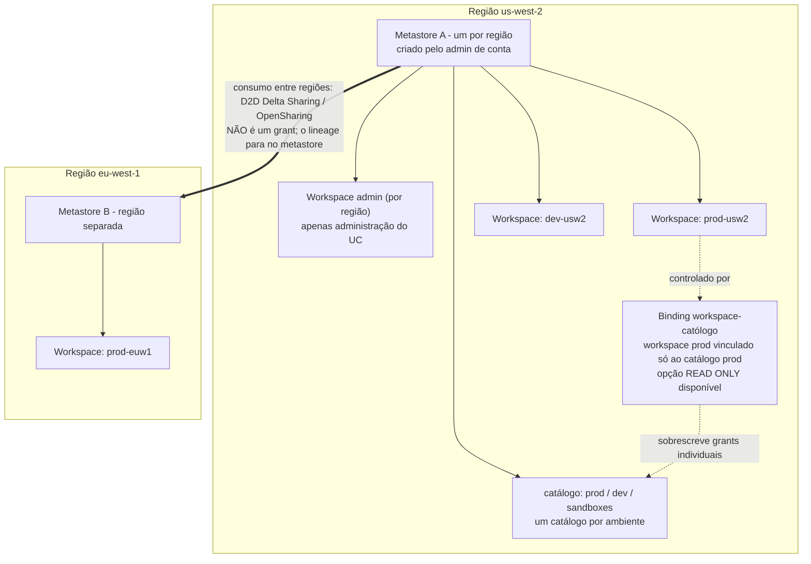
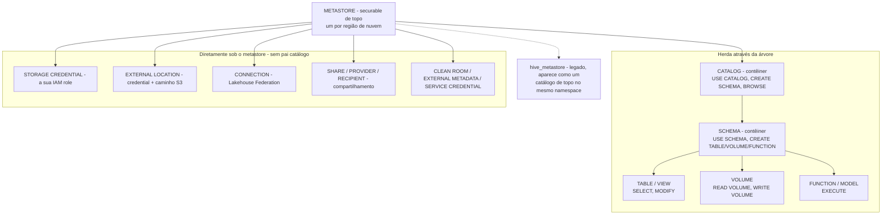
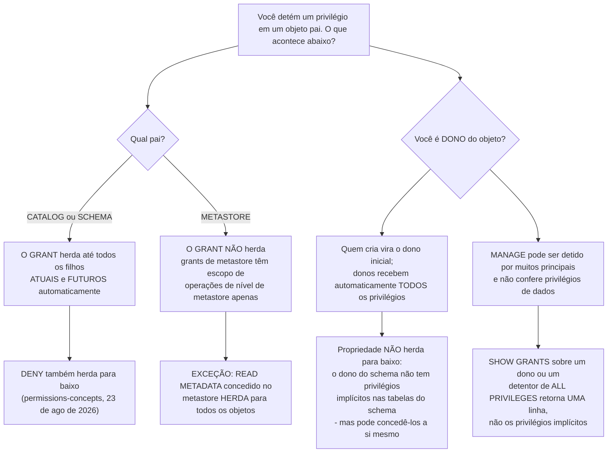
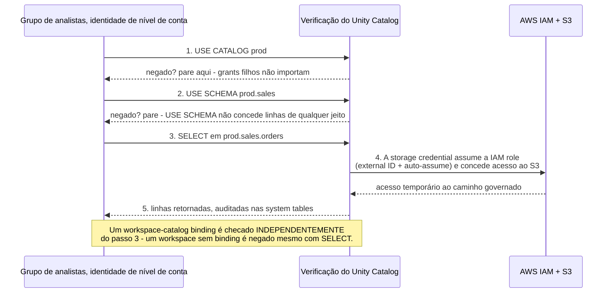
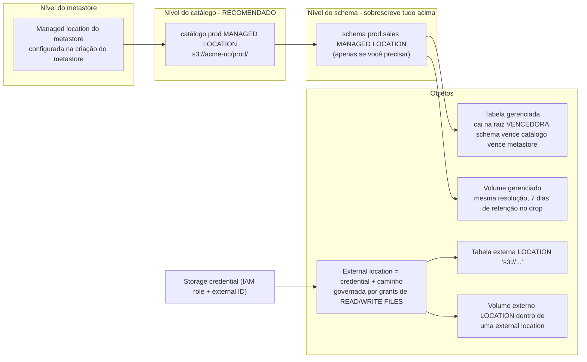
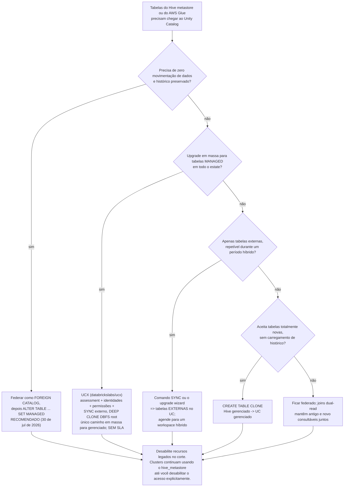

# Fundamentos do Unity Catalog: Metastore, Hierarquia, Grants, Storage Credentials e External Locations

A lição 02 construiu o substrato AWS: VPC, bucket raiz, PrivateLink, KMS, IAM. Esta lição coloca o **plano de governança** em cima dele. O Unity Catalog é onde esse substrato deixa de ser plumbing e passa a ser política: um `GRANT` que segue um *grupo* em todos os workspaces de uma região, uma IAM role envelopada em um securable para que revogar acesso seja um `REVOKE` em vez de uma edição de bucket policy, e um namespace de três níveis (`catalog.schema.table`) que finalmente dá aos caminhos do S3 um nome que cabe em uma review.

A regra didática desta lição: **o Unity Catalog decide *quem*, a sua conta AWS continua detendo *o quê*.** Os arquivos de dados nunca saem da sua conta S3, a IAM ainda precisa permitir que a Databricks assuma uma role, e cada grant que você escreve vale exatamente a cadeia de `USE CATALOG` → `USE SCHEMA` → `SELECT` que o entrega. Confunda essas duas frases e cada sintoma abaixo vira um mistério.

```text
=============================================================
 SUPERFÍCIE DO UNITY CATALOG NA AWS - em out 2026
-------------------------------------------------------------
 Metastore ...... securable de topo; UM por região de nuvem;
                  admins de conta criam/vinculam; um workspace
                  é atribuído a EXATAMENTE UM metastore
 Hierarquia ..... metastore > catálogo > schema >
                  tabela | view | volume | função |
                  modelo | service | segredo
                  (securables de dados ficam direto sob o
                  metastore: storage credentials, external
                  locations, connections, shares, ...)
 Namespace ...... três níveis: catálogo.schema.objeto
 Herança ........ grants de catálogo/schema alcançam filhos
                  ATUAIS E FUTUROS; grants de METASTORE NÃO
                  (apenas READ METADATA herda)
 Propriedade .... quem cria é dono; donos têm todos os
                  privilégios; propriedade NÃO herda para
                  baixo
 Padrão ......... deny-by-default - "Inicialmente, usuários
                  não têm acesso a dados em um metastore"
 Armazenamento .. storage credential = a SUA IAM role (com
                  external ID obrigatório) como securable
                  external location = credential + caminho S3
 Gerenciado ..... UC escolhe location + ciclo de vida, os
                  arquivos ficam na SUA conta, UNDROP 7 dias
 Externo ........ você escolhe LOCATION, UC só governa;
                  DROP remove metadados, S3 continua cobrando
 Migração ....... hive_metastore aparece como catálogo;
                  federate -> ALTER TABLE ... SET MANAGED
=============================================================
```

Nesta lição você vai:

- posicionar o **metastore** corretamente: um por região, criado em nível de conta, vinculado a muitos workspaces, com as funções de administração de conta / de workspace / de metastore separadas;
- desenhar a **hierarquia de securables** e nomear os objetos que deliberadamente ficam *fora* da árvore de catálogos;
- dominar **privilégios e herança**: por que `USE CATALOG` é obrigatório mas não concede dados, por que grants em nível de metastore não se propagam, e por que a propriedade não herda para baixo;
- operar o **deny by default** com as suas duas exceções documentadas de abertura padrão (`main`, o catálogo do workspace) e a regra de **workspace binding** que sobrescreve até um grant perfeito de `SELECT`;
- montar o **setup da AWS de ponta a ponta, resolvido**: trust policy de IAM com external ID → `CREATE STORAGE CREDENTIAL` → `CREATE EXTERNAL LOCATION` → quatro `GRANT`s → uma tabela Delta externa;
- separar **gerenciado de externo** em tabelas e volumes, prever onde uma tabela gerenciada fisicamente cai, e saber exatamente o que o `DROP` apaga em cada caso;
- escolher uma **ferramenta de migração do hive_metastore** por tipo de tabela (`SYNC`, upgrade wizard, `CREATE TABLE CLONE`, `DEEP CLONE` via UCX, federar e depois `SET MANAGED`);
- estudar **três casos nomeados de clientes** (Amgen, Rivian, nCino), ler a **caixa de atualizações de outubro de 2026** e praticar com **12 questões no estilo de exame** mais quatro verificações interativas.

---

## 1. O metastore: um objeto regional, gerenciado na conta

A própria referência do Unity Catalog começa pela definição da qual todo o resto depende:

> "O **metastore** é o objeto securable de topo do Unity Catalog. Um metastore contém todos os objetos securables registrados no Unity Catalog em uma única região de nuvem.": docs da Databricks, *Unity Catalog securable objects* (última atualização em 8 de out de 2026)

Três consequências se seguem, e cada uma delas é examinável:

1. **Um metastore por região de nuvem.** "Um metastore tem escopo de uma única região de nuvem. A sua organização precisa de um metastore em cada região em que opera." Um único metastore "pode ser vinculado a múltiplos workspaces na mesma região" (mesma página, 8 de out de 2026).
2. **Um workspace, um metastore.** "Cada workspace deve ser atribuído a exatamente um metastore" (guia de implantação well-architected da Databricks, *Design Unity Catalog architecture*, acesso em 2026-10). Um workspace não pode atravessar dois metastores, então leituras entre regiões nunca são "só um grant".
3. **Grants viajam com o metastore, não com o workspace.** "Concessões de permissão em um metastore se aplicam a todos os workspaces vinculados a esse metastore. Em outras palavras, um privilégio concedido em um workspace é efetivo em todos os outros workspaces que compartilham esse metastore" (8 de out de 2026). Essa é a razão inteira para consolidar: uma superfície de política, muitos workspaces.

O próprio metastore é "hospedado como um serviço multi-tenant no plano de controle da Databricks", enquanto "os dados em si continuam na sua conta de nuvem", o plano de controle guarda metadados, o seu S3 guarda bytes (guia de implantação; *Managed versus external assets*, 11 de set de 2026).

### 1.1 Quem administra o quê

| Nível de admin | Escopo | Criação / observações (página de admin-privileges, 23 de jun de 2026) |
|---|---|---|
| **Account admin** | A conta Databricks | Cria e vincula metastores e workspaces; pode conceder diretamente em um metastore; se um account admin criar o metastore manualmente, esse admin é o dono inicial *e* o metastore admin |
| **Workspace admin** | Um único workspace | Pode criar catálogos e outros securables de topo para **workspaces criados depois de 6 de mar de 2024** |
| **Metastore admin** | Um metastore (função opcional) | Como dono do metastore: pode gerenciar privilégios ou transferir a propriedade de *qualquer* objeto dentro dele, storage credentials, external locations, connections, shares, e pode conceder a qualquer pessoa leitura/escrita em qualquer dado dele |

Metastores provisionados automaticamente (auto-atribuição de workspace, ou a habilitação automática para contas AWS criadas depois de **8 de nov de 2023**) podem ter sido "criados sem um metastore admin", então não assuma que a função está preenchida só porque o Unity Catalog funciona.



- **📚 Você sabia?** Habilitar um workspace existente para o Unity Catalog é uma porta de mão única: "habilitar um workspace para o Unity Catalog **não pode ser revertido**. Uma vez que você habilita o workspace, você vai gerenciar usuários, grupos e service principals deste workspace usando interfaces de nível de conta" (docs da Databricks, *Enable a workspace for Unity Catalog*, última atualização em 20 de mai de 2026). A federação de identidade, usuários e grupos de nível de conta, é ligada ao mesmo tempo, e é por isso que os grants desta lição sempre nomeiam **identidades de nível de conta**, nunca identidades locais do workspace.

### 1.2 Exemplo resolvido E1: a topologia de duas regiões, decidida no papel

**Cenário:** um varejista roda produção e desenvolvimento em `us-west-2` e uma entidade europeia em `eu-west-1`. Quatro workspaces, um time de plataforma, um modelo de propriedade de dados.

```text
Exemplo resolvido E1 - topologia de metastores (em out 2026)

Região us-west-2
  metastore ...... 1 (um por região - limite rígido)
  workspaces ..... 2 vinculados: prod-usw2, dev-usw2
  workspace admin sim, 1 por região (guia de implantação)
  catálogos ...... prod, dev, sandboxes (isolamento de dados
                   "começa no nível do catálogo" -
                   boas práticas do UC, 20 de mai de 2026)
  bindings ....... prod-usw2  -> catálogo prod  (leitura-escrita)
                   dev-usw2   -> catálogo dev   (leitura-escrita)
                   ambos      -> sandboxes      (somente leitura)

Região eu-west-1
  metastore ...... 1
  workspaces ..... 1 vinculado: prod-euw1
  catálogos ...... prod_eu
  entre regiões .. analytics da UE sobre dados dos EUA passa
                   por D2D Delta Sharing, não por grant
                   (lineage não cruza a fronteira)

Por que NÃO quatro metastores
  - grants teriam de ser reemitidos por região
  - nenhum catálogo compartilhado entre workspaces de uma região
  - "Metastores proporcionam isolamento regional, mas não são
     pretendidos como unidades padrão de isolamento de dados"
     (boas práticas do UC, 20 de mai de 2026)
Por que NÃO um metastore para as duas regiões
  - impossível: metastores são regionais e um workspace
    pertence a exatamente um
```

**Leitura:** os ambientes são separados por **catálogos e bindings dentro de um único metastore**, não por metastores extras. O guia próprio da Databricks para workspaces novos diz o mesmo: "adote um metastore único por região com múltiplos catálogos… Isole ambientes com workspace bindings" (Databricks Answers, 2026-08-27). Uma ressalva que vale guardar: esse Q&A oficial também recomenda planejar "o storage root com cuidado porque ele não pode ser alterado após a criação": é uma postagem do Databricks Answers, não uma página de documentação, então trate a afirmação de imutabilidade como evidência de nível de Q&A oficial.

---

## 2. A hierarquia: o que fica pendurado onde, e por que isso importa

O Unity Catalog expõe "um namespace de três níveis (ou seja, `catalog.schema.table`)" (docs, *Enable a workspace*, 20 de mai de 2026). Ativos de dados e IA, "tabelas, views, volumes, funções, modelos e services", seguem essa estrutura, enquanto uma segunda família de objetos fica **diretamente sob o metastore**, completamente fora da árvore (*What is Unity Catalog?*, 7 de jul de 2026; securable-objects, 8 de out de 2026).



Dois fatos estruturais que os estudantes perdem repetidamente:

- **Os contêineres são o catálogo e o schema.** "Todo objeto nessa hierarquia é um objeto securable", e os privilégios concedidos em um pai "se aplicam automaticamente a todos os objetos filhos atuais e futuros", mas esse motor de herança começa no **catálogo**, não no metastore (permissions-concepts, 23 de ago de 2026; blog de privilégios: "O objeto de nível mais alto do qual os privilégios são herdados é o catálogo", 2023-05-05).
- **Storage credentials e external locations *não* ficam sob um catálogo.** Eles vivem em nível de metastore, e é por isso que criar um deles é uma operação com escopo de metastore e por isso que você concede neles com a sintaxe `ON STORAGE CREDENTIAL …` / `ON EXTERNAL LOCATION …` em vez de um nome de três níveis.

O Hive metastore legado é *aditivo*: "O metastore do Unity Catalog é aditivo, significando que ele pode ser usado junto com o Hive metastore por workspace no Databricks. O Hive metastore aparece como um catálogo de topo chamado `hive_metastore` no namespace de três níveis" (docs, *Work with the legacy Hive metastore*, acesso em 2026-10). A seção 8 transforma esse fato em um plano de migração.

- **📚 Você sabia?** O Unity Catalog foi open-sourced em **12/13 de jun de 2024** sob a licença Apache 2.0, construído sobre uma spec OpenAPI e "compatível com a metastore API do Apache Hive e a REST catalog API do Apache Iceberg", com suporte anunciado pela AWS, Google Cloud, Microsoft, NVIDIA e Salesforce (blog da Databricks, 2024-06-13; press release, 2024-06-12). Então o vocabulário de securables que você está aprendendo nesta lição não é profundo demais dentro da UI da Databricks: é o mesmo modelo servido pelas interfaces Iceberg REST e Hive Metastore.

---
## 3. Privilégios: a cadeia, as regras de herança, a armadilha do dono

> "Os objetos securables no Unity Catalog são hierárquicos, do metastore no topo, passando por catálogos e schemas, até os objetos de dados que eles contêm (tabelas, views, volumes, funções e modelos).": docs da Databricks, *Unity Catalog privileges* (última atualização em 8 de out de 2026)

Essa referência documenta a **Privilege Model versão 1.0**; um metastore "criado durante o public preview (antes de 25 de agosto de 2022)" pode estar em um modelo anterior, sem o comportamento de herança de hoje. Assuma 1.0 para tudo abaixo.

### 3.1 Os privilégios que você realmente vai digitar

| Nível | Privilégios que valem a memorização (referência de privilégios, 8 de out de 2026) |
|---|---|
| **Metastore** | `CREATE CATALOG`, `CREATE STORAGE CREDENTIAL`, `CREATE EXTERNAL LOCATION`, `READ METADATA`, `USE SHARE`, `CREATE CONNECTION` … |
| **Catálogo** | `USE CATALOG`, `CREATE SCHEMA`, `BROWSE`, `APPLY TAG`, mais os de nível filho como `SELECT`, `MODIFY`, `CREATE TABLE` |
| **Schema** | `USE SCHEMA`, `CREATE TABLE`, `CREATE VOLUME`, `CREATE FUNCTION`, `CREATE MATERIALIZED VIEW`, `EXTERNAL USE SCHEMA`, mais os de nível filho `SELECT`, `MODIFY`, `READ VOLUME`, `WRITE VOLUME` |
| **Tabela** | `SELECT`, `MODIFY`, `INSERT`, `UPDATE`, `DELETE` (os três de DML estão em Beta atualmente), `READ METADATA`, `MANAGE` |
| **Volume** | `READ VOLUME`, `WRITE VOLUME`, `READ METADATA`, `MANAGE` |
| **Storage credential** | `CREATE EXTERNAL LOCATION`, `READ FILES`, `WRITE FILES`, `MANAGE` |
| **External location** | `READ FILES`, `WRITE FILES`, `CREATE EXTERNAL TABLE`, `CREATE EXTERNAL VOLUME`, `EXTERNAL USE LOCATION`, `READ METADATA`, `BROWSE`, `MANAGE` |

Dois privilégios de navegação carregam o caminho inteiro de leitura:

> "`USE CATALOG`: Obrigatório para interagir com qualquer objeto dentro de um catálogo. **Por si só não concede acesso a dados.**" … "`USE SCHEMA`: Obrigatório para interagir com qualquer objeto dentro de um schema. Por si só não concede acesso a dados.": referência de privilégios, 8 de out de 2026

### 3.2 Herança versus propriedade: dois mecanismos, uma confusão



Leia esse diagrama como três leis separadas:

1. **Grants de catálogo e de schema se propagam** para "todos os schemas, tabelas, views, volumes e funções atuais e futuros": é por isso que conceder `SELECT` em um catálogo é a jogada em massa eficiente (securable-objects, 8 de out de 2026).
2. **Grants de metastore não se propagam**, com a única exceção documentada de `READ METADATA`: "privilégios concedidos em nível de metastore não herdam para objetos filhos… Isso difere do comportamento de herança de privilégios dos grants de catálogo e de schema" (8 de out de 2026). Ter `CREATE CATALOG` no metastore te dá zero tabelas legíveis.
3. **Propriedade não é herança.** "O principal que cria um objeto se torna o dono inicial dele"; "Dones de um objeto recebem automaticamente todos os privilégios sobre esse objeto"; mas "**a propriedade não herda para baixo no Unity Catalog**", o dono de um schema não recebe automaticamente privilégios nas tabelas do schema, embora "possa conceder privilégios a si mesmo" (permissions-concepts, 23 de ago de 2026; redação de propriedade da GCP, 5 de mar de 2026).

Quem pode conceder: "O dono do objeto. O dono do catálogo ou schema que contém o objeto. Um usuário com o privilégio MANAGE sobre o objeto. Um metastore admin. Account admins também podem conceder privilégios diretamente em um metastore" (manage-privileges, acesso em 2026-10).

### 3.3 Exemplo resolvido E2: a cadeia de grants e uma autópsia com `SHOW GRANTS`

**Alvo:** o grupo `analysts` precisa ler `prod.sales.orders`.

```sql
-- The full documented chain (Databricks Answers, 2026-08-27:
-- "reading a table requires the full USE CATALOG -> USE SCHEMA ->
--  SELECT chain")
GRANT USE CATALOG ON CATALOG prod      TO `analysts`;
GRANT USE SCHEMA  ON SCHEMA  prod.sales TO `analysts`;
GRANT SELECT      ON TABLE   prod.sales.orders TO `analysts`;

-- Shorter, equally valid: a catalog-level grant inherits down,
-- provided the usage privileges are there too:
--   "granting SELECT on a catalog allows a user to read any table
--    in that catalog (with the appropriate USE CATALOG and
--    USE SCHEMA usage privileges)" - securable-objects, Oct 8 2026
GRANT SELECT ON CATALOG prod TO `analysts`;

-- Audit: what does this principal actually hold?
SHOW GRANTS ON TABLE prod.sales.orders;
SHOW GRANTS ON CATALOG prod;
```

**Forense.** Suponha que `SHOW GRANTS ON SCHEMA sales_staging` retorne exatamente uma linha: `OWNERSHIP`. Por que o dono ainda pode fazer `SELECT` em `sales_staging.t`? Porque propriedade *é* todos os privilégios, renderizados em uma única linha, a referência é explícita de que para um detentor de `ALL PRIVILEGES` "apenas `ALL PRIVILEGES` é retornado, não os privilégios implícitos individuais como `SELECT` ou `MODIFY`" (8 de out de 2026). Por que um *segundo* usuário não pode? Negação por padrão (seção 4). O que o dono do schema precisa rodar para um colega? Um `GRANT SELECT ON SCHEMA …` explícito, propriedade não se propaga, então o colega não recebe nada do status do dono.

### 3.4 Verificação interativa: associe o privilégio ao seu nível

```matching
{
  "question": "Associe cada privilégio do Unity Catalog ao nível do securable no qual ele é documentado como um grant de primeira classe (referência de privilégios, 8 de out de 2026):",
  "pairs": [
    {"left": "USE CATALOG", "right": "Catálogo: obrigatório antes de interagir com qualquer coisa dentro dele; não concede dados"},
    {"left": "CREATE EXTERNAL LOCATION", "right": "Precisa ser mantido TANTO no metastore QUANTO na storage credential"},
    {"left": "READ VOLUME / WRITE VOLUME", "right": "Volume: governa arquivos não tabulares, não linhas de tabela"},
    {"left": "EXTERNAL USE LOCATION", "right": "External location: excluído de ALL PRIVILEGES de propósito"},
    {"left": "READ METADATA", "right": "O único privilégio de nível de metastore que herda para baixo"},
    {"left": "BROWSE", "right": "Catálogo: permite descobrir dados sem possuir USE CATALOG"}
  ],
  "explanation": "O conjunto de armadilhas é deliberado: USE CATALOG e USE SCHEMA são privilégios de navegação e nunca expõem linhas; CREATE EXTERNAL LOCATION é documentado como obrigatório tanto no metastore quanto na storage credential; EXTERNAL USE LOCATION é um dos quatro privilégios (com EXTERNAL USE SCHEMA, MANAGE e READ METADATA) que ALL PRIVILEGES deliberadamente não inclui, porque donos de location não o possuem por padrão: uma exceção anti-exfiltração. READ METADATA é o único privilégio de nível de metastore que herda."
}
```

- **📚 Você sabia?** `ALL PRIVILEGES` soa absoluto e não é: "ALL PRIVILEGES não inclui os privilégios `EXTERNAL USE SCHEMA`, `EXTERNAL USE LOCATION`, `MANAGE` ou `READ METADATA`" (referência de privilégios, 8 de out de 2026). E para evitar exfiltração acidental de dados, "dones de schema não têm o privilégio `EXTERNAL USE SCHEMA` por padrão e donos de external location não têm o privilégio `EXTERNAL USE LOCATION` por padrão" (permissions-concepts, 23 de ago de 2026). `EXTERNAL USE LOCATION` só pode ser concedido por um principal que detém `MANAGE` sobre a location.

---

## 4. Negação por padrão, as duas exceções de abertura padrão e os bindings que vencem grants

> "**Inicialmente, usuários não têm acesso a dados em um metastore.** Account admins, workspace admins e metastore admins da Databricks têm privilégios padrão para gerenciar o Unity Catalog.": docs da Databricks, *Manage privileges in Unity Catalog* (acesso em 2026-10)

O próprio Q&A da Databricks reformula isso como um "deny-by-default model" (answers.databricks.com, 2026-08-27). Tudo a que um usuário consegue chegar, foi concedido. Duas exceções documentadas mantêm os workspaces novos utilizáveis, e ambas valem a pena nomear com precisão, porque são o que faz um estate "trancado" vazar na primeira semana:

1. **O catálogo `main`:** "Todos os usuários têm `USE CATALOG` no catálogo `main` por padrão" (referência de privilégios, 8 de out de 2026).
2. **O catálogo do workspace:** "Todos os usuários do workspace recebem o privilégio `USE CATALOG` no catálogo do workspace. Os usuários do workspace também recebem os privilégios `USE SCHEMA`, `CREATE TABLE`, `CREATE VOLUME`, `CREATE MODEL`, `CREATE FUNCTION` e `CREATE MATERIALIZED VIEW` no schema padrão do catálogo" (manage-privileges, acesso em 2026-10).



### 4.1 Bindings são um segundo portão, independente

> "Por padrão, um catálogo é acessível de todos os workspaces vinculados ao mesmo metastore. Você pode restringir isso vinculando o catálogo a workspaces específicos, opcionalmente somente leitura. **O workspace binding sobrescreve grants de privilégio individuais.** Mesmo um usuário com um grant explícito de `SELECT` não consegue acessar um objeto em um catálogo que não está vinculado ao seu workspace.": securable-objects, 8 de out de 2026

Bindings existem para **catálogos**, **storage credentials** e **external locations** (página de workspace-catalog binding, 29 de abr de 2026), que é o mecanismo que impede que uma credential de produção seja usável em um workspace de sandbox. A mesma página observa que o acesso "de um workspace sem binding é negado, mesmo para usuários com grants explícitos de privilégio sobre o catálogo".

Um segundo padrão que vale conhecer: "Um metastore admin precisa habilitar o acesso externo a dados para cada metastore que você precise acessar externamente. Esta opção é **desabilitada por padrão** para impedir acesso externo não autorizado" (docs, *Enable external data access*, 14 de mai de 2026).

### 4.2 Exemplo resolvido E3: três grants quebrados, diagnosticados

```text
Exemplo resolvido E3 - as três falhas que todo time bate primeiro

(a) Erro de SQL: GRANT USAGE ON CATALOG prod TO `analysts`;
    POR QUÊ ... USAGE é vocabulário legado de Hive-metastore /
               Lake Formation. O Unity Catalog escreve USE CATALOG
               (e USE SCHEMA no próximo nível).
    CORREÇÃO .. GRANT USE CATALOG ON CATALOG prod TO `analysts`;

(b) SELECT negado em prod.sales.orders mesmo com o usuário
    detendo SELECT na tabela.
    POR QUÊ ... a cadeia pai está quebrada: sem USE CATALOG em prod
               ou sem USE SCHEMA em prod.sales. A referência de
               privilégios: USE CATALOG é "obrigatório para
               interagir com qualquer objeto dentro de um catálogo"
               independentemente dos privilégios filhos.
    CORREÇÃO .. conceda os dois privilégios de uso e teste de novo.

(c) A external location foi marcada como somente leitura hoje de
    manhã, mas um gravador legado ainda parece ter sucesso.
    POR QUÊ ... "Pode levar até 60 minutos para essa mudança
               tomar efeito em todos os recursos de compute"
               (manage-external-locations, acesso em 2026-10).
    CORREÇÃO .. espere a janela de propagação terminar e teste de
               novo; a flag de somente leitura também sobrescreve
               direitos de escrita concedidos pela IAM role sob a
               credential.
```

O padrão (b) é o que gera tickets: um grant de `SELECT` é uma *chave para uma porta*, e `USE CATALOG`/`USE SCHEMA` são o *corredor que leva até ela*: sem o corredor, a chave é inútil.

---

## 5. Storage credentials: a sua IAM role, envelopada em um securable

Na AWS, "uma **credential** é um objeto securable que representa uma IAM role da AWS" (referência de credentials do Databricks SQL, acesso em 2026-10), e o formato de storage credential é especificamente o que alcança o S3:

> "A primeira é uma **storage credential**, que especifica uma IAM role da AWS que permite acesso ao local S3. Você precisa dessa storage credential para o segundo objeto obrigatório: uma **external location**, que define o caminho para o seu local de armazenamento no S3 e as credenciais necessárias para acessar esse local.": docs da Databricks, *Connect to cloud object storage using Unity Catalog* / *S3 external location* (11 de set de 2026)

O que o objeto realmente armazena (API de Storage Credential, acesso em 2026-10):

| Campo | Função |
|---|---|
| `role_arn` | "O Amazon Resource Name (ARN) da IAM role da AWS usada para emitir credenciais temporárias" |
| `unity_catalog_iam_arn` (saída) | "O Amazon Resource Name (ARN) do usuário IAM da AWS gerenciado pela Databricks. Esta é a identidade que vai assumir a IAM role da AWS" |
| `external_id` (saída) | "O external ID usado na assume-role para prevenir o problema do confused deputy" |

Três regras rígidas do lado da AWS:

- **O external ID é obrigatório desde 2023-11-30.** "As políticas de IAM para storage credentials agora exigem um external ID: 30 de novembro de 2023. Para criar uma storage credential, você agora precisa adicionar o external ID da sua storage credential na política da IAM role na AWS" (release notes, nov de 2023). O exemplo de trust da documentação traz `"sts:ExternalId": "0000"` como placeholder para o *seu* valor devolvido.
- **A role precisa viver na mesma conta AWS do bucket**, e "Você precisa de permissões `iam:CreateRole` para criar a IAM role"; o setup automatizado "usa delegação temporária da AWS IAM" e é o caminho recomendado para "a maioria das implantações" (páginas de external location do S3, 11 de set / 7 de ago de 2026).
- **Roles auto-assumíveis são impostas.** "A Databricks bloqueia storage credentials novas e existentes baseadas em IAM roles que não são auto-assumíveis" (página de conexão do S3, 11 de set de 2026). A confiança é um `sts:AssumeRole` entre contas para a master role fixa do Unity Catalog da Databricks.

```text
A cadeia de confiança, em uma figura (em out 2026)

  Master role do UC da Databricks (conta Databricks 414351767826)
    arn:aws:iam::414351767826:role/unity-catalog-prod-UCMasterRole-...
        |  sts:AssumeRole + sts:ExternalId = <o seu>
        v
  A sua role de storage credential  (MESMA conta AWS do bucket)
    arn:aws:iam::111122223333:role/acme-uc-raw-s3
        |  s3:GetObject / PutObject / List* / DeleteObject no seu prefixo
        |  kms:Decrypt / Encrypt / GenerateDataKey* (se SSE-KMS)
        v
  s3://acme-lake/raw/   (+ grant opcional de política de chave KMS)
```

### 5.1 Exemplo resolvido E4: a trust policy, linha por linha

```json
{
  "Version": "2012-10-17",
  "Statement": [
    {
      "Sid": "AllowDatabricksUCToAssumeThisRole",
      "Effect": "Allow",
      "Principal": {
        "AWS": "arn:aws:iam::414351767826:role/unity-catalog-prod-UCMasterRole-14S5ZJVKOTYTL"
      },
      "Action": "sts:AssumeRole",
      "Condition": {
        "StringEquals": {
          "sts:ExternalId": "0000"
        }
      }
    },
    {
      "Sid": "SelfAssumeRequiredByUCPolicy",
      "Effect": "Allow",
      "Principal": { "AWS": "arn:aws:iam::111122223333:role/acme-uc-raw-s3" },
      "Action": "sts:AssumeRole"
    }
  ]
}
```

Checklist de revisor: (1) o principal é a master role do Unity Catalog da Databricks para a partição comercial `414351767826` (GovCloud usa IDs de conta diferentes: lição 02); (2) `sts:ExternalId` é igual ao valor que a Databricks devolveu para *esta* credential, não uma string inventada; (3) a política de **permissões** da role limita `s3:*` ao seu prefixo apenas; (4) se o bucket usa SSE-KMS, adicione `kms:Decrypt`, `kms:Encrypt`, `kms:GenerateDataKey*` nessa chave à política da role *e* atualize a **política da chave** para permitir a role com `kms:ViaService: s3.<region>.amazonaws.com` (docs, *Configure encryption for S3 with KMS*, acesso em 2026-10).

**Contraste legado, em uma linha:** um *instance profile* vincula uma IAM role a um **cluster**, então todo mundo que usa aquela caixa a herda; uma storage credential vincula a role a um **securable governado por grants**. A Databricks posiciona as service credentials, o objeto irmão para AWS Glue e Secrets Manager, como "a alternativa do Unity Catalog aos instance profiles, com a vantagem de que o acesso não fica preso a um recurso de compute específico" (docs, acesso em 2026-10), e rotula a configuração de KMS de instance profile como "configuração legada".

- **📚 Você sabia?** A autenticação machine-to-machine do OAuth 2.0, client credentials de service principal, tokens de acesso de **uma hora**, até **cinco** secrets OAuth por service principal, cada um válido por até **dois anos**, é como um *service principal se autentica no Databricks* (API, CLI, JDBC). Não é como o Unity Catalog alcança o S3: na AWS, o acesso a armazenamento é sempre emissão de IAM role com external ID (docs de autenticação OAuth M2M + CLI, acesso em 2026-10). Ensine M2M como a camada de identidade para *jobs que chamam o Databricks*, e IAM roles como a camada de identidade para *Databricks chamando o S3*.

---

## 6. External locations: credential mais caminho, governados por grants

> "Uma external location é um objeto securable que combina um caminho de armazenamento com uma storage credential que autoriza o acesso a esse caminho.": referência de external locations do Databricks SQL (acesso em 2026-10)

Os privilégios nela decidem quem pode tocar nos arquivos: `READ FILES` para ler diretamente, `WRITE FILES` para gravar (securable-objects, 8 de out de 2026), mais `CREATE EXTERNAL TABLE`, `CREATE EXTERNAL VOLUME`, `EXTERNAL USE LOCATION` e `BROWSE`. Duas regras estruturais causam a maioria das falhas de `CREATE EXTERNAL LOCATION`:

- **Sem aninhamento.** "O caminho de armazenamento de qualquer external location não pode estar contido dentro do caminho de armazenamento de outra external location"; "External locations não podem se sobrepor a outras external locations" (referência de external locations; *Path rules and access*, acesso em 2026-10).
- **Os dois portões para criação.** "`CREATE EXTERNAL LOCATION`: Cria uma external location que associa um caminho de armazenamento de nuvem a uma storage credential. **Obrigatório tanto no metastore quanto na storage credential**" (referência de privilégios, 8 de out de 2026).

E o fato operacional que surpreende todo mundo: virar uma location para somente leitura "pode levar **até 60 minutos** … para tomar efeito em todos os recursos de compute", enquanto a própria flag "Impede que os usuários gravem arquivos nessas external locations, independentemente de quaisquer permissões de escrita concedidas pela IAM role que fundamenta a storage credential" (manage-external-locations, acesso em 2026-10).

### 6.1 Exemplo resolvido E5, o setup resolvido: credential → location → grants → tabela externa

A peça central desta lição. Os estudantes preenchem o ARN da própria role e o bucket; todo o resto é sintaxe documentada (referência de credentials; referência de external locations; página manual do S3, 7 de ago de 2026).

```sql
-- 0) AWS prerequisites (outside Databricks)
--    * IAM role in the SAME account as the bucket
--    * trust: Databricks UC master role 414351767826 with your
--      sts:ExternalId  (E4 above)
--    * permission policy: s3:GetObject/PutObject/List*/DeleteObject
--      on s3://acme-lake/raw/*
--    * KMS bucket? add kms:Decrypt/Encrypt/GenerateDataKey* to the
--      role policy AND allow the role in the key policy

-- 1) Metastore level (metastore admin holds these by default)
CREATE STORAGE CREDENTIAL acme_raw_cred
  AWS_IAM_ROLE_ARN 'arn:aws:iam::111122223333:role/acme-uc-raw-s3'
  COMMENT 'raw landing zone credential';

CREATE EXTERNAL LOCATION acme_raw_loc
  URL 's3://acme-lake/raw/'
  WITH (CREDENTIAL acme_raw_cred)
  COMMENT 'raw landing zone';

-- 2) Delegate creation, nothing else, to the platform team.
--    Databricks' recommendation: "grant only CREATE EXTERNAL
--    LOCATION and no other privileges on storage credentials"
GRANT CREATE EXTERNAL LOCATION
  ON STORAGE CREDENTIAL acme_raw_cred TO `data-platform`;

-- 3) Ingest team: file rights at the location
GRANT READ FILES, WRITE FILES, CREATE EXTERNAL TABLE
  ON EXTERNAL LOCATION acme_raw_loc TO `ingest-engineers`;

-- 4) Analyst team: the normal three-step chain
GRANT USE CATALOG ON CATALOG sales              TO `analysts`;
GRANT USE SCHEMA  ON SCHEMA  sales.raw          TO `analysts`;
GRANT SELECT      ON SCHEMA  sales.raw          TO `analysts`;

-- 5) External table - files stay exactly where they are
CREATE TABLE sales.raw.orders_ext (
  order_id BIGINT,
  ts       TIMESTAMP,
  amount   DECIMAL(12,2)
)
USING DELTA
LOCATION 's3://acme-lake/raw/orders/2026-10/';

-- 6) Audit the storage side
SHOW GRANTS ON EXTERNAL LOCATION acme_raw_loc;
SHOW GRANTS ON STORAGE CREDENTIAL acme_raw_cred;
```

**Variante A: zona de aterrissagem somente leitura.** Marque a location como somente leitura no Catalog Explorer (ou na flag `read_only` da API) e depois teste as gravações de novo após a janela de propagação de **60 minutos**; não declare vitória no minuto cinco.

**Variante B, bucket SSE-KMS.** Adicione as três ações de KMS à política da role da storage credential, permita a role na política da chave com `kms:ViaService` e defina o **algoritmo de criptografia na external location**, uma opção documentada desde **2024-10-28** (release notes, out de 2024).

**Variante C, o grupo que nunca deve gravar.** Conceda apenas `READ FILES` e confie no modo somente leitura da location mais o vínculo a um workspace de produção como cinto e suspensório: administradores de nuvem "frequentemente vinculam storage credentials a workspaces específicos para garantir que credentials de produção sejam usadas apenas para criar external locations dentro de workspaces de produção" (manage-storage-credentials, acesso em 2026-10).

### 6.2 Verificação interativa: preencha os termos

```fillblank
{
  "question": "Complete a frase de setup usando os termos documentados do Unity Catalog / AWS (docs de external location e credentials do S3, 11 de set de 2026 e 7 de ago de 2026; release notes de nov de 2023):",
  "template": "O securable que armazena uma IAM role da AWS para S3 é uma storage {{1}}; combiná-la com um caminho de nuvem cria uma {{2}} {{3}}; a trust policy da role deve carregar o {{4}} devolvido pela Databricks, obrigatório desde 30 de novembro de 2023, e o privilégio necessário para criar o segundo objeto deve ser mantido tanto no metastore quanto nessa credential - {{5}}.",
  "answers": {
    "1": "credential",
    "2": "external",
    "3": "location",
    "4": "external ID",
    "5": "CREATE EXTERNAL LOCATION"
  },
  "distractors": ["metastore", "endpoint", "gateway", "access key", "instance profile", "USE CATALOG", "READ FILES", "namespace", "mount", "session token"],
  "explanation": "Storage credential = o securable da IAM role; external location = credential + caminho; o external ID é obrigatório desde 2023-11-30 (placeholder 0000 na documentação) e evita o problema do confused deputy; CREATE EXTERNAL LOCATION é documentado como obrigatório tanto no metastore quanto na storage credential. Os distratores são objetos reais: instance profile é o mecanismo legado preso ao compute, um mount de DBFS está obsoleto e jamais deve ser registrado como external location, e READ FILES concede acesso a arquivos em uma location existente, não o direito de criar uma."
}
```

- **📚 Você sabia?** O plumbing de eventos de arquivos para streaming sobre external locations é provisionado para você na AWS: os recursos de política de IAM documentados para eventos de arquivos incluem `arn:aws:sqs:*:*:csms-*` e `arn:aws:sns:*:*:csms-*`: as filas e tópicos gerenciados de eventos de arquivos que dirigem a ingestão baseada em notificação (manage-external-locations, acesso em 2026-10). E a governança de dados não tabulares passa cada vez mais por **volumes** em vez de grants crus de caminho: "Quando você define um volume externo, o acesso por URI de nuvem aos dados sob o caminho do volume é governado pelos privilégios concedidos **no volume**, e não pelos privilégios concedidos na external location onde o volume é armazenado" (docs, *What are Unity Catalog volumes?*, acesso em 2026-10).

---

## 7. Gerenciado versus externo: a mesma governança, ciclos de vida diferentes

> "**Ativos gerenciados:** o Unity Catalog controla a governança (controle de acesso, auditoria, lineage) e também o ciclo de vida do armazenamento de arquivos subjacente (otimização de arquivos, como eles são organizados e quando são apagados). **Ativos externos:** o Unity Catalog controla apenas a governança.": docs da Databricks, *Managed versus external assets in Unity Catalog* (11 de set de 2026)

| Dimensão | Tabela/volume **gerenciado** | Tabela/volume **externo** |
|---|---|---|
| Local de armazenamento | Escolhido pelo Unity Catalog: schema → catálogo → managed location do metastore | Você escolhe um `LOCATION` dentro de uma external location |
| Onde os bytes vivem | "Os arquivos de dados permanecem sempre na sua conta de nuvem" | O seu armazenamento de nuvem, inalterado |
| Ciclo de vida | UC otimiza, organiza e **apaga no DROP**; `UNDROP` disponível por **7 dias**, apagamento permanente **em até 30 dias** | DROP remove **apenas metadados**; "os arquivos de dados no seu armazenamento de nuvem não são apagados" |
| Formato | "**Tabelas gerenciadas usam o formato Delta ou Apache Iceberg**" | O que você registrar (Delta na prática para tabelas do UC) |
| Acesso por caminho | "Acesso por caminho a tabelas gerenciadas do Unity Catalog não é suportado": use nomes de tabela | Arquivos alcançáveis através da external location / volume governados |
| Capacidade extra | Qualifica para **predictive optimization** (compactação, clustering, vacuum) | Sem manutenção automática de armazenamento |
| Retenção no drop (volumes) | Arquivos de volume gerenciados retidos por **7 dias** após o drop | Os dados permanecem no armazenamento de nuvem |

Ordem de resolução para armazenamento gerenciado: "Localizações de armazenamento gerenciadas em níveis mais baixos da hierarquia sobrescrevem localizações de armazenamento definidas em níveis mais altos… A Databricks recomenda que você atribua armazenamento gerenciado no **nível do catálogo** para isolamento lógico de dados" (docs, *Specify a managed storage location*, acesso em 2026-10). Subdiretórios com hash mantêm os tenants separados: schemas caem sob `<storage-root>/__unitystorage/schemas/<uuid>` e catálogos sob `<storage-root>/__unitystorage/catalogs/<uuid>`.



### 7.1 Exemplo resolvido E6, matemática de colocação: onde a tabela realmente cai?

**Setup:** raiz do metastore `s3://acme-uc/metastore-root/`; catálogo `prod` criado com `MANAGED LOCATION 's3://acme-uc/prod/'`; schema `prod.sales` criado **sem** managed location; um segundo schema `prod_sandbox` criado **com** `MANAGED LOCATION 's3://acme-uc/sandbox/'`.

```text
Exemplo resolvido E6 - colocação gerenciada, em out 2026

Q1  Nova tabela gerenciada em prod.sales?
    Schema sem override -> a raiz do CATÁLOGO vence
    => s3://acme-uc/prod/__unitystorage/catalogs/<catalog-uuid>/
       (padrão com hash no nível do catálogo, documentado)

Q2  Nova tabela gerenciada em prod_sandbox?
    O override do schema vence a raiz do catálogo
    => s3://acme-uc/sandbox/__unitystorage/schemas/<schema-uuid>/

Q3  Nova tabela gerenciada em um catálogo SEM managed location
    em nenhum nível acima dele?
    Cai na managed location do metastore - se uma foi
    configurada na criação do metastore; senão, o
    armazenamento padrão da Databricks na sua conta Databricks.

Q4  Você faz ALTER no schema para adicionar MANAGED LOCATION depois.
    As tabelas existentes se movem?
    NÃO. Managed locations se aplicam a tabelas criadas depois;
    as tabelas existentes mantêm os caminhos originais. Planeje a
    raiz antes do primeiro CREATE TABLE.
```

Gerenciado versus externo lado a lado (Q5):

```sql
-- Managed: Unity Catalog picks the location and the lifecycle
CREATE TABLE sales.orders (
  order_id BIGINT, ts TIMESTAMP, amount DECIMAL(12,2)
) USING DELTA;

-- External: you pick the location, inside an external location
CREATE TABLE sales.orders_ext (
  order_id BIGINT, ts TIMESTAMP, amount DECIMAL(12,2)
) USING DELTA
LOCATION 's3://acme-lake/raw/orders/2026-10/';

-- Different DROP semantics (Sep 11, 2026)
DROP TABLE sales.orders;      -- files deleted; UNDROP 7 days,
                              -- permanent delete within 30 days
DROP TABLE sales.orders_ext;  -- metadata only; S3 keeps billing
```

```plot
{
  "type": "bar",
  "title": "Janelas de tempo do Unity Catalog sobre as quais podem te perguntar (horas), em out 2026",
  "data": [
    {"Window": "OAuth M2M access token", "Hours": 1},
    {"Window": "Read-only location flip", "Hours": 1},
    {"Window": "Managed table UNDROP", "Hours": 168},
    {"Window": "Dropped managed volume", "Hours": 168},
    {"Window": "Purge after managed DROP", "Hours": 720}
  ],
  "xKey": "Window",
  "dataKeys": ["Hours"],
  "xLabel": "Janela documentada (60 minutos = 1 hora; 7 dias = 168; 30 dias = 720)",
  "yLabel": "Horas"
}
```

> [!WARNING]
> ⚠️ **"Gerenciado" nunca significa "armazenamento da Databricks."** Tabelas gerenciadas continuam sendo arquivos na *sua* conta S3, o Unity Catalog apenas escolhe o caminho e o ciclo de vida (11 de set de 2026). Três consequências: (1) dar DROP em uma tabela gerenciada **apaga arquivos** depois da janela de `UNDROP` de 7 dias, com apagamento permanente em até 30 dias, enquanto dar DROP em uma tabela externa deixa o S3 cobrando você por arquivos órfãos; (2) você não consegue endereçar tabelas gerenciadas pelo caminho `s3://` de forma alguma; e (3) **nunca** registre um bucket usado como DBFS root como external location, "Você jamais deve carregar uma conta de armazenamento usada como DBFS root como uma external location no Unity Catalog" (docs, *Best practices for DBFS and Unity Catalog*, acesso em 2026-10).

---

## 8. Migrando do `hive_metastore`: a escada documentada

O Unity Catalog é aditivo, então a migração começa pela coexistência: o metastore legado "aparece como um catálogo de topo chamado `hive_metastore`", e consultas podem juntar uma tabela legada com uma tabela do Unity Catalog em um único comando enquanto você faz o corte (docs, *Work with the legacy Hive metastore*, acesso em 2026-10: um comportamento que este curso chama de **dual-read**, para o registro, não um nome de produto da documentação).

Existem dois caminhos documentados (mesma página): "Atualizar todas as tabelas registradas no Hive metastore para o Unity Catalog" ou "Federar o seu Hive metastore para o Unity Catalog usando Hive Metastore federation, para uma abordagem mais gradual."

A sequência recomendada é explícita:

> "A abordagem recomendada é primeiro **federar o seu Hive metastore ou catálogo AWS Glue como um foreign catalog, e depois atualizar as tabelas foreign no lugar.** Esse processo em dois passos permite migrar tabelas sem movimentação de dados, preservando histórico, configuração, permissões e views.": docs da Databricks, *Upgrade a Databricks workspace to Unity Catalog* (30 de jul de 2026)

O comando de conversão no lugar é `ALTER TABLE <foreign_catalog>.<schema>.<table_name> SET MANAGED`, que a "Databricks recomenda… para desbloquear o **predictive optimization** do Unity Catalog, que inclui manutenção automática (compactação, clustering, vacuum)" (mesma página).

### 8.1 As quatro ferramentas, pelo que elas produzem

| Ferramenta | Tipos de tabela Hive que ela trata | Resultado no UC | Dados movidos? | Histórico preservado? | Fonte |
|---|---|---|---|---|---|
| **Federate → `ALTER TABLE … SET MANAGED`** | Externas e gerenciadas (via foreign catalog) | Gerenciado, no lugar | **Não** | **Sim**: "preservando histórico, configuração, permissões e views" | página de upgrade, 30 de jul de 2026 |
| **UCX** (Databricks Labs, `databrickslabs/ucx`) | Ambas; `SYNC` para externas, **`DEEP CLONE`** para gerenciadas de DBFS root | Gerenciado ou externo | O clone copia dados para gerenciadas de DBFS root | Gerenciado pelo UCX | páginas de migração + UCX, acesso em 2026-10 |
| **Unity Catalog upgrade wizard / `SYNC`** | Tabelas externas (e gerenciadas armazenadas fora do DBFS root) | **Externo** | Não (cópia de metadados; repetível/agendável) | Tabelas ficam como estão | página de migração; blog do SYNC, 2022-11-03 |
| **`CREATE TABLE CLONE`** | Tabelas gerenciadas do Hive | Gerenciado | Cópia | **Não**: "O histórico da tabela não é migrado… tratadas como tabelas novas" | página de migração, acesso em 2026-10 |

Restrições para memorizar: "Se você quer fazer um upgrade em massa de tabelas Hive para tabelas gerenciadas do Unity Catalog, esta é a sua única opção": UCX (página de migração); o UCX "é um repositório público no GitHub e **não é suportado diretamente pela Databricks**" e não tem SLA; e "tabelas gerenciadas do Hive precisam estar no formato Delta ou Parquet para serem atualizadas" (página do UCX, acesso em 2026-10).



### 8.2 Exemplo resolvido E7: escolha a ferramenta por tipo de tabela

```text
Exemplo resolvido E7 - matriz de decisão de migração (preenchida)

Tabela                                   Ferramenta           Resultado  Movi?  Histórico
------------------------------------------------------------------------------------------
1 Tabela EXTERNA do Hive no S3           SYNC / upgrade wiz   externa    não    n/a
2 Tabela gerenciada do Hive no DBFS root UCX (DEEP CLONE)     gerenciada SIM    não
3 Tabela gerenciada do Hive em S3 ext.   federate -> SET MGD  gerenciada não    SIM
4 Tabela de catálogo AWS Glue            federate -> SET MGD  gerenciada não    SIM
5 Tabela gerenciada do Hive, precisa de  CREATE TABLE CLONE   gerenciada SIM    não
   vida nova, histórico não exigido
6 Relatório legado lendo hive_metastore  join dual-read       inalterada não    sim
   durante período híbrido

Checklist de corte (página de upgrade, 30 de jul de 2026)
  [ ] Vincular o workspace a um metastore do Unity Catalog
  [ ] Atualizar tabelas e views do Hive para o Unity Catalog
  [ ] Conceder acesso a usuários/grupos/service principals de nível de conta
  [ ] Atualizar consultas e jobs para os novos nomes de tabela
  [ ] Migrar arquivos, notebooks e scripts para fora do DBFS
  [ ] Atualizar o compute para versões suportadas do Databricks Runtime
  [ ] Desabilitar o acesso a recursos legados
```

**Leitura:** as linhas 1 e 4 são as baratas (só metadados, `SET MANAGED` onde suportado); a linha 2 é a cara, o armazenamento de DBFS root força um `DEEP CLONE` físico, e é exatamente por isso que "DBFS root e DBFS mounts estão obsoletos e não são recomendados pela Databricks. Contas novas são provisionadas sem acesso a esses recursos" (docs, *Best practices for DBFS and Unity Catalog*, acesso em 2026-10). A linha 6 é a rede de segurança: como o `hive_metastore` continua funcionando até você desabilitá-lo, antigo e novo podem ser juntados em uma única query enquanto os jobs migram um a um.

### 8.3 Verificação interativa: ordene o corte

```dragdrop
{
  "question": "Coloque a migração do Unity Catalog na ordem que a página oficial de upgrade implica (docs, 30 de jul de 2026; páginas do UCX, acesso em 2026-10):",
  "items": [
    "Vincular o workspace a um metastore do Unity Catalog na região",
    "Federar o Hive metastore ou o catálogo AWS Glue como um foreign catalog",
    "Atualizar as tabelas no lugar com ALTER TABLE ... SET MANAGED, ou migrar em massa identidades, permissões, armazenamento e tabelas com o UCX",
    "Conceder acesso a usuários, grupos ou service principals de nível de conta às tabelas atualizadas",
    "Atualizar consultas e jobs para referenciar as novas tabelas do Unity Catalog",
    "Migrar arquivos, notebooks e scripts do DBFS, depois atualizar o compute para versões suportadas do Databricks Runtime",
    "Desabilitar o acesso a recursos legados nos seus workspaces"
  ],
  "correctOrder": [
    "Vincular o workspace a um metastore do Unity Catalog na região",
    "Federar o Hive metastore ou o catálogo AWS Glue como um foreign catalog",
    "Atualizar as tabelas no lugar com ALTER TABLE ... SET MANAGED, ou migrar em massa identidades, permissões, armazenamento e tabelas com o UCX",
    "Conceder acesso a usuários, grupos ou service principals de nível de conta às tabelas atualizadas",
    "Atualizar consultas e jobs para referenciar as novas tabelas do Unity Catalog",
    "Migrar arquivos, notebooks e scripts do DBFS, depois atualizar o compute para versões suportadas do Databricks Runtime",
    "Desabilitar o acesso a recursos legados nos seus workspaces"
  ],
  "explanation": "A ordem documentada é: anexar o metastore primeiro (é o pré-requisito de tudo), depois federar, depois atualizar as tabelas no lugar (ou UCX para o caso em massa), depois conceder de novo para identidades de nível de conta, depois apontar consultas e jobs, depois limpar o DBFS e subir o runtime, e só então desabilitar os recursos legados: porque 'Por padrão, clusters de compute da Databricks continuam se conectando ao Hive metastore mesmo depois da migração, a menos que você desabilite explicitamente o acesso ao Hive metastore'. Desligar o acesso legado antes de os jobs estarem apontados quebra o período híbrido que torna essa migração segura."
}
```

- **📚 Você sabia?** O Unity Catalog te dá uma janela de recuperação que o Hive metastore nunca teve: no Unity Catalog "você pode fazer `UNDROP` de uma tabela gerenciada por 7 dias, e os dados são apagados permanentemente em até 30 dias", enquanto "Quando você dá drop em uma tabela gerenciada no Hive metastore, todos os arquivos de dados subjacentes são apagados imediatamente" (docs, *Database objects in the legacy Hive metastore*, acesso em 2026-10). Essa diferença é o melhor argumento único para terminar a migração, e a melhor razão para deixar de tratar `DROP` como um botão desfazível em scripts legados.

---

### Atualizações de 2026 (em outubro de 2026)

> [!NOTE]
> **O que mudou na história do Unity Catalog da qual esta lição depende: cada linha verificada contra uma fonte primária:**
> - **Referências de privilégios e de securables atualizadas em 2026-10-08.** A Privilege Model **1.0** continua atual; grants finos de `INSERT` / `UPDATE` / `DELETE` estão "em Beta" (ver *Fine-grained DML privileges*), e o securable mais novo `feature` está em Public Preview: tutoriais antigos que listam apenas tabelas, views, volumes e funções estão incompletos (docs.databricks.com/aws/en/data-governance/unity-catalog/securable-objects and access-control/privileges-reference, última atualização em 8 de out de 2026).
> - **Workspace bindings agora cobrem também o lado do armazenamento.** Catálogos, **storage credentials** e **external locations** são todos vinculáveis, com um nível opcional de **somente leitura**, e "O acesso de um workspace sem binding é negado, mesmo para usuários com grants explícitos de privilégio sobre o catálogo" (docs, workspace-catalog binding, última atualização em 29 de abr de 2026).
> - **Higiene de storage credential endurecida.** A Databricks "bloqueia storage credentials novas e existentes baseadas em IAM roles que não são auto-assumíveis", o external ID é obrigatório desde **2023-11-30**, e o setup automatizado via delegação temporária de IAM é o padrão documentado para a maioria das implantações (página de conexão do S3, 11 de set de 2026; manual de external location, 7 de ago de 2026).
> - **Conexões JDBC do Unity Catalog ficaram GA em 2026-10-02**, enquanto o OAuth M2M para esse caminho permanece em Beta: relevante quando uma ferramenta de BI precisa ler tabelas governadas via JDBC (release notes, outubro de 2026).
> - **Semântica de ativos gerenciados reafirmada em 2026-09-11:** o UC controla "governança… e o ciclo de vida do armazenamento de arquivos subjacente" para ativos gerenciados e "apenas governança" para os externos, e a documentação agora direciona conversões de tabelas foreign para o `SET MANAGED` para **predictive optimization** (managed-versus-external, 11 de set de 2026; página de upgrade, 30 de jul de 2026).
> - **A certificação agora testa exatamente essa superfície.** O guia de exame do *Databricks Certified Data Engineer Associate* (no ar em **4 de mai de 2026**) traz um domínio de **Governança e Segurança 15%**, o blueprint do Data Engineer Professional inclui **Data Governance 7%** mais **Data Sharing and Federation 5%**, e a acreditação AWS Platform Architect nomeia explicitamente "storage credentials vs instance profiles" no escopo (exam guides + databricks.com/learn/certification/databricks-on-aws, acesso em 2026-10-12).

---

## Casos Reais

A Databricks publica resultados de governança, não matrizes de grants. Todo número abaixo é **afirmado pelo cliente ou pela Databricks, não auditado**, com a sua URL e data para você conferir, o ponto examinável é o *padrão*, não o marketing.

### Caso A, Amgen: de mais de 120 IAM roles para uma ou duas, via Unity Catalog

| Elemento | Detalhe |
|---|---|
| Cliente | **Amgen**: biofarmacêutica |
| Desafio | **AWS Glue** como catálogo corporativo mais o sprawl de **AWS IAM** com uma role por caso de uso; auditar significava analisar políticas de IAM; governança não escalava para a adoção corporativa |
| Serviços | Unity Catalog sobre um estate da AWS, o blog nomeia Glue e IAM como a stack anterior, então o substrato é AWS; ACLs, views dinâmicas, histórico de consultas |
| Resultado | "não tivemos que criar ou gerenciar pelo menos 120+ IAM roles … passamos de centenas de IAM roles para apenas uma ou duas IAM role principais"; "Isso reduz o esforço de auditoria da função em 50%"; "cerca de ~500 objetos mapeados no Unity Catalog"; "90 por cento dos nossos casos de uso estão no Databricks" |
| Fonte | https://www.databricks.com/blog/how-databricks-unity-catalog-helped-amgen-enable-data-governance-enterprise-scale (**maio de 2023**) |
| Relação com esta lição | Seções 5 e 8: uma identidade governada substituindo o sprawl de roles, e a movimentação de um catálogo no estilo Glue/Hive para dentro do Unity Catalog |

> ⏳ *Nota temporal: números de maio de 2023: um retrato daquela implantação na época. O mecanismo (principais governados no UC, roles colapsadas) continua sendo o padrão documentado em out de 2026.*

### Caso B, Rivian: um catálogo governado para todos os times na AWS

| Elemento | Detalhe |
|---|---|
| Cliente | **Rivian**: veículos elétricos; página de caso marcada com **Cloud: AWS** |
| Desafio | Terabytes de dados de veículos e de campo por dia em mais de 70.000 veículos; times em silos bloqueando manutenção preditiva e ML de eficiência de bateria |
| Serviços | Databricks SQL, Delta Lake, **Unity Catalog**, Liquid Clustering |
| Resultado | "mais de 1.000 usuários da plataforma, um aumento de 75% em relação a um ano atrás" e "o Unity Catalog nos dá um catálogo de dados verdadeiramente centralizado em todos os nossos times diferentes" (https://www.databricks.com/customers/rivian, sem data, acesso em 2026-10); "50% better runtime performance" e "Mais de 70.000 Rivians na estrada, gerando terabytes de dados todos os dias" (https://www.databricks.com/your-ai/customers/rivian, **2024-05-30**); a stack "Unity Catalog for data governance, Delta Tables for storage, and Liquid Clustering for data layout" para ML de previsão de carga em tempo real (https://www.databricks.com/blog/data-intelligence-action-100-data-and-ai-use-cases-databricks-customers, **2025-07-09**) |
| Relação com esta lição | Seções 1 to 3: um metastore compartilhado por workspaces, uma hierarquia única de catálogos, grants que seguem grupos de nível de conta em vez de caixas |

> ⏳ *Nota temporal: datas misturadas: uma página de cliente sem data (acesso em out 2026) mais postagens datadas de 2024 e 2025. Ensine a afirmação de "catálogo centralizado entre times" como relatada, não garantida.*

### Caso C, nCino: dados bancários dentro de um único perímetro da AWS

| Elemento | Detalhe |
|---|---|
| Cliente | **nCino**: software bancário; página de caso marcada com **Cloud: AWS** |
| Desafio | Consolidar 13 anos de dados bancários e "trilhões em histórico de empréstimos" mantendo a postura de conformidade apertada |
| Serviços | Databricks na AWS, **Unity Catalog**, AI/BI Genie; os casos de uso listam Analytics e BI, AI, Data Warehousing, Governance and Security |
| Resultado | "Manter os dados dentro de um único ecossistema da AWS reduz a complexidade, fortalece a conformidade e dá aos times controle total sobre informações financeiras sensíveis."; "Com o Unity Catalog governando o acesso e o AI/BI Genie democratizando insights, executivos, analistas e gestores de relacionamento todos se beneficiam de soluções de IA orientadas por domínio que nenhum modelo genérico consegue replicar." |
| Fonte | https://www.databricks.com/customers/ncino (página sem data, acesso em 2026-10) |
| Relação com esta lição | Seções 4 e 6: bindings e external locations como o perímetro de conformidade: uma conta, uma família de credentials, um modelo de grants |

> ⏳ *Nota temporal: página de cliente sem data acessada em out 2026; as afirmações de arquitetura estão atuais, o número de histórico de empréstimos é o publicado.*

| Caso | Padrão do Unity Catalog que ele demonstra | Seção |
|---|---|---|
| Amgen | Sprawl de IAM roles colapsado em principais governados; catálogo da era Glue/Hive movido para o UC | 5, 8 |
| Rivian | Uma hierarquia de catálogos em nível de metastore servindo muitos times e workloads | 1 to 3 |
| nCino | Bindings + external locations como perímetro de conformidade de um único ecossistema da AWS | 4, 6 |

---

## Perguntas de Prática (Practice Questions)

```question
{
  "id": "dbl-03-q1",
  "type": "multiple-choice",
  "question": "Qual afirmação sobre metastores do Unity Catalog na AWS está correta em outubro de 2026?",
  "options": [
    "Um metastore pode abranger múltiplas regiões de nuvem, e cada workspace pode ser vinculado a um metastore por região",
    "Existe um metastore por região de nuvem, ele pode ser vinculado a múltiplos workspaces nessa região, e cada workspace deve ser atribuído a exatamente um metastore",
    "Cada workspace recebe seu próprio metastore automaticamente, e metastores podem ser livremente reatribuídos entre regiões",
    "Metastores são objetos locais do workspace que admins de conta podem opcionalmente consolidar"
  ],
  "correct": 1,
  "explanation": "A página de securable-objects (8 de out de 2026) diz que um metastore tem 'escopo de uma única região de nuvem' e pode ser vinculado a múltiplos workspaces nessa região, e o guia de implantação diz 'Cada workspace deve ser atribuído a exatamente um metastore'. Os distratores introduzem metastores entre regiões, metastores por workspace e reatribuição livre: nada disso existe; o consumo entre regiões passa pelo D2D Delta Sharing."
}
```

```question
{
  "id": "dbl-03-q2",
  "type": "multiple-choice",
  "question": "Quais objetos ficam DIRETAMENTE sob o metastore, e não sob um catálogo?",
  "options": [
    "Tabelas, views e volumes, porque objetos de dados sempre penduram no metastore",
    "Schemas e tabelas, porque o metastore é a camada de catálogo",
    "Storage credentials, external locations, service credentials, connections, shares, providers, recipients e clean rooms",
    "Somente external locations; todo outro securable precisa estar aninhado dentro de um catálogo"
  ],
  "correct": 2,
  "explanation": "O Unity Catalog documenta que, ao lado da árvore catálogo/schema, 'Storage credentials, External locations, External metadata, Service credentials, Connections, Shares, Providers, Recipients, Clean rooms' existem todos diretamente sob o metastore (securable-objects, 8 de out de 2026). Tabelas e views penduram em schemas; tratar o metastore como pai de objetos de dados é o erro estrutural por trás da maioria das tentativas de GRANT de três níveis que falham."
}
```

```question
{
  "id": "dbl-03-q3",
  "type": "true-false",
  "question": "Verdadeiro ou falso: conceder CREATE CATALOG no metastore também concede acesso ao conteúdo de todos os catálogos daquele metastore.",
  "options": ["Verdadeiro", "Falso"],
  "correct": 1,
  "explanation": "Falso. 'Importantly, privileges granted at the metastore level do not inherit to child objects in the hierarchy. Metastore-level grants are scoped to metastore-level operations only' (securable-objects, 8 de out de 2026). A única exceção documentada é READ METADATA, que de fato herda. Grants de catálogo e de schema, em contraste, se aplicam a todos os filhos atuais e futuros: e é por isso que o instinto de hierarquia quebra exatamente no degrau de cima."
}
```

```question
{
  "id": "dbl-03-q4",
  "type": "multiple-choice",
  "question": "Um usuário detém SELECT em prod.sales.orders, mas a consulta falha com erro de permissão. Qual é a causa mais provável?",
  "options": [
    "SELECT em uma tabela nunca é válido; você precisa deter MODIFY",
    "Falta ao usuário USE CATALOG em prod ou USE SCHEMA em prod.sales: ambos são obrigatórios para interagir com objetos dentro, e nenhum concede dados por si só",
    "A tabela é gerenciada, e tabelas gerenciadas exigem uma política de IAM de S3 separada para o usuário",
    "O metastore admin precisa primeiro rodar SHOW GRANTS para materializar o privilégio"
  ],
  "correct": 1,
  "explanation": "A referência de privilégios afirma que USE CATALOG é 'obrigatório para interagir com qualquer objeto dentro de um catálogo', independentemente de quais privilégios filhos o usuário detém, e que USE SCHEMA é obrigatório para objetos dentro de um schema. O próprio Q&A da Databricks resume o caminho de leitura como a cadeia completa USE CATALOG -> USE SCHEMA -> SELECT. SELECT é perfeitamente válido como privilégio de dados; tabelas gerenciadas são alcançadas pelo Unity Catalog, não por políticas cruas de S3; SHOW GRANTS é ferramenta de auditoria, não etapa de ativação."
}
```

```question
{
  "id": "dbl-03-q5",
  "type": "multiple-choice",
  "question": "Qual par de afirmações sobre propriedade está correto?",
  "options": [
    "A propriedade herda para baixo, então o dono de um schema automaticamente detém todo privilégio nas tabelas do schema",
    "Quem cria vira o dono inicial, donos detêm automaticamente todos os privilégios sobre o objeto, mas a propriedade não herda para baixo: o dono de um schema precisa conceder a si mesmo privilégios nas tabelas do schema",
    "Dones não detêm privilégios até concedê-los a si mesmos, e a propriedade se transfere automaticamente quando um objeto filho é criado",
    "Propriedade e MANAGE são idênticas: MANAGE pode ser detido por muitos principais e confere todos os privilégios de dados"
  ],
  "correct": 1,
  "explanation": "Permissions-concepts (23 de ago de 2026) diz que o principal criador vira o dono inicial, que donos 'recebem automaticamente todos os privilégios sobre esse objeto' e que 'a propriedade não herda para baixo': o dono de um schema não tem automaticamente privilégios em tabelas, mas pode concedê-los a si mesmo. MANAGE é diferente: pode ser detido por muitos principais e não confere privilégios de dados, e o SHOW GRANTS renderiza propriedade ou ALL PRIVILEGES como uma única linha, não como uma lista de privilégios implícitos."
}
```

```question
{
  "id": "dbl-03-q6",
  "type": "multiple-choice",
  "question": "Qual é o relacionamento correto entre uma IAM role, uma storage credential e uma external location na AWS?",
  "options": [
    "A external location armazena a IAM role, e a storage credential armazena o caminho S3",
    "São três nomes para o mesmo objeto, então conceder em um concede nos três",
    "A storage credential é o securable que guarda o ARN da IAM role mais o external ID; a external location combina essa credential com um caminho S3; grants na credential governam quem pode fazer CREATE EXTERNAL LOCATION, grants na location governam quem pode ler ou gravar arquivos",
    "A IAM role é anexada ao cluster como instance profile, e o Unity Catalog apenas registra o caminho"
  ],
  "correct": 2,
  "explanation": "Uma credential é 'um objeto securable que representa uma IAM role da AWS' armazenando role_arn mais o unity_catalog_iam_arn e o external_id devolvidos; uma external location 'combina um caminho de armazenamento com uma storage credential'. A Databricks recomenda conceder apenas CREATE EXTERNAL LOCATION em storage credentials, enquanto READ FILES / WRITE FILES / CREATE EXTERNAL TABLE vivem na location. A opção de instance profile descreve o modelo legado preso ao compute que as storage credentials substituíram."
}
```

```question
{
  "id": "dbl-03-q7",
  "type": "true-false",
  "question": "Verdadeiro ou falso: desde 30 de novembro de 2023, criar uma storage credential exige que o external ID esteja presente na trust policy da IAM role, e a Databricks bloqueia roles que não são auto-assumíveis.",
  "options": ["Verdadeiro", "Falso"],
  "correct": 0,
  "explanation": "Verdadeiro. As release notes de novembro de 2023 afirmam 'IAM policies for storage credentials now require an external ID', e a documentação do S3 diz que a Databricks 'blocks new and existing storage credentials based on IAM roles that are not self-assuming'. O external ID evita o problema do confused deputy; o exemplo de trust da documentação traz sts:ExternalId = 0000 como placeholder para o valor que a sua credential devolve."
}
```

```question
{
  "id": "dbl-03-q8",
  "type": "multiple-choice",
  "question": "Um time dá DROP em uma tabela Delta externa e depois descobre que os arquivos do S3 continuam lá e continuam sendo cobrados. Qual é a explicação correta?",
  "options": [
    "O DROP falhou; tabelas externas não podem receber drop enquanto contêm dados",
    "A Databricks põe os arquivos externos apagados em quarentena por 7 dias antes de removê-los",
    "O Unity Catalog remove apenas os metadados dos ativos externos, enquanto os arquivos de dados no armazenamento de nuvem não são apagados: ao contrário de uma tabela gerenciada, cujos arquivos são apagados com uma janela de UNDROP de 7 dias e apagamento permanente em até 30 dias",
    "Os arquivos pertencem à external location, que só os apaga quando a location em si recebe drop"
  ],
  "correct": 2,
  "explanation": "Documentação do ciclo de vida do object storage: 'Quando você apaga uma tabela externa ou um volume externo, o Unity Catalog remove os metadados do metastore. Os arquivos de dados no seu armazenamento de nuvem não são apagados.' Ativos gerenciados são o oposto: o UC controla o ciclo de vida dos arquivos, você pode fazer UNDROP por 7 dias e os dados são apagados permanentemente em até 30 dias. Dar drop em uma external location também não limpa os arquivos da tabela, então a recuperação de órfãos é trabalho do lado do S3."
}
```

```question
{
  "id": "dbl-03-q9",
  "type": "multiple-choice",
  "question": "Você precisa atualizar em massa tabelas do Hive metastore para tabelas MANAGED do Unity Catalog, com movimentação de dados apenas onde for inevitável. Qual ferramenta a documentação nomeia?",
  "options": [
    "O upgrade wizard do Unity Catalog, porque ele sempre cria tabelas gerenciadas",
    "O comando SYNC, porque o SYNC converte tabelas gerenciadas no lugar",
    "UCX (databrickslabs/ucx) - 'a sua única opção' para um upgrade em massa para tabelas gerenciadas, usando SYNC para tabelas externas e DEEP CLONE para gerenciadas de DBFS root",
    "CREATE TABLE CLONE, porque clones preservam o histórico da tabela"
  ],
  "correct": 2,
  "explanation": "A página de migração afirma que, para um upgrade em massa de tabelas Hive para tabelas gerenciadas do Unity Catalog, o UCX 'é a sua única opção', observando ao mesmo tempo que o UCX é um repositório público 'não suportado diretamente pela Databricks', sem SLA. SYNC e o upgrade wizard produzem tabelas EXTERNAS; CREATE TABLE CLONE de fato produz tabelas gerenciadas, mas 'o histórico da tabela não é migrado… tratadas como tabelas novas'. DEEP CLONE é o caminho do UCX para gerenciadas de DBFS root, e é por isso que o formato importa: tabelas gerenciadas do Hive precisam ser Delta ou Parquet."
}
```

```question
{
  "id": "dbl-03-q10",
  "type": "multiple-choice",
  "question": "Um usuário detém SELECT no catálogo prod e USE SCHEMA em prod.sales, mas não consegue gravar um arquivo no caminho raw de aterrissagem. O que falta?",
  "options": [
    "MODIFY na tabela: gravações de arquivo sempre são privilégios de tabela",
    "READ FILES ou WRITE FILES na external location que cobre aquele caminho (mais o caminho precisa estar dentro de uma external location registrada que está vinculada ao workspace)",
    "CREATE CATALOG no metastore, porque gravações são operações de nível de metastore",
    "Propriedade do schema: apenas donos podem gravar arquivos"
  ],
  "correct": 1,
  "explanation": "O acesso direto a arquivos é governado por READ FILES / WRITE FILES na external location, que combina o caminho com uma storage credential; CREATE EXTERNAL LOCATION em si precisa ser detido tanto no metastore quanto na credential. Privilégios de tabela como SELECT ou MODIFY se aplicam a dados de tabela, não a caminhos crus; CREATE CATALOG não tem relação; propriedade não é exigida e, de qualquer forma, não herda. E os bindings são checados de forma independente: um workspace sem binding falha independentemente dos grants."
}
```

```question
{
  "id": "dbl-03-q11",
  "type": "multiple-choice",
  "question": "Um analista tem um grant explícito de SELECT no catálogo prod, mas ainda não consegue acessá-lo a partir do workspace de finanças. Qual explicação é documentada?",
  "options": [
    "Grants expiram após 60 minutos a menos que sejam reemitidos",
    "O catálogo não está vinculado ao workspace de finanças: o workspace binding sobrescreve grants individuais de privilégio, então o acesso de um workspace sem binding é negado mesmo para usuários com grants explícitos",
    "O workspace de finanças está vinculado a um metastore diferente na mesma região, o que anula o grant",
    "SELECT precisa ser concedido de novo no nível da tabela antes que um grant em nível de catálogo tenha efeito"
  ],
  "correct": 1,
  "explanation": "A página de securable-objects é explícita: 'O workspace binding sobrescreve grants individuais de privilégio. Mesmo um usuário com um grant explícito de SELECT não consegue acessar um objeto em um catálogo que não está vinculado ao seu workspace', e a página de binding confirma que o acesso de workspace sem binding é negado. Não existe expiração de grant de 60 minutos (o número de 60 minutos pertence à alternância de somente leitura da external location); grants sobrevivem ao compartilhamento de metastore entre workspaces da mesma região; e concessões repetidas no nível da tabela não são condição de validade."
}
```

```question
{
  "id": "dbl-03-q12",
  "type": "multiple-choice",
  "question": "Qual veredito comparativo para governar dados do S3 no Databricks está correto em outubro de 2026?",
  "options": [
    "Instance profiles legados mais ACLs de tabela do Hive-metastore são equivalentes ao Unity Catalog porque ambos emitem grants, então a escolha é cosmética",
    "Bucket policies cruas do S3 são suficientes porque o Unity Catalog não pode revogar acesso que a IAM ainda permite",
    "O Unity Catalog (storage credential + external location + grupos de nível de conta) vence em onde a identidade se vincula: princípios, não caixas -, em grants auditados, na semântica de DROP e em sobreviver a um segundo workspace na mesma região; a stack legada vincula roles ao compute, apaga arquivos gerenciados do Hive imediatamente sem janela de UNDROP e mantém grants locais do workspace, enquanto bucket policies sozinhas nunca expressam escopo de tabela, schema ou coluna",
    "Nenhum dos modelos importa desde que o bucket seja privado, porque criptografia substitui controle de acesso"
  ],
  "correct": 2,
  "explanation": "As diferenças são estruturais, não de estilo: as storage credentials do UC vinculam IAM a securables governados por grants (service credentials são documentadas como 'a alternativa do Unity Catalog aos instance profiles'), drops gerenciados do Hive apagam arquivos imediatamente enquanto o UC oferece uma janela de UNDROP de 7 dias e purga de 30 dias, grants em nível de metastore se aplicam a todo workspace vinculado, e auditoria/lineage vêm junto. Bucket policies continuam necessárias para o perímetro de rede, mas têm forma de bucket ou prefixo, sem dimensão de tabela ou schema: e criptografia é ortogonal à autorização."
}
```

> [!WARNING]
> ⚠️ **Armadilhas de padrão desta lição: percorra esta lista antes de projetar qualquer coisa:**
> - **`GRANT USAGE ON …` não é sintaxe do Unity Catalog.** É vocabulário legado/Lake Formation; escreva `USE CATALOG` / `USE SCHEMA`.
> - **`USE CATALOG` não é acesso a dados.** Privilégios de navegação abrem o corredor; só `SELECT`/`MODIFY`/`READ VOLUME` abrem portas, e sem o corredor a chave da porta é inutilizável.
> - **Grants em nível de metastore não se propagam**: apenas `READ METADATA` herda do metastore. A herança começa no catálogo.
> - **A propriedade não herda para baixo**, e o `SHOW GRANTS` mostra propriedade ou `ALL PRIVILEGES` como uma linha: nenhum privilégio implícito é listado.
> - **`ALL PRIVILEGES` exclui `EXTERNAL USE SCHEMA`, `EXTERNAL USE LOCATION`, `MANAGE` e `READ METADATA`** de propósito; donos de location não detêm `EXTERNAL USE LOCATION` por padrão, e apenas um detentor de `MANAGE` pode concedê-lo.
> - **Bindings vencem grants.** Um workspace sem binding é negado mesmo com um `SELECT` perfeito; o mesmo vale para storage credentials e external locations vinculadas.
> - **External location não é storage credential, que não é IAM role.** Credential = ARN da role + external ID; location = credential + caminho + modo somente leitura; e `CREATE EXTERNAL LOCATION` precisa ser detido **tanto** no metastore **quanto** na credential.
> - **Alternar para somente leitura leva até 60 minutos** para valer em todos os computes, e isso também sobrescreve direitos de escrita da IAM role. Caminhos jamais podem se aninhar ou se sobrepor.
> - **Gerenciado não é armazenamento da Databricks.** Os arquivos ficam na sua conta; o `DROP` de uma tabela gerenciada os apaga (`UNDROP` de 7 dias, purga de 30 dias), o `DROP` de uma tabela externa apaga apenas metadados, e o acesso por caminho a tabelas gerenciadas não é suportado.
> - **Nunca registre um bucket de DBFS root como external location**, e não dê a identidades fora do UC acesso em nível de armazenamento a tabelas ou volumes gerenciados do UC.
> - **Ordem da migração:** anexar metastore → federar → `SET MANAGED` / UCX → conceder de novo para identidades de conta → apontar jobs → sair do DBFS → desabilitar acesso legado. Clusters continuam usando o `hive_metastore` até você desabilitá-lo explicitamente.

> [!IMPORTANT]
> **Veredito Comparativo: Unity Catalog versus a stack legada (ACL do Hive + instance profiles + DBFS) versus bucket policies cruas do S3**
> - **Contra as ACLs legadas do Hive metastore + instance profiles:** no stack legado a identidade se vincula ao **recurso de compute** (qualquer um no cluster herda o profile) e no Unity Catalog ela se vincula aos **principais** (storage credential + grants), então o mesmo `GRANT` funciona em um job cluster, em um SQL warehouse e em compute serverless. A semântica de drop diverge muito, drops gerenciados do Hive "apagam todos os arquivos de dados subjacentes… imediatamente", o Unity Catalog dá uma **janela de `UNDROP` de 7 dias** e purga de 30 dias, e grants são locais do workspace no Hive, mas se aplicam a **todo workspace vinculado ao metastore** no UC. O colapso publicado pela Amgen, de "mais de 120 IAM roles" para "uma ou duas IAM role principais", é a forma operacional desse veredito (maio de 2023).
> - **Contra bucket policies cruas do S3 com IAM apenas:** bucket policies têm **forma de bucket ou prefixo**, sem dimensão de catálogo, schema, tabela, coluna ou linha, sem lineage, sem trilha de auditoria de `SHOW GRANTS`, e precisam ser reescritas por principal e por prefixo (a aritmética da lição 02: o sprawl de políticas cresce com cada time novo). Mantenha-as para o **perímetro de rede e de conta**; coloque a autorização nos securables. Lembre da regra permanente da documentação: "A única identidade que deve ter acesso a dados gerenciados pelo Unity Catalog é a identidade usada pelo Unity Catalog" (connect-to-cloud-storage, 3 de jun de 2026).
> - **Contra não fazer nada (um instance profile por cluster):** a diferença é a *revogação*. Com UC, um único `REVOKE` em um grupo encerra o acesso em todo lugar; com instance profiles você fica dando patch em clusters e editando bucket policies, e caminhos de S3 sem governança sobrevivem à mudança.
> - **O veredito em uma frase:** em outubro de 2026, **modele todo caminho S3 como uma storage credential mais uma external location sem sobreposição, conceda direitos de arquivos na location e direitos de dados no namespace de três níveis a grupos de nível de conta, vincule catálogos e credentials de produção a workspaces de produção, mantenha tabelas gerenciadas onde quer que o UC possa gerenciar o ciclo de vida, e trate o acesso via Hive/instance profile como um backlog de migração: não como uma opção de design.**

> [!SUCCESS]
> **Pontos Principais (Key Takeaways):**
> 1. **O metastore é o securable de topo: um por região de nuvem**, criado/administrado em nível de conta e vinculado a múltiplos workspaces nessa região: "Cada workspace deve ser atribuído a exatamente um metastore", e **os grants se aplicam a todos os workspaces vinculados**. Isole ambientes com **catálogos e workspace bindings**, não com metastores extras; leituras entre regiões passam pelo D2D Delta Sharing, e o lineage para na fronteira do metastore.
> 2. **A hierarquia é `metastore → catálogo → schema → tabela|view|volume|função|modelo|service|segredo`**, com **storage credentials, external locations, connections, shares e clean rooms pendurados diretamente sob o metastore**; o `hive_metastore` legado aparece como um catálogo de topo no mesmo namespace de três níveis.
> 3. **A herança começa no catálogo**: grants de catálogo/schema alcançam todos os filhos atuais *e futuros*, e negações também herdam, mas **grants de metastore não herdam**, com a única exceção de `READ METADATA`. **A propriedade é separada**: quem cria é dono, donos têm todos os privilégios, **a propriedade não herda para baixo**, e o `SHOW GRANTS` imprime propriedade/`ALL PRIVILEGES` em uma única linha.
> 4. **Negação por padrão** ("Inicialmente, usuários não têm acesso a dados em um metastore") com duas exceções de abertura padrão: `USE CATALOG` em `main`, e os privilégios do schema padrão do **catálogo do workspace**. **O workspace binding sobrescreve grants**, até um `SELECT` explícito falha a partir de um workspace sem binding, e o acesso externo a dados está desativado por padrão em cada metastore.
> 5. **Caminho de leitura = `USE CATALOG` → `USE SCHEMA` → `SELECT`**; `USAGE` não é sintaxe do UC; privilégios `USE *` "por si só não concedem acesso a dados".
> 6. **Storage credential = a sua IAM role como securable** (`role_arn` + `unity_catalog_iam_arn` + `external_id`), external ID **obrigatório desde 2023-11-30**, roles auto-assumíveis impostas, confiança na master role do UC da Databricks na conta `414351767826`; **external location = credential + caminho**, nunca aninhada ou sobreposta, com `READ FILES`/`WRITE FILES`/`CREATE EXTERNAL TABLE` nela e `CREATE EXTERNAL LOCATION` exigido **tanto** no metastore **quanto** na credential. Alternar para somente leitura se propaga em **até 60 minutos**.
> 7. **Gerenciado versus externo é uma decisão de ciclo de vida, não de hospedagem**: os dados sempre ficam na sua conta. O armazenamento gerenciado resolve **schema → catálogo → metastore** (caminhos com hash em `__unitystorage/...`; o nível do catálogo é a recomendação da Databricks), tabelas gerenciadas são Delta/Iceberg com **`UNDROP` de 7 dias** e purga de 30 dias mais predictive optimization; `DROP` externo remove apenas metadados.
> 8. **Migração:** federar Hive/Glue como um foreign catalog e depois `ALTER TABLE … SET MANAGED` (sem movimentação de dados, histórico preservado); **o UCX é o único caminho em massa para tabelas gerenciadas** (SYNC para externas, `DEEP CLONE` para DBFS root, sem SLA); upgrade wizard/`SYNC` produzem tabelas **externas**; `CREATE TABLE CLONE` perde histórico. O acesso legado persiste até você desabilitá-lo, e buckets de DBFS root jamais podem virar external locations.
> 9. **Âncoras:** Amgen, "mais de 120 IAM roles" → "uma ou duas IAM role principais", esforço de auditoria **50%** menor, ~500 objetos governados (blog da Databricks, **maio de 2023**); Rivian, "um catálogo de dados verdadeiramente centralizado em todos os nossos times diferentes", mais de 1.000 usuários (sem data, acesso em 2026-10; 2024-05-30; 2025-07-09); nCino, "Manter os dados dentro de um único ecossistema da AWS reduz a complexidade, fortalece a conformidade" (sem data, acesso em 2026-10), afirmado pelo cliente, com data, não auditado.
