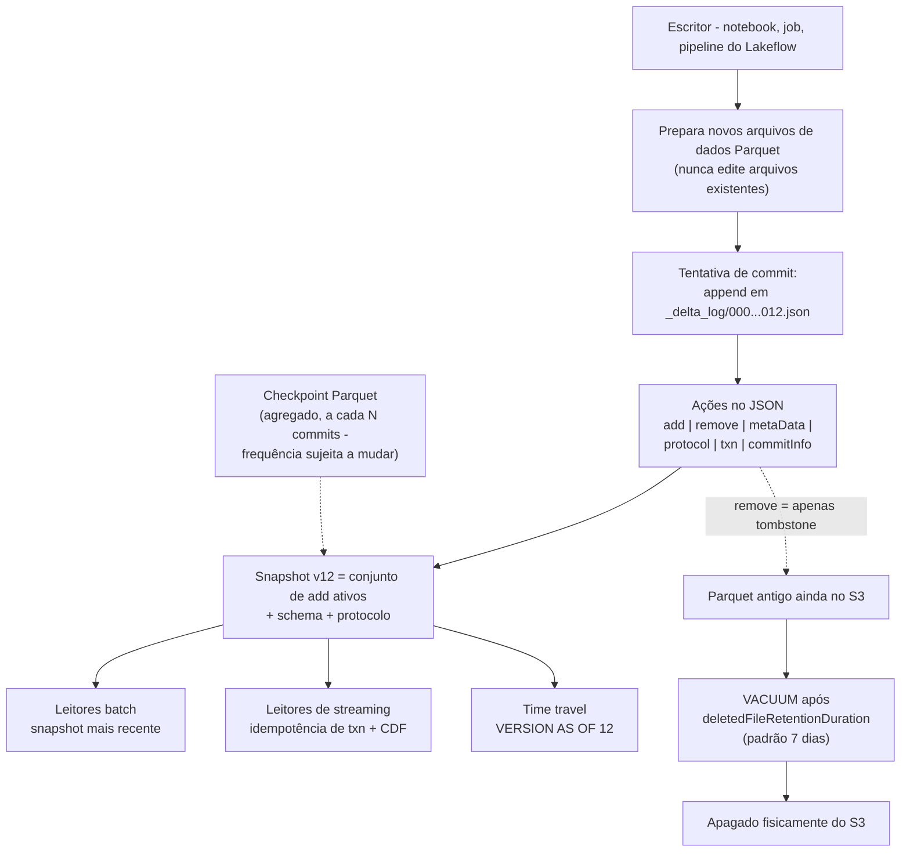
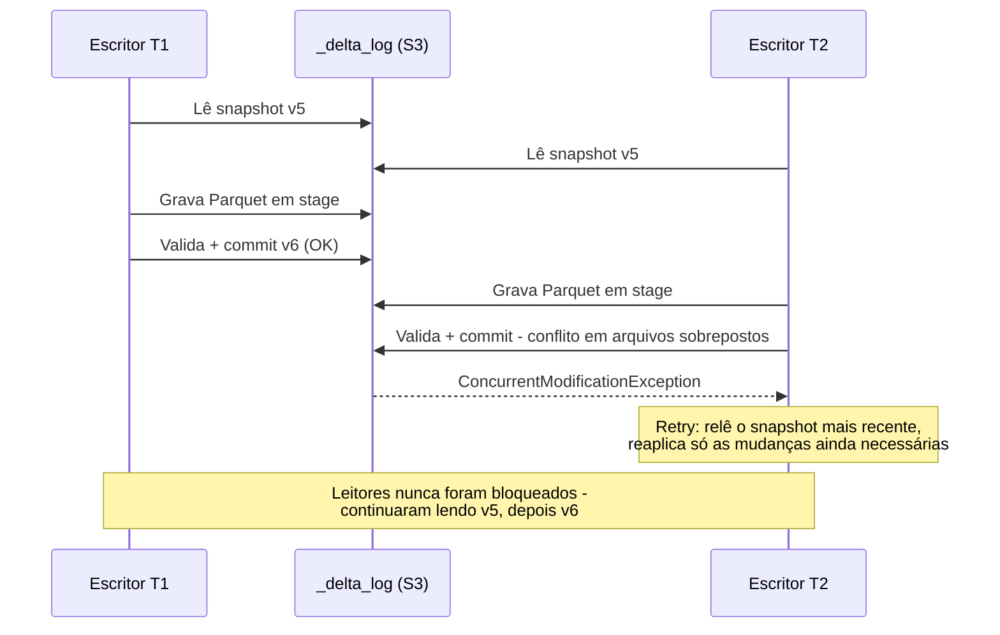
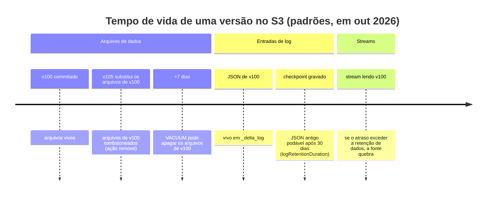
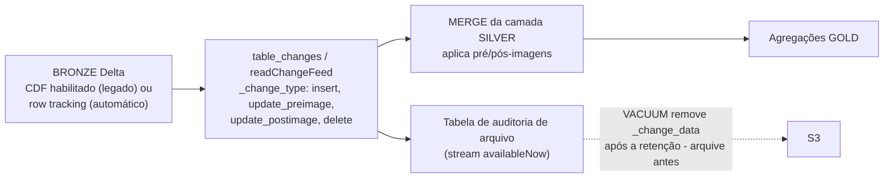

# Transações Delta Lake na AWS: Anatomia do Log, Time Travel, CDF, Clustering e VACUUM

Toda tabela bronze, silver e gold deste curso é uma **tabela Delta Lake**: arquivos de dados Parquet mais um log de transações baseado em arquivos, sentados no *seu* bucket S3, governados pelo Unity Catalog. Essa única frase explica tanto o superpoder quanto o modo de falha. O superpoder: commits ACID, time travel, change data feed e escritores concorrentes sobre um armazenamento de objetos que não tem nenhuma dessas propriedades nativamente. O modo de falha: times que tratam o Delta como uma pasta de Parquet — editando arquivos à mão, rodando `VACUUM RETAIN 0 HOURS`, habilitando o CDF depois do fato e se perguntando por que o histórico sumiu, ou particionando uma tabela de 200 GB em mil diretórios miúdos porque um tutorial de 2019 mandou.

A regra didática desta lição: **o log de transações é a tabela**. Arquivos de dados são só blobs que o log referencia; uma "versão" é um commit do log; time travel é um replay do log; o CDF é calculado a partir do que o log (ou o row lineage) sabe; `VACUUM` é a única coisa que apaga fisicamente qualquer coisa — e ele segue o cronograma do log, não o seu.

Todo fato abaixo vem da documentação da Databricks na AWS (páginas de histórico de tabelas, change data feed, liquid clustering, optimize, VACUUM, restrições, compatibilidade de features, ACID e limitações do S3 — todas acessadas ou datadas de **outubro de 2026**), do blog do Delta da Databricks e da base de conhecimento da Databricks. Faça a aritmética de retenção você mesmo; é a única forma de projetar uma tabela da qual você ainda consiga se recuperar no pior dia do ano.

```text
 =============================================================
  DELTA LAKE NA AWS - O MECANISMO EM UMA OLHADA (out 2026)
 -------------------------------------------------------------
  Tabela = arquivos de dados Parquet + _delta_log/ (JSON append-only)
  Commits = 00000000000000000000.json, ...0001.json, ...
  Ações = add | remove | metaData | protocol | txn | commitInfo
  Leituras = isolamento de snapshot (sempre)
  Escritas = WriteSerializable (padrão); otimista, sem locks
  Time travel = VERSION AS OF / TIMESTAMP AS OF
    arquivos de dados retidos: 7 dias (deletedFileRetentionDuration)
    entradas de log retidas: 30 dias (logRetentionDuration)
  CDF = legado (propriedade da tabela, forward-looking) |
        automático (DBR 19+, row tracking, sem propriedade)
  Layout = liquid clustering (CLUSTER BY, <=4 chaves, protocolo 3/7)
           substitui particionamento + ZORDER em tabelas novas
  Manutenção = OPTIMIZE (bin packing / recluster), VACUUM
  Restrições = NOT NULL + CHECK aplicadas; PK/FK informativas
  Nota AWS = um workspace por tabela S3; sem bucket versioning
  =============================================================
```

Nesta lição você vai:

- ler o **conjunto de ações do `_delta_log`** — o que `add`, `remove`, `metaData`, `protocol`, `txn` e `commitInfo` registram cada um, e como os checkpoints impedem que os leitores repliquem todos os arquivos JSON;
- rodar a história da **concorrência otimista** de ponta a ponta — leituras de snapshot, as etapas de ler, escrever, validar-e-commitar, e por que mudanças de metadados são os conflitos que doem;
- escrever **SQL de time travel** de verdade — `DESCRIBE HISTORY`, `VERSION AS OF`, `TIMESTAMP AS OF`, `RESTORE TABLE` — contra a divisão de retenção de **7 dias de dados / 30 dias de log**, com os pisos do DBR que bloqueiam versões mais antigas de cara;
- separar **CDF legado de CDF automático** (o fato que a maioria dos tutoriais de 2023 erra), consultar `table_changes` e arquivar um stream de CDF em uma tabela de auditoria permanente;
- executar um **`MERGE INTO` podado e resolvido** com `WITH SCHEMA EVOLUTION` e restrições `CHECK` aplicadas, e citar o ganho de poda medido (**13.16 min → 20.54 s**);
- escolher entre **particionamento, ZORDER e liquid clustering**, rodar migrações de `CLUSTER BY` / `OPTIMIZE ... FULL` e defender a escolha no **veredito comparativo**;
- calcular à mão a **matemática de retenção do `VACUUM`** — bytes tombstoneados, custo de armazenamento no S3, o piso de 168 horas e a regra de atraso de streaming — incluindo a linha do tempo documentada de perda de dados para `RETAIN 0 HOURS`;
- mapear a **escada de protocolo** (`minReaderVersion` 1–3, `minWriterVersion` 2–7, table features) e saber quais upgrades são irreversíveis;
- estudar **dois casos nomeados de clientes da AWS** (Rivian e Comcast), ler a **caixa de atualizações de 2026** e praticar com **12 questões no estilo de exame** mais quatro verificações interativas.

---

## 1. O log de transações: o que de fato torna uma tabela Delta ACID

### 1.1 Uma tabela, duas metades, uma fonte de verdade

O Delta Lake "extends Parquet data files with a file-based transaction log for ACID transactions and scalable metadata handling" (docs .../delta, datadas de 2026-07-10). Fisicamente, no seu bucket S3, isso é:

| Metade | Localização no S3 | Mutabilidade | Quem lê |
|---|---|---|---|
| **Arquivos de dados** | `<table-path>/*.parquet` (ou subdiretórios) | Imutáveis depois de gravados; reescritos como arquivos *novos* em DML | Qualquer motor de consulta |
| **Log de transações** | `<table-path>/_delta_log/` | JSON **append-only**, mais checkpoints Parquet | Apenas leitores do protocolo Delta |

O log "tem um protocolo aberto bem definido que pode ser usado por qualquer sistema para ler o log" (docs .../delta, 2026-07-10), e o delta.io estabelece a regra rígida: "O log de transações do Delta deve permanecer um log append-only" (PROTOCOL.md / delta.io, acesso em 2026-10). Cada commit bem-sucedido anexa um arquivo JSON com zeros à esquerda — `00000000000000000000.json`, depois `...0001.json`, `...0002.json` — e cada arquivo JSON é uma lista de **ações**. Os leitores "listam o log e fazem replay das ações" e derivam o conjunto de arquivos ativos mais o schema de qualquer versão cujos arquivos ainda existam.

### 1.2 Os seis tipos de ação

Do blog de mergulho profundo da Databricks "Diving Into Delta Lake: Unpacking The Transaction Log" (2019-08-21), ainda a enumeração canônica, consistente com a documentação atual:

| Ação | O que registra | Por que você se importa |
|---|---|---|
| **`add`** | Um arquivo de dados entra na tabela: caminho, tamanho, hora de modificação, valores de partição, flag `dataChange` e estatísticas de min/max por coluna em `stats` | Data skipping lê essas estatísticas; o Delta coleta estatísticas para as **primeiras 32 colunas** por padrão (docs .../tables/clustering, 2026-09-25) |
| **`remove`** | Um arquivo de dados sai do snapshot *atual* — um **tombstone**, não uma exclusão | O arquivo só é fisicamente apagado pelo `VACUUM`, depois de `delta.deletedFileRetentionDuration` (padrão **7 dias**) da remoção *lógica* |
| **`metaData`** | Id da tabela, `schemaString`, `partitionColumns` / configuração de clustering, propriedades da tabela, formato | Schema evolution e `CLUSTER BY` caem aqui; commits de metadados conflitam com escritores concorrentes |
| **`protocol`** | `minReaderVersion` / `minWriterVersion`, mais `readerFeatures` / `writerFeatures` em reader 3 / writer 7 | Habilitar feature sobe o protocolo; "Most protocol version upgrades are irreversible" (docs .../feature-compatibility, 2026-09-11) |
| **`txn`** (SetTransaction) | Marcador de idempotência: "Registra que um job de structured streaming já commitou um micro-batch com o ID dado" (blog, 2019-08-21) | Sinks de streaming exactly-once dependem dele |
| **`commitInfo`** | Nome da operação, `operationParameters`, usuário, timestamp, id do cluster, métricas | É exatamente o que o `DESCRIBE HISTORY` mostra |

- **📚 Você sabia?** Os nomes de commit de 20 dígitos com zeros à esquerda (`00000000000000000000.json`) existem para que a listagem lexicográfica do S3 seja igual à ordem numérica de versões — uma truque de sistema de arquivos que transforma o armazenamento de objetos em um WAL ordenado. O DML nunca edita Parquet no lugar: "O Delta Lake cria novas versões de arquivos em vez de modificá-las no lugar" e "O arquivo de dados antigo não é apagado, porém" (blog "DML Internals", 2020-09-29). Ele espera por uma ação `remove` mais o `VACUUM`.

### 1.3 Anatomia, desenhada



Duas regras operacionais se seguem diretamente, ambas oficiais: "evite interagir diretamente com arquivos de dados e de log de transações nos diretórios de arquivos do Delta Lake" (docs .../delta, 2026-07-10) e nunca faça `rm -rf` no diretório de uma tabela (docs .../delta/s3-limitations, 2026-09-11) — o log é a tabela, e o S3 não oferece rename atômico por uma razão: o Delta teve de inventar o seu próprio protocolo de commit.

### 1.4 Exemplo resolvido E1 — ler o log e classificar a manutenção

O `DESCRIBE HISTORY` lê ações `commitInfo`. Auto compaction, `OPTIMIZE` manual e liquid clustering **aparecem todos como operações `OPTIMIZE`** — você precisa inspecionar `operationParameters` para distingui-los (docs .../tables/history, última atualização em 2026-09-11):

```sql
-- Last five operations on the table
DESCRIBE HISTORY main.silver.orders LIMIT 5;

-- Audit view: what kind of OPTIMIZE ran, and what did it move?
SELECT version, timestamp, operation,
       operationParameters.clusterBy    AS cluster_by,      -- non-empty = liquid clustering
       operationParameters.zOrderBy     AS z_order_by,      -- non-empty = legacy ZORDER
       operationParameters.auto         AS is_auto_compaction,
       operationParameters.predicate    AS prune_predicate,
       operationMetrics.numRemovedFiles,
       operationMetrics.numAddedFiles,
       operationMetrics.numAddedBytes
FROM (DESCRIBE HISTORY main.silver.orders)
WHERE operation IN ('OPTIMIZE','WRITE','MERGE','STREAMING UPDATE','VACUUM','REORG')
ORDER BY version DESC;
```

A página de histórico também declara a retenção do próprio histórico: "A retenção do histórico da tabela é determinada pela configuração da tabela `logRetentionDuration`, que é de **30 dias** por padrão" — e avisa: "Não use o histórico da tabela como solução de backup de longo prazo para arquivamento de dados. Use apenas os últimos **7 dias** para operações de time travel, a menos que você tenha configurado tanto a retenção de dados quanto a de log para um valor maior" (docs .../tables/history, 2026-09-11). Essa divisão de 7-versus-30 é a seção 3.

---

## 2. ACID sem locks: concorrência otimista no S3

### 2.1 O que o Delta garante

"A Databricks usa controle de concorrência otimista. Isso significa que não há locks de leitura ou escrita em uma tabela, e deadlock não é uma possibilidade" (docs .../lakehouse/acid, atualizado em 2026-09-11). Por padrão: **isolamento de snapshot nas leituras**, **`WriteSerializable` nas escritas** — "Garante que apenas operações de escrita (não leituras) sejam serializáveis. Isso ainda é mais forte que o isolamento por snapshot" (docs .../isolation-levels, 2026-09-11). `Serializable` é opt-in:

```sql
ALTER TABLE main.silver.orders
  SET TBLPROPERTIES ('delta.isolationLevel' = 'Serializable');
```

As escritas seguem três etapas (docs .../acid): **leitura** (um `INSERT` só de append pode pular essa etapa inteira quando nenhuma subconsulta referencia o alvo), **escrita** (armazenar novos arquivos Parquet) e **validação e commit** (anexar o commit JSON se nenhum commit conflitante chegou desde a leitura; caso contrário, falhar com uma exceção de modificação concorrente em vez de corromper a tabela).



### 2.2 De onde vêm os conflitos de verdade

Três fontes de conflito, na ordem em que mordem times de produção (docs .../optimizations/isolation e .../acid, 2026-09-11):

1. **Dois escritores reescrevendo arquivos sobrepostos** — dois `MERGE`s batendo nas mesmas partições na mesma janela. Mitigação: estreite o predicado `ON` para as partições que você toca (isso também poda, seção 5); prefira appends onde a semântica permitir.
2. **Mudanças de metadados** — schema evolution, mudanças de propriedades da tabela, upgrades de protocolo/feature. Essas "podem fazer todas as operações de escrita concorrentes falharem", e "Leituras de streaming falham quando encontram um commit que muda os metadados da tabela. Se você quiser que o stream continue, você precisa reiniciá-lo."
3. **A regra de escopo específica do S3** — a garantia de commit no S3 tem escopo de workspace: "A Databricks recomenda que você não modifique a mesma tabela Delta Lake armazenada em S3 a partir de workspaces diferentes" (docs .../delta/s3-limitations, 2026-09-11). Uma tabela, um workspace; o isolamento de conta-por-ambiente (lição 02) é o que mantém essa propriedade verdadeira.

- **📚 Você sabia?** Escritores que falham deixam escombros: escritas criam arquivos de metadados `_started_<id>` e `_committed_<id>`, e "a operação `VACUUM` apaga todos os arquivos de dados não rastreados em um diretório de tabela, incluindo arquivos ainda não commitados de transações que falharam" (docs .../acid, 2026-09-11). Isso é uma *feature* — e também a razão de um `VACUUM` com retenção zero correndo contra um escritor lento apagar dados (seção 7).

---

## 3. Time travel: duas retenções, um piso rígido

### 3.1 O SQL que você vai realmente rodar

Toda operação modificadora cria uma nova versão. Sintaxe em tempo de consulta (docs .../tables/history, 2026-09-11):

```sql
-- Worked example E2 - point-in-time reads and repair patterns
SELECT * FROM main.silver.orders VERSION AS OF 42;
SELECT * FROM main.silver.orders TIMESTAMP AS OF '2026-10-01T00:00:00.000Z';
SELECT * FROM main.silver.orders@v42;                    -- shorthand
SELECT * FROM main.silver.orders@20261001000000000;      -- timestamp shorthand

-- DataFrame equivalents: .option("versionAsOf", 42) / .option("timestampAsOf", "...")

-- Undo a bad night: copy yesterday's rows for one user back in
INSERT INTO main.silver.orders
SELECT * FROM main.silver.orders TIMESTAMP AS OF date_sub(current_date(), 1)
WHERE user_id = 111;

-- Or rewind the whole table (creates a new version; does not delete history)
RESTORE TABLE main.silver.orders TO VERSION AS OF 41;
```

### 3.2 A armadilha 7-versus-30 e os pisos do DBR

| Controle | Padrão | O que governa | Aplicado por |
|---|---|---|---|
| `delta.deletedFileRetentionDuration` | **interval 7 days** | Por quanto tempo arquivos de dados fisicamente removidos do snapshot ficam no S3 | `VACUUM` |
| `delta.logRetentionDuration` | **interval 30 days** | Por quanto tempo JSON antigos do log / entradas de histórico são mantidos | Automático, após checkpoints |

Ambos ainda precisam existir para que uma versão seja legível. E desde o DBR 18.0 (DBR 12.2+ para tabelas gerenciadas do Unity Catalog): "consultas de time travel são bloqueadas se solicitarem uma versão mais antiga que a propriedade da tabela `deletedFileRetentionDuration` (padrão de 7 dias)" (docs .../tables/history, 2026-09-11) — então o time travel efetivo com os padrões é de **7 dias**, mesmo que os *metadados* de histórico mostrem 30 dias de operações.



> [!IMPORTANT]
> ⚠️ **Time travel não é backup.** "Não use o histórico da tabela como solução de backup de longo prazo para arquivamento de dados" (docs .../tables/history, 2026-09-11). Depois de um `VACUUM` padrão, "você não consegue restaurar uma tabela para uma versão mais antiga que referencie aqueles arquivos." Para durabilidade real na AWS use versionamento do S3 *apenas se a conformidade obrigar* (nesse caso: três versões, ciclo de vida de até 7 dias — docs .../delta/s3-limitations), ou snapshots/clones explícitos em um local com retenção controlada — nunca `VACUUM` + esperança. O KB diz sem rodeios: "se você rodar o VACUUM com as configurações padrão, você só vai poder viajar no tempo sete dias para trás" (kb.databricks.com VACUUM best practices, acesso em 2026-10).

---

## 4. Change data feed: legado versus automático (a verdade de 2026)

### 4.1 Duas implementações, uma API de leitura

O CDF "rastreia mudanças em nível de linha entre versões de uma tabela Delta Lake" com as colunas de metadados `_change_type` (`insert`, `update_preimage`, `update_postimage`, `delete`), `_commit_version` e `_commit_timestamp` (docs .../change-data-feed, última atualização em **2026-10-09**). Em outubro de 2026 existem **duas** implementações — é aqui que os tutoriais antigos envelhecem mal:

| | **CDF legado** | **CDF automático** |
|---|---|---|
| Mecanismo | Materializa arquivos de mudança na **escrita** | Calcula mudanças na **consulta** a partir do **row lineage** |
| Habilitação | Por tabela: `delta.enableChangeDataFeed = true` (CREATE ou ALTER) | Sem propriedade de tabela; exige **DBR 19 ou superior** + row tracking (Delta gerenciado/externo registrado no UC, ou Iceberg v3) |
| Custo de escrita | Cada `MERGE`/`UPDATE` grava arquivos de mudança extras | "melhora o desempenho de escrita e reduz os custos de armazenamento" (mesma página) |
| Olhada para trás | **Só para frente** — "ele vai capturar mudanças uma vez que a propriedade da tabela esteja configurada, e não antes" (blog, 2021-06-09) | Cobre as mudanças enquanto o row tracking existir |
| As duas ao mesmo tempo? | Não suportado — remova a propriedade legada antes de migrar | |

As APIs de leitura são idênticas nos dois modos (docs .../change-data-feed, 2026-10-09):

```sql
-- Worked example E3a - batch CDF reads (starting version REQUIRED)
SELECT * FROM table_changes('main.silver.orders', 0, 10);      -- versions 0..10 inclusive
SELECT * FROM table_changes('main.silver.orders', 12);         -- from v12 onward

SELECT _change_type, count(*) AS n
FROM table_changes('main.silver.orders', 12)
WHERE _commit_timestamp >= current_timestamp() - INTERVAL 1 DAY
GROUP BY _change_type;
```

```python
# Worked example E3b - DataFrame + permanent audit archive
# CDF is transient: change data lives in _change_data, is removed by VACUUM,
# and log versions are pruned - archive if you need permanence (docs 2026-10-09).

# Batch
spark.read.option("readChangeFeed", "true").option("startingVersion", 12).table("main.silver.orders")

# Streaming: first start returns the latest snapshot as INSERT, then future changes
(spark.readStream.option("readChangeFeed", "true").table("main.silver.orders")
      .writeStream
      .option("checkpointLocation", "/mnt/checkpoints/orders_cdf")
      .trigger(availableNow=True)
      .toTable("main.audit.orders_cdf_archive"))
```



Duas arestas afiadas da documentação e do resumo do KB: leituras batch de CDF **exigem** uma versão inicial — um início anterior ao momento em que o CDF foi habilitado gera erro; e um intervalo de CDF que atravesse uma mudança de schema não aditiva (renomear, dropar, trocar tipo) falha, então divida o intervalo. "Um change data feed não se destina a servir como registro permanente de todas as mudanças em uma tabela" (docs .../change-data-feed, 2026-10-09).

- **📚 Você sabia?** O próprio guia de streaming da Databricks agora diz: "A Databricks recomenda fazer streaming a partir do feed de CDC de uma tabela Delta Lake em vez de diretamente da tabela sempre que possível" (docs .../structured-streaming/delta-lake, página datada de 2026-08-24). Fazer streaming direto de uma tabela quente falha em commits de metadados (reinício obrigatório); um feed de CDF mais `foreachBatch` te dá aplicação downstream idempotente com menos surpresas (lição 13).

---

## 5. MERGE, UPDATE, DELETE: copy-on-write, feito do jeito certo

### 5.1 Semântica em uma tabela

Os três são **copy-on-write em granularidade de arquivo** — tocar uma linha reescreve o(s) arquivo(s) que a contém como novas versões (blog "DML Internals", 2020-09-29). O `MERGE INTO` aceita as cláusulas `WHEN MATCHED`, `WHEN NOT MATCHED [BY TARGET]` e `WHEN NOT MATCHED BY SOURCE`, avaliadas em ordem; todo `WHEN MATCHED` que não seja o último precisa carregar uma condição (senão `NON_LAST_MATCHED_CLAUSE_OMIT_CONDITION`); e duas linhas de origem casando com uma linha de destino falham com `DELTA_MULTIPLE_SOURCE_ROW_MATCHING_TARGET_ROW_IN_MERGE` (docs .../delta-merge-into, atualizado em 2026-06-18).

### 5.2 Exemplo resolvido E4 — MERGE podado para silver com restrições e evolução

```sql
-- Cheap, enforced data quality first: fails the transaction before bad rows land
ALTER TABLE main.silver.orders
  ADD CONSTRAINT order_id_not_null CHECK (order_id IS NOT NULL);
ALTER TABLE main.silver.orders
  ADD CONSTRAINT amount_nonneg CHECK (amount >= 0);

-- Worked example E4 - the production-shaped MERGE (docs 2026-06-18: WITH SCHEMA EVOLUTION = DBR 15.2+)
MERGE WITH SCHEMA EVOLUTION INTO main.silver.orders t
USING (SELECT * FROM main.bronze.orders_raw
       WHERE event_date >= date_sub(current_date(), 2)) s   -- prune BEFORE the join
ON  t.order_id = s.order_id
AND t.event_date >= date_sub(current_date(), 2)             -- pruning predicate in ON
WHEN MATCHED AND s.op <> 'DELETE' THEN UPDATE SET *
WHEN MATCHED AND s.op = 'DELETE'  THEN DELETE
WHEN NOT MATCHED THEN INSERT *;
-- Optimized writes + auto compaction are forced ON for MERGE/UPDATE/DELETE (docs 2026-09-11).
```

A razão medida de por que o predicado `ON` importa, vinda do KB da Databricks (última publicação em 2023-06-01): um `MERGE` sem filtro sobre uma tabela com `PartitionCount: 1000` levou **13.16 minutos**; acrescentar condições de poda (`PartitionCount: 2`) levou **20.54 segundos** — "mais de 40X mais rápido". Some o **low-shuffle merge** (GA e padrão desde o DBR 10.4 LTS): "up to 5x performance improvement on MERGE-based workloads with the average on the order of 2-3x" (blog, 2024-06-20), com um cliente ligado à área de saúde cortando o tempo médio de merge "from 11 minutes to 1.5 minutes" (7x). O low shuffle merge "also reduces the need for users to re-run `OPTIMIZE` after performing a `MERGE`" (docs, 2026-06-11) — embora linhas recém-inseridas numa tabela com clustering ainda possam querer um recluster.

---

## 6. Layout: particionamento, ZORDER e liquid clustering

### 6.1 O que cada técnica realmente faz

| Técnica | Mecanismo | Perfil de custo | Status na documentação (out 2026) |
|---|---|---|---|
| **Particionamento no estilo Hive** | Um diretório por valor de partição; poda = pular diretório | Pesado em reescritas; explosão de cardinalidade; shuffle na escrita | Desencorajado abaixo de tabelas de **1 TB**; apenas se cada partição tiver ≥ **1 GB** (docs .../performance-efficiency, 2026-09-11) |
| **ZORDER** | Co-localização de uma coluna entre arquivos baseada em reescrita (ordenação multidimensional) | Reescritas caras; o `MERGE` costumava quebrar o layout | Legado; a documentação "recomenda usar liquid clustering em vez de particionamento, `ZORDER` ou outras abordagens de layout de dados" (docs .../optimize, 2026-09-11) |
| **Liquid clustering** | Chaves `CLUSTER BY` + **ZCubes/bin packing** no `OPTIMIZE`; chaves trocáveis sem reescrita; poda em granularidade de arquivo ("nenhum atalho em nível de diretório para perder" — blog, 2026-01-06) | Recluster incremental; clustering na escrita para tabelas gerenciadas do UC | "Liquid clustering é uma técnica de otimização de layout de dados que **substitui o particionamento de tabelas e o `ZORDER`**" (docs .../tables/clustering, 2026-09-25); "A Databricks recomenda liquid clustering para todas as tabelas novas" |

Fatos de liquid clustering que você precisa saber enunciar com precisão (todos em docs .../tables/clustering, 2026-09-25, salvo indicação):

- Sintaxe: `CREATE TABLE t (...) CLUSTER BY (col1, col2)`; `ALTER TABLE t CLUSTER BY (cols)`; `ALTER TABLE t CLUSTER BY NONE`. "O clustering não é compatível com particionamento nem com `ZORDER`."
- **Até quatro chaves de clustering**; mais chaves degradam filtros de coluna única em tabelas abaixo de 10 TB. Estatísticas alimentam o data skipping nas **primeiras 32 colunas**.
- Histórico de versões, com data: trigger/escrita a partir do **DBR 13.3 LTS+**; anunciado como **GA no DBR 15.2** (blog, 2024-05-22); documentação atual: "disponível geralmente para tabelas Delta Lake com **Databricks Runtime 15.4 LTS e superior**". Protocolo: **reader 3 / writer 7** (particionamento oculto).
- `ALTER TABLE ... CLUSTER BY` **não** reescreve dados; o primeiro recluster é `OPTIMIZE t FULL` (**DBR 16.4 LTS+**). `CLUSTER BY AUTO` (clustering automático, gerenciado no UC + predictive optimization) é **DBR 15.4 LTS+**. `REPLACE PARTITIONED BY WITH CLUSTER BY` é **DBR 18.1+**.
- Cadência: `OPTIMIZE` é idempotente, não muda nenhum dado e "não afeta nenhum stream atual ou futuro que tenha esta tabela como fonte" (docs .../optimize, 2026-09-11) — tabelas quentes a cada **1–2 horas**, caso contrário **diariamente à noite** (amigável com spot); tabelas **> 1 TB** devem rodar `OPTIMIZE` em um agendamento (docs .../tune-file-size, 2026-09-11). Auto-optimize = `autoOptimize.optimizeWrite` + `autoOptimize.autoCompact`, arquivos-alvo de **128 MB**; sempre ativo para DML; tabelas gerenciadas do UC recebem no lugar ajuste automático de tamanho de arquivo (autotune de 256 MB–1 GB por tamanho de tabela).

### 6.3 Exemplo resolvido E5 — migração de CLUSTER BY e OPTIMIZE agendado

```sql
-- New table, clustered from birth (no PARTITION BY + CLUSTER BY together)
CREATE TABLE main.gold.events (
  event_date DATE, store_id BIGINT, customer_id BIGINT, payload STRING
) CLUSTER BY (event_date, store_id);          -- <= 4 keys

-- Enable clustering on an existing table, then force the first full recluster
ALTER TABLE main.gold.legacy_daily CLUSTER BY (event_date, customer_id);
OPTIMIZE main.gold.legacy_daily FULL;         -- DBR 16.4+; first run can take hours on big tables

-- DBR 18.1+: in-place conversion from partitioning, no full rewrite
ALTER TABLE main.gold.daily REPLACE PARTITIONED BY WITH CLUSTER BY (event_date, customer_id);

-- Incremental maintenance: prune with WHERE; bin packing is idempotent
OPTIMIZE main.gold.events WHERE event_date >= current_date() - 3;

-- Verify in history: expect REORG / UPGRADE PROTOCOL / OPTIMIZE with clusterBy set
DESCRIBE HISTORY main.gold.events LIMIT 10;
```

Contexto de benchmark para levar a revisões de design: em um workload de data warehouse de 1 TB, "Liquid Clustering resulted in **2.5x faster clustering relative to Z-order**. In the same trial, traditional Hive-style partitioning was an order of magnitude slower" (blog, 2023-06-29); uma grande firma de manufatura viu consultas pontuais "speeding up ... by **12x**" (blog, 2024-05-22). Trate ambos como benchmarks de fornecedor com datas, não como SLAs.

### 6.4 Exemplo resolvido E6 — a matemática da compactação de arquivos pequenos

Uma ingestão de streaming grava ~1,800 arquivos/dia de 4 MB cada em `main.silver.orders` (micro-batches do Auto Loader). Consultas que deveriam ler um único arquivo de 500 MB acabam abrindo 1,800+.

```text
Exemplo resolvido E6 - economia da compactação, em out 2026
Antes do OPTIMIZE:
  arquivos/dia ............ 1,800 x 4 MB = 7.2 GB/dia anexados como arquivos minúsculos
  semana de ingestão ...... 12,600 arquivos; listagem do S3 + custo de abertura dominam consultas curtas
Depois do OPTIMIZE (alvo ~128 MB autoCompact / autotune 256 MB-1 GB por tamanho):
  arquivos/dia ............ 7.2 GB / 128 MB ~ 58 arquivos/dia (bin packing)
  redução ................. ~31x menos objetos para os mesmos bytes
Cadência:
  tabela quente ........... OPTIMIZE a cada 1-2 horas (página de clustering dos docs)
  linha de base ........... diariamente à noite; tabelas > 1 TB em agendamento (docs tune-file-size)
Nota de custo:
  o OPTIMIZE roda no compute em que você o agenda - noite + spot é a dica dos docs;
  predictive optimization (gerenciado no UC) roda para você (padrão para contas
  criadas em/depois de 2024-11-11) - então desative os seus próprios jobs de OPTIMIZE agendados.
```

```plot
{
  "type": "bar",
  "title": "Latência de consulta p95 antes versus depois da compactação + clustering (caso ilustrativo de layout, workloads na escala de minutos)",
  "xLabel": "Fase do workload",
  "yLabel": "Latência p95 (segundos)",
  "xKey": "phase",
  "dataKeys": ["latency_s"],
  "data": [
    {"phase": "Before: 12,600 small files", "latency_s": 48.0},
    {"phase": "After: OPTIMIZE bin packing", "latency_s": 11.5},
    {"phase": "After: CLUSTER BY (event_date, store_id)", "latency_s": 6.2}
  ]
}
```

O formato dessa curva é o argumento inteiro: bin packing (menores arquivos e mais poucos) remove o imposto de listagem; o clustering (arquivos ordenados pelas chaves de filtro) então deixa o data skipping cortar o scan. Os segundos exatos são um cenário ilustrativo de compactação — os *mecanismos* são os documentados: data skipping baseado em estatísticas sobre as primeiras 32 colunas, alvos de compactação de 128 MB e poda em granularidade de arquivo sobre as chaves com clustering.

> **Veredito comparativo — particionamento / ZORDER versus liquid clustering (em outubro de 2026)**
> - **Escolha liquid clustering (`CLUSTER BY`)** para todas as tabelas novas, conforme a documentação atual: chaves de filtro de alta cardinalidade (customer_id, event_id), chaves que precisam mudar sem uma reescrita da tabela inteira, tabelas orientadas a streaming e tudo que for gerenciado no UC com predictive optimization. Ele substitui tanto o particionamento quanto o ZORDER, mantém o protocolo em reader 3 / writer 7 e marca 2.5x de clustering mais rápido que o ZORDER em um workload de DW de 1 TB (2023-06-29) com adoção em produção "incluindo dezenas com tabelas na escala de petabyte" (2026-01-06).
> - **O particionamento ainda tem um nicho legítimo**: tabelas ≥ 1 TB com um filtro *estável e de baixa cardinalidade* (uma data que você sempre poda, uma região na qual você sempre restringe) em que a ferramenta em nível de diretório fora da Databricks (compactação externa, leitores de terceiros) precisa do layout — e apenas se cada partição tiver ≥ 1 GB (docs, 2026-09-11). Abaixo de 1 TB, não particione.
> - **ZORDER é legado.** Mantenha-o apenas em tabelas pré-existentes que você ainda não migrou; a documentação recomenda liquid clustering; nunca combine `ZORDER` com `CLUSTER BY` ("não compatíveis"). Migre as chaves via `ALTER TABLE ... CLUSTER BY` + `OPTIMIZE FULL`, ou `REPLACE PARTITIONED BY WITH CLUSTER BY` no DBR 18.1+.
> - **A resposta armadilha em exames e em documentos de design:** "particione por uma coluna de baixa cardinalidade e depois faça ZORDER no resto" é conselho de 2022. Em outubro de 2026 a resposta padrão é `CLUSTER BY` com até quatro chaves bem escolhidas — e um `OPTIMIZE` agendado (ou preditivo).

- **📚 Você sabia?** Auto compaction, liquid clustering e ZORDER aparecem todos como `OPTIMIZE` no histórico da tabela — então uma afirmação de "nós nunca rodamos OPTIMIZE" vinda de um time com auto-optimize habilitado é invisível a menos que eles leiam `operationParameters.auto` / `.clusterBy` (E1). E em tabelas gerenciadas do Unity Catalog com predictive optimization ligado, a Databricks "recomenda desativar qualquer job de OPTIMIZE agendado" para não pagar duas vezes pelas mesmas reescritas (docs .../tables/clustering, 2026-09-25).

---

## 7. VACUUM: matemática de retenção e a linha do tempo de perda de dados

### 7.1 O que o VACUUM faz — e o que ele não faz

"O `VACUUM` remove todos os arquivos do diretório da tabela que não são gerenciados pelo Delta, bem como os arquivos de dados que não estão mais no estado mais recente do log de transações" — e "vai pular todos os diretórios que começam com um sublinhado (`_`), o que inclui o `_delta_log`" (docs .../delta-vacuum, 2026-09-11). A exclusão segue o **tempo desde a remoção lógica do log**, não o mtime do arquivo, mais as horas de retenção; limite padrão de **7 dias** via `delta.deletedFileRetentionDuration`. O `VACUUM` é também o que destrói o time travel para versões antigas e o que apaga os arquivos `_change_data` do CDF (docs .../operations/vacuum, datadas de 2026-04-21). A poda do JSON do log *não* é regida pelo `VACUUM` — os checkpoints a comandam, nos 30 dias de `logRetentionDuration`.

Modos: `DRY RUN` (lista até **1000** arquivos candidatos — rode isso primeiro, sempre); `FULL` (padrão) versus `LITE` (dirigido pelo log, **DBR 16.1+**). A exclusão de arquivos é uma operação apenas do driver.

### 7.2 Exemplo resolvido E7 — matemática de retenção sobre bytes reais

Uma tabela silver recebe 40 GB/dia de arquivos pequenos que o `OPTIMIZE` noturno tombstoneia (remoção *lógica*) enquanto os reescreve em arquivos maiores. Você precisa dimensionar o custo de armazenamento dos tombstones e escolher uma retenção.

```text
Exemplo resolvido E7 - matemática de retenção do VACUUM, S3 Standard $0.023/GB-mês (em out 2026)
Bytes tombstoneados/dia ..... 40 GB (removidos do snapshot, ainda no S3)

Retenção padrão = 7 dias = 168 horas:
  área dos tombstones ....... 40 GB x 7 = 280 GB
  custo de armazenamento .... 280 x $0.023 = $6.44 / mês
  janela de time travel ..... 7 dias (piso dos docs; DBR 18.0+ bloqueia mais antigo)

Retenção de conformidade = 30 dias (720 horas):
  área dos tombstones ....... 40 x 30 = 1,200 GB (1.2 TB)
  custo de armazenamento .... 1,200 x $0.023 = $27.60 / mês
  multiplicador vs padrão ... 30/7 ~ 4.3x os bytes e o custo dos tombstones

Restrição de segurança de streaming:
  retenção >= maior atraso de stream tolerado + transação concorrente mais longa
  ex.: pior atraso observado 36 h + job mais longo 8 h => manter >= 44 h; manter 168 h de qualquer forma
```

Leia a regra do multiplicador: aumentar a retenção aumenta linearmente os bytes *tombstoneados* no S3 ao mesmo tempo em que estende linearmente a sua janela de time travel e de dados de mudança do CDF — ele não aumenta o custo da tabela viva. Os 168 horas padrão são simultaneamente a recomendação mínima dos docs ("A Databricks recomenda fortemente definir um intervalo de retenção de pelo menos 7 dias", docs .../delta-vacuum) e o piso de atraso de streaming.

### 7.3 A linha do tempo documentada de perda de dados

O caso do KB (última publicação em 2025-07-14): o `VACUUM` inicia na versão 100 às 01:17 UTC; a versão 101 commita um novo arquivo de dados às 01:19; o `VACUUM` apaga aquele arquivo ainda não referenciado às 01:20 — "o VACUUM executou na versão 100 e apagou tudo que foi adicionado à versão 101." A barreira de proteção é `spark.databricks.delta.retentionDurationCheck.enabled`; a instrução do KB: "Não desabilite ... e não rode o vacuum com retenção zero para evitar perda de dados." E sobre fontes de streaming: "Se a tabela Delta for a fonte de uma consulta de streaming, e se a consulta de streaming ficar atrasada em mais de sete dias, então a consulta de streaming não vai conseguir ler a tabela corretamente" (KB, VACUUM best practices, acesso em 2026-10).

```sql
-- Safe drill, then a deliberate retention raise
VACUUM main.silver.orders DRY RUN;                            -- inspect the candidate list first
VACUUM main.silver.orders RETAIN 168 HOURS;                   -- the 7-day floor
ALTER TABLE main.silver.orders
  SET TBLPROPERTIES ('delta.deletedFileRetentionDuration' = 'interval 30 days');
-- NEVER in production:
-- SET spark.databricks.delta.retentionDurationCheck.enabled = false;
-- VACUUM main.silver.orders RETAIN 0 HOURS;
```

---

## 8. Restrições: qualidade de dados aplicada pelo preço de um commit de metadados

Dois tipos de restrição são **aplicados** no Delta (docs .../constraints, 2026-09-11): `NOT NULL` (inline ou `ALTER TABLE ... ALTER COLUMN ... SET NOT NULL`) e `CHECK` (`ALTER TABLE t ADD CONSTRAINT name CHECK (expr)`). Adicionar uma restrição "verifica que todas as linhas existentes satisfazem a restrição antes de adicioná-la" — a expressão precisa ser Spark SQL determinístico: sem UDFs, agregações, janela ou funções multi-linha. Uma violação "faz a transação falhar com um erro" antes dos dados caírem — uma guarda em tempo de escrita que não custa nada em tempo de leitura, ao contrário do filtro baseado em view.

Nota de protocolo: "Adicionar uma restrição sobe o protocolo de escrita da tabela se a versão atual de escrita for menor que 3" — um evento de compatibilidade para leitores externos (seção 9). E a armadilha que todo curso precisa desarmar: **primary key, foreign key e restrições unique são apenas informativas e não são aplicadas** (PK/FK GA desde o DBR 15.2; unique em Public Preview, DBR 18.2+). Elas podem ajudar na otimização; não são garantias de integridade. Restrições complementam — não substituem — expectations do Lakeflow e padrões de quarentena (lição 10).

```sql
-- Worked example E8 - the constrained silver table
CREATE TABLE main.silver.orders (
  order_id   BIGINT NOT NULL,
  event_date DATE  NOT NULL,
  amount     DECIMAL(18,2),
  status     STRING
);

ALTER TABLE main.silver.orders
  ADD CONSTRAINT amount_nonneg CHECK (amount >= 0);
ALTER TABLE main.silver.orders
  ADD CONSTRAINT status_valid CHECK (status IN ('NEW','PAID','SHIPPED','CANCELLED'));

SHOW TBLPROPERTIES main.silver.orders;   -- constraints and retention knobs live here
DESCRIBE DETAIL main.silver.orders;      -- protocol + location + stats summary
```

A imposição de schema é a mesma filosofia no nível da coluna: "a Databricks valida a qualidade de dados impondo schema na escrita para tabelas Delta Lake" — uma coluna com nome errado ou um tipo incompatível cancela a transação antes de qualquer commit (docs .../schema-enforcement; blog, 2019-09-24). A evolução é opt-in **por escrita ou por statement** — `WITH SCHEMA EVOLUTION` no `MERGE` (DBR 15.2+) / `INSERT` (DBR 18.1+), ou `.option("mergeSchema","true")` — e a Databricks desencoraja explicitamente o `spark.databricks.delta.schema.autoMerge.enabled` de sessão inteira em produção ("pode levar a mudanças de schema não intencionais"). Consultas de streaming travam o seu schema no planejamento: uma mudança de fonte no meio do stream falha a consulta e exige reinício (docs .../data-engineering/schema-evolution, acesso em 2026-10).

---

## 9. Protocolo, features e o que a sua tabela custa para outros leitores

Toda tabela Delta carrega `minReaderVersion` ∈ {1, 2, 3} e `minWriterVersion` ∈ {2..7}. Desde o DBR 12.2 LTS, as **table features** granularizam isso em reader 3 / writer 7 (docs .../feature-compatibility, 2026-09-11):

| Feature | Protocolo (reader/writer) | DBR mínimo (feature) |
|---|---|---|
| Tabela básica | 1 / 2 | — |
| Restrição CHECK | 1 / **3** | — |
| Change data feed (legado) | 1 / **4** | — |
| Column mapping | 2 / 5 | — |
| Colunas identity | 1 / 6 | — |
| Row tracking | 1 / 7 | 14.3 LTS |
| Deletion vectors | **3** / 7 | 13.3 LTS |
| Liquid clustering (particionamento oculto) | **3** / 7 | 13.3 LTS (anúncio GA no 15.2; docs citam 15.4 LTS+) |
| Type widening / Variant | 3 / 7 | 15.4 LTS |

Regras que importam especificamente na AWS:

1. **Features apenas de escrita (CHECK, CDF, identity, row tracking) não quebram leitores** — elas "apenas sobem o protocolo de escrita", então clientes legados somente-leitura sobrevivem. Features de leitor (column mapping, deletion vectors, type widening, particionamento oculto do liquid clustering) quebram leitores que não as implementam.
2. **"A maioria dos upgrades de versão de protocolo é irreversível."** Nunca faça "downgrade" editando o JSON. `DROP FEATURE` (DBR 15.4+) é o único rollback parcial, e nem toda feature pode ser droppada. Escritas em DBRs mais antigos são sempre legíveis em DBRs mais novos; o risco é a direção contrária — uma ferramenta de BI ou um cliente ETL preso a um Spark antigo pode simplesmente parar de ler a sua tabela depois que você habilitar clustering.
3. **No S3:** não habilite bucket versioning em buckets de Delta (briga com o GC do Delta); se for obrigatório, três versões com ciclo de vida de até 7 dias. Não grave a mesma tabela a partir de dois workspaces. Não edite à mão Parquet ou o log (docs .../delta/s3-limitations, 2026-09-11).
4. **Gerenciado versus externo:** tabelas gerenciadas (padrão, recomendadas) ficam sob o `MANAGED LOCATION` de schema/catálogo no seu S3 (subdiretórios com hash `__unitystorage`), o `DROP` apaga os dados (recuperação de 7 dias via `UNDROP`), e elas recebem predictive optimization mais ajuste automático de arquivos. Tabelas externas mantêm o seu caminho; o `DROP` mantém os arquivos; a manutenção é sua. O `_delta_log` fica dentro do diretório da tabela **nos dois** casos. Tabelas gerenciadas precisam ser acessadas por nome — "O acesso por caminho a tabelas gerenciadas do Unity Catalog não é suportado" (docs .../tables/managed, atualizado em 2026-10-08).

---

## 10. As armadilhas: doze confusões que esta lição não vai deixar você manter

1. **"Time travel = 30 dias."** Com os padrões são **7 dias** de dados; 30 dias é só o tempo que os *metadados* de histórico sobrevivem.
2. **`logRetentionDuration` versus `deletedFileRetentionDuration`.** JSON do log/histórico versus arquivos de dados removidos pelo `VACUUM`. O clássico erro 7-versus-30.
3. **O `VACUUM` apaga arquivos por idade no disco.** Não — por tempo desde a remoção *lógica*, e ele também recolhe escombros não commitados de jobs que falharam (por que menos de 7 dias é perigoso).
4. **CDF habilitado depois do fato.** O CDF legado é só para frente; mudanças retroativas ficam invisíveis. O CDF automático (DBR 19+, row tracking) não precisa de propriedade, mas cobre apenas a era do row tracking.
5. **Os dois modos de CDF ao mesmo tempo.** Não suportado; faça `UNSET` da propriedade legada ao migrar.
6. **Assumir que o histórico te diz qual OPTIMIZE rodou.** Leia `operationParameters.{auto, clusterBy, zOrderBy, predicate}`.
7. **`CLUSTER BY` junto com particionamento ou ZORDER.** "Não compatíveis" — um erro, não uma otimização bônus.
8. **"Liquid clustering é GA desde o 13.3."** 13.3 LTS = piso de trigger/escrita; GA anunciado no 15.2 (2024-05-22); docs hoje citam 15.4 LTS+. Carregue os três números com as datas deles.
9. **"Habilitar clustering reescreve a minha tabela."** `ALTER TABLE ... CLUSTER BY` é metadado; a reescrita é o `OPTIMIZE ... FULL` (16.4+).
10. **Upgrades de protocolo são de mão única.** Clientes externos presos a runtimes antigos quebram; confira o `DESCRIBE DETAIL` antes de habilitar features de leitor em um estate compartilhado.
11. **PK/FK/unique aplicam integridade.** Não aplicam; só `NOT NULL` e `CHECK` aplicam.
12. **`MERGE` sem predicados de poda.** Medido: 13.16 min contra 20.54 s (KB, 2023-06-01) — coloque predicados de partição/clustering na cláusula `ON`.

### Atualizações de 2026 (em outubro de 2026)

> [!NOTE]
> **O que mudou na plataforma Delta da qual esta lição depende:**
> - **2026-01-06 — liquid clustering roda em escala de produção documentada.** "O Liquid Clustering se tornou Generally Available em 2024 ... clientes rodando em escala, incluindo dezenas com **tabelas na escala de petabyte** em produção" (databricks.com/blog/debunking-8-data-layout-myths-why-liquid-clustering-outperforms-partitioning, 2026-01-06). O debate de particionamento-versus-clustering de tutoriais mais antigos está superado para tabelas novas.
> - **2026-09-25 — redação atual da documentação de clustering.** "Liquid clustering é uma técnica de otimização de layout de dados que **substitui o particionamento de tabelas e o `ZORDER`**"; GA "com Databricks Runtime 15.4 LTS e superior"; até quatro chaves; estatísticas nas primeiras 32 colunas (docs .../aws/en/tables/clustering, atualizado em 2026-09-25).
> - **2026-10-09 — o change data feed automático é a história atual do CDF.** "Automatic change data feed: computes changes during table reads using row lineage metadata. This doesn't require individual table configuration" — ou seja, ele "calcula mudanças durante as leituras da tabela usando metadados de row lineage, sem exigir configuração individual de tabela" — versus a materialização legada — exige **Databricks Runtime 19 ou superior** mais row tracking em uma tabela registrada no UC; "não é possível usar os dois, legado e automático, ao mesmo tempo" (docs .../change-data-feed, atualizado em 2026-10-09).
> - **2026-10-08 — ciclo de vida de tabelas gerenciadas e predictive optimization.** Tabelas gerenciadas com drop são recuperáveis por **7 dias** por padrão (`RETAIN DROPPED TO` ajusta); a resolução do armazenamento gerenciado é schema → catálogo → metastore; o acesso por caminho segue não suportado (docs .../tables/managed, atualizado em 2026-10-08). Predictive optimization é padrão para contas criadas em/depois de 2024-11-11 (docs, acesso em 2026-10).
> - **2026-06-11 / 2026-06-18 — páginas de low shuffle merge e de evolução do MERGE atualizadas.** LSM "GA no Databricks Runtime 10.4 LTS e superior" com "até 5x ... média na ordem de 2-3x"; `MERGE WITH SCHEMA EVOLUTION` documentado no DBR 15.2+ (docs .../low-shuffle-merge e .../delta-merge-into, 2026).
> - **2026-08-24 — o guia de streaming prefere feeds de CDC.** "A Databricks recomenda fazer streaming a partir do feed de CDC de uma tabela Delta Lake em vez de diretamente da tabela sempre que possível" (docs .../structured-streaming/delta-lake, página datada de 2026-08-24).

---

## Estudos de Caso do Mundo Real

> **📋 Caso A — Rivian (veículos elétricos, Cloud: AWS)**
> **Desafio.** Terabytes de dados de veículos e de campo por dia de mais de 70,000 veículos, com ferramentas legadas que "lutavam para escalar pipelines de forma econômica e gastavam recursos significativos em manutenção".
> **Stack na AWS.** Databricks SQL, tabelas Delta Lake, Unity Catalog — e **liquid clustering** nomeado explicitamente: "Unity Catalog para governança de dados, Delta Tables para armazenamento e Liquid Clustering para layout de dados" para ML de previsão de carga em tempo real (https://www.databricks.com/blog/data-intelligence-action-100-data-and-ai-use-cases-databricks-customers, 2025-07-09). A página do caso traz a própria tag `Cloud: AWS` da Databricks (https://www.databricks.com/customers/rivian, página sem data, acesso em 2026-10).
> **Resultado relatado.** "mais de 1.000 usuários da plataforma, um aumento de 75% em relação a um ano atrás" (customers/rivian, acesso em 2026-10); "50% better runtime performance" e "Mais de 70.000 Rivians na estrada, gerando terabytes de dados todos os dias" (https://www.databricks.com/your-ai/customers/rivian, 2024-05-30).
> **Relação com esta lição.** Seção 6 — liquid clustering não é um slide de benchmark: é a técnica de layout nomeada em uma lakehouse de produção na AWS alimentando ML, exatamente o padrão de acesso de ID de veículo de alta cardinalidade e série temporal onde o particionamento estático falha.
> ⏳ *Nota temporal: métricas vêm de páginas de 2024–2025; datadas quando você as citar.*

> **📋 Caso B — Comcast (comunicações e mídia, Cloud: AWS)**
> **Desafio.** Petabytes de telemetria e bilhões de interações de voz de mais de 20 milhões de remotes de voz; pipelines frágeis e dor de ingestão de arquivos pequenos.
> **Stack na AWS.** Databricks com **Delta Lake para ingestão e otimização de arquivos pequenos**, MLflow gerenciado, autoscaling com spot instances — `Cloud: AWS` na página do caso (https://www.databricks.com/customers/comcast, página sem data, acesso em 2026-10); também listado entre os clientes "já utilizando Databricks na AWS" (https://www.databricks.com/company/newsroom/press-releases/databricks-strengthens-scope-of-work-with-aws, 2022-05-10).
> **Resultado relatado.** "Redução de 10x nos custos globais de compute para processar dados · Redução de 90% nos recursos de DevOps necessários"; "O Delta Lake permitiu à Comcast otimizar a ingestão de dados, substituindo 640 máquinas por 64 enquanto melhorava o desempenho" (customers/comcast, acesso em 2026-10; origem da história em 2019).
> **Relação com esta lição.** Seções 1 e 6 — o log de transações mais a compactação (`OPTIMIZE` / auto compaction) colapsaram um estate de 640 máquinas em 64 *antes* de qualquer tuning exótico. A vitória de desempenho mais barata em um estate Delta é estrutural: menos arquivos, e com melhor layout, não clusters maiores.
> ⏳ *Nota temporal: uma história de origem em 2019 ainda exibida em 2026; ensine-a como o que a Comcast relatou na época.*

---

> [!SUCCESS]
> **Pontos Principais (Key Takeaways):**
> 1. **O log é a tabela.** Parquet mais JSON append-only em `_delta_log/` (`add`, `remove`, `metaData`, `protocol`, `txn`, `commitInfo`) mais checkpoints Parquet; nunca toque nos arquivos à mão; `remove` é um tombstone até o `VACUUM`.
> 2. **Concorrência sem locks.** Isolamento de snapshot nas leituras; `WriteSerializable` nas escritas por padrão; validação-e-commit otimista; mudanças de metadados e reescritas de arquivos sobrepostos são os conflitos de verdade; no S3 a garantia é de **workspace único**.
> 3. **O time travel tem dois relógios.** Arquivos de dados: 7 dias (`deletedFileRetentionDuration`, aplicado pelo `VACUUM`); log/histórico: 30 dias (`logRetentionDuration`); DBR 18.0+ (gerenciado por UC 12.2+) bloqueia viagens além do piso de retenção de dados. Histórico não é backup.
> 4. **CDF em 2026 = duas implementações.** Legado (`delta.enableChangeDataFeed=true`, só para frente, materializado) versus automático (DBR 19+, row tracking, em tempo de consulta, escritas mais baratas). Mesma API de leitura: `table_changes(...)`, `readChangeFeed` — arquive o CDF; ele é transitório.
> 5. **MERGE é copy-on-write.** Pode na cláusula `ON` (medido 13.16 min → 20.54 s, mais de 40x); low shuffle merge dá até 5x (média 2–3x); `WITH SCHEMA EVOLUTION` é DBR 15.2+; optimized writes/auto compaction são forçados em DML.
> 6. **Liquid clustering substitui particionamento e ZORDER** em tabelas novas: `CLUSTER BY`, até 4 chaves, protocolo 3/7, GA em 2024 (anúncio no 15.2; docs citam 15.4 LTS+), escrita a partir do 13.3 LTS+, `OPTIMIZE FULL` no 16.4+. Não particione abaixo de 1 TB; ZORDER é legado; os dois não são compatíveis juntos.
> 7. **Matemática do VACUUM:** 40 GB/dia de tombstones × 7 dias = 280 GB ≈ $6.44/mês a $0.023/GB-mês; ×30 dias ≈ 1.2 TB ≈ $27.60/mês (≈4.3x). Piso = 168 horas; a retenção precisa exceder o maior atraso de stream mais a transação concorrente mais longa; nunca desative a checagem de retenção nem use `RETAIN 0`.
> 8. **Restrições:** só `NOT NULL` e `CHECK` aplicam (protocolo de escrita ≥3); PK/FK/unique são informativas; o schema é imposto na escrita por padrão; evolua por statement, nunca com `autoMerge` de sessão inteira em produção.
> 9. **Protocolo é de mão única.** Features de leitor quebram clientes antigos; features de escrita não; "a maioria dos upgrades de versão de protocolo é irreversível" — inspecione o `DESCRIBE DETAIL` antes de habilitar features em tabelas compartilhadas.
> 10. **Específicos da AWS:** sem bucket versioning em buckets de Delta (ou 3 versões, ciclo de vida de até 7 dias); um workspace por tabela; tabelas gerenciadas precisam de acesso por nome e recebem predictive optimization (padrão para contas criadas ≥2024-11-11).

---

## Perguntas de Prática (Practice Questions)

```question
{
  "id": "dbl-04-q1",
  "type": "multiple-choice",
  "question": "Um arquivo é substituído por um MERGE e depois apagado do S3 pelo VACUUM. Qual par de mecanismos executou esses dois passos?",
  "options": [
    "Uma ação remove tombstoneou o arquivo no commit; o VACUUM o apagou fisicamente depois de delta.deletedFileRetentionDuration (padrão 7 dias) da remoção lógica",
    "O MERGE reescreveu o arquivo Parquet no lugar; regras de ciclo de vida do S3 apagaram o objeto antigo depois de 24 horas",
    "Uma ação metaData apagou o arquivo; o checkpoint o podou automaticamente depois de 30 dias",
    "O Delta nunca apaga arquivos - eles se acumulam para sempre até um administrador rodar rm -rf no prefixo da tabela"
  ],
  "correct": 0,
  "explanation": "O DML é copy-on-write: uma ação remove deixa um tombstone no log ('The old data file is not deleted, though', blog DML Internals, 2020-09-29), e o VACUUM apaga arquivos 'according to the time they have been logically removed from Delta's transaction log plus retention hours, not their modification timestamps', com padrão de 7 dias (docs .../delta-vacuum, 2026-09-11). A opção B está errada porque o Delta nunca edita arquivos no lugar e o ciclo de vida do S3 não faz parte do protocolo; a opção C confunde metaData (schema/propriedades) com remove; a opção D contradiz o propósito documentado do VACUUM e o aviso explícito de nunca fazer rm -rf em um diretório Delta."
}
```

```question
{
  "id": "dbl-04-q2",
  "type": "true-false",
  "question": "O Delta Lake no Databricks usa locks para coordenar escritores concorrentes, então uma transação de leitura longa pode bloquear escritores e causar deadlocks.",
  "options": ["Verdadeiro", "Falso"],
  "correct": 1,
  "explanation": "Falso. 'Databricks uses optimistic concurrency control. This means that there are no locks on reading or writing against a table, and deadlock is not a possibility' (docs .../lakehouse/acid, 2026-09-11). Leitores ganham isolamento de snapshot e nunca bloqueiam escritores; escritores falham com uma exceção de modificação concorrente na validação-e-commit quando conflitam, e depois tentam de novo - eles não entram em deadlock."
}
```

```question
{
  "id": "dbl-04-q3",
  "type": "multiple-choice",
  "question": "Com todas as configurações padrão em outubro de 2026, até onde você consegue viajar no tempo de forma confiável em uma tabela Delta gerenciada pelo Unity Catalog, e por quê?",
  "options": [
    "7 dias - arquivos de dados sobrevivem apenas a deletedFileRetentionDuration (padrão 7 dias) da remoção lógica, e DBR 12.2+ bloqueia consultas gerenciadas por UC mais antigas que isso",
    "30 dias - logRetentionDuration é a única retenção que importa para time travel",
    "90 dias - igual à janela de monitoramento padrão do S3 Intelligent-Tiering",
    "Para sempre - o _delta_log mantém cada versão indefinidamente"
  ],
  "correct": 0,
  "explanation": "O time travel efetivo é o relógio mais curto: arquivos de dados são levados ao VACUUM depois de 7 dias (deletedFileRetentionDuration), e 'In Databricks Runtime 18.0 and above, time travel queries are blocked if they request a version older than the deletedFileRetentionDuration table property (default 7 days). For Unity Catalog managed tables, this applies to Databricks Runtime 12.2 and above' (docs .../tables/history, 2026-09-11). A opção B é a confusão clássica 7-versus-30: 30 dias é o tempo de vida do JSON do histórico, mas os bytes já se foram. As opções C e D não têm base na documentação."
}
```

```question
{
  "id": "dbl-04-q4",
  "type": "multiple-choice",
  "question": "O DESCRIBE HISTORY mostra uma operação chamada OPTIMIZE com operationParameters.clusterBy = 'event_date, store_id' e auto não definido. O que rodou?",
  "options": [
    "Recluster de liquid clustering - o parâmetro clusterBy identifica um CLUSTER BY (não ZORDER, não auto compaction)",
    "ZORDER legado nas duas colunas nomeadas",
    "Auto compaction automática (autoOptimize.autoCompact), que sempre define auto=true",
    "Um VACUUM que por acaso logou sob o nome de operação OPTIMIZE"
  ],
  "correct": 0,
  "explanation": "Auto compaction, liquid clustering e ZORDER aparecem todos como OPTIMIZE; você classifica via operationParameters: clusterBy não vazio = liquid clustering, zOrderBy = ZORDER legado, auto='true' = auto compaction (docs .../tables/history, 2026-09-11). A opção B mostraria zOrderBy; a opção C é contradita por auto não definido; a opção D está errada porque o VACUUM loga com o seu próprio nome de operação."
}
```

```fillblank
{
  "question": "Complete a frase do CDF com os valores corretos em outubro de 2026:",
  "template": "As linhas do change data feed carregam a coluna de metadados _change_type cujos valores incluem insert, delete, update_preimage e {{1}}; leituras batch como table_changes('db.table', {{2}}, 10) exigem uma versão inicial; o CDF legado precisa ser habilitado com delta.enableChangeDataFeed = true ANTES das mudanças acontecerem porque ele é {{3}}; e o CDF automático em vez disso exige Databricks Runtime 19 ou superior mais row tracking, sem nenhuma propriedade de tabela.",
  "answers": {
    "1": "update_postimage",
    "2": "0",
    "3": "forward-looking"
  },
  "distractors": ["update_delta", "update_image", "upsert", "null", "1", "123", "backfill-capable", "retroactive", "schema-aware"],
  "explanation": "Os quatro valores documentados de _change_type são insert, update_preimage, update_postimage e delete (docs .../change-data-feed, atualizado em 2026-10-09). Leituras batch de table_changes exigem uma versão inicial - uma leitura de intervalo completo típica começa em 0. O CDF legado 'is a forward looking feature, it will capture changes once the table property is set up and not earlier' (blog da Databricks, 2021-06-09), e é por isso que habilitá-lo retroativamente não mostra nada. O CDF automático (DBR 19+, row tracking) remove a exigência de propriedade, mas não consegue reescrever a história anterior à existência do row tracking. Distratores como 'retroactive' ou tipos de mudança inventados não aparecem em nenhuma página oficial."
}
```

```question
{
  "id": "dbl-04-q5",
  "type": "multiple-choice",
  "question": "Qual afirmação distingue corretamente o CDF legado do CDF automático segundo a documentação de outubro de 2026?",
  "options": [
    "O legado materializa arquivos de mudança na escrita e precisa de uma propriedade por tabela; o automático calcula mudanças na consulta a partir do row lineage no DBR 19+ e melhora o desempenho de escrita ao não gravar arquivos de mudança durante MERGE/UPDATE",
    "O CDF automático é só um rename da propriedade legada da tabela e se comporta de forma idêntica em todos os runtimes",
    "O CDF legado consegue backfillar mudanças de antes da propriedade ser definida; o CDF automático não consegue ver nenhuma mudança histórica",
    "Os dois modos podem ser habilitados juntos para cobertura máxima"
  ],
  "correct": 0,
  "explanation": "A página do CDF (atualizada em 2026-10-09) define exatamente essa divisão: automático 'Computes changes during table reads using row lineage metadata. This doesn't require individual table configuration' versus legado 'Materializes changes during table writes... Requires individual table configuration'; e 'Because changes are not computed on every write for MERGE INTO and UPDATE operations, automatic change data feed improves write performance and reduces storage costs'. A opção C inverte a regra de olhada para trás (o legado é o que olha para frente; nenhum dos dois backfilla antes de ser configurado). A opção D é explicitamente não suportada: 'You can't use both legacy and automatic change data feeds together'."
}
```

```question
{
  "id": "dbl-04-q6",
  "type": "multiple-choice",
  "question": "Um MERGE contra uma tabela com 1,000 partições levou 13.16 minutos sem nenhum predicado de poda na cláusula ON. O que a correção documentada mudou, e qual foi o resultado medido?",
  "options": [
    "Acrescentar condições de poda por partição à cláusula ON derrubou o tempo para 20.54 segundos, com PartitionCount caindo para 2 - mais de 40x mais rápido",
    "Aumentar spark.sql.shuffle.partitions para 1,000 deixou cada tarefa menor e derrubou o tempo para 20.54 segundos",
    "Trocar a tabela para o ZORDER legado eliminou o shuffle inteiramente",
    "Rodar o VACUUM antes do MERGE removeu arquivos conflitantes e derrubou o tempo em 40x"
  ],
  "correct": 0,
  "explanation": "O caso do KB da Databricks (última publicação em 2023-06-01) mediu um MERGE sem poda em 13.16 minutos com PartitionCount: 1000, e uma condição de poda no ON em 20.54 segundos com PartitionCount: 2 - 'more than 40X faster'. É por isso que as boas práticas insistem que os predicados de poda vivam na cláusula ON (docs .../delta/best-practices, 2026-09-11). Mais partições de shuffle (opção B) geralmente criam MAIS arquivos pequenos, não menos; ZORDER e VACUUM (C, D) não têm relação com o escopo de scan do join."
}
```

```plot
{
  "type": "bar",
  "title": "Janela de OPTIMIZE noturno: arquivos tocados antes versus depois da adoção de auto-compaction (mesmo ingest de 7.2 GB/dia)",
  "xLabel": "Fase do pipeline",
  "yLabel": "Arquivos na tabela às 06:00",
  "xKey": "phase",
  "dataKeys": ["files_at_0600"],
  "data": [
    {"phase": "Before - 1,800 micro-files/day, no compaction", "files_at_0600": 12600},
    {"phase": "After - autoCompact at 128 MB target", "files_at_0600": 406},
    {"phase": "After - CLUSTER BY + nightly OPTIMIZE", "files_at_0600": 58}
  ]
}
```

```question
{
  "id": "dbl-04-q7",
  "type": "multiple-choice",
  "question": "Usando S3 Standard a $0.023/GB-mês (em out 2026), um pipeline tombstoneia 40 GB de arquivos pequenos por dia. Qual é o custo de armazenamento dos dados tombstoneados com a retenção padrão de 7 dias do VACUUM versus uma retenção deliberada de 30 dias?",
  "options": [
    "7 dias: 280 GB ≈ $6.44/mês; 30 dias: 1,200 GB ≈ $27.60/mês (cerca de 4.3x mais armazenamento de tombstone)",
    "7 dias: 40 GB ≈ $0.92/mês; 30 dias: 40 GB ≈ $0.92/mês - o VACUUM apaga dados independente da retenção",
    "7 dias: 280 GB ≈ $6.44/mês; 30 dias: 280 GB ≈ $6.44/mês - a retenção estende só o time travel, não o armazenamento",
    "Retenção não pode ser definida em dias - apenas em versões - então o cálculo é impossível"
  ],
  "correct": 0,
  "explanation": "Bytes tombstoneados ficam no S3 até o VACUUM: 40 GB x 7 = 280 GB x $0.023 = $6.44; 40 x 30 = 1,200 GB x $0.023 = $27.60; razão 30/7 ~ 4.3x (exemplo resolvido E7). A opção B esquece que remove != delete; a opção C presume erroneamente que o custo da tabela viva é o único custo; a opção D é falsa - delta.deletedFileRetentionDuration é uma propriedade de intervalo ('interval 7 days' por padrão), configurável em horas via RETAIN n HOURS."
}
```

```matching
{
  "question": "Associe cada conceito de log ou de manutenção do Delta ao que ele de fato governa (em out 2026):",
  "pairs": [
    {"left": "delta.logRetentionDuration (padrão 30 dias)", "right": "Por quanto tempo arquivos JSON antigos do log e entradas do DESCRIBE HISTORY sobrevivem - podados automaticamente depois dos checkpoints, NÃO pelo VACUUM"},
    {"left": "delta.deletedFileRetentionDuration (padrão 7 dias)", "right": "Por quanto tempo arquivos de dados tombstoneados por uma ação remove ficam no S3 antes de o VACUUM poder apagá-los - o teto efetivo do time travel"},
    {"left": "ação add com stats", "right": "Estatísticas de min/max por coluna para as primeiras 32 colunas - a matéria-prima do data skipping"},
    {"left": "ação txn", "right": "Marcador de idempotência que registra que um micro-batch de structured streaming com um dado ID já commitou"},
    {"left": "OPTIMIZE ... FULL (DBR 16.4+)", "right": "Força um recluster/reescrita completa - exigido depois de habilitar ou trocar as chaves de liquid clustering, já que o CLUSTER BY em si não reescreve dados"}
  ],
  "explanation": "Cada par é um relógio ou mecanismo distinto: a retenção de log mantém os metadados do histórico por 30 dias; deletedFileRetentionDuration mantém os bytes tombstoneados por 7 dias e bloqueia time travel mais antigo em DBRs modernos; as estatísticas das ações add alimentam o data skipping; os marcadores txn dão sinks de streaming exactly-once; OPTIMIZE FULL é a reescrita única depois de uma troca de chave de clustering (docs .../tables/history, .../delta-vacuum, .../tables/clustering, todos de 2026). A armadilha é tratar a janela de log de 30 dias como uma janela de dados de 30 dias - os bytes geralmente já se foram no dia 7."
}
```

```question
{
  "id": "dbl-04-q8",
  "type": "multiple-choice",
  "question": "Qual conjunto de fatos sobre liquid clustering está correto segundo a documentação de clustering de setembro de 2026?",
  "options": [
    "Até 4 chaves de clustering; compatível nem com particionamento nem com ZORDER; protocolo reader 3 / writer 7; ALTER TABLE ... CLUSTER BY não reescreve dados - o primeiro recluster é OPTIMIZE FULL (DBR 16.4+)",
    "Chaves ilimitadas; pode ser combinado com ZORDER para poda extra; reescreve a tabela inteira no momento do ALTER",
    "Exatamente 1 chave; funciona em tabelas Parquet não-Delta; protocolo reader 1 / writer 2",
    "As chaves de clustering precisam ser colunas de partição - o Delta exige PARTITION BY primeiro, depois CLUSTER BY"
  ],
  "correct": 0,
  "explanation": "A página de clustering (atualizada em 2026-09-25): 'You can specify up to four clustering keys'; 'Clustering is not compatible with partitioning or ZORDER'; o liquid clustering implementa particionamento oculto no protocolo 3/7 (docs .../feature-compatibility); e habilitar chaves é apenas metadado - você força a reescrita com OPTIMIZE FULL no 16.4+. A opção B viola a regra de incompatibilidade e o fato de não reescrever; a opção C inventa um limite de uma chave e ignora o suporte exclusivo ao Delta; a opção D inverte o design - CLUSTER BY substitui PARTITION BY, e o DBR 18.1+ até converte tabelas particionadas com REPLACE PARTITIONED BY WITH CLUSTER BY."
}
```

```dragdrop
{
  "question": "Ordene a migração segura de uma tabela Delta particionada e com ZORDER legado para liquid clustering no DBR 16.4 LTS+ (em out 2026):",
  "items": [
    "Confirme que a tabela é Delta, que o DBR é 16.4+ para o OPTIMIZE FULL, e que nenhum leitor externo precisa do layout antigo de diretórios",
    "Escolha até quatro chaves de clustering a partir dos predicados de filtro reais (existem estatísticas para as primeiras 32 colunas)",
    "ALTER TABLE ... CLUSTER BY (key1, key2) - apenas metadados; NÃO mantenha também PARTITION BY ou ZORDER",
    "Rode OPTIMIZE ... FULL uma vez para reescrever e reagrupar os dados existentes pelas novas chaves",
    "Agende OPTIMIZE incremental (a cada 1-2 horas em tabelas quentes, ou diariamente à noite); deixe o predictive optimization rodá-lo no lugar em tabelas gerenciadas do UC",
    "Remova quaisquer jobs de ZORDER legado agendados para que os dois sistemas não briguem pelo layout"
  ],
  "correctOrder": [
    "Confirme que a tabela é Delta, que o DBR é 16.4+ para o OPTIMIZE FULL, e que nenhum leitor externo precisa do layout antigo de diretórios",
    "Escolha até quatro chaves de clustering a partir dos predicados de filtro reais (existem estatísticas para as primeiras 32 colunas)",
    "ALTER TABLE ... CLUSTER BY (key1, key2) - apenas metadados; NÃO mantenha também PARTITION BY ou ZORDER",
    "Rode OPTIMIZE ... FULL uma vez para reescrever e reagrupar os dados existentes pelas novas chaves",
    "Agende OPTIMIZE incremental (a cada 1-2 horas em tabelas quentes, ou diariamente à noite); deixe o predictive optimization rodá-lo no lugar em tabelas gerenciadas do UC",
    "Remova quaisquer jobs de ZORDER legado agendados para que os dois sistemas não briguem pelo layout"
  ],
  "explanation": "A ordem importa: verifique a compatibilidade primeiro (upgrades de protocolo são de mão única e features de leitor quebram clientes antigos), escolha as chaves a partir de filtros reais, vire as chaves via ALTER (sem reescrita), force o recluster FULL único no 16.4+, e depois entre em manutenção incremental - predictive optimization (padrão para contas criadas em/depois de 2024-11-11) significa que você deve desativar os seus próprios agendamentos de OPTIMIZE em tabelas gerenciadas para não pagar duas vezes. ZORDER e CLUSTER BY não podem coexistir, então os jobs agendados antigos precisam embora. O DBR 18.1+ pode adicionalmente rodar REPLACE PARTITIONED BY WITH CLUSTER BY para a própria conversão de metadados."
}
```

```question
{
  "id": "dbl-04-q9",
  "type": "true-false",
  "question": "Em uma tabela Delta, as restrições PRIMARY KEY e FOREIGN KEY são aplicadas em cada escrita, então uma chave duplicada ou uma referência ausente falha a transação do mesmo jeito que uma violação de CHECK.",
  "options": ["Verdadeiro", "Falso"],
  "correct": 1,
  "explanation": "Falso. Apenas NOT NULL e CHECK são aplicados no Databricks ('Databricks supports two types of constraints: NOT NULL ... CHECK', docs .../constraints, 2026-09-11). 'Primary key, foreign key, and unique constraints are informational only and aren't enforced' (PK/FK GA no DBR 15.2+; unique ainda em Public Preview no 18.2+). Elas podem melhorar metadados de otimização, mas uma chave duplicada vai commitar - é por isso que a integridade de verdade continua no design do MERGE, nas expectations e nas restrições CHECK."
}
```

```question
{
  "id": "dbl-04-q10",
  "type": "multiple-choice",
  "question": "Um colega roda: SET spark.databricks.delta.retentionDurationCheck.enabled = false; VACUUM main.silver.orders RETAIN 0 HOURS; às 01:17 UTC, enquanto um MERGE commita a versão 101 às 01:19. O que acontece?",
  "options": [
    "O VACUUM, avaliando contra a versão 100, pode apagar os arquivos da versão 101 que ainda não são referenciados pelo seu snapshot - o KB documenta exatamente essa linha do tempo de perda de dados",
    "Nada - o VACUUM se recusa a rodar com retenção zero mesmo quando a checagem está desabilitada",
    "O MERGE fica bloqueado até o VACUUM terminar, porque o VACUUM trava a tabela de forma exclusiva",
    "O Delta coloca automaticamente os arquivos apagados em quarentena no diretório _delta_log/quarantine por 30 dias"
  ],
  "correct": 0,
  "explanation": "O caso do KB (última publicação em 2025-07-14) é literal: o VACUUM executado na versão 100 'deleted everything that was added to version 101'. Desabilitar a checagem de retenção remove a única barreira de proteção; não há locks (opção C) nem diretório de quarentena (opção D); a opção B é desejo - a checagem existe justamente porque administradores pedem retenção zero."
}
```

```question
{
  "id": "dbl-04-q11",
  "type": "multiple-choice",
  "question": "Qual mudança sobe o protocolo de escrita de uma tabela Delta para pelo menos a versão 3, e qual é o impacto na leitura?",
  "options": [
    "Adicionar uma restrição CHECK sobe o protocolo de escrita para >= 3; é uma feature apenas de escrita, então leitores legados que só sabem ler permanecem compatíveis",
    "Habilitar liquid clustering sobe apenas o escritor para 3; leitores não são afetados porque clustering é metadado invisível",
    "Adicionar uma restrição NOT NULL sobe o protocolo de leitor para 3 e quebra todos os leitores externos",
    "Habilitar o CDF legado sobe o escritor para 3 - a versão de escrita 4 (o valor do CDF) é só uma recomendação"
  ],
  "correct": 0,
  "explanation": "docs .../constraints (2026-09-11): 'Adding a constraint upgrades the table writer protocol if the current writer version is less than 3' - e feature-compatibility lista CHECK no writer 3 como uma feature apenas de escrita ('Writer features... only upgrade the write protocol'). O liquid clustering é uma feature de leitor em 3/7 e AFETA leitores (opção B errada). NOT NULL sozinho faz parte do schema básico, não é um bump de protocolo (opção C errada). O CDF legado é versão de escrita 4, não uma recomendação (opção D errada)."
}
```

```question
{
  "id": "dbl-04-q12",
  "type": "multiple-choice",
  "question": "O seu time habilita liquid clustering em uma tabela gerenciada pelo Unity Catalog no S3, e o predictive optimization está ligado (conta criada em 2025). Qual configuração operacional está correta em outubro de 2026?",
  "options": [
    "Desative os seus próprios jobs de OPTIMIZE agendados - a Databricks roda OPTIMIZE/VACUUM automaticamente via predictive optimization; mantenha a retenção do VACUUM no piso de 7 dias ou acima; nunca habilite bucket versioning no bucket da tabela",
    "Mantenha o job noturno de OPTIMIZE rodando por cima do predictive optimization para estar seguro, e defina VACUUM RETAIN 1 HOUR para minimizar custos no S3",
    "Habilite o bucket versioning do S3 no bucket da tabela para que os arquivos removidos pelo Delta sejam preservados, substituindo a necessidade de time travel",
    "Conceda a dois workspaces acesso de escrita ao mesmo prefixo de tabela S3 para melhorar a disponibilidade do pipeline de MERGE"
  ],
  "correct": 0,
  "explanation": "O predictive optimization (padrão para contas criadas em/depois de 2024-11-11) automatiza OPTIMIZE/VACUUM em tabelas gerenciadas, e docs .../tables/clustering (2026-09-25) 'recommends disabling any scheduled OPTIMIZE jobs' nesse modo; a retenção permanece >= 7 dias conforme docs .../delta-vacuum; o bucket versioning é desencorajado em buckets de Delta (docs .../delta/s3-limitations, 2026-09-11). A opção B arrisca o caminho documentado de perda de dados com retenção zero ou quase zero; a opção C briga com o próprio GC do Delta; a opção D viola a regra de escrita em workspace único para tabelas S3."
}
```
