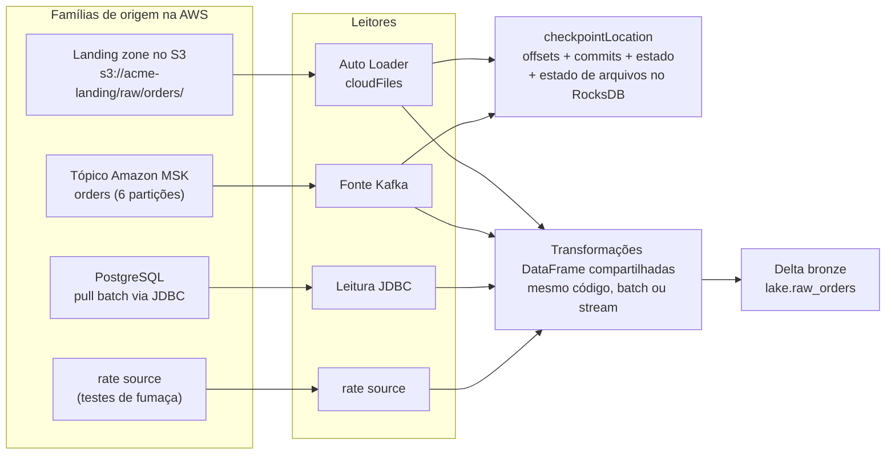
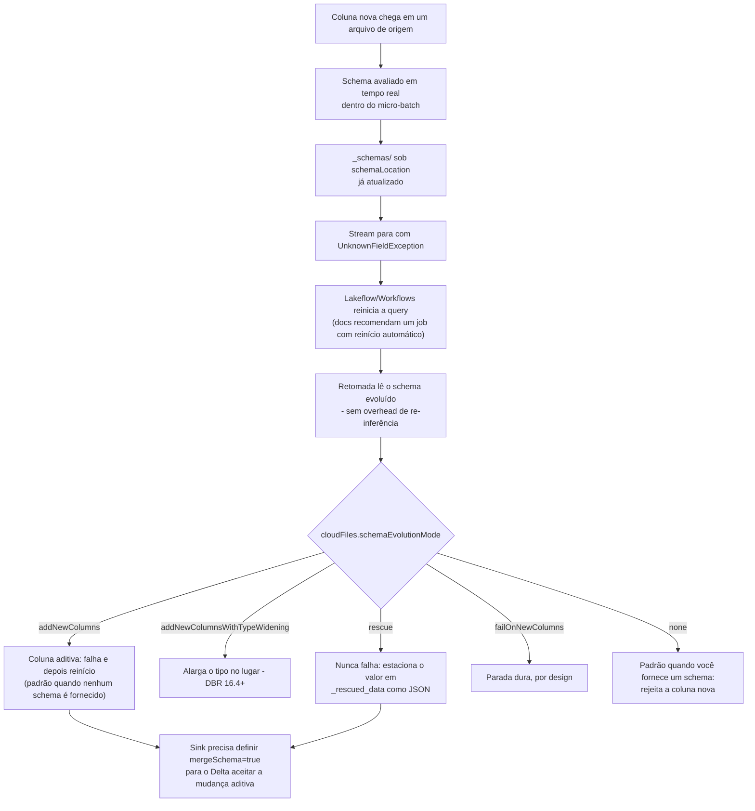
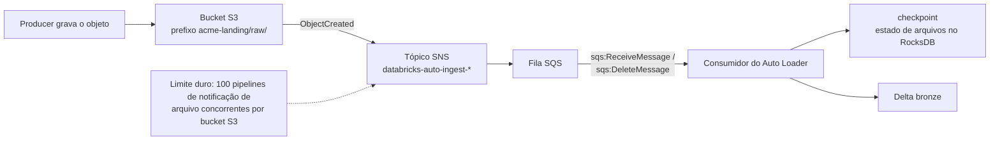
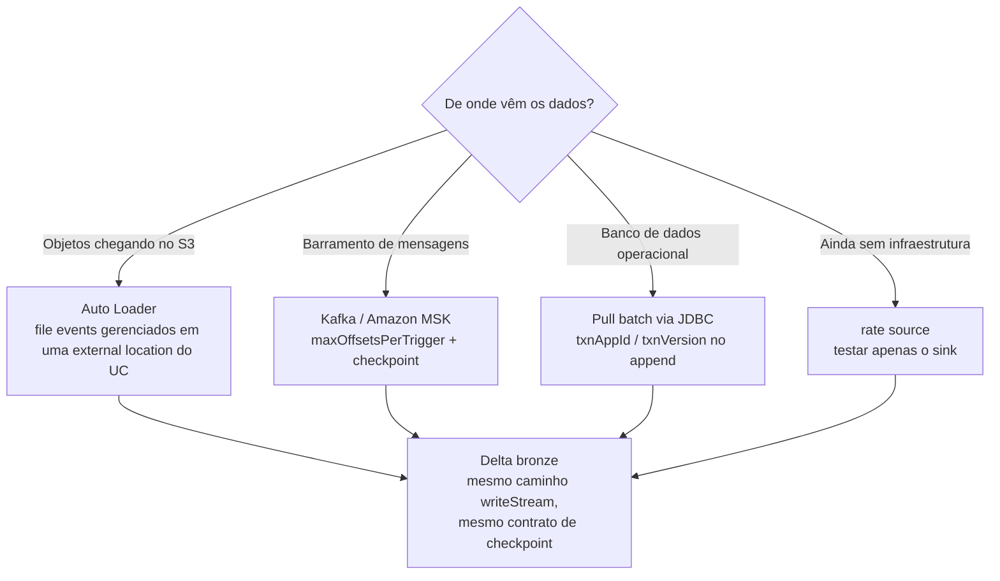
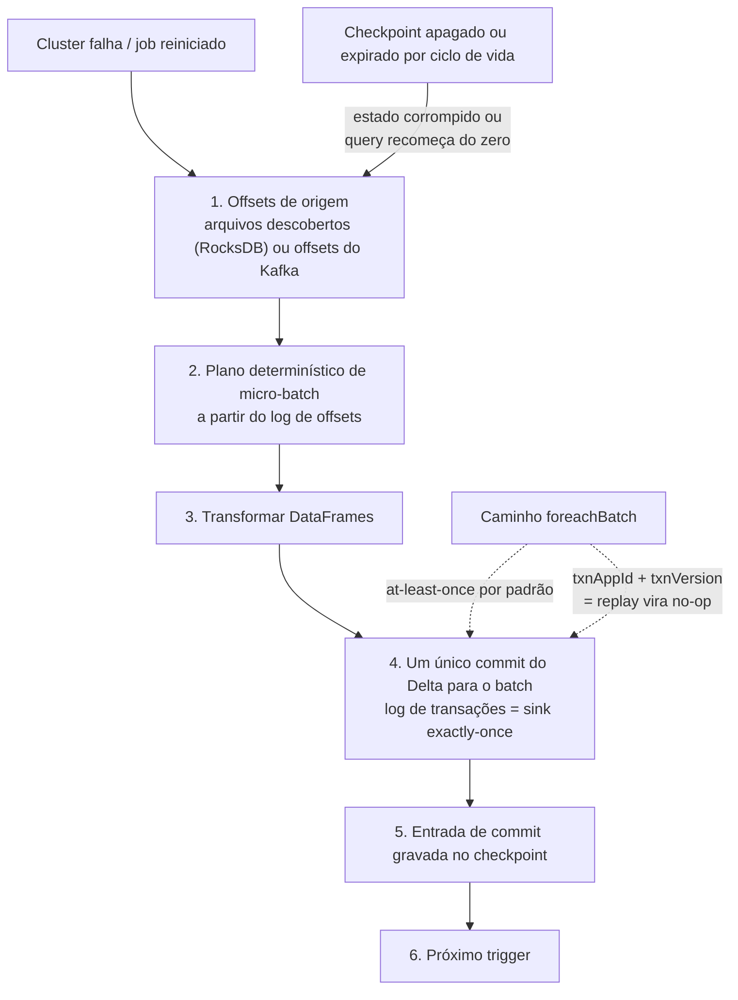

# Ingestão na AWS: Auto Loader, File Events, Kafka/MSK e Sinks Idempotentes

Tudo o que vem depois neste curso, as transações Delta da lição 04, os pipelines declarativos da lição 07, os gates de qualidade da lição 10, pressupõe **uma tabela bronze que já está sendo preenchida corretamente**. A ingestão é onde os projetos de lakehouse falham em silêncio: um checkpoint descartado "para corrigir o lag", um diretório de schema estacionado dentro do prefixo de chegada para que a stream descubra os próprios arquivos de estado, uma query Kafka deixada no `startingOffsets` padrão, fazendo a primeira execução pular três horas de backlog, ou uma stream de listagem de diretório com trigger de um segundo cuja conta de `LIST` cresce a cada hora de uptime.

A mecânica não é complicada. A recomendação da própria Databricks cabe em uma frase: "a Databricks também recomenda o Auto Loader sempre que você usar Apache Spark Structured Streaming para ingerir dados de armazenamento de objetos em nuvem" (docs.../auto-loader, última atualização em **2026-09-11**). O que é complicado é a *higiene*: onde o estado vive, o que acontece quando uma coluna aparece, qual modo de descoberta se paga, e como um micro-batch reprocessado evita escrever linhas duas vezes. Essa é esta lição.

Todo fato abaixo vem da documentação da Databricks na AWS (páginas de Auto Loader, directory-listing, file-notification, schema, production, clean-source, best-practices, FAQ, checkpoints, output-mode, triggers, foreach, Delta streaming, Kafka e JDBC), da documentação do Apache Spark e da AWS, e de blogs de engenharia da Databricks com data: todos acessados ou datados de **outubro de 2026**. O escopo da plataforma é **Databricks na AWS**: Azure Event Hubs não existe nesse substrato e está fora do escopo aqui.

```text
 =============================================================
  INGESTÃO NA DATABRIKS/AWS - FORMA DO PIPELINE (out 2026)
 -------------------------------------------------------------
  Famílias de origem (todas convergem para Delta bronze)
    arquivos no S3    -> Auto Loader (spark.readStream "cloudFiles")
    Kafka/MSK         -> spark.readStream.format("kafka")
    banco operacional -> extração batch via JDBC (sem fonte
                         de streaming JDBC no Databricks;
                         upserts passam por foreachBatch)
    rate source       -> só para teste (linhas timestamp + value)
  Modos de detecção de arquivos do Auto Loader
    listagem de diretório  -> API LIST do S3 a cada trigger (PADRÃO)
    notificações de arquivo -> tópico SNS + fila SQS por stream
    file events gerenciados -> 1 fila por external location
                               (DBR 14.3 LTS+, recomendado)
  Estado (dois locais, ambos duráveis, ambos sem lifecycle)
    checkpointLocation        -> offsets + commits + estado +
                                 estado de descoberta no RocksDB
    cloudFiles.schemaLocation -> histórico de schema em _schemas/
                                 (docs permitem que seja == checkpoint)
  Garantias
    descoberta de arquivos exactly once (RocksDB no checkpoint)
    appends do Delta exactly once (log de transações)
    foreachBatch -> at-least-once; torne-o idempotente com
                    txnAppId / txnVersion
  Triggers
    padrão ~3-5s | processingTime | availableNow (DBR 10.4+)
    continuous -> NÃO suportado no Databricks (use realTime)
  Números duros (docs, out 2026)
    maxFilesPerTrigger 1000 (duro) - auto-tuned no DBR 18.0+
    maxBytesPerTrigger suave, arquivos nunca são divididos
    inferência de schema    primeiros 50 GB ou 1,000 arquivos
    maxFileAge          mínimo 14 dias, recomendado 90 dias
    S3 LIST             $0.005 por 1,000 (mesma taxa do PUT)
    notificações clássicas: 100 pipelines por bucket S3
  =============================================================
```

Nesta lição você vai:

- escrever o próprio **notebook bronze de Auto Loader**, `cloudFiles.format`, `schemaLocation`, `checkpointLocation`, `useManagedFileEvents`, `inferColumnTypes`, `schemaEvolutionMode`, `mergeSchema` no sink Delta, e comentar cada padrão;
- colocar o **local de schema e o checkpoint** onde eles não possam ser descobertos, expirados ou compartilhados, e defender a escolha contra o instinto de "pôr o estado ao lado dos dados";
- calcular as **três contas de `LIST`** para um prefixo de chegada sob três políticas de trigger, e escolher entre **listagem de diretório, notificações clássicas de arquivo SNS+SQS e file events gerenciados** com suas permissões, limites e comportamento de backfill;
- rodar um **esboço de throughput** para um pico de 1,8 milhões de arquivos: taxa de chegada contra taxa de serviço, o teto duro de arquivos contra o teto suave de bytes, e o que acontece quando alguém "com cuidado" demais define `maxFilesPerTrigger` baixo demais;
- configurar **Amazon MSK com `AWS_MSK_IAM`**, incluindo os nomes de classe shaded e a porta que precisa bater com o modo de autenticação, mais a aritmética de dimensionamento de `maxOffsetsPerTrigger`;
- escolher um **modo de saída contra a matriz de suporte do Delta**, tornar `foreachBatch` **idempotente** com `txnAppId`/`txnVersion`, e defender a cadeia end-to-end de exactly-once;
- unificar **batch e streaming** em um único caminho de código com `Trigger.AvailableNow`, e precificar o job bronze noturno em **DBUs em outubro de 2026**;
- estudar **dois casos nomeados de clientes da AWS** (Asurion e Burberry), ler a **caixa de atualizações de 2026**, e praticar com **13 questões no estilo de exame** mais quatro verificações interativas.

---

## 1. Ingestão na lakehouse da AWS: três famílias de origem, um caminho de escrita

A ingestão Databricks-on-AWS tem três famílias que importam em produção, mais uma de brinquedo:

| Família | Leitor | O que você paga | Postura exactly-once | Auth na AWS |
|---|---|---|---|---|
| **Arquivos no S3** (landing zone, exportações DMS/Firehose, extrações de parceiros) | `spark.readStream.format("cloudFiles")`: Auto Loader | Descoberta (APIs de `LIST` ou de fila) + compute | Descoberta exactly once (RocksDB no checkpoint); appends do Delta exactly once | IAM instance profile / storage credential do Unity Catalog na external location |
| **Barramento de mensagens** (Amazon MSK / Kafka autogerido; Amazon Kinesis também é nomeado pela Databricks como fonte de baixa latência) | `spark.readStream.format("kafka")` | Offsets por micro-batch (`maxOffsetsPerTrigger`) + compute | Kafka é at-least-once no lado do broker; o sink Delta fecha o ciclo | `SSL` / `SASL_SSL` + `AWS_MSK_IAM`, ou uma service credential do UC |
| **Banco de dados operacional** | `spark.read.format("jdbc")` em pulls de batch (governados por uma conexão JDBC do Unity Catalog) | Full scan por pull + compute | Append com `txnAppId`/`txnVersion` para que reexecuções sejam no-ops | `dbutils.secrets` ou uma conexão JDBC do UC: nunca credenciais na URL |
| **rate source** (só para teste) | `spark.readStream.format("rate")` | Nada real | N/A | Nenhuma |

Três coisas nessa tabela são estruturais. Primeiro, **todas quatro convergem para o mesmo caminho de escrita**: `writeStream` → `checkpointLocation` → modo de saída → Delta. O código de transformação é idêntico para `spark.read` e `spark.readStream` porque ambos retornam DataFrames, essa é a história de unificação batch/streaming da seção 9. Segundo, **JDBC não tem nenhuma fonte de streaming documentada pela Databricks**: a documentação atual descreve leituras em batch, conexões UC governadas e `foreachBatch` para escritas; DML em nível de linha no banco de origem é explicitamente não suportado ("The Spark JDBC data source does not support arbitrary DML statements", docs.../connect/jdbc-connection, acesso em 2026-10). Terceiro, **o checkpoint é a query**, apague-o e você recomeça do zero: para Kafka isso significa que `startingOffsets` se aplica de novo; para Auto Loader, o estado de arquivos descobertos desapareceu.



- **📚 Você sabia?** O Auto Loader não é novo. A Databricks o anunciou em **2020-02-24** como "uma fonte otimizada de arquivos em nuvem para o Apache Spark, que carrega dados de forma contínua e eficiente do armazenamento em nuvem à medida que novos dados chegam", citando Fivetran, Qlik, Infoworks, StreamSets e Syncsort como ferramentas de ingestão parceiras no lançamento (databricks.com/blog/2020/02/24/introducing-databricks-ingest-easy-data-ingestion-into-delta-lake.html, 2020-02-24). O problema que ele resolveu nunca mudou: "tanto o custo quanto a latência podem somar muito rápido à medida que mais e mais arquivos entram em um diretório por causa da listagem repetida de arquivos". As cifras de escala que você verá citadas, "bilhões de arquivos" para backfills e "milhões de arquivos por hora" para ingest quase em tempo real, são **afirmações de capacidade do fornecedor** da página de docs (2026-09-11), não benchmarks de clientes: trate-as como folga de projeto, nunca como SLA.

---

## 2. Anatomia do Auto Loader: a fonte `cloudFiles`

### 2.1 As opções que importam (out 2026)

`spark.readStream.format("cloudFiles")` é uma fonte comum de Structured Streaming. O que a torna Auto Loader é o motor de descoberta: conforme arquivos são encontrados, seus metadados são persistidos "em um store chave-valor escalável (RocksDB) no *checkpoint location*", o que "garante que os dados sejam processados **exactly once**" (docs .../auto-loader, 2026-09-11).

| Opção | Padrão | O que ele realmente faz |
|---|---|---|
| `cloudFiles.format` | obrigatório | Parser: `json`, `csv`, `xml`, `parquet`, `avro`, `text`, `binaryFile` (`ORC` não é suportado para inferência/evolução) |
| `cloudFiles.schemaLocation` | não definido | Habilita inferência/evolução; guarda o histórico em `_schemas/`. Pode ser igual ao checkpoint: a documentação diz isso explicitamente |
| `cloudFiles.useManagedFileEvents` | `false` | Usa a fila de file events gerenciados em uma external location do Unity Catalog (DBR 14.3 LTS+) |
| `cloudFiles.inferColumnTypes` | `false` | Inferência tipada para JSON/CSV/XML; caso contrário tudo acaba como `string` |
| `cloudFiles.schemaEvolutionMode` | `addNewColumns` sem schema, `none` com schema fornecido | `addNewColumns` · `addNewColumnsWithTypeWidening` · `rescue` · `failOnNewColumns` · `none` |
| `cloudFiles.maxFilesPerTrigger` | `1000` (duro) | Teto de arquivos por micro-batch. **No DBR 18.0+ isso é configurado dinamicamente: não fixe manualmente** |
| `cloudFiles.maxBytesPerTrigger` | não definido (suave) | Teto de bytes como string (`"10g"`); um arquivo nunca é dividido entre micro-batches |
| `cloudFiles.includeExistingFiles` | `true` | Avaliado **apenas na primeira subida** de uma stream; mudar depois não tem efeito |
| `cloudFiles.maxFileAge` | `7d` na tabela do file-source; TTL de rastreamento de eventos do Auto Loader **mínimo de 14 dias, recomendado 90 dias** | Valor baixo demais significa ingestão duplicada ou arquivos perdidos |
| `checkpointLocation` | obrigatório | Offsets, commits, estado, metadados: mais o estado de arquivos em RocksDB do Auto Loader |

Dois padrões surpreendem todo mundo. `includeExistingFiles=true` significa que a primeira subida de um checkpoint novo varre o prefixo inteiro (esse é o seu backfill). E `maxFilesPerTrigger=1000` é um limite **duro**, enquanto o limite de bytes é suave: "Um arquivo individual nunca é dividido entre micro-batches" (docs.../spark/api-options, data da página **2026-10-05**).

### 2.2 Exemplo resolvido E1: um notebook bronze de Auto Loader com forma de produção

```python
BRONZE   = "lake.raw_orders"                    # Unity Catalog managed Delta table
SRC      = "s3://acme-landing/raw/orders/"      # external location, file events enabled
CKPT     = "/Volumes/lake/ops/checkpoints/orders_bronze"
SCHEMA_P = "/Volumes/lake/ops/schemas/orders_bronze"   # docs allow SCHEMA_P == CKPT

df = (spark.readStream.format("cloudFiles")
      .option("cloudFiles.format", "json")
      .option("cloudFiles.schemaLocation", SCHEMA_P)
      .option("cloudFiles.useManagedFileEvents", "true")   # DBR 14.3+; needs file events on the EL
      .option("cloudFiles.inferColumnTypes", "true")       # typed JSON instead of all-string
      .option("cloudFiles.schemaEvolutionMode", "addNewColumns")
      # .option("cloudFiles.maxFilesPerTrigger", 1000)     # omit on DBR 18.0+ (auto-tuned)
      .load(SRC))

query = (df.writeStream
      .option("checkpointLocation", CKPT)
      .option("mergeSchema", "true")            # additive change must reach the Delta table
      .trigger(availableNow=True)               # scheduled incremental batch, rate-limited
      .toTable(BRONZE))
```

O que os números significam enquanto ele roda: a primeira execução amostra **os primeiros 50 GB ou 1,000 arquivos** (o que for cruzado primeiro, mais recente por hora de modificação) para inferir o schema; cada micro-batch seguinte é limitado a **1,000 arquivos**, a menos que o runtime faça o auto-tune (DBR 18.0+); `Trigger.AvailableNow` processa apenas arquivos que chegaram **antes do horário de início da query** e se desliga sozinho; e se uma coluna nova aparecer, a query para com `UnknownFieldException` *depois* de `_schemas` já ter sido atualizado, então é o job, não uma pessoa, que a reinicia (seção 3).

> [!IMPORTANT]
> **Uma query, um checkpoint, para sempre.** "Dê a cada query o seu próprio diretório de checkpoint em armazenamento em nuvem durável" (docs.../structured-streaming/production, acesso em 2026-10). Duas streams de Auto Loader apontadas para um mesmo checkpoint corrompem o estado de arquivos uma da outra; trocar uma query para um checkpoint totalmente novo faz ela recomeçar do zero: com `includeExistingFiles=true` ela vai reprocesar o prefixo inteiro. E "Quando você apaga os arquivos em um diretório de checkpoint ou muda para um novo local de checkpoint, a próxima execução da query começa do zero" (docs.../structured-streaming/checkpoints, datada de 2026-06-30). Nunca apague um checkpoint para "consertar" lag; conserte o trigger e os limites de taxa no lugar disso.

---

## 3. Inferência, evolução de schema e rescue

### 3.1 O que a inferência de fato amostra

Na primeira definição do DataFrame, o Auto Loader "lista o seu diretório de origem e escolhe os **50 GB mais recentes (por hora de modificação do arquivo) ou 1000 arquivos**, e usa esses para inferir o schema dos seus dados" (FAQ do Auto Loader, datado de **2026-06-23**). O resultado é gravado em um diretório `_schemas` sob `cloudFiles.schemaLocation`, e é esse o histórico de schema que a stream recarrega em cada reinício: "Quando a stream reinicia, ela pega o schema evoluído do local de schema e começa a executar **sem nenhum overhead de inferência**" (mesmo FAQ).

Padrões que mordem:

- JSON, CSV e XML inferem **todas as colunas como strings** a menos que você defina `cloudFiles.inferColumnTypes=true`. Formatos tipados (Parquet, Avro) fazem merge dos tipos codificados no lugar.
- Se o diretório de origem estiver vazio, **você precisa fornecer um schema**: não há nada para amostrar.
- `cloudFiles.schemaHints` deixa você fixar tipos conhecidos (`"order_id=STRING, amount=DECIMAL(12,2)"`) sem escrever o schema inteiro à mão.
- Colunas de partição são inferidas a partir de caminhos estilo Hive, mas **colunas de partição novas não são evoluídas**: declare-as com `cloudFiles.partitionColumns`.
- Overrides existem: `spark.databricks.cloudFiles.schemaInference.sampleSize.numBytes` (por exemplo `10gb`) e `...sampleSize.numFiles`.

### 3.2 Modos de evolução e o loop de reinício

A sequência em uma mudança de schema é fixa, e vale memorizar, porque é um design de *alerta-e-replay* e não uma correção silenciosa:



Dois fatos de apoio. O **lado de escrita precisa concordar**: `.option("mergeSchema", "true")` no sink Delta, ou a tabela se recusa a mudança aditiva. E um **rename é tratado como um add**, o nome novo vira uma coluna, enquanto a antiga é preenchida com `NULL` nas linhas novas (docs.../data-engineering/schema-evolution, acesso em 2026-10). O schema de uma query de streaming fica "travado durante a fase de planejamento", então qualquer mudança de origem em pleno voo falha a query e exige reinício; é por isso que a documentação recomenda rodar streams de Auto Loader como **jobs do Lakeflow/Workflows** em vez de notebooks all-purpose rodando para sempre.

### 3.3 Exemplo resolvido E2: uma stream de eventos que nunca falha, com tipos fixados

```python
SRC      = "s3://acme-landing/raw/events/"
CKPT     = "/Volumes/lake/ops/checkpoints/raw_events"
SCHEMA_P = "/Volumes/lake/ops/schemas/raw_events"

df = (spark.readStream.format("cloudFiles")
      .option("cloudFiles.format", "json")
      .option("cloudFiles.schemaLocation", SCHEMA_P)
      .option("cloudFiles.inferColumnTypes", "true")
      .option("cloudFiles.schemaHints", "user_agent=STRING, device_id=STRING")
      .option("cloudFiles.schemaEvolutionMode", "rescue")   # new columns never stop the lane
      .load(SRC))

(df.writeStream
   .option("checkpointLocation", CKPT)
   .option("mergeSchema", "true")
   .trigger(availableNow=True)
   .toTable("lake.raw_events"))

# morning audit: what did we not understand yesterday?
#   SELECT * FROM lake.raw_events WHERE _rescued_data IS NOT NULL
```

`_rescued_data` guarda o que o schema não conseguiu aceitar, "coluna ausente do schema / tipo não confere / caixa não confere", como um blob JSON ao lado do caminho do arquivo de origem, e é assim que você mantém uma faixa sem perda de dados *e* um sinal de qualidade mensurável ao mesmo tempo. Use `rescue` para faixas que nunca podem parar (clickstream, IoT); use `addNewColumns` mais um job com reinício automático para faixas em que uma coluna nova é um evento que você quer *perceber*.

### 3.4 ⚠️ ALERTA: nunca coloque estado de schema ou checkpoint no caminho dos dados

> ⚠️ **ALERTA: `cloudFiles.schemaLocation` e `checkpointLocation` nunca podem ficar dentro do diretório de chegada da origem, e nenhum dos dois pode ficar sob uma política de ciclo de vida de objetos de nuvem.**
> 1. **Estar dentro do caminho dos dados significa autodescoberta.** Se `_schemas/` ou o checkpoint ficar sob `s3://acme-landing/raw/orders/`, o Auto Loader eventualmente vai listar os próprios arquivos de estado como entradas. Mantenha o estado em um **prefixo diferente ou em um volume do Unity Catalog** (`/Volumes/<catalog>/<schema>/checkpoints/...`), nunca sob o diretório de dados da tabela.
> 2. **Uma regra de ciclo de vida que expira o estado destrói a query.** "A Databricks recomenda definir o local do checkpoint em um local **sem uma política de ciclo de vida de objetos de nuvem**. Se os arquivos no local do checkpoint forem limpos conforme a política, **o estado da stream é corrompido**. Se isso acontecer, você precisa reiniciar a stream do zero" (docs .../auto-loader/production, rodapé **2026-09-18**). A mesma frase vale para `schemaLocation`.
> 3. **Separe por workload.** Cada workload de ingestão do Auto Loader exige um checkpoint de streaming próprio. Dois workloads dividindo um checkpoint, ou um único diretório `_schemas`, vão brigar pelo estado.
> 4. **Estado ao lado de uma tabela Delta precisa de prefixo de sublinhado.** Se você precisar colocar um checkpoint junto com uma tabela, use `/_checkpoints`: o `VACUUM` "ignora quaisquer diretórios que começam com `_`" (docs .../structured-streaming/delta-lake, datada de 2026-08-24), então a manutenção não vai comê-lo.
> 5. **Igualdade pode, contenção não.** A documentação permite explicitamente `schemaLocation == checkpointLocation`; o que ela nunca permite é estado dentro do caminho de entrada ou sob expiração.

---

## 4. Detecção de arquivos: listagem de diretório versus notificações de arquivo

O Auto Loader "suporta dois modos de detecção de arquivos. Por padrão, o Auto Loader usa o modo de **listagem de diretório**. No entanto, a Databricks recomenda o **modo de notificação de arquivo usando file events** para a maioria dos workloads" (docs .../auto-loader, 2026-09-11). Escolher entre eles é a decisão de custo e de infraestrutura desta lição.

### 4.1 Listagem de diretório (padrão)

Cada trigger lista a árvore de entrada. Duas propriedades tornam isso viável: o Auto Loader "usa APIs nativas da nuvem para obter listas de arquivos", e no S3 cada `LIST` devolve até **1,000 chaves**, então o número de chamadas de API escala como *arquivos ÷ 1,000* e não como *diretórios × triggers*. Essa é a diferença em relação ao file source do OSS Spark, cujo custo a documentação modela como "1 (diretório base) + 365 (por dia) × 24 (por hora) = **8761 chamadas**" para um layout `YYYY/MM/DD/HH` (docs .../auto-loader/directory-listing-mode, 2026-09-11).

O aviso documentado é sobre *frequência*: com triggers contínuos como `Trigger.ProcessingTime`, o modo de listagem de diretório "lista continuamente o diretório inteiro e pode aumentar significativamente os custos da API `LIST`". Três regras de higiene:

- mantenha **nomenclatura lexical de arquivos** (`YYYY/MM/DD/HH`, com zeros à esquerda: os arquivos de CDC do AWS DMS como `LOAD00000001.csv` e os nomes de objeto do Kinesis Firehose são os exemplos da própria documentação), ainda que o **Auto Loader não garanta a ordem em que arquivos são descobertos ou processados**;
- prefira `Trigger.AvailableNow` a um trigger contínuo nesse modo;
- **a listagem incremental está deprecada**: em modo `auto`, uma listagem completa de diretório roda depois de **7 listagens incrementais consecutivas** (ajustável com `cloudFiles.backfillInterval`), e o DBR 11.3 LTS+ deixa você mudar o caminho de entrada *sem* um checkpoint novo: capacidade **não suportada** para notificações de arquivo.

### 4.2 Notificações clássicas de arquivo: SNS + SQS



Nesse modo o Auto Loader liga a **notificação de bucket** do S3 (`ObjectCreated`) por meio de um **tópico AWS SNS** para uma **fila AWS SQS** (prefixo de recurso `databricks-auto-ingest`) e depois consome a fila. A política de setup precisa do conjunto de ações documentado, `s3:GetBucketNotification`, `s3:PutBucketNotification`, `sns:CreateTopic`, `sns:Subscribe`, `sns:Publish`, `sqs:CreateQueue`, `sqs:ReceiveMessage`, `sqs:DeleteMessage`, `sqs:SendMessage`, `sqs:SetQueueAttributes`, `sqs:ChangeMessageVisibility`, `sqs:PurgeQueue` em `databricks-auto-ingest-*`, e depois do setup a stream em execução só precisa da política reduzida de consumo (docs.../auto-loader/file-notification-mode, rodapé **2026-10-07**). A mesma página limita o padrão a **100 por bucket S3**.

Dois avisos vêm junto. A entrega de eventos é best-effort, "provedores de nuvem não garantem 100% de entrega de todos os arquivos de evento", então SLAs de completude no modo clássico são comprados com relistas assíncronas via `cloudFiles.backfillInterval` que ingerem **apenas os arquivos perdidos** (sem duplicatas, porque o checkpoint já sabe o que viu). E você não consegue mudar o caminho de entrada sem um checkpoint novo nesse modo.

### 4.3 File events gerenciados (recomendado)

A forma moderna é habilitada **na external location**, não por stream: uma única fila de notificação de arquivos para todas as streams que processam arquivos de uma dada external location, ativada com `cloudFiles.useManagedFileEvents=true`. Requisitos: um workspace habilitado para Unity Catalog, permissão para criar uma storage credential e uma external location, e **Databricks Runtime 14.3 LTS ou superior** (mesma página, 2026-10-07).

O que você ganha: menos grants de IAM (permissão de nuvem única, e depois nenhuma fila por stream), tuning e limpeza automáticos, backfill automático, "a Databricks faz backfill automático dessas external locations com uma listagem completa quando os file events são habilitados pela primeira vez, e depois continua fazendo backfill **a cada aproximadamente 24 horas**", e a instrução explícita de **não** definir um intervalo de backfill nesse modo. O que você precisa respeitar: "O serviço de file events otimiza a descoberta de arquivos fazendo **cache** dos arquivos criados mais recentemente. Se o Auto Loader rodar com pouca frequência, esse cache pode expirar … invoque o Auto Loader pelo menos **uma vez a cada sete dias**." Um job noturno ou horário de `AvailableNow` passa desse piso com folga; uma execução manual trimestral, não.

Trocar de modo é seguro: "você pode alternar entre notificações de arquivo e listagem de diretório a qualquer momento e ainda manter as garantias de processamento **exactly-once**" (mesma página).

### 4.4 Exemplo resolvido E3: a conta de `LIST`, calculada de três formas

Entradas (todas oficiais): o S3 devolve **1,000 chaves por `LIST`**; "Requisições LIST para qualquer storage class são cobradas na mesma taxa que as requisições PUT, COPY e POST do S3 Standard": **$0.005 por 1,000** em `us-east-1`, enquanto `DELETE` e `CANCEL` são grátis (aws.amazon.com/s3/pricing, acesso em **2026-10**). Prefixo de chegada: **2,000,000 arquivos**. A aritmética abaixo é nossa; as entradas são da AWS.

| Política | Ciclos de listagem/dia | Chamadas `LIST`/ciclo | Chamadas `LIST`/mês (30 d) | Cobrança/mês |
|---|---|---|---|---|
| Layout do file-source OSS `YYYY/MM/DD/HH` (o exemplo de 8,761 da própria documentação) | 1 | 8,761 | 262,830 | **$1.31** |
| Auto Loader + `Trigger.AvailableNow` a cada 15 min | 96 | 2,000 | 5,760,000 | **$28.80** |
| Auto Loader + `processingTime="10 seconds"` | 8,640 | 2,000 | 518,400,000 | **$2,592** |
| Auto Loader + trigger contínuo de 1 segundo | 86,400 | 2,000 | 5,184,000,000 | **$25,920** |
| **File events gerenciados** (listagem automática completa ≈ a cada 24 h) | 1 | 2,000 | 60,000 | **$0.30** |

Leia a forma, não só os dólares: o mesmo prefixo de 2M de arquivos custa **900× mais** com um trigger de 1 segundo do que com um `AvailableNow` de 15 minutos, porque o multiplicador é a *frequência* de listagem: não o volume de dados. File events gerenciados substituem a listagem por trigger por chamadas de API de fila, restando apenas a listagem automática de backfill de ~24 horas. Nós deliberadamente não precificamos o lado do SQS/SNS aqui: as fontes desta lição não trazem nenhum preço verificado de fila da AWS, então confira você mesmo aws.amazon.com/pricing antes de modelar isso.

```plot
{
  "type": "bar",
  "title": "Cobranças mensais de LIST do S3 para um prefixo de chegada com 2,000,000 arquivos (us-east-1, $0.005 por 1,000 requisições, em out 2026)",
  "xLabel": "Política de descoberta",
  "yLabel": "US$ por mês em requisições de LIST",
  "xKey": "policy",
  "dataKeys": ["usd_per_month"],
  "data": [
    {"policy": "Managed file events (~24 h backfill listing)", "usd_per_month": 0.3},
    {"policy": "Directory listing, AvailableNow every 15 min", "usd_per_month": 28.8},
    {"policy": "Directory listing, processingTime 10 s", "usd_per_month": 2592},
    {"policy": "Directory listing, 1 s continuous", "usd_per_month": 25920}
  ]
}
```

- **📚 Você sabia?** O `LIST` é cobrado como escrita, não como leitura: "Requisições LIST para qualquer storage class são cobradas na mesma taxa que as requisições PUT, COPY e POST do S3 Standard": **$0.005 por 1,000**: enquanto `DELETE` e `CANCEL` são grátis (aws.amazon.com/s3/pricing, acesso em 2026-10). E não existe rename de propósito geral no S3: "S3 Express One Zone é o único storage class que suporta a API `RenameObject`", então um arquivo de estilo MOVE é um par **copy + delete** cobrado pelas taxas de PUT/COPY/LIST, e, em termos de notificação clássica, essa cópia aparece como mais um evento `ObjectCreated`. Essa é uma segunda razão para os file events gerenciados, que não disparam de novo nas suas próprias cópias de bookkeeping, serem o modo recomendado.

---

## 5. Throughput e higiene de produção

### 5.1 Exemplo resolvido E4: um esboço de throughput para um pico de 1,8 milhões de arquivos

Cenário: um parceiro despeja **1,800,000 arquivos JSON de 120 KB** no prefixo de chegada durante uma janela noturna de duas horas (**216 GB**), e depois mantém um filete chegando. Taxa de chegada = 1,800,000 ÷ 7,200 s = **250 arquivos/s**.

Dimensionando os micro-batches:

- Padrão `maxFilesPerTrigger=1000` → cada micro-batch carrega **1,000 arquivos = 120 MB**.
- Defina `maxBytesPerTrigger="500mb"` no lugar e esse teto de bytes *suave* permitiria 500 MB ÷ 120 KB ≈ **4,166 arquivos**, mas o **limite de arquivos é um limite duro**, então o batch efetivo continua em 1,000 arquivos. Vale o limite que for atingido primeiro.
- Suponha que o cluster sustente **1,0 s por micro-batch** → taxa de serviço **1,000 arquivos/s (120 MB/s)**. Utilização ρ = 250 ÷ 1,000 = **0.625**: a fila esvazia.
- Um backlog de 1.8M de arquivos esvazia a 1,000 − 250 = 750 arquivos/s líquidos → **2,400 s = 40 minutos**, tendo processado 2.4M de arquivos no total (≈288 GB).

Agora o modo de falha que um engenheiro "cuidadoso" cria: definir `maxFilesPerTrigger=100` "para ser gentil com o cluster" limita o serviço a **100 arquivos/s < 250 arquivos/s de chegada**, a fila cresce a 150 arquivos/s sem limite, e nenhum tamanho de cluster conserta um knob ruim de controle de admissão. No **DBR 18.0+**, tanto `cloudFiles.maxFilesPerTrigger` quanto `cloudFiles.maxBytesPerTrigger` são "configurados dinamicamente e não precisam ser definidos manualmente" (docs.../spark/api-options, 2026-10-05); fixá-los ali briga com o tuning automático. E se o pico for genuinamente enorme e de uma vez só, rode `Trigger.AvailableNow` como uma task do Workflows em vez de um trigger contínuo, ele limita a taxa entre micro-batches e se desliga quando se atualiza.

### 5.2 Retenção: `maxFileAge`, `cleanSource`, backfill

| Knob | Regra (fonte, data) |
|---|---|
| `cloudFiles.maxFileAge` | Mínimo de **14 dias**; a Databricks recomenda "uma configuração conservadora … como **90 dias**"; tuning agressivo demais causa "ingestão duplicada ou arquivos perdidos" (página de production, **2026-09-18**). Esse é um relógio *diferente* do filtro de descoberta de 7 dias do file source |
| `cloudFiles.cleanSource` | **DBR 16.4+**; `OFF` (padrão) / `MOVE` / `DELETE`; `retentionDuration` padrão de **30 dias**; `DELETE` precisa ser **> 7 dias**; `waitForCompletion` é **DBR 19+** (página de clean-source, **2026-08-21**) |
| Destino do `MOVE` | Precisa **não** ser filho do diretório de origem (senão os arquivos são ingeridos de novo), e precisa permanecer na **mesma external location**; movimentações entre buckets não são suportadas (mesma página) |
| Quem pode habilitar | "Do not enable `cloudFiles.cleanSource` if multiple Auto Loader streams or other clients read from the same source directory" (best-practices, **2026-06-29**) |
| Backfill (modos clássicos) | `cloudFiles.backfillInterval` roda relistas completas assíncronas que ingerem **apenas os arquivos perdidos**; com file events gerenciados é automático (na habilitação e a cada ~24 h): não defina isso lá (página de production, 2026-09-18; página de file-notification, 2026-10-07) |

A economia do `cleanSource` é o mesmo argumento da seção 4: "Arquive os arquivos processados com `cloudFiles.cleanSource` … Isso reduz tanto os custos de armazenamento quanto os de listagem de diretório para streams de longa duração": você para de pagar para relistar arquivos que nunca mais vai ler.

### 5.3 Monitorando a origem

Três métricas te dizem se a ingestão está saudável *antes* que os alertas de frescor a jusante disparem: `numFilesOutstanding`, `numBytesOutstanding` e (notificações de arquivo) `approximateQueueSize`: mais a tabela de estado:

```sql
-- DBR 11.3 LTS+: what does this checkpoint believe?
SELECT * FROM cloud_files_state('/Volumes/lake/ops/checkpoints/orders_bronze');
```

Um `numFilesOutstanding` crescente com taxa de processamento estável significa que você está dimensionado abaixo do necessário (conserte os limites de taxa, não o checkpoint); um `approximateQueueSize` travado no modo clássico de notificação significa que o consumidor não consegue esvaziar a fila: permissões, ou o teto de 100 por bucket.

---

## 6. Kafka e Amazon MSK como origem

### 6.1 As opções que importam

Leitura mínima: `spark.readStream.format("kafka").option("kafka.bootstrap.servers", "<server:9094>").option("subscribe", "orders").option("startingOffsets", "latest").load()`, e então as quatro opções que decidem se o seu primeiro dia vai bem:

| Opção | Padrão | Comportamento |
|---|---|---|
| `startingOffsets` | **`latest`** (streaming), `earliest` (batch) | Aplica **apenas quando uma query nova começa**; "Resumed queries always use the checkpoint." Uma partição recém-adicionada começa em `earliest` |
| `maxOffsetsPerTrigger` | nenhum | Máximo de registros por micro-batch, "distributed proportionally across topic partitions", o seu limitador de taxa de recuperação |
| `minOffsetsPerTrigger` + `maxTriggerDelay` | nenhum / **`15m`** | Aglutina tráfego pequeno; quando `maxTriggerDelay` é atingido, o micro-batch roda de qualquer jeito |
| `failOnDataLoss` | **`true`** | Falha a query em tópicos apagados ou offsets truncados em vez de pular dados silenciosamente |

O schema de linha é um fixo de sete colunas: `key` binary, `value` binary, `topic` string, `partition` int, `offset` long, `timestamp` timestamp, `timestampType` int. Autenticação na AWS é `SSL` ou `SASL_SSL` com `PLAIN`/`SCRAM`/`AWS_MSK_IAM`: ou, no caminho governado, uma **service credential / conexão do Unity Catalog**, caso em que você *não* deve definir `kafka.security.protocol` nem `sasl.*` você mesmo. Se você de fato dirigir o cliente diretamente: **sempre prefixe as propriedades do cliente com `kafka.`** e use sempre os **nomes de classe shaded** da Databricks (`kafkashaded.`, `shadedmskiam.`), ou você vai encontrar `SaslException` / `RESTRICTED_STREAMING_OPTION_PERMISSION_ENFORCED`.

### 6.2 Exemplo resolvido E5: leitura MSK IAM com limitação de taxa

```python
kafka_opts = {
  "kafka.bootstrap.servers": "b-1.mskcluster.acme.amazonaws.com:9098",  # 9098 = IAM port
  "subscribe": "orders",
  "startingOffsets": "earliest",        # FIRST run only; the checkpoint wins from then on
  "maxOffsetsPerTrigger": 600000,       # records per micro-batch, split across 6 partitions
  "failOnDataLoss": "true",
  # Omit the next four lines when a Unity Catalog service credential governs the connection:
  "kafka.security.protocol": "SASL_SSL",
  "kafka.sasl.mechanism": "AWS_MSK_IAM",
  "kafka.sasl.jaas.config": "shadedmskiam.software.amazon.msk.auth.iam.IAMLoginModule required awsRoleArn='arn:aws:iam::123456789012:role/msk_client';",
  "kafka.sasl.client.callback.handler.class": "shadedmskiam.software.amazon.msk.auth.iam.IAMClientCallbackHandler",
}

raw = (spark.readStream.format("kafka").options(**kafka_opts).load()
        .selectExpr("cast(value as string) as json", "timestamp as ingest_ts"))
```

Aritmética de dimensionamento (nossa, sobre semântica oficial): a chegada no pico é de **12,000 msg/s** em 6 partições com **400 bytes** em média. Com `processingTime="30 seconds"` e `maxOffsetsPerTrigger=300000`, a capacidade é 300,000 ÷ 30 = **10,000 msg/s < 12,000 msg/s**, o backlog cresce a 2,000 msg/s. Suba para **600,000** → 20,000 msg/s de capacidade, payload do micro-batch 600,000 × 400 B = **240 MB**, ρ = 0.6, estável. Dois fatos de apoio para o runbook de operações: a IAM role precisa de `kafka-cluster:Connect` e `kafka-cluster:ReadData`, e a porta precisa bater com o modo (**9092** PLAINTEXT, **9094** SASL/SSL, **9098** IAM), mais VPC peering ou PrivateLink entre a VPC do Databricks e a VPC do MSK (docs.../kafka/authentication, 2026-07-10).

### 6.3 JDBC e a rate source

JDBC é um pull em **batch** nesta plataforma: credenciais via `dbutils.secrets.get(scope="jdbc", key="username")` (nunca na URL), ou o caminho governado `.option("databricks.connection", "prod_pg")` com o JAR do driver em um Volume: a memória do driver é limitada a **400 MiB**, e o `externalOptionsAllowList` padrão permite apenas seis opções de leitura. Como escritas em nível de linha na origem não são suportadas, o padrão de upsert é sempre *pull → Delta* com appends idempotentes:

```python
(df.write.format("delta").mode("append")
   .option("txnAppId", f"jdbc-pull-{run_date}").option("txnVersion", 0)
   .saveAsTable("lake.raw_orders_jdbc"))   # rerun of the same run_date is a no-op
```

A **rate source** (`spark.readStream.format("rate")`, `rowsPerSecond` padrão 1, mais `rampUpTime` e `numPartitions`) emite linhas sintéticas de `timestamp` + `value` e é "intended for testing and benchmarking": perfeita para verificar checkpoint, modo de saída e a fiação do sink Delta em dois minutos, antes que qualquer permissão de S3 ou MSK entre na jogada.



```matching
{
  "question": "Associe cada origem de ingestão à sua propriedade principal em outubro de 2026:",
  "pairs": [
    {"left": "Arquivos chegando em s3://acme-landing/raw/", "right": "Auto Loader (cloudFiles): o custo de descoberta escala com os arquivos ingeridos, não com diretórios; estado em RocksDB no checkpoint dá descoberta exactly-once"},
    {"left": "Tópico Amazon MSK com 6 partições", "right": "Fonte Kafka: maxOffsetsPerTrigger limita registros por micro-batch, startingOffsets aplica-se só a uma query nova, o checkpoint vence na retomada"},
    {"left": "Tabela PostgreSQL operacional", "right": "Pull batch via JDBC governado por uma conexão JDBC do Unity Catalog; não existe fonte de streaming JDBC no Databricks, e não há DML em nível de linha na origem"},
    {"left": "spark.readStream.format('rate')", "right": "Só para teste: linhas sintéticas de rowsPerSecond com timestamp e value: nunca uma origem de produção"},
    {"left": "Tabela Delta a montante (caminho de CDC preferido)", "right": "Leituras de streaming de uma origem Delta exigem entradas append-only; a Databricks recomenda fazer streaming do feed de CDC em vez de diretamente da tabela"}
  ],
  "explanation": "Cada origem tem um driver de custo e um modo de falha dominantes: arquivos -> frequência de descoberta e higiene de schema; Kafka -> controle de admissão de offsets e startingOffsets na primeira subida; JDBC -> custo de full scan e manuseio de credenciais; rate -> nada, é uma sonda; Delta CDC -> a recomendação documentada para pipelines dirigidos por mudanças (docs .../structured-streaming/delta-lake, 2026-08-24). A armadilha é assumir que qualquer uma delas compartilha a história de exactly-once de outra: só o sink Delta fecha o ciclo, e foreachBatch não."
}
```

---

## 7. Sinks: modos de saída, idempotência e MERGE

### 7.1 Modos de saída e a matriz do Delta

| Modo de saída | Semântica | Sink Delta? |
|---|---|---|
| **append** (padrão) | Apenas linhas que não vão mudar em triggers futuros; operadores com estado esperam o watermark | Suportado |
| **update** | Todas as linhas que mudaram durante este trigger | **Não suportado pelo Delta**: use MERGE em `foreachBatch` |
| **complete** | Cada linha que o operador já produziu; "can perform poorly as data scales" | Suportado (use materialized views para casos pesados em agregação) |

"**Delta Lake**, que sustenta todas as tabelas gerenciadas pelo Unity Catalog, **suporta os modos append e complete, mas não o modo update**" (docs .../structured-streaming/output-mode, 2026-09-11). Note também "Joins only support the append output mode". Appends simples do Delta são exactly-once pelo log de transações: "The Delta Lake transaction log guarantees exactly-once processing, even when there are other streams or batch queries running concurrently against the table" (docs .../structured-streaming/delta-lake, 2026-08-24).

### 7.2 Exemplo resolvido E6: upserts idempotentes em `foreachBatch`

"Você precisa usar `foreachBatch` para operações de merge do Delta Lake no Structured Streaming", e `foreachBatch()` "provides only **at-least-once** write guarantees", então a idempotência é problema seu (docs.../structured-streaming/foreach, datada de **2026-08-24**).

```python
from delta.tables import DeltaTable

def upsert(batch_df, batch_id):
    if batch_df.isEmpty():
        return
    (DeltaTable.forName(spark, "lake.silver_orders")
       .merge(batch_df.alias("s"), "s.order_id = t.order_id")     # pruned ON clause
       .whenMatchedUpdateAll(condition="s.ingest_ts > t.ingest_ts")
       .whenNotMatchedInsertAll()
       .execute())                                                # must itself be idempotent

(silver.writeStream.format("delta")
   .option("checkpointLocation", "/Volumes/lake/ops/checkpoints/silver_orders")
   .outputMode("update")            # accepted by foreachBatch; the Delta table itself gets append/complete
   .foreachBatch(upsert)
   .trigger(processingTime="1 minute")
   .start())
```

Para appends simples escritos a partir de `foreachBatch`, vincule a identidade do batch explicitamente: `.option("txnAppId", app_id).option("txnVersion", batch_id)`, o Delta "uses `txnAppId` and `txnVersion` to identify and **ignore duplicate writes**". Três regras das mesmas páginas: **se você apagar o checkpoint e reiniciar, precisa fornecer um `txnAppId` diferente**, porque "New checkpoints start with a **batch ID of 0**"; **não capture e tente de novo exceções localmente**, deixe os erros propagarem para que o orquestrador reexecute o batch inteiro e as métricas continuem honestas; e prefira **uma escrita de streaming por sink**, já que múltiplos sinks dentro de `foreachBatch` serializam o seu paralelismo.

```dragdrop
{
  "question": "Ordene a resposta a um incidente de mudança de schema na faixa bronze do Auto Loader (em out 2026):",
  "items": [
    "Coluna nova aparece em um arquivo de origem; o micro-batch a avalia em tempo real",
    "_schemas sob cloudFiles.schemaLocation é atualizado, depois a stream para com UnknownFieldException",
    "O job Lakeflow/Workflows reinicia a query (docs recomendam um job com reinício automático, não uma pessoa)",
    "A stream retomada carrega o schema evoluído de schemaLocation sem overhead de re-inferência",
    "O sink Delta aplica mergeSchema=true para que a coluna aditiva chegue à tabela bronze",
    "Auditoria: DESCRIBE HISTORY na tabela, depois cheque _rescued_data se a faixa roda com schemaEvolutionMode=rescue"
  ],
  "correctOrder": [
    "Coluna nova aparece em um arquivo de origem; o micro-batch a avalia em tempo real",
    "_schemas sob cloudFiles.schemaLocation é atualizado, depois a stream para com UnknownFieldException",
    "O job Lakeflow/Workflows reinicia a query (docs recomendam um job com reinício automático, não uma pessoa)",
    "A stream retomada carrega o schema evoluído de schemaLocation sem overhead de re-inferência",
    "O sink Delta aplica mergeSchema=true para que a coluna aditiva chegue à tabela bronze",
    "Auditoria: DESCRIBE HISTORY na tabela, depois cheque _rescued_data se a faixa roda com schemaEvolutionMode=rescue"
  ],
  "explanation": "A ordem documentada é: avaliar em tempo real, atualizar _schemas, falhar com UnknownFieldException, o job reinicia, retomada a partir do schema evoluído, mergeSchema no sink. Os dois erros clássicos são inverter as etapas 2 e 3 (as pessoas presumem que a stream falha antes de o local de schema ser gravado; a documentação diz que ela para depois de o local de schema ter sido atualizado) e esquecer mergeSchema no lado de escrita, o que transforma uma origem evoluída em um commit do Delta que falhou."
}
```

---

## 8. Exactly-once de ponta a ponta

A garantia é uma cadeia, e cada elo é um componente que você já conheceu:



O conteúdo do checkpoint é fixo: **offsets** (o que foi lido), **commits** (quais micro-batches chegaram ao sink: "enabling exactly-once semantics"), **estado**, e **metadata** (o ID único da query mais as configurações). Consequências que você deve recitar de cor:

- um checkpoint por query, em armazenamento durável, fora de qualquer política de ciclo de vida;
- apagá-lo ou movê-lo recomeça do zero: Kafka faz replay conforme `startingOffsets`, o Auto Loader relista (e reprocesa o prefixo se `includeExistingFiles` era true na primeira execução original), e as escritas do Delta fazem replay a menos que `txnAppId` mude;
- para alvos não-Delta (um banco OLTP, uma fila, uma API HTTP) *você* é dono da idempotência indexada em `batchId`: "Se o `batchId` permanecer o mesmo, o resultado da sua operação deve permanecer o mesmo";
- `foreachBatch` nunca roda em modo de continuous processing, e em serverless apenas `Trigger.AvailableNow()` e o deprecado `Trigger.Once()` são suportados.

- **📚 Você sabia?** Um checkpoint guardado *ao lado* de uma tabela Delta só sobrevive à manutenção se você o nomear com sublinhado: o `VACUUM` "ignora quaisquer diretórios que começam com `_`", e é por isso que a sugestão da própria documentação é "uma estrutura de diretórios como `/_checkpoints`" (docs .../structured-streaming/delta-lake, 2026-08-24). É uma pequena convenção de nomenclatura entre o estado da sua stream e um comando rotineiro de manutenção.

---

## 9. Unificação de batch + streaming

Um caminho de código, dois triggers. O mesmo leitor bronze roda como um job incremental noturno ou como uma stream de baixa latência; só o trigger, o checkpoint e o cluster mudam.

| Forma | Trigger | Use quando |
|---|---|---|
| Batch incremental agendado | `.trigger(availableNow=True)` em uma task do Workflows (DBR 10.4 LTS+) | Bronze noturno/horário; quer limitação de taxa mais autotérmino; a única história de trigger suportada em serverless, ao lado do deprecado `Once` |
| Micro-batch contínuo | padrão (latência ≈ **3 to 5 s**) ou `processingTime="10 seconds"` | SLAs de quase tempo real em compute clássico |
| Real-time | `realTime='5 minutes'`: "'5 minutes' indicates the length of a micro-batch" | Workloads operacionais sub-segundo; detalhes pertencem à lição 13 |
| Continuous processing | `continuous='1 second'` → "**Not supported.** This is an experimental feature included in Spark OSS. Use real-time mode instead." | Nunca no Databricks |

`Trigger.AvailableNow` "processes all files that arrived **before** the query start time", que é exatamente a semântica que um batch agendado quer, e usuários de SQL ganham o mesmo via `STREAM read_files(...)`, que por sua vez usa o Auto Loader para tabelas de streaming (docs .../read_files, 2026-08-03).

### 9.1 Exemplo resolvido E7: quanto custa o job bronze noturno

Uma execução `AvailableNow` por noite, **25 minutos** por execução, **30 execuções/mês** → **12.5 cluster-hours/mês** em um job cluster de 4 nós (1 driver + 3 workers). Para emissão usamos o próprio nó ilustrativo da Databricks: "an instance type which runs at 3 DBU/hour … a four node jobs cluster would be charged at $2.40 ($0.2 × 3 × 4)" (blog de custos de best-practices, **2022-10-18**) → **12 DBU/h**. Taxas: **Jobs Compute $0.15/DBU** e **All-Purpose $0.55/DBU** (AWS, EUA, tabela Premium, em out 2026: fonte documental: o registro de fornecedor Databricks G-Cloud 15 capturado em 2026-09-25, corroborado por leituras independentes em 2026-10; sempre reconfira `system.billing.list_prices` na sua própria conta). Lado da AWS: `m5.xlarge` a **$0.192/h** (tabela de preços da EC2, lida em 2026-10) × 4 nós.

| Configuração | Custo em DBU | Custo na AWS | Total |
|---|---|---|---|
| **Job cluster** (a casa correta para um pipeline) | 12 × 12.5 × $0.15 = **$22.50** | 4 × 12.5 × $0.192 = **$9.60** | **$32.10** |
| All-purpose cluster (mesmo código, SKU errado) | 12 × 12.5 × $0.55 = **$82.50** | $9.60 | **$92.10** |

A versão all-purpose é **3.7× a linha de DBU**, batendo com a própria regra de bolso da Databricks de que pipelines pertencem a job compute, e ela também cobra por tempo ocioso que você teria de administrar sozinho. Workers em spot cortam a coluna da AWS em até 90% (o driver fica on-demand, com aviso de evicção de dois minutos); a coluna de DBU não muda, porque spot altera o preço da instância, nunca a taxa de emissão.

- **📚 Você sabia?** O velho aviso de que "o lag de listagem após escrita do S3 pode fazer o Auto Loader perder arquivos" é **história**: desde **2020-12-01** "todas as operações GET, PUT e LIST do S3 … agora são **fortemente consistentes**" (AWS News Blog, 2020-12-01), confirmado no user guide do S3 (acesso em 2026-10). O risco *atual* de perda é a entrega de eventos, provedores de nuvem "não garantem a entrega de 100% de todos os eventos de arquivo", e é para isso que existem `cloudFiles.backfillInterval` (modo clássico) e o backfill automático de ~24 horas (file events gerenciados). Se um tutorial de 2021 mandar você construir uma gambiarra de consistência eventual para o S3, você pode apagar aquele parágrafo.

---

## 10. As armadilhas: doze confusões que esta lição não vai deixar você manter

1. **"`startingOffsets=latest` está bom: é o padrão."** Em uma query **nova**, ele pula o backlog em silêncio; queries retomadas usam o checkpoint de qualquer jeito. Defina `earliest` na primeira execução e depois confie no checkpoint para sempre.
2. **Apagar um checkpoint para consertar lag.** Ele recomeça do zero: Kafka faz replay ou pula conforme `startingOffsets`, o Auto Loader relista, e o Delta faz replay a menos que `txnAppId` mude (checkpoints novos reiniciam no batch ID 0).
3. **Estado no caminho dos dados ou sob uma regra de ciclo de vida.** Schema/checkpoint dentro do prefixo de chegada → autodescoberta; expiração por ciclo de vida → "o estado da stream é corrompido".
4. **"`schemaLocation` e `checkpointLocation` precisam sempre diferir."** Errado: a documentação permite que sejam iguais. O que precisa diferir é *estado versus dados*, e *um checkpoint por workload*.
5. **Delta + `outputMode("update")`.** Não suportado; use MERGE em `foreachBatch`. Delta dá só append e complete.
6. **Confiar em `foreachBatch` para exactly-once.** Ele é at-least-once: vincule `txnAppId`/`txnVersion`, mantenha o MERGE idempotente e nunca engula exceções localmente.
7. **Trigger contínuo + modo de listagem de diretório.** A explosão de custo clássica: listar a árvore inteira a cada trigger. Troque para `AvailableNow` ou file events.
8. **Fixar `maxFilesPerTrigger` no DBR 18.0+.** Lá ele é configurado dinamicamente, e fixes manuais brigam com o tuning; em runtimes antigos o padrão de 1,000 arquivos pode ser grande coisa pequeno demais para um backfill de vários TB.
9. **`maxFileAge` significa uma coisa só.** O file source usa como filtro de descoberta de 7 dias; o Auto Loader usa como estado de rastreamento de eventos com **mínimo de 14 dias** e **recomendação de 90 dias**, e na primeira execução ele limita o quanto para trás você ingeri.
10. **`cleanSource` com dois leitores.** O segundo leitor não encontra nada. Além disso: um destino de `MOVE` dentro do caminho de origem causa reingestão infinita, e movimentações entre bucket dão erro.
11. **Classes Kafka não shaded ou prefixo `kafka.` ausente.** Use `kafkashaded.` / `shadedmskiam.`, e quando uma service credential do UC governa a conexão, não defina `kafka.security.protocol` você mesmo.
12. **"`maxOffsetsPerTrigger` reseta a cada reinício."** Controles de admissão valem para queries novas; uma query retomada lê o seu checkpoint. Dimensione uma vez, de propósito, e observe o lag em vez de re-tunar depois de cada incidente.

> **Veredito Comparativo: listagem de diretório versus notificações de arquivo (em out 2026)**
> - **Escolha file events gerenciados** (uma fila por external location do Unity Catalog, `cloudFiles.useManagedFileEvents=true`, DBR 14.3 LTS+) para **a maioria dos workloads de produção**: essa é a recomendação expressa da Databricks: "a Databricks recomenda o modo de notificação de arquivo usando file events para a maioria dos workloads" (docs.../auto-loader/file-notification-mode, 2026-10-07). Você ganha descoberta orientada por eventos sem `LIST` a cada trigger (E3: **$0.30/mês contra $28.80 to $25,920/mês** no mesmo prefixo de 2M de arquivos), permissões únicas em vez de IAM por stream, backfills completos automáticos na habilitação e a cada ~24 horas, e o requisito duro de **rodar a stream pelo menos uma vez a cada 7 dias** para o cache de file events não expirar.
> - **Fique na listagem de diretório** quando o prefixo é pequeno e de vida curta, quando o job é uma execução agendada de `Trigger.AvailableNow` (96 listagens/dia ≈ $28.80/mês com 2M de arquivos: um erro de arredondamento perto do compute), quando você não consegue conceder `s3:GetBucketNotification` / `s3:PutBucketNotification` mais direitos de SNS/SQS, ou quando você precisa **mudar o caminho de entrada sem um checkpoint novo** (uma capacidade exclusiva da listagem de diretório). Ela é o padrão justamente porque não precisa de nada além de acesso de leitura.
> - **Notificações de arquivo clássicas SNS+SQS** são o meio legado: orientadas por eventos como os file events, mas com o conjunto de ações de IAM publicado, um prefixo de recurso para governar (`databricks-auto-ingest-*`), um teto duro de **100 pipelines por bucket S3**, filas por stream para limpar, entrega best-effort que exige `cloudFiles.backfillInterval`, e nenhuma mobilidade de caminho de entrada. Projetos novos pertencem aos file events gerenciados; o modo clássico sobrevive em estates que antecedem as external locations do Unity Catalog.
> - **A resposta armadilha:** "notificações de arquivo custam mais porque você paga SNS e SQS." A conta que você de fato consegue modelar, S3 `LIST` a $0.005 por 1,000, escala com a *frequência de listagem*, e as fontes desta lição não trazem nenhum preço verificado de SQS/SNS (então não modele um de memória). Decida sobre permissões, comportamento de backfill, a regra de cache de 7 dias e o teto de 100 por bucket; trate os centavos de requisição como secundários.

---

## Casos Reais

> **📋 Caso A: Asurion (seguros e proteção de dispositivos, Cloud: AWS)**
> **Desafio.** Um estate legado de 8,000 tabelas, 10,000 views e ~600 data marts, com mapeamentos de ETL por tabela e uma camada batch/speed duplicada que não conseguia absorver novas fontes de forma barata.
> **Stack na AWS.** Spark **Structured Streaming**, **Auto Loader** e `foreachBatch` em tabelas Delta, ingerindo "database CDC feeds, APIs and flat files to streams from Kinesis, Kafka, SNS and SQS", com Databricks SQL alimentando 600 data marts: um data lake de produção explicitamente "on AWS" (https://www.databricks.com/blog/2021/09/16/large-scale-etl-and-lakehouse-implementation-at-asurion.html, **2021-09-16**).
> **Resultado relatado.** "The Asurion data lake executes **4,000+ streaming jobs** and hosts over 4,000 tables in a production data lake on AWS" (https://www.databricks.com/blog/2021/05/10/aws-guide-to-data-ai-summit-featuring-disney-comcast-capital-one-and-mcdonalds.html, **2021-05-10**). Do ponto de vista arquitetural: "an unified approach to data movement from traditional ETL to streaming data pipelines between Delta tables" (2021-09-16).
> **Relação com esta lição.** Seções 1, 6 e 7: com 4,000+ jobs de streaming, a arquitetura *é* um framework de ingestão parametrizado (um padrão Auto Loader / `foreachBatch`, muitos feeds), e a lista de fontes nativas da AWS (Kinesis, SNS, SQS) é exatamente a razão pela qual as escolhas de substrato das seções 4 e 6 importam.
> ⏳ *Nota temporal: cifras de 2021 relatadas na época; reconfira qualquer afirmação de concorrência de workspace naquele blog contra a documentação atual antes de reutilizá-la.*

> **📋 Caso B: Burberry (varejo de luxo, Cloud: AWS)**
> **Desafio.** Lotes diários de clickstream chegando "anywhere between **2:00 and 7:00 PM GMT**", e um data warehouse em nuvem que pré-agregava o detalhe necessário para o Customer 360.
> **Stack na AWS.** Databricks Data Intelligence Platform com Snowplow Behavioral Data Platform para Customer 360 em tempo real: a página da história carrega a própria tag `Cloud: AWS` da Databricks (https://www.databricks.com/customers/burberry, página sem data, acesso em **2026-10**).
> **Resultado relatado.** "**99% Reduction in latency** for customer clickstream data · **52x Increase in cookie duration**"; "we've broken free from daily data batches and formed an accurate real-time view of our customers' digital activity" (mesma URL, acesso em 2026-10; origem da história em 2023).
> **Relação com esta lição.** Seções 4 e 9: um SLA de latência em arquivos de evento é um requisito de negócio, atendido por descoberta orientada por eventos mais um trigger de baixa latência, e não por um cluster maior. O gargalo era a cadência de chegada de arquivos, não o compute.
> ⏳ *Nota temporal: uma cifra de origem de 2023 ainda exibida em 2026; cite-a como o que a Burberry relatou na época.*

---

### Atualizações de 2026 (em outubro de 2026)

> [!NOTE]
> **O que mudou na plataforma de ingestão da qual esta lição depende:**
> - **2026-09-11: Auto Loader é o padrão documentado.** "a Databricks também recomenda o Auto Loader sempre que você usar Apache Spark Structured Streaming para ingerir dados de armazenamento de objetos em nuvem", e a documentação de listagem de diretório acrescenta que a Databricks "recommends file notification mode using file events on external locations instead of directory listing mode for most workloads" (docs.../auto-loader e.../auto-loader/directory-listing-mode, última atualização em 2026-09-11). Tutoriais de file-source do OSS são material legado.
> - **2026-10-07: file events são configurados na external location.** Uma fila por external location, exigindo DBR **14.3 LTS+** e um workspace habilitado para UC; listagem completa automática na habilitação e "about every 24 hours"; rode a stream "at least **once every seven days**" ou o cache expira; o modo clássico SNS+SQS é limitado a **100 pipelines por bucket S3**; trocar de modo no meio da stream mantém as garantias exactly-once (docs.../auto-loader/file-notification-mode, rodapé 2026-10-07).
> - **2026-10-08: página de triggers, redação atual.** Latência padrão ≈ **3 to 5 s**; `continuous` é "**Not supported** … Use real-time mode instead"; em serverless apenas `AvailableNow`/`Once` são suportados e a Databricks recomenda `Trigger.AvailableNow()`; `Trigger.Once` está deprecado (docs.../structured-streaming/triggers, rodapé 2026-10-08).
> - **2026-10-05: pare de fazer tuning manual dos limites de taxa.** No DBR 18.0+, `cloudFiles.maxFilesPerTrigger` e `cloudFiles.maxBytesPerTrigger` são "configurados dinamicamente e não precisam ser definidos manualmente"; os padrões em outros casos continuam 1,000 arquivos (duro) e nenhum teto de bytes (suave) (docs.../spark/api-options, data da página 2026-10-05).
> - **2026-08-21: retenção de origem é uma feature nomeada.** `cloudFiles.cleanSource` com `OFF` / `MOVE` / `DELETE`, retenção padrão de 30 dias, `DELETE` exigindo **mais de 7 dias**, `waitForCompletion` no **DBR 19+** (docs.../auto-loader/clean-source, datada de 2026-08-21).
> - **2026-09-18: página de higiene de produção.** Checkpoints precisam ficar em locais **sem uma política de ciclo de vida de objetos de nuvem** ("o estado da stream é corrompido" caso contrário); `maxFileAge` mínimo de **14 dias**, recomendado **90 dias**; `Trigger.AvailableNow` processa arquivos que chegaram antes do início da query; inspecione o estado com `cloud_files_state()` (DBR 11.3 LTS+) (docs.../auto-loader/production, rodapé 2026-09-18).

---

> [!SUCCESS]
> **Pontos Principais (Key Takeaways):**
> 1. **O Auto Loader é o padrão documentado** para Structured Streaming a partir de armazenamento de objetos em nuvem; ele descobre arquivos **exactly once** pelo estado em RocksDB guardado no checkpoint, e a documentação afirma folga até bilhões de arquivos para backfills (afirmação do fornecedor, 2026-09-11).
> 2. **Dois locais de estado, ambos sagrados.** `checkpointLocation` = offsets/commits/estado + estado de descoberta de arquivos; `cloudFiles.schemaLocation` = histórico de `_schemas/` (locais iguais são permitidos). Nenhum dos dois pertence dentro do caminho dos dados, sob uma política de ciclo de vida, ou dividido entre workloads.
> 3. **Evolução de schema é falha-e-depois-reinício.** Amostra de **50 GB ou 1,000 arquivos** na primeira definição; uma coluna nova atualiza `_schemas` e *então* para a query com `UnknownFieldException`; um job a reinicia com o schema evoluído; o sink Delta precisa de `mergeSchema=true`. O modo `rescue` estaciona desconhecidos em `_rescued_data` em vez de falhar.
> 4. **Três modos de descoberta, uma recomendação.** Listagem de diretório (padrão; custo de `LIST` escala com a *frequência* de listagem), notificações clássicas SNS+SQS (100 por bucket, conjunto de ações de IAM publicado, backfill para entrega best-effort), e **file events gerenciados** (DBR 14.3 LTS+, uma fila por external location, backfills automáticos de ~24 h, rode pelo menos a cada 7 dias).
> 5. **Faça a conta do `LIST`:** 2M de arquivos a $0.005/1,000, `AvailableNow` a cada 15 min ≈ **$28.80/mês**; trigger de 10 s ≈ **$2,592**; contínuo de 1 s ≈ **$25,920**; file events gerenciados ≈ **$0.30**. O S3 é strongly consistent em GET/PUT/LIST desde **2020-12-01**, o risco de perda de hoje é a entrega de eventos, não a listagem.
> 6. **Throughput é controle de admissão.** Padrão de 1,000 arquivos/trigger (duro) contra um teto suave de bytes; a taxa de serviço precisa superar a taxa de chegada (E4: 1,000 arquivos/s contra 250 arquivos/s → esvaziamento em 40 minutos; um teto de 100 arquivos enfileira para sempre). No DBR 18.0+ ambos os knobs são auto-tuned.
> 7. **Kafka começa em `latest`.** Defina `earliest` apenas na primeira execução, limite a recuperação com `maxOffsetsPerTrigger` (E5: 600,000 offsets por 30 s = 20,000 msg/s contra chegada de 12,000 msg/s), mantenha `failOnDataLoss=true`, e use classes `shadedmskiam.` na porta **9098** para MSK IAM.
> 8. **Delta rejeita o modo `update`.** Só append e complete; upserts passam por `foreachBatch` + MERGE, que é at-least-once: vincule `txnAppId`/`txnVersion`, torne o MERGE idempotente, deixe as exceções propagarem, um escritor de streaming por sink.
> 9. **Exactly-once é uma cadeia:** estado de arquivos em RocksDB → log de offsets → plano determinístico → um commit do Delta → log de commits; o elo mais fraco é a higiene de checkpoint (diretório próprio, durável, sem política de ciclo de vida, nunca apagado "para consertar lag").
> 10. **Unifique batch e streaming** com `Trigger.AvailableNow` (DBR 10.4 LTS+, o trigger recomendado em serverless); precifique pipelines como job compute, o job bronze noturno do E7 custa **$32.10/mês** em um job cluster contra **$92.10** em all-purpose (3.7× só na linha de DBU).

---

## Perguntas de Prática (Practice Questions)

```question
{
  "id": "dbl-05-q1",
  "type": "multiple-choice",
  "question": "Qual afirmação descreve corretamente os modos de detecção de arquivos do Auto Loader segundo a documentação de outubro de 2026?",
  "options": [
    "A listagem de diretório é o padrão, mas a Databricks recomenda o modo de notificação de arquivo usando file events para a maioria dos workloads; trocar entre os modos no meio da stream mantém as garantias de processamento exactly-once",
    "O modo de notificação de arquivo é o padrão porque é mais barato, e a listagem de diretório precisa ser solicitada explicitamente com cloudFiles.useIncrementalListing",
    "Os dois modos não podem ser trocados depois que uma stream começou, mudar o modo força um novo checkpoint e uma reingestão completa",
    "A listagem de diretório está deprecada e dá erro em prefixos acima de um milhão de arquivos"
  ],
  "correct": 0,
  "explanation": "O Auto Loader suporta dois modos de detecção: “By default, Auto Loader uses directory listing mode. However, Databricks recommends file notification mode using file events for most workloads” (docs.../auto-loader, 2026-09-11), e “you can switch between file notifications and directory listing at any time and still maintain exactly-once data processing guarantees” (página de file-notification, 2026-10-07). A opção B inverte o padrão; a opção C contradiz a regra documentada de troca de modo; a opção D inventa um erro por contagem de arquivos que não aparece em lugar algum: a listagem escala por chamada de API, não por rejeição."
}
```

```question
{
  "id": "dbl-05-q2",
  "type": "true-false",
  "question": "O Auto Loader garante a ordem em que arquivos são descobertos e processados, então consumidores a jusante podem confiar na ordem lexicográfica de chegada.",
  "options": ["Verdadeiro", "Falso"],
  "correct": 1,
  "explanation": "Falso. A documentação afirma diretamente que “Auto Loader does not guarantee the order in which files are discovered or processed, regardless of whether you use directory listing or file notifications” (docs.../auto-loader, 2026-09-11). A nomenclatura lexical (LOAD00000001.csv do DMS, prefixos do Firehose) ainda importa para backfills e depuração humana, mas qualquer design que precise de ordenação deve carregar uma chave explícita de event-time: não confiar na ordem de descoberta."
}
```

```question
{
  "id": "dbl-05-q3",
  "type": "multiple-choice",
  "question": "Um time quer armazenar cloudFiles.schemaLocation e o checkpoint da stream bronze de pedidos. Qual layout está correto?",
  "options": [
    "/Volumes/lake/ops/schemas/orders_bronze e /Volumes/lake/ops/checkpoints/orders_bronze: caminhos de volume separados, fora de qualquer política de ciclo de vida, um checkpoint por workload",
    "s3://acme-landing/raw/orders/_schemas e s3://acme-landing/raw/orders/_checkpoint: estado ao lado dos dados para que a stream consiga encontrá-lo",
    "Os dois em s3://acme-landing/raw/orders/, mas sob uma regra de ciclo de vida de 30 dias para que arquivos de estado antigos expirem automaticamente",
    "Um checkpoint compartilhado em /Volumes/lake/ops/checkpoints/shared usado por toda stream de Auto Loader do workspace"
  ],
  "correct": 0,
  "explanation": "O estado pertence a caminhos duráveis, sem expiração, fora do prefixo de origem: “Databricks recommends setting the checkpoint location to a location without a cloud object lifecycle policy. If files in the checkpoint location are cleaned according to the policy, the stream state is corrupted” (página de production, 2026-09-18), e cada workload precisa do seu próprio checkpoint. A opção B faria o Auto Loader descobrir o próprio estado; a opção C é literalmente o caso de corrupção por ciclo de vida; a opção D viola a regra de um checkpoint por query. Repare na armadilha: a documentação PERMITE que schemaLocation seja igual a checkpointLocation: igualdade pode, contenção no caminho dos dados não."
}
```

```fillblank
{
  "question": "Complete os padrões do Auto Loader e do Kafka em outubro de 2026:",
  "template": "O Auto Loader processa no máximo {{1}} arquivos por micro-batch por padrão (um limite duro), amostra os primeiros {{2}} GB ou {{3}} arquivos para inferência de schema, exige que cloudFiles.maxFileAge seja de pelo menos {{4}} dias com um valor recomendado de cerca de {{5}} dias, e uma consulta de streaming Kafka totalmente nova tem startingOffsets {{6}} por padrão.",
  "answers": {
    "1": "1000",
    "2": "50",
    "3": "1000",
    "4": "14",
    "5": "90",
    "6": "latest"
  },
  "distractors": ["500", "10000", "10", "7", "14 dias está errado - 30", "30", "earliest", "100", "5", "128"],
  "explanation": "Padrões direto da documentação (out 2026): cloudFiles.maxFilesPerTrigger = 1000 e duro (api-options, 2026-10-05); a inferência de schema amostra os primeiros 50 GB ou 1,000 arquivos (página de schema, 2026-09-11); o mínimo de cloudFiles.maxFileAge é 14 dias com “a conservative setting ... such as 90 days” (página de production, 2026-09-18); startingOffsets tem como padrão “latest” para streaming e “earliest” para batch (opções do Kafka). As armadilhas: 7 dias é o filtro de descoberta maxFileAge do file source, não o TTL do Auto Loader; “earliest” é o que você precisa definir de propósito na primeira execução, nunca o padrão; 500/10,000/128 não têm base nessas páginas."
}
```

```question
{
  "id": "dbl-05-q4",
  "type": "multiple-choice",
  "question": "Uma consulta de streaming Kafka está rodando há uma semana com startingOffsets deixado no padrão. Um colega a reinicia depois de uma falha de cluster e afirma que ela vai pular o backlog acumulado enquanto estava fora. O que realmente acontece?",
  "options": [
    "Nada é pulado: consultas retomadas sempre leem o checkpoint, e startingOffsets só se aplica quando uma query começa pela primeira vez",
    "A query retoma em 'latest', porque esse é o padrão de streaming, então o backlog do período fora é perdido",
    "A query retoma em 'earliest' automaticamente depois de qualquer falha, fazendo replay do tópico inteiro",
    "A query falha com failOnDataLoss=true até um engenheiro definir startingOffsets explicitamente"
  ],
  "correct": 0,
  "explanation": "Página de opções do Kafka: para consultas de streaming, startingOffsets “only applies when a new query starts. Resumed queries always use the checkpoint.” O perigo é o OPOSTO da afirmação: uma consulta genuinamente nova com o padrão “latest” pula em silêncio tudo o que já está no tópico: e é por isso que você define “earliest” na primeira execução. A opção C descreve exclusão de checkpoint, não reinício; a opção D confunde tratamento de perda de dados (tópicos apagados/offsets truncados) com comportamento de retomada."
}
```

```question
{
  "id": "dbl-05-q5",
  "type": "multiple-choice",
  "question": "Qual configuração de autenticação do Amazon MSK está correta quando o cluster do Databricks autentica com uma IAM role e nenhuma service credential do Unity Catalog está em uso?",
  "options": [
    "kafka.security.protocol=SASL_SSL, kafka.sasl.mechanism=AWS_MSK_IAM, kafka.sasl.jaas.config=shadedmskiam.software.amazon.msk.auth.iam.IAMLoginModule required awsRoleArn='...', kafka.sasl.client.callback.handler.class=shadedmskiam.software.amazon.msk.auth.iam.IAMClientCallbackHandler, porta de bootstrap 9098",
    "kafka.security.protocol=SASL_SSL com mechanism PLAIN, usando o nome de usuário e a senha de admin do MSK, na porta 9092",
    "security.protocol=SASL_SSL e sasl.mechanism=AWS_MSK_IAM sem o prefixo kafka., usando software.amazon.msk.auth.iam.IAMLoginModule na porta 9094",
    "kafka.security.protocol=SSL com as classes não shaded org.apache.kafka, na porta 9098"
  ],
  "correct": 0,
  "explanation": "A forma documentada de MSK IAM é SASL_SSL + AWS_MSK_IAM com os nomes de classe shaded da Databricks (shadedmskiam.) e a porta IAM 9098; o próprio guia de clientes MSK da AWS lista as mesmas quatro propriedades (docs.aws.amazon.com/msk/.../configure-clients-for-iam-access-control, acesso em 2026-10). A opção B inventa credenciais de MSK; a opção C derruba o prefixo obrigatório “kafka.” e usa a classe upstream não shaded, as duas causas mais comuns de SaslException / RESTRICTED_STREAMING_OPTION_PERMISSION_ENFORCED; a opção D usa SSL puro (truststore), que não faz autenticação IAM. E quando uma service credential do UC governa a conexão, você NÃO deve definir essas propriedades de modo algum."
}
```

```question
{
  "id": "dbl-05-q6",
  "type": "true-false",
  "question": "Uma agregação de streaming pode ser gravada em uma tabela Delta gerenciada pelo Unity Catalog com outputMode('update'), porque o Delta segue a semântica de update da origem.",
  "options": ["Verdadeiro", "Falso"],
  "correct": 1,
  "explanation": "Falso. “Delta Lake, which backs all Unity Catalog managed tables, supports append and complete modes but not update mode” (docs.../structured-streaming/output-mode, 2026-09-11). Para comportamento tipo update você roda MERGE dentro do foreachBatch: a documentação chama de “Merge in streaming”. O Kafka aceita os três modos, e é exatamente por isso que os alunos generalizam demais; joins suportam apenas append, independentemente do sink."
}
```

```question
{
  "id": "dbl-05-q7",
  "type": "multiple-choice",
  "question": "Um job de upsert com foreachBatch é apagado e reiniciado com um checkpoint NOVO, reutilizando o mesmo txnAppId que a execução antiga usava. O que acontece com as escritas do primeiro batch?",
  "options": [
    "As escritas são ignoradas em silêncio: checkpoints novos reiniciam no batch ID 0, e o Delta vê aquela combinação txnAppId/txnVersion como já commitada",
    "As escritas são aplicadas duas vezes, produzindo linhas duplicadas na tabela alvo",
    "O job falha na validação porque txnAppId precisa ser derivado do caminho do checkpoint",
    "O Delta aloca automaticamente um txnAppId novo e aplica o batch normalmente"
  ],
  "correct": 0,
  "explanation": "docs.../structured-streaming/delta-lake (2026-08-24): o Delta “uses txnAppId and txnVersion to identify and ignore duplicate writes”, “If you delete the streaming checkpoint and restart the query with a new checkpoint, you must provide a different txnAppId”, e “New checkpoints start with a batch ID of 0”. Reutilizar o app id antigo faz os batches reexecutados virarem no-ops: a armadilha da perda de dados silenciosa. A opção B é o que acontece SEM txnAppId/txnVersion em um caminho de foreachBatch at-least-once; a opção D é inventada; a opção C confunde as duas direções da regra."
}
```

```question
{
  "id": "dbl-05-q8",
  "type": "multiple-choice",
  "question": "Um prefixo de chegada tem 2,000,000 arquivos e é lido pelo Auto Loader em modo de listagem de diretório (1,000 chaves por LIST, $0.005 por 1,000 requisições de LIST, us-east-1, mês de 30 dias). Qual é a cobrança aproximada de LIST do S3 para Trigger.AvailableNow a cada 15 minutos?",
  "options": [
    "Cerca de $28.80 por mês - 96 ciclos de listagem/dia x 2,000 chamadas de LIST = 5,760,000 LIST/mês",
    "Cerca de $1.31 por mês: o exemplo de 8,761 chamadas da documentação se aplica a toda stream de Auto Loader",
    "Cerca de $0.30 por mês: notificações de arquivo são o padrão, então nenhuma listagem é cobrada",
    "Cerca de $10 por mês: LIST é cobrado na taxa de GET de $0.0004 por 1,000"
  ],
  "correct": 0,
  "explanation": "2,000,000 arquivos / 1,000 chaves = 2,000 chamadas de LIST por ciclo completo; 96 ciclos/dia x 30 dias = 2,880 ciclos -> 5,760,000 requisições de LIST -> x $0.005/1,000 = $28.80 (exemplo resolvido E3; entradas de aws.amazon.com/s3/pricing, acesso em 2026-10). A opção B aplica mal o exemplo de árvore de diretórios do file-source OSS (8,761 chamadas) ao Auto Loader; a opção C confunde o modo recomendado com o padrão (listagem de diretório é o padrão) - e a cifra de $0.30 pertence aos file events gerenciados; a opção D usa a taxa de GET, mas “LIST requests... are charged at the same rate as S3 Standard PUT, COPY, and POST requests”."
}
```

```question
{
  "id": "dbl-05-q9",
  "type": "multiple-choice",
  "question": "Qual conjunto declara corretamente os requisitos e as obrigações dos file events gerenciados?",
  "options": [
    "Workspace habilitado para Unity Catalog, permissão para criar uma storage credential e uma external location, DBR 14.3 LTS+, cloudFiles.useManagedFileEvents=true, e a stream precisa rodar pelo menos uma vez a cada sete dias",
    "Qualquer workspace em qualquer runtime, cloudFiles.useNotifications=true, e um backfillInterval manual de 5 minutos",
    "DBR 11.3 LTS+, apenas instance profile (sem external location), e uma fila SQS por stream",
    "File events gerenciados não exigem permissões além de leitura no bucket e não impõem nenhuma obrigação de frequência de execução"
  ],
  "correct": 0,
  "explanation": "A página de file-notification (2026-10-07) lista exatamente isso: workspace habilitado para UC, direitos de storage credential + external location, “Compute on Databricks Runtime 14.3 LTS or above”, habilitado pela external location mais cloudFiles.useManagedFileEvents=true; e o serviço de file events faz cache de arquivos recentes, então “invoke Auto Loader at least once every seven days” (página de production, 2026-09-18) ou a descoberta volta para uma listagem completa. O useNotifications e o backfill de 5 minutos da opção B pertencem ao modo clássico; a opção C subestima o gate de runtime e inventa filas por stream (file events gerenciados são uma fila por external location); a opção D ignora a permissão única de nuvem que a feature explicitamente exige."
}
```

```question
{
  "id": "dbl-05-q10",
  "type": "multiple-choice",
  "question": "Qual configuração de cleanSource é segura no DBR 16.4 LTS+?",
  "options": [
    "cloudFiles.cleanSource=MOVE com moveDestination=s3://acme-archive/orders/, retentionDuration de 30 dias, e um único leitor do diretório de origem",
    "cloudFiles.cleanSource=DELETE com retentionDuration=3 dias, porque os arquivos apagados já estão no checkpoint",
    "cloudFiles.cleanSource=MOVE com moveDestination dentro do diretório de origem s3://acme-landing/raw/orders/archive/",
    "cloudFiles.cleanSource=MOVE apontando para um bucket S3 diferente, com duas streams de Auto Loader lendo o mesmo prefixo"
  ],
  "correct": 0,
  "explanation": "Página de clean-source (2026-08-21): o destino do MOVE “Must not be a child of the source directory” (senão os arquivos são ingeridos de novo), precisa permanecer na mesma external location/volume/mount (entre buckets não é suportado), e o best-practices (2026-06-29) diz “Do not enable cloudFiles.cleanSource if multiple Auto Loader streams or other clients read from the same source directory”. A opção B viola o piso duro: DELETE “Must be greater than 7 days for DELETE”. A opção C é o layout de reingestão infinita; a opção D quebra tanto a regra de mesmo local quanto a de leitor único."
}
```

```question
{
  "id": "dbl-05-q11",
  "type": "multiple-choice",
  "question": "Durante um pico de duas horas, a sua landing zone recebe 250 arquivos/s. Um cluster processa 1,000 arquivos/s no limite de taxa padrão, mas um engenheiro define cloudFiles.maxFilesPerTrigger=100 para ficar seguro. Qual é a avaliação correta?",
  "options": [
    "A capacidade de serviço cai para 100 arquivos/s, abaixo da taxa de chegada de 250 arquivos/s, então o backlog cresce sem limite; no DBR 18.0+ o knob é configurado dinamicamente e deve ser deixado em paz",
    "A stream fica mais segura porque micro-batches menores reduzem o custo: DBUs são cobrados por arquivo, não por segundo",
    "Nada muda: maxFilesPerTrigger só é avaliado na primeira subida de uma stream, como includeExistingFiles",
    "A taxa de chegada pausa automaticamente enquanto a fila não está vazia, então um teto menor só adiciona latência"
  ],
  "correct": 0,
  "explanation": "Controle de admissão define a taxa de serviço: 100 arquivos por trigger a 1 s/micro-batch = 100 arquivos/s contra 250 arquivos/s chegando significa que a fila diverge (exemplo resolvido E4). No DBR 18.0+, tanto maxFilesPerTrigger quanto maxBytesPerTrigger são “dynamically configured and do not need to be set manually” (api-options, 2026-10-05), então fixá-los briga com o tuning. A opção B confunde o medidor (DBUs são compute por hora/por segundo, não por arquivo); a opção C a confunde com includeExistingFiles, que É restrito à primeira subida; a opção D descreve nenhuma backpressure documentada."
}
```

```question
{
  "id": "dbl-05-q12",
  "type": "true-false",
  "question": "Porque o Amazon S3 historicamente oferecia consistência eventual para operações de LIST, pipelines de Auto Loader no S3 em 2026 ainda precisam de uma gambiarra de consistência eventual para não perder arquivos.",
  "options": ["Verdadeiro", "Falso"],
  "correct": 1,
  "explanation": "Falso: a premissa está desatualizada. Desde 2020-12-01 “all S3 GET, PUT, and LIST operations... are now strongly consistent” (AWS News Blog, 2020-12-01), confirmado pelo user guide do S3 (acesso em 2026-10). O risco residual atual é a entrega best-effort de eventos de arquivo (“Cloud providers do not guarantee 100% delivery of all file events”), que é tratada por cloudFiles.backfillInterval no modo clássico e pelo backfill automático de ~24 horas com file events gerenciados (docs, 2026-10-07)."
}
```

```question
{
  "id": "dbl-05-q13",
  "type": "multiple-choice",
  "question": "Um job noturno de Auto Loader usa Trigger.AvailableNow, roda 25 minutos x 30 dias (12.5 cluster-hours) em um job cluster de 4 nós emitindo 3 DBU/h por nó. Na tabela Premium da AWS (Jobs $0.15/DBU, All-Purpose $0.55/DBU, out 2026), qual é a diferença de custo em DBU entre rodá-lo em job compute versus all-purpose compute?",
  "options": [
    "$60.00 por mês a mais em all-purpose - $82.50 contra $22.50, o gap documentado de 3.7x por DBU entre os SKUs",
    "$9.60 por mês a mais, porque só o lado da EC2 difere entre os dois SKUs",
    "$22.50 por mês de qualquer jeito: as taxas de DBU não diferem entre job e all-purpose compute",
    "$82.50 por mês a mais em job compute, porque job clusters cobram um prêmio de concorrência"
  ],
  "correct": 0,
  "explanation": "12 DBU/h x 12.5 h = 150 DBU: x $0.55 = $82.50 all-purpose contra x $0.15 = $22.50 jobs -> um gap de $60.00, ou seja 3.7x na linha de DBU (exemplo resolvido E7; taxas do registro documental de out-2026 descrito na lição: sempre reconfira system.billing.list_prices). A coluna da AWS é idêntica nas duas linhas ($9.60 de tempo de m5.xlarge), e é por isso que a opção B está errada; a opção C contradiz a escada de SKUs; a opção D inventa um prêmio de concorrência: job compute é a casa mais barata e correta para pipelines."
}
```
