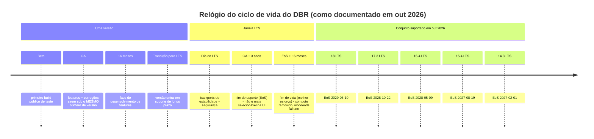
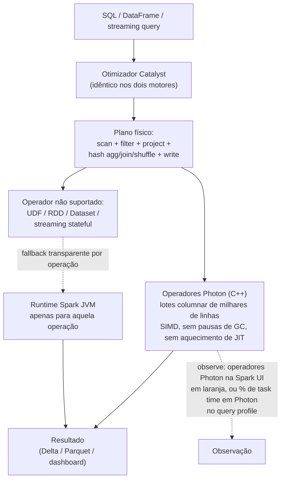
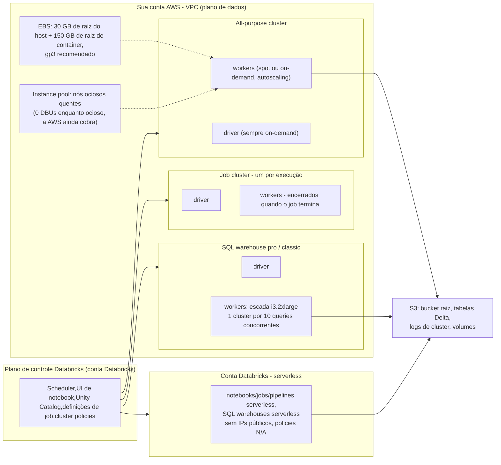
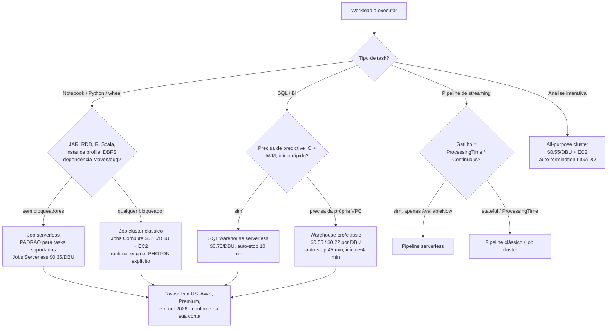
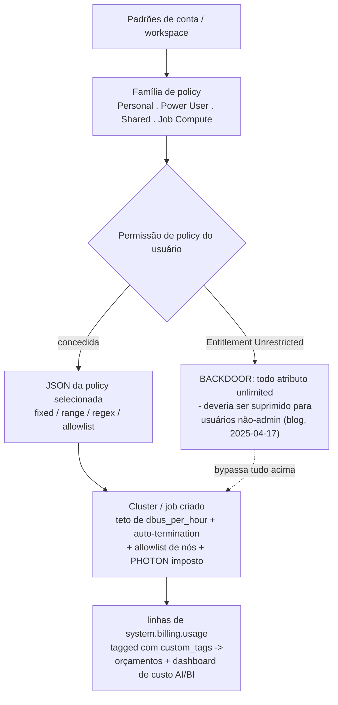

# Databricks Runtime, Photon e Clusters: DBR/LTS, Políticas, Pools e a Forma do Custo de Compute

Todo pipeline deste curso roda em alguma coisa. Tabelas Delta não se otimizam sozinhas, o Auto Loader não lista um prefixo de graça, e um pipeline Lakeflow só é tão barato quanto as máquinas que ficam embaixo dele. Esta lição é sobre esse *algo*: qual versão do **Databricks Runtime** você fixa, se o **Photon** está executando o seu plano, em que **tipo de cluster** (ou warehouse, ou sessão serverless) o trabalho roda, quem pode criá-lo (**cluster policies**), quão rápido ele pode subir (**instance pools**), que **família de EC2** ele usa e — a parte que aparece na fatura — qual **taxa de DBU** se aplica a ele.

Esse último ponto é a espinha da lição. Na AWS, **a mesma instância EC2 é cobrada em uma taxa de DBU diferente dependendo do tipo de compute ao qual ela foi anexada.** A Jobs API 2.0 diz isso sem rodeios: "Quando você executa um job em um novo jobs cluster, o job é tratado como um workload de Jobs Compute (automático) sujeito à precificação de Jobs Compute" e "Quando você executa um job em um all-purpose cluster existente, ele é tratado como um workload de All-Purpose Compute (interativo) sujeito à precificação de All-Purpose Compute" (docs .../jobs-2.0-api, página datada de 2026-08-03). Mesmos nós, mesmo Spark, mesmos dados — e nos preços de lista dos EUA em out 2026, um SKU de **$0.15/DBU** contra um SKU de **$0.55/DBU**. Todo o resto desta lição é decisão de performance ou decisão de governança; esta aqui é aritmética pura, e é a razão pela qual um ETL noturno de 45 minutos pode custar $1,027 ou $2,947 por mês (exemplo resolvido E5).

```text
 =============================================================
  LIÇÃO 06 - MAPA - compute na AWS, em out 2026
 ------------------------------------------------------------
  Versão    DBR 19 (atual) / 18 LTS (até 2029-06-10)
  Motor     Photon (C++, columnar, SIMD) + planejador Catalyst
  Tipos     all-purpose | job | SQL warehouse | serverless
  Grade     cluster policies (JSON) + instance pools
  Hardware  famílias M/C/R/I, Graviton, fleet, EBS, spot
  Medidor   $0.15 jobs . $0.55 all-purpose . $0.22/$0.55/$0.70 SQL
            (lista US, Premium, AWS, em out 2026 -
             confirme contra system.billing.list_prices)
  -------------------------------------------------------------
  Regra da lição: escolha o TIPO de compute antes de ajustar
  o cluster. O tipo define a taxa; o ajuste define só horas.
 =============================================================
```

Nesta lição você vai:

- ler a **tabela de DBRs suportados em out 2026** com todas as datas de EoS, e percorrer o ciclo de vida **Beta → GA → LTS → EoS → EoL** como um diagrama;
- rastrear uma query por **Catalyst e Photon**, nomear os quatro casos em que o Photon não ajuda, e datar cada benchmark que você citar;
- separar os tipos de compute **all-purpose, job, SQL warehouse e serverless**, incluindo a regra de precificação que decide a fatura;
- resolver **seis exemplos resolvidos**: uma **cluster-policy JSON** comentada, uma **configuração de instance pool**, a **seleção de família de instância** para quatro formas de workload, a **forma de custo job-versus-all-purpose**, uma **triagem Photon-or-not**, e uma **postura de notebook de produção**;
- aplicar **cluster policies** (fixed/allowlist/regex/range, `dbus_per_hour`, `cluster_type`, `auto:latest-lts`) e fechar a **backdoor Unrestricted**;
- definir **janelas de autoscaling, auto-termination, topologia de spot e `first_on_demand`** sem pisar nas armadilhas documentadas;
- estudar **Comcast e Addepar** na AWS, ler a **caixa de atualizações de 2026**, e praticar com **doze questões** mais quatro verificações interativas.

---

## 1. Databricks Runtime: a escada de versões e o relógio do LTS

### 1.1 O conjunto suportado (página de release-notes com última atualização em 11 de setembro de 2026)

A Databricks publica duas linhas ao mesmo tempo: uma linha **atual**, que continua recebendo features, e uma linha **LTS**, que troca novidade por uma janela de suporte de três anos. A tabela de versões suportadas na AWS (docs .../release-notes/runtime, última atualização em **11 de setembro de 2026**, acesso 2026-10) é a única lista de versões em que você deve confiar:

| Runtime | Spark | Lançamento | Fim do suporte (EoS) | Linha |
|---|---|---|---|---|
| **DBR 19** | 4.2.0 | **15 de junho de 2026** | Determinado na transição para LTS | atual (listado como suportado) |
| **18 LTS** | 4.1.0 | **10 de junho de 2026** | **10 de junho de 2029** | LTS atual |
| **17.3 LTS** | 4.0.0 | **22 de outubro de 2025** | **22 de outubro de 2028** | LTS |
| **16.4 LTS** | 3.5.2 | **9 de maio de 2025** | **9 de maio de 2028** | LTS |
| **15.4 LTS** | 3.5.0 | **19 de agosto de 2024** | **19 de agosto de 2027** | LTS |
| **14.3 LTS** | 3.5.0 | **1 de fevereiro de 2024** | **1 de fevereiro de 2027** | LTS (o mais antigo suportado) |

Cada versão também vem com uma **variante ML** (mesmo número, MLflow mais bibliotecas de ML fixadas nela): a matriz de MLflow lê 19 → MLflow **3.12.0**, 18 LTS → **3.8.1**, 17.3 LTS → **3.0.1**, 16.4 LTS → **2.21.3** (mesma página, acesso 2026-10).

Duas questões de 2026 importam mais que os próprios números:

1. **A numeração mudou no DBR 19.** "Antes do Databricks Runtime 19, a Databricks lançava runtimes como versões menores de features (por exemplo, 18.0, 18.1, 18.2), cada uma com seu próprio Beta e GA" (docs .../release-notes/runtime/databricks-runtime-ver, acesso 2026-10). A partir do 19, a fase de desenvolvimento de features roda como uma única linha major.
2. **Um minor aposentado e um LTS vivo coexistem.** A página de release-notes do **DBR 18.0** já está rotulada de **(EoS)** — "Support for this Databricks Runtime version has ended" — ainda que a mesma página registre "This version incorporates all features … Databricks released this version in January 2026", Spark **4.1.0** e **JDK 21** por padrão (docs .../release-notes/runtime/18.0, acesso 2026-10). Enquanto isso, o **18 LTS** é suportado até **10 de junho de 2029**. Fixe a *linha LTS*, nunca um número de minor aposentado.

### 1.2 O ciclo de vida, desenhado



As quatro durações vêm direto da página de ciclo de vida de suporte (acesso 2026-10): uma fase de features no GA de **~seis meses**, backports LTS por **três anos**, "The end-of-support date is three years after the GA release date", e "Databricks makes a best effort to set the end-of-life date **six months after the end-of-support date**". No EoS a versão "is no longer selectable using the UI when you create or update a compute resource"; no EoL ela "becomes unusable … existing workloads running on these versions fail". Essa é a diferença entre *um job que para de ser agendado* e *um job que quebra* — e é a razão pela qual fixar versão é um controle de produção, não uma preferência.

### 1.3 Qual linha para qual workload

A página de configuração de compute é explícita (docs .../compute/configure, última atualização em **6 de outubro de 2026**): "For all-purpose compute, use the most current version … For job compute running operational workloads, consider using the Long Term Support (LTS) Databricks Runtime version." Traduzindo:

- **Interativo/exploratório (all-purpose):** a versão suportada mais nova — você quer as features e, de qualquer forma, reinicia com frequência.
- **Jobs operacionais:** uma linha LTS, fixada pela string exata (`17.3.x-scala2.12`), porque um minor inesperado do Spark no meio de um trimestre é uma indisponibilidade.
- **Data science / ML:** a variante ML da linha que você escolheu.
- **Em uma cluster policy:** `spark_version` com um token especial — `auto:latest-lts`, `auto:latest-ml`, `auto:prev-major`, `auto:prev-lts` — que "does not make the compute auto-update when a new runtime version is released"; ele resolve **quando um usuário edita** o compute (docs .../admin/clusters/policy-definition, última atualização em **1 de outubro de 2026**).

- **📚 Você sabia?** A Databricks mantém "cluster configuration information for terminated clusters for **30 days**" (intro da Clusters API, acesso 2026-10). É tempo suficiente para responder "que runtime e que tipo de nó aquele job com falha usou na terça passada?" e curto o bastante para você exportar as formas que interessam (via asset bundles ou Terraform) em vez de fazer arqueologia na UI.

---

## 2. Photon: o que o motor vetorizado faz — e o que ele não faz

### 2.1 Um planejador, dois motores de execução

"Photon is the Databricks-native **vectorized query engine** that accelerates your SQL workloads, DataFrame API calls, ETL pipelines, and **stateless streaming** workloads" (docs .../compute/photon, última atualização em **11 de setembro de 2026**). A frase de arquitetura para decorar: "The Apache Spark query optimizer (Catalyst) still plans your query, but Photon takes over at the **execution layer**" — e "When Photon encounters an unsupported operation … it transparently falls back to the Spark runtime for the remainder of that operation."



O Photon processa "data in batches of thousands of rows at a time, enabling modern CPUs to use **SIMD** instructions", e features como predictive I/O e dynamic file pruning em `MERGE`/`UPDATE`/`DELETE` *exigem* Photon (mesma página). Ele é "the **default engine for all SQL warehouses**", está habilitado em compute serverless e pipelines Lakeflow serverless e — desde o DBR 9.1 LTS — "Photon is enabled by default on compute running Databricks Runtime 9.1 LTS and above" para compute all-purpose e job clássico criado pela UI.

> [!IMPORTANT]
> ⚠️ **A armadilha da API: clusters criados por API rodam sem Photon, silenciosamente.** A mesma página de docs diz: "If you create these resources using the **Clusters API or Jobs API**, you must explicitly enable Photon by setting `runtime_engine` to `PHOTON`." Times de Terraform, CLI e asset bundle benchmarkam "Photon é lento" todo ano quando na verdade benchmarkaram *sem Photon*. Defina `"runtime_engine": "PHOTON"` nas suas definições de job/cluster (ou deixe uma cluster policy forçar — seção 6) e depois confirme na Spark UI.

### 2.2 Onde o Photon não ajuda

A documentação é incomumente direta, e cada cláusula abaixo é citável:

| Caso | O que a documentação diz (docs .../compute/photon, 11 de setembro de 2026) | O que fazer no lugar |
|---|---|---|
| **Queries abaixo de ~2 segundos** | "Queries that normally complete in under two seconds don't see meaningful improvement because execution time is dominated by planning and scheduling overhead." | Conserte o plano, o caching ou o número de queries — não o motor. |
| **UDFs de Python** | "Photon doesn't support **UDFs**, RDD APIs, or Dataset APIs." Corpos de UDF rodam fora do Photon. | Reescreva UDFs quentes como expressões de DataFrame / pandas UDFs / built-ins. |
| **Streaming stateful** | "**Stateful streaming is not supported.**" Streaming stateless *é* suportado para sinks Delta ou Parquet, a partir de fontes Delta, Parquet, CSV, JSON, Kafka e Kinesis. | Mantenha o operador stateful no Spark, ou remodelle para stateless + `foreachBatch`. |
| **Um único operador não suportado** | O fallback é por operação: um plano mistura operadores Photon (laranja) e operadores Spark clássicos. | Leia o query profile antes de concluir em qualquer sentido. |

Há também uma cláusula de economia: Photon não é velocidade grátis. "Photon instance types consume DBUs at a **different rate** than the same instance type running the non-Photon runtime" (blog da Databricks, "Announcing Photon Public Preview", **2021-06-17**). A regra operante: **Photon só paga quando é mais do que proporcional em velocidade** — então faça benchmark do *seu* workload e meça a fatia do Photon na Spark UI em vez de adivinhar.

### 2.3 As evidências, datadas

Cite-as com as datas; elas não são intercambiáveis:

| Afirmação | Fonte (data) |
|---|---|
| "up to **5x better price/performance** for data and analytics workloads compared to other cloud data warehouses" (TPC-DS) | docs .../compute/photon (atualizado **2021→2026-09-11**) |
| "Photon is up to **2x faster** than Databricks Runtime 8.0" (TPC-DS 1TB) e "2-4x average speedups" no preview | blog, Photon Public Preview (**2021-06-17**) |
| "delivered benchmark-setting price/performance at **up to 12x better** than traditional cloud data warehouses"; 90% de 400 clientes do preview relataram queries mais rápidas | blog, Photon GA (**2022-08-03**) |
| "Photon has accelerated some customer workloads by **over 10×**"; o conselho TPC rodou TPC-DS 100TB em **S3**, **cluster de 256 nós de i3.2xlarge**, DBR + Photon | artigo do SIGMOD '22, *Photon: A Fast Query Engine for Lakehouse Systems* (**junho de 2022**, DOI 10.1145/3514221.3526054) |
| "Databricks SQL has set a new world record in 100TB TPC-DS … outperformed the previous record by **2.2x**", formalmente auditado pelo conselho TPC | blog (**2021-11-02**) |
| Photon + AWS **i4i** vs i3 sem Photon: **5.3x** de melhoria de latência, **2.5x** de melhoria de custo | blog, *Faster Insights with Databricks Photon using AWS i4i instances* (workloads rodados em **julho de 2022**, página datada de **2024-06-21**) |
| DBSQL Serverless: ganho de performance de **5x** desde 2022, mais "up to **25% faster**" de Predictive Query Execution e Photon Vectorized Shuffle (**1.5x** de throughput de shuffle) | blog, *Databricks SQL Accelerates Customer Workloads by 5x* (**2025-06-17**) |

- **📚 Você sabia?** O recorde auditado de TPC-DS de 100 TB rodou **neste substrato do curso**: dados em **Amazon S3**, 256 × **i3.2xlarge** (SIGMOD '22). Instâncias storage-optimized mais um motor vetorizado é o datapoint de referência de "lakehouse bate warehouse" — e é a mesma família de instância na qual os warehouses clássicos e pro ainda se padronizam hoje (todos os workers de warehouse classic/pro são **i3.2xlarge**, docs .../warehouse-behavior, acesso 2026-10).

### 2.4 Exemplo resolvido E1 — Photon ou não? Triagem de dois notebooks

**Em outubro de 2026.** Duas equipes afirmam "Photon não ajudou". Faça a triagem antes de mudar qualquer coisa:

```text
Exemplo resolvido E1 - triagem de Photon (mecanismos conforme docs .../compute/photon, 2026-09-11)
-----------------------------------------------------------------------------
Equipe A: joins/agregações estilo TPC-DS de 30 minutos sobre 2 TB em nós r5,
          queries de 8-90 s cada, puro DataFrame API.
  -> Espere ganho. Confirme: a Spark UI mostra operadores Photon em laranja;
     o query profile mostra o % de task time em Photon.
     Pontos de referência: i4i vs i3 sem Photon = 5.3x de latência (página
     de 2024-06-21); SIGMOD de mais de 10x em alguns workloads de clientes
     (jun 2022).

Equipe B: pipeline de UDF Python por linha, queries de 200 ms, mais um passo
          de streaming stateful com uma agregação em janela.
  -> Dois casos documentados sem ganho empilhados: corpos de UDF não são
     vetorizados, e "Stateful streaming is not supported". Soma-se o fato de
     que toda query é < 2 s, onde "execution time is dominated by planning
     and scheduling overhead".
  -> Ação: reescreva a UDF como expressões de DataFrame, desligue o Photon se
     a diferença de emissão for mensurável na SUA conta (leia
     system.billing.list_prices filtrando pelos SKUs de Photon), mantenha o
     operador stateful no Spark. Não conclua a partir de um dashboard de
     queries de 200 ms.

Regra: Photon é uma troca na camada de execução. Faça benchmark do plano,
não da vibe.
```

---

## 3. Anatomia do cluster: all-purpose versus job versus warehouse versus serverless

### 3.1 O que roda onde, na AWS

"Databricks components" (docs, página datada de **2026-07-28**) traça a linha de forma simples: "There are two types of clusters: all-purpose and job." Some os SQL warehouses e as sessões serverless e você tem os quatro tipos de compute que este curso usa.



Três fatos específicos da AWS naquela figura: clusters clássicos e warehouses pro/classic rodam em **EC2 na sua VPC** ("With a pro SQL warehouse (unlike a serverless SQL warehouse), the **compute layer exists in your AWS account**", docs .../warehouse-types, última atualização em **12 de fevereiro de 2026**); serverless roda na **conta Databricks sem IPs públicos**; e com o secure cluster connectivity ligado (o modo de implantação padrão), nada no plano de dados precisa de IP público de entrada.

### 3.2 A diferença de ciclo de vida — e a diferença de preço

| | All-purpose | Job cluster |
|---|---|---|
| Criado por | Você (UI/CLI/REST API) | O **job scheduler**, por execução |
| Ciclo de vida | "You can manually terminate and restart" — vários usuários o compartilham | "terminates the cluster when the job is complete. **You cannot restart a job cluster**" |
| Classe de workload | interativo | automático |
| Taxa de DBU (lista US, out 2026) | **All-Purpose Compute $0.55/DBU** | **Jobs Compute $0.15/DBU** |
| Aderência a produção | exploração, análise ad hoc | todo pipeline agendado |

Citação das docs (página de components, 2026-07-28): "The Databricks job scheduler creates a job cluster when you run a job on a new job cluster and terminates the cluster when the job is complete." E a consequência de precificação, vinda da Jobs API 2.0 (página datada de **2026-08-03**): "When you run a job on a new jobs cluster, the job is treated as a Jobs Compute (automated) workload subject to Jobs Compute pricing" — enquanto apontar um job para um all-purpose cluster existente é **precificação de All-Purpose**, e, segundo a página de components, "running a job on an existing all-purpose cluster is also treated as an **interactive** workload." A mesma API acrescenta: "We suggest running jobs on new clusters for greater reliability."

A orientação da Databricks sobre jobs-compute vai além (docs .../jobs/compute, última atualização em **15 de setembro de 2026**): "**Serverless compute for jobs is the default for all tasks that support it**", e "All-purpose compute — You can optionally configure tasks using classic all-purpose compute. **Databricks does not recommend this configuration for production jobs.**"

Um detalhe que vale levar para a lição 09: um **shared job cluster** é "scoped to a single job run and cannot be used by other jobs or runs of the same job. **Libraries cannot be declared in a shared job cluster configuration.**" Declare dependências por task (ou via job environments), não no objeto do cluster compartilhado.

### 3.3 Exemplo resolvido E2 — a forma de custo: um pipeline, três configurações

**Em outubro de 2026, lista US, plano Premium, AWS.** Cenário: um ETL noturno de 45 minutos que roda **400 cluster-hours por mês**, 4 nós no total (1 driver + 3 workers). O exemplo resolvido da própria Databricks usa um nó que "runs at 3 DBU/hour" (blog, *Best practices for cost management in Databricks*, **2022-10-18**) — trate esse valor de emissão como **ilustrativo**: a emissão de DBU por nó não é publicada como tabela oficial, então leia a sua em `system.billing.list_prices` ou na calculadora de preços.

```text
Exemplo resolvido E2 - mesmo pipeline, três tipos de compute (lista US, out 2026)
--------------------------------------------------------------------------
DBU/hora  = 4 nós x 3 DBU/h/nó          = 12 DBU/h   (emissão ilustrativa)
Custo DBU = 12 DBU/h x 400 h x taxa
Custo AWS = 4 x m5.xlarge x $0.192/h x 400 h = $307.20    (us-east-1, lido em 2026-10-12)

(A) Novo job cluster, Jobs Compute $0.15/DBU
    DBU  4,800 x 0.15 =   $720.00   + AWS $307.20  =  $1,027.20 / mês
(B) Mesmo job apontado para um all-purpose cluster de longa duração, $0.55/DBU
    DBU  4,800 x 0.55 = $2,640.00   + AWS $307.20  =  $2,947.20 / mês
    delta A->B = $1,920.00 / mês  (65% da fatura combinada)
(C) Mesma forma, workers spot com -60% só na coluna AWS
    AWS  $307.20 x 0.40 = $122.88 ; coluna DBU INALTERADA  =  $1,142.88 (A + spot)
```

A configuração (B) também carrega horas ociosas: um all-purpose cluster é cobrado enquanto está *ligado*, não enquanto trabalha — e é exatamente por isso que existem auto-termination (seção 8) e policies (seção 6). Repare no que **não** mudou entre (A) e (B): nós, runtime, Spark, dados. Só o **tipo de compute** — e, com ele, o SKU. Essa é a decisão de maior alavancagem desta lição, e é a razão pela qual a Databricks relata que clientes "saved tens of thousands of dollars by simply moving just ten percent of their workloads from all-purpose clusters to jobs clusters" (blog, 2022-10-18).

```plot
{
  "type": "bar",
  "title": "Custo mensal de um pipeline de 400 horas por tipo de compute (lista US, AWS, em out 2026)",
  "xLabel": "Configuração de compute",
  "yLabel": "USD por mês (DBU + AWS)",
  "xKey": "config",
  "dataKeys": ["usd_per_month"],
  "data": [
    {"config": "New job cluster, Jobs $0.15/DBU", "usd_per_month": 1027.2},
    {"config": "Job + spot workers (-60% AWS side)", "usd_per_month": 1142.88},
    {"config": "Existing all-purpose cluster, $0.55/DBU", "usd_per_month": 2947.2}
  ]
}
```

---

## 4. Compute serverless e SQL warehouses

### 4.1 A matriz de compute recomendado

A Databricks publica uma tabela de recomendação por tipo de task (docs .../jobs/compute, última atualização em **15 de setembro de 2026**). Leia-a como "o padrão, a menos que sua lista de dependências proíba":

| Tipo de task | Recomendado | Também suportado |
|---|---|---|
| Notebook / script Python / Python wheel | **Jobs serverless** | jobs clássicos, all-purpose clássico |
| SQL | **SQL warehouse serverless** | SQL warehouse pro |
| Pipeline (declarativo) Lakeflow | **Pipeline serverless** | pipeline clássico |
| dbt | **SQL warehouse serverless** | — |
| **Task JAR** | — | **apenas jobs clássicos** |
| **Spark Submit** | — | **apenas jobs clássicos** |

Elegibilidade de serverless na AWS (docs .../sql/admin/serverless, última atualização em **10 de junho de 2026**): workspace em **plano Premium ou superior**, não um free trial, suportado em **todas as regiões AWS**, sem IPs públicos — e "**Cluster policies, including spot instance policies, are not supported**". Essa última cláusula é a frontira de tudo na seção 6: policies governam compute *clássico*; serverless é governado por controles em nível de conta/workspace no lugar disso.

### 4.2 Limitações do serverless — leia esta lista antes de migrar um job

De docs .../compute/serverless/limitations (acesso 2026-10), os bloqueadores que forçam compute clássico:

- "**R is not supported.**" · "Scala and R are not supported in notebooks."
- "Only **Spark Connect** APIs are supported. Spark RDD APIs are not supported."
- "**Maven coordinates are not supported.**" · "**JAR libraries are not supported in notebooks** … JAR tasks in jobs are supported." · "Task libraries are not supported for notebook tasks."
- "You must use **Unity Catalog** to connect to external data sources." · "Access to **DBFS** is limited."
- "**Serverless compute has a maximum runtime of 7 days.**"
- Gatilhos de streaming: `Trigger.AvailableNow()` (recomendado) e o deprecado `Trigger.Once()` apenas — `Trigger.ProcessingTime` e `Trigger.Continuous` **não** são suportados.

A página de migração (última atualização em **2026-07-10**) lista os mesmos bloqueadores como coisas a substituir *primeiro*: imagens customizadas, variantes de ML Runtime, DBR < 13, instance profiles, e "dependencies such as **eggs, JARs, and Maven libraries**", com os padrões de substituição — RDD APIs → DataFrame APIs, caminhos DBFS → volumes do UC, IAM instance profiles → external locations do UC, JARs JDBC customizados → Lakehouse Federation.

### 4.3 SQL warehouses: três tipos, dois relógios

(docs .../sql-warehouse/warehouse-types, última atualização em **12 de fevereiro de 2026**; auto-stop de docs .../sql-warehouse/create, acesso 2026-10)

| | Serverless | Pro | Classic |
|---|---|---|---|
| Onde roda | Conta Databricks | **sua conta AWS** | **sua conta AWS** |
| Photon | sim (padrão) | sim | sim |
| Predictive IO | sim | sim | não |
| Intelligent Workload Management | sim | não | não |
| Início | rápido | "typically approximately **4 minutes**" | "approximately 4 minutes" |
| Workers | vertical + IWM | escada **i3.2xlarge** | escada **i3.2xlarge** |
| **Padrão de auto-stop** | **10 minutos** (mín 5 UI / 1 API) | **45 minutos** (mín 10) | **45 minutos** (mín 10) |

O dimensionamento de classic/pro é um cluster para 10 queries concorrentes, de 2X-Small (1 driver + 1 worker) por X-Small, Small … X-Large (32 workers), 2X (64), 3X (128), 4X (256), com **5X-Large (512) em Public Preview** (docs .../warehouse-behavior, acesso 2026-10). A orientação permanente da Databricks: "**Databricks recommends using serverless SQL warehouses when available**" — e a frase de cobrança para decorar: "**Idle SQL warehouses continue to accumulate DBU and cloud instance charges until they are stopped.**"



> **Veredito comparativo — job cluster versus all-purpose versus SQL warehouse versus serverless (em out 2026)**
> - **Job cluster (clássico, Jobs Compute $0.15/DBU + seu EC2)** — a **resposta padrão para batch de produção**. Efêmero por execução, sem reinício, auto-termina com a run, aceita spot, governado por policy, o SKU clássico mais barato por DBU. Pague pelas horas em que ele de fato roda; você é dono do EC2, do EBS e do tempo de aquecimento. Use quando as dependências forem só-clássicas (JAR/Spark Submit, RDD, instance profiles, DBFS) ou quando o job roda longo e quente em uma forma previsível.
> - **All-purpose (All-Purpose Compute $0.55/DBU + seu EC2)** — **apenas interativo**: exploração, notebooks compartilhados, ensino. 3.7× a taxa por DBU de jobs na lista US, é cobrado enquanto *ligado*, e apontar jobs de produção para ele é simultaneamente um anti-padrão de cobrança interativa e de confiabilidade ("Databricks does not recommend this configuration for production jobs"). Controles obrigatórios: auto-termination, uma policy, nunca um driver em spot.
> - **SQL warehouse (SQL Classic $0.22 / Pro $0.55 / Serverless $0.70 por DBU)** — o caminho de servir BI, cobrado enquanto **ligado**, dimensionado por camiseta e não pelos workers que você escolhe. Serverless soma Predictive IO + IWM e auto-stop de 10 minutos; pro/classic rodam na sua VPC em i3.2xlarge com auto-stop de 45 minutos e início de ~4 minutos. Escolha por *concorrência de query e SLA de latência*, não só pela taxa de DBU — o gap classic/serverless ($0.48 por DBU-hora) é a máquina+ops que o serverless absorve por você.
> - **Jobs/notebooks serverless (Jobs Serverless $0.35/DBU, All-Purpose Serverless $0.75/DBU)** — **o padrão da plataforma onde a lista de limitações permite**: sem fatura de EC2, sem pools, sem aquecimento, sem superfície de policy, runtime máximo de 7 dias, cobrança por segundo, custo ocioso zero. Custa por volta de 1,3–2,3× mais por DBU que o clássico, mas apaga as colunas de tempo ocioso e de administração da fatura.
> - **Veredito em uma linha:** *serverless por padrão → job clusters clássicos quando um bloqueador ou uma forma longa e quente exigir → all-purpose para humanos, nunca para pipelines → SQL warehouse para BI com auto-stop obrigatório.* Toda taxa acima é lista US, plano Premium, AWS, em outubro de 2026; confirme contra `system.billing.list_prices` na sua conta antes de comprometer um orçamento com ela.

---

## 5. Instance pools: subida quente, não compute grátis

Um pool é "A set of idle, ready-to-use instances that reduce cluster start and auto-scaling times" (docs .../getting-started/concepts, 2026-07-28). Os clusters anexados tiram seu driver e seus workers do pool e os devolvem no encerramento. Três knobs de dimensionamento (docs .../compute/pools, acesso 2026-10): **`min_idle_instances`**, **`max_capacity`**, **`idle_instance_autotermination_minutes`**.

A regra de cobrança é a que os estudantes erram: "**Databricks does not charge DBUs while instances are idle in the pool. Instance provider billing does apply**" (docs .../pool-best-practices / pool-index, acesso 2026-10). Pools deslocam custo da coluna de DBU para a coluna da AWS e compram minutos de subida; eles não apagam a fatura. Restrições e regras das mesmas páginas:

- Um pool é "**either all spot instances or all on-demand instances**"; a Instance Pools API acrescenta **`SPOT_WITH_FALLBACK`** — "the pool acquires spot instances first, and falls back to on-demand instances when spot capacity is unavailable".
- "By default, Databricks sets the max spot price at **100% of the on-demand price**."
- Estourar a escala falha de forma barulhenta: "If a cluster using the pool requests more instances than this number during autoscaling, the request fails with an **INSTANCE_POOL_MAX_CAPACITY_FAILURE** error." Mantenha o tamanho máximo do cluster ≤ pool `max_capacity`.
- Clusters herdam a **availability zone** do pool; use **pools separados** quando os requisitos de driver e de worker diferem.
- **Nunca spot no driver:** "Do not use a pool with spot instances as your driver type. Select an on-demand driver type to prevent your driver from being reclaimed."
- Onde o serverless cabe, o conselho da Databricks é direto: "If your workload supports serverless compute, Databricks recommends using serverless compute instead of pools."
- Orientação de dimensionamento: pools de spot para workers tolerantes a custo; **pools on-demand para "jobs with short execution times and strict execution time requirements"**.

### 5.1 Exemplo resolvido E3 — configuração de pool + a fatura de ociosidade

**Em outubro de 2026 (lista us-east-1, lida em 2026-10-12).** Uma equipe quer subidas quentes para um job noturno de 45 minutos e para clusters de dev interativos.

```json
{
  "pool_name": "etl-workers-spot-fallback",
  "node_type_id": "r5.xlarge",
  "min_idle_instances": 2,
  "max_capacity": 8,
  "idle_instance_autotermination_minutes": 20,
  "aws_attributes": { "availability": "SPOT_WITH_FALLBACK" },
  "custom_tags": { "COST_CENTER": "9531", "team": "data-eng" }
}
```

```text
Exemplo resolvido E3 - o que o pool custa enquanto te mantém quente (out 2026)
--------------------------------------------------------------------------
Regras aplicadas: 0 DBUs enquanto ocioso (pool), a AWS cobra de qualquer forma;
                   workers podem ser spot, driver NUNCA (pool on-demand separado);
                   mantenha max_workers do cluster <= max_capacity = 8.

Pool de driver (on-demand, separado):   1 x r5.xlarge
  AWS  1 x $0.252/h x 6 h ociosas/dia x 30 d = $45.36/mês   DBU = $0
Pool de workers (SPOT_WITH_FALLBACK, 2 quentes):
  AWS  2 x $0.252/h x 6 h ociosas/dia x 30 d = $90.72/mês   DBU = $0
  (se o spot indisponível, o pool cai para on-demand ao mesmo
   preço de nó; preço máximo de spot padrão = 100% do on-demand)
Total do seguro de subida quente:  $136.08/mês de AWS, $0 de DBU
O que você compra: nós já rodando -> latência de subida e de autoscale
                   do cluster cai de minutos para segundos, mais
                   reserva de capacidade. Conferência cruzada:
                   idle_instance_autotermination 20 min vence uma
                   folga de job de 45 min; nenhum DBU acumula nesse meio.
Armadilha: cluster de 8 nós contra um pool de 6 nós -> INSTANCE_POOL_MAX_CAPACITY_FAILURE
```

- **📚 Você sabia?** O seguro de ociosidade do pool custa cerca de **$136/mês** neste exemplo — enquanto um único *dia* acidental daquele all-purpose cluster de 4 nós deixado ligado (12 DBU/h × 24 h × $0.55 = **$158.40** de DBUs **mais** 4 × $0.192 × 24 ≈ **$18.43** de EC2 ≈ **$177**) já custa mais do que um mês inteiro de subidas quentes. Pools são para **latência de subida e capacidade**, auto-termination é para **custo**; equipes que instalam pools mas pulam o auto-termination costumam terminar com as duas faturas.

---

## 6. Cluster policies: governança e guardrails de custo como JSON

"Uma policy é uma ferramenta que administradores de workspace podem usar para limitar as permissões de criação de compute de um usuário ou grupo com base em um conjunto de regras de policy" (docs .../admin/clusters/policies, página datada de **2026-06-10**). Os benefícios documentados: configurações prescritas, limites de quantos clusters um usuário pode criar, uma UI simplificada, "**Control cost by limiting per-cluster maximum cost**" e "Enforce cluster-scoped library installations". O próprio blog de onboarding de policies da Databricks (2025-04-17) nomeia os dois ganhos — "**Simplification of platform usage and effective cost control are the two main benefits of cluster policies**" — e o conjunto inicial de quatro famílias: **Personal Compute, Power User Compute, Shared Compute, Job Compute**.

Mecânica que você precisa saber antes de escrever JSON (docs .../admin/clusters/policy-definition, última atualização em **1 de outubro de 2026**):

- As regras se aplicam a "any of the attributes controlled with the Clusters API", e "**There can only be one limitation per attribute.**"
- Tipos de limitação: **`fixed`, `forbidden`, `allowlist`, `blocklist`, `regex`, `range`, `unlimited`** (cada um pode carregar `defaultValue`, `isOptional`, `hidden`).
- **Atributos virtuais:** `dbus_per_hour` — "Calculated attribute representing the maximum DBUs a resource can use on an hourly basis including the driver node … Use with **range**" — e `cluster_type` (`all-purpose` / `job` / `dlt`), que te deixa bloquear uma classe de compute de plano.
- `runtime_engine` aceita `PHOTON` ou `STANDARD`; `spark_version` aceita os tokens `auto:*` (seção 1); `workload_type.clients.jobs` / `.notebooks` controlam qual tipo de cliente pode anexar.
- **Armadilha da API:** "Default values don't automatically get applied to compute created with the Clusters API. To apply default values using the API, add the parameter `apply_policy_default_values` … set it to true."
- Apagar uma policy não limpa nada: o compute em execução continua, mas "cannot be edited unless the user has unrestricted cluster creation permissions."

### 6.1 Exemplo resolvido E4 — uma policy de guardrail de custo só para jobs

Construída sobre o próprio exemplo só-para-jobs da documentação (página policy-definition, 1 de outubro de 2026) e estendida com Photon, topologia de spot e tags. Este é o JSON que você colaria em um recurso `databricks_cluster_policy` do Terraform ou na UI de admin:

```json
{
  "cluster_type":                 { "type": "fixed", "value": "job", "hidden": true },
  "dbus_per_hour":                { "type": "range", "maxValue": 100 },
  "spark_version":                { "type": "unlimited", "defaultValue": "auto:latest-lts" },
  "runtime_engine":               { "type": "fixed", "value": "PHOTON", "hidden": true },
  "node_type_id":                 { "type": "regex", "pattern": "[rmci][3-5][rnad]*.[0-8]{0,1}xlarge" },
  "driver_node_type_id":          { "type": "regex", "pattern": "[rmci][3-5][rnad]*.[0-8]{0,1}xlarge" },
  "num_workers":                  { "type": "range", "minValue": 1, "maxValue": 10, "defaultValue": 2 },
  "aws_attributes.availability":  { "type": "fixed", "value": "SPOT_WITH_FALLBACK" },
  "aws_attributes.first_on_demand": { "type": "fixed", "value": 1 },
  "autotermination_minutes":      { "type": "fixed", "value": 60, "hidden": true },
  "custom_tags.COST_CENTER":      { "type": "allowlist", "values": ["9999", "9921", "9531"] },
  "workload_type.clients.notebooks": { "type": "fixed", "value": false },
  "workload_type.clients.jobs":      { "type": "fixed", "value": true }
}
```

```text
Exemplo resolvido E4 - intenção linha a linha (página policy-definition, 2026-10-01)
-----------------------------------------------------------------------------
cluster_type fixed "job"      a policy aparece só na UI de compute JOB;
                               notebooks ad hoc não podem selecioná-la
dbus_per_hour range <= 100    o teto real de DBU por hora incl. driver -
                               o único número que limita o pior caso de gasto
spark_version auto:latest-lts todo job cai na linha LTS; o token resolve
                               na hora da edição, ele NÃO faz upgrade
                               automático do compute em execução
runtime_engine fixed PHOTON   fecha a armadilha do cluster criado por API (2.1)
node/driver regex             admite famílias r/m/c/i, gerações 3-5, até
                               xlarge apenas - sem monstros de 8xl sem exceção
num_workers range 1..10       teto de workers; padrão 2
SPOT_WITH_FALLBACK +          workers podem ser spot com fallback on-demand;
first_on_demand = 1           a PRIMEIRA instância (driver) é sempre on-demand
autotermination_minutes 60    um matador de ociosidade imposto - o guardrail que
                              vence uma varredura manual semanal (o valor é uma
                              escolha da policy; nenhum padrão oficial é
                              publicado para clusters)
custom_tags.COST_CENTER       apenas allowlist - tags que chegam aos relatórios
                               de EC2 + DBU
notebooks=false / jobs=true   policy de produção, ninguém roda ad hoc nela
Lembrete: compute criado por API precisa de apply_policy_default_values=true
para pegar os padrões acima.
```



> [!WARNING]
> ⚠️ **Feche a backdoor Unrestricted antes de escrever uma única regra.** "The 'unrestricted' cluster policy entitlement provides a **backdoor route for bypassing the cluster policies** and should be suppressed for non-admin users" (Cluster Policy Onboarding Primer, databricks.com/blog, **2025-04-17**). E observe a documentação: "By default, workspace admins have permissions on all policies. Non-admin users must be granted permissions on a policy to access it" — então uma policy definida sem nenhuma atribuição ao seu grupo de usuários não protege ninguém. Implante policies assim: escreva o JSON → conceda ao grupo → remova o Unrestricted daquele grupo → verifique tentando provisionar demais.

---

## 7. Bibliotecas e postura do notebook

### 7.1 Quatro escopos, uma matriz de origem

(docs .../libraries, última atualização em **11 de setembro de 2026**)

| Escopo | Definido em | Persiste? | Observações |
|---|---|---|---|
| **Vinculado ao compute** | cluster / warehouse | sim, enquanto o compute vive | "used by all notebooks and jobs running on the compute" — a página de best practices diz para **evitar** onde environments/deps de job bastam |
| **Bibliotecas de job/task** | objeto `libraries` da Jobs API | por execução | em serverless só via **job environments**; task libraries não suportadas para tasks de notebook |
| **Vinculado ao notebook** | magics `%pip` / `%R` | **não** — "do not persist and must be re-installed for each session" | apenas Python/R; "**JARs cannot be installed at the notebook level.**" |
| **Environments** | environment base em YAML (Beta, modo de acesso padrão do DBR 19+) | sim | substitui bibliotecas de cluster em setups declarativos |

Origens: **PyPI, Maven, CRAN**, arquivos do workspace, **volumes do Unity Catalog**, armazenamento de objetos da nuvem. As linhas de corte em out 2026:

- O modo de acesso padrão precisa de **DBR 13.3 LTS+** para PyPI, Maven, volumes e arquivos do workspace; "**CRAN: Not supported**" no modo de acesso padrão (dedicated/legacy o mantêm).
- Python **eggs** apenas em "Databricks Runtime 13.3 LTS and below"; `requirements.txt` precisa de **DBR 15.0+**.
- "**storing library files in the DBFS root is deprecated and disabled by default in Databricks Runtime 15.1 and above**" — use arquivos do workspace, volumes do UC ou repositórios de pacotes.
- "**Workspace libraries have been deprecated** and should not be used" — note que os *arquivos* de workspace continuam totalmente suportados.
- Precedência de import do Python (maior primeiro): cwd da pasta Git → raiz da pasta Git → vinculado ao notebook (`%pip`) → vinculado ao compute → bibliotecas incluídas no DBR.

Ergonomia de notebook que vale decorar: "`%pip` — Install Python packages (notebook-scoped)" mas "%pip commands do not automatically restart the Python process … you may need `dbutils.library.restartPython()`"; "`%run` — Execute another notebook, importing its functions and variables" e "**%run must be in a cell by itself, because it runs the entire notebook inline.**" Em serverless, `%uv pip` é a alternativa mais rápida (environment na versão 5+).

### 7.2 Exemplo resolvido E5 — a postura do notebook de produção

```text
Exemplo resolvido E5 - notebook de produção parametrizado (docs, 11 de set de 2026)
--------------------------------------------------------------------------
FAÇA
  partir de uma pasta Git / Databricks Repo (trunk-based, repositório único)
  dbutils.widgets.text("env", "dev")            # params; marcadores de parâmetro
                                                # SQL precisam de DBR 15.2+
                                                # (guarda contra injeção)
  %run /Shared/helpers $X = "10"                # definições de helper inline;
                                                # DEVE ocupar a própria célula
  bibliotecas em nível de task OU job environments  # declaradas no código, versionadas
  "Run as" de uma service principal              # execuções ligadas a token herdam
                                                # as permissões da identidade do token
  manter a lógica de negócio em src/*.py, notebooks
  como "camadas finas de orquestração e visualização"

NÃO FAÇA
  %pip install pandas==2.2.2 no meio do notebook em um all-purpose
      cluster compartilhado -> só por sessão; um job cluster novo
      não vai tê-lo
  hardcodar spark.executor.memory / spark.dynamicAllocation.* nas definições de job
  commitar artefatos de build (.jar/.whl), tokens ou credenciais no repo
  tratar o notebook como o contêiner da lógica de negócio
      -> "if something isn't in version control, it doesn't exist"

Regra de dependência de produção: declarativo (job/env/cluster) vence magic;
%pip é só para iteração interativa.
```

- **📚 Você sabia?** A orientação de engenharia da Databricks agora diz: "**Declarative automation is built on the idea that if something isn't in version control, it doesn't exist**" e "**Minimize business logic in notebooks** … Use notebooks only as thin orchestration and visualization layers that call the underlying code" (docs .../notebooks/best-practices e .../developers/best-practices, ambas com última atualização em **2026-09-11**). O repositório companheiro é `github.com/databricks/notebook-best-practices`.

---

## 8. Autoscaling, auto-termination e spot

### 8.1 Horizontal no clássico, vertical do lado serverless

Clusters all-purpose e job clássicos fazem autoscale **apenas nos workers**, entre `autoscale.min_workers` e `max_workers`. O autoscaling otimizado (Premium e acima; workspaces em plano Standard recebem autoscaling padrão) tem quatro características documentadas (docs .../compute/configure, última atualização em **6 de outubro de 2026**):

- "Scales up from min to max in **at most 2 scaling events**."
- "On job compute, scales down if the compute resource is underutilized over the last **40 seconds**. On all-purpose compute … **150 seconds**." (`spark.databricks.aggressiveWindowDownS`, até **600 s**, retarda essa queda.)
- Ele pode reduzir nós não-ociosos usando o estado dos arquivos de shuffle — então um nó quente-mas-esperando não está protegido.
- O autoscaling padrão em vez disso começa com "+8 nodes, then exponential" e "scales down when 90% of the nodes are not busy for 10 minutes".

Scaling vertical não existe no clássico: "Scale vertically by adding or removing resources from a single machine … This typically means **stopping the workload, moving it to a larger machine, and restarting it**" (docs .../performance-efficiency, acesso 2026-10). A seleção vertical de instância é uma feature de **pipelines serverless** — "Vertical autoscaling is used for all serverless pipelines", escolhendo tipos de instância economicamente eficientes com base em evidência de OOM (docs .../ldp/auto-scaling, acesso 2026-10).

Duas armadilhas documentadas: "**Do not enable Apache Spark Dynamic Allocation** (`spark.dynamicAllocation.enabled`) **on compute resources that use Databricks autoscaling**" (executores em conflito → `NODES_LOST`), e o autoscaling "has limitations scaling down … for Structured Streaming workloads" — streams longas querem um piso, não um piso que se move.

### 8.2 Auto-termination e topologia de spot

**Auto-termination** mata um all-purpose cluster ocioso depois de `autotermination_minutes` de inatividade. A API aceita **10–10.000 minutos, com `0` desabilitando-o** (docs de schema de asset bundle/job da Databricks, acesso 2026-10) — e as páginas de docs impressas em outubro de 2026 **não trazem nenhum padrão numérico**, então defina-o explicitamente em vez de confiar em um valor de UI que você não verificou. Os padrões de auto-stop de SQL warehouse *são* documentados (seção 4.3): **45 min** pro/classic, **10 min** serverless.

**Spot**, da mesma página de configuração de compute: `aws_attributes.availability` ∈ `SPOT` / `ON_DEMAND` / `SPOT_WITH_FALLBACK`; `aws_attributes.first_on_demand` fixa o driver (e N nós) em on-demand; `aws_attributes.spot_bid_price_percent` tem padrão de **100% do on-demand**. "The first instance will always be on-demand (the driver node is always on-demand) and subsequent instances will be spot instances." A AWS precifica o Spot em "up to 90% off On-Demand prices" (aws.amazon.com/ec2/spot, acesso 2026-10) com um **aviso de interrupção de dois minutos** — e a economia cai **apenas na coluna da AWS**: as taxas de DBU e as contagens de emissão não mudam com spot.

> [!IMPORTANT]
> ⚠️ **Nunca rode o driver em spot.** "Do not use a pool with spot instances as your driver type. Select an on-demand driver type to prevent your driver from being reclaimed" (docs .../compute/configure, 2026-10-06); as best practices de pool repetem: "Only use spot pools as worker nodes. Your driver node should use on-demand instances." Um driver recolhido leva o Spark context inteiro junto — no meio da task, depois do aviso de dois minutos da AWS. Defina `first_on_demand >= 1`, use um pool de driver on-demand dedicado e torne todo stage reiniciável (lição 13).

---

## 9. Tipos de nós da AWS: famílias, Graviton, fleet e discos

### 9.1 As famílias

Da documentação de tipos de instância da EC2 (acesso 2026-10): **M** propósito geral, **C** otimizado para compute, **R** otimizado para memória, e **D/I** otimizado para armazenamento com NVMe local — "Storage optimized instances are designed for workloads that require high, sequential read and write access to very large data sets on local storage" (as classes de família abrangem C5…C9g, R5…R9g, D3/D3en/I3en/I4i/I7i/I8g/Im4gn/Is4gen).

A própria orientação de seleção da Databricks (docs .../cluster-config-best-practices, página datada de **2026-06-11**): ETL batch simples que "don't require wide transformations" → "instances with lower requirements for memory and storage"; workloads analíticos "will likely require reading the same data repeatedly, so recommended node types are **storage optimized with disk cache enabled or instances with local storage**"; e "For simple batch ETL jobs … use spot instances for workloads that have lax latency requirements."

### 9.2 Exemplo resolvido E6 — seleção de família de instância para quatro formas de workload

**Em outubro de 2026; EC2 Linux on-demand, us-east-1, lido da lista de preços da AWS em 2026-10-12.**

```text
Exemplo resolvido E6 - escolha a família antes de fazer tuning do Spark
--------------------------------------------------------------------------
(A) Dedupe noturno + ETL com join, 45 min, latência laxa, majoritariamente CPU
    -> família C ou M, workers spot:  c6i.xlarge  $0.170/h
       (ETL batch simples: memória/armazenamento enxutos segundo as docs 2026-06-11)
    Forma: 4 nós = 0.68/h de AWS  + Jobs Compute $0.15/DBU

(B) Agregações amplas / cache em memória / joins enviesados
    -> família R:  r5.xlarge  $0.252/h  (otimizado para memória)
       Alternativa Graviton da classe r6g/r7g é mais barata por vCPU mas
       exige DBR 10.2+ para Photon, e "Databricks does not support mixing AWS
       Graviton and non-AWS Graviton instance types" - uma ISA por cluster;
       verifique wheels de terceiros só-x86 antes de trocar.

(C) Varreduras analíticas repetidas estilo BI em SQL warehouse classic ou pro
    -> otimizado para armazenamento:  i3.2xlarge  $0.624/h
       (o cavalo de batalha documentado do warehouse: TODOS os workers de
        warehouse classic/pro são i3.2xlarge; escada de dimensionamento
        2X-Small -> 4X-Large = 256 workers, 5X-Large em preview;
        1 cluster por 10 queries concorrentes)

(D) Varreduras gigantes em NVMe local, ex.: i3.4xlarge  $1.248/h
    -> apenas quando o armazenamento local realmente bate S3 + disk cache;
       lembre também do lado do EBS: raiz de host de 30 GB + raiz de
       container de 150 GB por worker, gp3 recomendado, armazenamento
       local com autoscaling até 5 TB por instância, capacidade padrão
       de EBS do workspace de 50 TiB.

Conferência da forma de custo para (A): 4 x $0.170 x 400 h = $272 de AWS/mês
mais 4,800 DBU x $0.15 = $720  ->  $992/mês no total (lista, out 2026).
Compare com E2(B): mesmas horas em all-purpose = $2,640 + AWS.
A escolha da família economizou ~11%; o TIPO de compute economizou 65%.
```

Dois fatos de hardware mais que vale levar: os **fleet instance types** (`m-fleet.xlarge`, `rd-fleet.4xlarge`, …) são "a variable instance type that automatically resolves to the best available instance type of the same size" usando o Spot Placement Score da AWS — e "If you update the spot instance bid percentage using the API or JSON, it has no effect when the worker node type is a fleet instance type." Tipos fleet não trazem GPUs. A **EC2 P2 não é mais suportada** (mesma página). Para janelas garantidas de GPU/instância, os Capacity Blocks se anexam pela tag `X-Databricks-AwsCapacityBlockId` mais uma AZ e apenas on-demand.

---

## 10. O medidor: mesma instância, fatura diferente

### 10.1 A tabela de taxas na qual você será cobrado

**Lista US, plano Premium, AWS, em outubro de 2026** — fontes documentais (as próprias páginas de preços da Databricks renderizam no cliente; esses números vêm do registro de fornecedor UK G-Cloud 15 capturado em **2026-09-25** mais seis leituras independentes da mesma tabela de taxas datadas entre **2026-06-03 e 2026-10-06**, e são corroborados para SQL por snapshots de página do databricks.com). Confirme na sua conta com `system.billing.list_prices` antes de orçar:

| SKU de compute | Classic $/DBU | Serverless $/DBU |
|---|---|---|
| **Jobs Compute** (Lakeflow Jobs) | **0.15** (Enterprise 0.20) | **0.35** |
| **All-Purpose Compute** | **0.55** (Enterprise 0.65) | **0.75** (Enterprise 0.95) |
| **SQL Classic / Pro / Serverless** | 0.22 / 0.55 | **0.70** |
| Lakeflow Pipelines (Standard tier legado) | 0.20 Core / 0.25 Pro / 0.36 Advanced | 0.35 (serverless) |
| Jobs legados "Light" (Standard tier) | 0.10 — **aposentado** | — |

Três regras em torno dessa tabela:

1. **Região:** as taxas clássicas são planas em todas as regiões AWS (de qualquer forma você paga EC2 local); **as taxas serverless não são** — SQL Serverless é **$0.70/DBU em us-east-1 contra $0.91 em eu-central-1** (leitura de page-data, 2026-08-07). Uma cotação dos EUA nunca se transfere para Frankfurt.
2. **O Standard tier acabou.** "Databricks has announced end-of-life for the Standard tier. All current Standard tier workspaces will be upgraded to the Premium tier effective **October 1, 2025 on AWS and GCP**" — então a velha taxa de jobs de $0.10 é história (databricks.com/product/pricing/lakeflow-jobs, acesso 2026-10).
3. **Duas faturas no clássico, uma no serverless.** Clássico = DBUs + EC2/EBS na sua conta; serverless embute a máquina no DBU. `system.billing.usage` contém apenas o lado Databricks: "The `system.billing.usage` only contains Databricks costs … cloud infrastructure spend is not included and would need to be reviewed via the relevant cloud console" (blog, **2026-09-22**).

### 10.2 Atribuição: dê um endereço a cada DBU

`system.billing.usage` (página datada de **2026-07-23**) traz `sku`, `usage_type`, `product_feature`, `workspace_name`, `region`, `tags`, `run_as`, `metered_quantity`, `list_price` e `unblended_cost` — "When a classic compute resource's driver and worker nodes use different instance types, their usage appears as **separate records**". Agrupe por `sku` + `run_as` e você vê exatamente quanto do seu parque está em All-Purpose versus Jobs. Um limite para lembrar quando montar o dashboard: as consultas de atribuição de custo de job "only calculate costs for jobs run on **jobs compute and serverless compute**. Jobs run on SQL warehouses and all-purpose compute are **not billed as jobs**" (docs .../system-tables/jobs-cost, acesso 2026-10). E os budgets (até **1.000** por conta, **4 thresholds** cada, em USD a preço de lista) **monitoram** o gasto — eles não o limitam (doc de budgets, **2026-10-07**).

---

## 11. As armadilhas: catorze confusões que esta lição não vai deixar você manter

1. **"LTS é o número com `.x`."** Em outubro de 2026 **o 18 LTS é suportado (até 2029-06-10) enquanto o 18.0 está em EoS.** Fixe `spark_version` na linha LTS.
2. **"`auto:latest-lts` mantém meus clusters atualizados."** Ele resolve **quando o compute é editado**, não continuamente — clusters em execução não se atualizam sozinhos.
3. **"Nossos clusters criados por API estão no Photon."** Só se `runtime_engine` for `"PHOTON"` — o padrão da UI não viaja para a Clusters/Jobs API.
4. **"O Photon vai consertar meu dashboard de 100 ms."** "Queries that normally complete in under two seconds don't see meaningful improvement."
5. **"O Photon faz tudo o que o Spark faz."** Sem UDFs, sem APIs RDD/Dataset, sem streaming stateful; o fallback é por operação e silencioso.
6. **"Um job em um all-purpose cluster existente é a opção barata."** Ele é cobrado na precificação de **All-Purpose (interativo)** e classificado como interativo — 3.7× a taxa por DBU na lista dos EUA.
7. **"Pools são grátis."** 0 DBUs enquanto ocioso, mas **as cobranças de instância da AWS continuam**; defina `min_idle_instances` de propósito.
8. **"Workers em spot, driver em spot."** Nunca — driver sempre on-demand (`first_on_demand >= 1`), e o spot só abate a coluna da AWS.
9. **"Dynamic Allocation + autoscaling da Databricks = mais segurança."** Explicitamente advertido contra: churn de executores e `NODES_LOST`.
10. **"Memória maior = nó maior, sem reinício."** Clusters clássicos não têm autoscaling vertical; mudar o tipo de nó significa reinício.
11. **"Os padrões da policy se aplicam automaticamente."** Não via Clusters API — você precisa passar `apply_policy_default_values: true`.
12. **"Apagamos a policy, então o gasto parou."** O compute existente continua rodando e fica não-editável (exceto para usuários unrestricted).
13. **"`%pip install` no notebook significa que o job tem o pacote."** Bibliotecas vinculadas ao notebook "do not persist" — declare deps em nível de task/cluster/environment.
14. **"A taxa de DBU é meu custo total."** No clássico ela é metade da fatura; a metade do EC2/EBS/NAT/S3 vive só no AWS Cost Explorer.

### Atualizações de 2026 (em outubro de 2026)

> [!NOTE]
> **O que mudou na camada de compute/runtime de que esta lição depende:**
> - **2026-09-11 — a tabela de versões suportadas é a fonte de verdade do DBR.** DBR 19 (Spark 4.2.0, 15 de junho de 2026, "EoS: Determined at LTS transition") e **18 LTS** (Spark 4.1.0, 10 de junho de 2026 → **EoS 10 de junho de 2029**) lideram a lista da AWS, com 17.3/16.4/15.4/14.3 LTS atrás deles; "Prior to Databricks Runtime 19, Databricks released runtimes as minor feature versions (for example, 18.0, 18.1, 18.2)" (docs .../release-notes/runtime, última atualização em **2026-09-11**). A própria página do 18.0 já está marcada como **(EoS)**.
> - **2026-10-06 — a configuração de compute é o manual de regras atual** para padrões do Photon, topologia de spot ("the driver node is always on-demand"), janelas de autoscaling (40 s job / 150 s all-purpose, ≤2 eventos de redimensionamento) e as raízes de EBS de 30 GB + 150 GB (docs .../compute/configure, última atualização em **2026-10-06**).
> - **2026-10-01 — a referência de policy agora documenta os atributos virtuais** `dbus_per_hour` (range = teto de DBU por hora) e `cluster_type`, além dos tokens `auto:latest-lts` da família `spark_version` e do `apply_policy_default_values` (docs .../admin/clusters/policy-definition, última atualização em **2026-10-01**).
> - **2026-09-15 — serverless é o padrão documentado para tasks de job**, com JAR e Spark Submit forçados a jobs clássicos, e all-purpose explicitamente desaconselhado para produção (docs .../jobs/compute, última atualização em **2026-09-15**).
> - **2026-10-07 — controles de custo migraram para a superfície da plataforma**: padrões de auto-stop reafirmados (45 min Pro/Classic, 10 min Serverless), "custom tags can be enforced via compute policies and serverless usage policies", mais uma página de Governance Hub Cost (Beta) e novos **query tags** (Public Preview) em `system.query.history` (blog, *Set budgets and alerts for cloud data warehouse costs*, **2026-10-07**; consultas de custo de system-tables, **2026-09-22**).
> - **2026-05-04 — o blueprint de certificação testa o escopo desta lição**: o guia de exame DEA (versão no ar em **2026-05-04**) mapeia "Troubleshooting, Monitoring, and Optimization" para 10% da prova, e o mapeamento curso-blueprint liga "L06 (DBR, Photon, compute, cost models)" ao domínio de plataforma (digest 19, acesso em **2026-10-12**).

---

## Estudos de Caso do Mundo Real

> **📋 Caso A — Comcast (comunicações e mídia, Cloud: AWS)**
> **Desafio.** Petabytes de telemetria e bilhões de interações de voz de mais de 20 milhões de remotes de voz; pipelines frágeis e dor de ingestão de arquivos pequenos, com centenas de modelos implantados em nuvem, on-prem e edge.
> **Stack na AWS.** Databricks com Delta Lake para ingestão e otimização de arquivos pequenos, MLflow gerenciado e **autoscaling com instâncias spot** — `Cloud: AWS` na página da história (https://www.databricks.com/customers/comcast, página sem data, acesso em 2026-10); também listada entre os clientes "already leveraging Databricks on AWS" (https://www.databricks.com/company/newsroom/press-releases/databricks-strengthens-scope-of-work-with-aws, **2022-05-10**).
> **Resultado relatado.** "**Redução de 10x nos custos gerais de compute** para processar dados · **Redução de 90% nos recursos de DevOps necessários**"; "Delta Lake has enabled Comcast to optimize data ingestion, **replacing 640 machines with 64** while improving performance" (https://www.databricks.com/customers/comcast, sem data, acesso em 2026-10; origem da história em 2019).
> **Como mapeia para esta lição.** Seções 8–10 — workers spot mais autoscaling horizontal e right-sizing estrutural são exatamente as alavancas do exemplo resolvido E2: a economia veio de *qual forma de compute rodava o trabalho*, não de um desconto.
> ⏳ *Nota temporal: uma história de origem de 2019 ainda exibida em 2026 — ensine-a como o que a Comcast relatou na época, não como um 10× garantido.*

> **📋 Caso B — Addepar (gestão de patrimônio, Cloud: AWS)**
> **Desafio.** Times de engenharia e de dados em silos, entrega de pipeline lenta e custo de infraestrutura crescente em uma plataforma que modela mais de US$ 8 trilhões em investimentos.
> **Stack na AWS.** Databricks rodando na AWS com Unity Catalog, notebooks compartilhados e Databricks SQL — tag `Cloud: AWS` na página da história.
> **Resultado relatado.** "A Addepar modela mais de **US$ 8 trilhões** em investimentos no Databricks rodando na AWS. Notebooks compartilhados, Unity Catalog e acesso colaborativo a dados juntam os times de engenharia e de dados em um só lugar, **acelerando a entrega de pipelines em 5x e cortando custos de infraestrutura em US$ 2 milhões**" (https://www.databricks.com/customers/addepar/aws, página sem data, acesso em 2026-10).
> **Como mapeia para esta lição.** Seções 6 e 10 — uma redução de US$ 2 milhões em infraestrutura com velocidade de entrega 5× é o que "governança e padronização de compute" parecem em uma fatura: compute compartilhado e governado por policy vence o sprawl de um-cluster-por-notebook, que é o problema de personal-compute policy da seção 6 resolvido em escala de empresa.
> ⏳ *Nota temporal: página sem data, acesso em out 2026; os US$ 2 milhões são custo de infraestrutura, não custo de DBU.*

---

> [!SUCCESS]
> **Pontos Principais (Key Takeaways):**
> 1. **Duas linhas, um relógio.** DBR 19 é a linha atual (Spark 4.2.0, 15 de junho de 2026); **o 18 LTS vai até 10 de junho de 2029**; EoS = GA + 3 anos, EoL ≈ EoS + 6 meses. All-purpose → mais nova; jobs operacionais → LTS fixado; ML → variante ML. Em outubro de 2026, **o 18.0 está em EoS enquanto o 18 LTS não está**.
> 2. **Photon é uma troca na camada de execução, não um planejador.** O Catalyst planeja; o Photon executa em lotes columnar SIMD com fallback transparente por operação. Ele não ajuda em queries <2 s, em código UDF/RDD/Dataset nem em streaming stateful — e compute criado por API precisa de `runtime_engine: "PHOTON"` explícito.
> 3. **O tipo de compute define a taxa; o tuning define só as horas.** Job cluster novo = Jobs Compute (**$0.15/DBU**), all-purpose existente = All-Purpose (**$0.55/DBU**) e classificação interativa — mesmos nós, 3.7× a taxa (lista US, AWS, out 2026).
> 4. **Serverless é o padrão onde as limitações permitem**: sem tasks JAR/Spark Submit, sem RDD/R/Scala, sem Maven, runtime máximo de 7 dias, só `AvailableNow`, UC obrigatório, policies N/A — plano Premium+, todas as regiões AWS, sem IPs públicos.
> 5. **Warehouses são cobrados enquanto ligados**: auto-stop de **45 min** pro/classic (mín 10), **10 min** serverless (mín 5 UI / 1 API); todos os workers classic/pro são **i3.2xlarge**; início de ~4 min pro/classic; um cluster por 10 queries concorrentes.
> 6. **Pools = 0 DBUs enquanto ocioso, a AWS ainda cobra.** Dimensione com `min_idle_instances` / `max_capacity` / `idle_instance_autotermination_minutes`, fique de olho no `INSTANCE_POOL_MAX_CAPACITY_FAILURE`, e mantenha o driver on-demand no seu próprio pool.
> 7. **Policies são o guardrail mais barato**: uma regra por atributo; o range de `dbus_per_hour` é o teto real por hora; `cluster_type` controla a classe de compute; `apply_policy_default_values` é obrigatório para criações via API; suprima a backdoor **Unrestricted**.
> 8. **Bibliotecas**: escopos de compute/job/task/notebook, `%pip` é por sessão, JARs não podem ser vinculados ao notebook, CRAN está fora no modo de acesso padrão, armazenamento na raiz do DBFS desligado desde o DBR 15.1 — dependências de produção ficam em task libraries ou environments, e notebooks permanecem finos.
> 9. **Autoscaling é só horizontal no clássico** (≤2 eventos de redimensionamento; janelas de scale-down de 40 s job / 150 s all-purpose) — nunca o combine com Dynamic Allocation; o spot abate apenas a coluna da AWS, e o driver é sempre on-demand.
> 10. **Tudo são duas colunas.** `system.billing.usage` guarda a coluna de DBU (agrupe por `sku` + `run_as`); o AWS Cost Explorer guarda a coluna de EC2/EBS/NAT/S3; budgets alertam mas nunca limitam — e jobs em all-purpose ou SQL warehouses "are not billed as jobs".

---
## Perguntas de Prática (Practice Questions)

```question
{
  "id": "dbl-06-q1",
  "type": "multiple-choice",
  "question": "Segundo a página de versões suportadas com última atualização em 11 de setembro de 2026, qual afirmação sobre as versões do Databricks Runtime na AWS está correta?",
  "options": [
    "18 LTS é suportado até 10 de junho de 2029, enquanto a página de release-notes do DBR 18.0 já está marcada como EoS - portanto jobs operacionais devem se fixar na linha LTS, não em um minor aposentado",
    "DBR 18.0 e 18 LTS são a mesma coisa e ambos recebem correções até 10 de junho de 2029",
    "DBR 19 foi removido da tabela de suportados depois que seu período de Beta terminou",
    "O fim de vida acontece antes do fim do suporte, então o EoS é o prazo mais brando"
  ],
  "correct": 0,
  "explanation": "A página de release-notes (última atualização em 2026-09-11) lista 18 LTS (Spark 4.1.0, 10 de junho de 2026) com EoS em 10 de junho de 2029, enquanto a própria página do 18.0 diz 'Support for this Databricks Runtime version has ended' - e é exatamente por isso que você fixa a linha LTS. A opção B mistura dois artefatos diferentes; o DBR 19 está na tabela de suportados (data de lançamento 15 de junho de 2026, EoS determinado na transição para LTS), então C é falsa; o ciclo de vida é EoS (GA + 3 anos) e depois EoL em melhor esforço (~6 meses depois), então D inverte a ordem."
}
```

```question
{
  "id": "dbl-06-q2",
  "type": "true-false",
  "question": "Um job cluster criado pelo job scheduler da Databricks pode ser parado e reiniciado depois por um administrador, exatamente como um all-purpose cluster.",
  "options": ["Verdadeiro", "Falso"],
  "correct": 1,
  "explanation": "Falso. 'The Databricks job scheduler creates a job cluster when you run a job on a new job cluster and terminates the cluster when the job is complete. You cannot restart a job cluster' (docs .../getting-started/concepts, página datada de 2026-07-28). Só all-purpose clusters podem ser iniciados, parados e compartilhados manualmente - que é também o motivo de serem o SKU interativo e os job clusters serem o SKU automático."
}
```

```question
{
  "id": "dbl-06-q3",
  "type": "multiple-choice",
  "question": "Um job noturno é redirecionado de um job cluster novo para um all-purpose cluster compartilhado existente. Segundo a Jobs API 2.0, o que muda?",
  "options": [
    "A cobrança muda da precificação de Jobs Compute para a precificação de All-Purpose Compute, e a execução é classificada como um workload interativo - mesmo que nada no código tenha mudado",
    "Nada muda: a precificação de DBU depende apenas do tipo de instância, não do tipo de compute",
    "A cobrança muda para a precificação de SQL warehouse porque o job roda SQL",
    "O job vai automaticamente para serverless e mantém a taxa de Jobs Compute"
  ],
  "correct": 0,
  "explanation": "'When you run a job on a new jobs cluster, the job is treated as a Jobs Compute (automated) workload subject to Jobs Compute pricing' versus 'When you run a job on an existing all-purpose cluster, it is treated as an All-Purpose Compute (interactive) workload subject to All-Purpose Compute pricing' (docs .../jobs-2.0-api, página datada de 2026-08-03), e a página de components acrescenta que ele 'is also treated as an interactive workload'. Na lista dos EUA (out 2026) isso é $0.15 contra $0.55 por DBU - cerca de 3.7x. A opção B é a falsa ideia central que esta lição existe para matar; C e D inventam SKUs."
}
```

```fillblank
{
  "question": "Preencha os fatos do Photon exatamente como a documentação de outubro de 2026 os declara:",
  "template": "O Photon é o motor de query {{1}} nativo da Databricks, e embora o otimizador de query do Apache Spark, o Catalyst, ainda {{2}} a sua query, o Photon assume na camada de execução; queries que normalmente terminam em menos de {{3}} segundos não ganham melhora significativa, e o Photon não suporta UDFs, APIs RDD nem APIs Dataset - enquanto o streaming stateful não é suportado de modo algum, embora o streaming stateless para um sink Delta ou Parquet seja.",
  "answers": {
    "1": "vetorizado",
    "2": "planeja",
    "3": "dois"
  },
  "distractors": ["orientado a linhas", "distribuído", "relacional", "executa", "otimiza", "compila", "um", "cinco", "dez", "trinta"],
  "explanation": "docs .../compute/photon (última atualização em 2026-09-11) chama o Photon de 'the Databricks-native vectorized query engine', diz 'The Apache Spark query optimizer (Catalyst) still plans your query, but Photon takes over at the execution layer' e afirma 'Queries that normally complete in under two seconds don't see meaningful improvement because execution time is dominated by planning and scheduling overhead'. Os distratores são palavras plausíveis de motor e de limiar que não aparecem em lugar nenhum naquela página - o Catalyst planeja em vez de executar, e o piso é de dois segundos, não um ou cinco."
}
```

```question
{
  "id": "dbl-06-q4",
  "type": "multiple-choice",
  "question": "Seu módulo Terraform cria job clusters pela Clusters API. O que ele precisa fazer para o Photon de fato rodar?",
  "options": [
    "Definir runtime_engine como \"PHOTON\" explicitamente - o padrão da UI não se aplica a criações pela Clusters API ou Jobs API",
    "Nada: o Photon está habilitado por padrão em todo recurso de compute desde o DBR 9.1 LTS, com API ou sem API",
    "Instalar a wheel do Photon como biblioteca vinculada ao compute na subida do cluster",
    "Escolher um tipo de instância Graviton, que força o Photon a ligar"
  ],
  "correct": 0,
  "explanation": "Docs do Photon (última atualização em 2026-09-11): o Photon está habilitado por padrão em serverless, SQL warehouses e (desde o DBR 9.1 LTS) compute clássico criado pela UI, mas 'If you create these resources using the Clusters API or Jobs API, you must explicitly enable Photon by setting runtime_engine to PHOTON'. A opção B é o ponto cego clássico de IaC; C confunde um motor com uma biblioteca; D está errada - o suporte a Graviton (DBR 10.2+ com Photon) é ortogonal e você ainda não pode misturar Graviton e não-Graviton em um mesmo cluster."
}
```

```question
{
  "id": "dbl-06-q5",
  "type": "true-false",
  "question": "Um job de Structured Streaming com uma agregação em janela vai rodar inteiramente dentro do Photon assim que o Photon for habilitado, porque o Photon acelera todos os workloads de streaming.",
  "options": ["Verdadeiro", "Falso"],
  "correct": 1,
  "explanation": "Falso. O Photon suporta apenas 'stateless streaming', para um sink Delta ou Parquet, a partir de fontes incluindo Delta, Parquet, CSV, JSON, Kafka e Kinesis - 'Stateful streaming is not supported' (docs .../compute/photon, 2026-09-11). Uma agregação em janela é stateful, então aquele operador cai transparentemente para o runtime Spark - comportamento correto, mas sem aceleração do Photon. O fallback é por operação, então o plano vai misturar operadores Photon e clássicos."
}
```

```question
{
  "id": "dbl-06-q6",
  "type": "multiple-choice",
  "question": "Duas instâncias on-demand r5.xlarge ficam ociosas em um instance pool por seis horas por dia. O que é cobrado?",
  "options": [
    "Zero DBUs, mas as cobranças de instância da AWS continuam - pools não cobram DBUs enquanto as instâncias estão ociosas, a cobrança do provedor de instância se aplica",
    "Custo total zero, porque instâncias em pool são capacidade reservada paga pela Databricks",
    "Cobranças cheias de DBU de All-Purpose, porque os nós estão anexados à capacidade de um cluster",
    "DBUs apenas enquanto as instâncias estão executando ativamente uma task do Spark, e nada além disso"
  ],
  "correct": 0,
  "explanation": "'Databricks does not charge DBUs while instances are idle in the pool. Instance provider billing does apply' (docs .../pool best-practices, acesso 2026-10). Pools compram latência de subida e capacidade, não compute grátis: 2 x r5.xlarge a $0.252/h (us-east-1, lido em 2026-10-12) x 6 h x 30 dias = $181.44/mês na coluna da AWS com $0 de DBUs (o exemplo resolvido E3 usa uma ilustração de 6 horas da mesma regra). As opções B e D contradizem a frase citada; C confunde capacidade de pool com anexação a cluster - um nó ocioso de pool não é compute de cluster."
}
```

```question
{
  "id": "dbl-06-q7",
  "type": "multiple-choice",
  "question": "Um admin escreve uma cluster policy com um padrão de spark_version de auto:latest-lts e um range de dbus_per_hour com maxValue 100, e então cria um cluster pela Clusters API. Qual par de afirmações está correto?",
  "options": [
    "dbus_per_hour é um atributo virtual documentado, utilizável com uma limitação de range para limitar os DBUs por hora, e compute criado por API precisa de apply_policy_default_values definido como true para absorver os valores padrão",
    "dbus_per_hour é rejeitado porque policies não podem restringir custo, e os padrões sempre se aplicam automaticamente",
    "O padrão atualiza automaticamente clusters em execução sempre que um novo LTS é lançado",
    "A limitação de range se aplica a DBUs por execução em vez de por hora, e apenas a SQL warehouses"
  ],
  "correct": 0,
  "explanation": "A referência de policy de compute (última atualização em 2026-10-01) documenta dbus_per_hour como 'Calculated attribute representing the maximum DBUs a resource can use on an hourly basis including the driver node … Use with range', e avisa 'Default values don't automatically get applied to compute created with the Clusters API. To apply default values using the API, add the parameter apply_policy_default_values … set it to true'. A opção C lê errado os tokens especiais de spark_version: eles resolvem quando o compute é editado, não fazem upgrade automático de clusters em execução; B e D contradizem ambas as cláusulas."
}
```

```question
{
  "id": "dbl-06-q8",
  "type": "multiple-choice",
  "question": "Qual caminho de migração está bloqueado para jobs serverless, forçando job clusters clássicos segundo a página de limitações de outubro de 2026?",
  "options": [
    "Uma task JAR que precisa de um driver JDBC customizado do Maven - tasks JAR/Spark Submit rodam em jobs clássicos, e coordenadas Maven não são suportadas em serverless",
    "Um notebook que lê tabelas Delta por external locations do Unity Catalog",
    "Um job Python usando Trigger.AvailableNow() e operações de DataFrame pandas",
    "Um pipeline rodando em SQL warehouses serverless em uma região AWS fora de us-east-1"
  ],
  "correct": 0,
  "explanation": "A tabela de compute recomendado envia tasks JAR e Spark Submit para jobs clássicos, e a página de limitações de serverless afirma 'Maven coordinates are not supported', 'JAR libraries are not supported in notebooks … JAR tasks in jobs are supported', além de sem R, sem notebooks Scala/R, só Spark Connect (sem APIs RDD), runtime máximo de 7 dias, e SQL warehouses serverless suportados em todas as regiões AWS (docs, 10 de junho de 2026). As opções B, C e D são todos padrões serverless suportados - external locations do UC são de fato obrigatórias em serverless, AvailableNow é o gatilho recomendado, e o SQL serverless é independente de região na AWS."
}
```

```question
{
  "id": "dbl-06-q9",
  "type": "multiple-choice",
  "question": "Uma equipe habilita spark.dynamicAllocation.enabled ao lado do autoscaling da Databricks em um job cluster. O que a documentação avisa?",
  "options": [
    "Não habilite Dynamic Allocation em compute que usa autoscaling da Databricks - os dois brigam pelo número de executores e produzem falhas NODES_LOST",
    "Dynamic Allocation dobra automaticamente a taxa de DBU do cluster",
    "A combinação é exigida para o autoscaling otimizado escalar para baixo em no máximo 2 eventos",
    "É suportado, mas apenas quando o cluster está anexado a um instance pool"
  ],
  "correct": 0,
  "explanation": "Configuração de compute (última atualização em 2026-10-06): 'Do not enable Apache Spark Dynamic Allocation (spark.dynamicAllocation.enabled) on compute resources that use Databricks autoscaling.' Dois gerenciadores reservando e liberando os mesmos executores causam churn e NODES_LOST. As opções B, C e D inventam mecânicas: o autoscaling já escala os workers (janela de scale-down de job de 40 s, all-purpose de 150 s, min→max em no máximo 2 eventos) e nenhum documento liga Dynamic Allocation a pools ou a precificação."
}
```

```question
{
  "id": "dbl-06-q10",
  "type": "multiple-choice",
  "question": "Você configura um pool de spot para um cluster de ETL. Qual arranjo é documentado como correto?",
  "options": [
    "Workers do pool de spot (ou SPOT_WITH_FALLBACK), driver em um tipo on-demand - 'Do not use a pool with spot instances as your driver type' - com first_on_demand >= 1",
    "Driver e workers ambos do pool de spot puro, para maximizar o desconto",
    "Driver de um pool de spot com spot_bid_price_percent definido em 25 para limitar o risco de interrupção",
    "Workers em spot e o driver também em spot, contanto que o pool defina max_capacity alto o bastante"
  ],
  "correct": 0,
  "explanation": "Configuração de compute (2026-10-06): 'Do not use a pool with spot instances as your driver type. Select an on-demand driver type to prevent your driver from being reclaimed' e 'The first instance will always be on-demand (the driver node is always on-demand)'; as best practices de pool acrescentam 'Only use spot pools as worker nodes. Your driver node should use on-demand instances.' Um pool é todo-spot ou todo-on-demand (a API acrescenta SPOT_WITH_FALLBACK), então uma forma mista de driver/worker precisa de pools separados; porcentagens de lance menores não protegem um driver recolhido, e a AWS ainda emite um aviso de interrupção de dois minutos."
}
```

```question
{
  "id": "dbl-06-q11",
  "type": "multiple-choice",
  "question": "Usando a aritmética do exemplo resolvido E2 (12 DBU/h, 400 horas, 4 x m5.xlarge a $0.192/h, lista US out 2026), qual é a diferença mensal entre rodar o pipeline em um job cluster novo ($0.15/DBU) e em um all-purpose cluster existente ($0.55/DBU)?",
  "options": [
    "$1,920 - cerca de 65% da fatura combinada de $2,947.20 de all-purpose - só pelo tipo de compute, já que a coluna da AWS é idêntica",
    "$307.20 - a diferença entre as duas colunas da AWS",
    "$0 - o mesmo tipo de instância sempre é cobrado na mesma taxa de DBU",
    "$720 - exatamente o custo de DBU do job cluster, que é a economia inteira"
  ],
  "correct": 0,
  "explanation": "4 nós x 3 DBU/h (emissão ilustrativa do próprio exemplo resolvido da Databricks, blog 2022-10-18) = 12 DBU/h; 12 x 400 = 4,800 DBU. Jobs: 4,800 x 0.15 = $720 + AWS $307.20 = $1,027.20. All-purpose: 4,800 x 0.55 = $2,640 + AWS $307.20 = $2,947.20. Diferença = $1,920 (65% do total de all-purpose). A opção B é a coluna da AWS (idêntica nas duas, logo não pode ser a diferença); C é a falsa ideia testada; D confunde um componente de custo com o delta."
}
```

```dragdrop
{
  "question": "Ordene o lançamento de um programa de guardrail de custo de compute em um workspace Databricks-on-AWS (em out 2026):",
  "items": [
    "Escreva e revise o JSON da cluster policy: gate de cluster_type, range de dbus_per_hour, allowlist de nós, autotermination, custom_tags impostos",
    "Atribua a policy a todo grupo não-admin e então suprima o entitlement Unrestricted para que a backdoor seja fechada",
    "Crie pools de driver on-demand e de workers SPOT_WITH_FALLBACK dimensionados para a demanda real, mantendo o tamanho máximo do cluster dentro do max_capacity do pool",
    "Mantenha as tasks de produção em serverless jobs por padrão em vez de all-purpose, recorrendo a job clusters clássicos apenas onde a lista de limitações força",
    "Verifique em system.billing.usage que a mistura sku/run_as migra de All-Purpose para Jobs e serverless, e defina budgets com quatro thresholds",
    "Ajuste o right-sizing e faça tuning: janelas de autoscale, Photon onde ele ajuda, workers em spot para stages de latência laxa - agora seguro porque os guardrails seguram"
  ],
  "correctOrder": [
    "Escreva e revise o JSON da cluster policy: gate de cluster_type, range de dbus_per_hour, allowlist de nós, autotermination, custom_tags impostos",
    "Atribua a policy a todo grupo não-admin e então suprima o entitlement Unrestricted para que a backdoor seja fechada",
    "Crie pools de driver on-demand e de workers SPOT_WITH_FALLBACK dimensionados para a demanda real, mantendo o tamanho máximo do cluster dentro do max_capacity do pool",
    "Mantenha as tasks de produção em serverless jobs por padrão em vez de all-purpose, recorrendo a job clusters clássicos apenas onde a lista de limitações força",
    "Verifique em system.billing.usage que a mistura sku/run_as migra de All-Purpose para Jobs e serverless, e defina budgets com quatro thresholds",
    "Ajuste o right-sizing e faça tuning: janelas de autoscale, Photon onde ele ajuda, workers em spot para stages de latência laxa - agora seguro porque os guardrails seguram"
  ],
  "explanation": "Governança antes de otimização: uma policy que ninguém consegue contornar (e cuja backdoor Unrestricted está suprimida - blog, 2025-04-17) torna toda economia posterior impositiva e não apenas advisory. Pools vêm em seguida porque definem o envelope de capacidade que a policy precisa respeitar (max_capacity contra max_workers, senão INSTANCE_POOL_MAX_CAPACITY_FAILURE). A escolha de SKU (serverless por padrão, jobs para tasks só-clássicas) é a alavancagem de 65% do exemplo resolvido E2 e deve preceder o micro-tuning; a medição via system.billing.usage com tags comprova a mudança e os budgets (monitoramento, não limites) alertam sobre regressões; o tuning de performance vem por último para que seu efeito seja mensurável contra uma baseline estável."
}
```

```matching
{
  "question": "Associe cada tipo de compute à sua regra de cobrança e ao seu controle em outubro de 2026:",
  "pairs": [
    {"left": "Job cluster novo", "right": "Precificação de Jobs Compute (lista US $0.15/DBU) - workload automático, encerrado quando a execução termina, EC2 cobrado separadamente"},
    {"left": "All-purpose cluster existente", "right": "Precificação de All-Purpose Compute ($0.55/DBU) e classificado como interativo - mesmo quando quem chama é um job agendado"},
    {"left": "SQL warehouse (classic/pro)", "right": "Cobrado enquanto ligado a $0.22/$0.55 por DBU com padrão de auto-stop de 45 min, workers são i3.2xlarge, início ~4 minutos"},
    {"left": "Job / notebook serverless", "right": "$0.35 jobs serverless / $0.75 all-purpose serverless por DBU, máquina embutida na taxa, sem fatura de EC2, runtime máximo de 7 dias"},
    {"left": "Instance pool, ocioso", "right": "Zero DBUs enquanto ocioso - as cobranças de instância da AWS se aplicam, então pools deslocam custo entre as colunas em vez de eliminá-lo"}
  ],
  "explanation": "Cada linha é um medidor diferente: o tipo de compute define o SKU (Jobs API 2.0, página datada de 2026-08-03), o uptime do warehouse define o relógio ('Idle SQL warehouses continue to accumulate DBU and cloud instance charges until they are stopped'), o serverless embute a máquina em uma taxa por DBU mais alta, e os pools não cobram DBUs enquanto ociosos mas ainda custam dinheiro da AWS. Respostas-armadilha: tratar todos os quatro como 'só DBU x horas', ou assumir que um job herda a taxa de jobs independentemente do cluster para o qual ele aponta."
}
```

```question
{
  "id": "dbl-06-q12",
  "type": "multiple-choice",
  "question": "Um notebook de produção roda %pip install great-expectations==1.1.0 na primeira célula, em um job cluster que é recriado a cada execução. Qual é a estratégia correta de dependência?",
  "options": [
    "Declarar a dependência em nível de task ou de cluster (ou via job environments) para que job clusters novos a tenham; %pip é vinculado ao notebook, não persiste e pode exigir dbutils.library.restartPython() de qualquer forma",
    "Manter o %pip - bibliotecas vinculadas ao notebook persistem no cluster pela vida útil do workspace",
    "Enviar o arquivo egg para a raiz do DBFS para que toda execução possa instalar de lá",
    "Instalá-la como biblioteca de workspace, que é o escopo atualmente recomendado"
  ],
  "correct": 0,
  "explanation": "Bibliotecas vinculadas ao notebook 'do not persist and must be re-installed for each session' e 'JARs cannot be installed at the notebook level' (docs .../libraries, 2026-09-11); um job cluster criado do zero a cada execução significa que a célula %pip é a única coisa entre o job e um ImportError - dependências declarativas de task/cluster/environment são a resposta de produção (best practices: evite instalações vinculadas ao compute onde environments/deps de job bastam). A opção B afirma errado a persistência; C está bloqueado porque 'storing library files in the DBFS root is deprecated and disabled by default in Databricks Runtime 15.1 and above'; D está errada - 'Workspace libraries have been deprecated and should not be used'."
}
```

```question
{
  "id": "dbl-06-q13",
  "type": "multiple-choice",
  "question": "Qual conjunto de fatos de seleção de nós da AWS está correto em outubro de 2026?",
  "options": [
    "Workloads analíticos que relêem os mesmos dados são direcionados a instâncias storage-optimized com disk cache ou armazenamento local; SQL warehouses classic/pro padronizam workers em i3.2xlarge; tipos Graviton e não-Graviton não podem ser misturados em um mesmo cluster",
    "Nós Graviton podem ser misturados livremente com nós x86 porque o Spark abstrai a arquitetura de CPU",
    "Tipos fleet de instância respondem a spot_bid_price_percent, já que o lance é o que resolve o fleet",
    "Instâncias EC2 P2 permanecem totalmente suportadas para clusters GPU legados no DBR 19"
  ],
  "correct": 0,
  "explanation": "A página de best practices de compute clássico (datada de 2026-06-11) recomenda instâncias storage-optimized ou de armazenamento local para workloads analíticos; os docs de behavior de warehouse listam i3.2xlarge como o worker para todo tamanho classic/pro; e a configuração de compute (2026-10-06) afirma 'Databricks does not support mixing AWS Graviton and non-AWS Graviton instance types, as each type requires a different Databricks Runtime' (Graviton + Photon exige DBR 10.2+). A opção C é explicitamente falsa - 'If you update the spot instance bid percentage … it has no effect when the worker node type is a fleet instance type'; a opção D é falsa: a EC2 P2 não é mais suportada."
}
```
