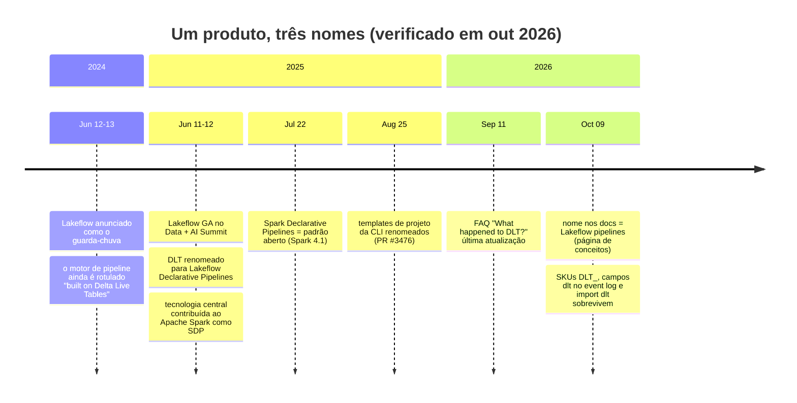
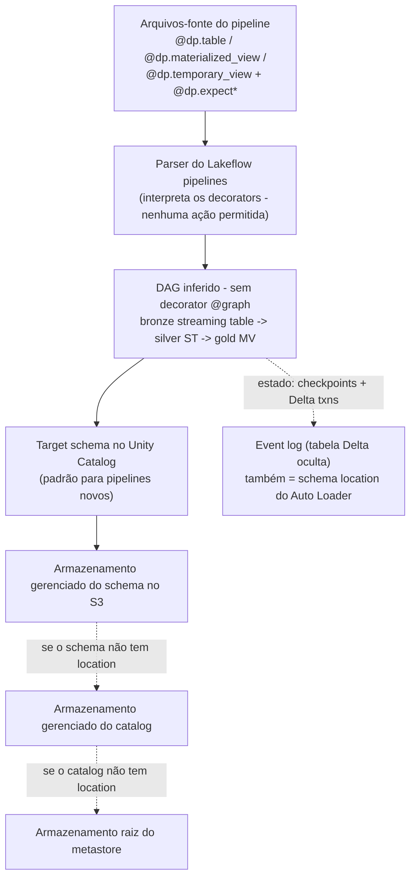
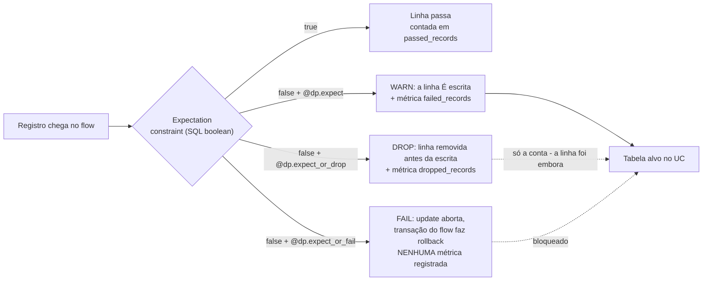
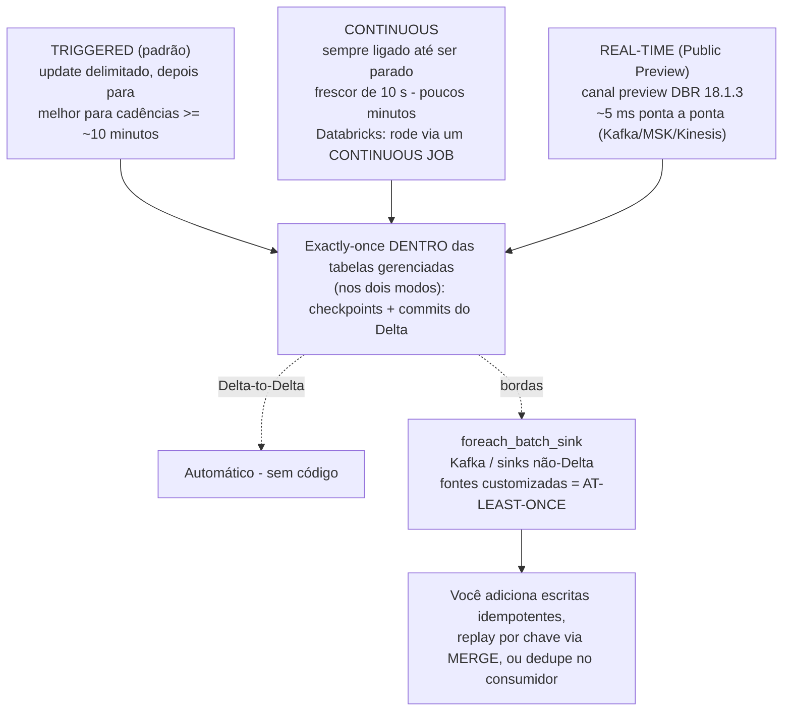
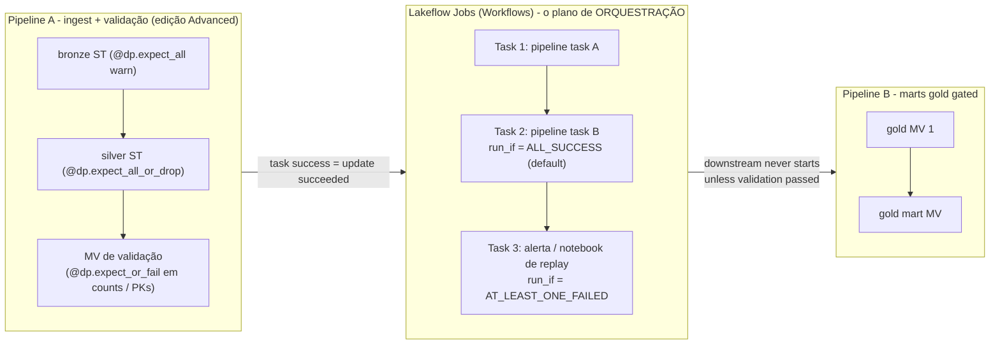

# Lakeflow Declarative Pipelines (anteriormente Delta Live Tables): Expectations, Modes e a Decisão DLT vs Jobs

Todo patrimônio de dados acaba fazendo duas perguntas à sua camada de ETL: *os dados estão bons?* e *o job realmente rodou?* Na Databricks na AWS, a primeira pergunta é respondida dentro dos **Lakeflow pipelines** — o produto que os seus tutoriais de 2023 chamavam de **Delta Live Tables (DLT)** — por um recurso chamado **expectations**: verificações SQL por registro, com três ações graduadas (warn, drop, fail) e métricas legíveis por máquina. A segunda pergunta é respondida pela orquestração, que no mundo Databricks significa **Lakeflow Jobs** (Workflows). O erro mais caro deste domínio é confundir os dois planos: expectations garantem **qualidade de dados**, jobs garantem **orquestração**, e os docs dizem isso com todas as letras — "**Expectations enforce data quality, not orchestration**" (docs .../ldp/expectation-patterns, datado de **2026-07-14**).

Esta lição ensina o produto sob seu **nome atual e com todo o histórico de renomeação**, porque em outubro de 2026 o seu ambiente vai conter os três nomes ao mesmo tempo: notebooks com `import dlt`, faturas com SKUs `DLT_`, campos de event log com `dlt` neles — e documentação que diz "Lakeflow pipelines". "The product formerly known as Delta Live Tables (DLT) has been updated to **Lakeflow pipelines**. If you have previously used DLT, there is **no migration required** to use Lakeflow pipelines: your code will still work" (docs .../ldp/concepts/where-is-dlt, rodapé de **11 de setembro de 2026**). Três nomes, um produto, zero reescritas forçadas — e uma superfície de cobrança que ainda diz DLT.

```text
 =============================================================
  MAPA DA LIÇÃO 07 - Lakeflow pipelines na AWS, em out 2026
 ------------------------------------------------------------
  Nome       DLT -> Lakeflow Declarative Pipelines (GA 2025-06)
             -> "Lakeflow pipelines" nos docs (out 2026)
             padrão aberto: Apache Spark Declarative Pipelines
             (SDP, pyspark.pipelines, Apache Spark 4.1)
  Modelo     pipelines | flows | streaming tables | MVs |
             views | sinks - o DAG é INFERIDO (sem @graph)
  Qualidade  6 decorators de expectation, 3 ações
             warn (mantém + métricas) | drop (remove + conta)
             | fail (aborta, SEM métricas)
             métricas vivem em EVENTOS flow_progress, não em colunas
             quarentena = PADRÃO documentado, não um decorator
  Modos      triggered (padrão, cadências >= ~10 min)
             | continuous (rode via um CONTINUOUS JOB)
             | real-time (Public Preview, canal preview DBR 18.1.3)
  Compute    serverless é o padrão para pipelines ETL novos
             (Unity Catalog obrigatório) | classic (Hive/legado)
  Edições    Core (ingest) < Pro (+CDC) < Advanced (+expect)
  Medição    serverless $0.35/DBU relatado na página de preços
             (thread da comunidade 2025-07-10, confirmado por staff)
             classic DLT_CORE $0.20 / DLT_PRO $0.25 /
             DLT_ADVANCED $0.36 (CSV de terceiros, 2026-04-10 -
             só corroboração; confirme na página de preços)
  -------------------------------------------------------------
  Regra da lição: pipelines garantem qualidade de DADOS;
  jobs garantem ORQUESTRAÇÃO. Nunca confunda os dois.
 =============================================================
```

Nesta lição você vai:

- reconstruir a **linha do tempo de nomes** (anúncio do Lakeflow 2024-06 → GA 2025-06 + renomeação do DLT + contribuição ao Spark → nome nos docs out 2026) e triar os **vestígios do DLT** que sobrevivem a ela;
- escrever pipeline Python na **API `dp`** e provar para você mesmo que o estilo antigo `@dlt.expect` ainda roda;
- aplicar todos os **seis decorators de expectation** e as **três ações**, e explicar com precisão por que **fail não grava métricas**;
- consultar métricas de expectation no **event log** e na tabela de sistema **`pipeline_events`** (Beta);
- construir o **padrão de quarentena** com regras NULL-safe, para que linhas boas e ruins particionem a entrada exatamente uma vez;
- escolher entre os modos **triggered, continuous e real-time** e calcular a **forma de custo de $105 vs $2,520 por mês** dessa escolha;
- configurar pipelines na AWS: **cascata de armazenamento do Unity Catalog, serverless vs classic, edições, run-as com service principals, Declarative Automation Bundles**;
- decidir **Lakeflow pipelines vs Workflows jobs** com uma matriz de decisão, estudar **NAB e Shell** na AWS, ler a **caixa de atualizações de 2026** e praticar com **doze questões** mais quatro verificações interativas.

---

## 1. Um produto, três nomes: a linha do tempo sobre a qual você será avaliado

### 1.1 A renomeação, com datas

| Data | O que a Databricks anunciou | Fonte |
|---|---|---|
| **2024-06-12/13** | **Lakeflow** apresentado como o guarda-chuva unificado de engenharia de dados (Connect + Pipelines + Jobs); o motor de pipeline é "Lakeflow Pipelines, built on Delta Live Tables technology" | blog *Introducing Databricks Lakeflow* (**2024-06-13**) + release de imprensa (**2024-06-12**) |
| **2025-06-11/12** (Data + AI Summit) | **Lakeflow vai para GA**; **DLT renomeado para Lakeflow Declarative Pipelines**, "100% source-compatible with the open standard" Apache Spark Declarative Pipelines e "100% backward-compatible with DLT pipelines"; tecnologia central contribuída para o Apache Spark | blog *Announcing the GA of Databricks Lakeflow* (**2025-06-12**) |
| **2025-07-22** | "We've **contributed our core declarative pipeline technology to the Apache Spark™ project as Spark Declarative Pipelines** … It's now an open standard"; "**DLT is now Lakeflow Declarative Pipelines**, with the same core benefits and full backward compatibility" | blog *What's New in Lakeflow Declarative Pipelines: July 2025* (**2025-07-22**) |
| **2025-08-25** | As ferramentas acompanham: os templates de projeto da Databricks CLI deixam de se chamar "Delta Live Tables" (databricks/cli PR #3476, merge em **2025-08-25**) | GitHub PR |
| **Out 2026** | O nome do produto nos docs é **"Lakeflow pipelines"**; a FAQ *What happened to Delta Live Tables (DLT)?* (rodapé **2026-09-11**) documenta a renomeação e os vestígios do DLT que sobrevivem | docs .../ldp/ (página de conceitos datada de **2026-10-09**) |



Formulação da lição para decorar: **Delta Live Tables (DLT), renomeado Lakeflow Declarative Pipelines no GA de junho de 2025 e hoje chamado Lakeflow pipelines nos docs — mesmo produto, três nomes, uma linha do tempo.** Dois nomes relacionados não podem ser confundidos com o nome do produto: **Apache Spark™ Declarative Pipelines (SDP)** é o *padrão aberto* que a Databricks estendeu ("All Lakeflow pipelines Python APIs are implemented in the `pyspark.pipelines` module"; "Apache Spark™ includes declarative pipelines **beginning in Spark 4.1**", docs .../ldp/developer/python-dev, datado de **2026-07-10**), e **Lakeflow** é a *família*: **Lakeflow Connect** (ingestão gerenciada), **Lakeflow Declarative Pipelines** (esta lição), **Lakeflow Jobs** (Workflows) (blog de GA, 2025-06-12).

### 1.2 Os vestígios: por que suas queries de cobrança ainda grepam `dlt`

A página de FAQ é explícita sobre o que *não* mudou: "There are still some references to the DLT name in Databricks. The **classic SKUs for Lakeflow pipelines still begin with `DLT`**, and **event log schemas with `dlt` in the name have not changed**. Python APIs that used `dlt` in the name can still be used, but Databricks recommends moving to the new names" (docs .../ldp/concepts/where-is-dlt, **2026-09-11**).

| Superfície | Ainda diz DLT (out 2026) | O que você faz a respeito |
|---|---|---|
| SKUs clássicos de DBU | `DLT_CORE_COMPUTE`, `DLT_PRO_COMPUTE`, `DLT_ADVANCED_COMPUTE` (e variantes Photon) | Mantenha os filtros `DLT_` nas queries de custo |
| Cobrança serverless | `billing_origin_product` in (`JOBS`, **`DLT`**); refreshes de MV em SQL warehouse aparecem com `billing_origin_product='SQL'` **e** `usage_metadata.dlt_pipeline_id` preenchido (docs .../admin/system-tables/serverless-billing, **2026-06-01**) | Dê join em `dlt_pipeline_id`, não só no nome do produto |
| Campos de event log | campos com `dlt` no nome, em schemas legados, inalterados | Não reescreva queries históricas de event log |
| Python | `import dlt`, `@dlt.expect`, `dlt.read` ainda funcionam | Código novo: `from pyspark import pipelines as dp` |

- **📚 Você sabia?** Um ticket de suporte que diz "why is there a *pipeline* ID on our **SQL** bill?" tem uma resposta documentada: "When you create a materialized view in a Databricks SQL warehouse, a **serverless pipeline is created** to process refreshes" — e a linha de cobrança aparece como `billing_origin_product = 'SQL'` com `usage_metadata.dlt_pipeline_id IS NOT NULL` (docs .../admin/system-tables/serverless-billing, **2026-06-01**). Pipelines não são apenas a coisa que você constrói; são também maquinário que outros produtos criam nas suas costas.

### 1.3 Exemplo resolvido E1 — a migração: código `dlt` legado vs código `dp` atual

**Em outubro de 2026.** A Equipe A entrega um notebook DLT da era de 2023. A Equipe B pergunta se vale a pena reescrevê-lo. Resposta segundo os docs: *sem migração obrigatória — mas a divisão de `@dlt.table` em dois decorators importa*.

```python
# --- LEGACY STYLE (2022-2024 tutorials). STILL RUNS on Lakeflow pipelines.
import dlt

@dlt.table
@dlt.expect("order_id_not_null", "order_id IS NOT NULL")            # warn
@dlt.expect_or_drop("valid_amount", "amount IS NOT NULL AND amount >= 0")  # drop
def silver_orders():
    return spark.readStream.table("bronze_orders").filter("event_type = 'ORDER'")
```

```python
# --- CURRENT STYLE (docs .../ldp/developer/python-ref, dated 2026-08-06).
from pyspark import pipelines as dp

@dp.table                                                             # streaming DF -> streaming table
@dp.expect("order_id_not_null", "order_id IS NOT NULL")              # warn
@dp.expect_or_drop("valid_amount", "amount IS NOT NULL AND amount >= 0")
def silver_orders():
    return spark.readStream.table("bronze_orders").filter("event_type = 'ORDER'")
```

A tabela de mapeamento da referência de Python (datada de **2026-08-06**) — aprenda a coluna do meio e cite a coluna da esquerda só ao ler código antigo:

| DLT (`import dlt`) | Lakeflow / SDP (`pipelines as dp`) | Observação |
|---|---|---|
| `@dlt.table` em um DF **streaming** | `@dp.table` | cria uma **streaming table** |
| `@dlt.table` em um DF **batch** | `@dp.materialized_view` | a divisão de 2025 — mesmo decorator, dois tipos de dataset |
| `@dlt.view` | `@dp.temporary_view` | avaliado sob demanda, não persistido |
| `dlt.read(t)` / `dlt.read_stream(t)` | `spark.read.table(t)` / `spark.readStream.table(t)` | readers Spark comuns dentro das funções de dataset |
| `dlt.apply_changes(...)` | `dp.create_auto_cdc_flow(...)` | exclusivo da Databricks (não está no Apache Spark), edição Pro ou superior |
| `@dlt.create_sink` | `dp.create_sink` | sinks não podem carregar expectations |
| `@dlt.expect*` | `dp.expect*` | seis decorators, exclusivos da Databricks (não estão no SDP) |
| — (indisponível no DLT) | `@dp.update_flow`, `dp.foreach_batch_sink`, `dp.create_auto_cdc_from_snapshot_flow`, `dp.replace_flow` | novas capacidades do Lakeflow |

Duas armadilhas visíveis neste exemplo. Primeiro, a **divisão de decorators**: `@dlt.table` cobria os dois tipos de dataset; `@dp.table` com um DataFrame *batch* (ou `@dp.materialized_view` com um streaming) declara errado o tipo de dataset e quebra o planejamento de flows (mapeamento python-ref, 2026-08-06). Segundo, o **predicado NULL-safe**: `amount >= 0` descarta apenas as linhas em que o predicado é *falso*; uma quantia NULL avalia como NULL e é **mantida** por expectations em modo drop. Escreva `amount IS NOT NULL AND amount >= 0` (a seção 5 volta a esse ponto com a prova de particionamento da quarentena).

> ⚠️ **AVISO — não copie e cole o resto de um blog post do DLT de 2023.** Material antigo também diz "set continuous in the pipeline settings for production", "query `LIVE.my_table`", e "serverless is preview". Em outubro de 2026: o modo de publicação padrão **ignora `LIVE`** (consulte `catalog.schema.table`), **serverless é o padrão** para pipelines ETL novos, e a Databricks **desaconselha o setting built-in de continuous para pipelines novos** — embale o pipeline em um **continuous job** em vez disso (docs .../ldp/concepts/pipeline-mode, acesso 2026-10; .../ldp/serverless, **2026-10-09**; .../ldp/target-schema, **2026-09-11**).

---

## 2. O modelo declarativo: o que você escreve vs o que a plataforma faz

### 2.1 Pipelines, flows, datasets — e um DAG inferido

"A pipeline is the main unit of development and execution of Apache Spark™ Declarative Pipelines (SDP) in Lakeflow. A pipeline is a collection of source code files and a configuration" (docs .../ldp/concepts/pipelines, datado de **2026-10-09**). A página de conceitos nomeia os blocos de construção: "pipelines, **flows**, **streaming tables**, **materialized views**, and **sinks**" (docs .../ldp/concepts/, datado de **2026-08-15**). Você declara datasets com decorators; a plataforma "automatically infer[s] dependencies between datasets and arrange[s] them in a **directed acyclic graph (DAG)**" — **não existe decorator `@graph`**; o grafo é inferido a partir do que as suas funções de dataset leem (concepts/pipelines, 2026-10-09).

| Tipo de dataset | Python | Semântica (conceitos, 2026-08-15) |
|---|---|---|
| **Streaming table** | `@dp.table` retornando um DataFrame **streaming** | "Each record is processed **exactly one time**, assuming an append-only source" |
| **Materialized view** | `@dp.materialized_view` retornando um DataFrame **batch** | "Results are recomputed as needed" (refresh incremental em serverless) |
| **View** | `@dp.temporary_view` | "Evaluated on demand, not persisted" |
| **Sink** | `dp.create_sink` / `dp.foreach_batch_sink` | escritas customizadas/externas — e o envelope exactly-once termina aqui |

Um **flow** é a aresta de processamento: "A flow reads data from a source, applies user-defined processing logic, and writes the result into a target … (Currently, only the **Append** and **Update** flows are exposed.)" (conceitos, 2026-08-15). Append flows são o padrão, um por alvo; update flows são apenas Python, via `@dp.update_flow`.



### 2.2 Leis de código: o motor avalia a sua função repetidamente

"Python pipeline code does not directly call the functions that perform data ingestion and transformation … Instead, Lakeflow pipelines **interpret the decorator functions** … and build a dataflow graph" (docs .../ldp/developer/python-dev, **2026-07-10**). As funções de dataset "must return a Spark DataFrame", e você nunca deve chamar `collect()`, `count()`, `toPandas()`, `save()`, `saveAsTable()`, `start()`, `toTable()` dentro delas — o planejador avalia as definições várias vezes, então ações e efeitos colaterais quebram a idempotência. Ler outros datasets é feito com readers Spark comuns (`spark.read.table`, `spark.readStream.table`, SQL `STREAM(...)`), não com um helper especial `source()`.

### 2.3 Fontes na AWS: de onde vêm os bytes

| Fonte | Como (docs, out 2026) | Observação no substrato AWS |
|---|---|---|
| **Tabelas do Unity Catalog** | batch `spark.read.table` → materialized view; streaming `spark.readStream.table` → streaming table; SQL `STREAM(cat.schema.table)` | governado por grants do UC |
| **Auto Loader / `read_files`** | `spark.readStream.format("cloudFiles").load(<path>)` ou SQL `read_files("/path", format => "json")` | "**Auto Loader using the `read_files()` function to read from Unity Catalog external locations**" — external location + storage credential (IAM role) + grant **`READ FILES`** obrigatórios (docs .../ldp/unity-catalog, **2026-10-09**; .../ldp/load, **2026-08-15**) |
| **Kafka / Amazon MSK, Kinesis** | fontes streaming em pipelines UC | o par de streaming nativo da AWS; Event Hubs é Azure |
| **Lakeflow Connect** | conectores gerenciados → tipo de pipeline `MANAGED_INGESTION` | fontes SaaS sem escrever código |
| **Hive metastore** | via o catalog de federação | **não pode ser atualizado para UC** — clone + reingestão (doc unity-catalog, 2026-10-09) |

Dentro dos pipelines a plataforma é dona da encanagem: "If you use Lakeflow pipelines, Databricks manages schema location and other checkpoint information automatically" (docs de schema do auto-loader, **2026-07-10**), e "The **event log location also serves as the schema location** for any Auto Loader queries in the pipeline" (docs .../ldp/monitor-event-logs, **2026-10-09**). A página de best practices do Auto Loader diz o padrão de produção sem rodeios: "For most users and production pipelines, **Auto Loader with Lakeflow pipelines is a good fit**. However, if you need maximum control and customization, use Auto Loader with Structured Streaming" (docs, **2026-06-29**).

> [!IMPORTANT]
> ⚠️ **Nunca apague o event log.** A mesma página avisa: "Do not delete the event log or the parent catalog or schema … Deleting the event log might result in your pipeline failing to update during future runs" — porque esse local também é a **schema location do Auto Loader**. Mover ou publicar o event log é um evento de rastreamento de schema, não uma limpeza doméstica (docs .../ldp/monitor-event-logs, **2026-10-09**).

---

## 3. Expectations: seis decorators, três ações, um regulamento

### 3.1 O inventário verificado — exatamente seis, sem decorator de quarentena

"Expectations are optional clauses in pipeline materialized view, streaming table, or view creation statements that apply data quality checks on each record passing through a query. Expectations use standard SQL Boolean statements" (docs .../ldp/expectations, rodapé de **11 de setembro de 2026**). A referência de Python (datada de **2026-09-11**) não deixa margem: "The `dp` module includes **six decorators** to control expectations behavior" — e a ordem canônica é *depois* do decorator do dataset e *antes* da função:

| Decorator | Assinatura | Ação na violação |
|---|---|---|
| `@dp.expect(description, constraint)` | verificação única | **warn** (padrão): a linha é **escrita** no alvo; passed/failed são contados |
| `@dp.expect_or_drop(...)` | verificação única | **drop**: "Invalid records are dropped before data is written to the target. The count of dropped records is logged alongside other dataset metrics" |
| `@dp.expect_or_fail(...)` | verificação única | **fail**: "Invalid records prevent the update from succeeding. Manual intervention is required before reprocessing" |
| `@dp.expect_all({description: constraint, ...})` | **dict** de verificações | warn em qualquer falha |
| `@dp.expect_all_or_drop({...})` | dict | drop em qualquer falha |
| `@dp.expect_all_or_fail({...})` | dict | fail no update em qualquer falha |

Gêmeo SQL (para datasets escritos em SQL): `CONSTRAINT name EXPECT (expr)` com opcional `ON VIOLATION DROP ROW` ou `ON VIOLATION FAIL UPDATE`. **Não existe** decorator `expect_all_or_quarantine` — quarentena é um *padrão* documentado que você constrói sozinho (seção 5). Expectations exigem a edição de produto **Advanced**: "Core to run streaming ingest workloads … doesn't require advanced features such as change data capture (CDC) or expectations. Pro … plus … CDC. Advanced … and includes **data quality constraints with expectations**" (docs .../ldp/configure-pipeline, datado de **2026-10-01**).

### 3.2 As três ações, desenhadas



Três cláusulas do doc de expectations (2026-09-11) que decidem o desenho de produção:

1. "**Because `fail` causes the update to fail when an invalid record is detected, metrics are not recorded.**" Fail é uma *parada de mão*, não um *instrumento de medição* — nunca instrumente uma tabela com expectations em modo fail e depois fique se perguntando por que seu dashboard de qualidade está vazio.
2. "An expectation **name must be unique for a given dataset**. You can reuse expectations across multiple datasets in a pipeline."
3. Constraints "must use valid SQL syntax and cannot contain … Custom Python functions, External service calls, Subqueries referencing other tables." Sem UDFs, sem APIs externas, sem verificações entre tabelas — se você precisa disso, isso pertence a um notebook de validação ou a um pipeline separado.

A semântica do modo de execução também importa: "In a triggered pipeline, the failure of a single flow does not cause other parallel flows to fail. In a continuous pipeline, an expectation failure **stops the flow, all dependent flows**, and the pipeline emits a message explaining why it stopped" (mesma página). O artefato de depuração dos docs para o modo fail é este: `[EXPECTATION_VIOLATION.VERBOSITY_ALL] Flow 'sensor-pipeline' failed to meet the expectation. Violated expectations: 'temperature_in_valid_range'. Input data: '{"id":"TEMP_001",…}'` — nome do flow, nome da expectation e o registro problemático, em um erro só.

### 3.3 Exemplo resolvido E2 — um pipeline medallion com as três ações

**Em outubro de 2026, serverless, edição Advanced, alvos no Unity Catalog.** A fonte completa do pipeline (adaptada da forma documentada nos docs; os aliases `@dlt.expect*` funcionam da mesma forma):

```python
# file: transformations/orders_pipeline.py   (pipeline source; NO actions allowed)
from pyspark import pipelines as dp
from pyspark.sql.functions import col, expr

LANDING = "/Volumes/lake/landing/orders/"   # UC volume; external location also fine

bronze_rules = {
    "order_id_not_null": "order_id IS NOT NULL",
    "event_ts_not_null": "event_ts IS NOT NULL",
}

@dp.table(
    name="bronze_orders",
    table_properties={"quality": "bronze", "pipelines.autoOptimize.managed": "true"},
    # path omitted -> managed storage of the target schema (the S3 cascade)
)
@dp.expect_all(bronze_rules)                     # WARN: keep rows, emit metrics
def bronze_orders():
    return (
        spark.readStream.format("cloudFiles")
             .option("cloudFiles.format", "json")
             .option("cloudFiles.schemaEvolutionMode", "addNewColumns")
             .load(LANDING)
    )

silver_rules = {
    "valid_order_id":  "order_id IS NOT NULL",                          # total (NULL-safe)
    "valid_amount":    "amount IS NOT NULL AND amount >= 0",
    "valid_currency":  "currency IN ('USD','EUR','GBP')",
}

@dp.table(name="silver_orders")
@dp.expect_all_or_drop(silver_rules)            # DROP: bad rows excluded, counts logged
def silver_orders():
    return (
        spark.readStream.table("bronze_orders")
             .filter(expr("event_type = 'ORDER'"))
    )

@dp.materialized_view(name="gold_daily_revenue")
@dp.expect_or_fail("row_count_positive", "total_revenue >= 0")   # FAIL: abort this flow
def gold_daily_revenue():
    return (
        spark.read.table("silver_orders")
             .groupBy("order_date", "currency")
             .agg(col("amount").sum().alias("total_revenue"))
    )
```

Narre o grafo antes de rodá-lo: **bronze avisa** (só métricas — bronze é para perícia, não para serving), **silver descarta** (linhas ruins nunca chegam ao consumidor; só as contas restam — a seção 5 mostra o que fazer quando contas não bastam), **gold falha** (um total de receita negativo é impossível, então pare o update em vez de publicá-lo). O motor infere o DAG (`bronze_orders` → `silver_orders` → `gold_daily_revenue`), publica os três no **target schema do pipeline no Unity Catalog** (fisicamente no armazenamento S3 gerenciado daquele schema) e um update **triggered** processa os dados disponíveis no início e para. Repare na divisão de tipos de dataset em ação: `gold_daily_revenue` é uma agregação *batch*, logo é `@dp.materialized_view`, não `@dp.table`.

---

## 4. Métricas: onde os números de expectation realmente ficam

### 4.1 O payload do event log é a API de métricas

Métricas **não** são colunas na sua tabela alvo. Os docs atuais as definem puramente como **payloads do event log**: "the metrics for the number of records that passed and failed an expectation are stored in the `details:flow_progress.data_quality.expectations` object. The metric for the number of dropped records is stored in the `details:flow_progress.data_quality` object. Events … have the event type `flow_progress`" (docs .../ldp/monitor-event-logs, **2026-10-09**). O schema do array de expectations é publicado: `array<struct<name: string, dataset: string, passed_records: int, failed_records: int>>`, e `dropped_records` conta as linhas que "failed one or more expectations".

Três superfícies leem os mesmos números:

1. **UI de monitoramento do pipeline → dataset → aba Data quality** (expectations warn/drop; a visão humana).
2. **O event log por pipeline** — uma tabela Delta oculta consultável como `SELECT * FROM event_log(<pipeline_id>)` (formatada `event_log_{pipeline_id}`), que você pode **publicar** em uma tabela nomeada do Unity Catalog para acesso mais largo (JSON de Advanced settings `{"event_log": {"catalog", "schema", "name"}}`).
3. **A tabela de sistema `pipeline_events` (Beta)** — `system.lakeflow_pipeline_events_preview.pipeline_events`, que "contains events for all pipelines across the workspaces in a region" e hoje é a superfície de consulta **recomendada**, completa com um Lakeview dashboard para download (docs .../ldp/monitor-and-query-events, **2026-10-09**).

> ⚠️ **Não vá caçar colunas `_expectation_name` na sua tabela silver.** Material de comunidade mais antigo mostra colunas de metadados de expectation; os docs atuais definem o contrato acima e nada mais. Se o seu SQL de monitoramento faz select de `_expectation_*` a partir de uma tabela de pipeline, você está rodando código velho (docs .../ldp/monitor-event-logs, **2026-10-09**; doc de expectations, **2026-09-11**). E lembre-se: expectations em modo fail deixam **nenhuma métrica por design**, e é exatamente por isso que fail pertence a gates orquestrados (seção 7), não a tabelas de serving monitoradas.

### 4.2 Exemplo resolvido E3 — SQL de monitoramento de DQ: event log, tabela de sistema, fatura

```sql
-- (a) Per-update expectation metrics from the per-pipeline event log
WITH exploded AS (
  SELECT explode(from_json(
           details:flow_progress:data_quality:expectations,
           "array<struct<name: string, dataset: string, passed_records: int, failed_records: int>>"
         )) AS row_expectations
  FROM event_log(<pipeline_id>)
  WHERE event_type = 'flow_progress'
)
SELECT row_expectations.dataset           AS dataset,
       row_expectations.name              AS expectation,
       SUM(row_expectations.passed_records) AS passing_records,
       SUM(row_expectations.failed_records) AS failing_records
FROM exploded
GROUP BY 1, 2;

-- (b) Region-wide, cross-pipeline (Beta system table; requires USE/SELECT on system schemas)
SELECT pipeline_id, update_id,
       coalesce(expectation.dataset, origin.dataset_name) AS dataset_name,
       expectation.name,
       SUM(expectation.failed_records) AS failed
FROM system.lakeflow_pipeline_events_preview.pipeline_events
LATERAL VIEW explode(variant_get(details,
  '$.flow_progress.data_quality.expectations',
  'ARRAY<STRUCT<name:STRING,dataset:STRING,passed_records:BIGINT,failed_records:BIGINT>>')) AS expectation
WHERE event_type = 'flow_progress'
GROUP BY 1, 2, 3, 4
HAVING SUM(expectation.failed_records) > 0;

-- (c) What did this pipeline cost? (billing still keys on the dlt_pipeline_id)
SELECT sku_name, product_features.performance_target, SUM(usage_quantity) AS dbus
FROM system.billing.usage
WHERE usage_metadata.dlt_pipeline_id = '<pipeline_id>'
GROUP BY 1, 2;
```

A query (c) é a tabela de vestígios da §1.2 em forma executável: pipelines são cobrados sob `usage_metadata.dlt_pipeline_id`, e as linhas serverless carregam `product_features.performance_target` ∈ {`PERFORMANCE_OPTIMIZED`, `STANDARD`} (docs .../admin/system-tables/serverless-billing, **2026-06-01**). A aba **Data quality** na UI serve para um humano verificando um dataset; as queries (a) e (b) é o que você coloca em um alerta agendado ou em um dashboard de saúde do Lakeview.

- **📚 Você sabia?** Pipelines retêm "**60 days** of past updates in the pipeline UI and the Pipelines API" (docs .../ldp/configure-pipeline, **2026-10-01**) — mas "older ones remain only in the event log". Qualquer auditoria ou revisão de incidente que vá além de 60 dias é uma query de **event log** (ou da tabela publicada de event log), o que é mais uma razão para nunca apagar aquela tabela.

---

## 5. Quarentena: um padrão, não um decorator — e a armadilha do NULL dentro dele

Quando expectations em modo drop são destrutivos demais (dados regulamentados, requisitos de replay), você precisa *manter* as linhas ruins. A Databricks documenta a receita — uma **streaming table temporária particionada por uma flag `is_quarantined` computada**, anotada com `@dp.expect_all(rules)` para que as métricas continuem fluindo, e depois duas views que dividem o stream (docs .../ldp/expectation-patterns, datado de **2026-07-14**).

### 5.1 Exemplo resolvido E4 — a forma oficial de quarentena, deixada NULL-safe

```python
from pyspark import pipelines as dp
from pyspark.sql.functions import expr

rules = {
    "valid_pickup_zip":  "(pickup_zip IS NOT NULL)",
    "valid_dropoff_zip": "(dropoff_zip IS NOT NULL)",
}
# NOT(all rules) -> TRUE means "at least one rule failed" (NULL-safe: rules are total)
quarantine_expr = "NOT({0})".format(" AND ".join(rules.values()))

@dp.view
def raw_trips_data():
    return spark.readStream.table("samples.nyctaxi.trips")

@dp.table(temporary=True, partition_cols=["is_quarantined"])
@dp.expect_all(rules)                            # metrics still recorded per rule
def trips_data_quarantine():
    return (spark.readStream.table("raw_trips_data")
                 .withColumn("is_quarantined", expr(quarantine_expr)))

@dp.view
def valid_trips_data():
    return spark.read.table("trips_data_quarantine").filter("is_quarantined = false")

@dp.view
def invalid_trips_data():
    return spark.read.table("trips_data_quarantine").filter("is_quarantined = true")
```

Depois, em produção, promova `invalid_trips_data` a um `@dp.table(name="trips_quarantine")` de verdade (ela precisa persistir no S3 sob o Unity Catalog — para pipelines UC isso significa o armazenamento gerenciado do schema, a location do catalog ou a raiz do metastore, nessa ordem de fallback) e **alerte sobre a contagem de linhas dela**; nada na plataforma faz replay automático nem expira tabelas de quarentena.

> [!WARNING]
> **A armadilha do NULL em toda divisão feita à mão.** `expect_or_drop` descarta uma linha apenas quando o predicado é **falso** — SQL NULL *não* é falso. Então a regra ingênua `fare > 0` **mantém** silenciosamente tarifas NULL, e a sua negação `NOT(fare > 0)` também é NULL, o que significa que uma linha com tarifa NULL cai em *nenhuma* das duas ramificações de uma divisão `valid`/`invalid` — e as suas duas ramificações deixam de particionar a entrada. Torne toda regra **total** (`fare IS NOT NULL AND fare > 0`) ou compute um único booleano explícito e ramifique a partir *dele*, exatamente como a flag `is_quarantined` acima faz (padrão documentado, expectation-patterns, **2026-07-14**; comportamento do NULL, doc de expectations, **2026-09-11**).

**História de replay (prática do curso, consistente com o padrão documentado):** trague as linhas de quarentena → corrija no upstream ou aceite-as → rode de novo a mesma transformação filtrada com um predicado alargado ou com `MERGE` a partir da tabela de quarentena depois do reparo → o próximo update do pipeline continua (Delta ACID + estado do pipeline mantêm os replays idempotentes **desde que você faça replay por chave**, não por append às cegas) → arquive ou descarte as linhas de quarentena sob direitos `MODIFY` do UC com trilha de auditoria.

---

## 6. Modos e garantias: triggered, continuous, real-time

### 6.1 A tabela de modos

"Triggered mode refreshes available data and stops, while continuous mode keeps tables fresh as new data arrives" (docs .../ldp/concepts/pipeline-mode, acesso 2026-10). Dois fatos que os alunos costumam errar: "**Pipeline mode is independent of the type of table** being computed" (tanto MVs quanto streaming tables atualizam em qualquer modo), e "Refresh operations for **standalone** materialized views and streaming tables **always run using triggered pipeline mode**".

| | **Triggered** (padrão) | **Continuous** | **Real-time** (Public Preview) |
|---|---|---|---|
| Ciclo de vida | "Automatically when complete" — processa os dados disponíveis no início e para | "Runs continuously until manually stopped" | um flow-level optimisation **por cima do continuous** |
| Frescor | "every 10 minutes, hourly, or daily" | "between every 10 seconds and a few minutes" | ponta a ponta "as low as **five milliseconds**" |
| Forma de custo | paga por update | compute sempre ligado — o maior lever desta lição | sempre ligado, baixa latência |
| Extras | o mais barato; MVs/STs standalone só rodam aqui | pula trabalho automaticamente quando tabelas Delta dependentes não mudaram; cadência via `pipelines.trigger.interval` (prefira **por tabela** — streaming e batch flows "have different defaults") | canal **preview do DBR 18.1.3**; `spark.databricks.streaming.realTimeMode.enabled=true` + `pipelines.trigger: RealTime` em um `@dp.update_flow` apontando para um `dp.create_sink`; Kafka/MSK in+out, Kinesis in (EFO), **Delta não suportado**; recomendado um flow real-time por pipeline |

### 6.2 Exactly-once: dentro do envelope e nas suas bordas

"Lakeflow pipelines give you **exactly-once processing by default within the tables they manage**, and at the edges you add idempotent writes to keep re-runs safe" (docs .../ldp/best-practices/processing-guarantees, datado de **2026-08-15**). Mecanismo: "Streaming tables use Structured Streaming checkpoints combined with Delta Lake's transactional writes: each micro-batch commits its source offsets and its output together, so a retried batch after a failure either fully succeeds or is fully rolled back … **never partially applied twice**" — para Auto Loader, Kafka, Kinesis e upserts de `AUTO CDC`, "without any code from you". A regra de bolso: "if your entire pipeline is **Delta-to-Delta** … you already have exactly-once." Onde termina: `foreach_batch_sink`, sinks Kafka/não-Delta e fontes Python customizadas são **at-least-once** — torne a escrita idempotente ou deduplique downstream.



### 6.3 A regra do continuous job (higiene de produção)

A orientação atual da Databricks é um padrão, não uma preferência: "Databricks recommends running continuous pipelines with a **continuous job** rather than setting … Pipeline mode to continuous … the job manages the pipeline's execution lifecycle and unlocks serverless performance modes, such as Standard mode, that the pipeline's built-in continuous mode doesn't support." E quando um job orquestra um pipeline, "the job determines the execution mode and takes precedence … **set the pipeline's Pipeline mode to triggered (the default) when you wrap it in a continuous job.**" O setting built-in "is not being removed, but Databricks **discourages its use for new pipelines**" (docs .../ldp/concepts/pipeline-mode, acesso 2026-10). O modo real-time anda na mesma pilha: "Continuous mode is still required" (docs .../ldp/real-time, acesso 2026-10).

### 6.4 Exemplo resolvido E5 — a decisão de modo, em dólares

**Em outubro de 2026.** Aritmética sobre as taxas documentadas: pipelines Lakeflow serverless são relatados a **$0.35/DBU** (orçamento de cliente da página de preços, confirmado em substância por uma resposta de staff da Databricks — "While the **DBU price is the same for both modes**, the Performance Optimized mode … can significantly increase total cost due to higher DBU consumption", Databricks Community, **2025-07-10**); SKUs clássicos do DLT corroborados por um CSV de taxas de terceiros (coletado em **2026-04-10**): `DLT_CORE_COMPUTE` **$0.20**, `DLT_PRO_COMPUTE` **$0.25**, `DLT_ADVANCED_COMPUTE` **$0.36** — trate aquele CSV como corroboração de nomes de SKU e confirme o card no ar antes de assinar um orçamento.

```text
Exemplo resolvido E5 - triggered vs continuous, taxa de queima de 10 DBU/h
(a) Triggered, update noturno de 1 h, serverless:
      10 DBU/h x 1 h x $0.35/DBU  = $3.50/noite  ~= $105/mês (30 dias)
(b) Continuous, sempre ligado, serverless (mesma taxa de queima):
      10 DBU/h x 24 h x $0.35/DBU = $84/dia      ~= $2,520/mês
(c) Mesma execução noturna na edição Advanced clássica (apenas coluna de DBU):
      10 DBU/h x 1 h x $0.36/DBU  = $3.60/noite  (+ EC2 - fatura separada)
DELTA da escolha de modo .......... ~$2,415/mês
Pergunta de break-even para fazer ao negócio:
  "Dados com até ~24 horas de atraso valem mais que $2.4k/mês?"
  Se não -> triggered. Se sim -> continuous job, e então ajuste o intervalo.
```

```plot
{
  "type": "bar",
  "title": "Custo mensal de DBU a uma taxa de queima de 10 DBU/h (exemplo resolvido E5, em out 2026)",
  "data": [
    {"mode": "Triggered nightly 1h (serverless $0.35/DBU)", "usd_per_month": 105},
    {"mode": "Triggered nightly 1h (classic ADV $0.36/DBU, DBU only)", "usd_per_month": 108},
    {"mode": "Continuous 24x7 (serverless $0.35/DBU)", "usd_per_month": 2520}
  ],
  "xKey": "mode",
  "dataKeys": ["usd_per_month"],
  "xLabel": "Modo do pipeline e taxa",
  "yLabel": "USD por mês (apenas coluna de DBU)"
}
```

O enquadramento de break-even é a disciplina que este curso quer: **comece em triggered**, e compre continuous (ou real-time) apenas com um SLA de latência cujo valor de negócio supere o prêmio de sempre-ligado. A mesma matemática se estende aos performance modes: o performance mode serverless padrão "typically start[s] within **four to six minutes** after being triggered" e "Both modes use the same SKU, but standard performance mode consumes **fewer DBUs**" — a economia está no consumo, não na taxa, e o standard mode para pipelines continuous só é alcançável via um continuous job com "Performance optimized" desmarcado (docs .../ldp/serverless, **2026-10-09**).

---

## 7. Topologia: um pipeline ou vários? (e por que expectations não podem fazer gate)

### 7.1 Um pipeline: o grafo medallion em um único update

Um único pipeline pode abrigar bronze→silver→gold: o motor infere as dependências, publica todo dataset não-`private` no target schema e deixa esconder intermediários com `private=True` (ref. de tabela, **2026-08-06**). Você tem um update, uma atribuição de compute, ordenação automática e estado incremental compartilhado — é por isso que o grafo do exemplo resolvido E2 é um pipeline só. Mas lógica de orquestração **não pode morar dentro dele**: um dataset de validação com `expect_or_fail` falha apenas o seu próprio flow (modo triggered) ou os dependentes dele (modo continuous), e "A validation table doesn't gate its downstream tables … To stop downstream processing when a validation fails, **split the validation logic and the downstream work into separate pipelines and orchestrate them with a job**" (expectation-patterns, **2026-07-14**).



Regra prática deste curso: **um pipeline por domínio/SLA delimitado** (ex.: ingest+limpeza de pedidos; um segundo pipeline para os marts gold gated), jobs orquestrando-os em ordem, executando como um **service principal**. O `run_if = ALL_SUCCESS` padrão do job é o que transforma um expectation em modo fail em um gate de verdade — "Because a pipeline task fails when its update fails, the downstream task doesn't run unless the validation pipeline succeeds" (expectation-patterns, 2026-07-14).

### 7.2 Updates de desenvolvimento vs updates de produção

Updates interativos a partir do **Lakeflow Pipelines Editor** (a "IDE for data engineering" anunciada no release de GA, com pareamento código-DAG, previews contextuais e execução seletiva de um arquivo/tabela) usam "fast-start, debugging-focused behavior"; updates vindos de **Jobs ou da Pipelines API — e todos os updates continuous — usam retry e restart automáticos** (restart do cluster em erros recuperáveis como credenciais obsoletas, retry em falha de subida do cluster, cluster derrubado depois da execução) (monitor-event-logs, 2026-10-09; doc de updates). Checklist de higiene de produção: agende uma **pipeline task** no Workflows (os gatilhos de update são "Manual … Scheduled (jobs) … Programmatic"), defina **run-as** como um service principal ("Running pipelines as service principals is considered a best practice because they are not tied to individual users"), promova código com **Declarative Automation Bundles**, mantenha o pipeline em **triggered** a menos que um SLA sub-segundo comprovado exija continuous/real-time, e lembre-se da janela de histórico de **60 dias** na UI/API.

---

## 8. Configurando o pipeline na AWS: armazenamento, compute, edições, identidade

### 8.1 Onde os dados aterrisam: a cascata de armazenamento do Unity Catalog

"Unity Catalog is the **default** for newly created pipelines" e é um **requisito** para serverless (docs .../ldp/unity-catalog, **2026-10-09**). O armazenamento segue uma regra: "Data for materialized views and streaming tables are stored in the **storage location for the containing schema**. If a schema storage location is not specified, tables are stored in the **catalog** storage location. If schema and catalog storage locations are not specified, tables are stored in the **root storage location of the metastore**." Duas exceções que você precisa decorar:

- O parâmetro Python **`path=`** em `@dp.table(...)`/`create_table` — "A storage location for table data. **If not set, use the managed storage location for the schema containing the table**" (ref. de tabela, **2026-08-06**) — a forma suportada de fixar uma tabela de pipeline em uma location explícita (ex.: um volume UC ou um prefixo S3 atrás de external location).
- A propriedade SQL **`LOCATION` não é suportada** ao definir tabelas em pipelines UC (limitações unity-catalog, 2026-10-09). Settings legados de pipeline `storage` (pipelines anteriores a **5 de fevereiro de 2025**, era do Hive metastore) caem por padrão em `dbfs:/pipelines/` e "cannot be changed after a pipeline is created" (ref. de propriedades, **2026-07-14**).

A semântica de exclusão também mudou com o UC: excluir um pipeline **retém** as suas tabelas por padrão (ficam inativas, mas continuam consultáveis); `DELETE /api/2.0/pipelines/{id}?cascade=true` as remove; `UNDROP` recupera tabelas derrubadas em até **7 dias**; e os dados de suporte vivem sob um catálogo `__databricks_internal` — "This is expected" (doc unity-catalog, 2026-10-09).

### 8.2 Serverless vs classic (AWS)

Pipelines ETL novos já nascem como "**Unity Catalog · Current channel · Serverless compute**" (configure-pipeline, 2026-10-01). Requisitos de serverless: workspace com UC habilitado, aceite dos termos de serverless, uma **região com serverless habilitado** (confira a matriz de suporte de regiões — não dê por garantido) e "If you need to use an **AWS PrivateLink** connection with your serverless Lakeflow pipelines, **contact your Databricks representative**" (doc serverless, 2026-10-09). Nenhuma permissão de criação de cluster é necessária. Capacidades exclusivas de serverless: "**Incremental refresh for Materialized views**", "**Stream pipelining**" (habilitado por padrão) e "**Vertical autoscaling**". O classic continua para pipelines legados de Hive metastore, setups de rede não suportados e regiões sem serverless; as suas alavancas são enhanced autoscaling, tipos de instância worker/driver, instance profile, cluster policy, cluster tags e o toggle do Photon. Você não pode misturar: um pipeline grava ou no UC ou no Hive metastore, nunca nos dois — e "Existing pipelines that use the Hive metastore **cannot be upgraded** to use Unity Catalog … you must create a new pipeline and re-ingest data" (doc unity-catalog, 2026-10-09).

### 8.3 Exemplo resolvido E6 — ligação de produção: bundle DAB, config de pipeline, continuous job, run-as

```yaml
# databricks.yml (Declarative Automation Bundles - the documented CI/CD vehicle)
bundle:
  name: orders-lakeflow
resources:
  pipelines:
    orders_pipeline:
      name: orders_etl
      channel: CURRENT
      serverless: true
      edition: ADVANCED               # expectations need Advanced
      catalog: lake
      schema: silver
      pipeline_mode: TRIGGERED        # leave triggered; the JOB owns execution mode
      continuous: false
      configuration: {}               # extra JSON settings if needed (e.g. spark_conf)
  jobs:
    orders_continuous:
      name: orders-continuous
      continuous: true                # continuous JOB - the recommended pattern
      tasks:
        - pipeline_task:
            pipeline_key: orders_pipeline
        - job_task:
            notebook_path: ../notebooks/alert_on_quarantine.py
            depends_on: [ orders_pipeline ]
run_as:
  service_principal_name: "sp-lakeflow-prod"
targets:
  dev:  { mode: development }
  prod: { mode: production, git_branch: main }
```

A identidade de run-as precisa deter, no Unity Catalog: "`USE CATALOG` on the target catalog; `USE SCHEMA` and `CREATE TABLE` on the target schema; `MODIFY` permission on existing tables that the pipeline updates" (configure-pipeline, 2026-10-01) — mais acesso ao armazenamento de nuvem via **storage credentials** e **external locations** (os objetos suportados por IAM role da lição 03) para todo caminho S3 que o pipeline tocar. Repare em cada linha não óbvia: `pipeline_mode: TRIGGERED` + `continuous: true` na **job** é o padrão da §6.3 (o job prevalece de qualquer forma, mas deixar o pipeline em triggered evita surpresas); `edition: ADVANCED` é o gate da §3.1 para expectations; e os **targets** dev/prod promovem o mesmo código sem bifurcá-lo.

- **📚 Você sabia?** O modo **file-notification** do Auto Loader tem um limite de escala duro que você vai eventualmente bater: "**100 pipelines per S3 bucket**" no modo clássico de file-notification (docs, 2026-10, via digest 07). File events gerenciados (DBR 14.3 LTS+) usam uma fila por external location em vez disso — o que é mais uma razão para que external locations, e não caminhos `s3://` crus, sejam a unidade de governança de ingestão na AWS.

---

## 9. Lakeflow pipelines vs Workflows jobs: a matriz de decisão

O enquadramento dos docs: pipelines são "declarative datasets + flows" com estado gerenciado e processamento incremental; jobs clássicos são para o trabalho que a abstração esconde. As best practices do Auto Loader deixam o padrão explícito — "For most users and production pipelines, **Auto Loader with Lakeflow pipelines is a good fit**. However, if you need maximum control and customization, use Auto Loader with Structured Streaming" (2026-06-29).

| Dimensão | **Lakeflow pipeline** | **Workflows job (tasks de notebook/JAR/Python)** |
|---|---|---|
| Estado & checkpoints | Gerenciado: checkpoints + commits do Delta dão exactly-once em tabelas gerenciadas | Você constrói e babita checkpoints (`checkpointLocation`), idempotência, retries |
| Qualidade de dados | **Expectations** (seis decorators, warn/drop/fail + métricas) | Asserts feitos à mão no notebook; sem contrato de métricas |
| Orquestração | DAG **de datasets**, inferido; sem branching/condicionais | Fluxo de controle completo: `ifelse`, `forEach`, `run_if`, dependências, retries, notificações |
| Trabalho fora de DataFrame | Não permitido (nenhuma ação em funções de dataset) | Chamadas de API, treino de ML, movimentação de arquivos, jobs `%pip` — qualquer coisa imperativa |
| Bibliotecas | **apenas Python** de terceiros — "**JARs are not supported**" para pipelines UC | JARs, Spark Submit, environments, escopos de bibliotecas |
| Compute | Serverless por padrão (só UC); classic para Hive/legado | Jobs serverless por padrão, job clusters clássicos, all-purpose (só interativo) |
| Forma de custo | Por DBU serverless (`$0.35/DBU` relatado) ou SKU clássico `DLT_*`; continuous = sempre ligado | Jobs Compute `$0.15/DBU` clássico + EC2, ou jobs serverless `$0.35/DBU` |
| Portabilidade | Construído sobre **Apache Spark Declarative Pipelines** (padrão aberto, Spark 4.1) — código SDP se move | APIs de job exclusivas da Databricks |
| Forma de produção | Pipeline **task dentro de um multi-task job** (agenda, retries, run-as, notificações) | Multi-task jobs, DABs, Airflow/Step Functions na borda |

Na prática, ambientes de produção **combinam** os dois: uma pipeline task dentro de um multi-task job para agenda, dependências, retries e notificações; pipelines separados coordenados por dependências de job para gates de qualidade (§7.1); e jobs clássicos para o trabalho fora de DataFrame que nenhuma função de dataset pode conter.

> **Veredito comparativo — Lakeflow pipelines (DLT) vs Workflows jobs (em out 2026)**
> - **Lakeflow pipeline** — a **resposta padrão para ETL incremental batch-ou-stream sobre Delta**. Você declara datasets e expectations; a plataforma infere o DAG, gerencia checkpoints, aplica schema evolution, emite exactly-once em tabelas gerenciadas, grava métricas de qualidade e publica no Unity Catalog — em serverless por padrão, com extras exclusivos de serverless (refresh incremental de MV, stream pipelining, vertical autoscaling). Compre a edição **Advanced** quando precisar de expectations; embale workloads continuous em um **continuous job**; trate o setting built-in de continuous como legado para pipelines novos.
> - **Workflows job** — a **resposta padrão para orquestração e tudo que não é DataFrame**: agendamento (pipeline tasks, notebook tasks, gates `run_if`), retries, notificações, run-as com service principals, branching, trabalho JAR/Spark-Submit, treino de ML, movimentação de arquivos. Jobs são também onde vivem os *gates de qualidade entre pipelines*, porque expectations não podem fazer gate dos próprios datasets downstream de um pipeline.
> - **Veredito em uma frase:** *pipelines para o plano de dados, jobs para o plano de controle — um pipeline por domínio/SLA delimitado, gated por um pipeline de validação dentro de um multi-task job, rodando como um service principal, triggered por padrão, continuous apenas contra um SLA de latência escrito.* Bônus de portabilidade: a metade do pipeline é SDP de padrão aberto; a metade do job é nativa da Databricks.

---

## 10. As armadilhas: doze confusões que esta lição não vai deixar você manter

1. **"O DLT acabou."** Meio certo e operacionalmente perigoso: o produto agora é Lakeflow pipelines, mas SKUs `DLT_`, campos `dlt` no event log, `billing_origin_product='DLT'` e `import dlt` sobrevivem — código novo usa `dp`, monitoramento ainda grepando `dlt`.
2. **"`@dlt.table` cobre os dois tipos de dataset."** Não na API atual: DF streaming → `@dp.table`, DF batch → `@dp.materialized_view`. O desalinhamento quebra o planejamento de flows.
3. **"Existe um decorator `expect_all_or_quarantine`."** Não existe. Existem seis decorators; quarentena é o padrão documentado na seção 5.
4. **"Expectations em modo fail populam o meu dashboard de qualidade."** "Because `fail` causes the update to fail … **metrics are not recorded**." Fail = gate, warn/drop = medição.
5. **"Expectations fazem gate do pipeline inteiro."** `expect_or_fail` falha apenas o flow ofensor (triggered) ou os dependentes dele (continuous); datasets downstream não esperam o veredito de uma tabela de validação. Gate entre pipelines = pipelines separados + um job.
6. **"`NOT(rule)` divide NULLs corretamente."** NULL não é nem verdadeiro nem falso; as duas ramificações podem perder a linha. Torne as regras totais ou ramifique a partir de uma flag explícita.
7. **"Continuous é o padrão de produção."** É o maior fator de custo no medidor ($2,520 vs $105/mês a 10 DBU/h no E5). Comece em triggered; prefira um **continuous job** ao setting built-in.
8. **"Editar um pipeline continuous vivo é seguro."** "Continuous pipelines automatically restart with the updated configuration. **This can interrupt an active update**"; trocar continuous→triggered cancela o update em execução.
9. **"Caminhos `s3://` crus funcionam em pipelines UC."** O Auto Loader precisa passar por uma **external location do UC + storage credential + `READ FILES`**; e a localização do event log também é a schema location, então mover ou apagá-la quebra updates futuros.
10. **"Excluir o pipeline apaga os dados."** Pipelines UC **retêm** tabelas por padrão (inativas, ainda consultáveis); `cascade=true` apaga; `UNDROP` tem **7 dias**.
11. **"Expectations funcionam em qualquer edição."** Core = ingest, Pro = +CDC, **Advanced = +expectations**; CDC exige Pro ou superior. Escolha por pipeline, precifique por SKU.
12. **"Standard serverless é uma taxa mais barata."** Mesmo SKU, **menos DBUs** e início de 4–6 minutos; e o standard mode para pipelines continuous só existe via um continuous job.

### Atualizações de 2026 (em outubro de 2026)

> [!NOTE]
> **O que mudou na camada de Lakeflow pipelines de que esta lição depende:**
> - **2026-09-11 — a FAQ do DLT é a fonte da verdade de nomes**: "The product formerly known as Delta Live Tables (DLT) has been updated to **Lakeflow pipelines** … no migration required"; SKUs clássicos ainda começam com `DLT`; schemas de event log com `dlt` inalterados (docs .../ldp/concepts/where-is-dlt).
> - **2026-10-09 — páginas de conceitos, Unity Catalog, serverless e observabilidade atualizadas**: UC + serverless são o padrão para pipelines ETL novos; a tabela de sistema **`pipeline_events`** (Beta) é a superfície de eventos recomendada; a localização do event log também é a schema location do Auto Loader (docs .../ldp/concepts/pipelines, .../unity-catalog, .../serverless, .../monitor-and-query-events).
> - **2026-10-01 — configure-pipelines**: edições **Core < Pro (+CDC) < Advanced (+expectations)**; retenção de updates de **60 dias**; run-as com service principals como best practice; CI/CD via **Declarative Automation Bundles** (docs .../ldp/configure-pipeline).
> - **2026-09-11 / 2026-08-06 — referências de Python**: exatamente **seis** decorators de expectation (sem decorator de quarentena); tabela de mapeamento DLT→SDP; expectations exigem a edição **Advanced** (docs .../ldp/developer/*).
> - **2026-08-15 — garantias de processamento e conceitos de pipeline**: "**exactly-once processing by default within the tables they manage**"; modo de pipeline independente do tipo de dataset; refreshes standalone de MV/ST sempre triggered (docs .../ldp/best-practices/processing-guarantees, .../concepts).
> - **2026-07-14 — padrões de expectation**: quarentena documentada como padrão; "Expectations enforce data quality, not orchestration"; gate entre pipelines via pipelines separados + job (docs .../ldp/expectation-patterns).

---

## Estudos de Caso do Mundo Real

> **📋 Caso A — National Australia Bank (NAB) (banking, Cloud: AWS)**
> **Desafio.** Um data warehouse Teradata de 26 anos com ~1.000 casos de uso, mais ETL escrito à mão em Spark/SQL legado com DML de 5.000–8.000 linhas e até **64 `union-all` por pipeline**, mantido de forma inconsistente por 300–400 engenheiros.
> **Stack na AWS.** Databricks SQL, **Auto Loader**, **Spark Declarative Pipelines on Lakeflow**, Unity Catalog (lineage, masking, access control) e asset bundles para CI/CD — tag `Cloud: AWS` na página da história (https://www.databricks.com/customers/national-australian-bank-nab, página sem data, acesso em 2026-10).
> **Resultado relatado.** "**1,800 Spark Declarative Pipelines running on Databricks Lakeflow** · **99.6% job success rate** · **80% less transformation complexity**"; latência ponta a ponta "under 15 minutes"; qualidade de dados "+38%"; alguns pipelines passaram de 64 `union-all` para 3 (mesma URL, sem data, acesso em 2026-10). Página complementar: Teradata de 26 anos descomissionado, 456 casos de uso migrados para o Databricks SQL (https://www.databricks.com/customers/nab/dbsql, sem data, acesso em 2026-10).
> **Como mapeia para esta lição.** Seções 2, 7 e 9 — 1.800 pipelines declarativos é o que "o DAG é inferido, a plataforma é dona do estado" parece em escala de banco; o número de 80% menos complexidade é o modelo medallion + declarativo substituindo dezenas de milhares de linhas de ETL imperativo.
> ⏳ *Nota temporal: página sem data, acesso em out 2026 — trate cada número como o que a NAB relatou, não como garantia da plataforma.*

> **📋 Caso B — Shell (energia, Cloud: AWS, Azure — tag dual-cloud)**
> **Desafio.** Milhões de tags de séries temporais industriais, infraestrutura legada e crescimento exponencial de dados — ETL em escala IoT com escassez de skills de engenharia de dados.
> **Stack.** A plataforma da Shell.ai no Databricks: **Delta Live Tables** (nome histórico; hoje *Lakeflow Declarative Pipelines*), Delta Lake, Databricks SQL e o framework de streaming open-source **RTDIP**. ⚠️ **Nota de escopo de nuvem: a página da história está marcada `Cloud: AWS, Azure`** — o padrão (tabelas Delta no S3 + ingestão streaming + pipelines declarativos) é portável entre nuvens; a parte específica da AWS é o substrato: S3, IAM storage credentials, VPC.
> **Resultado relatado.** "**1.3 trillion rows of sensor data processed** with Delta Live Tables · millions of dollars saved with data-driven operations · 70+ AI-driven transformation use cases" (PDF de estudo de caso DLT da Shell, **agosto de 2021** — nome histórico do produto dentro da fonte correta para o período); "Real-time data consumption has increased **15-fold** over the last 5 years at Shell" (https://www.databricks.com/blog/developing-time-series-lakehouse-shell, **2023-10-09**); 600 membros de times de data science apoiando mais de 100 aplicações de IA (https://www.databricks.com/customers/shell, sem data, acesso em 2026-10).
> **Como mapeia para esta lição.** Seções 2 e 6 — pipelines declarativos são o que permite a um operador industrial centenário rodar trilhões de linhas de sensor sem um time de ETL de 100 pessoas; o nome DLT no PDF de 2021 é a linha do tempo de renomeação desta lição concretizada.
> ⏳ *Nota temporal: o número de 1,3 trilhões é um relato de 2021; o número de 15× é de 2023 — ambos são resultados relatados, não capacidades de plataforma de 2026.*

---

> [!SUCCESS]
> **Pontos Principais (Key Takeaways):**
> 1. **Três nomes, um produto.** DLT → **Lakeflow Declarative Pipelines** (GA, 2025-06-12, "100% backward-compatible with DLT pipelines") → **Lakeflow pipelines** nos docs de outubro de 2026; o padrão aberto é **Apache Spark Declarative Pipelines** (`pyspark.pipelines`, Spark 4.1). Sem migração obrigatória — mas SKUs `DLT_`, campos `dlt` no event log e `billing_origin_product='DLT'` sobrevivem, então queries de custo ainda grepam `dlt`.
> 2. **Declare, não orquestre.** Você escreve funções de dataset anotadas com decorators (sem ações, sem efeitos colaterais); a plataforma **infere o DAG**, gerencia checkpoints/schema locations, publica no Unity Catalog via a cascata de armazenamento **schema → catalog → raiz do metastore** e entrega **exactly-once dentro de tabelas Delta-to-Delta gerenciadas** (bordas como `foreach_batch_sink` e sinks Kafka são at-least-once).
> 3. **Seis decorators, três ações.** `expect`/`expect_all` (warn, mantém + métricas), `expect_or_drop`/`expect_all_or_drop` (drop + conta), `expect_or_fail`/`expect_all_or_fail` (aborta — **nenhuma métrica registrada**). Constraints só de SQL, nomes únicos por dataset, edição **Advanced** obrigatória. **Quarentena é um padrão** (tabela temporária + flag `is_quarantined` + views), não um decorator — e toda regra precisa ser NULL-safe.
> 4. **Métricas são eventos, não colunas.** Os payloads `flow_progress` carregam `passed_records` / `failed_records` por expectation, mais `dropped_records`; leia-os na **aba Data quality**, em `event_log(<id>)` (nunca o apague — ele também é a schema location do Auto Loader) ou na tabela Beta **`system.lakeflow_pipeline_events_preview.pipeline_events`**. Histórico na UI/API: **60 dias**.
> 5. **Modos custam mais que taxas.** Triggered (padrão) para cadências de ≥~10 minutos; continuous sempre ligado — prefira um **continuous job** deixando o pipeline em triggered; real-time é Public Preview (DBR 18.1.3 preview, ~5 ms, Kafka/MSK/Kinesis). A 10 DBU/h: **~$105/mês triggered vs ~$2,520/mês continuous** (serverless $0.35/DBU, relatado em 2025-07-10).
> 6. **Pipelines fazem qualidade de dados; jobs fazem orquestração.** Gates entre pipelines são pipelines de validação sequenciados por um multi-task job (`run_if = ALL_SUCCESS`), rodando como um **service principal** (`USE CATALOG`/`USE SCHEMA`/`CREATE TABLE`/`MODIFY`), promovidos com **Declarative Automation Bundles** — e as 1.800 pipelines da NAB com 99.6% de sucesso de job é o que essa forma parece em escala de banco na AWS.

---

## Perguntas de Prática (Practice Questions)

```question
{
  "id": "dbl-07-q1",
  "type": "multiple-choice",
  "question": "Um colega afirma em um design review: 'Delta Live Tables foi aposentado, então todos os nossos pipelines precisam ser reescritos e as nossas queries de custo DLT estão obsoletas.' Em outubro de 2026, qual afirmação está correta?",
  "options": [
    "O produto foi renomeado duas vezes - Lakeflow Pipelines (2024), Lakeflow Declarative Pipelines no GA (2025-06), nome nos docs 'Lakeflow pipelines' (2026) - mas não há migração obrigatória, e SKUs DLT_ mais campos de event log dlt ainda existem, então as queries de cobrança mantêm seus filtros DLT",
    "DLT foi totalmente removido em 2026 e todo pipeline precisa ser reescrito em SQL",
    "A renomeação afetou apenas a UI; a API Python não mudou e import dlt foi removido",
    "Lakeflow é um produto completamente separado que não inclui pipelines"
  ],
  "correct": 0,
  "explanation": "A página de FAQ (última atualização em 2026-09-11) diz que o produto 'has been updated to Lakeflow pipelines' com 'no migration required', enquanto 'classic SKUs ... still begin with DLT' e 'event log schemas with dlt in the name have not changed' - por isso queries de custo ainda precisam filtrar DLT_. A opção B inventa uma remoção; C é falsa porque a superfície Python sim mudou (@dlt -> @dp, divisão de @dlt.table) enquanto import dlt continua funcionando; D contradiz o anúncio de 2024-06-12 de que Lakeflow é o guarda-chuma que inclui o motor de pipelines."
}
```

```question
{
  "id": "dbl-07-q2",
  "type": "true-false",
  "question": "Na API Python atual, o mesmo decorator @dp.table é usado tanto para DataFrames streaming quanto para DataFrames batch, porque a plataforma infere o tipo de dataset.",
  "options": ["Verdadeiro", "Falso"],
  "correct": 1,
  "explanation": "Falso. A tabela de mapeamento (docs .../ldp/developer/python-ref, datada de 2026-08-06) divide o antigo @dlt.table: um DataFrame streaming recebe @dp.table (streaming table), um DataFrame batch recebe @dp.materialized_view. Usar o errado declara errado o tipo de dataset e quebra o planejamento de flows - a plataforma infere o DAG, não o tipo de dataset."
}
```

```fillblank
{
  "question": "Preencha a linha do tempo de nomes exatamente como a documentação e os blogs de outubro de 2026 a datam:",
  "template": "O Lakeflow foi anunciado como o guarda-chuva unificado de engenharia de dados em {{1}} de 2024; o motor de pipeline foi renomeado Lakeflow Declarative Pipelines no GA em {{2}} de 2025, e a tecnologia declarativa central foi contribuída para o Apache Spark como Spark Declarative Pipelines, que chega no módulo pyspark.pipelines a partir do Apache Spark {{3}}.",
  "answers": {
    "1": "junho",
    "2": "junho",
    "3": "4.1"
  },
  "distractors": ["janeiro", "julho", "outubro", "dezembro", "março", "maio", "agosto", "novembro", "3.5", "4.0", "2.12", "5.0"],
  "explanation": "A Databricks anunciou o Lakeflow em 2024-06-12/13 (blog 2024-06-13, release de imprensa 2024-06-12); o blog de GA é de 2025-06-12 no Data + AI Summit, e o blog de julho de 2025 (2025-07-22) registra tanto a contribuição ao Spark quanto que 'DLT is now Lakeflow Declarative Pipelines'; os docs de Python dev (2026-07-10) dizem 'Apache Spark includes declarative pipelines beginning in Spark 4.1'. Os distratores são meses que aparecem em outras notícias de releases da Databricks e versões do Spark que não trazem pyspark.pipelines."
}
```

```question
{
  "id": "dbl-07-q3",
  "type": "multiple-choice",
  "question": "Uma code review sinaliza um decorator proposto @dp.expect_all_or_quarantine em uma tabela silver. Qual é a resposta correta segundo a referência de Python de 11 de setembro de 2026?",
  "options": [
    "Recusar: o módulo dp tem exatamente seis decorators de expectation e nenhum é de quarentena - quarentena é um padrão documentado (tabela temporária particionada por uma flag is_quarantined mais views valid/invalid)",
    "Aceitar - quarentena foi adicionada à plataforma em 2026 como um sétimo decorator",
    "Aceitar apenas na edição Core, já que quarentena é um recurso de ingestão leve",
    "Recusar, mas só porque quarentena exige SQL em vez de Python"
  ],
  "correct": 0,
  "explanation": "'The dp module includes six decorators to control expectations behavior' (referência Python de expectations, datada de 2026-09-11): expect, expect_or_drop, expect_or_fail, expect_all, expect_all_or_drop, expect_all_or_fail. A forma de quarentena documentada (expectation-patterns, 2026-07-14) é construída à mão com uma streaming table temporária, uma coluna is_quarantined e duas views. As opções B e C inventam um recurso de plataforma que só aparece em helpers de terceiros; D confunde o padrão com a sintaxe SQL CONSTRAINT ... EXPECT, que é outra coisa completamente diferente."
}
```

```question
{
  "id": "dbl-07-q4",
  "type": "multiple-choice",
  "question": "Uma materialized view gold carrega @dp.expect_or_fail('revenue_sane', 'total_revenue >= 0') e o update abortou por causa de uma entrada ruim. Um engenheiro pergunta por que a aba Data quality não mostra nada para aquela expectation. Qual é a explicação correta?",
  "options": [
    "Porque fail aborta o update, métricas não são registradas de modo algum - fail é uma parada de mão, não um instrumento de medição; use expectations warn/drop quando precisar de métricas",
    "Métricas só são registradas para streaming tables, nunca para materialized views",
    "As métricas foram gravadas em uma coluna _expectation_name que exige ALTER TABLE para ser revelada",
    "Métricas de modo fail aparecem apenas nas tabelas de sistema de cobrança, não no event log"
  ],
  "correct": 0,
  "explanation": "O doc de expectations (última atualização em 2026-09-11) afirma: 'Because fail causes the update to fail when an invalid record is detected, metrics are not recorded.' A opção B está errada - expectations se anexam a streaming tables, materialized views e temporary views por igual (as métricas de views são pouco confiáveis, mas MVs funcionam); C inventa um contrato de coluna de metadados que os docs atuais não definem; D confunde métricas de qualidade com linhas de cobrança de DBU."
}
```

```question
{
  "id": "dbl-07-q5",
  "type": "multiple-choice",
  "question": "Onde as métricas de expectation ficam na documentação atual da Databricks, e como você as consulta em escala de região em todos os pipelines?",
  "options": [
    "Nos payloads de evento flow_progress - details:flow_progress.data_quality.expectations (array de name/dataset/passed_records/failed_records) mais dropped_records - consultáveis via tabela de sistema Beta system.lakeflow_pipeline_events_preview.pipeline_events",
    "Como colunas booleanas _expectation_name e _failed adicionadas automaticamente a toda tabela alvo de pipeline",
    "No log de transações Delta da tabela alvo, legível apenas via DESCRIBE HISTORY",
    "Em system.billing.usage, com join em usage_metadata.dlt_pipeline_id"
  ],
  "correct": 0,
  "explanation": "A página de event log (2026-10-09) define o contrato de métricas como payloads flow_progress, e a página de monitoramento (2026-10-09) nomeia system.lakeflow_pipeline_events_preview.pipeline_events (Beta) como a superfície recomendada em escala de região, com queries publicadas de 'failed expectations by dataset'. A opção B é a armadilha do material de comunidade obsoleto; C confunde métricas com histórico de tabela; D é a superfície de custo (uso de DBU por pipeline), que não traz contagens de expectation."
}
```

```question
{
  "id": "dbl-07-q6",
  "type": "true-false",
  "question": "Um pipeline Lakeflow que lê arquivos do Auto Loader e grava apenas nas suas próprias Delta streaming tables recebe processamento exactly-once por padrão, inclusive através de falhas e retries.",
  "options": ["Verdadeiro", "Falso"],
  "correct": 0,
  "explanation": "Verdadeiro, dentro do envelope de tabelas gerenciadas: 'Lakeflow pipelines give you exactly-once processing by default within the tables they manage' porque 'each micro-batch commits its source offsets and its output together, so a retried batch after a failure either fully succeeds or is fully rolled back ... never partially applied twice' - cobrindo Auto Loader, Kafka, Kinesis e AUTO CDC (processing-guarantees, 2026-08-15). A garantia termina em foreach_batch_sink, sinks Kafka/não-Delta e fontes customizadas, que são at-least-once - mas um pipeline Auto Loader Delta-to-Delta está dentro do envelope."
}
```

```question
{
  "id": "dbl-07-q7",
  "type": "multiple-choice",
  "question": "Um pipeline de pagamentos precisa de frescor menor que um minuto em produção. Qual é o padrão atual documentado (out 2026)?",
  "options": [
    "Embale o pipeline em um continuous job e deixe o próprio Pipeline mode do pipeline em triggered - o job determina o modo de execução e libera as opções de performance de serverless; o setting built-in de continuous é desaconselhado para pipelines novos",
    "Defina o Pipeline mode do pipeline como continuous nos settings do pipeline e não agende mais nada, porque o setting built-in agora é o caminho recomendado",
    "Mude o pipeline para o modo real-time, que já não exige continuous mode por baixo",
    "Converta o pipeline em um notebook de jobs clássico para que ele possa fazer polling a cada 30 segundos"
  ],
  "correct": 0,
  "explanation": "A página de pipeline-mode diz que a Databricks 'recommends running continuous pipelines with a continuous job', que 'the job determines the execution mode and takes precedence', que você deve 'set the pipeline's Pipeline mode to triggered (the default) when you wrap it in a continuous job', e que o setting built-in de continuous, embora não vá ser removido, é algo que a Databricks 'discourages ... for new pipelines'. A opção B inverte a orientação; C está errada - 'Continuous mode is still required' para real-time (e real-time está em Public Preview no canal preview do DBR 18.1.3); D abandona o modelo declarativo por polling."
}
```

```question
{
  "id": "dbl-07-q8",
  "type": "multiple-choice",
  "question": "Uma equipe quer 'nenhum dado gold a menos que as verificações de validação passem'. Elas adicionam checagens @dp.expect_or_fail a um dataset de validação dentro do mesmo pipeline das tabelas gold. Por que isso é insuficiente?",
  "options": [
    "Expectations garantem qualidade de dados, não orquestração: em um pipeline triggered um fail apenas faz rollback do update daquele flow, e datasets downstream não esperam o veredito de uma tabela de validação - o padrão documentado é pipelines separados orquestrados por um job com run_if = ALL_SUCCESS",
    "expect_or_fail não é suportado em materialized views, apenas em streaming tables",
    "O job não vai rodar um pipeline que contenha qualquer expectation em modo fail",
    "Datasets de validação exigem a edição Core, então a edição Advanced vai rejeitá-los"
  ],
  "correct": 0,
  "explanation": "A página expectation-patterns (2026-07-14) diz exatamente isso: 'Expectations enforce data quality, not orchestration', 'A validation table doesn't gate its downstream tables', e para 'split the validation logic and the downstream work into separate pipelines and orchestrate them with a job ... the downstream task doesn't run unless the validation pipeline succeeds'. A opção B é falsa (expectations se anexam a STs e MVs); C inventa um veto de plataforma; D inverte a escada de edições (expectations exigem Advanced)."
}
```

```question
{
  "id": "dbl-07-q9",
  "type": "multiple-choice",
  "question": "O caminho de origem do Auto Loader do seu time em um pipeline do Unity Catalog continua falhando com um erro de acesso. Qual correção corresponde aos requisitos documentados?",
  "options": [
    "Configure uma external location do Unity Catalog suportada por uma storage credential (uma IAM role) para aquele caminho S3 e conceda READ FILES à identidade de run-as do pipeline - pipelines UC precisam ler fontes do Auto Loader por external locations",
    "Anexe um instance profile a um cluster clássico e passe o caminho s3:// cru para o cloudFiles, porque instance profiles contornam o Unity Catalog",
    "Mova os arquivos para a localização do event log, já que aquela localização é isenta da governança de external location",
    "Defina cloudFiles.schemaLocation como a raiz do metastore, que carrega grants de leitura implícitos"
  ],
  "correct": 0,
  "explanation": "Os docs de load (2026-08-15): 'Auto Loader uses Unity Catalog external locations to authenticate against cloud storage. You must configure an external location for the storage path you want to read from and grant the READ FILES privilege', suportado por uma storage credential que referencia um bucket S3; a página do UC (2026-10-09) repete que pipelines UC leem por external locations. A opção B é o padrão pré-UC que pipelines UC rejeitam; C é ativamente perigosa - a localização do event log é também a schema location e não pode ser reaproveitada nem apagada; D usa errado a cascata de armazenamento, que governa onde tabelas de pipeline são ESCRITAS, não quem pode ler."
}
```

```question
{
  "id": "dbl-07-q10",
  "type": "multiple-choice",
  "question": "Usando a aritmética do exemplo resolvido E5 (queima de 10 DBU/h, serverless a $0.35/DBU conforme relatado em 2025-07-10), qual é a diferença mensal entre rodar o workload como um update triggered noturno de uma hora versus continuous, e o que isso justifica?",
  "options": [
    "Cerca de $2,415/mês ($105 vs $2,520) - o modo continuous só deve ser comprado contra um SLA de latência escrito cujo valor supere esse prêmio, caso contrário fique em triggered",
    "Cerca de $105/mês - continuous é quase de graça porque o performance mode padrão usa um SKU mais barato",
    "$0 - a escolha de modo afeta apenas a latência; o consumo de DBU depende só do tamanho do cluster",
    "Cerca de $2,520/mês - updates triggered são cobrados com um prêmio de retry que o modo continuous evita"
  ],
  "correct": 0,
  "explanation": "Triggered: 10 x 1 x 0.35 = $3.50/noite ~= $105/mês. Continuous: 10 x 24 x 0.35 = $84/dia ~= $2,520/mês. Delta ~= $2,415/mês para a mesma taxa de queima - o prêmio de sempre-ligado. A opção B está errada: o performance mode padrão usa o MESMO SKU (ele economiza DBUs, não a taxa, e leva 4-6 minutos para iniciar); C é a falsa ideia que está sendo testada; D inventa um prêmio de retry que nenhum doc descreve."
}
```

```question
{
  "id": "dbl-07-q11",
  "type": "multiple-choice",
  "question": "A NAB (Cloud: AWS) relata 1.800 Spark Declarative Pipelines no Lakeflow com uma taxa de sucesso de job de 99.6%. Segundo a página do cliente (sem data, acesso em 2026-10), o que caiu 80%?",
  "options": [
    "A complexidade de transformação - alguns pipelines passaram de 64 statements union-all para 3",
    "O volume de dados fluindo pelo lakehouse",
    "O número de engenheiros mantendo os pipelines",
    "O gasto em cloud com SQL warehouses do Databricks"
  ],
  "correct": 0,
  "explanation": "A página da história da NAB no Lakeflow publica '1,800 Spark Declarative Pipelines ... 99.6% job success rate ... 80% less transformation complexity', além de latência 'under 15 minutes' e qualidade de dados '+38%'. O número de 80% é de complexidade, não de volume, de headcount ou de gasto - esses distratores vêm de outras histórias (economias de custo pertencem a Nubank/Addepar) ou invertem uma métrica. Sempre amarre um número de estudo de caso à sua página: https://www.databricks.com/customers/national-australian-bank-nab (sem data, acesso em 2026-10)."
}
```

```question
{
  "id": "dbl-07-q12",
  "type": "true-false",
  "question": "Um pipeline criado com Unity Catalog pode ser migrado in place do Hive metastore para o Unity Catalog simplesmente trocando a configuração de catalog na configuração do pipeline.",
  "options": ["Verdadeiro", "Falso"],
  "correct": 1,
  "explanation": "Falso. A página de limitações do Unity Catalog (2026-10-09) afirma: 'Existing pipelines that use the Hive metastore cannot be upgraded to use Unity Catalog ... you must create a new pipeline and re-ingest data.' Um pipeline grava ou no Unity Catalog ou no Hive metastore, nunca nos dois; pipelines Hive também não podem usar serverless, e pipelines UC rejeitam cláusulas SQL LOCATION e JARs (apenas modo de acesso padrão)."
}
```

```matching
{
  "question": "Associe cada decorator de expectation à sua ação documentada (docs .../ldp/expectations, última atualização em 11 de setembro de 2026):",
  "pairs": [
    {"left": "@dp.expect(name, constraint)", "right": "WARN (padrão): o registro inválido É escrito no alvo, e as contas de passed/failed são emitidas nas métricas flow_progress"},
    {"left": "@dp.expect_or_drop(name, constraint)", "right": "DROP: o registro inválido é removido antes da escrita; só a conta dropped_records sobrevive como evidência"},
    {"left": "@dp.expect_or_fail(name, constraint)", "right": "FAIL: o update aborta e faz rollback do flow - e NENHUMA métrica é registrada, por design"},
    {"left": "@dp.expect_all({desc: sql, ...})", "right": "WARN em qualquer regra falhando no dict - a família expect_all aceita um dict Python de pares description: constraint"},
    {"left": "@dp.expect_all_or_drop({desc: sql, ...})", "right": "DROP em qualquer regra falhando - torne toda regra NULL-safe ou linhas podem escapar do predicado como NULL"}
  ],
  "explanation": "Três ações (warn/drop/fail) em seis decorators; as variantes expect_all* apenas aplicam as mesmas ações em lote sobre um dict. Armadilhas: assumir que fail grava métricas (não grava), assumir que warn protege tabelas de serving (não protege - warn mantém a linha ruim), e esquecer que um predicado NULL não é nem verdadeiro nem falso, então uma regra não-total pode manter uma linha NULL mesmo em modo drop."
}
```

```dragdrop
{
  "question": "Ordene o rollout de produção de um pipeline Lakeflow na AWS (em out 2026):",
  "items": [
    "Escreva o Python do pipeline com from pyspark import pipelines as dp: STs streaming com @dp.table, MVs batch com @dp.materialized_view, regras NULL-safe via @dp.expect_all*",
    "Configure o alvo: catalog/schema do Unity Catalog (serverless + UC são os padrões), edição Advanced para as expectations, external location + storage credential + READ FILES para as fontes do Auto Loader",
    "Adicione a camada de qualidade: warn no bronze, drop-ou-quarentena no silver, checagens em modo fail em um pipeline de validação SEPARADO para o gate do job",
    "Ligue a orquestração: pipeline task dentro de um multi-task job, run-as com service principal via USE CATALOG/USE SCHEMA/CREATE TABLE/MODIFY, modo triggered por padrão",
    "Observe: publique o event log (nunca o apague), consulte pipeline_events (Beta) e system.billing.usage em dlt_pipeline_id, alerte sobre contagens de linhas de quarentena",
    "Promova: o mesmo código via Declarative Automation Bundles nos targets dev -> prod; só então considere um continuous job (ou real-time, preview) contra um SLA de latência escrito"
  ],
  "correctOrder": [
    "Escreva o Python do pipeline com from pyspark import pipelines as dp: STs streaming com @dp.table, MVs batch com @dp.materialized_view, regras NULL-safe via @dp.expect_all*",
    "Configure o alvo: catalog/schema do Unity Catalog (serverless + UC são os padrões), edição Advanced para as expectations, external location + storage credential + READ FILES para as fontes do Auto Loader",
    "Adicione a camada de qualidade: warn no bronze, drop-ou-quarentena no silver, checagens em modo fail em um pipeline de validação SEPARADO para o gate do job",
    "Ligue a orquestração: pipeline task dentro de um multi-task job, run-as com service principal via USE CATALOG/USE SCHEMA/CREATE TABLE/MODIFY, modo triggered por padrão",
    "Observe: publique o event log (nunca o apague), consulte pipeline_events (Beta) e system.billing.usage em dlt_pipeline_id, alerte sobre contagens de linhas de quarentena",
    "Promova: o mesmo código via Declarative Automation Bundles nos targets dev -> prod; só então considere um continuous job (ou real-time, preview) contra um SLA de latência escrito"
  ],
  "explanation": "Formato do código antes da configuração, configuração antes dos gates de qualidade, gates antes da orquestração, orquestração antes da observabilidade, observabilidade antes da promoção - porque cada passo restringe o próximo (expectations precisam da edição Advanced; gate de job precisa de pipelines separados; serverless precisa de UC; continuous é decisão de custo, não um padrão). Pular direto para o modo continuous é como times descobrem o vão de $2,520 contra $105 do exemplo resolvido E5 na primeira fatura."
}
```

```question
{
  "id": "dbl-07-q13",
  "type": "multiple-choice",
  "question": "Qual conjunto de afirmações sobre compute e edições de pipeline na AWS está correto em outubro de 2026?",
  "options": [
    "Pipelines ETL novos nascem com Unity Catalog + serverless; serverless exige UC e uma região com serverless habilitado (PrivateLink + serverless significa contatar um representante da Databricks); as edições são Core (ingest) < Pro (+CDC) < Advanced (+expectations); o performance mode padrão inicia em 4-6 minutos e consome menos DBUs no mesmo SKU",
    "Pipelines serverless funcionam com o Hive metastore e não precisam de permissão de criação de cluster, mas exigem uma cluster policy clássica",
    "Expectations estão incluídas na edição Core porque rodam na camada de SQL",
    "O performance mode padrão é mais barato porque usa uma taxa por DBU menor que a do performance-optimized"
  ],
  "correct": 0,
  "explanation": "Toda cláusula de A está documentada: os padrões 'Unity Catalog - Current channel - Serverless compute' (configure-pipeline 2026-10-01); os requisitos de serverless incluindo a nota de PrivateLink (doc serverless 2026-10-09); a escada de edições (mesma página configure-pipeline); e 'Both modes use the same SKU, but standard performance mode consumes fewer DBUs' com início de 4-6 minutos. B está errada - serverless exige UC e classic é o caminho do Hive; C inverte o gate de edições (expectations exigem Advanced); D confunde consumo com taxa - o preço de DBU é o mesmo para os dois modos (resposta de staff da comunidade, 2025-07-10)."
}
```
