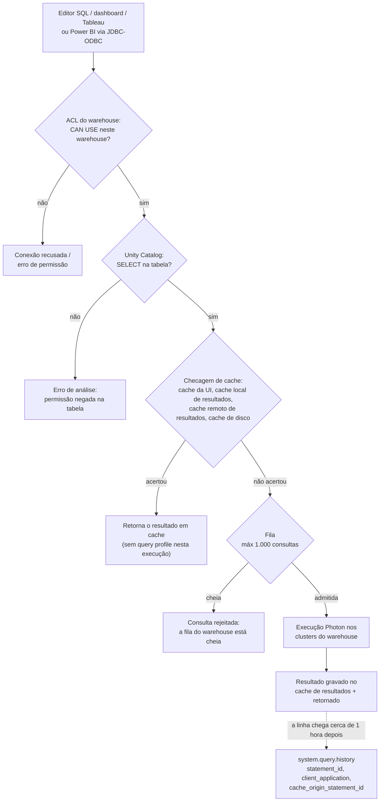
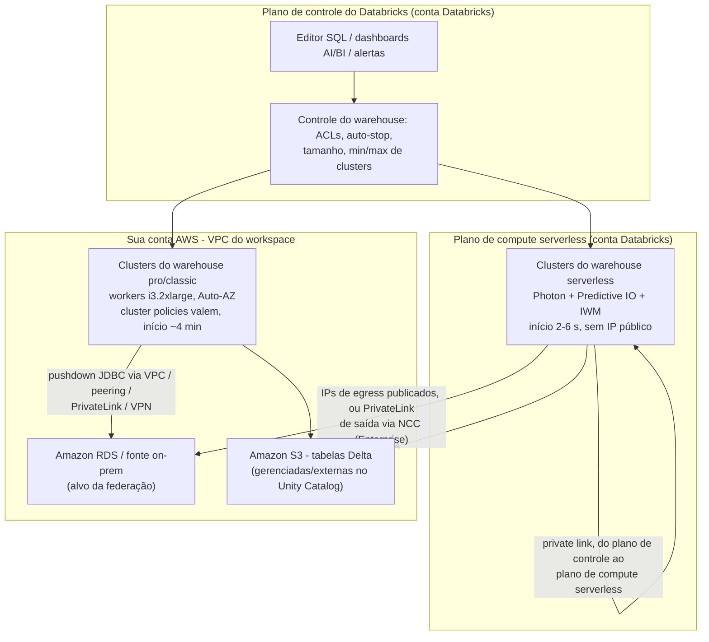
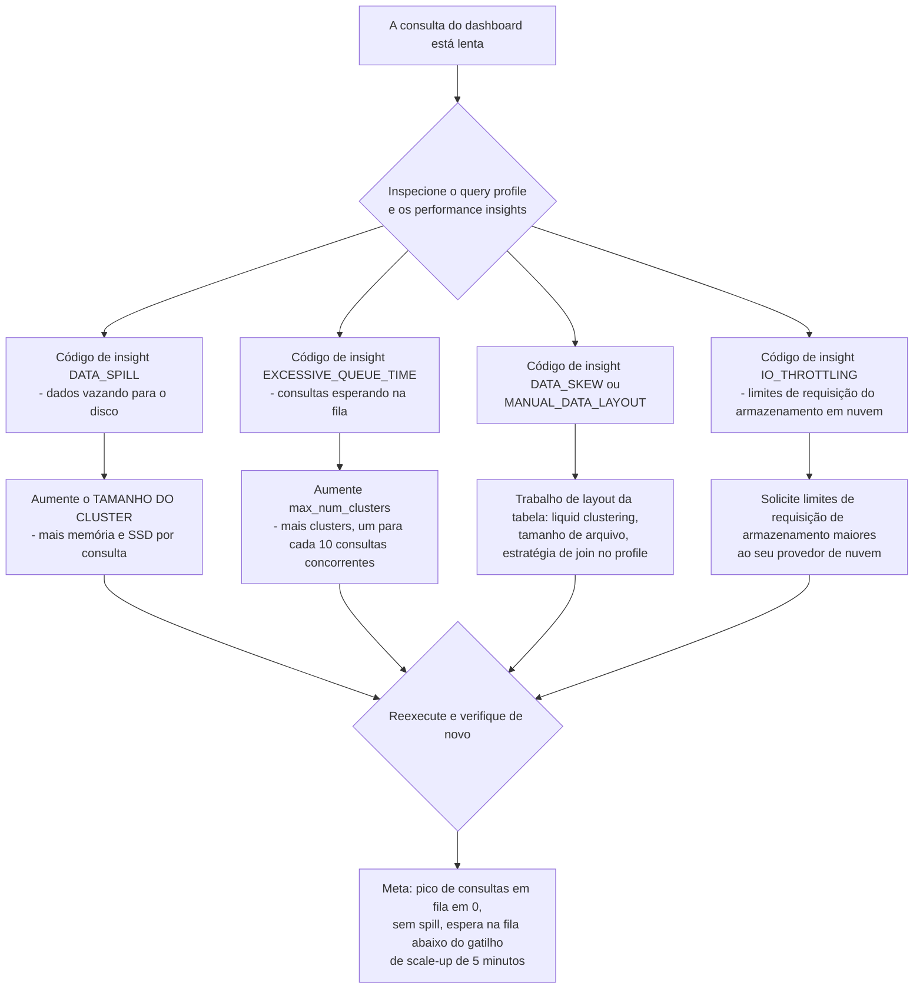
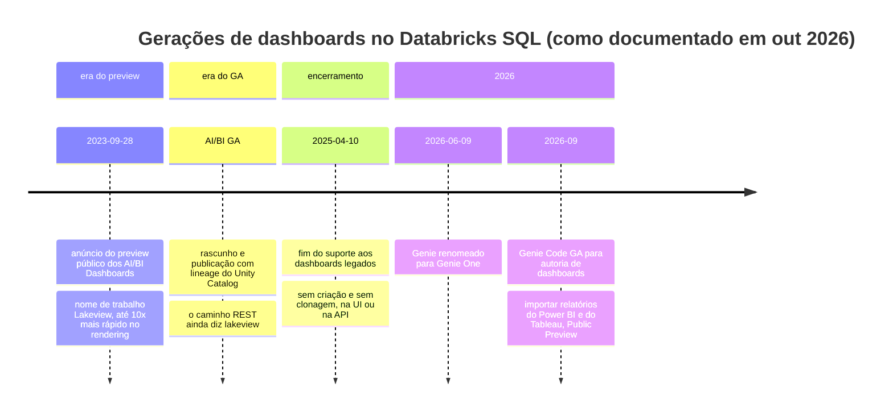
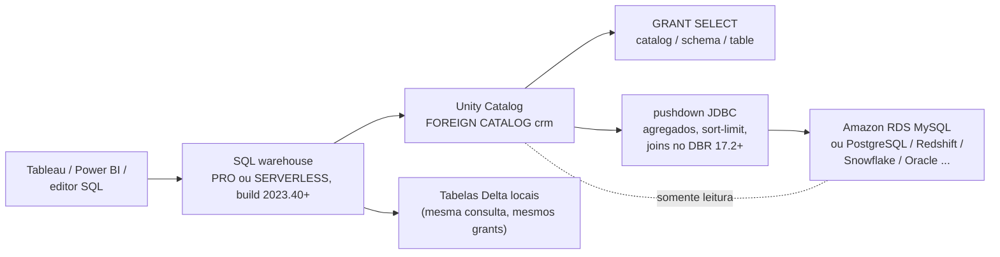

# Databricks SQL Warehouses e a Camada de Serviço: Serverless, Escalabilidade, Dashboards, BI e Federação

Tudo que vem antes neste curso termina do mesmo jeito: uma tabela Delta, governada pelo Unity Catalog, que alguém precisa *ler*. Analistas leem em um editor SQL, executivos leem em um dashboard, o Tableau lê via ODBC e um pipeline de relatórios lê por um catálogo federado. Na Databricks toda essa leitura acontece em uma única peça de compute, o **SQL warehouse**, e a escolha que você faz sobre qual tipo de warehouse, qual tamanho, qual janela de auto-stop e qual driver de BI é, ao mesmo tempo, uma decisão de latência, uma decisão de governança e uma fatura.

Esta lição é essa escolha, trabalhada de ponta a ponta. A espinha é uma única distinção que os docs de outubro de 2026 enunciam sem rodeios: **com um SQL warehouse pro ou classic a camada de compute existe na sua conta AWS; com um SQL warehouse serverless ela existe na conta Databricks** (docs.../compute/sql-warehouse/warehouse-types, atualizado em **11 de setembro de 2026**). Todo o resto, inícios frios de 2 a 6 segundos contra cerca de quatro minutos, cluster policies que deixam de valer, uma VPC gerenciada pelo cliente que deixa de importar, a nota de rodapé de $0.70 que diz "inclui o custo da instância na nuvem", decorre dessa única linha.

```text
 =============================================================
  MAPA DA LIÇÃO 08 - a camada de serviço SQL do Databricks, out 2026
 ------------------------------------------------------------
  Tipos     serverless | pro | classic  (GA)
            + Lakehouse//RT (Beta, só SELECT)
  Poder     Photon nos três . Predictive IO serverless+pro
            IWM só em serverless
  Local     serverless = conta Databricks (sem IP público)
            pro/classic = sua conta AWS, VPC, workers i3
  Início    serverless 2-6 s  .  pro/classic ~4 minutos
  Auto-stop 45/10 min pro-classic  .  10/5/1 min serverless
  Tamanho   1 cluster : 10 consultas concorrentes
            fila máx 1.000 . max_num_clusters 40
  Tarifas   $0.22 classic . $0.55 pro . $0.70 serverless
            (lista US, AWS, instantâneo da página 2026-10 -
             confira contra system.billing.list_prices na conta)
  Servir    editor SQL . dashboards AI/BI . alertas . ferramentas BI
            foreign catalogs do Lakehouse Federation
  ------------------------------------------------------------
  Regra da lição: o TIPO define onde o compute fica e quais
  recursos existem; o TAMANHO define poder por consulta; a
  contagem de clusters define concorrência; o auto-stop define
  quanto da fatura é ar.
 =============================================================
```

Nesta lição você vai:

- ler a **linha de warehouses de out 2026**, três tipos GA mais o Lakehouse//RT em Beta, e a matriz de capacidades que os separa (Photon, Predictive IO, Intelligent Workload Management);
- desenhar **onde o compute fica** na AWS (conta Databricks vs sua VPC), incluindo a história de egress do serverless e do PrivateLink de saída;
- percorrer **sete exemplos resolvidos**: uma **tabela de decisão de tipo de warehouse com a encantação da API**, **matemática de dimensionamento por concorrência**, um **cálculo de desperdício de auto-stop**, um **pacote de consultas de monitoramento**, uma **ficha de conexão de BI para Tableau e Power BI**, uma **sequência de DDL de consulta federada** e um **rascunho de custo mensal DBU + EC2 em duas colunas com tarifas de out 2026**;
- dimensionar um warehouse **do sintoma ao botão** usando os códigos do query profile e dos performance insights;
- construir **dashboards AI/BI, consultas salvas e alertas** e saber exatamente o que aconteceu com os dashboards legados;
- ligar **Tableau, Power BI, Excel e ferramentas do Partner Connect** com os nomes atuais dos drivers e os requisitos mínimos;
- esboçar o **Lakehouse Federation** com foreign catalogs e nomear o requisito que exclui silenciosamente os warehouses classic;
- estudar **NAB, Punchh e nCino** na AWS, ler a **caixa de atualizações de 2026** e praticar com **doze questões** mais quatro verificações interativas.

---

## 1. O que é o Databricks SQL e as duas portas por que toda consulta passa

### 1.1 Uma interface, muitas superfícies

Databricks SQL é "um data warehouse de nuvem construído sobre a arquitetura lakehouse. Ele roda diretamente no seu data lake" com ANSI SQL e extensões do Delta Lake (docs.../sql/, atualizado em **11 de setembro de 2026**). As superfícies documentadas: **SQL editor** (autoria com assistência de IA, comentários de código, histórico de versões), **notebooks** anexados a um warehouse, **jobs**, **dashboards**, **metric views**, **alerts**, **ETL** (tabelas streaming e materialized views definidas direto no SQL) e uma **REST API**: mais os monitores: query history, query profile e query performance insights.

A regra de compute que vale a pena memorizar: "Databricks uses SQL warehouses for compute in the following interfaces: **SQL editor · Databricks SQL queries · Dashboards · SQL alerts**" e, opcionalmente, notebooks, o file editor e Lakeflow Jobs (docs .../query, atualizado em **11 de setembro de 2026**). A mesma página acrescenta duas restrições que moldam todo o resto:

- "Quando você consulta dados com SQL warehouses, pode usar **apenas sintaxe SQL**."
- "Para workspaces habilitados para o Unity Catalog, **os SQL warehouses sempre usam o Unity Catalog** para gerenciar o acesso às fontes de dados."

E, na página de warehouse-types: "SQL warehouses não suportam credential passthrough. A Databricks recomenda usar o Unity Catalog para governança de dados." Não existe caminho de credencial por usuário em um warehouse: a governança é grant do Unity Catalog, ponto final.

### 1.2 As duas portas

Toda consulta por um warehouse passa por duas verificações independentes, e os alunos costumam confundi-las:

1. **A ACL do warehouse**, este principal pode usar este *compute*? (`CAN USE` para rodar, `CAN MONITOR` para ver profiles, `CAN MANAGE` para reconfigurar, seção 9.)
2. **O grant do Unity Catalog**; este principal pode ler esta *tabela*? (`SELECT` em catalog/schema/table.)

Passar por uma não diz nada sobre a outra. Um usuário com `CAN USE` no warehouse e sem `SELECT` na tabela recebe um erro de autorização; um usuário com `SELECT` e sem `CAN USE` nem chega ao motor. Ensine as duas, sempre.



Esse diagrama é também o modelo mental para o resto da lição: as seções 2 to 4 decidem *onde o compute está e quanto dele existe*, as seções 5 to 6 decidem *o que o usuário vê*, as seções 7 to 8 decidem *quais ferramentas podem falar com ele*, a seção 9 decide *quem pode* e a seção 10 decide *quanto custa*.

---

## 2. A linha de warehouses em out 2026: serverless, pro, classic, e uma Beta

### 2.1 Três tipos GA, uma Beta

"O Databricks SQL suporta os tipos **serverless, pro e classic**" e "Além disso, o **Lakehouse Real-Time (Beta)** é um tipo especializado de warehouse serverless para consultas de leitura sub-segundo e de alta concorrência" que "suporta apenas consultas (SELECT)" (docs .../warehouse-types, atualizado em **11 de setembro de 2026**). A matriz de capacidades da mesma página:

| Capacidade | Serverless | Pro | Classic |
|---|---|---|---|
| Motor Photon | ✓ | ✓ | ✓ |
| Predictive IO | ✓ | ✓ |: |
| Intelligent Workload Management (IWM) | ✓ |, |, |
| Local do compute | **conta Databricks** | **sua conta AWS** | **sua conta AWS** |
| Início frio | **2 to 6 segundos** | **~4 minutos** | **~4 minutos** |
| Tarifa de lista (EUA, AWS, instantâneo 2026-10) | **$0.70/DBU** ("inclui o custo da instância na nuvem") | **$0.55/DBU** | **$0.22/DBU** |

Três consequências decorrem da linha do meio apenas:

1. **Pro e classic herdam a sua rede AWS.** Rodam como EC2 na VPC do workspace, escolhem uma availability zone via Auto-AZ e são governados por cluster policies, configurações de spot e o seu desenho de VPC/PrivateLink (a rede do workspace da Lição 02).
2. **Serverless não.** "VPCs gerenciadas pelo cliente não se aplicam aos recursos de compute dos SQL warehouses serverless", "**Cluster policies, incluindo políticas de instâncias spot, não são suportadas**" e "os SQL warehouses serverless não têm endereços IP públicos" (docs .../sql/admin/serverless, atualizado em **10 de junho de 2026**).
3. **Classic é o padrão da API ao mesmo tempo em que é o tipo menos capaz.** Usando a UI "o tipo padrão de SQL warehouse é serverless"; usando a API de SQL warehouses com os padrões "o tipo padrão de SQL warehouse é **classic**. Para usar serverless, defina o parâmetro `enable_serverless_compute` como true e `warehouse_type` como pro." Terraform e scripts que omitem essa flag criam silenciosamente o único tipo de warehouse que não pode federar, não pode criar materialized views nem tabelas streaming e não pode chamar AI Functions.

### 2.2 Pré-requisitos de serverless na AWS (leia antes de prometer)

De docs .../sql/admin/serverless (atualizado em **10 de junho de 2026**): a conta "não pode estar em um período de teste gratuito"; o workspace "deve estar no **plano Premium ou superior**"; "SQL warehouses serverless são suportados em **todas as regiões da AWS**"; o workspace "não pode usar S3 access policies" e não pode usar "um **Hive metastore legado externo**" (warehouse-types repete a cláusula do metastore: "Se o seu workspace usa um Hive metastore externo legado, SQL warehouses serverless não são suportados"). A identidade é o Unity Catalog e a conectividade é privada: serverless "usa conectividade privada entre o plano de controle do Databricks e o plano de compute serverless em quase todos os casos."

- **📚 Você sabia?** O egress do serverless até os *seus* recursos é um problema separado da ausência de IPs públicos do próprio serverless. Para qualquer coisa fora do Amazon S3 ou do DynamoDB na mesma região, "o compute serverless usa **endereços IP públicos** para alcançar seus recursos", e desde **meados de fevereiro de 2026** a Databricks "publica IPs de saída em formato JSON em um endpoint público", depois de **25 de maio de 2026** as listas IP legadas foram descontinuadas (docs.../serverless-firewall, acesso em 2026-10). Para conectividade dedicada você usa **PrivateLink de saída por meio de uma network connectivity configuration**: cada conta recebe até **10 NCCs por região**, cada região **30 private endpoints** e cada NCC anexa até **50 workspaces**, e esse caminho exige o **plano Enterprise** (docs.../pl-to-internal-network, acesso em 2026-10).

### 2.3 Onde o compute fica, desenhado



A aresta da direita é a que os alunos ignoram: **a federação a partir de um warehouse serverless até um banco de dados privado ainda precisa atravessar um caminho de rede**, e o serverless traz as próprias regras de egress junto. Pro é a escolha documentada quando "você tem rede definida personalizada e quer se conectar a bancos de dados na sua rede" (warehouse-types, 11 de setembro de 2026).

### 2.4 Exemplo resolvido E1: tabela de decisão de tipo de warehouse e a encantação da API

**Entradas (três bifurcações, todas específicas da AWS):**

1. O workspace é elegível para serverless (Premium+, sem teste gratuito, sem Hive metastore legado externo, sem S3 access policies)?
2. Você precisa alcançar um banco de dados privado/on-prem para a federação, ou impor uma rede personalizada?
3. Você precisa de AI Functions, ou de materialized views / tabelas streaming criadas a partir do SQL?

| Bifurcação | Serverless | Pro | Classic |
|---|---|---|---|
| Elegível + sem necessidade de rede privada | **✓ escolha padrão**: início de 2 to 6 s, IWM, Predictive IO | OK, mas início de ~4 min e você é dono do EC2 | OK a $0.22/DBU, mas veja a linha 5 |
| Precisa de rede personalizada / caminho de federação | valem as regras de egress (IPs publicados ou PrivateLink de saída/Enterprise) | **✓ escolha documentada**: compute na sua conta | ✗ federação não suportada |
| AI Functions (`ai_gen`, `ai_query`, `ai_summarise`) | ✓ | ✓ | **✗ "not available on Classic SQL warehouses"** (docs .../ai-functions, **9 de outubro de 2026**) |
| `CREATE MATERIALIZED VIEW` / tabela streaming a partir do SQL | ✓ | **✓ "created using a Pro or Serverless SQL warehouse"** | ✗ |
| Mais barato por DBU | $0.70 tudo incluído | $0.55 + o seu EC2 | **$0.22 + o seu EC2** |

**O corpo de API que te dá serverless** (docs .../api/warehouses/v1/warehouse, acesso em 2026-10):

```text
POST /api/2.0/sql/warehouses
{
  "name": "bi-serverless-lg",
  "warehouse_type": "PRO",
  "enable_serverless_compute": true,
  "cluster_size": "Large",
  "min_num_clusters": 1,
  "max_num_clusters": 4,
  "auto_stop_minutes": 10,
  "tags": [{"key": "team", "value": "bi"}]
}
```

`warehouse_type` aceita apenas `PRO` ou `CLASSIC`; serverless é `PRO` **mais** `enable_serverless_compute: true`. Esqueça a flag e você construiu um warehouse pro: que é um warehouse perfeitamente bom, só que com início frio de quatro minutos e uma linha de EC2 na sua fatura da AWS. Tags são limitadas a **menos de 45 por warehouse** e existem, nas palavras da própria API, "to monitor the cost of cloud resources used by users and groups."

---

## 3. Dimensionamento: tamanhos em camiseta, a regra de concorrência e os limites rígidos

### 3.1 A escada de tamanhos

Os tamanhos vão de **2X-Small → 5X-Large** e, para classic/pro, a escada é concreta: "Todos os workers usam instâncias **i3.2xlarge**" (docs .../compute/sql-warehouse/warehouse-behavior, atualizado em **8 de outubro de 2026**).

| Tamanho | Workers (classic/pro) | Tipo de instância do driver |
|---|---|---|
| 2X-Small | 1 | i3.2xlarge |
| X-Small | 2 | i3.2xlarge |
| Small | 4 | i3.4xlarge |
| Medium | 8 | i3.8xlarge |
| Large | 16 | i3.8xlarge |
| X-Large | 32 | i3.16xlarge |
| 2X-Large | 64 | i3.16xlarge |
| 3X-Large | 128 | i3.16xlarge |
| 4X-Large | 256 | i3.16xlarge |
| **5X-Large** | **512** | i3.16xlarge: **Public Preview** para pro e serverless |

Só o driver escala, i3.2xlarge → i3.4xlarge → i3.8xlarge → i3.16xlarge, enquanto todo worker continua i3.2xlarge (mesma página). Os docs observam que a tabela "pode variar conforme a disponibilidade do produto ou da região e a carga de trabalho"; leia `system.compute.warehouses` para ver a forma que você realmente recebeu.

O padrão ao criar um warehouse na UI é **X-Large**. O cache de disco vive nos SSDs locais desses workers (seção 6), é por isso que a família storage-optimised i3 importa para o desempenho de consulta e é por isso que o preço do lado da AWS de um nó i3 importa para o rascunho de custo da seção 10.

### 3.2 Concorrência é um botão de *número de clusters*, não de tamanho

Regras documentadas (warehouse-behavior 8 de outubro de 2026; create 11 de setembro de 2026):

- **"um cluster para cada 10 consultas concorrentes"**: a regra prática de dimensionamento, enunciada nas duas páginas.
- **"O número máximo de consultas em uma fila para todos os tipos de warehouse é 1.000."**
- Limites da API: `max_num_clusters` **≤ 40**; `min_num_clusters` ≤ min(max, **30**); padrão do min **1**. Aumentar `min_num_clusters` "vai garantir que um número maior de clusters esteja sempre rodando e, portanto, pode **reduzir o tempo de início frio**": a um custo contínuo de cobrança.
- Teto do workspace: **1.000 SQL warehouses** no total, fixo (docs .../resources/limits, **9 de outubro de 2026**).
- **"A Databricks recicla clusters que estão rodando há mais de 24 horas"** e pode terminá-los à força, então nenhuma consulta individual nem sessão de notebook anexado deve assumir clusters imortais.

A regra dos dois botões que conserta a maioria dos dashboards: **tamanho (cluster size) compra poder por consulta; `max_num_clusters` compra concorrência.** Vazamento para disco é o primeiro botão; enfileiramento é o segundo.

```plot
{
  "type": "bar",
  "title": "Tamanho do warehouse vs concorrência (escada classic/pro, em 8 de out de 2026): tamanho adiciona workers, contagem de clusters adiciona slots de consulta",
  "xLabel": "Tamanho do warehouse",
  "yLabel": "Workers por cluster / slots de consulta concorrentes",
  "xKey": "size",
  "dataKeys": ["workers_per_cluster", "query_slots_at_max_4_clusters"],
  "data": [
    {"size": "2X-Small", "workers_per_cluster": 1, "query_slots_at_max_4_clusters": 40},
    {"size": "X-Small", "workers_per_cluster": 2, "query_slots_at_max_4_clusters": 40},
    {"size": "Small", "workers_per_cluster": 4, "query_slots_at_max_4_clusters": 40},
    {"size": "Medium", "workers_per_cluster": 8, "query_slots_at_max_4_clusters": 40},
    {"size": "Large", "workers_per_cluster": 16, "query_slots_at_max_4_clusters": 40},
    {"size": "X-Large", "workers_per_cluster": 32, "query_slots_at_max_4_clusters": 40},
    {"size": "2X-Large", "workers_per_cluster": 64, "query_slots_at_max_4_clusters": 40},
    {"size": "3X-Large", "workers_per_cluster": 128, "query_slots_at_max_4_clusters": 40},
    {"size": "4X-Large", "workers_per_cluster": 256, "query_slots_at_max_4_clusters": 40},
    {"size": "5X-Large (Preview)", "workers_per_cluster": 512, "query_slots_at_max_4_clusters": 40}
  ]
}
```

A série plana é a lição: com `max_num_clusters` fixado em 4 você tem **4 × 10 = 40 slots de consulta concorrentes em qualquer tamanho**, de um 2X-Small com 1 worker até um 5X-Large com 512 workers. Ir mais largo no eixo do tamanho multiplica o poder por consulta (e o custo) sem admitir nenhuma consulta concorrente extra; ir mais largo em `max_num_clusters` faz o oposto. Os nomes dos tamanhos de warehouse são idênticos entre os tipos, mas os tamanhos serverless são cobrados a uma taxa fixa de DBU-por-hora que depende do tamanho escolhido (docs answers, página datada de **2026-08-27**).

### 3.3 Exemplo resolvido E2: dimensionar 30 usuários de dashboard concorrentes

**Cenário.** Uma equipe de BI com **30 usuários de dashboard concorrentes**, consulta média de 4 s, dashboards rodando das 09:00 às 18:00, **21 dias úteis por mês**.

```text
Passo 1  concorrência -> clusters
         taxa documentada: 1 cluster para cada 10 consultas concorrentes
         clusters = ceil(30 / 10) = 3 clusters
         -> min_num_clusters 1 .. max_num_clusters >= 3 (a API permite até 40)

Passo 2  tamanho por cluster: Medium (8 workers) vs Large (16 workers)
         decida pelo query profile, não pelo organograma:
         DATA_SPILL presente       -> aumente o TAMANHO do cluster (memória/SSD por consulta)
         tempo de fila domina      -> aumente max_num_clusters (concorrência)
         nenhum dos dois, mas lento -> ajuste de operador/join no profile

Passo 3  checagem de fan-out (a armadilha do dashboard)
         um dashboard com 20 widgets pode disparar 20 consultas quase simultâneas
         20 widgets x ~30 usuários NÃO é 600: os widgets compartilham a
         sessão do usuário, mas a rajada ainda chega como dezenas de
         consultas enfileiradas
         -> dimensione max_num_clusters para a PRIMEIRA reunião grande do dia

Passo 4  latência do autoscaler classic/pro (docs, 8 de out de 2026)
         uma consulta espera 5 minutos          -> o warehouse escala para cima
         carga baixa por 15 min consecutivos    -> escala para baixo até a necessidade de pico
         carga 2-6 min -> +1 cluster, 6-12 -> +2, 12-22 -> +3,
         acima de 22 min -> +3 mais 1 a cada 15 minutos adicionais
         => o autoscaler NÃO vai salvar uma rajada de 60 consultas no minuto um.

Passo 5  alternativa serverless
         comece com UM warehouse MAIOR e deixe o IWM gerenciar a concorrência;
         "It is usually more efficient to size down if necessary than to
          start small and scale up" (warehouse-behavior, 8 de out de 2026)
```

Resposta: **três clusters no mínimo** sob a taxa documentada, dimensionados em Medium ou Large a partir da evidência de vazamento, com `max_num_clusters` definido antes da rajada de pico, e, em serverless, um único warehouse maior com IWM no lugar de ajustar à mão três clusters.

### 3.4 Sintoma → botão



Dois limites rígidos ficam atrás dessa árvore: a fila segura no máximo **1.000 consultas**, e o profile de um resultado **em cache** não existe (seção 6), então o benchmark precisa derrotar o cache primeiro ou a árvore vai parecer mais limpa do que a realidade.

---

## 4. Escalabilidade, auto-stop e a economia do cold start

### 4.1 Dois modelos de scaling, não um

Dois modelos de scaling documentados: um por família de warehouse:

- **Classic e pro: min/max de clusters mais autoscaling baseado em carga**, com as faixas de carga citadas no E2 (adicionar clusters depois de 2 to 6, 6 to 12, 12 to 22 minutos de carga; escalar para cima quando uma consulta espera **5 minutos**; escalar para baixo depois de **15 minutos consecutivos** de carga baixa). As availability zones são resolvidas por **Auto-AZ**.
- **Serverless: Intelligent Workload Management.** "O IWM usa **modelos de machine learning** para gerenciar recursos de compute dinamicamente"; quando a capacidade falta "a consulta é colocada em uma fila" e "se os tempos de espera aumentam, o autoscaler provisiona rapidamente mais clusters" (warehouse-behavior, 8 de outubro de 2026). O IWM é exclusivo de serverless: pro e classic ganham Photon e Predictive IO, mas não IWM.

### 4.2 Auto-stop: a otimização mais barata deste curso

| Tipo de warehouse | Padrão de auto-stop | Mínimo | Fonte (data) |
|---|---|---|---|
| Pro e classic | **45 minutos** | **10 minutos** | docs .../sql-warehouse/create (**11 de setembro de 2026**) |
| Serverless | **10 minutos** | **5 minutos** (UI) · **1 minuto** (API) | mesma página |

E a frase do dinheiro, literal: "**SQL warehouses ociosos continuam acumulando DBU e cobranças de instância na nuvem até serem parados.**" (mesma página). Um warehouse cobra enquanto está *ligado*: não enquanto está ocupado.

> ⚠️ **AVISO, o padrão de auto-stop é uma decisão de cobrança que você herda.** O padrão de 45 minutos de pro/classic foi escolhido por conforto, não por economia: todo intervalo menor que 45 minutos mantém um warehouse (e suas instâncias EC2, *na sua* conta AWS) faturável. Em contrapartida, um warehouse serverless no seu **mínimo de 1 minuto pela API** para entre duas atualizações de dashboard de um usuário: barato, e a apenas um reinício de **2 to 6 segundos** de distância. Em um warehouse **pro/classic** esse mesmo reinício é de **~4 minutos**, que os usuários leem como uma indisponibilidade. Combine o auto-stop com o comportamento do cliente: extrações e refreshs agendados → auto-stop mais longo ou `min_num_clusters = 1`; humanos interativos em serverless → auto-stop curto. E nunca configure o auto-stop como "never": a frase de cobrança por ociosidade dos docs é incondicional.

### 4.3 Exemplo resolvido E3: quanto custa por mês um padrão de auto-stop

**Cenário (premissas declaradas: reexecute com o seu próprio tráfego):** um warehouse pro servindo dashboards com tráfego real apenas em dois picos: **09:00 to 10:00 e 14:00 to 15:00**: ao longo de **21 dias úteis**.

```text
Tráfego útil      2 h/dia x 21 dias                =  42.0 h/mês

Auto-stop 45 min (o padrão pro/classic)
  sessão da manhã 09:00 -> 10:00 + 45 min          =  1.75 h/dia
  sessão da tarde 14:00 -> 15:00 + 45 min          =  1.75 h/dia
  tempo ligado    3.50 h/dia x 21                  =  73.5 h/mês
  desperdício     73.5 - 42.0                      =  31.5 h/mês

Auto-stop 10 min (o mínimo pro/classic documentado)
  sessão da manhã 09:00 -> 10:10                   =  1.167 h/dia
  sessão da tarde 14:00 -> 15:10                   =  1.167 h/dia
  tempo ligado    2.333 h/dia x 21                 =  49.0 h/mês
  desperdício     49.0 - 42.0                      =   7.0 h/mês

Horas recuperadas por uma mudança de configuração = 73.5 - 49.0 = 24.5 h/mês
Na forma ilustrativa 2X-Small (4 DBU/h, 2 x i3.2xlarge):
  coluna DBU   24.5 h x 4 DBU/h x $0.22  = $ 21.56
  coluna AWS   24.5 h x 2 x $0.624/h     = $ 30.58
  economia em UM warehouse                = $ 52.14/mês
  x 20 warehouses em um workspace         ~ $ 1,043/mês
```

Tarifas: SQL Classic **$0.22/DBU** (instantâneo de página **2026-10**) e AWS us-east-1 sob demanda **i3.2xlarge $0.624/h** (lista de preços do AWS EC2, lida em **2026-10-12**). A emissão de **4 DBU/h** é uma cifra *ilustrativa* por tamanho: a página de preços publica **$/DBU apenas**, então leia o seu próprio DBU/hora por tamanho em `system.billing.list_prices` (seção 10). O ponto sobrevive à substituição: **vinte minutos desnecessários de auto-stop em vinte warehouses eclipsam qualquer mudança de tier de tamanho.**

- **📚 Você sabia?** Auto-stop é só metade da história da ociosidade. Aumentar `min_num_clusters` "reduz o tempo de início frio de novas consultas" (Warehouses API, acesso em 2026-10), mas mantém clusters faturáveis quentes 24 horas por dia: enquanto em serverless o início frio já é de **2 to 6 segundos**, então `min_num_clusters > 1` raramente vale a pena pagar. E como "a Databricks recicla clusters que estão rodando há mais de 24 horas", um warehouse que nunca fica ocioso ainda tem seus clusters reciclados, com possível terminação forçada de trabalho de longa duração (docs.../sql-warehouse/create, 11 de setembro de 2026).

---

## 5. Consultas, dashboards e alertas: a bancada do DBSQL

### 5.1 Consultas salvas têm suas próprias permissões

O SQL editor vem com assistência de IA, comentários de código e histórico de versões (docs .../sql/, 11 de setembro de 2026). Consultas salvas são securables em si mesmas (docs .../sql/user/queries, atualizado em **29 de abril de 2026**):

- compartilhar uma consulta exige **`CAN MANAGE`** naquela consulta;
- dois modos de credencial: **"Run as viewer"**, "A credencial do visualizador é usada para executar a consulta. O visualizador também precisa ter permissões de pelo menos **CAN USE** no warehouse", versus **"Run as owner"**;
- "Um usuário administrador do workspace Databricks tem acesso de visualização a todas as consultas do workspace."

A UI de query history mantém **30 dias** de histórico; você vê as suas próprias consultas como dono, ou as de outros se tiver pelo menos `CAN VIEW` no warehouse que as executou. Qualquer coisa mais longa vai para `system.query.history` (seção 6).

### 5.2 Dashboards AI/BI: a geração Lakeview, agora a única geração

"Os dashboards AI/BI apresentam autoria com assistência de IA, uma biblioteca de visualização aprimorada e uma experiência de configuração simplificada" (docs .../dashboards, atualizado em **11 de setembro de 2026**). O conjunto de capacidades documentado: datasets e visualizações; filtros em nível de página/widget/global com **cross-filtering** e **drill-through**; cálculos personalizados; rascunho/publicação; **"Quando publicados, seus dashboards podem ser compartilhados com qualquer pessoa registrada na sua conta Databricks, mesmo que ela não tenha acesso ao workspace"**; **incorporação por iframe**; agendamento e assinatura por e-mail ou Slack; **integração com Git / controle de versão**; **Declarative Automation Bundles**; APIs REST; agendamento como **Lakeflow Job**; agentes Genie; monitoramento de uso por logs de auditoria e system tables; e lineage do Unity Catalog integrado.

**Os dashboards legados acabaram.** "Fim do suporte aos dashboards legados: **10 de abril de 2025**. Você não pode mais criar ou clonar dashboards legados usando a UI ou a API" (docs.../ai-bi/release-notes/2025); a documentação legada foi aposentada, e o endpoint de migração `POST /api/2.0/lakeview/dashboards/migrate` está marcado como **Deprecated** com a nota "Use Lakeview (AI/BI) dashboards instead" (referência da API Lakeview, acesso em 2026-10).



- **📚 Você sabia?** O nome que você vê na API é um fóssil. Os dashboards AI/BI "eram anteriormente conhecidos como Lakeview dashboards. A API Lakeview ainda mantém esse nome", então toda chamada create/list/publish continua sendo `/api/2.0/lakeview/dashboards/*` mesmo quando a UI diz AI/BI (docs.../dashboards, 11 de setembro de 2026; referência da REST API, acesso em 2026-10). Qualquer script, recurso de Terraform ou tutorial que fala em "migrar para o Lakeview" está escrevendo história de 2023 to 2024: o endpoint de migração está deprecado e dashboards legados não podem ser criados de forma alguma desde **2025-04-10**.

### 5.3 Alertas

"Use os alerts do Databricks SQL para executar consultas periodicamente, avaliar condições definidas e enviar notificações se uma condição for atendida" (docs.../sql/user/alerts, página datada de **28 de julho de 2026**). Desde maio de 2025 o editor é consolidado, configuração da consulta, condições, agendamentos e destinos de notificação em uma única interface, e os alertas legados continuam funcionando ao lado dele (release notes, maio de 2025). Alertas são a metade de fechamento do loop de monitoramento: anexe um à consulta de higiene da frota no E4 e um warehouse cujo auto-stop passe dos 30 minutos aciona alguém em vez de faturar quieto.

---

## 6. Cache, o query profile e as system tables

### 6.1 Quatro caches, quatro vidas úteis

| Cache | Escopo | Vida útil | Armadilha |
|---|---|---|---|
| **Cache da UI do Databricks SQL** | por usuário | **no máximo 7 dias** | "não se aplica aos dashboards AI/BI" |
| **Cache local de resultados** | por cluster | vida do cluster | morre quando o warehouse para |
| **Cache remoto de resultados** | todo o workspace | sobrevive a parada/início | **exclusivo de serverless**; alcançável via ODBC/JDBC e pela SQL Statement API |
| **Cache de disco** | SSD local do worker | invalidado em mudança de arquivo | **≤ metade** do SSD local do worker; `CACHE SELECT` é **ignorado** em SQL warehouses e DBR 14.2+ |

(docs.../queries/query-caching e.../optimizations/disk-cache, acesso em 2026-10). Para medir com honestidade: `SET use_cached_result = false;`: documentado como apropriado "only in testing or benchmarking". Consultas determinísticas acertam os caches; um predicado no estilo `NOW()` os derrota e aí você paga preço cheio em cada execução.

### 6.2 O profile, os insights e seus significados

- **Query profile**: você precisa ser o **dono da consulta** ou ter pelo menos **`CAN MONITOR`** no warehouse; "Um query profile **não está disponível para consultas que executam a partir do cache de consultas**. Para contornar o cache de consultas, faça uma alteração trivial na consulta, como mudar ou remover o LIMIT" (docs.../query-profile, 10 de junho de 2026).
- **Query performance insights**: recomendações com código (docs.../performance-insights, 11 de setembro de 2026): `DATA_SPILL` → "Aumente o tamanho do warehouse para adicionar memória"; `EXCESSIVE_QUEUE_TIME` → "Aumente o **número máximo de clusters**"; `IO_THROTTLING` → solicite limites de requisição de armazenamento mais altos; mais `DATA_SKEW`, `MANUAL_DATA_LAYOUT` e as acelerações aplicadas `AUTO_LIQUID_CLUSTERING`, `HISTORY_BASED_JOIN_STRATEGY`, `SHORT_QUERY_PRIORITIZATION`.
- **System tables**: a mesma história dos dados: `system.query.history` (Public Preview, **365 dias**, regional, registros "tipicamente disponíveis **dentro de uma hora**"), `system.compute.warehouses` (instantâneos de configuração), `system.compute.warehouse_events` (eventos de início/parada/scale), `system.billing.usage` e `system.billing.list_prices` (o log de preços, retenção indefinida, global).

Nota de acesso sobre `system.query.history`: "Por padrão, **apenas administradores** têm acesso à system table… A Databricks recomenda criar uma **view dinâmica** para cada usuário ou grupo" (docs .../system-tables/query-history, página datada de **21 de setembro de 2026**). A coluna `client_application` dela é o que diz se uma consulta veio do "Databricks SQL Editor, Tableau, and Power BI", e `cache_origin_statement_id` é como você prova que um resultado veio do cache.

### 6.3 Exemplo resolvido E4: um pacote de monitoramento para a frota de warehouses

```sql
-- (a) fleet hygiene: warehouses that idle-expire late
SELECT warehouse_name, warehouse_type, warehouse_size,
       min_clusters, max_clusters, auto_stop_minutes
FROM   system.compute.warehouses
WHERE  delete_time IS NULL AND auto_stop_minutes > 30;

-- (b) who is actually using which warehouse (about 1-hour latency)
SELECT w.warehouse_name, q.client_application,
       COUNT(*) AS queries, SUM(q.total_duration_ms)/1000 AS seconds
FROM   system.query.history q
JOIN   system.compute.warehouses w ON w.warehouse_id = q.warehouse_id
WHERE  q.execution_status = 'FINISHED'
GROUP  BY 1, 2 ORDER BY queries DESC;

-- (c) cache effectiveness: rows whose statement differs from the origin
SELECT COUNTIF(cache_origin_statement_id <> statement_id) / COUNT(*) AS hit_rate
FROM   system.query.history
WHERE  warehouse_id = 'abc123';

-- (d) cost: DBU spend by SKU for the month
SELECT sku, usage_type, product_feature,
       SUM(metered_quantity) AS dbus, SUM(unblended_cost) AS cost
FROM   system.billing.usage
WHERE  billing_month = date_format(current_date, 'yyyy-MM')
GROUP  BY 1, 2, 3 ORDER BY cost DESC;
```

Fontes: página de monitoring-queries (docs.../sql-warehouse/monitor/queries, **11 de setembro de 2026**), referência de query-history (**21 de setembro de 2026**), system tables de billing (atualizado em **2026-10-08**). A consulta (a) é a que se acopla a um alerta; a consulta (d) é a que se publica em um dashboard AI/BI: a Databricks entrega consultas de custo prontas e um Usage Dashboard pré-montado exatamente para isso (docs.../admin/usage/system-tables, 11 de setembro de 2026).

---

## 7. Conectividade de BI: primeiro os drivers, depois as ferramentas

### 7.1 A situação dos drivers em out 2026

| Linha do driver | Versão atual (out 2026) | Situação |
|---|---|---|
| **Databricks JDBC Driver** (código aberto) | **3.4.3** | atual; "a Databricks suporta cada versão de driver por pelo menos **2 anos**" |
| Simba JDBC | 2.8.3 (2026-07-20) | legado: migre |
| **Databricks ODBC Driver** | **2.12.1** (2026-08-06) | atual |
| Simba Spark ODBC | última entrada 2.10.0 (2026-02-26) | **"The Simba Spark ODBC Driver is deprecated."** |

(docs .../integrations/odbc/download, espelho de página datado de **11 de setembro de 2026**; páginas de download e de arquivo do driver, acesso em 2026-10). A renomeação de fevereiro de 2026 importa operacionalmente: "A partir de fevereiro de 2026, novas versões do driver ODBC estão sendo publicadas pela Databricks e o driver foi renomeado para Databricks ODBC Driver." Caminhos de instalação: Windows `C:\Program Files\Databricks ODBC Driver`, macOS `/Library/databricks/databricksodbc`, Linux `/opt/databricks/databricksodbc`. Algumas ferramentas embutem o driver (versões recentes do Power BI Desktop); o Tableau Desktop não.

O denominador comum em todas as ferramentas: conexão = **Server Hostname + HTTP Path de um SQL warehouse**, autenticação = OAuth / login Databricks / personal access token / service principal. **Usuário/senha está morto**: a própria ajuda do Tableau registra que "Basic authentication using a Databricks user name and password reached end of life as of **July 2024**."

### 7.2 A matriz de ferramentas

| Ferramenta | Requisitos mínimos (docs, 2026) | Observações |
|---|---|---|
| **Tableau** | Tableau Desktop **2021.4+**, Databricks ODBC **2.6.19+** (página datada de **22 de julho de 2026**) | Server Hostname + HTTP Path; tile do Partner Connect; auth: login Databricks (recomendado), PAT, service principal |
| **Power BI** | consultas SQL nativas exigem **Power BI v2.112.603.0+**; **ADBC ou ODBC** (página datada de **20 de agosto de 2026**) | "**SQL warehouses Databricks são recomendados ao usar o Power BI no modo DirectQuery**"; ADBC **obrigatório para Lakehouse//RT**; service principals OAuth M2M, SSO com Microsoft Entra ID, publicação no serviço |
| **Excel** | Databricks Excel Add-in, Public Preview (páginas datadas de **11 de setembro / 6 de agosto de 2026**) | um admin do workspace precisa **habilitar o preview do Excel Connector**; **apenas SSO**; exige `CAN USE` em um warehouse; pode gravar de volta em uma tabela do Unity Catalog e usar o Genie |
| **Tiles do Partner Connect** |: | **Hex, Power BI, Preset, Qlik Sense, Sigma, Tableau, ThoughtSpot** (docs.../partner-connect/bi) |

- **📚 Você sabia?** Versões de driver são um compromisso de *suporte*, não apenas uma lista de download: "a Databricks suporta cada versão de driver por pelo menos **2 anos**" (página de download do driver, acesso em 2026-10). O arquivo também carrega um aviso que vale ler uma vez: versões do Simba JDBC anteriores a **2.6.21** dependem de uma biblioteca com **CVE-2021-44228** (Log4Shell): uma razão concreta pela qual os docs "strongly recommend migrating" para fora das linhas Simba.

### 7.3 Exemplo resolvido E5: ficha de conexão de BI (especificação copiar/colar)

**Tableau Desktop → um SQL warehouse serverless**

```text
Servidor      : dbc-01234567890abcdef0123.cloud.databricks.com   (porta 443)
HTTP Path     : /sql/1.0/warehouses/a1b2c3d4e5f67890              (HTTP path do warehouse)
Driver        : Databricks ODBC Driver 2.12.1  (>= 2.6.19 exigido)
Autenticação  : OAuth / login Databricks  (usuário+senha EOL julho de 2024)
Catálogo      : main            Schema: analytics
Requisitos    : Tableau Desktop 2021.4+
Entrada       : Marketplace -> Partner Connect -> tile do Tableau
                (baixa um arquivo de conexão; precisa de CAN USE no warehouse)
```

**Power BI → o mesmo warehouse**

```text
Conector      : Databricks (driver ADBC suportado; ADBC OBRIGATÓRIO para Lakehouse//RT)
Modo          : Import para refresh agendado; DirectQuery -> SQL warehouse recomendado
SQL nativo    : Power BI v2.112.603.0 ou acima
Auth de serv. : OAuth M2M com service principal registrado no Unity Catalog
SSO           : Microsoft Entra ID
Metric views  : modo de compatibilidade de BI, ou MEASURE() dentro de uma consulta nativa
Armadilha     : um warehouse parado dá erro em todo cliente até alguém com
                CAN MONITOR (ou o dono) religá-lo
```

As duas fichas assumem as duas portas da seção 1: `CAN USE` no warehouse para a *identidade da ferramenta*, `SELECT` nas tabelas subjacentes para essa mesma identidade (um service principal precisa das duas). Some o `auto_stop_minutes` do warehouse à ficha: uma extração agendada a cada 15 minutos contra um warehouse serverless com auto-stop de 10 minutos paga um reinício de 2 to 6 segundos cada vez, enquanto o mesmo agendamento contra um warehouse pro paga ~4 minutos.

---

## 8. Lakehouse Federation: consultando outros sistemas a partir do Databricks SQL

### 8.1 O que é

"O **Lakehouse Federation** é a plataforma de query federation do Databricks. Ele fornece acesso governado e **somente leitura** a dados externos por meio de foreign catalogs do Unity Catalog, com pushdown automático de consultas e controles de acesso refinados no nível da tabela" (docs .../query-federation, atualizado em **29 de setembro de 2026**). Dois sabores:

- **query federation**: empurrado para o banco de dados externo via **JDBC**; "A consulta roda no Databricks e no compute remoto… **Não suportado (somente leitura)**" para escritas;
- **catalog federation**: "Roda diretamente contra o object storage, apenas no compute do Databricks. Mais econômico e otimizado para desempenho."

**Listas de fontes verificadas (out 2026).** Query federation: MySQL, PostgreSQL, Teradata, Oracle, Amazon Redshift, Salesforce Data 360, Snowflake, Microsoft SQL Server, Azure Synapse, Google BigQuery, Databricks. Catalog federation: Hive metastore legado do Databricks, Hive metastore externo, **AWS Glue metastore**, Salesforce Data 360, Snowflake, Palantir Foundry, Workday Data Connect, Google Cloud Lakehouse.

### 8.2 O requisito que exclui os warehouses classic

Das páginas de federação MySQL e SQL Server (**19 de agosto / 11 de setembro de 2026**): "O compute do Databricks deve usar o Databricks Runtime **13.3 LTS ou superior** e o modo de acesso **Standard ou Dedicated**"; "**SQL warehouses devem ser pro ou serverless e devem usar 2023.40 ou superior**"; o workspace deve ter o Unity Catalog habilitado (workspaces criados depois de **8 de novembro de 2023** têm). MySQL exige adicionalmente **SSL**. O pushdown é desigual por design: agregados, aritmética, booleano/bitwise e ordenação com limite descem em 13.3 LTS+; **joins exigem DBR 17.2+** (no MySQL: um toggle em Public Preview); **funções de janela não são suportadas no MySQL**. E quando os dois caminhos existem: "Quando a sua fonte suporta tanto Lakehouse Federation quanto Lakeflow Connect, a Databricks recomenda **Lakeflow Connect** se desempenho em volumes maiores de dados e menor latência forem prioridades."

> [!IMPORTANT]
> **Warehouse classic não podem federar.** A federação exige warehouses "pro ou serverless" no build **2023.40+**: os mesmos três vazamentos se repetem: classic não pode federar, não pode criar materialized views/tabelas streaming a partir do SQL e não pode rodar AI Functions. Como a **API de SQL warehouses tem o padrão classic**, todo módulo de Terraform ou script que esquece `enable_serverless_compute: true` (ou `warehouse_type: PRO` para um warehouse pro) cria exatamente o tipo de warehouse que falha nos três. Audite a frota com `SELECT warehouse_name, warehouse_type FROM system.compute.warehouses WHERE warehouse_type = 'CLASSIC'`.

### 8.3 Exemplo resolvido E6: consulta federada, MySQL no RDS → Databricks SQL

```sql
-- 1) connection: credentials come from a secret scope, never inline
CREATE CONNECTION mysql_crm TYPE MYSQL
  OPTIONS (host 'crm-cluster.abc.us-east-1.rds.amazonaws.com', port '3306',
           user     secret('crm.secrets', 'user'),
           password secret('crm.secrets', 'pass'));

-- 2) foreign catalog mirrors the remote database under Unity Catalog
CREATE FOREIGN CATALOG crm USING CONNECTION mysql_crm;

-- 3) governance is ordinary UC: catalog/schema/table level grants
GRANT SELECT ON CATALOG crm TO `data-analysts`;

-- 4) federated query: JDBC pushdown runs on BOTH the warehouse and MySQL
SELECT c.region, COUNT(*) AS orders, SUM(o.amount) AS revenue
FROM   crm.shop.customers c
JOIN   local_bronze.orders o ON o.customer_id = c.id   -- local Delta join
GROUP  BY c.region
ORDER  BY revenue DESC
LIMIT  20;
```

A referência de linguagem (docs.../sql-ref-federated-queries, datada de **29 de junho de 2026**) enquadra isso como exatamente três pré-requisitos: criar uma **foreign connection**, registrar **foreign catalogs**, conceder acesso, e observa que se aplica a "Databricks SQL · Databricks Runtime 13.3 LTS and above · **Unity Catalog only**". O join do passo 4 é a metade interessante: Delta local juntado ao MySQL remoto, com o lado remoto empurrado via JDBC e governado pelos mesmos grants das suas tabelas nativas. É **somente leitura**, **não** substitui ETL em volume, e o caminho de rede do seu warehouse até o RDS é seu para construir (VPC peering, PrivateLink ou VPN: seção 2.3).



---

## 9. Quem pode tocar no warehouse: ACLs, entitlements e o padrão de grupos

Permissões de warehouse, da matriz de ACLs (docs .../access-control, atualizado em **10 de julho de 2026**) e da página de criação de warehouse (**11 de setembro de 2026**):

| Permissão | O que concede |
|---|---|
| **CAN VIEW** | ver detalhes do warehouse e suas consultas; não pode executar (o nível somente-leitura da UI; a Permissions API o chama `CAN READ`) |
| **CAN MONITOR** | executar consultas **e** ver monitoramento, query history e **profiles**: é o nível de onde parte o acesso a profiles |
| **CAN USE** | executar consultas |
| **IS OWNER** | aplicada automaticamente ao criador do warehouse; carrega os direitos de parar, apagar e modificar permissões (os mesmos direitos de parada/apagar que o `CAN MANAGE` tem) mais a propriedade do objeto |
| **CAN MANAGE** | parar, apagar, editar configuração, modificar permissões; **admins do workspace o têm em todos os objetos** |

Duas entitlements ficam acima de tudo isso: a entitlement **`databricks-sql-access`** controla quem pode usar o Databricks SQL de forma alguida, e criar warehouses exige admin do workspace **ou** a entitlement **`Allow unrestricted cluster creation`**: "A maioria dos usuários não consegue criar SQL warehouses, mas pode reiniciar qualquer SQL warehouse ao qual possa se conectar." Warehouses apagados podem ser restaurados pelo suporte **dentro de 14 dias**.

O padrão de delegação a ensinar: `data-analysts` → `CAN USE` no warehouse de BI mais `SELECT` nos schemas gold; `bi-viewers` → `CAN VIEW`; `data-engineers` → `CAN MANAGE` no warehouse da plataforma e no seu auto-stop; service principals para Power BI/Tableau → `CAN USE` mais `SELECT`. Grupos, não indivíduos: caso contrário o `CAN MANAGE` em branco dos admins do workspace vira o único modelo que funciona, e a dispersão de admins vem junto.

---

## 10. Quanto custa: tarifas, medidores e a fatura em duas colunas

### 10.1 As tarifas (lista dos EUA, AWS, instantâneo de página 2026-10)

| SKU | Tarifa | Inclui a máquina? |
|---|---|---|
| SQL Classic | **$0.22 / DBU** | a página de preços não declara inclusão da instância; a frase de auto-stop cobra "DBU **e cobranças de instância na nuvem**" |
| SQL Pro | **$0.55 / DBU** | mesma coisa |
| SQL Serverless | **$0.70 / DBU** | **sim**: nota de rodapé "Inclui o custo da instância na nuvem" |
| Lakehouse//RT (Beta) | **$0.55 / DBU** | produto em Beta (instantâneo de página 2026-10) |

Ressalvas que você precisa imprimir ao lado de qualquer número: "Os preços do Databricks e da Infraestrutura de Nuvem podem variar conforme a região geográfica e o provedor de serviços de nuvem" (FAQ de preços, 2026-10); as tarifas serverless acompanham a infraestrutura regional, enquanto as tarifas classic são planas entre as regiões da AWS porque você paga o preço local do EC2 (uma leitura secundária do arquivo de dados da página de preços relatou **$0.91/DBU** para SQL Serverless em eu-central-1 contra $0.70 em us-east-1, 2026-08-07: confirme na conta); **as atualizações de materialized views e de tabelas streaming são cobradas às tarifas DLT serverless**, não à tarifa do seu warehouse (nota de rodapé 3 da página de preços, 2026-10); a inferência de AI Function é cobrada separadamente sob `MODEL_SERVING` / `AI_FUNCTIONS` (docs.../ai-functions, 9 de outubro de 2026). O número autoritativo é sempre o seu: `system.billing.list_prices` (retenção indefinida, global) cruzado com `system.billing.usage`.

### 10.2 Exemplo resolvido E7: um rascunho de custo mensal em duas colunas

**Premissas declaradas:** um warehouse **2X-Small** (driver + 1 worker = **2 × i3.2xlarge**), ligado por **193 h/mês** (≈9.2 h/dia × 21 dias úteis de BI em horário comercial), emissão ilustrativa de **4 DBU/h**, AWS us-east-1 sob demanda **i3.2xlarge $0.624/h** (lista de preços da AWS, lida em **2026-10-12**), tarifas em **2026-10**.

```text
DBUs consumidos  193 h x 4 DBU/h                     =  772 DBU
Coluna AWS       193 h x 2 nós x $0.624/h            = $240.86 / mês

(A) SQL Classic  $0.22/DBU
    DBU  772 x 0.22 = $169.84   + AWS $240.86  =  $410.70 / mês
(B) SQL Pro      $0.55/DBU
    DBU  772 x 0.55 = $424.60   + AWS $240.86  =  $665.46 / mês
(C) SQL Serverless $0.70/DBU ("Inclui o custo da instância na nuvem")
    DBU  772 x 0.70 = $540.40   + AWS   $0.00  =  $540.40 / mês

Sensibilidade: +50 h ociosas/mês (deriva do auto-stop) em (A)
    DBU  50 x 4 x 0.22 = $44.00  + AWS 50 x 1.248 = $62.40
    total acrescentado                  = $106.40 / mês
    -> a deriva custa mais que um tier inteiro de tamanho nesta forma
```

Leia como três lições, não como um ranking. **(A) só é o mais barato se você aceitar** início frio de ~4 minutos, sem Predictive IO, sem federação, sem AI Functions e sem criação de materialized views. **(C) vence (B) aqui** porque, nesta forma leve e estável, a coluna de EC2 do warehouse pro ($240.86) supera todo o prêmio de serverless ($540.40 − $424.60 = $115.80). E **a linha de sensibilidade de (A) é a manchete real**: são as horas ociosas, não as tarifas de lista, que dominam: ou seja, a aritmética de auto-stop da seção 4 aparecendo de novo na fatura. A cifra de **4 DBU/h** é uma emissão ilustrativa por tamanho; a página de preços publica **$/DBU apenas**, então extraia a sua própria emissão por tamanho de `system.billing.list_prices` para o seu contrato antes de citar um número para alguém.

---

## 11. As armadilhas: catorze confusões que esta lição não vai deixar você manter

1. **"Serverless roda na minha VPC."** Roda na conta Databricks: "VPCs gerenciadas pelo cliente não se aplicam", sem cluster policies, sem IPs públicos.
2. **"A API cria o mesmo warehouse da UI."** Padrão da UI = **serverless**; padrão da API = **classic**, a menos que `enable_serverless_compute` seja true e `warehouse_type` seja `PRO`.
3. **"Classic é a opção econômica."** É também a opção que **não pode federar, não pode criar MVs/STs e não pode rodar AI Functions**.
4. **"Um tamanho maior significa mais consultas concorrentes."** Concorrência é `max_num_clusters` × 10; tamanho é poder por consulta. Spill → tamanho; fila → clusters.
5. **"O autoscaler vai dar conta da rajada das 9h."** Classic/pro escala para cima só depois de uma consulta esperar **5 minutos**; o teto da fila é **1.000**.
6. **"Auto-stop de 45 minutos é inofensivo."** "SQL warehouses ociosos continuam acumulando DBU e cobranças de instância na nuvem até serem parados."
7. **"O auto-stop do serverless pode ser zero."** Mínimo de **5 min** na UI, **1 min** via API; o mínimo de pro/classic é **10 min**.
8. **"Eu consegui um query profile, então entendi a execução."** Não existe profile para um resultado **em cache**: mude o `LIMIT`.
9. **"Cache é cache."** Cache da UI (≤7 dias, não vale para AI/BI) ≠ cache local de resultados (morre com o cluster) ≠ cache remoto de resultados (exclusivo de serverless, sobrevive à parada) ≠ cache de disco (arquivos, ≤50% do SSD).
10. **"Dashboards legados ainda funcionam."** Fim do suporte em **2025-04-10**: sem criação, sem clonagem, endpoint de migração deprecado.
11. **"Lakeview é um produto diferente do AI/BI."** Mesmo produto, nome do preview de 2023 mantido no caminho REST `/api/2.0/lakeview/dashboards`.
12. **"Autenticação por senha funciona para o Tableau."** A autenticação básica "reached end of life as of **July 2024**"; e a linha Simba ODBC está deprecada desde a renomeação de **fevereiro de 2026**.
13. **"A federação me deixa gravar de volta."** Somente leitura, pushdown JDBC com suporte desigual; use **Lakeflow Connect** quando volume e latência importam.
14. **"A tarifa de $0.70 é a fatura inteira do serverless."** Atualizações de MV são cobradas às tarifas **DLT serverless**, a inferência de IA sob `MODEL_SERVING`/`AI_FUNCTIONS`, e a rede até a sua VPC pode carregar cobranças próprias.

---

> **Veredito Comparativo: warehouses SQL classic vs pro vs serverless (AWS, em out de 2026)**
> - **Classic, $0.22/DBU mais cobranças de instância na nuvem, início de ~4 minutos.** O padrão da API e o piso da linha: só Photon, sem Predictive IO, sem IWM. **Não pode federar, não pode criar materialized views nem tabelas streaming a partir do SQL, não pode rodar AI Functions.** Roda na sua VPC com cluster policies, configurações de spot e o cache de disco no SSD local i3. Escolha quando a carga é SQL simples em forma estável, o custo por DBU é a restrição que decide e nenhum dos três recursos faltantes se aplica, e configure o auto-stop para **10 minutos**, não 45.
> - **Pro, $0.55/DBU mais cobranças de instância na nuvem, início de ~4 minutos.** Tudo que o classic tem **mais Predictive IO**, e a escolha documentada quando "você tem rede definida personalizada e quer se conectar a bancos de dados na sua rede", isto é, federação de dentro da sua VPC. Ainda são suas instâncias, seu Auto-AZ, suas políticas, sua coluna de EC2. Escolha quando o alcance da rede privada pesa mais que a latência do início frio.
> - **Serverless: $0.70/DBU, máquina incluída, início de 2 to 6 segundos.** O padrão documentado para a maioria das cargas: **Photon + Predictive IO + IWM**, sem cluster policies (logo, sem guardrails baseados em política também), sem VPC gerenciada pelo cliente, sem IPs públicos, padrão de auto-stop de **10 minutos**, cobrança por segundo sem cobrança por ociosidade além da janela de auto-stop. Escolha, a menos que alguma bifurcação do E1 diga o contrário.
> - **Veredito em uma linha:** *serverless por padrão → pro quando você precisa do compute dentro da sua conta AWS para federação ou rede personalizada → classic apenas para SQL estreito, estável e pobre em recursos onde $0.22 ganha a aritmética.* Toda tarifa é lista dos EUA, AWS, instantâneo de página **2026-10**; a emissão de DBU-por-hora por tamanho deve vir de `system.billing.list_prices`, não de um tutorial.

---

### Atualizações de 2026 (em outubro de 2026)

> [!NOTE]
> **O que mudou na camada de serviço do Databricks SQL de que esta lição depende: cada linha verificada contra uma fonte primária:**
> - **2026-10-07: controles de custo viraram superfície de plataforma.** Padrões de auto-stop reafirmados (45 min Pro/Classic, 10 min Serverless, até 5 na UI e 1 via API); atualizações de materialized views confirmadas como uso de **pipeline serverless** e não de warehouse; novas **query tags (Public Preview)** chegam em `system.query.history`; página de custo do Governance Hub (Beta); predictive optimization ligado por padrão para contas criadas em ou depois de **2024-11-11** (blog da Databricks, *Set budgets and alerts for cloud data warehouse costs*, **2026-10-07**).
> - **2026-10-08: a página de dimensionamento/escalabilidade é o manual atual**: "um cluster para cada 10 consultas concorrentes", teto de fila **1.000**, scale-up após **5 minutos** de espera na fila, scale-down após **15 minutos consecutivos** de carga baixa, **Auto-AZ** e **5X-Large em Public Preview** para pro e serverless (docs.../compute/sql-warehouse/warehouse-behavior, atualizado em **2026-10-08**).
> - **2026-09-29: a documentação do Lakehouse Federation consolidou** a divisão query-federation vs catalog-federation e as listas de fontes verificadas usadas na seção 8 (docs.../query-federation, atualizado em **2026-09-29**); as páginas de requisitos de federação estão datadas de **2026-08-19 / 2026-09-11**.
> - **2026-06-09 → 2026-09, a superfície de dashboards foi renomeada e rearmada**: "**Genie renamed to Genie One**, June 9, 2026"; "**Genie Code for dashboard authoring … is now generally available**" (setembro de 2026); "**Import BI files (Public Preview)**: Importing **Power BI and Tableau reports as AI/BI dashboards with Genie Code**" (docs.../ai-bi/release-notes/2026, atualizado em **2026-09-17**).
> - **Fevereiro de 2026 → 2026-08-06, o driver ODBC foi renomeado.** "A partir de fevereiro de 2026 … o driver foi renomeado para Databricks ODBC Driver", "**The Simba Spark ODBC Driver is deprecated**", release atual **2.12.1 (2026-08-06)** (docs.../integrations/odbc/download, espelho datado de **2026-09-11**; arquivo do driver, acesso em 2026-10).
> - **2026-05-25: as listas de egress do serverless mudaram de forma.** IPs de saída são publicados em **JSON** desde meados de fevereiro de 2026 e "legacy IP lists will be decommissioned" depois de **25 de maio de 2026**; conectividade dedicada é PrivateLink de saída via NCCs (plano Enterprise) (docs.../serverless-firewall e.../pl-to-internal-network, acesso em 2026-10).

---

## Casos Reais

> **📋 Caso A: NAB (National Australia Bank, bancos, Cloud: AWS)**
> **Desafio.** Um **data warehouse Teradata de 26 anos** carregando ~1.000 casos de uso e ~140 suítes de relatórios, com ETL escrito à mão e prática inconsistente entre 300 to 400 engenheiros.
> **Stack na AWS.** Databricks SQL como substituto do warehouse, mais Auto Loader, Spark Declarative Pipelines (Lakeflow), Unity Catalog e asset bundles: `Cloud: AWS` na página da história.
> **Resultado relatado.** "**26-year-old Teradata warehouse decommissioned · 456 Use cases migrated to Databricks SQL · 1,200+ Users enabled**"; "95% of critical workloads migrated"; ~140 suítes de relatórios aposentadas (https://www.databricks.com/customers/nab/dbsql, página sem data, acesso em 2026-10).
> **Citação.** "A migração não teria sido possível sem o Databricks SQL": Gurry, mesma URL.
> **Como mapeia para esta lição.** Seções 3, 7 e 9: substituir um warehouse é uma *racionalização de relatórios* mais um exercício de dimensionamento/ACL: 1.200 usuários precisam de `CAN USE` por grupo, e 456 casos de uso precisam de um orçamento de concorrência na frota inteira, não de um warehouse gigante.
> ⏳ *Nota temporal: página sem data, acesso em out de 2026: um resultado de cliente relatado, não uma garantia de 2026.*

> **📋 Caso B: Punchh (fidelidade no varejo / tecnologia para restaurantes, Cloud: AWS)**
> **Desafio.** AWS MySQL que cresceu demais, um warehouse caríssimo de manter, e relatórios Tableau lentos por joins de 12 tabelas executados do zero a cada relatório.
> **Stack na AWS.** Databricks SQL sobre tabelas Delta bronze/silver/gold, notebooks e **Tableau por cima**: `Cloud: AWS` na página da história.
> **Resultado relatado.** "**10x Faster time-to-insight · 30% Lower operational costs · 12% Increase in customer satisfaction**" (https://www.databricks.com/customers/punchh, página sem data, acesso em 2026-10; história com origem em 2021).
> **Citação.** "Quando você está juntando 12 tabelas em tempo real toda vez que um cliente roda um relatório, o custo de gerar o relatório pode ser alto. A Databricks não só aumentou o desempenho do ETL como reduziu os custos gerais": Phylis Savari, mesma URL.
> **Como mapeia para esta lição.** Seções 7 e 10, o padrão de BI externo na sua forma mais pura: Tableau via ODBC para um SQL warehouse, tabelas gold pré-joinadas fazendo o que um warehouse maior teria que resolver na força bruta.
> ⏳ *Nota temporal: uma história com origem em 2021 ainda exibida em 2026: ensine o mecanismo, date as métricas.*

> **📋 Caso C: nCino (software bancário, Cloud: AWS)**
> **Desafio.** Consolidar 13 anos de dados bancários e "trillions in loan history" mantendo informações financeiras sensíveis sob controle total.
> **Stack na AWS.** Databricks na AWS com **Unity Catalog** e **AI/BI Genie**: `Cloud: AWS`; a lista de casos de uso traz Analytics and BI, AI, Data Warehousing, Governance and Security.
> **Resultado relatado.** "Manter os dados dentro de um único ecossistema AWS reduz a complexidade, reforça a conformidade e dá às equipes controle total sobre informações financeiras sensíveis"; "Com o Unity Catalog governando o acesso e o AI/BI Genie democratizando insights, executivos, analistas e gerentes de relacionamento todos se beneficiam de soluções de IA orientadas por domínio" (https://www.databricks.com/customers/ncino, página sem data, acesso em 2026-10).
> **Como mapeia para esta lição.** Seções 5 e 9: dashboards AI/BI mais o Genie como camada de serviço governada, com as duas portas (ACL do warehouse + grant do UC) fazendo o trabalho de conformidade.
> ⏳ *Nota temporal: página sem data, acesso em out de 2026.*

---

> [!SUCCESS]
> **Pontos Principais (Key Takeaways):**
> 1. **Uma linha decide tudo: o compute serverless vive na conta Databricks; pro e classic vivem na sua conta AWS.** Essa única distinção explica inícios frios de 2 to 6 s vs ~4 minutos, por que cluster policies e VPCs gerenciadas pelo cliente deixam de valer, e por que pro é a escolha documentada para rede personalizada e federação.
> 2. **A linha de out 2026 é de três tipos GA mais uma Beta**: serverless (Photon + Predictive IO + IWM), pro (Photon + Predictive IO), classic (Photon) e Lakehouse//RT Beta para leituras sub-segundo só de SELECT. O padrão da UI é serverless; **o padrão da API é classic**, a menos que você defina `warehouse_type: PRO` com `enable_serverless_compute: true`.
> 3. **Tamanho ≠ concorrência.** Um cluster para cada **10 consultas concorrentes**, teto de fila **1.000**, `max_num_clusters` ≤ **40**, teto de workspace de **1.000** warehouses. Spill → aumente o tamanho do cluster; enfileiramento → aumente `max_num_clusters`; a orientação em serverless é começar maior e reduzir depois.
> 4. **Auto-stop é a alavanca mais barata**: 45/10 min pro-classic (padrão/mínimo), 10/5/1 serverless: porque "SQL warehouses ociosos continuam acumulando DBU e cobranças de instância na nuvem até serem parados." O E3 mostra **24,5 horas recuperadas por mês** com uma única mudança de configuração, ~$52/mês por warehouse 2X-Small.
> 5. **Tarifas em out 2026 (lista dos EUA, AWS):** SQL Classic **$0.22**, SQL Pro **$0.55**, SQL Serverless **$0.70** "Inclui o custo da instância na nuvem". Carregue sempre duas colunas, `system.billing.usage` para DBUs, AWS Cost Explorer para EC2/EBS, e leia a emissão por tamanho em `system.billing.list_prices`.
> 6. **Dashboards agora são AI/BI**: os dashboards legados acabaram em **2025-04-10**, o nome Lakeview sobrevive só no caminho REST, e o Genie virou **Genie One** em **2026-06-09**, com o Genie Code GA em setembro de 2026.
> 7. **Ferramentas de BI conectam do mesmo jeito**: Server Hostname + HTTP Path, OAuth/PAT/service principal, **Databricks ODBC 2.12.1** atual (renomeado em fev 2026, Simba deprecado), Tableau ≥2021.4 com ODBC ≥2.6.19, Power BI ≥ v2.112.603.0 com ADBC/ODBC: a autenticação por senha morreu em julho de 2024.
> 8. **A federação é somente leitura e exclusiva de pro/serverless** (build 2023.40+, DBR 13.3 LTS+, Unity Catalog, Standard/Dedicated): `CREATE CONNECTION` → `CREATE FOREIGN CATALOG` → `GRANT` → consulta, com pushdown JDBC desigual.
> 9. **Duas portas, sempre**: a ACL do warehouse responde *você pode usar o compute*; os grants do Unity Catalog respondem *o que você pode ver*. `CAN MONITOR` é o nível que destrava os query profiles; `system.query.history` é só de administradores por padrão: delegue com uma view dinâmica.

---
## Perguntas de Prática (Practice Questions)

```question
{
  "id": "dbl-08-q1",
  "type": "multiple-choice",
  "question": "Segundo a página warehouse-types (atualizada em 11 de setembro de 2026), qual afirmação sobre onde o compute dos SQL warehouses roda na AWS está correta?",
  "options": [
    "Os warehouses pro e classic rodam com a camada de compute na sua conta AWS, enquanto os warehouses serverless rodam na conta Databricks",
    "Os três tipos de warehouse rodam dentro da VPC do workspace do cliente, de modo que os security groups sempre valem",
    "Os warehouses serverless rodam na sua conta AWS e os warehouses pro rodam na conta Databricks",
    "Os warehouses classic rodam na conta Databricks porque são o padrão da API"
  ],
  "correct": 0,
  "explanation": "Os docs dizem isso diretamente: 'With a pro SQL warehouse (unlike a serverless SQL warehouse), the compute layer exists in your AWS account rather than in the Databricks account': e a documentação de serverless acrescenta que 'Customer-managed VPCs are not applicable' e que não há IPs públicos. A opção B é a concepção errônea mais comum que esta lição existe para matar; C inverte as duas; D confunde um padrão da API (classic) com um local de implantação."
}
```

```question
{
  "id": "dbl-08-q2",
  "type": "true-false",
  "question": "SQL warehouses serverless na AWS podem ser restringidos por cluster policies (incluindo políticas de instâncias spot) e podem ser colocados em uma VPC gerenciada pelo cliente.",
  "options": ["Verdadeiro", "Falso"],
  "correct": 1,
  "explanation": "Falso. A página de configuração de serverless (atualizada em 10 de junho de 2026) lista as duas como limitações: 'Cluster policies, including spot instance policies, are not supported' e 'Customer-managed VPCs are not applicable to compute resources for serverless SQL warehouses.' É exatamente por isso que os guardrails de serverless vivem no nível da conta/workspace (entitlements, grants do UC, políticas de uso) e não em JSON de cluster policy: e é por isso que o pro, que roda na sua VPC, continua sendo a escolha documentada para rede personalizada."
}
```

```question
{
  "id": "dbl-08-q3",
  "type": "multiple-choice",
  "question": "Um warehouse é deixado com as configurações padrão documentadas de auto-stop. Qual par está correto segundo a página de criação de warehouse datada de 11 de setembro de 2026?",
  "options": [
    "Pro/classic: padrão 45 minutos, mínimo 10 minutos; serverless: padrão 10 minutos, mínimo 5 minutos na UI (1 minuto via API)",
    "Pro/classic: padrão 60 minutos, mínimo 30 minutos; serverless: padrão 15 minutos, mínimo 5 minutos",
    "Todos os tipos de warehouse: padrão 45 minutos, mínimo 10 minutos, porque auto-stop é uma configuração de nível de workspace",
    "Serverless: padrão 45 minutos para absorver inícios frios; pro/classic: padrão 10 minutos"
  ],
  "correct": 0,
  "explanation": "45/10 para pro e classic, 10/5(UI)/1(API) para serverless, de docs.../sql-warehouse/create (11 de setembro de 2026), e a mesma página carrega a frase do dinheiro: 'Idle SQL warehouses continue to accumulate DBU and cloud instance charges until they are stopped.' A opção B inventa números; C torna o auto-stop erroneamente workspace-wide (ele é por warehouse); D troca os dois padrões: serverless é o tipo com início frio rápido de 2-6 s, então ele pode pagar o padrão agressivo."
}
```

```question
{
  "id": "dbl-08-q4",
  "type": "multiple-choice",
  "question": "Exemplo resolvido E2: 30 usuários de dashboard concorrentes, taxa documentada de um cluster para cada 10 consultas concorrentes. O query profile mostra DATA_SPILL, mas a fila continua vazia. Qual é o movimento correto?",
  "options": [
    "Aumentar o TAMANHO do cluster (por exemplo de Medium para Large): spill significa que cada consulta precisa de mais memória/SSD, e a contagem de clusters não é o gargalo",
    "Aumentar max_num_clusters, porque adicionar clusters é o jeito de consertar vazamento para disco",
    "Reduzir auto_stop_minutes, já que um warehouse que para mais vezes vaza menos",
    "Migrar para um warehouse classic, que é o único tipo com cache de disco no SSD local i3"
  ],
  "correct": 0,
  "explanation": "Dois botões, dois sintomas (warehouse-behavior, 8 de out de 2026): 'If queries are spilling to disk, increase the cluster size', e o código de performance-insights DATA_SPILL diz 'Increase the warehouse size to add memory', enquanto EXCESSIVE_QUEUE_TIME é o código que diz 'Increase the maximum number of clusters.' A opção B é a armadilha principal: é a resposta certa para o sintoma errado; auto-stop (C) não tem nada a ver com spill; D é falsa porque os três tipos de warehouse rodam Photon e o cache de disco não é exclusivo do classic (e o classic não pode federar nem rodar AI Functions)."
}
```

```question
{
  "id": "dbl-08-q5",
  "type": "multiple-choice",
  "question": "Uma equipe quer executar consultas federadas contra Amazon RDS MySQL a partir do Databricks SQL. Qual conjunto de requisitos está correto (docs de federação MySQL, 19 de agosto de 2026)?",
  "options": [
    "Workspace com Unity Catalog, DBR 13.3 LTS+ com modo de acesso Standard ou Dedicated, e um SQL warehouse pro ou serverless no build 2023.40 ou superior: warehouses classic não podem federar",
    "Qualquer tipo de SQL warehouse, inclusive classic, desde que o workspace esteja no plano Premium",
    "É exigido um warehouse classic, porque a federação deve rodar onde está a VPC do cliente",
    "DBR 11.3 LTS ou superior com qualquer tipo de warehouse, já que o pushdown acontece inteiramente no banco de dados remoto"
  ],
  "correct": 0,
  "explanation": "As páginas de federação declaram: 'Databricks compute must use Databricks Runtime 13.3 LTS or above and Standard or Dedicated access mode' e 'SQL warehouses must be pro or serverless and must use 2023.40 or above'; SSL também é exigido para MySQL. A opção B é a armadilha criada pelo padrão da API (classic) - classic é o tipo que falha silenciosamente aqui; C confunde 'compute na sua conta' (pro) com um requisito de federação; D subestima o piso e ignora que a consulta roda nos DOIS lados via JDBC."
}
```

```question
{
  "id": "dbl-08-q6",
  "type": "multiple-choice",
  "question": "Usando o exemplo resolvido E7 (193 horas ligadas, 4 DBU/h ilustrativos, 2 x i3.2xlarge a $0.624/h, tarifas de lista dos EUA em out 2026), qual conclusão é sustentada?",
  "options": [
    "Serverless totaliza $540.40/mês e vence o pro ($665.46) porque a coluna de EC2 de $240.86 do pro excede o prêmio de serverless de $115.80, enquanto o classic ($410.70) é o mais barato mas carece de federação, AI Functions e criação de MV/ST",
    "Serverless é o mais caro a $0.70/DBU, então o pro sempre vence em qualquer forma",
    "Classic não custa nada além de $169.84 porque a precificação de pro e classic inclui o custo da instância na nuvem",
    "A emissão de 4 DBU/h é uma taxa oficial por tamanho publicada na página de preços"
  ],
  "correct": 0,
  "explanation": "772 DBU/mês: classic 772 x 0.22 + $240.86 = $410.70; pro 772 x 0.55 + $240.86 = $665.46; serverless 772 x 0.70 = $540.40 (nota de rodapé: 'Includes cloud instance cost'). A opção B é a falácia só-tarifa-de-DBU que este rascunho de duas colunas existe para refutar; C é falsa, apenas o serverless está marcado como incluindo a máquina, e a frase de auto-stop cobra 'DBU and cloud instance charges'; D está errada: a página de preços publica $/DBU apenas, então os 4 DBU/h ilustrativos devem ser substituídos pela emissão por tamanho lida de system.billing.list_prices."
}
```

```question
{
  "id": "dbl-08-q7",
  "type": "multiple-choice",
  "question": "Você clica em uma consulta no SQL editor e nenhum query profile aparece, embora a consulta tenha retornado linhas. Qual é a razão documentada mais provável?",
  "options": [
    "O resultado veio do cache de consultas - 'A query profile is not available for queries that run from the query cache'; mude ou remova o LIMIT para forçar a reexecução",
    "Você não tem CAN USE no warehouse, então os profiles ficam ocultos para você",
    "Profiles só existem para consultas que rodaram em warehouses classic, porque pro e serverless usam IWM",
    "Profiles só são gravados em system.query.history depois de 7 dias"
  ],
  "correct": 0,
  "explanation": "docs.../query-profile (10 de junho de 2026): o acesso ao profile exige propriedade da consulta ou pelo menos CAN MONITOR no warehouse, e 'A query profile is not available for queries that run from the query cache. To circumvent the query cache, make a trivial change to the query, such as changing or removing the LIMIT.' A opção B erra o nível de permissão (CAN USE deixa você rodar, CAN MONITOR destrava profiles); C inventa uma restrição por tipo: profiles funcionam em todos os tipos de warehouse; D confunde retenção (30 dias na UI, 365 dias em system.query.history, linhas chegando em cerca de uma hora) com disponibilidade de profile."
}
```

```question
{
  "id": "dbl-08-q8",
  "type": "true-false",
  "question": "Uma equipe seguindo um tutorial antigo ainda pode clonar um dashboard legado pela API e migrá-lo para o Lakeview usando o endpoint de migração de dashboards.",
  "options": ["Verdadeiro", "Falso"],
  "correct": 1,
  "explanation": "Falso nos dois pontos. As release notes de AI/BI de 2025 registram 'End of support for legacy dashboards: April 10, 2025. You can no longer create or clone legacy dashboards using the UI or API', e POST /api/2.0/lakeview/dashboards/migrate está marcado como 'Deprecated: Legacy dashboard migration is no longer supported. Use Lakeview (AI/BI) dashboards instead' (API Lakeview, acesso em 2026-10). Note o fóssil que sobrevive: o caminho REST ainda diz 'lakeview' mesmo quando o produto é AI/BI dashboards: o nome não é evidência de que a migração ainda funcione."
}
```

```question
{
  "id": "dbl-08-q9",
  "type": "multiple-choice",
  "question": "Qual configuração de conexão de BI está correta segundo a documentação de parceiros de outubro de 2026?",
  "options": [
    "Tableau Desktop 2021.4+ com Databricks ODBC 2.6.19+ ou superior, conectado por Server Hostname e HTTP Path, autenticado com OAuth, um personal access token ou um service principal",
    "Tableau Desktop 2019.1+ com o driver Simba Spark ODBC, autenticado com usuário e senha do Databricks",
    "Power BI Desktop com o driver ADBC apenas para warehouses classic, já que o Lakehouse//RT precisa de ODBC",
    "Excel add-in com autenticação por usuário/senha, habilitado por qualquer usuário do workspace"
  ],
  "correct": 0,
  "explanation": "A página do Tableau (22 de julho de 2026) exige Tableau Desktop 2021.4+ e Databricks ODBC 2.6.19+, conectando via Server Hostname + HTTP Path; a própria ajuda do Tableau registra que a autenticação básica por usuário/senha 'reached end of life as of July 2024'. A opção B falha nos três pontos (piso de versão, linha Simba deprecada desde a renomeação de fev 2026, autenticação por senha morta); C inverte a regra: ADBC é suportado pelo conector do Power BI e é 'required to connect to a Lakehouse//RT warehouse'; D está errada porque o Excel add-in 'uses single sign-on (SSO) authentication' e um admin do workspace precisa habilitar o preview do conector."
}
```

```question
{
  "id": "dbl-08-q10",
  "type": "multiple-choice",
  "question": "A NAB (Cloud: AWS) descontinuou um data warehouse Teradata de 26 anos em favor do Databricks SQL. Qual dupla de métricas publicadas está correta (https://www.databricks.com/customers/nab/dbsql, sem data, acesso em 2026-10)?",
  "options": [
    "456 casos de uso migrados para o Databricks SQL e 1.200+ usuários habilitados",
    "40% de economia anual de custos enquanto as consultas mensais cresciam de 20MM para 40MM",
    "10x mais rápido time-to-insight e 30% menos custos operacionais",
    "12x de redução no custo de compute e 20% de redução no custo de egress de dados"
  ],
  "correct": 0,
  "explanation": "A página da história do NAB no Databricks SQL publica '26-year-old Teradata warehouse decommissioned - 456 Use cases migrated to Databricks SQL - 1,200+ Users enabled'. A opção B pertence ao resumo da sessão da Nubank no Data + AI Summit (uma empresa diferente, e uma história de custo, não de substituição de warehouse), C são as métricas de fidelidade no varejo da Punchh, e D é a história de Unity Catalog da Block: três armadilhas deliberadas entre histórias, porque o hábito que este curso treina é métrica -> fonte -> data."
}
```

```question
{
  "id": "dbl-08-q11",
  "type": "multiple-choice",
  "question": "Um colega precisa ver o query history de um warehouse e abrir o query profile de consultas que ele não escreveu, mas não pode ter permissão para editar o warehouse. Qual permissão ele deve ter?",
  "options": [
    "CAN MONITOR: permite executar consultas além de ver monitoramento, query history e query profiles, sem os direitos de parada/apagar/editar do CAN MANAGE",
    "CAN VIEW, é o nível somente-leitura e por isso inclui profiles",
    "CAN USE: executar consultas é suficiente para abrir qualquer profile",
    "CAN MANAGE: o jeito mais simples de conceder amplo acesso de leitura"
  ],
  "correct": 0,
  "explanation": "A matriz de ACLs (10 de julho de 2026) coloca o acesso a profile e monitoramento em CAN MONITOR: o acesso ao profile exige propriedade da consulta 'or at least CAN MONITOR permission on the SQL warehouse that executed the query', enquanto CAN VIEW é apenas de visualização e CAN USE apenas executa consultas. CAN MANAGE também funcionaria, mas viola o princípio do menor privilégio: ele pode parar, apagar, editar configuração e modificar permissões, que é exatamente o papel de dono de gastos que este colega não deve ter."
}
```

```question
{
  "id": "dbl-08-q12",
  "type": "multiple-choice",
  "question": "Qual afirmação sobre as system tables usadas no monitoramento de warehouses está correta em outubro de 2026?",
  "options": [
    "system.query.history está em Public Preview com 365 dias de retenção, os registros chegam tipicamente em cerca de uma hora e, por padrão, apenas administradores podem ler: a Databricks recomenda uma view dinâmica por usuário ou grupo",
    "system.query.history é só de administradores para sempre e nunca pode ser delegado",
    "system.compute.warehouse_events guarda instantâneos de configuração, enquanto system.compute.warehouses guarda eventos de início/parada/scale",
    "system.billing.list_prices guarda as suas linhas de uso, enquanto system.billing.usage guarda o histórico de preços"
  ],
  "correct": 0,
  "explanation": "A referência de query-history (página datada de 21 de setembro de 2026) traz o caminho da tabela, retenção livre de 365 dias, escopo regional, disponibilidade de ~1 hora, e 'By default, only admins have access to the system table... Databricks recommends creating a dynamic view for each user or group.' A opção C troca as duas tabelas (warehouses = instantâneos de configuração incl. auto_stop_minutes e min/max_clusters; warehouse_events = eventos de início/parada/scale), e D troca o par de billing: usage é o medidor, list_prices é o log de preços (indefinido, global)."
}
```

```fillblank
{
  "question": "Preencha os fatos do warehouse exatamente como a documentação de outubro de 2026 os declara:",
  "template": "O Databricks SQL suporta os tipos de warehouse serverless, {{1}} e classic, além do Lakehouse Real-Time em Beta; os inícios frios do serverless levam entre 2 e {{2}} segundos, enquanto pro e classic levam aproximadamente 4 minutos; a regra de concorrência documentada é um cluster para cada {{3}} consultas concorrentes; e o padrão de auto-stop dos warehouses pro e classic é de {{4}} minutos.",
  "answers": {
    "1": "pro",
    "2": "6",
    "3": "10",
    "4": "45"
  },
  "distractors": ["premium", "advanced", "lite", "3", "5", "20", "100", "15", "30", "60"],
  "explanation": "Os quatro valores são literais da documentação de warehouses acessada em 2026-10: 'Databricks SQL supports serverless, pro, and classic types'; 'Rapid startup time (typically between 2 and 6 seconds)'; pro/classic 'takes several minutes to start up (typically approximately 4 minutes)'; 'Databricks recommends a cluster for every 10 concurrent queries'; e o auto-stop de pro e classic tem padrão de 45 minutos (mínimo 10). Os distratores são alternativas plausíveis tiradas de outros produtos ou de outras configurações: nomes de tier no estilo Snowflake, o padrão de 10 minutos do serverless e o teto de fila de 1.000 consultas, que é um limite totalmente diferente."
}
```

```matching
{
  "question": "Relacione cada cliente da AWS à métrica principal que ele de fato publicou:",
  "pairs": [
    {"left": "Punchh (Cloud: AWS)", "right": "10x mais rápido time-to-insight e 30% menos custos operacionais: Tableau sobre tabelas Delta bronze/silver/gold do Databricks SQL (databricks.com/customers/punchh, sem data, acesso em 2026-10)"},
    {"left": "NAB (Cloud: AWS)", "right": "456 casos de uso migrados para o Databricks SQL e 1.200+ usuários habilitados depois de descontinuar um data warehouse Teradata de 26 anos (databricks.com/customers/nab/dbsql, sem data, acesso em 2026-10)"},
    {"left": "Nubank (camada de armazenamento na AWS no S3)", "right": "+40% de economia anual de custos enquanto as consultas mensais cresciam de 20MM para 40MM em uma migração de 12 meses para o Databricks SQL sem tempo de inatividade (página da sessão do Data + AI Summit, sem data, acesso em 2026-10)"},
    {"left": "Block (Cloud: AWS)", "right": "12x de redução no custo de compute, 20% de redução no custo de egress de dados, 12PB governados com Unity Catalog (databricks.com/customers/block/unity-catalog, sem data, acesso em 2026-10)"}
  ],
  "explanation": "Cada métrica está presa a exatamente uma empresa e uma URL: a disciplina que este curso treina é métrica -> fonte -> data. Armadilhas: o +40% da Nubank é uma história de custo por consulta (não de substituição de warehouse), os números da Block são orientados por governança e não por BI, e o 10x da Punchh é time-to-insight e não velocidade bruta de consulta. NAB e Nubank migraram ambas para o Databricks SQL, e é por isso que são o par mais fácil de trocar; a base em AWS da Nubank repousa na transcrição de uma palestra de 2026-08-27 citando armazenamento em S3, não em uma tag Cloud: AWS na página da história."
}
```

```dragdrop
{
  "question": "Ordene as etapas de um rollout governado de Lakehouse Federation do Databricks SQL para um banco de dados externo (em out 2026):",
  "items": [
    "Confirme os pré-requisitos: workspace com Unity Catalog, DBR 13.3 LTS+ em modo de acesso Standard ou Dedicated, e um SQL warehouse PRO ou SERVERLESS no build 2023.40 ou superior",
    "Crie a foreign connection, mantendo as credenciais em um secret scope: CREATE CONNECTION ... TYPE POSTGRESQL OPTIONS (..., user secret('scope','user'))",
    "Registre o banco de dados remoto como um securable do Unity Catalog: CREATE FOREIGN CATALOG ... USING CONNECTION ...",
    "Conceda acesso em nível de catálogo, schema ou tabela aos mesmos grupos que têm CAN USE no warehouse",
    "Execute a consulta federada, verificando o pushdown no query profile: joins exigem DBR 17.2+, funções de janela não são suportadas no MySQL e todo acesso é somente leitura",
    "Governize o custo e a latência contínuos: observe o warehouse para EXCESSIVE_QUEUE_TIME e mude para o Lakeflow Connect quando o volume de dados ou os requisitos de latência crescerem além da federação JDBC"
  ],
  "correctOrder": [
    "Confirme os pré-requisitos: workspace com Unity Catalog, DBR 13.3 LTS+ em modo de acesso Standard ou Dedicated, e um SQL warehouse PRO ou SERVERLESS no build 2023.40 ou superior",
    "Crie a foreign connection, mantendo as credenciais em um secret scope: CREATE CONNECTION ... TYPE POSTGRESQL OPTIONS (..., user secret('scope','user'))",
    "Registre o banco de dados remoto como um securable do Unity Catalog: CREATE FOREIGN CATALOG ... USING CONNECTION ...",
    "Conceda acesso em nível de catálogo, schema ou tabela aos mesmos grupos que têm CAN USE no warehouse",
    "Execute a consulta federada, verificando o pushdown no query profile: joins exigem DBR 17.2+, funções de janela não são suportadas no MySQL e todo acesso é somente leitura",
    "Governize o custo e a latência contínuos: observe o warehouse para EXCESSIVE_QUEUE_TIME e mude para o Lakeflow Connect quando o volume de dados ou os requisitos de latência crescerem além da federação JDBC"
  ],
  "explanation": "A ordem documentada é pré-requisitos -> conexão -> foreign catalog -> grants -> consulta -> operar (referência de linguagem de federated-queries, 29 de junho de 2026: criar uma foreign connection, registrar foreign catalogs, conceder acesso e depois consultar). A falha comum é começar no passo 2 com um warehouse classic, que é excluído pelo requisito 'pro or serverless', ou conceder acesso ao warehouse sem grants do UC: as duas portas são independentes. O último passo é deliberado: a federação é somente leitura com pushdown desigual, então a própria Databricks recomenda o Lakeflow Connect 'if performance on higher data volumes and lower latency are priorities'."
}
```
