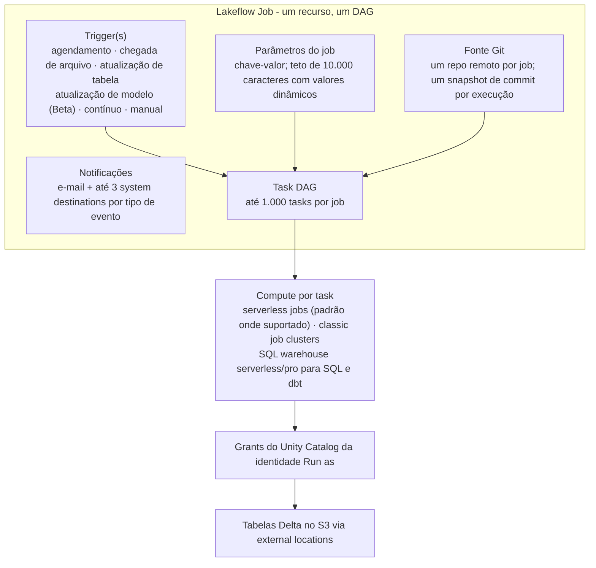
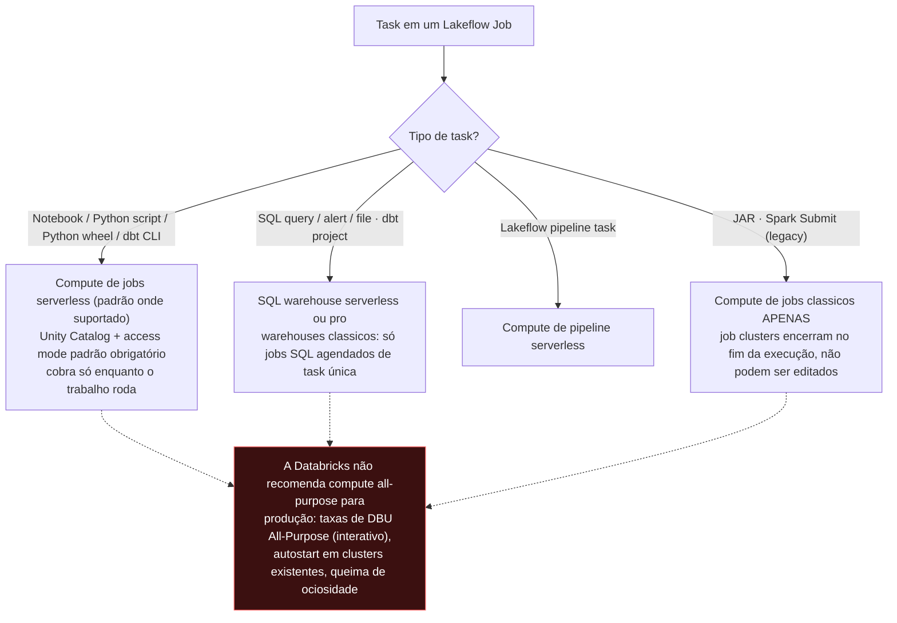
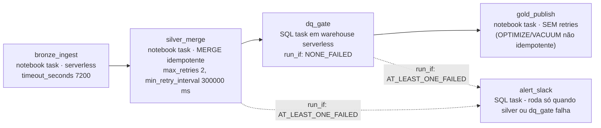
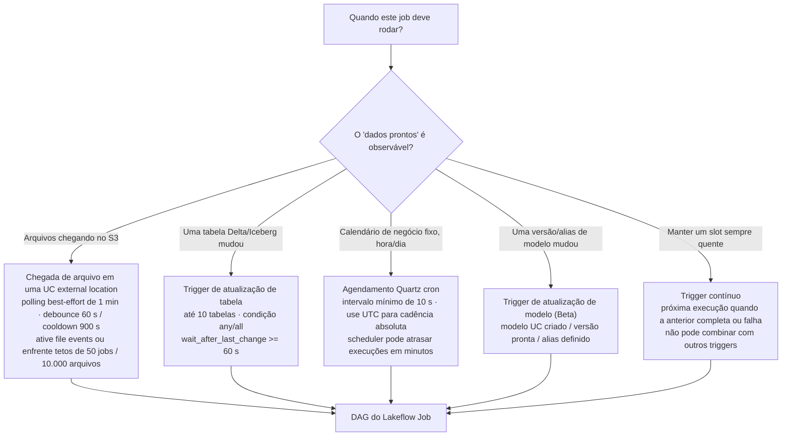
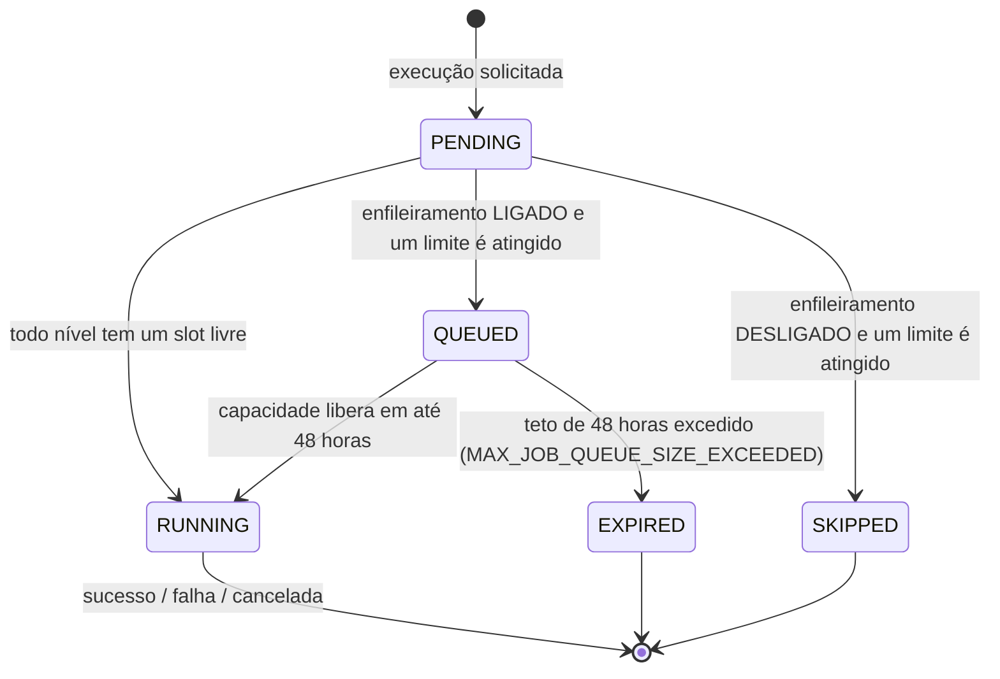
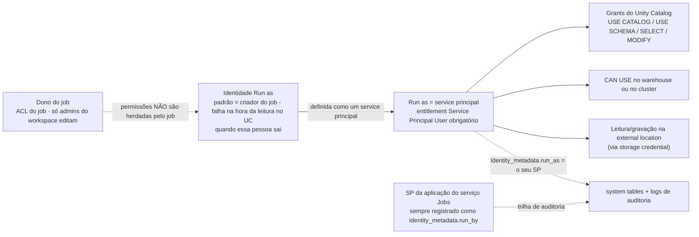

# Lakeflow Jobs (anteriormente Databricks Workflows): Multi-Task Jobs como Código, Triggers, Retries e a Matriz de Decisão do Scheduler

Todo lakehouse eventualmente falha do mesmo jeito: os dados estavam bons, o cluster estava bom, e ninguém apertou o botão — ou três botões, na ordem errada, duas vezes. Orquestração é a diferença entre uma demo de lakehouse e um lakehouse, e no Databricks na AWS o orquestrador nativo é o **Lakeflow Jobs**. Se esse nome é novo para você, essa é a primeira lição: "Databricks Workflows" foi renomeado **Lakeflow Jobs** dentro da família Lakeflow — "**Lakeflow Jobs (formerly known as Databricks Workflows)**" (blog da Databricks, **2025-07-24**) — enquanto os caminhos REST, os objetos de API e as system tables continuam dizendo `jobs`. Três nomes, um produto, e uma página de docs atualizada em **9 de outubro de 2026** que agora abre com "Lakeflow Jobs é automação de workflow para o Databricks, fornecendo orquestração para workloads de processamento de dados" (docs.databricks.com/aws/en/jobs/).

Esta lição é o manual de operações: como um job é construído (tasks, DAG, compute), quando ele dispara (seis tipos de trigger), o que acontece quando a capacidade acaba (fila vs. skip), como ele se recupera (retries, repairs, notificações), com qual identidade ele roda (service principals), como ele é distribuído (YAML de Declarative Automation Bundles, anteriormente Databricks Asset Bundles) e quando você *não* deve usá-lo de modo algum (Amazon MWAA/Airflow, AWS Step Functions). Todo limite e preço abaixo traz a fonte e o carimbo de data de **outubro de 2026**; tudo que a Databricks não publica fica de fora, em vez de ser chutado.

```text
 =============================================================
  MAPA DA LIÇÃO 09 - Lakeflow Jobs na AWS, em out 2026
 ------------------------------------------------------------
  Modelo    job -> tasks (<= 1.000) renderizado como um DAG
            + triggers + parâmetros + notificações + Git
  Triggers  agendado (Quartz, intervalo >= 10 s) |
            chegada de arquivo (best-effort 1/min, UC location) |
            atualização de tabela (<= 10 tabelas, debounce >= 60 s) |
            atualização de modelo (Beta) | contínuo | manual
  Capacidade 2.000 execuções de tasks concorrentes/workspace (429)
            12.000 jobs salvos | 12.000 triggers ativos
            10.000 criações de job por hora
            max_concurrent_runs: padrão 1, máx 1.000,
            0 = pula tudo; teto de fila de 48 horas
  Confiab.  classic padrão = SEM retries; serverless
            otimiza retries sozinho; timeout 0 = nenhum;
            repair / partial runs; códigos de eventos de webhook
  Identidade Run as = service principal (recomendado);
            tokens OAuth M2M vivem 1 hora
  As código Declarative Automation Bundles (DABs,
            anteriormente Databricks Asset Bundles):
            databricks.yml + resources/*.job.yml,
            alvo dev pausa agendamentos e prefixa nomes
  Dinheiro  piso do Lakeflow Jobs $0.15/DBU vs. all-purpose
            $0.40/DBU; MWAA env large $0.99/h =
            $736.56/mês mesmo com um único DAG; Step
            Functions Standard $0.025 por 1.000 transitions
  -------------------------------------------------------------
  Regra da lição: cron é um palpite, triggers são um
  fato - e o scheduler NÃO serve para trabalho de baixa latência.
 =============================================================
```

Nesta lição você vai:

- reconstruir o **rename de Workflows → Lakeflow Jobs** e a anatomia job/tasks/triggers contra o **envelope de escala** publicado (tasks, jobs, triggers, concorrência, criações por hora);
- escolher **tipos de task e compute** na matriz serverless-first e precificar o mesmo job nos pisos de **$0.15 vs. $0.40 por DBU**;
- montar o DAG: **`depends_on` + as seis condições `run_if`**, fluxo de controle por condition/for-each/Run Job, e a semântica **Excluded-conta-como-sucesso** que decide se a sua task de alerta chega a rodar;
- configurar as seis **famílias de trigger** — agendamentos Quartz com o **piso de 10 segundos** e o **ajuste DST → UTC**, triggers de chegada de arquivo com **cooldown de 900 s / debounce de 60 s**, triggers de atualização de tabela com o piso de debounce de **60 segundos**;
- separar o **enfileiramento** (teto de 48 horas, ligado por padrão em jobs de UI desde 2024-04-15) do **skipping** e diagnosticar os dois com forense nas **system tables de jobs**;
- definir **retries, timeouts, repairs, partial runs** e **notificações por webhook**, sabendo que tasks classicas não fazem *nenhum* retry por padrão e que alertas de nível de job ficam em silêncio enquanto houver retries;
- rodar jobs de produção como **service principals** com OAuth M2M, e não como a pessoa que clicou em Create;
- descrever o estate em **Declarative Automation Bundles** YAML com **alvos dev/prod** e **fontes de task em Git remoto**, e fazer a ponte com calendários corporativos via **Amazon MWAA** com `DatabricksRunNowOperator`;
- escolher **Workflows vs. Airflow/MWAA vs. Step Functions** a partir de uma matriz de decisão com preços, estudar **NAB e Asurion** na AWS, ler a **caixa de atualizações de 2026** e praticar com **catorze questões** mais quatro verificações interativas.

---

## 1. Anatomia: um job, um DAG, três conceitos

Os docs são lacônicos de propósito: um job guarda **tasks**, tasks são visualmente representadas por um **DAG**, e **triggers** decidem quando o job dispara. As configurações de nível de job carregam o resto — **Trigger, Parameters, Notifications (e-mails ou webhooks), Git** (docs .../jobs/, **9 de outubro de 2026**). Todo o resto desta lição é um detalhe uma dessas quatro superfícies.



### 1.1 O envelope de escala (todos acessados em out 2026)

| Limite | Valor | Comportamento ao ser atingido | Fonte |
|---|---|---|---|
| Tasks por job | **1.000** (endpoints de escrita) | request rejeitada | visão geral de jobs (9 de outubro de 2026); Jobs API 2.2 |
| Jobs salvos por workspace | **12.000** | criação rejeitada | visão geral de jobs |
| Criações de job por workspace por hora | **10.000** (inclui `runs submit`) | sofre throttling | visão geral de jobs |
| Execuções de tasks concorrentes por workspace | **2.000** | HTTP **429 Too Many Requests** | visão geral de jobs |
| Triggers ativos por workspace | **12.000** (pausados excluídos) | criação rejeitada | triggers (6 de outubro de 2026) |
| Triggers por job (Multiple Triggers Beta) | **5**; contínuo não combina com os demais | rejeitado | triggers (6 de outubro de 2026) |
| `max_concurrent_runs` | padrão **1**, máx **1.000**, **0 = pula todas as novas execuções** | pula ou rejeita | Jobs API 2.0; configure-job (7 de julho de 2026) |
| Duração da fila | **48 horas** | execução morre com `MAX_JOB_QUEUE_SIZE_EXCEEDED` | configure-job |

Dois números causam a maior parte do estrago operacional. Primeiro, **`max_concurrent_runs` tem padrão 1**: "Por padrão, o máximo de execuções concorrentes de todos os jobs novos é 1", e uma execução que excederia o teto é **pulada**, a menos que o enfileiramento a intercepte (configure-job). Segundo, o **teto de 2.000 execuções de tasks concorrentes do workspace** é global — uma frota de jobs de fan-out pode esfomear umas às outras, e o erro aparece como 429 ou como `WORKSPACE_RUN_LIMIT_EXCEEDED` nas system tables (visão geral de jobs; system-tables/jobs, **21 de maio de 2026**).

- **📚 Você sabia?** A referência legada da Jobs API 2.0 (atualizada pela última vez em 3 de agosto de 2026) ainda diz "A job can contain up to **100 tasks**", enquanto a visão geral atual e o blog *"What's new in Workflows?"* de 2024-08-22 dizem **1.000**. O número de 1.000 tasks é o limite atual de produto (os endpoints de escrita o impõem); as 100 são uma página legada desatualizada — e os endpoints de leitura simplesmente devolvem 100 por página com paginação. Carimbe sempre a data do limite que você cita.

---

## 2. Tipos de task e compute: serverless primeiro, nunca all-purpose

### 2.1 A paleta de tipos de task

A paleta atual da UI (página configure-task) é: **Notebook · Visual data prep · Clean Room notebook · Python script · Python wheel · SQL (query/alert/file) · Pipeline (Lakeflow) · Database Table Sync pipeline · Ingestion pipeline · SQL Alert (Public Preview) · Dashboards · Power BI · dbt · dbt platform (Public Preview) · JAR · Spark Submit · Run Job · Genie Code (Beta) · If/else · For each**. O mapeamento REST (Jobs API 2.2) é o que o seu YAML realmente escreve: `notebook_task`, `spark_jar_task`, `spark_python_task`, `python_wheel_task`, `sql_task`, `dbt_task`, `run_job_task`, `condition_task`, `foreach_task`, `pipeline_task` — com `spark_submit_task` marcado "**Deprecated (Legacy)** … Databricks recommends using the spark_jar_task instead".

Três entradas merecem comentário antes da matriz de compute:

- **dbt é first-class**: uma task dbt é "one or more dbt commands" mais um `project_directory`, e "A task dbt requer tanto o Databricks SQL quanto a capacidade de usar um **SQL warehouse serverless ou pro**" — SQL warehouses classicos ficam restritos a jobs SQL agendados de task única (Jobs API 2.2). A Databricks injeta `DBT_ACCESS_TOKEN` para a identidade Run-as, e é por isso que o service principal de run-as precisa de acesso ao warehouse *e* de grants no UC.
- **Tasks de Condition (if/else) "não exigem um cluster para executar e não suportam retries nem notificações"** (Jobs API 2.2; docs de bundles, 21 de agosto de 2026). Você não consegue "repetir um branch" — repita a task de dados que o branch protege.
- **Tasks de Run Job** disparam "outros jobs configurados no seu Databricks workspace" — apenas no mesmo workspace — com os parâmetros do job empurrados para baixo, e têm teto rígido: "A Databricks não suporta jobs com dependências circulares nem jobs que aninham mais de três Run Job tasks" (docs .../jobs/tasks/run-job, **11 de setembro de 2026**).

### 2.2 A árvore de decisão de compute

A página compute-matrix (atualizada pela última vez em **15 de setembro de 2026**) é explícita: "**Compute serverless para workflows… é o padrão** para todas as tasks que o suportam", e "**Compute all-purpose | Você pode configurar opcionalmente tasks usando all-purpose clássico. A Databricks não recomenda essa configuração para jobs de produção.**"



A cobrança segue a escolha do cluster, e essa única regra ancora toda lição de custo do curso: "When you run a job on a new jobs cluster, the job is treated as a **Jobs Compute (automated) workload subject to Jobs Compute pricing**. When you run a job on an existing all-purpose cluster, it is treated as an **All-Purpose Compute (interactive) workload subject to All-Purpose Compute pricing**" (referência da Jobs API 2.0, 3 de agosto de 2026). Job clusters também se comportam diferente na saída: o compute "termina e fica indisponível para reinício quando o job é concluído", enquanto um job agendado apontado para um cluster all-purpose *encerrado* o **autostarta** (docs .../compute/clusters-manage) — é assim que um cluster reutilizado "barato" vira discretamente uma linha de conta 24×7.

### 2.3 Exemplo resolvido E1 — o mesmo job, dois SKUs

**Em out 2026.** Um job medallion roda 2 horas por dia e consome **12 DBU/h** (um fan-out modesto de múltiplas tasks em compute de jobs classicos). Custo mensal de DBU nos pisos oficiais da página de preços da Databricks (instantâneo **2026-10**):

```text
Exemplo resolvido E1 - custo DBU de jobs vs. all-purpose, em out 2026
Carga ............... 12 DBU/h x 2 h/dia x 30 dias = 720 DBU/mês

Caminho A - job clusters (piso do Jobs Compute "from $0.15 / DBU")
  720 DBU x $0.15 ................................... = $108.00 / mês em DBU
  (+ instâncias EC2 cobradas separadamente pela AWS no classic)

Caminho B - cluster all-purpose existente (piso All-Purpose "from $0.40 / DBU")
  720 DBU x $0.40 ................................... = $288.00 / mês em DBU
  (+ queima de ociosidade sempre que o cluster está de pé entre execuções)

Delta ................. $180.00 / mês - os mesmos notebooks,
                        os mesmos dados, um multiplicador DBU de 2.7x
```

Jobs serverless são o terceiro caminho: eles "bill only when a command or query runs (plus a small session fee for the REPL VM); charges stop automatically after a few minutes of idle time" (Databricks Answers, **2026-08-27**), e a página de best practices de serverless acrescenta que "**Standard mode can reduce costs by up to 70% compared to performance-optimized mode**" — ao preço de "**4 to 6 minutes**" de latência de inicialização (run-serverless-jobs, 9 de outubro de 2026). Jobs serverless exigem um **workspace com Unity Catalog habilitado** e **access mode padrão**; a auto-otimização (incluindo retries, seção 6) vem ligada por padrão.

```plot
{
  "type": "bar",
  "title": "Piso mensal em USD de um job de 720 DBU mais os pisos de orquestração (exemplo resolvido E1 + MWAA, em out 2026)",
  "xLabel": "Cenário",
  "yLabel": "USD por mês (pisos publicados)",
  "xKey": "design",
  "dataKeys": ["usd_per_month"],
  "data": [
    {"design": "Job clusters: 720 DBU x $0.15/DBU", "usd_per_month": 108.0},
    {"design": "All-purpose: 720 DBU x $0.40/DBU", "usd_per_month": 288.0},
    {"design": "MWAA large env floor only: 744 h x $0.99/h (before any Databricks DBUs)", "usd_per_month": 736.56}
  ]
}
```

> [!WARNING]
> ⚠️ **Duas armadilhas de compute quebram orçamentos de produção e jobs paralelos.** (1) **Nunca aponte tasks de produção para clusters all-purpose existentes** — você paga taxas de DBU interativas *e* herda autostart, tempo ocioso e a ressalva documentada de que "pode ser necessário reiniciar o cluster manualmente se ele parar de responder" (Jobs API 2.0). A folha de dica de produção diz em uma linha: "Use serverless compute for jobs… **Use service principals instead of user accounts**… **For classic compute: use jobs clusters for automated workflows**" (docs .../cheat-sheet/jobs, 4 de abril de 2026). (2) **Job clusters compartilhados vazam estado**: eles são escopados a uma única execução e cortam a latência de inicialização, mas "Libraries cannot be declared in a shared job cluster configuration" (declare-as por task), o cluster fica ocioso enquanto outras tasks rodam, e "Scala singletons and companion objects are shared across tasks… If parallel tasks read from or write to the same companion-object variable, one task's value can overwrite another's" (página de compute, 15 de setembro de 2026). Tasks paralelas e sensíveis a isolamento levam compute próprio ou serverless — ponto final.

- **📚 Você sabia?** Jobs serverless carregam **rate-limit objects** automatizados que limitam a execução a cerca de **60 / 120 / 240 / 480 / 960 DBU por hora** de Small até 2X-Large, e "Within a single job, the cap is shared across all the job's tasks" (docs .../compute/serverless/manage-serverless-compute, acesso em out 2026). Rate limits valem apenas para cargas automatizadas — notebooks interativos e Databricks Connect são isentos — e aplicá-los exige Databricks Runtime **17.3.1 ou superior**. Um ticket do tipo "por que meu fan-out travou?" muitas vezes tem essa como resposta.

---

## 3. Dependências e fluxo de controle: o DAG que você realmente tem

Tasks depois da primeira declaram `depends_on: [{task_key: …}]`, o que desenha as arestas. O que essas arestas *significam* é decidido pelo **Run if**, e é aqui que DAGs de produção saem do trilho. As seis condições (docs de configuração do run-if, **25 de junho de 2026**): **All succeeded (default) · At least one succeeded · None failed · All done · At least one failed · All failed**.

Três semânticas documentadas são de prova de exame e de incidente ao mesmo tempo:

1. "Upstream tasks with the **Excluded** result state are treated as **successful** when evaluating Run if conditions."
2. "Upstream tasks marked **Upstream failed** or **Upstream canceled** are treated as **failed**, not as skipped."
3. "If all of a task's dependencies are excluded, the task itself is also excluded… exclusion cascades along a linear dependency chain" — independentemente do próprio Run if daquela task. Cancelamento da mesma forma "propaga para as tasks a jusante, e tasks com uma condição Run if que trata falhas são executadas".



Leia o diagrama como uma política, não como um formato. `dq_gate` usa **NONE_FAILED** porque a publicação em gold não pode rodar sobre um silver corrompido — mas um upstream *cancelado* conta como falha, então um cancelamento manual ainda pula o gold, que é o que você quer. A task de alerta usa **AT_LEAST_ONE_FAILED** para sobreviver à falha do silver; como "Upstream failed" conta como falha, o alerta dispara exatamente nos incidentes que interessam. Os companheiros de fluxo de controle completam a caixa de ferramentas: **tasks de condition If/else** comparam operandos (EQUAL_TO, GREATER_THAN, …) contra valores dinâmicos como `{{job.repair_count}}` ou `{{tasks.task_key.values.output}}` (docs de job-task-types do bundles, 21 de agosto de 2026); **For each** percorre um array JSON, manual ou produzido a montante via `dbutils.jobs.taskValues.set`; **Run Job** compõe jobs inteiros, no mesmo workspace, sem ciclos, com aninhamento ≤3 níveis.

- **📚 Você sabia?** A propagação de parâmetros tem direção e vencedor: os parâmetros do job "are pushed down automatically, and if a job parameter and a task parameter share a key, the **job parameter takes precedence**" — mas "Tasks that take **JSON-array parameters don't receive job parameters automatically**; reference them explicitly with `{{job.parameters.<name>}}`" (docs .../jobs/parameters, 26 de junho de 2026). Tasks com array JSON são Python script, wheel posicional, JAR, Spark Submit e For each. Erre isso e a sua task de Python script roda silenciosamente com argv vazio.

---

## 4. Triggers: cron é um palpite, chegada de dados é um fato

Seis comportamentos de trigger existem hoje (docs de triggers, **6 de outubro de 2026**): **Scheduled**, **Table update**, **File arrival**, **Model update (Beta)**, **Continuous** ("trigger another job run whenever a job run completes or fails") e **None (manual)**. Múltiplos triggers por job estão em **Beta** — até **cinco**, cada um pausável independentemente, e "Um trigger contínuo não pode ser combinado com nenhum outro trigger". A API os carrega em um array `triggers`; não misture esse array com os campos legados `schedule` / `trigger` / `continuous` em uma mesma request.

### 4.1 Agendado: Quartz cron, o piso de 10 segundos e o DST

Agendamentos usam **sintaxe cron do Quartz** em um **timezone id do Java**, com `pause_status` UNPAUSED/PAUSED (esquema do objeto Run, Jobs API 2.2 — exemplo `"quartz_cron_expression": "20 30 * * * ?", "timezone_id": "Europe/London"`). Três regras da página de schedules (atualizada pela última vez em **26 de junho de 2026**):

- "Databricks enforces a **minimum interval of 10 seconds** between subsequent runs triggered by the schedule of a job regardless of the configuration in the cron expression."
- Fusos que observam DST: "an **hourly job is skipped or might appear to be delayed by an hour or two when daylight saving time begins or ends**. To run at every hour (absolute time), choose UTC."
- "**The job scheduler is not intended for low-latency jobs.** Due to network or cloud issues, job runs might occasionally be delayed up to several minutes."

### 4.2 Exemplo resolvido E2 — o bug de cron e a correção event-driven

```text
Exemplo resolvido E2 - design de agendamento, em out 2026
BUG - job noturno, fuso DST, meia-noite local:
  quartz_cron_expression: "0 0 0 * * ?"
  timezone_id: "Europe/London"
  -> por volta da virada de outubro o relógio local de parede
     não tem 00:00, então a execução daquela noite é pulada;
     por volta de março o 00:00 dispara duas vezes em termos
     locais. Duas cargas perdidas por ano em um pipeline de
     conformidade são uma achado de auditoria.

CORREÇÃO 1 - cadência horária absoluta:
  quartz_cron_expression: "0 0 * * * ?"
  timezone_id: "UTC"          <- a prova de DST por construção

CORREÇÃO 2 - pare de adivinhar quando os dados estão prontos
  (chegada de arquivo):
  triggers:
    - file_arrival:
        url: "s3://acme-landing/orders/"     # UC external location
        min_time_between_triggers_seconds: 900   # cooldown
        wait_after_last_change_seconds: 60       # debounce
  -> 3 arquivos chegando com 30 s de intervalo = UMA execução
     (debounce). Um segundo lote 5 min depois ESPERA até a
     janela de cooldown de 900 s expirar. Os valores são o
     par de exemplo documentado (docs de chegada de arquivo,
     7 de outubro de 2026).

IMPOSSÍVEL - cron abaixo de 10 segundos:
  "0/5 * * * * ?"   ok (5 s >= piso de 10 s? NÃO - 5 < 10,
                    a plataforma ainda impõe >= 10 s entre execuções)
```

Triggers de chegada de arquivo "fazem o melhor esforço para **verificar novos arquivos a cada minuto**", monitoram "the root of a Unity Catalog external location or volume, or a subpath" recursivamente, e "**do not incur additional costs other than cloud provider costs associated with listing files**" (docs de chegada de arquivo, 7 de outubro de 2026). Os cantos afiados: **somente arquivos novos disparam** — "Sobrescrever um arquivo existente com um arquivo de mesmo nome não dispara uma execução"; sem curingas; e "Quando o diretório configurado não existe ou foi excluído do Amazon S3…, os triggers de chegada de arquivo continuam avaliados **sem erro**". Sem **file events** habilitados na external location, o workspace te limita a "**A maximum of 50 jobs**" com triggers de chegada de arquivo nesses locais e "**10,000 files**" no caminho monitorado. O pareamento recomendado é Auto Loader com `cloudFiles.useManagedFileEvents=true` e `trigger(availableNow=True)` — uma variante foreachBatch que "provides only **at-least-once** processing guarantees" — com o checkpoint mantido *fora* do caminho monitorado.

### 4.3 Triggers de atualização de tabela

Um trigger de atualização de tabela "verifica atualizações de tabelas e, quando uma tabela é atualizada, o job é executado", monitorando até **10** tabelas gerenciadas Delta/Iceberg do Unity Catalog, tabelas externas com Delta, materialized views, streaming tables e views dependentes — detectando "updates, merges, and deletes" (docs de atualização de tabela, 26 de junho de 2026). `wait_after_last_change_seconds` tem um **piso de 60 segundos**: é um debounce, não um SLA de menos de um minuto. Como a chegada de arquivo, ele "não gera custos adicionais além dos custos do provedor de nuvem", e "For best performance and scalability, **enable file events** on the external location."



```matching
{
  "question": "Associe cada número relacionado a trigger ao que ele realmente controla (todos em outubro de 2026):",
  "pairs": [
    {"left": "10 segundos", "right": "Intervalo mínimo entre execuções subsequentes do agendamento de um job, imposto independentemente da expressão cron"},
    {"left": "900 s / 60 s", "right": "O par de exemplo documentado de chegada de arquivo: tempo mínimo entre triggers (cooldown) e espera após a última mudança (debounce)"},
    {"left": "60 segundos", "right": "Piso do wait_after_last_change_seconds em um trigger de atualização de tabela - um debounce, não um SLA de menos de um minuto"},
    {"left": "5 triggers", "right": "Máximo de triggers por job durante o Multiple Triggers Beta; um trigger contínuo não pode ser combinado com nenhum outro"},
    {"left": "12.000 triggers ativos", "right": "Teto em todo o workspace para todos os jobs e tipos de trigger - triggers pausados não contam para esse limite"},
    {"left": "50 jobs / 10.000 arquivos", "right": "Tetos de chegada de arquivo em uma location SEM file events: máximo de jobs com trigger por workspace e máximo de arquivos no caminho monitorado"}
  ],
  "explanation": "Cada número desta lição pertence a uma superfície de controle específica, e atribuí-los ao lugar errado é como times entregam a correção errada: aumentar max_concurrent_runs não conserta um pulo de DST (isso é a superfície de agendamento de 10 segundos/UTC); ativar file events levanta os tetos de 50 jobs/10.000 arquivos e não faz nada pelo debounce de tabela de 60 segundos; e o par 900/60 é um exemplo de controle de taxa dos docs de chegada de arquivo, não um mínimo da plataforma - os únicos pisos rígidos são o intervalo de agendamento de 10 segundos e a espera de tabela de 60 segundos."
}
```

- **📚 Você sabia?** Um workspace pode guardar até **12.000 triggers ativos** em todos os jobs e tipos de trigger, e **triggers pausados não contam** nesse limite (docs de triggers, 6 de outubro de 2026). Isso transforma a higiene de pause_status em uma ferramenta de capacidade: uma frota de jobs de backfill dormentes deve nascer com `pause_status: PAUSED` — que é exatamente o que o development mode do Declarative Automation Bundles faz por você (seção 8).

---

## 5. Enfileiramento, concorrência e a armadilha do skip

Quando uma execução não pode começar, duas máquinas diferentes a capturam, e só uma vem ligada por padrão. O **enfileiramento** (ligado por padrão em jobs criados pela UI depois de **15 de abril de 2024**) segura a execução "for up to **48 hours** if resources are unavailable", acionado quando qualquer um dos três limites é atingido: o máximo de execuções ativas concorrentes do workspace, o máximo de execuções de task Run Job concorrentes do workspace, ou o próprio `max_concurrent_runs` do job (configure-job, 7 de julho de 2026). Sem enfileiramento, atingir um limite significa que a execução é **pulada** — e uma execução agendada pulada é uma lacuna silenciosa de dados.



Botões e tetos para manter direitos: `max_concurrent_runs` padrão **1**, máximo rígido **1.000**, **0 pula tudo**; baixá-lo nunca mata execuções ativas; as **2.000 execuções de tasks concorrentes** em todo o workspace devolvem 429 ou `WORKSPACE_RUN_LIMIT_EXCEEDED` mesmo com o enfileiramento ligado (visão geral de jobs; system tables). A profundidade da fila além do teto documentado de 48 horas não é publicada — trate "quão profunda é a fila interna, e em que ordem ela desenfileira?" como desconhecido, e projete para o teto, não para justiça.

### 5.1 Exemplo resolvido E3 — forense de fila nas system tables

```text
Exemplo resolvido E3 - incidente de capacidade, em out 2026
Sintoma ... um job de fan-out com 20 tasks e max_concurrent_runs: 10
            mostra execuções presas em PENDING; alertas a jusante disparam
Fato ...... o workspace já está em 1.990 execuções de tasks concorrentes
Ação ....... as primeiras execuções do novo job entram na FILA
            (enfileiramento ligado por padrão); na 2.000ª execução de
            task a API responde 429 e a system table registra
            WORKSPACE_RUN_LIMIT_EXCEEDED
Contraste .. o mesmo job com enfileiramento DESLIGADO: limite atingido
            -> SKIPPED com MAX_CONCURRENT_RUNS_REACHED - uma carga
            perdida em silêncio
```

```sql
-- jobs system tables (docs .../admin/system-tables/jobs, last updated May 21, 2026)
SELECT
  job_run_id,
  job_name,
  run_state,
  queue_duration_seconds,
  setup_duration_seconds
FROM system.lakeflow.job_run_timeline
WHERE queue_duration_seconds > 300
ORDER BY queue_duration_seconds DESC;
```

A mesma referência lista os estados de falha que valem um alerta: `WORKSPACE_RUN_LIMIT_EXCEEDED` ("O workspace atingiu a cota para o número máximo de execuções ativas concorrentes"), `MAX_CONCURRENT_RUNS_EXCEEDED`, `MAX_JOB_QUEUE_SIZE_EXCEEDED`, `CLUSTER_REQUEST_LIMIT_EXCEEDED` e `REPOSITORY_CHECKOUT_FAILED` — mais a nota honesta de que `creator_user_name` e `paused` são "Não preenchido para linhas emitidas antes de **início de dezembro de 2025**", então consultas históricas de higiene precisam de um piso de data.

```fillblank
{
  "question": "Preencha os limites e pisos publicados do Lakeflow Jobs (todos em outubro de 2026):",
  "template": "Um workspace roda no máximo {{1}} execuções de tasks concorrentes (HTTP 429 além disso) e pode guardar {{2}} jobs salvos e {{3}} triggers ativos, com no máximo {{4}} criações de job por hora. Um único job guarda no máximo {{5}} tasks. max_concurrent_runs tem padrão {{6}}, não pode exceder 1.000, e 0 pula toda nova execução. O enfileiramento (ligado por padrão em jobs de UI desde 2024-04-15) segura uma execução por no máximo {{7}} horas. Execuções agendadas ficam pelo menos {{8}} segundos separadas, o debounce de atualização de tabela é de pelo menos {{9}} segundos, e cada job ou task pode notificar no máximo {{10}} system destinations por tipo de evento.",
  "answers": {
    "1": "2000",
    "2": "12000",
    "3": "12000",
    "4": "10000",
    "5": "1000",
    "6": "1",
    "7": "48",
    "8": "10",
    "9": "60",
    "10": "3"
  },
  "distractors": ["100", "500", "5000", "100000", "5", "10", "0", "24", "72", "1", "5", "10", "30", "600"],
  "explanation": "Todos os números vêm da visão geral de jobs (9 de outubro de 2026), da página de triggers (6 de outubro de 2026), do configure-job (7 de julho de 2026), da página de schedules (26 de junho de 2026), da página de atualização de tabela (26 de junho de 2026) e da página de notificações (9 de outubro de 2026). Os distractores são os vizinhos plausíveis: 100 é o número legado desatualizado por página/task, 5 é o teto por job do Multiple Triggers Beta, 24 e 72 convidam ao chute de 'um dia / um fim de semana' no teto da fila, e 600/30 convidam à confusão com os segundos de debounce e o throttle de renotificação de backlog de streaming."
}
```

---

## 6. Confiabilidade: retries, timeouts, repairs, notificações

### 6.1 Retries diferem por compute — o padrão é silêncio

"A configuração padrão de retries de task depende da configuração do job. Na maioria das configurações, a configuração padrão **não repete nenhuma task** quando a task falha" (configure-task). Contra isso: "**Serverless jobs auto-optimize retries by default**" (dê opt out pela caixa "Enable serverless auto-optimization" — e *dê mesmo* opt out para sinks não idempotentes), e "**Continuous jobs use an exponential backoff retry policy**" (mesma página). Os botões por task: `max_retries`, `min_retry_interval_millis`, `retry_on_timeout`; `timeout_seconds` é por task, com "**A value of 0 means no timeout**" (Jobs API 2.2) — e um timeout *não* é repetido, a menos que `retry_on_timeout` esteja definido.

### 6.2 Exemplo resolvido E4 — a política de retry como documento de design

```text
Exemplo resolvido E4 - política de retry por task, em out 2026
silver_merge     MERGE idempotente em Delta
  max_retries: 2
  min_retry_interval_millis: 300000     # 5 minutos entre tentativas
  timeout_seconds: 10800                # teto de 3 h
  -> solavancos transitórios de EMR/HTTP se curam sozinhos;
     o MERGE é seguro de reexecutar

gold_publish     OPTIMIZE + VACUUM + cascata de grants - NÃO idempotente
  max_retries: 0                        # explícito: já é o default classic
  timeout_seconds: 3600
  -> reexecutar um OPTIMIZE parcial desperdiça DBUs; um VACUUM
     parcial é inofensivo mas barulhento. Falhe alto, alertue,
     repare na mão.

dq_gate          SQL task em um warehouse serverless
  auto-otimização serverless MANTIDA LIGADA (query somente leitura)
  timeout_seconds: 900

alert_slack      run_if: AT_LEAST_ONE_FAILED
  max_retries: 1                        # alertas podem falhar; um retry
```

Superfícies de recuperação além dos retries: **repair** reexecuta "the subset of unsuccessful tasks" em uma execução multi-task; **partial runs** (blog do Lakeflow Jobs, **2025-07-24**) "allow users to select which tasks to execute without affecting others" — a resposta operacional para "reexecutar só a task de gold que quebrou"; e as saídas de query SQL podem alimentar tasks seguintes como parâmetros (mesmo blog). Tasks de notebook também têm tetos rígidos de saída — **30 MB** de saída combinada de células e **8 MB** por célula — além dos quais a execução falha (docs .../jobs/tasks/notebook, 11 de setembro de 2026); tasks tagarelas precisam gravar em Delta, não em stdout.

### 6.3 Notificações: três destinos, retries em silêncio

Eventos de notificação (docs de notificações, **9 de outubro de 2026**): **Start · Successful completion · Failure · duration threshold exceeded · streaming backlog threshold exceeded · maintenance start/complete (continuous jobs)**. Os destinos são "email addresses or third-party destinations such as **Slack, Microsoft Teams, PagerDuty, or any webhook-based service**", onde "An administrator must configure **system destinations**" e "Para cada job ou task, você pode configurar no máximo **três system destinations** para cada tipo de evento de notificação". Os códigos `event_type` de webhook são estáveis: `jobs.on_start`, `jobs.on_success`, `jobs.on_failure`, `jobs.on_duration_warning_threshold_exceeded`.

> [!IMPORTANT]
> 🔔 **"Job-level notifications aren't sent when failed tasks are retried."** Essa única linha (docs de notificações, 9 de outubro de 2026) é o motivo de o on-call continuar perdendo incidentes em jobs instáveis: uma task de silver que falha duas vezes e depois dá certo não dispara *nada* no nível do job. O padrão documentado é **alertas no nível de task** mais a opção da UI "Silenciar notificações até o último retry" — alerte na falha *final*, não na primeira. Duas semânticas vizinhas completam o quadro: "**Succeeded with failures**" conta como sucesso (selecione o evento Success se quiser esses) e os alertas de backlog de streaming avaliam "average backlog over a **10-minute period**" com um throttle de renotificação de **30 minutos**. Execuções canceladas e puladas podem ser silenciadas por evento.

### 6.4 Exemplo resolvido E5 — o payload do webhook e a chamada run-now

```text
Exemplo resolvido E5 - webhook de falha + gatilho REST, em out 2026
O que a Databricks faz POST na sua system destination
(docs .../jobs/notifications, 9 de outubro de 2026):

{
  "event_type": "jobs.on_failure",
  "workspace_id": "1234567890123456",
  "run":  { "run_id": "678901234567890" },
  "job":  { "job_id": "42", "name": "medallion_daily" }
}

O que a sua equipe de plataforma chama do calendário corporativo
(Jobs API 2.2, /api/2.1/jobs/run-now):

curl -X POST "https://<workspace-url>/api/2.1/jobs/run-now" \
  -H "Authorization: Bearer $DATABRICKS_OAUTH_TOKEN" \
  -H "Content-Type: application/json" \
  -d '{
    "job_id": 42,
    "job_parameters": { "env": "prod", "dt": "2026-10-11" }
  }'

Repare apenas o subconjunto falhado dessa execução:

curl -X POST "https://<workspace-url>/api/2.1/jobs/runs/repair" \
  -H "Authorization: Bearer $DATABRICKS_OAUTH_TOKEN" \
  -H "Content-Type: application/json" \
  -d '{
    "run_id": 678901234567890,
    "rerun_tasks": [ { "task_key": "silver_merge" } ]
  }'
```

Use tokens **OAuth M2M** (client id + OAuth secret; access tokens válidos por **1 hora**, secrets com escopo em `jobs`) em vez de personal access tokens; se uma integração legada forçar um PAT, use um **PAT de service principal**, nunca o de um humano (seção 7 e a costura do Airflow na seção 9).

---

## 7. Identidade: owner, Run as, e a saída que quebra às 3 da manhã

Um job tem duas identidades: o **owner** (ACL do job; "Somente administradores do workspace podem editar o owner do job") e a identidade **Run as**, cujas permissões executam cada task. Run as padrão = criador do job — e a recomendação dos docs é inequívoca: "**A Databricks recomenda mudar o Run as user para um service principal**, para que os privilégios possam ser controlados separadamente dos privilégios do owner, e para que os jobs não quebrem quando o owner sair ou tiver mudado de privilégios" (docs .../jobs/privileges, acesso em out 2026). Mudar o Run as exige **CAN MANAGE ou IS OWNER** no job, o service principal precisa do entitlement **Service Principal User**, e "Run as a group" está em **Public Preview**.



O detalhe de auditoria importa na revisão de incidentes: `identity_metadata.run_as` registra *a sua* identidade configurada (o grupo, no preview de Run-as por grupo), enquanto `identity_metadata.run_by` "always records" o service principal de aplicação do serviço Jobs (mesma página). O modo de falha que isso evita é o quebra-cabeça de produção mais comum do curso: o job agendado continua parecendo saudável na hora do agendamento e morre na primeira leitura no UC depois que o acesso do criador é revogado. A autenticação machine-to-machine para orquestração é OAuth M2M (tokens de 1 hora) ou, para Airflow na AWS, a **federalização de token AWS IAM OIDC** do provedor — "exchange for a Databricks OAuth token. Stores no secrets" (docs do apache-airflow-providers-databricks 7.19.0, acesso em out 2026).

---

## 8. Jobs como código: Declarative Automation Bundles

Montar jobs clicando na UI não sobrevive a um segundo engenheiro. A superfície as-code é o **Declarative Automation Bundles** — "formerly known as Databricks Asset Bundles" (docs .../dev-tools/bundles, acesso em out 2026) — que empacota "Source files… Definitions and settings for Databricks resources, such as **Lakeflow Jobs**, Lakeflow Spark Declarative Pipelines, Dashboards, Model Serving endpoints, MLflow Experiments". O loop: escreva `databricks.yml` + `resources/*.job.yml`, depois `databricks bundle validate` → `databricks bundle deploy --target dev` → `databricks bundle run --target dev <job>`.

### 8.1 Exemplo resolvido E6 — um job multi-task de produção, YAML completo

```yaml
# resources/medallion_daily.job.yml  (Declarative Automation Bundles)
resources:
  jobs:
    medallion_daily:
      name: "medallion_daily"
      max_concurrent_runs: 1
      queue:
        enabled: true
      run_as:
        service_principal_name: "0000aaaa-1111-bbbb-2222-cccc3333dddd"
      tags:
        cost-center: "data-engineering"
        team: "lakehouse"
      schedule:
        quartz_cron_expression: "0 0 2 * * ?"   # 02:00 daily, Quartz
        timezone_id: "UTC"                       # DST-proof cadence
        pause_status: PAUSED                     # dev target unpauses
      parameters:
        env: "prod"
        dt: "{{job.parameters.env}}"             # override on run-now
      tasks:
        - task_key: bronze_ingest
          description: "Auto Loader bronze from the S3 landing zone"
          timeout_seconds: 7200
          notebook_task:
            notebook_path: "/Repos/lakehouse/bronze_ingest"
            base_parameters: { env: "{{job.parameters.env}}" }
          new_cluster:
            spark_version: "15.4.x-scala2.12"
            node_type_id: "m6i.xlarge"
            num_workers: 4
        - task_key: silver_merge
          timeout_seconds: 10800
          max_retries: 2
          min_retry_interval_millis: 300000
          depends_on: [ { task_key: bronze_ingest } ]
          notebook_task:
            notebook_path: "/Repos/lakehouse/silver_merge"
        - task_key: dq_gate
          run_if: "NONE_FAILED"
          depends_on: [ { task_key: silver_merge } ]
          sql_task:
            query:
              query_id: 1140225567890123
            warehouse_id: "abc123def456abcd"
        - task_key: gold_publish
          depends_on: [ { task_key: dq_gate } ]
          timeout_seconds: 3600
          max_retries: 0                # non-idempotent OPTIMIZE/VACUUM
          notebook_task:
            notebook_path: "/Repos/lakehouse/gold_publish"
        - task_key: alert_slack
          run_if: "AT_LEAST_ONE_FAILED"
          depends_on:
            - { task_key: silver_merge }
            - { task_key: dq_gate }
          sql_task:
            query:
              query_id: 2255678901234567
            warehouse_id: "abc123def456abcd"
      notification_settings:
        alert_on_last_retry_only: true
        no_alert_for_skipped_runs: true
```

Tudo nesse arquivo mapeia para um campo documentado: `run_as.service_principal_name` aceita "the email of an active workspace user or the **application ID of a service principal**" (Jobs API 2.2); `queue.enabled` espelha o comportamento de enfileiramento de 48 horas (seção 5); o bloco de retry é o E4; `run_if` é a seção 3; `schedule` é o formato verificado do exemplo job-settings da Jobs API (acesso em out 2026). Jobs existentes construídos na UI podem ser engenharia reversa para esse formato com `databricks bundle generate job` (docs de job-task-types do bundles, 21 de agosto de 2026) — o caminho de migração mais rápido a partir do click-ops.

### 8.2 Alvos dev/prod são a barreira de segurança

Predefinições do development mode (docs de deployment-modes do bundles): "**Pausa todos os schedules e triggers** nos recursos implantados, como jobs" (anule com `schedule.pause_status: UNPAUSED`), antepõe o prefixo de nome `[dev ${workspace.current_user.short_name}]` e "**Enables concurrent runs on all deployed jobs**". O production mode não aplica nada disso — é por isso que o mesmo YAML é seguro de publicar de um laptop e assustador de publicar de um laptop *sem alvos*. A promoção é `databricks bundle deploy --target prod` a partir do CI, com o service principal de run-as e os secrets resolvidos por alvo.

### 8.3 Fontes Git: um repo, um commit, um snapshot

Tasks de notebook, Python script, SQL file e dbt podem usar uma **fonte em repositório Git remoto** (docs .../jobs/git, 11 de setembro de 2026): "**Todas as tasks de um job devem referenciar o mesmo commit**… a Databricks faz um **snapshot** da branch ou commit especificados" quando a execução começa; "**Apenas um repositório Git remoto pode ser usado para todas as tasks de um job**"; e "Tasks configured to use a remote Git repository **cannot write to workspace files**". **Git folders** (sync workspace-repo) funcionam, mas precisam ser sincronizados manualmente e são recomendados "apenas para iteração rápida e testes durante o desenvolvimento" — tasks de staging e produção referenciam o repo remoto com branch/tag/commit fixados, e o histórico de execuções mostra o SHA do commit.

```dragdrop
{
  "question": "Ordene o loop de promoção jobs-as-code de um novo job multi-task, do primeiro artefato ao agendamento de produção (Declarative Automation Bundles, em out 2026):",
  "items": [
    "Modele o job uma vez na UI (DAG visual) ou escreva resources/medallion_daily.job.yml à mão",
    "Faça engenharia reversa ou snapshot dele: databricks bundle generate job (opcional, mas recomendado para jobs legados)",
    "Commit o YAML e o databricks.yml no repo Git do qual o CI vai publicar",
    "databricks bundle validate e depois databricks bundle deploy --target dev - agendamentos e triggers chegam PAUSED, os nomes carregam o prefixo [dev user]",
    "Destrave no dev, rode, mate uma task de propósito e depois faça repair ou partial run dela para provar que a recuperação funciona",
    "databricks bundle deploy --target prod a partir do CI com o service principal de run-as - agendamento ao vivo, sem prefixo dev, presets de concorrência desligados"
  ],
  "correctOrder": [
    "Modele o job uma vez na UI (DAG visual) ou escreva resources/medallion_daily.job.yml à mão",
    "Faça engenharia reversa ou snapshot dele: databricks bundle generate job (opcional, mas recomendado para jobs legados)",
    "Commit o YAML e o databricks.yml no repo Git do qual o CI vai publicar",
    "databricks bundle validate e depois databricks bundle deploy --target dev - agendamentos e triggers chegam PAUSED, os nomes carregam o prefixo [dev user]",
    "Destrave no dev, rode, mate uma task de propósito e depois faça repair ou partial run dela para provar que a recuperação funciona",
    "databricks bundle deploy --target prod a partir do CI com o service principal de run-as - agendamento ao vivo, sem prefixo dev, presets de concorrência desligados"
  ],
  "explanation": "O loop é o fluxo documentado do tutorial de bundles (validate -> deploy -> run, por alvo) envolvido em dois hábitos de produção que os docs empurram: fazer engenharia reversa de jobs montados com cliques usando bundle generate job, e testar a recuperação (repair/partial run) ANTES de o agendamento entrar no ar. Os triggers auto-pausados do alvo dev são a guarda embutida contra um deploy de laptop disparando o calendário de produção; o production mode remove o prefixo de nome dev e o preset de execuções concorrentes, de modo que o mesmo YAML significa algo diferente em cada lado da promoção."
}
```

---

## 9. A costura externa: Airflow e Amazon MWAA

Alguns calendários são propriedade da empresa: janelas de SAP, manutenção do Redshift, SLAs de API de terceiros. A própria página da Databricks documenta a costura — "você também pode agendar seus jobs usando ferramentas como o Apache Airflow" — com a ressalva de que os pacotes open source "are **not directly supported by Databricks**" (docs .../jobs/how-to/use-airflow-with-jobs, 11 de setembro de 2026). O mapa de operators:

| Operator | Chamada de API | Use quando |
|---|---|---|
| **`DatabricksRunNowOperator`** | `POST /api/2.1/jobs/run-now` em um **job existente** | Padrão. "Databricks recommends using the DatabricksRunNowOperator because it reduces duplication of job definitions, and job runs triggered with this operator can be found in the Jobs UI" |
| `DatabricksSubmitRunOperator` | `POST /api/2.1/jobs/runs/submit` | Execuções efêmeras sem job salvo — invisíveis para o monitoramento de nível de job |
| `DatabricksCreateJobsOperator` | `jobs/create` + `jobs/reset` | Empurrar definições de job a partir do Airflow (sobrepõe os DABs — escolha um dono) |

Endurecimento de produção vindo dos docs do provedor (7.19.0 / módulo 7.20.0, acesso em out 2026): o **durable mode** persiste "the Databricks run id… to task state store before polling begins, so if the worker crashes… the operator reconnects to the run… instead of triggering a duplicate run"; existem variantes deferrables; a conexão deve carregar **SP OAuth** ou **federalização AWS IAM OIDC**, e nunca um PAT humano; e o operator "write[s] the job run page URL to the Airflow logs every **polling_period_seconds** (the default is **30 seconds**)" (tutorial do Databricks). Higiene de versão: o tutorial da Databricks ainda diz "Airflow version **2.5.0 and later**… tested with Airflow version **2.6.1**", enquanto o provider 7.19.0 exige "**Apache Airflow version supported by this provider distribution is 2.11.0**" — fixe e teste no MWAA em vez de confiar em qualquer um dos números sozinho.

### 9.1 Exemplo resolvido E7 — o DAG do MWAA para o Databricks, precificado

```text
Exemplo resolvido E7 - DAG híbrido + o piso do MWAA, em out 2026
from airflow.providers.databricks.operators.databricks import (
    DatabricksRunNowOperator,
)

with DAG(
    dag_id="enterprise_calendar_to_lakehouse",
    schedule="0 2 * * *",          # cron do Airflow - o CALENDÁRIO DE NEGÓCIO
    catchup=False,
    default_args={"retries": 1},   # NÃO faça retry duplo: o Databricks
) as dag:                          # silver_merge já repete duas vezes
    prep = PythonOperator(...)     # trabalho local do Airflow, se houver
    medallion = DatabricksRunNowOperator(
        task_id="run_medallion_daily",
        databricks_conn_id="databricks_sp_oauth",  # SP OAuth ou IAM OIDC
        job_id=42,
        job_parameters={"env": "prod"},
        deferrable=True,
    )
    prep >> medallion

Piso de custo do MWAA (página de preços da AWS MWAA, acesso em out 2026, us-east-1):
  ambiente large ....... 744 h x $0.99/h  = $736.56 / mês
  ambiente small ....... 744 h x $0.49/h  = $364.56 / mês
  workers extra large .. $0.22/h cada      (workers small $0.055/h)
  meta database ........ $0.10 por GB-mês (metadados no RDS)
  regra de capacidade .. mw1.medium padrão = 10 tasks por worker;
                        workers necessários = tasks concorrentes
                        no pico / 10 x buffer de segurança
                        (AWS Big Data Blog, 2026-05-01); acompanhe
                        CloudWatch RunningTasks e QueuedTasks

O lado do Databricks cobra SOMENTE enquanto as tasks rodam (DBUs
de serverless/jobs). Os $736.56 são o piso de orquestração que você
paga exista um DAG ou cem naquele ambiente.
```

A regra de design que sai do E7: **uma caminha é dona das arestas do DAG, a outra é dona do compute.** Os retries do Airflow espelham — mas não podem multiplicar — os retries de task do Databricks (ponha retries do Airflow em 0–1 quando o job já repete 2–3); a URL do `DatabricksRunNowOperator` no log do Airflow é o seu breadcrumb entre sistemas; e estates com múltiplos workspaces mantêm uma conexão MWAA (ou um conjunto de credenciais OIDC) **por workspace**, porque a task Run Job e o run-now são primitivas do mesmo workspace.

---

## 10. A matriz de decisão do scheduler: Workflows vs. Airflow vs. Step Functions

Três orquestradores tocam um estate Databricks-na-AWS, e cada um tem uma forma de preço documentada.

| Dimensão | **Lakeflow Jobs (Workflows)** | **Amazon MWAA / Apache Airflow** | **AWS Step Functions** |
|---|---|---|---|
| Consciência nativa do Databricks | Total: task values, repairs, partial runs, jobs UI, UC run-as, system tables | Via operators do provider (`RunNow` preferido); execuções invisíveis na UI de jobs com `SubmitRun` | Só no nível de API; chamadas ao Databricks são apenas task integrations |
| Triggers cientes de dados | Chegada de arquivo + atualização de tabela + modelo (Beta) em objetos UC; "no orchestration surcharge" — pague só pelo compute das tasks (afirmação do fornecedor, blog 2025-01-12) | Sensors/operators customizados; padrões EventBridge→DAG; fan-out nativo da AWS | Nativo do EventBridge; precificação por transição de estado |
| Custo de ociosidade | $0 quando ocioso (sem scheduler DBU; o compute só cobra enquanto as tasks rodam) | **$0.99/h em ambiente large = $736.56/mês de piso** (exemplo da página de preços da AWS, us-east-1) + workers + metadados RDS | Standard **$0.025 por 1.000 state transitions** (AWS Compute Blog, 2022-08-30); Express **$0.00001667 por GB-segundo** (+ preço por request não citado aqui) |
| Melhor ajuste | DAG com 90%+ de tasks Databricks; medallion event-driven; repairs/partial runs; identidades governadas por UC | Fan-out para muitos sistemas não-Databricks; padrões de Airflow e backfills em toda a organização; camada de DAG neutra de fornecedor | Coordenação serverless nativa da AWS de Lambda/ECS/Batch/Glue *mais* chamadas de API do Databricks |
| Limites a respeitar | 2.000 execuções de tasks concorrentes; 1.000 tasks/job; 12.000 triggers; fila de 48 h | mw1.medium ≈ 10 tasks/worker; capacidade é o seu dimensionamento | Standard: pague por transição; Express: medição por duração |

O híbrido em que a maioria dos times de AWS para: **um único job de "ingest" do Databricks com trigger de chegada de arquivo é dono da prontidão dos dados; o MWAA é dono do calendário corporativo e chama esse job com `DatabricksRunNowOperator`; e o Step Functions coordena os passos do lado da AWS ao redor da chamada do Databricks.** Alternativas da família do Airflow gerenciado (Prefect, Astronomer) integram pela mesma costura REST/SDK — mesma arquitetura, conta diferente, então mantenha a comparação qualitativa até ter as cotações ao vivo delas.

> **Veredito Comparativo — Lakeflow Jobs vs. Amazon MWAA/Airflow vs. AWS Step Functions (AWS, em out 2026)**
> - **Lakeflow Jobs — o padrão para DAGs nativos do Databricks.** Sem cobrança de scheduler ocioso (fornecedor: "sem sobretaxa de orquestração — você paga apenas pelo compute usado pelas suas tasks", blog 2025-01-12), triggers cientes de dados em external locations no S3 e tabelas UC, repairs/partial runs, run-as com service principals e observabilidade de jobs nas system tables. Piso de DBU **$0.15/DBU** (Data Engineering, instantâneo da página de preços 2026-10) em compute de jobs classicos — ou serverless que "cobra apenas quando um comando ou consulta é executado". Fraqueza: a orquestração *para fora* do Databricks ainda é jovem (o blog do Lakeflow de junho de 2026 anuncia External Orchestration para Snowflake/REST/Slack/PagerDuty sem declarar a maturidade), e o encadeamento por Run Job é só no mesmo workspace, ≤3 níveis, sem ciclos.
> - **Amazon MWAA/Airflow — o dono do calendário corporativo.** DAGs neutros de fornecedor, operators/sensors customizados, semântica madura de backfill e o único lar confortável para fan-out que gasta a maior parte dos seus passos fora do Databricks. O custo honesto: um **piso de $0.99/h em ambiente large ≈ $736.56/mês** (exemplo da página de preços da AWS) mais workers a $0.22/h e metadados RDS a $0.10/GB-mês — orquestração com conta própria *e* com plantão próprio. Chame o Databricks pelo `DatabricksRunNowOperator` (SP OAuth ou IAM OIDC, deferrable, durable) para que as execuções continuem visíveis na UI de jobs.
> - **AWS Step Functions — o orquestrador cola da AWS.** Melhor quando o centro de gravidade do workflow é Lambda/ECS/Batch/Glue e o Databricks é uma chamada de API entre muitas; a precificação Standard é por state transition (**$0.025 por 1.000**, AWS Compute Blog 2022-08-30 — confira de novo a tabela ao vivo), o Express mede GB-segundos ($0.00001667/GB-s, página de preços acessada em out 2026). Você abre mão de task values, repairs e da UI de jobs — os recursos cientes de Databricks vivem fora do console.
> - **Veredito em uma linha:** *Lakeflow Jobs para o DAG interno do Databricks → MWAA onde o calendário ou o fan-out é não-Databricks → Step Functions onde os serviços da AWS são o workflow e o Databricks é um callee* — e em todo híbrido, exatamente uma camada é dona das arestas do DAG, o run-now é dono da costura, e a identidade de run-as é um service principal.

---

### Atualizações de 2026 (em outubro de 2026)

> [!NOTE]
> **O que mudou na camada de orquestração do Databricks de que esta lição depende — cada linha conferida contra uma fonte primária:**
> - **2025-07-24 — o rename e os partial runs.** "**Lakeflow Jobs (formerly known as Databricks Workflows)**"; "**Partial runs** allow users to select which tasks to execute without affecting others"; saídas de query SQL utilizáveis como parâmetros de job (blog da Databricks, *What's New: Lakeflow Jobs Provides More Efficient Data Orchestration*, 2025-07-24).
> - **2025-06 → 2026-06 — consolidação da família Lakeflow.** O GA do Lakeflow (2025-06) colocou Jobs ao lado de Pipelines e Connect; o blog *Lakeflow: A new era of agentic data engineering* de 2026-06-16 relata "**50+ integrations**" e anuncia o **External Orchestration** (dispara jobs do Snowflake, chama APIs REST customizadas, Slack/PagerDuty) — a página não declara o status de GA/preview, então trate a maturidade como não verificada e mantenha as chamadas entre sistemas na costura do Airflow/Step Functions até que ela seja declarada.
> - **2026-10-06/07/09 — atualização dos docs reenuncia os limites.** Página de triggers: Multiple Triggers **Beta ≤5**, contínuo não combina, **12.000 triggers ativos** (pausados excluídos); página de chegada de arquivo: polling best-effort de 1 minuto, tetos sem file event de **50 jobs / 10.000 arquivos**, exemplo 900 s/60 s; configure-job: teto de fila de **48 horas**, concorrência padrão **1**; página de notificações: **3 system destinations** por tipo de evento, falhas repetidas continuam mudas no nível do job; visão geral de jobs: 1.000 tasks, 12.000 jobs, 10.000 criações/hora, 2.000 execuções de tasks concorrentes.
> - **2026-09-11 → 2026-10-09 — páginas de serverless e identidade mudam.** Serverless compute for workflows é o default documentado onde suportado (UC + access mode padrão; modos Standard vs. Performance-optimized, "up to 70%" mais barato no Standard); orientação de run-as reenunciada: service principal para produção, Run-as por grupo ainda em **Public Preview**; a página de Run Job avisa contra mais de 3 níveis aninhados e correntes circulares.
> - **2026-08 → 2026-10 — o piso do provider do Airflow mudou.** apache-airflow-providers-databricks **7.19.0** exige **Airflow ≥ 2.11.0**, enquanto o texto do tutorial da Databricks ainda diz 2.5.0+ (testado na 2.6.1) — fixe o par explicitamente no MWAA; a persistência do run-id no durable mode e os operators deferrable são as proteções documentadas contra execução duplicada.
> - **2025-01-12 (ainda citado em 2026) — a tese da consolidação.** O post *From Apache Airflow to Lakeflow Jobs* da Databricks argumenta que times estão "consolidating legacy orchestrators… onto a single, unified platform", citando um **SLA de uptime de 99,95%** e ausência de sobretaxa de orquestração — afirmações do fornecedor; pare-as com o contracaso do MWAA da seção 9 sempre que aparecerem em um business case.

---

## Casos Reais

> **📋 Caso A — NAB (National Australia Bank, banco, Cloud: AWS)**
> **Desafio.** Um **data warehouse Teradata de 26 anos** carregando ~1.000 casos de uso e ~140 suítes de relatórios, mais ETL em Spark escrito à mão com DML de 5.000–8.000 linhas e até 64 `union-all` por pipeline, mantido por 300–400 engenheiros com prática inconsistente.
> **Stack na AWS.** Databricks SQL, Auto Loader, **Spark Declarative Pipelines no Lakeflow** (o irmão de pipeline do Jobs desta lição), Unity Catalog e **asset bundles para CI/CD** — `Cloud: AWS` na página da história.
> **Resultado relatado.** "**1,800 Spark Declarative Pipelines running on Databricks Lakeflow · 99.6% Job success rate · 80% Less transformation complexity**"; latência ponta a ponta "under 15 minutes"; qualidade de dados "+38%" (https://www.databricks.com/customers/national-australian-bank-nab, página sem data, acesso em 2026-10).
> **Citação.** "A migração não teria sido possível sem o Databricks SQL" — Gurry (https://www.databricks.com/customers/nab/dbsql, página sem data, acesso em 2026-10).
> **Mapeia para esta lição.** Seções 6 e 8 — uma **taxa de sucesso de jobs de 99,6%** em 1.000 pipelines é uma métrica de *confiabilidade*: retries, repairs, service principals de run-as e definições publicadas por bundle são o que transformam orquestração de heroísmo em um número que um auditor consegue acompanhar.
> ⏳ *Nota temporal: página sem data, acesso em out 2026 — um resultado de cliente relatado, não uma garantia de 2026.*

> **📋 Caso B — Asurion (seguros / proteção de dispositivos, Cloud: AWS)**
> **Desafio.** 8.000 tabelas, 10.000 views e ~600 data marts com mapeamentos de ETL por tabela, mais duplicação entre camada batch e camada de velocidade em milhares de jobs que não caberiam em um modelo de agendamento de um cluster por job.
> **Stack na AWS.** Spark Structured Streaming, **Auto Loader**, `foreachBatch` no Delta; fontes Kinesis, Kafka, SNS, SQS, CDC, APIs e arquivos flat; Databricks SQL para a camada de mart — o data lake de produção explicitamente **na AWS**.
> **Resultado relatado.** "The Asurion data lake executes **4,000+ streaming jobs** and hosts over 4,000 tables in a production data lake **on AWS**" (https://www.databricks.com/blog/2021/05/10/aws-guide-to-data-ai-summit-featuring-disney-comcast-capital-one-and-mcdonalds.html, **2021-05-10**); "unified approach to data movement from traditional ETL to streaming data pipelines between Delta tables" (https://www.databricks.com/blog/2021/09/16/large-scale-etl-and-lakehouse-implementation-at-asurion.html, **2021-09-16**).
> **Mapeia para esta lição.** Seções 1 e 2 — com 4.000+ jobs streaming, o *design do job* é a arquitetura: um framework parametrizado com convenções compartilhadas (task keys, timeouts, identidade de run-as, escolhas de compute) vence 4.000 ETLs sob medida, e os limites de escala de workspace da seção 1.1 são exatamente o envelope contra o qual um estate desses precisa ser projetado.
> ⏳ *Nota temporal: números de 2021; trate como um marco de escala relatado e confira de novo qualquer limite de concorrência citado no blog na documentação atual antes de reutilizá-lo.*

---

> [!SUCCESS]
> **Pontos Principais (Key Takeaways):**
> 1. **Um produto, três nomes:** Databricks Workflows → **Lakeflow Jobs** (blog, 2025-07-24); caminhos REST, APIs e system tables ainda dizem `jobs`. O modelo é job → tasks (≤**1.000**) como DAG → triggers, com parâmetros, notificações e Git no nível do job.
> 2. **Envelope de escala (out 2026):** 2.000 execuções de tasks concorrentes/workspace (429), 12.000 jobs salvos, 10.000 criações de job/hora, 12.000 triggers ativos (pausados excluídos), Multiple Triggers Beta ≤5, `max_concurrent_runs` padrão **1** / máx 1.000 / **0 = pula tudo**, teto de fila de **48 horas**.
> 3. **Regra de compute:** jobs serverless são o default onde suportado (UC + access mode padrão); **job clusters** classicos cobram Jobs Compute e encerram no fim da execução; **all-purpose não é recomendado para produção** — o mesmo código em all-purpose cobra o piso de $0.40/DBU contra $0.15/DBU em jobs (página de preços, instantâneo 2026-10): o job de 720 DBU do E1 = **$108 vs. $288/mês**.
> 4. **Fluxo de controle:** `run_if` tem seis condições (padrão ALL_SUCCESS); **Excluded conta como sucesso**, **Upstream failed/canceled conta como falha**, exclusão total cascateia; tasks de condition não precisam de cluster e não suportam retries/notificações; Run Job é no mesmo workspace, sem ciclos, ≤3 aninhados.
> 5. **Triggers:** Quartz cron com **intervalo mínimo de 10 segundos** e **UTC para cadência absoluta** (o DST pula/atrasa jobs horários); chegada de arquivo faz polling best-effort a cada minuto em locations UC com cooldown/debounce (exemplo 900 s/60 s), dispara só com arquivos *novos* e sem file events trava em 50 jobs/10.000 arquivos; atualização de tabela monitora ≤10 tabelas com debounce ≥60 s; atualização de modelo é **Beta**; contínuo não combina com outros triggers.
> 6. **Fila vs. skip:** enfileiramento (padrão LIGADO em jobs de UI desde 2024-04-15) segura execuções por até 48 h; sem ele, os limites **pulam** execuções; diagnostique com `queue_reason` e `queue_duration_seconds` em `system.lakeflow.job_run_timeline`; observe os estados `WORKSPACE_RUN_LIMIT_EXCEEDED`, `MAX_CONCURRENT_RUNS_REACHED`, `MAX_JOB_QUEUE_SIZE_EXCEEDED`.
> 7. **Confiabilidade:** tasks classicas não fazem **nenhum retry** por padrão; serverless otimiza retries sozinho (desligue para sinks não idempotentes); contínuo usa backoff exponencial; timeouts com padrão 0 (nenhum) e não repetem sem `retry_on_timeout`; repairs e **partial runs** reexecutam subconjuntos; **alertas de falha no nível do job não disparam enquanto houver retries** — use alertas por task / mute até o último retry; ≤**3** system destinations por tipo de evento; "Succeeded with failures" conta como sucesso.
> 8. **Identidade:** Run as padrão = criador do job (quebra quando essa pessoa sai); defina um **service principal** (CAN MANAGE ou IS OWNER para mudar; o SP precisa do entitlement Service Principal User); `identity_metadata.run_as` vs. `run_by` (sempre o SP do serviço Jobs); tokens OAuth M2M vivam **1 hora**.
> 9. **Jobs as code:** Declarative Automation Bundles (anteriormente Databricks Asset Bundles) = `databricks.yml` + `resources/*.job.yml`, `bundle validate|deploy|run -t <target>`; **o modo dev pausa agendamentos/triggers, prefixa nomes e habilita execuções concorrentes**; `bundle generate job` faz engenharia reversa de jobs da UI; fontes de task em Git remoto fixam um repo e um snapshot de commit por execução e não podem gravar arquivos do workspace.
> 10. **Costura híbrida:** prefira `DatabricksRunNowOperator` a `SubmitRun` (as execuções ficam na UI de jobs); durable mode + deferrable protegem contra execução duplicada; SP OAuth ou AWS IAM OIDC, nunca um PAT humano; piso do ambiente large do MWAA **$0.99/h = $736.56/mês** mais workers ($0.22/h) e metadados RDS ($0.10/GB-mês); capacidade ≈ tasks concorrentes no pico ÷ 10 (mw1.medium) × buffer.
> 11. **Linha de decisão:** Lakeflow Jobs para DAGs internos do Databricks e triggers cientes de dados → MWAA para calendários corporativos e fan-out não-Databricks → Step Functions para coordenação nativa da AWS (Standard $0.025/1.000 transitions; Express $0.00001667/GB-segundo) — uma camada é dona das arestas, o run-now é dono da costura, um service principal é dono da identidade.

---

## Perguntas de Prática (Practice Questions)

```question
{
  "id": "dbl-09-q1",
  "type": "multiple-choice",
  "question": "Um colega insiste que o seu time ainda usa 'Databricks Workflows' e que nada foi renomeado. Em outubro de 2026, qual afirmação está correta?",
  "options": [
    "O produto foi renomeado Lakeflow Jobs dentro da família Lakeflow; URLs dos docs e a UI dizem Lakeflow Jobs / Jobs & Pipelines, enquanto caminhos REST, objetos de API e system tables ainda usam 'jobs'",
    "Workflows foi descontinuado em 2025 e substituído por integração com AWS Step Functions; não resta nenhum orquestrador nativo",
    "O rename vale apenas para workspaces Azure; workspaces AWS ainda chamam o recurso de Workflows",
    "Lakeflow Jobs é um produto pago separado que não compartilha a Jobs REST API com o Workflows"
  ],
  "correct": 0,
  "explanation": "O próprio blog da Databricks afirma 'Lakeflow Jobs (formerly known as Databricks Workflows)' (2025-07-24), e a página de visão geral de jobs (atualizada pela última vez em 9 de outubro de 2026) tem título de Lakeflow Jobs - enquanto a API continua /api/2.1/jobs/... e as system tables mantêm job nos nomes. A opção B inventa uma descontinuação que nunca aconteceu; C contradiz os docs escopados na AWS; D inventa um segundo produto - é um produto só com rename, e é por isso que os seus runbooks, consultas de custo e filtros de auditoria precisam ser atualizados juntos."
}
```

```question
{
  "id": "dbl-09-q2",
  "type": "multiple-choice",
  "question": "Um job agendado tem max_concurrent_runs: 0 e enfileiramento habilitado. O que acontece quando o agendamento dispara?",
  "options": [
    "A execução entra na fila por até 48 horas e então começa",
    "Todas as novas execuções são puladas - definir max_concurrent_runs como 0 faz com que todas as novas execuções sejam puladas",
    "A definição do job é rejeitada na hora de salvar, porque 0 fica abaixo do mínimo de 1",
    "O workspace devolve HTTP 429 porque o limite de concorrência foi excedido"
  ],
  "correct": 1,
  "explanation": "A Jobs API 2.0 documenta exatamente isso: 'This value cannot exceed 1000. Setting this value to 0 causes all new runs to be skipped. The default behavior is to allow only 1 concurrent run.' O enfileiramento não sobrescreve o 0 - a fila de 48 horas vale quando a capacidade está temporariamente indisponível, não quando a concorrência é deliberadamente definida para pular tudo. O HTTP 429 é a resposta das 2.000 execuções de tasks concorrentes em todo o workspace, um teto completamente diferente."
}
```

```question
{
  "id": "dbl-09-q3",
  "type": "true-false",
  "question": "A Databricks impõe um intervalo mínimo de 10 segundos entre execuções subsequentes disparadas pelo agendamento de um job, independentemente do que a expressão cron diz.",
  "options": ["Verdadeiro", "Falso"],
  "correct": 0,
  "explanation": "Verdadeiro - a página de schedules (atualizada pela última vez em 26 de junho de 2026) afirma: 'Databricks enforces a minimum interval of 10 seconds between subsequent runs triggered by the schedule of a job regardless of the configuration in the cron expression.' Uma expressão Quartz que parece disparar a cada 5 segundos ainda resulta em espaçamento de 10 segundos, e a mesma página avisa que o scheduler 'is not intended for low-latency jobs' - as execuções podem atrasar em minutos. Cadências de sub-segundo ou de poucos segundos pertencem a streaming ou a triggers contínuos, não ao cron."
}
```

```question
{
  "id": "dbl-09-q4",
  "type": "multiple-choice",
  "question": "Um job roda de hora em hora via Quartz cron com timezone_id Europe/London e silenciosamente perdeu cargas duas vezes por ano. Qual é a correção documentada?",
  "options": [
    "Aumentar max_concurrent_runs para que a hora pulada entre na fila",
    "Definir o fuso como UTC para cadência em tempo absoluto - fusos que observam DST fazem com que jobs horários sejam pulados ou atrasados em uma ou duas horas quando os relógios mudam",
    "Trocar o cron para o campo especial de DST do Quartz, 'D', na posição 7",
    "Ativar triggers de chegada de arquivo no mesmo job para que a hora perdida seja reproduzida a partir do listing do S3"
  ],
  "correct": 1,
  "explanation": "A página de schedules diz diretamente: 'If you select a time zone that observes daylight saving time, an hourly job is skipped or might appear to be delayed by an hour or two when daylight saving time begins or ends. To run at every hour (absolute time), choose UTC.' Concorrência não recupera um agendamento que nunca disparou; o Quartz não tem campo de DST para encaixar; triggers de chegada de arquivo são outra família de trigger (e durante o Multiple Triggers Beta um job não pode misturar tipos de trigger livremente) - a correção para um bug de calendário é o calendário: UTC."
}
```

```question
{
  "id": "dbl-09-q5",
  "type": "multiple-choice",
  "question": "Em um job multi-task, a task C depende das tasks A e B com run_if: AT_LEAST_ONE_SUCCESS. A task A termina com estado de resultado Excluded e a task B falha. O que acontece com C?",
  "options": [
    "C roda, porque tasks upstream com estado Excluded são tratadas como bem-sucedidas na avaliação das condições Run if - mas aqui B falhou e A conta como sucesso, então existe pelo menos um sucesso",
    "C é pulada, porque Excluded não é nem sucesso nem falha e portanto não pode satisfazer AT_LEAST_ONE_SUCCESS",
    "C é excluída, porque qualquer dependência Excluded cascateia a exclusão independentemente da condição run_if",
    "C roda somente se B for repetida e tiver sucesso; upstream Excluded sempre força a semântica ALL_SUCCESS"
  ],
  "correct": 0,
  "explanation": "Os docs do run-if (25 de junho de 2026) afirmam: 'Upstream tasks with the Excluded result state are treated as successful when evaluating Run if conditions.' Então A contribui com um sucesso e AT_LEAST_ONE_SUCCESS é satisfeito mesmo com B falhada. As armadilhas: a cascata de exclusão só dispara quando TODAS as dependências de uma task são excluídas (a opção C descreve essa verdade parcial); Upstream failed/canceled conta como falha, não como pulada - é por isso que tasks de tratamento de falha precisam ser escritas deliberadamente (seção 3)."
}
```

```question
{
  "id": "dbl-09-q6",
  "type": "multiple-choice",
  "question": "Você configura um trigger de chegada de arquivo em s3://acme-landing/orders/ (uma external location do Unity Catalog SEM file events) e o trigger nunca dispara. Qual causa documentada NÃO é válida?",
  "options": [
    "O diretório monitorado foi excluído do Amazon S3 - triggers de chegada de arquivo continuam sendo avaliados sem erro quando o diretório não existe",
    "Um arquivo existente foi sobrescrito com um arquivo de mesmo nome - somente arquivos NOVOS disparam execuções",
    "O trigger está sofrendo throttling porque a location excede os tetos documentados sem file event de no máximo 50 jobs com trigger por workspace e 10.000 arquivos no caminho monitorado",
    "O trigger está sofrendo throttling porque triggers de chegada de arquivo exigem mais de um trigger por job durante o Multiple Triggers Beta"
  ],
  "correct": 3,
  "explanation": "Os docs de chegada de arquivo (7 de outubro de 2026) listam os verdadeiros gotchas: caminhos S3 excluídos/inexistentes são avaliados em silêncio, sem erro; somente arquivos novos disparam (sobrescritas não); e sem file events você fica limitado a 50 jobs e 10.000 arquivos. Exigir múltiplos triggers por job é ao contrário - o Multiple Triggers Beta permite ATÉ CINCO triggers por job, e um trigger contínuo nem pode ser combinado com outros. Um único trigger de chegada de arquivo em uma única location é totalmente suportado."
}
```

```question
{
  "id": "dbl-09-q7",
  "type": "multiple-choice",
  "question": "Uma task de notebook em compute classic falha com um erro transitório de rede. Sem nenhuma configuração de retry, o que a Databricks faz por padrão?",
  "options": [
    "Repete a task três vezes com backoff exponencial, porque três retries é o padrão da plataforma para todas as tasks",
    "Não repete - para a maioria das configurações, o ajuste padrão não repete nenhuma task em caso de falha; quem faz auto-otimização de retries por padrão são os jobs serverless",
    "Repete até o teto de fila de 48 horas expirar e então marca a execução como falha",
    "Cai automaticamente para compute serverless e repete lá"
  ],
  "correct": 1,
  "explanation": "A página configure-task: 'The default setting for task retries depends on the job configuration. For most configurations, the default setting does not retry any tasks on task failure' - e, separadamente, 'Serverless jobs auto-optimize retries by default' e 'Continuous jobs use an exponential backoff retry policy.' A opção A é o mito mais caro da operação de jobs; o teto da fila governa execuções pendentes, não retries; e não existe fallback automático de compute."
}
```

```question
{
  "id": "dbl-09-q8",
  "type": "multiple-choice",
  "question": "Em um job cujo dono acabou de sair da empresa, as execuções agendadas começam a falhar na primeira leitura do Unity Catalog, embora o agendamento em si esteja bom. Qual é a causa raiz e a correção documentada?",
  "options": [
    "A saída do dono do job apagou o snapshot Git do job; aponte as tasks de novo para um repositório Git remoto com um commit fixado",
    "Jobs rodam como o seu criador por padrão; defina o Run as como um service principal com os próprios grants no UC (exige CAN MANAGE ou IS OWNER, e o SP precisa do entitlement Service Principal User)",
    "O workspace atingiu o limite de 12.000 jobs salvos; arquive jobs antigos para liberar capacidade",
    "O recurso de Run as por grupo em Public Preview revogou a filiação do criador ao grupo; desative o Run as por grupo"
  ],
  "correct": 1,
  "explanation": "Docs de privilégios: 'Jobs Run as the job creator by default. If the Run as user leaves your organization, the job might fail' - daí 'Databricks recommends changing the Run as user to a service principal'. Mudar o Run as exige CAN MANAGE ou IS OWNER no job, e o service principal precisa do entitlement Service Principal User. Snapshots Git, cotas de jobs salvos e Run as por grupo (ainda em Public Preview) não têm relação com a falha de permissão descrita."
}
```

```question
{
  "id": "dbl-09-q9",
  "type": "multiple-choice",
  "question": "O seu DAG da MWAA precisa disparar um job Databricks existente e manter a execução visível na UI de Jobs do Databricks. Qual operator você deve usar?",
  "options": [
    "DatabricksSubmitRunOperator - submissões efêmeras são mais rápidas e portanto sempre preferíveis em produção",
    "DatabricksRunNowOperator - ele chama run-now em um job existente; a Databricks o recomenda porque reduz a duplicação de definições de job e as execuções aparecem na Jobs UI",
    "DatabricksCreateJobsOperator - ele cria o job na hora do parse do DAG, de modo que a definição sempre casa com o código",
    "Um HttpOperator comum contra /api/2.1/jobs/runs/submit - qualquer chamada REST é equivalente para visibilidade na UI"
  ],
  "correct": 1,
  "explanation": "A página de Airflow da Databricks: 'The DatabricksRunNowOperator requires an existing Databricks job and uses the POST /api/2.1/jobs/run-now API request... Databricks recommends using the DatabricksRunNowOperator because it reduces duplication of job definitions, and job runs triggered with this operator can be found in the Jobs UI.' SubmitRun usa runs/submit sem job salvo - a execução fica invisível para o monitoramento de nível de job; CreateJobsOperator serve para empurrar definições, o que sobrepõe o seu pipeline de DABs; uma chamada submit pura herda a mesma invisibilidade."
}
```

```question
{
  "id": "dbl-09-q10",
  "type": "multiple-choice",
  "question": "Usando os pisos publicados em outubro de 2026, quanto custa por mês rodar um job de 720 DBU em job clusters classicos versus o mesmo job em um cluster all-purpose existente - antes de quaisquer cobranças de EC2?",
  "options": [
    "$108 em job clusters (720 x $0.15/DBU) contra $288 em all-purpose (720 x $0.40/DBU)",
    "$288 em job clusters contra $108 em all-purpose - compute de jobs é o SKU premium",
    "$720 nos dois - DBUs têm preço fixo independentemente do tipo de compute",
    "$108 em job clusters contra $736.56 em all-purpose - a tarifa de $0.99/h da MWAA se aplica a clusters interativos"
  ],
  "correct": 0,
  "explanation": "A página de preços (instantâneo 2026-10) mostra Data Engineering a partir de $0.15/DBU e cargas interativas a partir de $0.40/DBU, e a referência da Jobs API 2.0 amarra o SKU ao cluster: job clusters novos cobram Jobs Compute, clusters all-purpose existentes cobram All-Purpose Compute. 720 x 0.15 = $108; 720 x 0.40 = $288 - um multiplicador de 2.7x para código idêntico. $736.56 é o piso do ambiente large da MWAA (744 h x $0.99), uma conta completamente diferente (exemplos resolvidos E1 e E7)."
}
```

```question
{
  "id": "dbl-09-q11",
  "type": "true-false",
  "question": "Uma task de silver falha na tentativa 1, dá certo na tentativa 2 de 2, e o job tem uma notificação de falha no nível do job configurada. O webhook de falha dispara assim que a tentativa 1 falha.",
  "options": ["Verdadeiro", "Falso"],
  "correct": 1,
  "explanation": "Falso - a página de notificações (9 de outubro de 2026) afirma: 'Job-level notifications aren't sent when failed tasks are retried.' O padrão documentado é notificação no nível de task mais 'Mute notifications until the last retry', para que o on-call seja alertado na falha FINAL, não em cada solavanco transitório. É por isso que jobs instáveis com retries parecem quietos no Slack e barulhentos no histórico de execuções - e é por que existem eventos separados de duration threshold e de streaming backlog (média de 10 minutos, renotificação a cada 30 minutos)."
}
```

```matching
{
  "id": "dbl-09-q12",
  "type": "matching",
  "question": "Associe cada família de trigger ao seu comportamento e limites documentados (todos em outubro de 2026):",
  "pairs": [
    {"left": "Scheduled (Quartz cron)", "right": "Mínimo de 10 segundos entre execuções agendadas; fusos que observam DST pulam ou atrasam jobs horários - escolha UTC para cadência absoluta; o scheduler pode atrasar execuções em minutos"},
    {"left": "Chegada de arquivo", "right": "Verificação best-effort a cada minuto em uma external location ou volume do Unity Catalog; somente arquivos NOVOS disparam, sobrescritas não; sem file events: no máximo 50 jobs com trigger por workspace e 10.000 arquivos no caminho"},
    {"left": "Atualização de tabela", "right": "Monitora até 10 tabelas UC (updates, merges, deletes); wait_after_last_change_seconds tem piso de 60 segundos; sem custo Databricks além do listing"},
    {"left": "Contínuo", "right": "Inicia outra execução sempre que a anterior completa ou falha; não pode ser combinado com nenhum outro trigger; continuous jobs usam retries com backoff exponencial"},
    {"left": "Atualização de modelo", "right": "Beta na página de triggers de 6 de outubro de 2026 - dispara quando um modelo do Unity Catalog é criado, uma versão fica pronta ou um alias é definido"},
    {"left": "Multiple Triggers (Beta)", "right": "Um job pode ter até cinco triggers, cada um pausável independentemente; um workspace guarda no máximo 12.000 triggers ativos (pausados excluídos)"}
  ],
  "explanation": "Cada par é um extrato direto das páginas de visão geral de triggers (6 de outubro de 2026), schedules (26 de junho de 2026), chegada de arquivo (7 de outubro de 2026) e atualização de tabela (26 de junho de 2026). As armadilhas: confundir o debounce de tabela de 60 segundos com um SLA de menos de um minuto; assumir que sobrescritas re-disparam a chegada de arquivo; esquecer que o contínuo não pode misturar com outros triggers; e citar a atualização de modelo como GA quando a página ainda a marca como Beta."
}
```

```question
{
  "id": "dbl-09-q13",
  "type": "multiple-choice",
  "question": "Um time publica jobs com databricks bundle deploy --target dev a partir dos laptops. O que o development mode faz com os recursos publicados por padrão?",
  "options": [
    "Apaga todos os agendamentos e triggers para que jobs de dev só possam rodar manualmente para sempre",
    "Pausa todos os agendamentos e triggers, antepõe o prefixo [dev <user>] nos nomes dos recursos e habilita execuções concorrentes nos jobs publicados",
    "Publica direto nos recursos de produção porque dev e prod compartilham um metastore",
    "Reescreve run_as como o personal access token do usuário que publica durante toda a sessão"
  ],
  "correct": 1,
  "explanation": "Modos de deployment de bundle: o development mode 'Pauses all schedules and triggers on deployed resources such as jobs' (anule com schedule.pause_status: UNPAUSED), antepõe o prefixo [dev <user>] e 'Enables concurrent runs on all deployed jobs'; o production mode não aplica nenhum desses presets. É a barreira de segurança embutida contra um deploy de laptop disparando o calendário de produção. Nada é apagado (A), dev e prod são alvos separados (C), e run_as vem do service principal do YAML, não de um PAT de sessão (D)."
}
```

```dragdrop
{
  "id": "dbl-09-q14",
  "type": "dragdrop",
  "question": "Ordene os estados de capacidade que uma execução agendada pode assumir, da solicitação ao resultado terminal, quando os limites do workspace ou do job entram em jogo (enfileiramento LIGADO vs. DESLIGADO, em out 2026):",
  "items": [
    "PENDING - a execução é aceita e espera capacidade em todo nível (2.000 execuções de tasks do workspace, max_concurrent_runs do job)",
    "RUNNING - existe um slot livre em todo nível; a execução roda o seu task DAG",
    "QUEUED - enfileiramento LIGADO (padrão em jobs de UI desde 2024-04-15) e um limite é atingido; a execução espera por até 48 horas",
    "EXPIRED / pulada com MAX_JOB_QUEUE_SIZE_EXCEEDED - o teto de fila de 48 horas foi excedido antes de a capacidade liberar",
    "SKIPPED - enfileiramento DESLIGADO (ou concorrência 0) e um limite é atingido; a execução nunca roda e a carga some em silêncio"
  ],
  "correctOrder": [
    "PENDING - a execução é aceita e espera capacidade em todo nível (2.000 execuções de tasks do workspace, max_concurrent_runs do job)",
    "RUNNING - existe um slot livre em todo nível; a execução roda o seu task DAG",
    "QUEUED - enfileiramento LIGADO (padrão em jobs de UI desde 2024-04-15) e um limite é atingido; a execução espera por até 48 horas",
    "EXPIRED / pulada com MAX_JOB_QUEUE_SIZE_EXCEEDED - o teto de fila de 48 horas foi excedido antes de a capacidade liberar",
    "SKIPPED - enfileiramento DESLIGADO (ou concorrência 0) e um limite é atingido; a execução nunca roda e a carga some em silêncio"
  ],
  "explanation": "Configure-job (7 de julho de 2026): uma execução entra na fila 'for up to 48 hours if resources are unavailable' quando o máximo de execuções concorrentes do workspace, o limite de task Run Job do workspace ou o max_concurrent_runs do job é atingido; sem enfileiramento, a Databricks 'skips the run if the job has already reached its maximum number of active runs'. O teto do workspace de 2.000 execuções de tasks concorrentes devolve 429 / WORKSPACE_RUN_LIMIT_EXCEEDED de qualquer forma. A lição operacional: o enfileiramento converte uma lacuna silenciosa de dados em um atraso visível - então deixe-o ligado e alerte sobre queue_duration_seconds, não só sobre falha."
}
```
