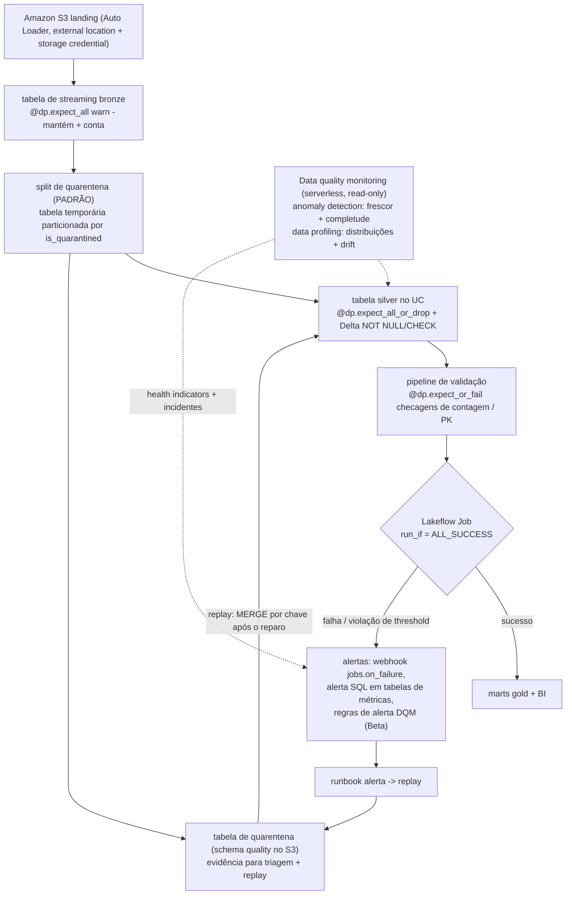
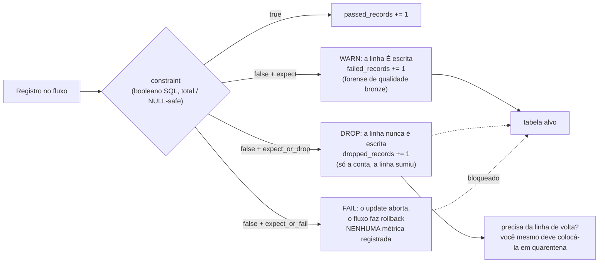
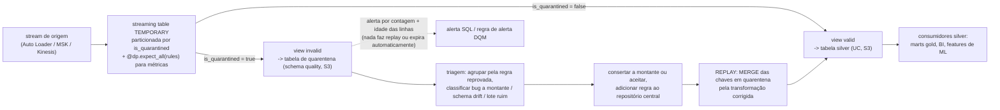
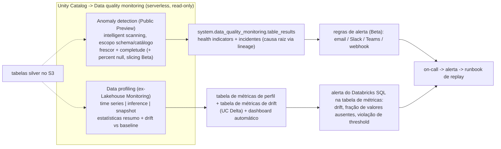
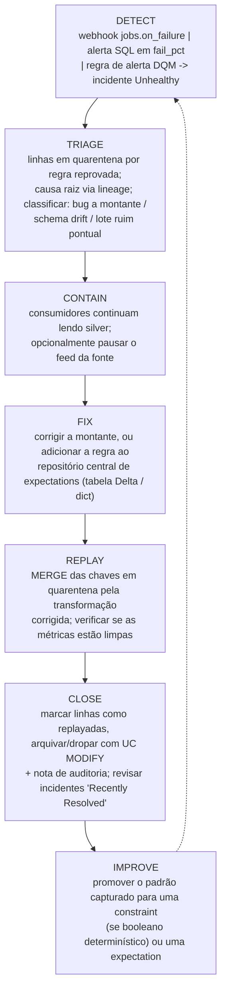

# Qualidade de Dados no Lakehouse da Databricks: Constraints, Expectations, Quarentena e Monitoramento

Todo lakehouse acaba encontrando a mesma manhã desagradável: um dashboard a jusante mostra uma receita 4% abaixo do real, e ninguém consegue dizer se o negócio encolheu ou se o pipeline mentiu. Qualidade de dados na Databricks na AWS é a disciplina que torna essa manhã *respondível*, e, em outubro de 2026, são cinco mecanismos distintos com cinco trabalhos distintos, não um recurso. **Constraints** são gates de escrita always-on aplicados pelo Delta em cada transação. **Expectations** são verificações SQL por registro dentro de pipelines do Lakeflow, com três ações graduadas e métricas legíveis por máquina. **Quarentena** é um *padrão* documentado: não um decorator: que mantém linhas reprovadas em uma tabela do Unity Catalog no S3 para triagem e replay. **Data quality monitoring** é o plano de detecção (**anomaly detection** em todo o schema mais **data profiling** por tabela, o recurso "anteriormente conhecido como Lakehouse Monitoring"). **Alertas e gates de qualidade** vivem nos Lakeflow Jobs. Prevenção, evidência, detecção, orquestração: misture-as e você ou perde linhas silenciosamente ou afoga numa tabela de quarentena que ninguém esvazia.

A regra que mantém a lição inteira em pé vem direto dos docs: "**Expectations enforce data quality, not orchestration**" (docs .../ldp/expectation-patterns, datado de **2026-07-14**). Constraints *previnem*; monitoring *detecta*; jobs *gateiam*; quarentena *lembra*. Um patrimônio maduro precisa de todos os quatro verbos.

```text
 =============================================================
  MAPA DA LIÇÃO 10 - a pilha de qualidade de dados na AWS, em out 2026
 ------------------------------------------------------------
  L1 CONSTRAINTS   Delta NOT NULL + CHECK, aplicados na ESCRITA
                   violação -> transação falha com um erro
                   ADD CONSTRAINT valida linhas EXISTENTES
                   pode elevar o writer protocol para >= 3
                   sem UDF / aggregate / window / subquery
  L2 EXPECTATIONS  6 decorators, 3 ações, apenas booleanos SQL
                   warn  -> linha mantida + métricas passed/failed
                   drop  -> linha removida + contagem dropped_records
                   fail  -> update aborta, NENHUMA métrica registrada
                   exige a edição ADVANCED do pipeline
                   não existe expect_all_or_quarantine - nunca existiu
  L3 QUARANTINE    um PADRÃO: tabela de streaming temporária particionada
                   por is_quarantined + views valid/invalid ->
                   tabela silver + tabela UC de quarentena no S3
  L4 MONITORING    anomaly detection (Public Preview): frescor
                     + completude, health indicators
                     -> system.data_quality_monitoring.table_results
                   data profiling (ex-Lakehouse Monitoring):
                     perfis time series / inference / snapshot,
                     2 tabelas de métricas + dashboard, drift vs baseline
                   serverless, cobrado como DATA_QUALITY_MONITORING
  L5 ALERT+GATES   notificações de job/task + webhooks
                   (jobs.on_failure ...), alertas do Databricks SQL
                   em tabelas de métricas, regras de alerta DQM (Beta),
                   gates run_if (6 condições, padrão ALL_SUCCESS)
  -------------------------------------------------------------
  Evidência vive em: payloads de eventos flow_progress, event log,
  pipeline_events (Beta), tabela de quarentena, tabelas Delta de métricas
  Nunca: colunas _expectation_* em tabelas alvo (mito obsoleto)
 =============================================================
```

Nesta lição você vai:

- colocar as cinco camadas em um único diagrama de arquitetura e dizer com precisão qual camada **previne**, qual **detecta** e qual **gateia**;
- escrever a escada de constraints, `NOT NULL`, faixa e regex via `CHECK`, com a query de pré-voo que faz a validação de histórico no momento da adição bem-sucedida, e explicar o efeito colateral do **writer protocol ≥3**;
- aplicar todos os **seis decorators de expectation** com os aliases legados `@dlt.expect*` ainda em execução, e provar por que `fail` deixa um dashboard vazio;
- consultar métricas de expectation nos payloads `flow_progress`, no event log e na tabela Beta **`system.lakeflow_pipeline_events_preview.pipeline_events`**;
- construir o **padrão de quarentena** exatamente como documentado (tabela temporária, partição `is_quarantined`, views valid/invalid) com regras NULL-safe, e depois **replay** das chaves em quarentena de forma idempotente com `MERGE`;
- configurar o loop **alerta → replay**: notificações de job, códigos de eventos de webhook e as seis condições `run_if` que ramificam um job em tasks de replay e de notificação;
- ler o **data quality monitoring** sob o par de nomes atual verificado, **anomaly detection + data profiling**, com seus health indicators, tabelas de métricas e o produto de cobrança `DATA_QUALITY_MONITORING`;
- pesar os três planos entre si em um **Veredito Comparativo**, triar **doze armadilhas**, estudar **NAB e Burberry** na AWS, ler a **caixa de atualizações de 2026** e praticar com **doze questões** mais quatro verificações interativas.

---

## 1. A pilha de cinco camadas: prevenção, evidência, detecção, orquestração

### 1.1 Um modelo mental, quatro verbos

| Camada | Mecanismo | Verbo | Dispara quando | Precisa de orquestração? |
|---|---|---|---|---|
| **1. Delta constraints** | `NOT NULL`, `CHECK`, aplicados pelo escritor do Delta | **previne** | qualquer escrita na tabela, qualquer engine (Spark batch, sink de Structured Streaming, pipeline do Lakeflow, JDBC) | Não, zero de plumbing |
| **2. Pipeline expectations** | seis decorators `dp.expect*` / `CONSTRAINT... EXPECT` | **previne** (drop) ou **mede** (warn) ou **para** (fail) | cada registro passando por uma query de pipeline | Não, mas exige a edição **Advanced** |
| **3. Quarentena** | padrão documentado: tabela temporária + `is_quarantined` + views | **lembra** | cada update, como uma partição do stream | Parcialmente: você constrói e esvazia |
| **4. Data quality monitoring** | anomaly detection + data profiling | **detecta** | scans serverless em background | Não: "does not modify any tables it monitors, nor does it add overhead to any jobs" (docs, **2026-09-11**) |
| **5. Alertas + gates** | notificações de job, webhooks, alertas SQL, regras de alerta DQM, `run_if` | **notifica + gateia** | falhas, thresholds, tabelas não saudáveis | Sim; isto *é* orquestração |

Duas consequências caem da tabela imediatamente. Primeiro, as camadas 1 to 2 são **no momento da escrita**: elas não protegem uma tabela na qual ninguém escreve (uma tabela legada não recebe proteção até que um dono adicione constraints ou expectations a montante). Segundo, a camada 4 é **pura detecção**: ela nunca bloqueia nada, então um health indicator que diz "Unhealthy" é um telefonema, não um firewall.



### 1.2 O que cada camada *não* pode fazer (o espaço negativo)

- **Constraints** não podem verificar unicidade nem integridade referencial: `CHECK` proíbe "User-defined functions. Aggregate functions. Window functions. Functions returning multiple rows" (docs.../tables/constraints, **2026-09-11**), e as declarações de primary key, foreign key e `UNIQUE` são "informational only and aren't enforced" (mesma página).
- **Expectations** não podem chamar Python, serviços externos nem subqueries (docs.../ldp/expectations, **2026-09-11**): verificações cross-table pertencem a um pipeline de validação ou a um notebook.
- **Quarentena** não tem automação de plataforma: "nothing in the platform auto-replays or auto-expires quarantine tables", o seu runbook é dono disso (prática do curso; consistente com o padrão documentado).
- **Monitoring** não pode aplicar (enforce): ele "não modifica nenhuma das tabelas que ele monitora" (docs, **2026-09-11**).
- **Jobs** não veem linhas: eles veem *estados de task* e *métricas que você publica para eles*.

- **📚 Você sabia?** O plano de detecção inteiro é cobrado sob um único produto nomeado: data quality monitoring "runs on serverless compute and is billed as serverless DBUs under the `DATA_QUALITY_MONITORING` billing product" (docs.../data-quality-monitoring, **2026-09-11**). Para resultados criados **a partir de fevereiro de 2026** você encontra essas linhas com `billing_origin_product = 'DATA_QUALITY_MONITORING'`; linhas de profiling mais antigas ainda estão marcadas com `custom_tags['LakehouseMonitoring'] = 'true'`, o nome antigo do produto sobrevive *dentro dos dados de cobrança*, e é exatamente por isso que esta lição ensina os dois nomes.

---

## 2. Camada 1, Delta constraints: o gate de escrita barato e always-on

### 2.1 Os dois tipos aplicados, e o que "aplicado" custa

"Constraints aplicadas verificam a integridade dos dados antes de adicionar linhas a uma tabela" e "Quando uma constraint é violada, a transação falha com um erro" (docs.../tables/constraints, **2026-09-11**). Apenas dois tipos são aplicados: **`NOT NULL`** e **`CHECK`**. Todo o resto, `PRIMARY KEY`, `FOREIGN KEY`, `UNIQUE`, é metadata para o otimizador ("não são aplicadas"; PK/FK disponíveis no DBR **13.3 LTS+** para tabelas Unity Catalog e Delta, **GA no DBR 15.2+**; `UNIQUE` está em **Public Preview** no Databricks SQL e no DBR **18.2+**).

Três fatos operacionais decidem como você faz o rollout das constraints:

1. **A validação no momento da adição é real.** "O Databricks verifica que todas as linhas existentes satisfazem a constraint antes de adicionar uma constraint `NOT NULL` a uma tabela", e o `ALTER TABLE ADD CONSTRAINT` "verifica que todas as linhas existentes satisfazem a constraint antes de adicionar a constraint à tabela." Você não pode encaixar uma constraint em uma tabela suja: repare ou coloque em quarentena o histórico primeiro.
2. **O writer protocol se move.** "Adding a constraint upgrades the table writer protocol if the current writer version is less than 3": clientes Delta externos mais antigos podem quebrar. Verifique seus consumidores antes do rollout de DQ.
3. **A remoção é deliberada.** No DBR **15.4 LTS+** você remove um check constraint com `DROP FEATURE`: não com um `ALTER` casual.

Constraints são agnósticas de engine: elas se aplicam "to any Delta write path", Spark batch, sinks de Structured Streaming, pipelines do Lakeflow, ingestão via JDBC, então são a única camada que protege tabelas escritas *fora* dos seus pipelines.

### 2.2 Exemplo resolvido E1: a escada de constraints com seu guard de pré-voo

**Em outubro de 2026, tabela silver do Unity Catalog no S3.** A forma de escada documentada (`people_demo` nas docs de constraints), anotada com o guard que faz a validação no momento da adição dar certo:

```sql
-- (0) PRE-FLIGHT: run BEFORE ALTER TABLE. Expect 0 rows, otherwise repair first.
--     The predicate is written NULL-safe: NULL must count as a violation.
SELECT count(*) AS rows_that_would_block_the_constraint
FROM lake.silver.people_demo
WHERE NOT (birthDate > DATE '1900-01-01')
   OR (birthDate > DATE '1900-01-01') IS NULL;

-- (1) Table declared with NOT NULL on the columns that must always be present
CREATE TABLE lake.silver.people_demo (
  id         INT    NOT NULL,
  middleName STRING,
  ssn        STRING,
  birthDate  DATE
);

-- (2) Relax what the business really tolerates
ALTER TABLE lake.silver.people_demo ALTER COLUMN middleName DROP NOT NULL;

-- (3) Tighten what must be present - verifies EVERY existing row first
ALTER TABLE lake.silver.people_demo ALTER COLUMN ssn SET NOT NULL;

-- (4) Range check - also verifies every existing row first
ALTER TABLE lake.silver.people_demo
  ADD CONSTRAINT dateWithinRange CHECK (birthDate > DATE '1900-01-01');

-- (5) Regex idiom from the validate docs (docs .../transform/validate, 2026-09-11)
ALTER TABLE lake.silver.orders
  ADD CONSTRAINT sku_format CHECK (sku REGEXP '^[A-Za-z0-9]+$');

-- (6) Range idiom, the documented two-sided form
ALTER TABLE lake.silver.orders
  ADD CONSTRAINT pct_within_range CHECK (pct_complete >= 0 AND pct_complete <= 100);

-- (7) Audit what is actually enforced today
SHOW TBLPROPERTIES lake.silver.people_demo;
-- (8) Removal, DBR 15.4 LTS+ only
-- ALTER TABLE lake.silver.people_demo DROP FEATURE 'dateWithinRange' CASCADE;
```

Se o passo (0) retornar diferente de zero, o `ALTER TABLE` posterior falha com um erro e nada muda, esse é o resultado correto e a razão de o guard ser o passo 0, não um afterthought. Note o que a escada *não* pode conter: `CHECK (count(distinct id) = count(*))` (aggregate proibido), `CHECK` chamando uma UDF (proibido), qualquer subquery. **Unicidade e integridade referencial estão fora do alcance do `CHECK` por design**, use um pipeline de validação com `expect_or_fail` em `count(*) = count(distinct pk)`, os testes `unique`/`relationships` do dbt, ou o monitoring (seção 6).

> [!IMPORTANT]
> ⚠️ **Constraints protegem escritores, não leitores, e nunca consertam o histórico retroativamente.** Adicionar uma constraint valida as linhas existentes mas *não conserta nada*: o histórico sujo precisa ser reparado ou colocado em quarentena primeiro. Inversamente, uma tabela legada sem constraints continua servindo linhas ruins a todo consumidor até que um dono aja; leitores não recebem erro nenhum. Constraints são um gate **no momento da escrita** para **todo** escritor, essa é a sua força e o seu ponto cego.

---

## 3. Camada 2, expectations do Lakeflow: seis decorators, três ações

### 3.1 O inventário verificado

"Expectations are optional clauses in pipeline materialized view, streaming table, or view creation statements that apply data quality checks on each record passing through a query. Expectations use standard SQL Boolean statements" (docs .../ldp/expectations, rodapé de **11 de setembro de 2026**). "The `dp` module includes **six decorators** to control expectations behavior" (referência Python, página datada de **2026-09-11**), empilhados **depois** do decorator de dataset e **antes** da função:

| Decorator | Aceita | Ação na violação |
|---|---|---|
| `@dp.expect(description, constraint)` | uma regra | **warn** (padrão): "Invalid records are written to the target" + contagens passed/failed |
| `@dp.expect_or_drop(...)` | uma regra | **drop**: "Invalid records are dropped before data is written to the target. The count of dropped records is logged" |
| `@dp.expect_or_fail(...)` | uma regra | **fail**: "Invalid records prevent the update from succeeding. Manual intervention is required before reprocessing" |
| `@dp.expect_all({desc: sql, ...})` | **dict Python** | warn em qualquer regra reprovada |
| `@dp.expect_all_or_drop({...})` | dict | drop em qualquer regra reprovada |
| `@dp.expect_all_or_fail({...})` | dict | fail no update em qualquer regra reprovada |

Gêmeo SQL para datasets autoralados em SQL: `CONSTRAINT name EXPECT (expr)` com `ON VIOLATION DROP ROW` opcional ou `ON VIOLATION FAIL UPDATE`. Quatro cláusulas decidem o design de produção:

1. "**Como `fail` faz a atualização falhar quando um registro inválido é detectado, as métricas não são registradas.**" Fail é uma placa de parada, não um instrumento de medição.
2. "O **nome de uma expectation deve ser único para um dado dataset**" (reutilizável entre datasets).
3. Constraints são SQL puro: sem "Custom Python functions, External service calls, Subqueries referencing other tables."
4. Gate de edição: "Core … doesn't require advanced features such as change data capture (CDC) or expectations. Pro … plus … CDC. Advanced … and includes **data quality constraints with expectations**" (docs .../ldp/configure-pipeline, **2026-10-01**).

**Não existe decorator `expect_all_or_quarantine`**, nem sob `dp`, nem sob `dlt`. Existem exatamente seis; a quarentena é construída à mão na seção 5. Expectations se anexam a streaming tables, materialized views e temporary views (métricas de views são pouco confiáveis, "as views só são calculadas quando consultadas"); sinks e fluxos `AUTO CDC FROM SNAPSHOT` não podem carregá-las.



### 3.2 Exemplo resolvido E2: uma suíte DQ resolvida em uma tabela silver (os dois estilos de API)

**Em outubro de 2026, serverless, edição Advanced, alvos Unity Catalog.** A coluna da esquerda é o estilo de alias legado que ainda roda; a da direita é o estilo `dp` atual. Os mesmos seis decorators, as mesmas três ações.

```python
# --- LEGACY STYLE (2022-2024 tutorials) - still functional, Databricks recommends dp
import dlt

@dlt.table
@dlt.expect("order_id_not_null", "order_id IS NOT NULL")                    # warn
@dlt.expect_or_drop("valid_amount", "amount IS NOT NULL AND amount >= 0")   # drop
def bronze_orders():
    return spark.readStream.format("cloudFiles").json("/Volumes/lake/landing/orders/")

# --- CURRENT STYLE (docs .../ldp/developer/*, 2026-09-11 / 2026-08-06)
from pyspark import pipelines as dp

bronze_rules = {
    "order_id_not_null": "order_id IS NOT NULL",
    "event_ts_not_null": "event_ts IS NOT NULL",
}
silver_rules = {
    "valid_order_id":   "order_id IS NOT NULL",                       # total (NULL-safe)
    "valid_amount":     "amount IS NOT NULL AND amount >= 0",
    "valid_currency":   "currency IN ('USD','EUR','GBP')",
}

@dp.table(name="bronze_orders", table_properties={"quality": "bronze"})
@dp.expect_all(bronze_rules)                    # WARN: keep rows, emit metrics
def bronze_orders():
    return (spark.readStream.format("cloudFiles")
                 .option("cloudFiles.format", "json")
                 .load("/Volumes/lake/landing/orders/"))

@dp.table(name="silver_orders")
@dp.expect_all_or_drop(silver_rules)            # DROP: bad rows excluded, counts logged
def silver_orders():
    return spark.readStream.table("bronze_orders").filter("event_type = 'ORDER'")

@dp.materialized_view(name="gold_daily_revenue")
@dp.expect_or_fail("revenue_sane", "total_revenue >= 0")   # FAIL: abort this flow only
def gold_daily_revenue():
    return (spark.read.table("silver_orders")
                 .groupBy("order_date", "currency")
                 .agg({"amount": "sum"}))
```

Narre a suíte antes de rodá-la: **bronze avisa** (camada forense, linhas ruins são evidência, não ruído), **silver dropa** (consumidores nunca veem linhas inválidas; só as contagens sobrevivem, a seção 5 mostra o que fazer quando uma conta não basta), **gold falha** (um total de receita negativo é impossível, então abortar em vez de publicar). Toda regra acima está escrita **total**, `amount IS NOT NULL AND amount >= 0`, nunca `amount >= 0` solto, porque os docs exigem que cada predicado seja um booleano por registro, e uma regra que pode avaliar para NULL em entradas NULL não se comportará como o autor pretendia em um split feito à mão (docs.../ldp/expectation-patterns, **2026-07-14**; a semântica de veredito NULL não está detalhada, então torne as regras total e pare de adivinhar).

### 3.3 Exemplo resolvido E2b, o gêmeo SQL

```sql
CREATE OR REFRESH STREAMING TABLE lake.silver.orders AS
SELECT * FROM STREAM lake.bronze.orders_raw
CONSTRAINT order_id_not_null EXPECT (order_id IS NOT NULL)                       -- warn
CONSTRAINT valid_amount         EXPECT (amount IS NOT NULL AND amount >= 0)
  ON VIOLATION DROP ROW;                                                        -- drop
```

As duas estratégias de nomenclatura aparecem nos docs: uma expectation consolidada, ou cláusulas separadas "resulting in multiple entries under different names" no event log: escolha uma convenção por dataset para que suas queries de métricas agrupem corretamente.

- **📚 Você sabia?** Uma expectation em modo fail produz a mensagem de erro mais *útil* de toda a pilha de qualidade deste curso. O exemplo documentado imprime nome do fluxo, nome da expectation, registro de entrada e registro de saída em uma única string: `[EXPECTATION_VIOLATION.VERBOSITY_ALL] Flow 'sensor-pipeline' failed to meet the expectation. Violated expectations: 'temperature_in_valid_range'. Input data: '{"id":"TEMP_001",…}'` (docs.../ldp/expectations, **2026-09-11**). Em um pipeline triggered, apenas o update daquele fluxo faz rollback, outros fluxos paralelos continuam atualizando, então trate a mensagem como um relatório de bug *preciso*, não como um alarme de pipeline inteiro.

---

## 4. Onde as métricas de expectation vivem (e onde não vivem)

### 4.1 O contrato é um payload de evento, não uma coluna

Os docs atuais definem métricas puramente como **payloads de eventos `flow_progress`**: "as métricas com a contagem de registros que passaram e falharam em uma expectation são armazenadas no objeto `details:flow_progress.data_quality.expectations`. A métrica com a contagem de registros descartados é armazenada no objeto `details:flow_progress.data_quality`" (docs .../ldp/monitor-event-logs, **2026-10-09**). O schema do array é publicado: `array<struct<name: string, dataset: string, passed_records: int, failed_records: int>>`, onde `dropped_records` conta as linhas que "falharam em uma ou mais expectations".

Três superfícies de leitura, um contrato:

1. **Pipeline UI → dataset → aba Data quality**: apenas warn/drop, escala humana, por pipeline.
2. **O event log**: uma tabela Delta oculta, `SELECT * FROM event_log(<pipelineId>)`, publicável em uma tabela UC nomeada. Pipelines retêm **60 dias** de updates passados na UI/API; detalhes mais antigos vivem apenas no event log (docs.../ldp/configure-pipeline, **2026-10-01**).
3. **`system.lakeflow_pipeline_events_preview.pipeline_events` (Beta)**: a superfície recomendada entre pipelines, com queries publicadas de "failed expectations by dataset" e um dashboard do Lakeview pronto para importar; precisa de admin de metastore/conta ou `USE`+`SELECT` nos schemas de sistema (docs.../ldp/monitor-and-query-events, **2026-10-09**).

> ⚠️ **AVISO, o mito da coluna obsoleta.** Se a sua SQL de monitoring faz SELECT de `_expectation_name` ou `_expectation_type` a partir de uma tabela alvo de pipeline, você está rodando o blog post de 2023 de alguém: os docs atuais definem o payload acima e mais nada (doc de expectations **2026-09-11**; doc de event log **2026-10-09**). E se uma expectation em modo fail mostra *nenhuma* métrica, isso não é um bug, "metrics are not recorded" por design.

### 4.2 Exemplo resolvido E3, a suíte de métricas: event log, tabela de sistema, conta

```sql
-- (a) Pass/fail rate per expectation from the per-pipeline event log
WITH exploded AS (
  SELECT explode(from_json(
           details:flow_progress:data_quality:expectations,
           "array<struct<name: string, dataset: string, passed_records: int, failed_records: int>>"
         )) AS e
  FROM event_log(<pipeline_id>)
  WHERE event_type = 'flow_progress'
)
SELECT e.dataset AS dataset, e.name AS expectation,
       SUM(e.passed_records) AS passing, SUM(e.failed_records) AS failing,
       ROUND(100 * SUM(e.failed_records)
             / NULLIF(SUM(e.passed_records) + SUM(e.failed_records), 0), 3) AS fail_pct
FROM exploded GROUP BY 1, 2 ORDER BY failing DESC;

-- (b) Region-wide, across every pipeline in the account (Beta system table)
SELECT expectation.dataset, expectation.name,
       SUM(expectation.failed_records) AS failed
FROM system.lakeflow_pipeline_events_preview.pipeline_events
LATERAL VIEW explode(variant_get(details,
  '$.flow_progress.data_quality.expectations',
  'ARRAY<STRUCT<name:STRING,dataset:STRING,passed_records:BIGINT,failed_records:BIGINT>>')) AS expectation
WHERE event_type = 'flow_progress'
GROUP BY 1, 2
HAVING SUM(expectation.failed_records) > 0;

-- (c) What does the detection plane cost? (DBU QUANTITY only - see note below)
SELECT billing_origin_product,
       CASE WHEN usage_metadata.schema_id IS NOT NULL THEN 'anomaly detection'
            WHEN usage_metadata.table_id  IS NOT NULL THEN 'data profiling' END AS capability,
       sku_name, SUM(usage_quantity) AS dbus
FROM system.billing.usage
WHERE billing_origin_product = 'DATA_QUALITY_MONITORING'
  AND usage_date >= current_date() - 30
GROUP BY 1, 2, 3;
```

A query (c) deliberadamente soma **DBUs, não dólares**: o nome do produto de cobrança e a divisão `schema_id`/`table_id` são documentados (docs.../data-quality-monitoring/expense, **2026-09-11**), mas nenhuma taxa listada para `DATA_QUALITY_MONITORING` é publicada nas páginas que este curso verificou, então precifique a partir da *taxa serverless da sua conta* e rotule isso como uma suposição.

---

## 5. Camada 3, quarentena: um padrão, não um decorator

Quando expectations em modo drop são destrativas demais (dados regulados, requisitos de replay, "precisamos ver o que rejeitamos"), você precisa que as linhas ruins sejam *mantidas*. A Databricks documenta a receita: uma **streaming table temporária particionada por uma flag computada `is_quarantined`**, anotada com `@dp.expect_all(rules)` para que as métricas ainda fluam, e então duas views que dividem o stream (docs .../ldp/expectation-patterns, **2026-07-14**).

### 5.1 Exemplo resolvido E4: a forma documentada de quarentena

```python
from pyspark import pipelines as dp
from pyspark.sql.functions import expr

rules = {
    "valid_pickup_zip":  "(pickup_zip IS NOT NULL)",          # total rules only
    "valid_dropoff_zip": "(dropoff_zip IS NOT NULL)",
}
# NOT(rule1 AND rule2 ...) -> TRUE means "at least one rule failed"
quarantine_expr = "NOT({0})".format(" AND ".join(rules.values()))

@dp.view
def raw_trips_data():
    return spark.readStream.table("samples.nyctaxi.trips")

@dp.table(temporary=True, partition_cols=["is_quarantined"])
@dp.expect_all(rules)                      # metrics still recorded per rule
def trips_data_quarantine():
    return (spark.readStream.table("raw_trips_data")
                 .withColumn("is_quarantined", expr(quarantine_expr)))

@dp.view
def valid_trips_data():     # -> materialize as silver
    return spark.read.table("trips_data_quarantine").filter("is_quarantined = false")

@dp.view
def invalid_trips_data():   # -> materialize as the UC quarantine table
    return spark.read.table("trips_data_quarantine").filter("is_quarantined = true")
```

Em produção, promova `invalid_trips_data` a uma `@dp.table(name="orders_quarantine")` de verdade, em um schema `quality` dedicado. Para pipelines do Unity Catalog, ambas as tabelas caem fisicamente no **armazenamento gerenciado do schema no S3** (fallback: localização do catalog, depois a raiz do metastore, docs.../ldp/unity-catalog, **2026-10-09**), ou em um prefixo S3 seu atrás de uma external location; as mesmas chaves KMS, as mesmas regras de lifecycle (por exemplo, transição dos prefixos de quarentena para armazenamento mais barato após N dias, recomendação do lado da AWS).



### 5.2 Exemplo resolvido E5, SQL de replay: triagem, reparo, MERGE de volta, fechamento

**Prática do curso, consistente com o padrão documentado (digest 10 §B6).** O ACID do Delta mais o estado do pipeline tornam os replays idempotentes **desde que você replaie por chave**, nunca por append cego.

```sql
-- (1) TRIAGE: what is in there, by failed rule and age?
SELECT quarantine_reason, min(quarantine_date) AS oldest, count(*) AS rows
FROM lake.quality.orders_quarantine
WHERE replayed_at IS NULL
GROUP BY 1 ORDER BY rows DESC;

-- (2) CONTAIN: consumers keep reading silver - bad rows never landed there.
-- (3) FIX upstream (bad file format, enum drift, late schema change) or accept the rows.

-- (4) REPLAY: reprocess quarantined keys through the FIXED transform, idempotently
MERGE INTO lake.silver.orders AS t
USING (
  SELECT order_id, order_ts, amount, currency, customer_id
  FROM lake.quality.orders_quarantine
  WHERE replayed_at IS NULL AND quarantine_date >= current_date() - 7
) AS s
ON t.order_id = s.order_id
WHEN MATCHED AND s.repaired THEN UPDATE SET *
WHEN NOT MATCHED THEN INSERT *;

-- (5) CLOSE: mark the evidence, don't destroy it silently
UPDATE lake.quality.orders_quarantine
SET replayed_at = current_timestamp()
WHERE replayed_at IS NULL AND quarantine_date >= current_date() - 7;

-- (6) GUARD the silver table with the always-on layer (after history is clean)
ALTER TABLE lake.silver.orders
  ADD CONSTRAINT amount_sane CHECK (amount IS NOT NULL AND amount >= 0);
```

Dois pontos de disciplina. **A contenção é de graça**: os consumidores silver nunca viram as linhas, então o replay é um *reparo*, não um rollback de incidente. **O fechamento é governado**: marcar linhas como replayadas, arquiválas ou dropá-las exige `MODIFY` do UC na tabela de quarentena e deve deixar um rastro de auditoria: evidência de qualidade é em si um dado governado, e data stewards normalmente recebem apenas `SELECT` na quarentena, concedido de forma estreita.

> ⚠️ **AVISO: expectations abusadas como filtros.** `expect` (warn) **mantém** linhas inválidas no alvo: tudo bem no bronze, perigoso em um caminho de serving silver/gold onde "the check exists" parece proteção. `expect_or_drop` descarta linhas silenciosamente: só sobra uma conta, e uma conta não pode ser replayada. `expect_or_fail` é a única ação que para dados, e ela registra **nenhuma métrica**. Escolha por camada: **warn no bronze, drop-ou-quarentena no silver, fail nos gates de validação**, e nunca escreva uma regra `expect` em uma tabela de serving e chame isso de estratégia de qualidade (docs.../ldp/expectations, **2026-09-11**; expectation-patterns, **2026-07-14**).

> [!WARNING]
> **A tabela de quarentena é um passivo que cresce sozinho.** Nada na plataforma faz replay ou expira automaticamente. Adicione seus próprios controles: alertas SQL ou regras de alerta DQM sobre contagens e idade das linhas de quarentena, uma regra de lifecycle do S3 no prefixo, um runbook de replay com SLA por violação, e grants do UC estreitos o suficiente para que apenas o papel de on-call consiga `MODIFY`. Uma tabela de quarentena que ninguém esvazia é um incidente silencioso de perda de dados em câmera lenta.

---

## 6. Camada 4, data quality monitoring: anomaly detection + data profiling

### 6.1 A nomenclatura verificada (é isso que outubro de 2026 realmente diz)

Sob Unity Catalog → **Data quality monitoring**, os docs de "**Sep 11, 2026**" listam duas capacidades: **Anomaly detection** (Public Preview) e **Data profiling**, e a mesma página afirma "**Data profiling was formerly known as Lakehouse Monitoring.**" Decore o mapeamento:

| Vocabulário antigo (tutoriais ≤2025) | Vocabulário atual de out 2026 | O que realmente faz |
|---|---|---|
| "Lakehouse Monitoring" | **Data profiling** | perfis por tabela: estatísticas resumo, drift contra janelas de tempo ou uma **tabela baseline**, métricas SQL customizadas: duas tabelas Delta de métricas + um dashboard automático em um schema UC à sua escolha |
| "monitors de freshness / volume" | **Anomaly detection** | "intelligent scanning" em schema ou catálogo inteiro; modelos aprendidos por tabela para **frescor** (commit incomumente atrasado → *stale*) e **completude** (contagem de linhas de 24 horas abaixo do limite inferior previsto → *incomplete*) |
| "setup de monitor via JSON / CLI" | UI + grants `MANAGE` | habilitar em até **50 schemas por vez** a partir de um catálogo; exige `MANAGE` no schema ou no catálogo pai |

Qualquer material de curso dizendo "três tipos de monitor sob Lakehouse Monitoring" está obsoleto em dois eixos, o **nome** e a **divisão** entre detecção e profiling.

### 6.2 O que cada capacidade entrega

- **Anomaly detection** (docs **2026-10-09**, Public Preview): job em background por schema; resultados em **`system.data_quality_monitoring.table_results`**; health indicators (*Healthy / Unhealthy / Training / Error / Excluded / Not enabled*) no Catalog Explorer e em nós de lineage; "Smart scanning might delay the population of health indicators for some tables by up to **two weeks**"; extras Beta **percent null** e **completeness slicing** (até **3** colunas de slice, apenas onde uma coluna tem **≤ 50 valores distintos**); análise de causa raiz "uses Unity Catalog data lineage"; incidentes suportam "Assign to me" e "Not an issue" com atribuição persistindo por **7 dias**. Limitações: sem views nem foreign tables; **desabilitar apaga o job e todas as tabelas de resultado: irreversível**.
- **Data profiling** (docs **2026-09-11**): três tipos de perfil: **Time series** (métricas ao longo de janelas de tempo), **Inference** (logs de requisição do modelo), **Snapshot** ("A tabela completa é processada a cada refresh. O tamanho máximo de tabela de um perfil snapshot é **4TB**"). Saída: "A tabela de métricas do perfil contém estatísticas resumidas … a tabela de métricas de drift contém estatísticas relacionadas ao drift dos dados ao longo do tempo", ambas tabelas Delta UC comuns mais um dashboard automático. Perfis time series e inference "apenas calculam métricas dos últimos **30 dias**". Requisitos: `USE CATALOG`, `USE SCHEMA`, `SELECT`, `MANAGE`; compute serverless para jobs. O blog de GA de 2024 recomenda habilitar **CDF** para profiling incremental em perfis time series/inference.
- **Read-only por contrato**: monitoring "não modifica nenhuma das tabelas que monitora, nem adiciona overhead a jobs que populam essas tabelas" (docs, **2026-09-11**). Detecção não é enforcement.



- **📚 Você sabia?** O tipo de perfil **snapshot** tem um teto duro, "**O tamanho máximo de tabela de um perfil snapshot é 4TB**", enquanto os perfis time series e inference apenas "calculam métricas dos últimos 30 dias" (docs.../data-profiling, **2026-09-11**). Auditorias de horizonte longo precisam, portanto, ou de uma tabela baseline exportada para comparação de drift, ou do histórico do event log fora da janela do perfil; a resposta dos docs para "eu preciso de mais de 30 dias" é literalmente "entre em contato com o seu time de contas da Databricks."

---

## 7. Camada 5, alerta → replay: notificações, gates e o runbook

### 7.1 Os três planos de alerta

| Plano | O que observa | Fatos de configuração (docs, 2026) |
|---|---|---|
| **Notificações do Lakeflow Jobs** | ciclo de vida de task/job: início, sucesso, falha, threshold de duração, backlog de streaming, manutenção | email ou **system destinations** configuradas pelo admin (Slack, Teams, PagerDuty, webhooks); "**max 3 system destinations per each notification event type**" por job/task; códigos de webhook `jobs.on_start`, `jobs.on_success`, `jobs.on_failure`, `jobs.on_duration_warning_threshold_exceeded`; "Job-level notifications aren't sent when failed tasks are retried" → use notificações de task + "Mute until the last retry"; alertas de streaming-backlog "aren't supported for pipeline tasks" (docs .../jobs/notifications, **2026-10-09**) |
| **Alertas do Databricks SQL** | a sua SQL sobre as tabelas de métricas de perfil/drift ou métricas de eventos | "create a Databricks SQL query on the profile metrics table or drift metrics table. You then create a Databricks SQL alert for this query"; email por padrão, webhook/Slack/PagerDuty disponíveis (docs .../monitor-alerts, **2025-01-21**) |
| **Regras de alerta DQM (Beta)** | tabelas que ficam **Unhealthy** em um catálogo ou schema | "Each alert rule is scoped to a catalog or a specific schema"; destinos "email … Slack, Microsoft Teams, or webhook"; exige `MANAGE` no schema/catálogo (docs .../anomaly-detection/alerts, **2026-10-01**) |

Consumidores de máquina devem usar **webhooks definidos pelo usuário**: "If you require a specific schema or formatting for notifications, Databricks recommends configuring a user-defined webhook": os corpos de mensagem do Slack não são um contrato estável (mesma página).

### 7.2 Gates de qualidade: `run_if`, seis condições

"Configure task dependencies (Run if)" (docs **2026-06-25**) oferece exatamente seis condições: `ALL_SUCCESS` (padrão), `AT_LEAST_ONE_SUCCESS`, `NONE_FAILED`, `ALL_DONE`, `AT_LEAST_ONE_FAILED`, `ALL_FAILED`. Semântica para ter decorada: com uma condição orientada para sucesso, uma task não atendida é marcada **`Upstream failed`**; com uma condição orientada para falha, ela é marcada **`Excluded`**; e "As tasks upstream com o estado de resultado `Excluded` são tratadas como bem-sucedidas ao avaliar as condições `Run if`."

### 7.3 Exemplo resolvido E6, o job alerta → replay (YAML de asset bundle)

```yaml
# databricks.yml - quality gate + alert -> replay branches (as of Oct 2026)
resources:
  jobs:
    silver_quality_gate:
      name: silver-quality-gate
      max_concurrent_runs: 1
      tasks:
        - task_key: validate_pipeline            # expect_or_fail checks live HERE
          pipeline_task: { pipeline_key: validate_pipeline }
        - task_key: build_silver
          pipeline_task: { pipeline_key: orders_pipeline }
          depends_on: [{ task_key: validate_pipeline }]   # default run_if = ALL_SUCCESS
        - task_key: notify_quarantine            # runs only when validation failed
          notebook_task: { notebook_path: ../notebooks/summarize_quarantine.py }
          depends_on: [{ task_key: validate_pipeline }]
          run_if: AT_LEAST_ONE_FAILED            # unmet -> task Excluded, not failed
        - task_key: post_check                   # ALWAYS runs, even after failures
          sql_task:
            query: { query_id: 1234567890 }      # failed-records ratio > threshold
          depends_on: [{ task_key: build_silver }]
          run_if: ALL_DONE
      email_notifications:
        on_failure: ["oncall-data@example.com"]
      webhook_notifications:
        - id: ops-webhook                        # user-defined: schema-stable payload
          url: "{{secrets/lake/ops_webhook_url}}"
          events: ["on_failure"]                 # jobs.on_failure JSON payload
      # job-level: at most 3 system destinations per event type;
      # retries: default 3 - pair task notifications with "mute until last retry"
```

A dependência padrão (`ALL_SUCCESS`) é o que transforma uma expectation em modo fail em um gate de verdade: "Because a pipeline task fails when its update fails, the downstream task doesn't run unless the validation pipeline succeeds" (expectation-patterns, **2026-07-14**). Lembre do limite dentro do pipeline: `expect_or_fail` dentro de um único pipeline triggered falha apenas aquele fluxo, então **o gate é o job, não o decorator**.

### 7.4 O runbook, como uma máquina de estados



A linha de roadmap do blog de 2026-02-04, "**Filter and quarantine bad data**: Proactively identify bad data and prevent it from reaching consumers", é um *item de roadmap*, não uma capacidade de plataforma entregue. Hoje, o loop é seu para rodar.

- **📚 Você sabia?** Incidentes de anomaly detection são um workflow com data de validade: atribuições persistem por **7 dias**, "Recently Resolved Incidents" está em Beta, e o smart scanning "pode atrasar em até **duas semanas** a população de health indicators de algumas tabelas" (docs.../anomaly-detection, **2026-10-09**), então um schema recém-criado sem indicadores está em *Training*, não em *Healthy*. E o outro lado da moeda: "Quando você desabilita o anomaly detection, o job de anomaly detection e todas as tabelas e informações de anomaly detection são apagados. Esta ação não pode ser desfeita."

### 7.5 Exemplo resolvido E7: verificações de terceiros apenas nos caminhos oficialmente documentados

**Great Expectations** é documentado pela própria GX para Databricks: `%pip install` em um notebook, Data Context / Expectation Suite / Checkpoint / Data Docs, metadata stores em DBFS ou UC Volumes (docs do fornecedor, acessados em 2026-10): não existe página de integração first-party em `docs.databricks.com`, então ensine-o como "instale a biblioteca OSS em um job cluster e rode validações como uma task de job", nunca como um recurso de plataforma. Os **testes de dbt** têm um caminho oficial de Databricks: o adapter mantido pela Databricks **`dbt-databricks`** compila `data_tests: [unique, not_null, accepted_values, relationships]` em SQL de contagem de linhas reprovadas contra o Unity Catalog, e "quando você roda `dbt test`, o dbt percorre os seus arquivos YAML … se esse número for 0, o teste é bem-sucedido" (quickstart do dbt, **2026-10-07**): útil quando a camada de transformação é dbt, redundante com constraints/expectations quando é Lakeflow. **Deequ** não tinha caminho de integração oficial com Databricks documentado em outubro de 2026: apenas padrão de comunidade.

---

## 8. Veredito Comparativo: expectations vs constraints vs monitoring

> **Veredito Comparativo: expectations vs constraints vs data quality monitoring (em outubro de 2026)**
> - **Delta constraints (`NOT NULL` / `CHECK`)**, o gate **always-on, agnóstico de engine**. Zero de orquestração, aplicado em cada escrita na tabela vinda de qualquer engine, falha a transação na violação. Fraquezas: sem aggregates/UDFs/subqueries (então sem unicidade nem integridade referencial), a validação de histórico no momento da adição significa que você precisa limpar primeiro, possível bump de writer protocol ≥3, e protege **escritores, não leitores**. *Escolha constraints para invariantes que são verdadeiros em toda linha, sempre.*
> - **Expectations do Lakeflow (seis decorators)**, a camada **dentro do pipeline, por registro**, com as únicas ações graduadas (warn mantém / drop remove / fail aborta) e o único contrato de *métricas* (payloads `flow_progress` → event log → `pipeline_events`). Fraquezas: apenas Lakeflow, edição **Advanced**, apenas booleanos SQL, fail registra **nenhuma métrica**, elas garantem qualidade de dados *não* orquestração, e a quarentena é um padrão que você constrói. *Escolha expectations para regras de negócio que variam por camada medallion, onde você precisa de contagens por regra.*
> - **Data quality monitoring (anomaly detection + data profiling)**, o **detetive**: frescor/completude aprendidos em schema inteiro com health indicators e causa raiz via lineage, mais profiling de distribuição/drift por tabela com comparação a baseline. Fraquezas: read-only (nunca bloqueia nada), cobrado por serverless sob `DATA_QUALITY_MONITORING`, janela de perfil de 30 dias / teto de snapshot de 4TB, atraso de health indicator de até duas semanas, desabilitar é irreversível. *Escolha monitoring para as perguntas para as quais ninguém consegue escrever uma regra por registro: esta tabela está atrasada, fina, em drift?*
> - **Veredito em uma linha:** *constraints em todo invariante, expectations em todo caminho de serving (warn no bronze, drop-ou-quarentena no silver, fail em um pipeline de validação separado), monitoring em todo schema em que os consumidores confiam: depois ligue a detecção a um job com ramos `run_if` para que alerta → replay seja um procedimento operacional, não uma esperança. Prevenção sem detecção é cega; detecção sem gates é decoração.*

---

## 9. Doze armadilhas que esta lição não vai deixar você continuar carregando

1. **Pedir `expect_all_or_quarantine`.** Ele não existe: apenas seis decorators; quarentena é o padrão documentado (seção 5).
2. **Caçar colunas `_expectation_name` / `_expectation_type`.** O contrato é `details:flow_progress.data_quality.expectations` + `dropped_records`. Blogs antigos escreviam colunas; os docs atuais não.
3. **Expectations abusadas como filtros de ETL.** warn mantém linhas ruins, drop deixa só uma conta, fail para dados mas não registra nada. Escolha por camada.
4. **"`expect_or_fail` gateia o meu pipeline."** Em um pipeline triggered ele falha apenas o fluxo ofensor; datasets downstream não esperam por uma tabela de validação. Gateie com um job.
5. **"Constraints não são retroativas."** Meio certo e perigoso: `ADD CONSTRAINT` **valida** todas as linhas existentes: você não pode aplicá-la a uma tabela suja, e nada conserta o histórico automaticamente.
6. **Escrever `CHECK` para unicidade ou integridade FK.** Impossível por design (aggregates proibidos; PK/FK/`UNIQUE` são informativos). Use checagens de contagem com `expect_or_fail` ou testes do dbt.
7. **Surpresa do bump de protocolo.** A primeira constraint pode elevar o writer protocol para ≥3 e quebrar clientes Delta externos mais antigos: verifique os consumidores primeiro.
8. **Regras não-total.** `amount >= 0` não rejeita NULL, e `NOT(...)` sobre um NULL não é um veredito sobre o qual você possa ramificar. Torne as regras total ou ramifique em uma flag explícita.
9. **Quarentena crescendo silenciosamente.** Sem replay automático, sem expiração automática. Alerta por contagem + idade, lifecycle no prefixo S3, rode o runbook.
10. **Drift no nome do produto de monitoring.** Lakehouse Monitoring = **data profiling**; checagens de freshness/volume = **anomaly detection** com thresholds aprendidos. O corte de UI de 2025-10-07 e o freeze de config de 2025-07-21 para novos clientes são as pistas.
11. **Acreditar que monitoring aplica (enforce) qualquer coisa.** Ele "não modifica nenhuma das tabelas que ele monitora": apenas detecção + alerta.
12. **Pontos cegos de notificação.** Alertas em nível de job pulam tasks com retry (use notificações de task + mute-until-last-retry); alertas de streaming-backlog não cobrem pipeline tasks; corpos de Slack não têm schema estável: use webhooks definidos pelo usuário.

### Atualizações de 2026 (em outubro de 2026)

> [!NOTE]
> **O que mudou na camada de qualidade de dados de que esta lição depende:**
> - **2026-10-09: docs de anomaly detection atualizados (Public Preview):** resultados caem em `system.data_quality_monitoring.table_results`; Beta de **percent null** e **completeness slicing** (≤3 colunas, ≤50 valores distintos); health indicators, causa raiz via lineage, incidentes com atribuição de 7 dias; desabilitar apaga tudo irreversivelmente; habilitação de até **50 schemas por vez** (docs.../data-quality-monitoring/anomaly-detection).
> - **2026-10-01: regras de alerta DQM (Beta):** regras de alerta com escopo de catálogo/schema notificando usuários e destinos (email, Slack, Teams, webhook) quando uma tabela fica **Unhealthy**; `MANAGE` obrigatório (docs.../anomaly-detection/alerts).
> - **2026-09-11: a fonte da verdade da nomenclatura:** "Data profiling was formerly known as Lakehouse Monitoring"; monitoring é read-only; cobrança sob **`DATA_QUALITY_MONITORING`** (docs.../data-quality-monitoring,.../data-profiling); as páginas de expectations, constraints e validate carregam a mesma data de rodapé.
> - **2026-02-04, Data Quality Monitoring agêntico anunciado (Public Preview na AWS, Azure, GCP):** baselines aprendidos, issues priorizadas por lineage, causa raiz "surfaced directly in upstream Lakeflow jobs and pipelines"; itens de roadmap incluem regras de unicidade/validade e "**Filter and quarantine bad data**" (blog, **2026-02-04**), ainda roadmap, não entregue.
> - **Corte de cobrança 2025-06-12 → 2025-10-07 → fev 2026:** data quality monitoring em nível de schema entrou em beta no Data + AI Summit 2025; a nova UI do DQM foi entregue em **2025-10-07**; resultados criados **a partir de fevereiro de 2026** são cobrados sob `billing_origin_product = 'DATA_QUALITY_MONITORING'` (linhas mais antigas mantêm a tag `LakehouseMonitoring`).
> - **Linha do tempo de produto para citar:** Lakehouse Monitoring lançado em **2023-12-12**, foi GA em **2024-08-01** com tabelas de métricas de perfil + drift e profiling incremental via CDF: depois de duas renomeações e uma divisão de capacidade, o vocabulário de out 2026 é **anomaly detection + data profiling**.

---

## Casos Reais

> **📋 Caso A: National Australia Bank (NAB) (banca, Cloud: AWS)**
> **Desafio.** Um data warehouse Teradata de 26 anos, ETL escrito à mão em Spark/SQL legado com DML de 5.000 to 8.000 linhas e prática de engenharia inconsistente entre 300 to 400 engenheiros: qualidade era uma esperança de code review, não uma propriedade mensurável.
> **Stack na AWS.** Databricks SQL, Auto Loader, **Spark Declarative Pipelines no Lakeflow**, Unity Catalog (lineage, masking, access control) e asset bundles: `Cloud: AWS` na página da história (https://www.databricks.com/customers/national-australian-bank-nab, página sem data, acessada em 2026-10).
> **Resultado relatado.** "**1,800 Spark Declarative Pipelines running on Databricks Lakeflow** · **99.6% job success rate** · **80% less transformation complexity**"; latência ponta a ponta "under 15 minutes"; e **data quality improved 38%** (mesma URL, sem data, acessada em 2026-10).
> **Mapeia para esta lição.** Seções 3, 6 e 7: 1.800 pipelines é exatamente a escala na que o olhinho por pipeline para de funcionar: expectations dão contagens por regra, `pipeline_events` dá a visão da frota inteira, e a melhoria de qualidade de 38% é o que um loop de qualidade *medido* (detectar → triar → consertar → replay) produz em escala de banco.
> ⏳ *Nota temporal: página sem data, acessada em out 2026: trate cada número como o que a NAB relatou, não como uma garantia da plataforma.*

> **📋 Caso B: Burberry (varejo de luxo, Cloud: AWS)**
> **Desafio.** Lotes diários de clickstream de clientes chegando "anywhere between 2:00 and 7:00 PM GMT": um problema de frescor antes de ser um problema de modelagem.
> **Stack na AWS.** Databricks Data Intelligence Platform com Snowplow Behavioral Data Platform para Customer 360 em tempo real: `Cloud: AWS` na página da história (https://www.databricks.com/customers/burberry, página sem data, acessada em 2026-10).
> **Resultado relatado.** "**99% reduction in latency for customer clickstream data** · 52x increase in cookie duration" (mesma URL, sem data, acessada em 2026-10; origem da história em 2023).
> **Mapeia para esta lição.** Seção 6: "Freshness refers to how recently a table has been updated … If a commit is unusually late, the table is marked as stale" (docs, **2026-09-11**). A janela de entrega de 2 to 7 PM da Burberry é precisamente o padrão para o qual o modelo de frescor aprendido do anomaly detection foi construído para sinalizar; a lição é que um SLA de latência que você consegue *declarar* é um threshold que você consegue *monitorar*.
> ⏳ *Nota temporal: os números relatados datam da história de 2023, o que a Burberry mediu então, não uma capacidade atual da plataforma.*

---

> [!SUCCESS]
> **Pontos Principais (Key Takeaways):**
> 1. **Cinco camadas, quatro verbos.** Constraints e expectations **previnem**; quarentena **lembra**; data quality monitoring **detecta**; jobs **notificam e gateiam**. Expectations "enforce data quality, not orchestration", o gate é sempre o job.
> 2. **Constraints são baratas e absolutas.** `NOT NULL` + `CHECK` falham a transação na violação em *caminho de escrita algum*; `ADD CONSTRAINT` valida linhas **existentes**; sem aggregates/UDFs/subqueries (então sem checagens de unicidade/FK); a primeira constraint pode elevar o writer protocol ≥3; a remoção exige `DROP FEATURE` no DBR 15.4 LTS+.
> 3. **Seis decorators, três ações.** `expect`/`expect_all` (warn: mantém + métricas), `*_or_drop` (drop + conta), `*_or_fail` (aborta, **nenhuma métrica registrada**). Apenas SQL, nomes únicos por dataset, edição **Advanced** exigida, `expect_all*` aceita um dict. **Não existe `expect_all_or_quarantine`**, quarentena é um padrão.
> 4. **Métricas são eventos, não colunas.** Payloads `flow_progress` carregam `name`, `dataset`, `passed_records`, `failed_records`, `dropped_records`; leia-os na aba Data quality, em `event_log(<id>)`, ou na tabela Beta `system.lakeflow_pipeline_events_preview.pipeline_events`; o histórico de UI/API é de **60 dias**.
> 5. **Quarentena e depois replay.** Streaming table temporária particionada por `is_quarantined` + views valid/invalid → tabela UC de quarentena no S3 (armazenamento gerenciado do schema); replay por chave com `MERGE`, marque as linhas como fechadas, conceda de forma estreita, alerte por contagem e idade: nada faz replay ou expira automaticamente.
> 6. **O nome atual do monitoring é um par.** **Anomaly detection** (frescor, completude, percent null, slicing, health indicators → `system.data_quality_monitoring.table_results`) + **data profiling** (o **Lakehouse Monitoring** renomeado: time series / inference / snapshot, teto de 4TB, janela de 30 dias, duas tabelas de métricas). Read-only, serverless, cobrado como `DATA_QUALITY_MONITORING`.
> 7. **Alerta → replay é um procedimento operacional.** Três planos (notificações de job/webhooks, alertas SQL em tabelas de métricas, regras de alerta DQM), seis condições `run_if` (padrão `ALL_SUCCESS`), no máximo 3 system destinations por tipo de evento: depois o runbook: detectar, triar, conter, consertar, replayar, fechar, melhorar.

---

## Perguntas de Prática (Practice Questions)

```question
{
  "id": "dbl-10-q1",
  "type": "multiple-choice",
  "question": "Uma nova tabela silver no S3 deve rejeitar valores negativos de amount independentemente de qual pipeline, notebook ou loader JDBC escreva nela, sem nenhuma orquestração a configurar. Qual camada serve?",
  "options": [
    "Uma CHECK constraint do Delta: ela é aplicada pelo escritor do Delta em todo caminho de escrita, então a transação falha com um erro na violação: sem job, sem pipeline, sem exigência de edição",
    "Uma expectation @dp.expect_or_fail no pipeline do Lakeflow, porque expectations são o único mecanismo de qualidade de dados aplicado",
    "Uma regra de alerta DQM, porque alertar é o que impede linhas ruins de serem escritas",
    "Uma constraint de primary key, porque keys são aplicadas junto com o NOT NULL"
  ],
  "correct": 0,
  "explanation": "Constraints são 'enforced... before adding rows to a table' e 'When a constraint is violated, the transaction fails with an error' (docs.../tables/constraints, 2026-09-11), em qualquer caminho de escrita Delta - Spark batch, sinks de streaming, pipelines, JDBC. A opção B prende as pessoas: expectations só existem dentro de queries de pipeline do Lakeflow e exigem a edição Advanced; C inverte detecção com prevenção; D está errada porque PK/FK/UNIQUE são 'informational only and aren't enforced'."
}
```

```question
{
  "id": "dbl-10-q2",
  "type": "true-false",
  "question": "Um dataset gold carregando @dp.expect_or_fail('revenue_sane', 'total_revenue >= 0') aborta em entrada ruim, e a aba Data quality do pipeline não mostra métricas para aquela expectation. Isso é um bug de plataforma.",
  "options": ["Verdadeiro", "Falso"],
  "correct": 1,
  "explanation": "Falso: é comportamento documentado: 'Because fail causes the update to fail when an invalid record is detected, metrics are not recorded' (docs.../ldp/expectations, 2026-09-11). Fail é uma placa de parada, não um instrumento de medição; se você quer métricas, precisa usar warn ou drop. É também por isso que fail pertence a um gate de validação orquestrado, não a uma tabela de serving monitorada."
}
```

```question
{
  "id": "dbl-10-q3",
  "type": "multiple-choice",
  "question": "Uma revisão de design propõe @dp.expect_all_or_quarantine(rules) na tabela silver. Qual é o veredito correto em outubro de 2026?",
  "options": [
    "Recusar: o módulo dp tem exatamente seis decorators de expectation e nenhum deles é quarentena: quarentena é um padrão documentado (streaming table temporária particionada por is_quarantined mais views valid/invalid)",
    "Aceitar: quarentena virou um sétimo decorator quando o data quality monitoring foi a Public Preview",
    "Aceitar, mas apenas em SQL via ON VIOLATION QUARANTINE",
    "Recusar apenas porque regras de quarentena precisam ser funções Python"
  ],
  "correct": 0,
  "explanation": "'The dp module includes six decorators to control expectations behavior': expect, expect_or_drop, expect_or_fail, expect_all, expect_all_or_drop, expect_all_or_fail (referência Python, 2026-09-11). A receita documentada de quarentena (expectation-patterns, 2026-07-14) é construída à mão. B inventa um recurso; C confunde o gêmeo SQL, cujas únicas cláusulas são ON VIOLATION DROP ROW e ON VIOLATION FAIL UPDATE; D inverte a regra real: expectation constraints são apenas SQL, nunca Python."
}
```

```fillblank
{
  "question": "Preencha a métrica e o número exatamente como a documentação de outubro de 2026 os define:",
  "template": "As contagens de pass/fail de expectation são armazenadas no objeto details:flow_progress.data_quality.expectations como um array de structs com campos name, dataset, {{1}} e {{2}}; a métrica separada dropped_records conta linhas que falharam em uma ou mais expectations. Um perfil snapshot processa a tabela inteira a cada refresh, com um tamanho máximo de tabela documentado de {{3}}.",
  "answers": {
    "1": "passed_records",
    "2": "failed_records",
    "3": "4TB"
  },
  "distractors": ["failed_rows", "quality_score", "violation_count", "record_status", "error_records", "row_count", "2TB", "1TB", "8TB", "500GB"],
  "explanation": "A página de event log (2026-10-09) publica o schema array<struct<name: string, dataset: string, passed_records: int, failed_records: int>> mais uma contagem separada dropped_records; não existem colunas de metadados _expectation_* em tabelas alvo. O máximo de 4TB do perfil snapshot é citado literalmente da página de data profiling (2026-09-11). Os distratores são nomes de métricas plausíveis e tetos de armazenamento mais redondos que nenhum doc afirma."
}
```

```question
{
  "id": "dbl-10-q4",
  "type": "multiple-choice",
  "question": "Você roda ALTER TABLE lake.silver.orders ADD CONSTRAINT amount_sane CHECK (amount >= 0) em uma tabela que já contém valores negativos. O que acontece?",
  "options": [
    "O statement falha: ADD CONSTRAINT verifica que todas as linhas existentes satisfazem a constraint antes de adicioná-la: você precisa reparar ou colocar em quarentena o histórico primeiro",
    "A constraint é adicionada e deleta silenciosamente as linhas violadoras no próximo OPTIMIZE",
    "A constraint é adicionada como apenas informativa até você rodar ALTER TABLE ... VALIDATE",
    "A constraint se aplica apenas às linhas escritas após um update posterior de pipeline, sem checagem do histórico"
  ],
  "correct": 0,
  "explanation": "'ALTER TABLE ADD CONSTRAINT verifies that all existing rows satisfy the constraint before adding the constraint to the table' (docs .../tables/constraints, 2026-09-11). B inventa um efeito colateral de deleção (constraints nunca modificam dados); C aplica errado o rótulo 'informativo', que pertence a PK/FK/UNIQUE, não a CHECK; D descreve comportamento retroativo no tempo, o oposto da validação documentada no momento da adição."
}
```

```question
{
  "id": "dbl-10-q5",
  "type": "multiple-choice",
  "question": "Qual afirmação sobre a nomenclatura e o comportamento atual do plano de monitoring está correta em outubro de 2026?",
  "options": [
    "Data profiling era anteriormente conhecido como Lakehouse Monitoring; a capacidade irmã anomaly detection varre schemas em busca de frescor e completude, grava em system.data_quality_monitoring.table_results, e o plano inteiro é read-only: ele não modifica as tabelas que monitora",
    "Lakehouse Monitoring ainda existe como um terceiro tipo de monitor ao lado de anomaly detection e data profiling",
    "Monitoring bloqueia escritas quando uma tabela é marcada como Unhealthy, porque health indicators são aplicados no commit",
    "Anomaly detection armazena seus resultados na tabela de métricas de perfil que o data profiling cria"
  ],
  "correct": 0,
  "explanation": "A página de data quality monitoring (2026-09-11) afirma 'Data profiling was formerly known as Lakehouse Monitoring' e que o monitoring 'does not modify any tables it monitors, nor does it add overhead to any jobs'; a página de anomaly detection (2026-10-09, Public Preview) coloca os resultados em system.data_quality_monitoring.table_results. B é o modelo mental obsoleto de 'três tipos de monitor'; C contradiz o contrato read-only; D mistura duas saídas distintas (table_results vs as tabelas de perfil/drift do profiling)."
}
```

```dragdrop
{
  "question": "Ordene o fluxo de quarentena exatamente como o padrão documentado o executa, da chegada ao replay:",
  "items": [
    "O stream de origem assenta os registros e a transformação computa NOT(rule1 AND rule2 ...) como is_quarantined, com toda regra escrita NULL-safe (total)",
    "Uma streaming table temporária particionada por is_quarantined carrega @dp.expect_all(rules) para que métricas por regra ainda fluam para o flow_progress",
    "Duas views dividem a flag: view valid (is_quarantined = false) materializa a tabela silver, view invalid (is_quarantined = true) materializa a tabela UC de quarentena no S3",
    "Alertas disparam por contagem e idade das linhas de quarentena: alerta SQL ou regra de alerta DQM: porque nada na plataforma faz replay ou expira automaticamente",
    "Triage pela regra reprovada e classifique: bug a montante, schema drift ou lote ruim pontual; conserte a montante ou aceite e marque as linhas",
    "Replay das chaves em quarentena pela transformação corrigida com MERGE (idempotente, por chave), depois marque as linhas como replayadas com UC MODIFY e uma nota de auditoria"
  ],
  "correctOrder": [
    "O stream de origem assenta os registros e a transformação computa NOT(rule1 AND rule2 ...) como is_quarantined, com toda regra escrita NULL-safe (total)",
    "Uma streaming table temporária particionada por is_quarantined carrega @dp.expect_all(rules) para que métricas por regra ainda fluam para o flow_progress",
    "Duas views dividem a flag: view valid (is_quarantined = false) materializa a tabela silver, view invalid (is_quarantined = true) materializa a tabela UC de quarentena no S3",
    "Alertas disparam por contagem e idade das linhas de quarentena: alerta SQL ou regra de alerta DQM: porque nada na plataforma faz replay ou expira automaticamente",
    "Triage pela regra reprovada e classifique: bug a montante, schema drift ou lote ruim pontual; conserte a montante ou aceite e marque as linhas",
    "Replay das chaves em quarentena pela transformação corrigida com MERGE (idempotente, por chave), depois marque as linhas como replayadas com UC MODIFY e uma nota de auditoria"
  ],
  "explanation": "A forma documentada (expectation-patterns, 2026-07-14) é: computar a flag -> tabela temporária com expect_all -> duas views -> tabelas reais silver + de quarentena; a detecção (passo 4) precisa existir porque o replay é manual; depois triagem, conserto, replay por chave, fechamento da evidência. Pular o passo 1 NULL-safe coloca linhas em nenhum dos ramos; pular o passo 4 é como tabelas de quarentena crescem silenciosamente; replayar por append cego em vez de MERGE-por-chave é como você duplica linhas do silver."
}
```

```question
{
  "id": "dbl-10-q6",
  "type": "multiple-choice",
  "question": "Em um job multi-task, qual condição run_if o notebook de resumo de quarentena deve carregar para executar apenas quando o pipeline de validação falhou, e qual estado ele recebe quando a validação deu certo?",
  "options": [
    "AT_LEAST_ONE_FAILED: e quando a validação deu certo a task é marcada como Excluded (condições orientadas para falha marcam uma task não atendida como Excluded, e tasks upstream com Excluded contam como successful para outras condições)",
    "ALL_FAILED: e quando a validação deu certo a task é marcada como Upstream failed",
    "ALL_SUCCESS: e quando a validação deu certo a task roda normalmente ao lado das tasks downstream",
    "NONE_FAILED: e quando a validação deu certo a task é marcada como Upstream failed"
  ],
  "correct": 0,
  "explanation": "A página run-if (2026-06-25) documenta seis condições; uma orientada para falha (AT_LEAST_ONE_FAILED / ALL_FAILED) marca uma task não atendida como 'Excluded', enquanto condições orientadas para sucesso a marcam como 'Upstream failed': e 'Upstream tasks with the Excluded result state are treated as successful when evaluating Run if conditions'. ALL_SUCCESS é o gate padrão de build_silver, não o ramo de notificação; NONE_FAILED/ALL_FAILED aqui não expressariam 'apenas quando a validação falhou'."
}
```

```question
{
  "id": "dbl-10-q7",
  "type": "true-false",
  "question": "Habilitar anomaly detection em um schema adiciona uma coluna de validação ou um trigger às tabelas monitoradas, então os consumidores dessas tabelas veem overhead de escrita enquanto está habilitado.",
  "options": ["Verdadeiro", "Falso"],
  "correct": 1,
  "explanation": "Falso. 'Data quality monitoring does not modify any tables it monitors, nor does it add overhead to any jobs that populate these tables' (docs.../data-quality-monitoring, 2026-09-11). Ele roda como um job de background separado em compute serverless, grava resultados em system.data_quality_monitoring.table_results e é cobrado sob DATA_QUALITY_MONITORING: apenas detecção, nunca enforcement."
}
```

```question
{
  "id": "dbl-10-q8",
  "type": "multiple-choice",
  "question": "Uma tabela silver em caminho de serving usa atualmente @dp.expect('valid_amount', 'amount >= 0') (warn). Um revisor está satisfeito porque 'a checagem está no lugar'. Qual é a exposição real?",
  "options": [
    "Warn mantém linhas inválidas: elas são escritas no alvo e apenas contadas: valores NULL e negativos de amount ainda chegam aos consumidores, então uma regra em modo warn em uma tabela de serving é medição, não proteção",
    "Warn registra métricas apenas para streaming tables, então a regra pode nem rodar em uma materialized view",
    "Warn deleta as linhas mas as retém no log de transações Delta até o VACUUM",
    "Warn bloqueia o update quando a razão de falha excede 5%"
  ],
  "correct": 0,
  "explanation": "Segundo o doc de expectations (2026-09-11), warn significa 'Invalid records are written to the target': essa é a armadilha de expectations abusadas como filtros. Camada correta: warn no bronze, drop-ou-quarentena no silver (retendo as linhas), fail em um pipeline de validação separado. B está errada (expectations também se anexam a MVs, embora métricas de views sejam pouco confiáveis); C descreve nem warn nem drop; D inventa um comportamento de threshold que pertence a alertas, não a expectations."
}
```

```matching
{
  "question": "Associe cada camada da pilha de qualidade de outubro de 2026 ao que ela realmente entrega:",
  "pairs": [
    {"left": "Delta CHECK / NOT NULL constraint", "right": "Enforcement em todo caminho de escrita: a transação falha com um erro; validação no momento da adição das linhas existentes; possível bump de writer protocol para >= 3"},
    {"left": "@dp.expect_or_drop / expect_all_or_drop", "right": "Linha removida antes da escrita, apenas dropped_records contado: seguro para caminhos de serving, irreplayável sem quarentena"},
    {"left": "@dp.expect_or_fail em um pipeline de validação", "right": "Update aborta com um erro no nível do registro e NENHUMA métrica; gateia o resto do job apenas quando uma dependência de job o segue (ALL_SUCCESS)"},
    {"left": "Tabela de quarentena (partição is_quarantined)", "right": "Loja de evidências no S3 em um schema UC: linhas ruins retidas para triagem e replay via MERGE por chave, governada por grants UC estreitos"},
    {"left": "Anomaly detection + data profiling", "right": "Detecção read-only em serverless: health indicators de frescor/completude em system.data_quality_monitoring.table_results, mais tabelas de métricas de drift e resumo"}
  ],
  "explanation": "Prevenção (constraints), ação graduada dentro do pipeline (drop), parada sem medição (fail), evidência (quarentena), detecção (monitoring). Armadilhas: assumir que fail mede (não mede), assumir que warn protege (não protege), assumir que monitoring bloqueia escritas (não bloqueia), e assumir que quarentena é um decorator (é um padrão)."
}
```

```question
{
  "id": "dbl-10-q9",
  "type": "multiple-choice",
  "question": "Seu time precisa de uma checagem de unicidade em orders.order_id dentro de um pipeline do Lakeflow. Qual abordagem é suportada em outubro de 2026?",
  "options": [
    "Um dataset de validação usando expect_or_fail em uma regra baseada em contagem (por exemplo um aggregate por update expresso em SQL que a plataforma aceita) ou uma checagem equivalente em notebook/SQL: constraints CHECK não podem expressar unicidade porque aggregates são proibidos e UNIQUE/PK não são aplicados",
    "ALTER TABLE ... ADD CONSTRAINT uniq_order CHECK (count(distinct order_id) = count(*))",
    "PRIMARY KEY (order_id), porque primary keys são aplicadas em tabelas Delta",
    "@dp.expect('unique', 'order_id IS UNIQUE') usando o predicado SQL UNIQUE"
  ],
  "correct": 0,
  "explanation": "CHECK proíbe 'User-defined functions. Aggregate functions. Window functions. Functions returning multiple rows' (2026-09-11), e PK/FK/UNIQUE são 'informational only and aren't enforced': então unicidade precisa de uma checagem de contagem via expectation/notebook/dbt (o teste genérico 'unique' do dbt compila em SQL de contagem de linhas reprovadas). B viola a proibição do CHECK sobre aggregates; C depende de um recurso apenas informativo (UNIQUE em si está só em Public Preview no DBS/DBR 18.2+); D inventa um predicado SQL."
}
```

```question
{
  "id": "dbl-10-q10",
  "type": "multiple-choice",
  "question": "Usando a matriz de alertas da seção 7, qual configuração roteia corretamente uma pipeline task que falhou para um canal Slack de on-call como um evento legível por máquina?",
  "options": [
    "Uma notificação de webhook definida pelo usuário na task com events: [\"on_failure\"], porque os docs recomendam um webhook definido pelo usuário quando você precisa de um schema ou formatação específica, e o payload carrega jobs.on_failure com run_id, job_id e task_key",
    "Uma notificação de email em nível de job, porque alertas em nível de job são enviados mesmo quando tasks com falha são retryadas",
    "Uma notificação de streaming-backlog na pipeline task, porque pipeline tasks suportam alertas de backlog",
    "Uma regra de alerta DQM, porque regras de alerta disparam em falhas de task assim como em tabelas não saudáveis"
  ],
  "correct": 0,
  "explanation": "O doc de notifications (2026-10-09) documenta códigos de eventos de webhook (jobs.on_failure etc.) com payloads JSON e recomenda explicitamente webhooks definidos pelo usuário para estabilidade de schema; o máximo de 3 system destinations por tipo de evento se aplica. B está errada: 'Job-level notifications aren't sent when failed tasks are retried': use notificações de task mais mute-until-last-retry; C está errada: 'Streaming backlog notifications aren't supported for pipeline tasks'; D está errada: regras de alerta DQM disparam em tabelas não saudáveis, não no ciclo de vida de tasks."
}
```

```plot
{
  "type": "bar",
  "title": "Razão de registros reprovados por expectation a partir de uma janela flow_progress (exemplo resolvido E3, dados didáticos sintéticos)",
  "data": [
    {"expectation": "order_id_not_null (bronze, warn)", "fail_pct": 0.02},
    {"expectation": "valid_amount (silver, drop)", "fail_pct": 0.31},
    {"expectation": "valid_currency (silver, drop)", "fail_pct": 1.45},
    {"expectation": "quarantine_flag (split, expect_all)", "fail_pct": 2.10},
    {"expectation": "revenue_sane (gold, fail)", "fail_pct": 0.0}
  ],
  "xKey": "expectation",
  "dataKeys": ["fail_pct"],
  "xLabel": "Nome da expectation (dataset, ação)",
  "yLabel": "Registros reprovados como % dos registros no update"
}
```

```question
{
  "id": "dbl-10-q11",
  "type": "multiple-choice",
  "question": "valid_currency (silver, drop) mostra uma razão de falha de 1.45% na query de métricas. Replayando as linhas em quarentena após consertar a montante, qual é a sequência correta de encerramento?",
  "options": [
    "MERGE das chaves em quarentena pela transformação corrigida para o silver (idempotente por chave), verificar se a razão de failed_records do próximo update está limpa, depois marcar as linhas como replayadas: e arquivá-las ou dropá-las apenas com direitos UC MODIFY e um rastro de auditoria",
    "INSERT OVERWRITE na tabela silver inteira a partir da tabela de quarentena, depois truncar a quarentena para liberar espaço no S3",
    "Deletar as partições de quarentena primeiro para frear o crescimento do armazenamento, depois investigar a partir do event log",
    "Rodar o pipeline em modo continuous; duplicatas são impossíveis porque expectations deduplicam no replay"
  ],
  "correct": 0,
  "explanation": "O replay precisa ser keyed (MERGE) para permanecer idempotente, verificado através das métricas (flow_progress / pipeline_events), e encerrado sob governança: evidência de qualidade é em si um dado governado. OVERWRITE (B) arrisca perda de dados além das chaves em quarentena; C destrói a evidência necessária para triagem e compliance; D está errada em dobro: linhas de quarentena nunca pousaram no silver (sem necessidade de dedup), e o modo continuous é uma escolha de custo/latência sem relação com a segurança do replay."
}
```

```question
{
  "id": "dbl-10-q12",
  "type": "multiple-choice",
  "question": "A NAB (Cloud: AWS) roda 1.800 Spark Declarative Pipelines no Lakeflow. Segundo a página do cliente (sem data, acessada em 2026-10), qual número relata o resultado de qualidade de dados deles?",
  "options": [
    "Data quality improved 38% - ao lado de uma taxa de sucesso de job de 99.6% e 80% less transformation complexity",
    "Data quality improved 95%, igualando a taxa de migração de cargas críticas deles",
    "Quarantine volume reduced by 50%, igualando a redução relatada de esforço de auditoria deles",
    "Data quality improved 12%, igualando um aumento relatado de satisfação do cliente"
  ],
  "correct": 0,
  "explanation": "A página da história da NAB no Lakeflow publica '99.6% job success rate', '80% less transformation complexity' e data quality '+38%' (https://www.databricks.com/customers/national-australian-bank-nab, sem data, acessada em 2026-10). O número de 95% pertence à página de Databricks SQL da NAB sobre migração de cargas críticas; a redução de 50% no esforço de auditoria é a história de Unity Catalog da Amgen; 12% é a métrica de satisfação do cliente da Punchh: sempre amarre um número de estudo de caso à sua própria página."
}
```
