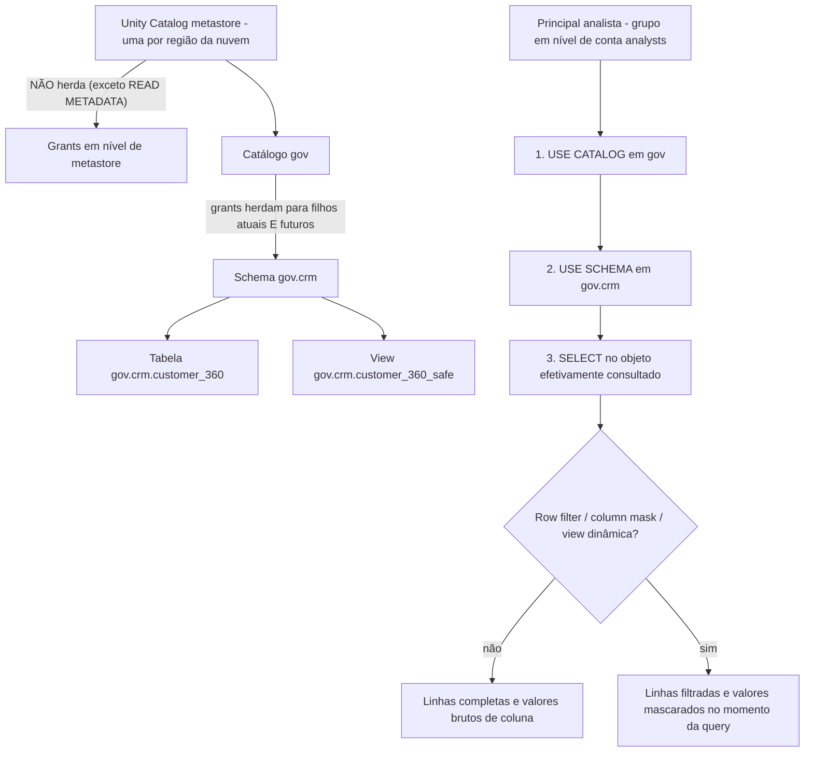
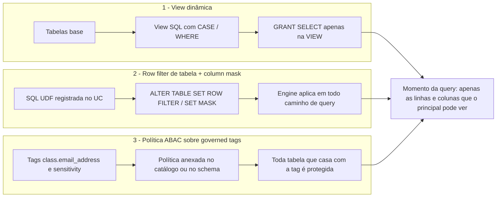
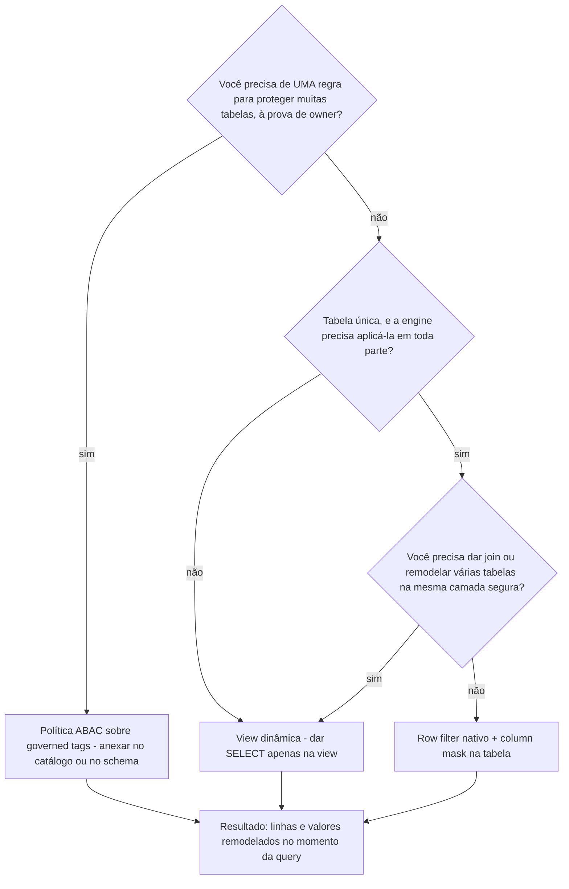
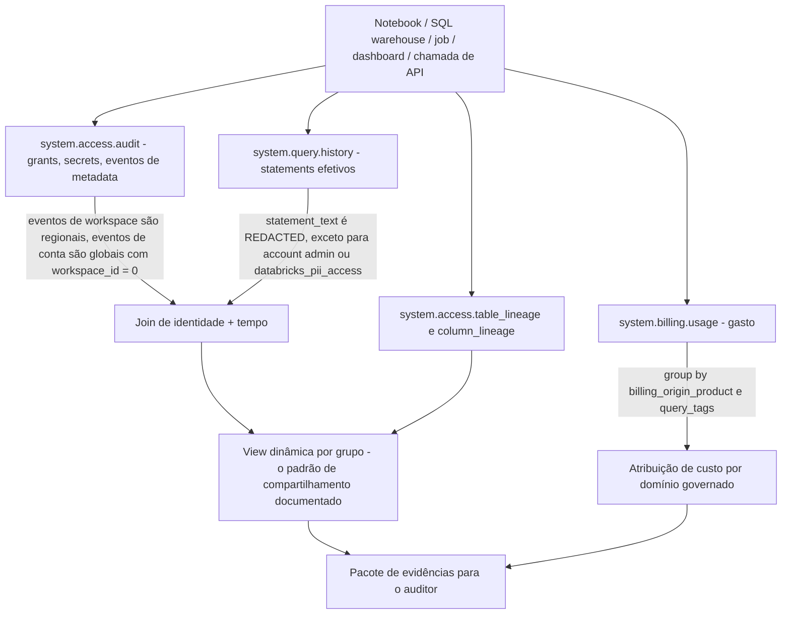
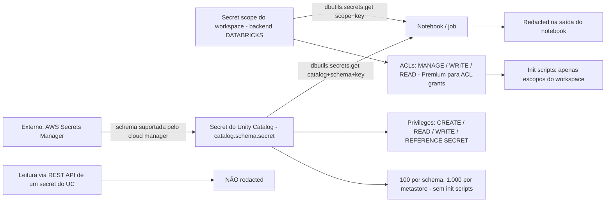
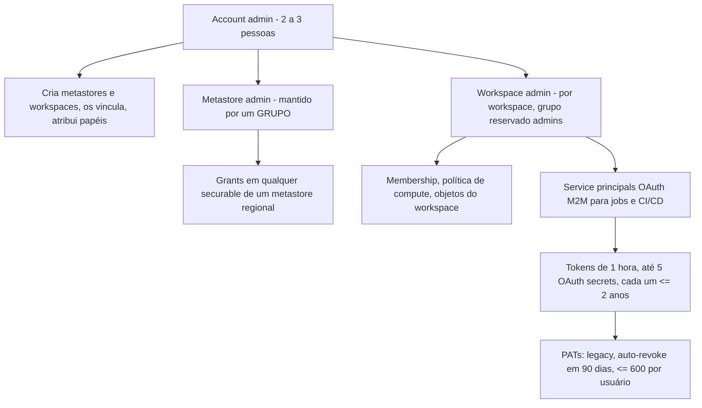

# Segurança no Unity Catalog: Controles de Linha e Coluna, Tags, Auditoria, Lineage e Segredos

As lições 01–10 deram a você a máquina: uma VPC, um lakehouse Delta no S3, um metastore com catálogs e pipelines que nunca param de escrever. É exatamente nesse momento que a governança deixa de ser papelada e vira um problema de engenharia, porque cada nova tabela multiplica o número de respostas que você deve a um auditor. O Unity Catalog responde a elas com um modelo de grants deny-by-default — "**Initially, users have no access to data in a metastore**" (docs .../manage-privileges, acesso em 2026-10) — e depois com uma segunda camada, separada, de controles que só pode *subtrair* do acesso que você já detém: **row filters, column masks, views dinâmicas e políticas ABAC**. Esses controles nunca concedem nada; eles remodelam o que uma query legítima retorna.

Três afirmações sustentam esta lição. Primeiro, **privileges e controles de linha/coluna são camadas diferentes** — você precisa de `USE CATALOG` + `USE SCHEMA` + `SELECT` *e então* o filtro ou o mask decide o que o seu `SELECT` retorna. Segundo, **evidência é uma superfície de produto**: `system.access.audit`, `system.query.history`, o par de lineage e `system.billing.usage` são tabelas consultáveis com retenção e latência documentadas, não arquivos de log pelos quais você implora à equipe de plataforma. Terceiro, **segredos, tokens e bordas de rede fazem parte da mesma história de governança** — um modelo de grants perfeito vaza por meio de um personal access token colado em um notebook.

```text
 =============================================================
  MAPA DA LIÇÃO 11 - segurança do Unity Catalog na AWS, em out 2026
 ------------------------------------------------------------
  GRANTS        deny by default; herança flui PARA BAIXO a partir do
                catálogo; grants de metastore NÃO herdam
                cadeia de leitura: USE CATALOG + USE SCHEMA + SELECT
                owners têm todo privilege sobre o seu objeto
  LINHA/COLUNA  3 mecanismos (eles só subtraem):
                  1 views dinâmicas  portátil, dê grant na VIEW
                  2 row filter de tabela ALTER TABLE SET ROW FILTER
                    + column mask    ALTER COLUMN SET MASK,
                                     um mask por coluna, SQL UDF
                  3 políticas ABAC   dirigidas por governed tag, anexadas
                                     em catálogo/schema/tabela
  IDENTIDADE    session_user()          atual (email)
                current_user()          alias DESATUALIZADO
                is_account_group_member grupos em nível de conta
                is_member()             era workspace/Hive - evite
  TAGS          governed: 1,000/conta, 500 valores, ligadas a policy
                Data Classification -> auto-tags class.*
                limites: 50 tags/objeto, 1,000 column tags/tabela
  EVIDÊNCIA     system.access.audit      365d, atualizado ao longo do dia
                system.query.history     365d, ~1 hora
                system.billing.usage     365d, ~12 horas
                table_lineage/column_lineage 365d, janela móvel de 1 ano
  SEGREDOS      escopos do workspace (init scripts) ->
                secrets do UC (catalog.schema.secret) ->
                external: suportados pelo AWS Secrets Manager
  BORDA         IP access lists (Enterprise) E ingress baseado em
                contexto; IPs privados do PrivateLink -> AWS Network
                Firewall; FedRAMP Moderate em 4 regiões da AWS
  ARMADILHAS    grant SELECT na tabela base, is_member(),
                DBR < 12.2 LTS zero linhas em silêncio, mito do real-time
 =============================================================
```

Nesta lição você vai:

- ler uma falha de permissão corretamente com a **cadeia de três privilégios** e as regras de herança que param no catálogo;
- escolher entre os **três mecanismos de linha/coluna** e dizer com precisão quando cada um ganha;
- escrever a **política de dynamic view resolvida** sobre `gov.crm.customer_360` com `session_user()` e `is_account_group_member()`, e depois concedê-la com segurança;
- vincular **row filters nativos e column masks** a SQL UDFs, e prever o que um runtime antigo retorna no lugar de um erro;
- aplicar **DDL de tags** (`SET TAGS` / `SET TAG`) e ligar as tags `class.*` do **Data Classification** no loop classificar → tag → policy;
- rodar o **pacote de auditoria em SQL** sobre `system.access.audit`, `system.query.history` e as tabelas de lineage, com os números de retenção e latência que tornam a query honesta;
- escolher a **geração de secret** certa para cada job na AWS, dos escopos de init script aos external secrets suportados pelo AWS Secrets Manager;
- pesar o **TACL legado do `hive_metastore` contra o Unity Catalog** em um Veredito Comparativo, estudar **Block, Amgen e nCino** na AWS, ler a **caixa de atualização de outubro de 2026** e praticar com **doze questões** mais quatro verificações interativas.

---

## 1. O modelo de grants sobre o qual esta lição se apoia

O Unity Catalog é uma hierarquia de **securables** — metastore → catálogo → schema → tabela/view/volume/function/secret — e o acesso é concedido como **privileges sobre securables** para **principals** (usuários, grupos em nível de conta, service principals). Quatro regras decidem quase todo ticket de suporte:

1. **A herança flui para baixo e para no catálogo.** "Privileges granted on a catalog automatically apply to all current and future schemas, tables, views, volumes, and functions within it" (docs .../securable-objects, 2026-10-08), enquanto "privileges granted at the metastore level do not inherit to child objects in the hierarchy" (mesma página). `READ METADATA` é a única exceção em nível de metastore que herda.
2. **Privilégios de uso são separados dos privilégios de dados.** "To read from a table, a user needs `SELECT` on the table, `USE CATALOG` on the parent catalog, and `USE SCHEMA` on the parent schema" (referência de privileges, 2026-09-25), e `USE CATALOG` "does not grant access to the catalog itself or any specific objects within it".
3. **Owners são onipotentes no próprio objeto.** "Object owners have all privileges on that object, including the ability to grant privileges to other principals" (docs .../manage-privileges, acesso em 2026-10) — ownership *não* herda para baixo, e `SHOW GRANTS` renderiza o ownership como uma única linha, não como uma lista de privileges implícitos.
4. **Controles de linha/coluna apenas subtraem.** Filtros, masks, views dinâmicas e políticas ABAC remodelam resultados para principals que já detêm os privilégios; nenhum deles pode ser usado para *conceder* acesso.



O exemplo resolvido **E0** é o diagnóstico que você vai reutilizar a lição inteira: um usuário relata que `SELECT * FROM gov.crm.customer_360` falha, e `SHOW GRANTS ON TABLE gov.crm.customer_360` mostra `SELECT` para o grupo dele. O grant é real e irrelevante — confira a cadeia em ordem: `SHOW GRANTS ON CATALOG gov` e depois `SHOW GRANTS ON SCHEMA gov.crm`. Um `USE CATALOG` ausente aparece como uma falha opaca *antes* mesmo de a tabela ser resolvida, e é por isso que é a primeira armadilha na documentação de permissões da Databricks (docs .../access-control, acesso em 2026-10).

Um controle fica *acima* dos privileges e os vence: **vinculação catálogo-workspace**. "By default, a catalog is accessible from all workspaces attached to the same metastore. You can restrict this by binding the catalog to specific workspaces, optionally as read-only" — e "Workspace binding supersedes individual privilege grants. Even a user with an explicit `SELECT` grant cannot access an object in a catalog that is not bound to their workspace" (docs .../securable-objects, 2026-10-08). A mesma vinculação existe para storage credentials e external locations, e é assim que um workspace de produção é impedido de usar a credential da zona raw. Ordene o seu modelo mental assim: **a vinculação decide *onde* um grant vale, os privileges decidem *o que* ele permite, filtros/masks decidem *quais linhas e valores* voltam.**

> **📚 Você sabia?** A palavra `USAGE` é uma armadilha para quem vem do AWS Lake Formation ou do Hive: os privileges do Unity Catalog são `USE CATALOG` e `USE SCHEMA`. `GRANT USAGE ON CATALOG gov TO analysts` não é sintaxe do Unity Catalog — pertence ao vocabulário legado, e é o erro de copiar-e-colar mais comum em scripts de migração (docs .../access-control/privileges-reference, 2026-09-25).

---

## 2. Três mecanismos que subtraem: views, controles de tabela, ABAC

Em outubro de 2026 a documentação coloca **três** mecanismos de linha/coluna lado a lado, e a forma honesta de ensiná-los é como uma escada — cada degrau troca portabilidade por centralização:

| Mecanismo | No que você o vincula | Melhor para | Limites duros |
|---|---|---|---|
| **View dinâmica** | Uma view SQL cuja lógica `WHERE` / `CASE` chama funções de identidade | Curar uma fatia, combinar várias tabelas, misturar regex + joins em "uma única camada segura" | Cada tabela base nova exige uma view nova; a proteção é o `SELECT` *retido* na tabela base |
| **Row filter de tabela + column mask** | A própria tabela/coluna, via SQL UDFs (`ALTER TABLE … SET ROW FILTER`, `ALTER COLUMN … SET MASK`) | Uma tabela, preciso, aplicado pela engine em SQL, notebooks, jobs e ferramentas de BI | Um mask por coluna; **não pode ser aplicado a uma view**; pisos de DBR; gerenciado pelo owner |
| **Política ABAC** | Governed tags, anexadas em catálogo / schema / tabela (nível de metastore está em Beta) | Consistência em muitas tabelas — "table owners can't override or remove" a política | A gramática exata de `CREATE POLICY` deve ser lida nos docs, nunca inventada (docs .../abac, 2026-09-29) |

A recomendação da própria Databricks é explícita: "Databricks recommends ABAC policies when you need consistent row filtering and column masking across many tables" (docs .../filters-and-masks, 2026-09-24). A página da dynamic view enuncia o corolário igualmente direto: "Databricks recommends that you not grant users the ability to read the tables and views referenced in the view" (docs .../views/dynamic, 2025-02-14).



Escolher entre eles é uma decisão de três perguntas, e a ordem importa porque a última opção é a mais cara de desfazer:



Dois invariantes viajam com os três. **A aplicação é do lado da engine no momento da query**: em um filtro ou mask, "the user cannot view base table values before filtering or masking is applied" — e quando o otimizador precisa escolher entre velocidade e não-vazamento, "it always makes the secure choice, which can affect query performance" (docs .../filters-and-masks, 2026-09-24). **E nenhum deles conserta um grant errado**: uma view dinâmica é derrotada por um único `GRANT SELECT` desavisado na tabela base, e é por isso que a próxima seção escreve os grants antes de escrever o SQL.

---

## 3. Exemplo resolvido E1 — a política de dynamic view

O exemplo em andamento desta lição é `gov.crm.customer_360` no S3 (gerenciado atrás de uma storage credential e uma external location, conforme a Lição 03), com três grupos de público: `pii-analysts`, `finance` e todo o resto. Requisitos verificados nos docs: um SQL warehouse ou access mode padrão (access mode dedicado exige DBR 15.4 LTS+), compute serverless habilitado para o caminho de filtragem avançada no DBR 15.4 LTS e acima, e grants colocados na view (docs .../views/dynamic, 2025-02-14).

```sql
CREATE OR REPLACE VIEW gov.crm.customer_360_safe
COMMENT 'Row-filtered + masked projection; base-table SELECT deliberately not granted'
AS
SELECT
  customer_id,
  region,
  -- identity hook: session_user() returns the current user's email address
  CASE WHEN session_user() LIKE '%@acme-corp.com'
       THEN customer_id ELSE -1 END AS customer_id_visible_to_internal,
  CASE
    WHEN is_account_group_member('pii-analysts') THEN email
    ELSE concat(substr(email, 1, 2), '***@', split_part(email, '@', 2))
  END AS email,
  CASE
    WHEN is_account_group_member('pii-analysts')
      OR is_account_group_member('finance') THEN ssn
    ELSE '***-**-****'
  END AS ssn,
  CASE
    WHEN is_account_group_member('finance') THEN lifetime_value
    ELSE CAST(ROUND(lifetime_value, -3) AS DECIMAL(12,2))   -- coarse bucket for everyone else
  END AS lifetime_value
FROM gov.crm.customer_360
WHERE region = 'EU'
   OR is_account_group_member('global-analysts');           -- row filter by account group
```

Depois os grants — a parte que de fato protege o design:

```sql
GRANT USE CATALOG ON CATALOG gov     TO `analysts`;
GRANT USE SCHEMA  ON SCHEMA gov.crm  TO `analysts`;
GRANT SELECT      ON VIEW gov.crm.customer_360_safe TO `analysts`;
-- deliberately NO: GRANT SELECT ON TABLE gov.crm.customer_360 TO `analysts`;
SHOW GRANTS ON VIEW gov.crm.customer_360_safe;
```

Três fatos de identidade para ensinar junto com esse SQL:

- `session_user()` "Returns the current user's email address" — a função a usar em políticas novas (docs .../views/dynamic, 2025-02-14).
- `current_user()` é um alias **desatualizado**: "This function is deprecated. The SQL standard reserves `CURRENT_USER` for the authorized user, but in Databricks it returns the session user, which can be misleading. Use `session_user` instead." (docs .../functions/current_user, 2026-09-11.) Notebooks antigos ainda rodam com ela.
- `is_account_group_member('<group>')` retorna true quando o usuário da sessão é "a direct or indirect member of the specified group at the account level" e está marcada na página como "Unity Catalog only" (docs .../functions/is_account_group_member, 2026-09-11). A irmã dela, `is_member()`, tem escopo de workspace e é da era do Hive metastore: "Avoid using it with views against Unity Catalog data, because it does not evaluate account-level group membership" (docs .../views/dynamic, 2025-02-14).

> ⚠️ **AVISO — três jeitos de essa política voltar a abrir acesso completo sem ninguém perceber.** (1) Alguém roda `GRANT SELECT ON TABLE gov.crm.customer_360 TO analysts` "só para destravar um prazo": a view vira decoração. (2) Chega uma tabela base nova e ninguém cria a view, então o time concede grant na tabela no lugar disso — o padrão de view não escala sozinho, e é exatamente a lacuna que o ABAC preenche. (3) Lógica `CASE` escrita contra `is_member()` em vez de `is_account_group_member()` avalia grupos em nível de workspace, então grupos de conta sincronizados pelo IdP caem silenciosamente no ramo `ELSE` — ou pior, no ramo permissivo.

A verificação é um diff de três princípios: rode o mesmo `SELECT` no warehouse como membro de `pii-analysts`, membro de `finance` e um analista comum, e compare as contagens de linhas *e* os valores de coluna. Uma política funcionando produz três conjuntos de resultados visivelmente diferentes; uma quebrada produz a mesma saída para todo mundo.

---

## 4. Exemplo resolvido E2 — row filters nativos e column masks

O padrão de view tem um gêmeo nativo: registre uma SQL UDF no Unity Catalog e depois vincule-a à tabela ou à coluna. "Table-level column masks are bound to a column using `ALTER TABLE ... ALTER COLUMN ... SET MASK` and managed by the table owner" (docs .../filters-and-masks, 2026-09-24).

```sql
-- 1) The UDFs (registered in Unity Catalog, DETERMINISTIC where possible)
CREATE FUNCTION gov.crm.mask_email(s STRING) RETURNS STRING
DETERMINISTIC
RETURN CASE WHEN is_account_group_member('pii-analysts') THEN s
            ELSE concat(substr(s, 1, 2), '***@', split_part(s, '@', 2)) END;

CREATE FUNCTION gov.crm.eu_only(region STRING) RETURNS BOOLEAN
DETERMINISTIC
RETURN region = 'EU' OR is_account_group_member('global-analysts');

-- 2) Bind them (documented DDL forms, docs .../filters-and-masks/manually-apply)
ALTER TABLE gov.crm.customer_360 ALTER COLUMN email SET MASK gov.crm.mask_email;
ALTER TABLE gov.crm.customer_360 SET ROW FILTER gov.crm.eu_only ON (region);

-- 3) Inspect and reverse
DESCRIBE TABLE gov.crm.customer_360;
ALTER TABLE gov.crm.customer_360 DROP ROW FILTER;
```

Você também pode declarar o filtro na criação: `CREATE TABLE sales (region STRING, id INT) WITH ROW FILTER us_filter ON (region);`. Para atribuir uma função você precisa de `EXECUTE` na função mais `USE SCHEMA` e `USE CATALOG` nos pais dela (docs .../manually-apply, acesso em 2026-10). Duas regras estruturais: **cada coluna pode ter um mask** — um segundo mask sobreposto falha com `COLUMN_MASKS_FEATURE_NOT_SUPPORTED.MULTIPLE_MASKS` — e "You cannot apply row-level security or column masks to a view"; mascara a view *dentro* da definição dela no lugar disso (docs .../filters-and-masks, 2026-09-24).

> [!IMPORTANT]
> ⚠️ **Runtimes antigos falham em silêncio, não aos berros.** "Databricks Runtime versions below 12.2 LTS do not support row filters or column masks. These runtimes fail securely" — o que na prática significa zero linhas, sem erro (docs .../filters-and-masks, 2026-09-24). Os pisos de compute documentados: access mode padrão e SQL warehouses em **DBR 12.2 LTS+**, access mode dedicado em **DBR 15.4 LTS+** — e compute dedicado em 15.3 LTS ou abaixo não lê filters/masks de forma alguma. Para piorar, "With ANSI mode disabled, values that can't be cast are silently converted to NULL, which can cause the filter to produce incorrect results without raising an error" (mesma página). Quando uma tabela filtrada não retorna nada, confira o access mode e a versão do DBR *antes* de depurar o SQL.

---

## 5. Tags, Data Classification e o loop ABAC

Tags são a camada de atributos que as políticas ABAC avaliam. Duas populações importam: **governed tags** — "account-level tags with built-in rules for consistency and control. When you create a governed tag, you also define a tag policy" (docs .../admin/governed-tags, 2026-09-11) — e as tags comuns. Aplicá-las é DDL puro (DBR 13.3 LTS+ para `SET TAGS`, DBR 16.1+ para `SET TAG`), e exige `APPLY TAG` no objeto mais `USE SCHEMA` e `USE CATALOG`; governed tags exigem ainda `ASSIGN` na tag (docs .../database-objects/tags, 2026-10-08).

```sql
-- Worked example E3 - tag DDL, then the classify -> tag -> policy loop
-- 3a) manual tagging: table level, then column level (one column per statement)
ALTER TABLE gov.crm.customer_360
  SET TAGS ('sensitivity' = 'restricted', 'domain' = 'crm');
ALTER TABLE gov.crm.customer_360
  ALTER COLUMN ssn SET TAGS ('pii' = 'ssn');
ALTER TABLE gov.crm.customer_360
  ALTER COLUMN email SET TAGS ('pii' = 'email');
-- DBR 16.1+ equivalent forms
SET TAG ON TABLE gov.crm.customer_360 cost_center = `crm`;
SET TAG ON COLUMN gov.crm.customer_360.ssn pii;

-- 3b) read the tags back from the per-catalog information schema
--     (view names per the tags page; inspect the column list before narrowing)
SELECT * FROM gov.information_schema.column_tags
WHERE table_name = 'customer_360'
LIMIT 100;

-- 3c) read the governed-tag definitions (Beta system table)
SELECT * FROM system.tags.governed_tags;
```

**Data Classification** fecha o loop sem um humano taggeando cada coluna: "Databricks Data Classification uses an agent to automatically classify and tag tables in your catalog", gravando detecções como `class.email_address`, `class.credit_card` e `class.us_ssn` nas colunas correspondentes, com resultados em `system.data_classification.results` (docs .../data-classification, acesso em 2026-10; blog **2025-10-27**). Os frameworks para os quais ela mapeia são publicados como lista: "PII, PCI DSS, GDPR, HIPAA, GLBA, FCRA, India DPDPA, Canada PIPEDA, Mexico LFPDPPP, Swiss FADP, Israel PPL, UAE PDPL" (docs .../data-classification-tags, 2026-09-18). O ganho cabe em uma frase: **classificar → tag → policy** — a tag `class.*` vira a condição `WHEN` de uma política ABAC de row filter ou column mask, então uma coluna de PII nova é protegida sem ninguém escrever uma view.

Limites documentados que vale citar literalmente quando você desenha um padrão de tags: **1,000 governed tags por conta**, **500 valores permitidos por tag**, chaves/valores com no máximo **256 caracteres**, sensível a maiúsculas/minúsculas, com `* . / < > % & ? \ =` proibidos (governed tags, 2026-09-11); tags comuns permitem **50 tags por objeto securable** e **1,000 column tags por tabela**, com `. , - = / :` banidos das chaves (página de tags, 2026-10-08). A herança tem um canto afiado: governed tags em um catálogo ou schema são herdadas por tudo que estiver abaixo "except individual table columns" — e a herança implícita é aplicada "when evaluating ABAC policies only" (página de tags, 2026-10-08).

> **📚 Você sabia?** Metadata de tag não é metadata secreta. "Tag data is stored as plain text and may be replicated globally. Do not use tag names, values, or descriptors that could compromise the security of your resources" (governed-tags, 2026-09-11). Em relação a isso, dar `DROP` em uma coluna que carrega governed tags *falha* até que você as `UNSET` primeiro — uma regra de ordenação anti-vazamento de dados, deliberada, na documentação de tags (página de tags, 2026-10-08).

---

## 6. System tables: o pacote de auditoria

System tables ficam no catálogo `system` e são "a Databricks-hosted analytical store of your account's operational data" (docs .../admin/system-tables, 2026-10-08). As quatro de que você precisa para trabalho de segurança, com os números que decidem o que as suas queries podem afirmar com honestidade:

| Tabela | Responde | Retenção gratuita | Frescor |
|---|---|---|---|
| `system.access.audit` (Public Preview) | Quem tocou em qual securable via API/UI — grants, secrets, mudanças de policy | 365 dias | "updated throughout the day"; **sem monitoramento em tempo real** |
| `system.query.history` | Quem rodou qual SQL: `executed_by`, `statement_type`, `client_application`, `query_tags` | 365 dias | tipicamente dentro de **uma hora** |
| `system.billing.usage` | Gasto por `billing_origin_product`, `usage_type`, por domínio governado | 365 dias | `record_type = 'ORIGINAL'` tipicamente dentro de **12 horas** |
| `system.access.table_lineage` + `column_lineage` | Raio de explosão: o que leu ou escreveu esta tabela/coluna | 365 dias (janela móvel de 1 ano) | com capacidade de streaming; DBR 16.4+ para stream |

O acesso em si é governado: admins o têm por padrão, todos os demás precisam de `USE CATALOG` em `system` mais `USE SCHEMA` e `SELECT` nos system schemas relevantes. E "System tables are free to use. You are only charged for the compute used to query them" (mesma página, 2026-10-08).



### Exemplo resolvido E4 — "quem consultou a tabela de PII nesta semana?"

```sql
-- (a) Control-plane: permission and secret events. ALWAYS filter event_date.
SELECT event_time, user_identity.email AS who, service_name, action_name,
       request_params['full_name_arg'] AS securable, source_ip_address, audit_level
FROM system.access.audit
WHERE event_date BETWEEN DATE '2026-10-01' AND DATE '2026-10-07'
  AND service_name = 'unityCatalog'
  AND action_name LIKE '%Permission%'
ORDER BY event_time DESC;

-- (b) Query-plane: the SELECTs themselves
--     compute = WAREHOUSE | SERVERLESS_COMPUTE | CLASSIC_COMPUTE
--     query_source = notebook / job / dashboard / alert / Genie ids
SELECT executed_by, executed_as, start_time, statement_type, client_application,
       compute, query_source
FROM system.query.history
WHERE start_time >= TIMESTAMP '2026-10-01 00:00:00'
  AND statement_type = 'SELECT'
ORDER BY start_time DESC;

-- (c) Blast radius: downstream consumers of the table
SELECT source_table_full_name, target_table_full_name, entity_type, created_by, event_time
FROM system.access.table_lineage
WHERE source_table_full_name = 'gov.crm.customer_360';

-- (d) Cost evidence: governed-domain spend for September
SELECT billing_origin_product, usage_type,
       SUM(usage_quantity) AS dbus, COUNT(*) AS records
FROM system.billing.usage
WHERE ingestion_date BETWEEN DATE '2026-09-01' AND DATE '2026-09-30'
GROUP BY billing_origin_product, usage_type
ORDER BY dbus DESC;
```

Taggear as queries em si torna (d) atribuível a um domínio governado em vez de a um warehouse: `SET QUERY_TAGS = '{"team":"crm","cost_center":"701","env":"prod"}';` no início da sessão, ou via parâmetros de configuração de sessão, e depois agrupe `system.query.history` pelo mapa `query_tags` (referência de query history, 2026-10-06). Combine isso com `system.billing.usage` agrupado por `billing_origin_product` e você responde à pergunta de follow-up do auditor — *qual domínio governado está gastando o quê* — no mesmo vocabulário SQL desta lição.

Notas de ensino que tornam esse pacote correto e não apenas executável: `event_date` é a partição de performance documentada — "To improve query performance, filter on `event_date` rather than `event_time`" (audit-logs, 2026-07-01); `statement_text` é `<REDACTED>` a menos que você seja account admin ou membro de `databricks_pii_access` (query history, 2026-10-06); uma query não seletiva o suficiente é rejeitada na lisa com "`System Table query returned too much data. Please repeat query with more selective predicates.`" (system tables, 2026-10-08); e a forma documentada de compartilhar qualquer coisa disso com um grupo de analistas é, mais uma vez, uma **view dinâmica por usuário ou grupo** — a página de query history diz isso diretamente.

> ⚠️ **AVISO — o mito do tempo real.** System tables são um repositório de evidência, não um SIEM: "No support for real-time monitoring. Data is updated throughout the day. If you don't see a log for a recent event, check back later" (system tables, 2026-10-08). Os pisos de latência são ~1 hora (query history), ~12 horas (billing), "ao longo do dia" (audit). Cuidado também com a geografia: linhas de audit são regionais para eventos de workspace e globais para eventos de conta (`workspace_id = 0`), billing é global, e lineage/query history são regionais — uma conta multi-região precisa consultar região por região.

---

## 7. Lineage: nível de coluna, com lacunas nomeadas

"Unity Catalog captures lineage automatically for queries run on Databricks, **down to the column level**, and aggregates it across all workspaces attached to the metastore" (docs .../data-governance/unity-catalog/data-lineage, 2026-08-06). O ingresso para *ver* lineage é `BROWSE` no catálogo pai — "BROWSE allows users to view metadata … It does not grant access to data" (best practices, 2026-07-27) — o que o torna o grant ideal de descoberta em um estate deny-by-default.

A versão honesta de "nível de coluna" inclui as suas lacunas documentadas:

- **Leituras por caminho perdem o lineage de coluna:** `select * from delta."s3://<bucket>/<path>"` não é capturado em nível de coluna.
- **Lineage de UDF é só em nível de tabela:** "Column-level UDF lineage is not captured", e SQL UDFs são invisíveis em `INSERT`, `UPDATE` e `MERGE`.
- **Colunas sem origem nunca aparecem:** um `INSERT` com valores literais explícitos não é registrado na tabela de colunas — leituras são capturadas quer você escreva a saída ou não.
- **Renames perdem lineage**, e nada existe para eventos capturados antes de **2024-09-01**.
- **Dois relógios diferentes:** lineage em system table é uma janela móvel de **1 ano**, enquanto o Catalog Explorer e a API de lineage "indefinitely retain lineage captured after September 1, 2024".
- `statement_id` em `table_lineage` faz join com `system.query.history`, mas "is only set when the query is run from a SQL warehouse".

Ler isso é um exercício de duas tabelas — primeiro o raio de explosão em nível de tabela, depois o detalhe em nível de coluna e, opcionalmente, o statement por trás:

```sql
-- who reads or writes the table, across every workspace on the metastore
SELECT event_time, target_table_full_name, created_by, entity_type, statement_id
FROM system.access.table_lineage
WHERE source_table_full_name = 'gov.crm.customer_360'
ORDER BY event_time DESC;

-- column-level detail: read the column list from the lineage system-table
-- reference first (schema headers verified, source/target column-name fields
-- not quoted here), then narrow it the same way
SELECT *
FROM system.access.column_lineage
WHERE source_table_full_name = 'gov.crm.customer_360'
ORDER BY event_time DESC
LIMIT 100;

-- the statement behind a lineage row, when it came from a SQL warehouse
SELECT executed_by, statement_type, start_time, client_application
FROM system.query.history
WHERE statement_id = '<statement_id from the lineage row>';
```

Essa é a história de conformidade que os docs vendem — "For compliance audits, see where regulated data originates, how it is transformed, and which downstream assets consume it" (docs de lineage, 2026-08-06) — pareada com os limites que um auditor deveria ouvir em voz alta.

---

## 8. Exemplo resolvido E5 — segredos, três gerações

Segredos são onde a governança ou se sustenta ou vaza, e a AWS lhe dá três gerações documentadas para escolher:

| Geração | Forma na AWS | Privileges / ACLs | Use para | Limites |
|---|---|---|---|---|
| **Secret scopes do workspace** | Backend `DATABRICKS`, `dbutils.secrets.get(scope=…, key=…)` | ACLs de escopo: `MANAGE` / `WRITE` / `READ` (ACL grants exigem plano Premium) | Senhas JDBC e **o único caminho que funciona em init scripts** | Nome do escopo legível por todos os usuários; ≤1,000 secrets por escopo; valores ≤128 KB |
| **Secrets do Unity Catalog** | Securable `catalog.schema.secret`, entre workspaces | `CREATE` / `READ` / `WRITE` / `REFERENCE SECRET` | Material governado, auditável, criptografável com CMK | ≤100 secrets por schema, ≤1,000 por metastore; **sem init scripts**; env serverless 4+ ou DBR 17.3 LTS+ |
| **External secrets** | Um schema do UC suportado pelo **AWS Secrets Manager** | Os mesmos privileges do UC, valores ficam na sua conta AWS | Credenciais de longa duração que você se recusa a armazenar na Databricks | Leituras via REST não são redacted |

```sql
-- (i) workspace scope - CLI + notebook
--   databricks secrets create-scope jdbc
--   databricks secrets put-secret jdbc password
--   databricks secrets put-acl jdbc datascience READ      (Premium plan or above)
--   notebook: dbutils.secrets.get(scope="jdbc", key="password")   -> output redacted

-- (ii) Unity Catalog secret (docs .../security/secrets/unity-catalog-secrets, 2026-10-06)
GRANT CREATE SECRET, USE SCHEMA ON SCHEMA gov.ops TO `etl-sp`;
CREATE SECRET gov.ops.api_key;                    -- value written with WRITE SECRET / API
GRANT READ SECRET ON SECRET gov.ops.api_key TO `etl-sp`;
--   notebook: dbutils.secrets.get(catalog="gov", schema="ops", key="api_key")

-- (iii) audit every secret event
SELECT event_time, user_identity.email AS who, action_name, request_params
FROM system.access.audit
WHERE event_date = DATE '2026-10-20'
  AND service_name = 'unityCatalog'
  AND action_name LIKE '%Secret%';
```

A ressalva honesta, direto dos docs: administradores, criadores de secret e usuários com permissão *podem* ler valores de secret — "it is not possible to prevent such users from reading secrets" — então os controles reais são privileges estreitos, rotação e a query de auditoria acima. `REFERENCE SECRET` existe justamente para que um pipeline referencie um secret sem deter acesso ao valor dele (referência de privileges, 2026-09-25).



Um checklist de higiene de secret que cabe em uma página, cada linha rastreável até um fato documentado:

1. **Classifique o secret antes de escolher a geração** — init script ⇒ escopo do workspace (secrets do UC são barados); valor governado entre workspaces ⇒ secret do UC; valor que você se recusa a armazenar na Databricks ⇒ schema externo suportado pelo **AWS Secrets Manager**.
2. **Conceda de forma estreita e conceda a service principals, não a pessoas** — `REFERENCE SECRET` deixa um pipeline nomear um secret sem deter o valor dele (referência de privileges, 2026-09-25).
3. **Leia via `dbutils.secrets.get`** — "Databricks recommends `dbutils` to read secrets, because it applies secret redaction" (secrets do UC, 2026-10-06); leituras REST de secrets do UC não são redacted.
4. **Rotacione em um schedule que você consegue provar** — secrets de OAuth duram no máximo dois anos; PATs morrem após 90 dias sem uso; *nomes de escopo* de secret são legíveis por todo mundo no workspace, então nunca codifique sensibilidade em um nome.
5. **Audite o raio de explosão mensalmente** — a query `action_name LIKE '%Secret%'` em E5 é o ponto de partida documentado, e lembre-se de que ela cai em `system.access.audit`, que é atualizado "ao longo do dia".

> **📚 Você sabia?** Vidas de token são números nos quais você consegue projetar: access tokens de OAuth M2M são válidos por **uma hora**, um service principal detém no máximo **cinco secrets de OAuth**, cada um válido por até **dois anos** (docs .../oauth-m2m, 2026-09-11). Personal access tokens são rotulados **(legacy)** no próprio título da documentação, são revogados automaticamente após **90 dias** sem uso, e têm teto de **600 por usuário por workspace** — e eles não conseguem automatizar operações em nível de conta de forma alguma (docs .../auth/pat, 2026-09-11).

---

## 9. Identidade, service principals e quem administra o quê

### 9.1 As quatro funções de identidade, decididas

| Função | Retorna | Status |
|---|---|---|
| `session_user()` | Endereço de email do usuário atual | **Atual** — use em views, filtros e masks novos |
| `current_user()` | Alias de `session_user()`; service principals retornam um **UUID** | **Desatualizada** (2026-09-11) — ainda roda |
| `is_account_group_member('g')` | TRUE para membership direto ou indireto em grupo em nível de **conta** | **Atual**, "Unity Catalog only" |
| `is_member('g')` | Membership em nível de workspace (compatibilidade com Hive metastore) | **Evite em dados do UC** |

O UUID do service principal é a armadilha que quebra expressões `CASE` de identidade: um job rodando como service principal não casa em nenhum ramo de email, então toda política de identidade precisa decidir explicitamente o que faz com sessões não humanas.

Os grupos em si vêm do seu identity provider: usuários, grupos e service principals em nível de conta são federados para a conta Databricks (SCIM em nível de conta), e é isso que faz de `is_account_group_member()` um *input de policy* em vez de uma lista mantida à mão — adicione alguém a `pii-analysts` no IdP e a checagem de membership acompanha, sem editar grant nenhum do lado Databricks. Service principals participam da governança como usuários: podem ser owner de securables, deter privileges do Unity Catalog e rodar jobs "como" um principal — e cada uma das ações deles cai no mesmo pacote de auditoria de um humano.

### 9.2 Exemplo resolvido E6 — a matriz de verificação de três princípios

Uma query, três princípios, quatro asserções:

| Principal | Linhas esperadas | `email` | `ssn` | `lifetime_value` |
|---|---|---|---|---|
| Membro de `pii-analysts` | linhas EU + `global-analysts` | bruto | bruto | bruto (só o finance o transforma em bucket) |
| Membro de `finance` | linhas EU + `global-analysts` | mascarado | bruto | bruto |
| Analista comum | apenas linhas EU | mascarado | `***-**-****` | arredondado para a milha mais próxima |

Qualquer outra coisa significa que os *grants* estão errados (mesma saída para os três ⇒ alguém detém `SELECT` na tabela base) ou que as *funções* estão erradas (`is_member()` contra grupos de conta).

### 9.3 Escopos de admin

"From a Unity Catalog permissions perspective, the three most important are **account admins, workspace admins, and metastore admins**. Account admins and workspace admins are required for all deployments, and the metastore admin role is optional" (docs .../admin-privileges, acesso em 2026-10). Account admin cria e vincula metastores e workspaces; workspace admin atua dentro de um único workspace pelo grupo reservado `admins` (atribuível a usuários e service principals, **não** a um grupo); metastore admin governa catálogos, connections e external locations de um metastore por região da nuvem. Admins de recurso — Marketplace admin, billing admin — completam o quadro. A forma recomendada: **account admin nas mãos de duas ou três pessoas, metastore admin nas mãos de um grupo.**



---

## 10. A borda de rede e a superfície de conformidade

Controles de perímetro na AWS se empilham em vez de se substituir:

- **IP access lists** (tier Enterprise, block list avaliada antes da allow list, ≤**1,000** valores IP/CIDR somados) controlam o web app e os endpoints REST — mas "If you use PrivateLink, IP access lists apply only to requests over the internet"; tráfego privado precisa ser controlado com o **AWS Network Firewall** (docs .../ip-access-list, acesso em 2026-10).
- **Controles de ingress baseados em contexto** são o mecanismo mais novo, em nível de conta, que combina identidade, tipo de requisição e origem de rede em regras de allow/deny: "Databricks recommends using context-based ingress controls as your primary method for managing access", e "A request must be allowed by both controls to succeed" (mesma fonte).
- **Negações de inbound são observáveis** em `system.access.inbound_network` (retenção gratuita de 30 dias).
- **Escopo de conformidade, enunciado do jeito que as trust pages enunciam:** FedRAMP **Moderate** nas regiões comerciais da AWS us-east-1, us-east-2, us-west-1, us-west-2; FedRAMP **High** na AWS GovCloud us-gov-west-1; opções de HIPAA na AWS multi-tenant "Available in all regions", com o relatório SOC 2 Type II + HIPAA da sua equipe de conta (páginas databricks.com/trust, acesso em 2026-10). Certificações são atestações de plataforma — o seu BAA, as suas políticas IAM e de KMS e o seu desenho de rede continuam sendo escolhas suas.

Criptografia é o último perímetro, e na AWS ela tem três pontos de contato que são seus: a **KMS key policy** precisa permitir o uso da chave via S3 (`kms:ViaService: s3.<region>.amazonaws.com`), a **política IAM da storage credential** precisa carregar `kms:Decrypt` / `kms:Encrypt` / `kms:GenerateDataKey*` naquela chave, e a **external location** precisa declarar o seu algoritmo de criptografia (SSE-S3 ou SSE-KMS) quando a bucket policy exige cabeçalhos de criptografia (docs .../security/keys/kms-s3 e .../cloud-storage/s3, acesso em 2026-10). Chaves gerenciadas pela Databricks são o padrão; **chaves gerenciadas pelo cliente para o Unity Catalog** — que protegem o armazenamento gerenciado padrão/fornecido pela Databricks por catálogo — "requires the **Enterprise tier**" e um grant para o ARN raiz da Databricks na sua chave KMS (docs .../keys/cmek-unity-catalog, acesso em 2026-10). A regra que mantém os auditores calmos: *grants decidem quem pode pedir, chaves decidem se os bytes são legíveis se forem levados, e os dois são documentados separadamente.*

---

## 11. Veredito Comparativo: TACL legado do `hive_metastore` versus Unity Catalog

> **Veredito Comparativo — controle de acesso a tabelas legado do `hive_metastore` versus Unity Catalog (em outubro de 2026)**
> - **Escopo de identidade.** Permissões do TACL "defined within the `hive_metastore` catalog always refer to the local identities in the workspace"; o Unity Catalog "permissions always refer to account-level identities" (blog da Databricks, *Data Privilege Model in Unity Catalog*, 2023-05-05). Um metastore, uma região, todo workspace vinculado vê os mesmos grants.
> - **Herança.** Grants do UC herdam para baixo, do catálogo para "all current and future" filhos, e a exceção é dita logo de cara: grants em nível de metastore não herdam (exceto `READ METADATA`). Isso lhe dá uma regra auditável com `SHOW GRANTS` — o lado legado das fontes desta lição não documenta nenhuma hierarquia declarada equivalente.
> - **Controles de linha/coluna.** O UC tem os três mecanismos documentados das seções 2–5 (views dinâmicas, row filters de tabela + column masks, ABAC dirigido por tags). Para o modelo legado, a documentação de admin da própria Databricks afirma simplesmente: "Hive metastore table access control is a legacy data governance model. Databricks recommends that you use Unity Catalog instead for its simplicity and account-centered governance model" (docs .../manage-instance-profiles, 2026-04-22).
> - **Evidência.** O UC lhe dá `system.access.audit`, `system.query.history`, lineage de tabela/coluna agregado no metastore e as tabelas de governed tag/classificação — consultáveis, com retenção publicada. O lado legado das fontes desta lição não oferece nenhum repositório de evidência consultável equivalente.
> - **Identidade de nuvem.** O UC anexa a identidade da AWS a *securables* (storage credentials + external locations + grants); o padrão legado anexa uma **instance profile** do IAM ao *compute*, então todo mundo no cluster a herda — é por isso que os docs chamam as service credentials de "the Unity Catalog alternative to instance profiles" (docs .../service-credentials, acesso em 2026-10).
> - **Operações destrutivas.** `DROP` de tabela gerenciada do Hive apaga os arquivos imediatamente; o Unity Catalog suporta `UNDROP` por 7 dias, com apagamento permanente dentro de 30 dias (docs .../database-objects/hive-metastore, acesso em 2026-10).
> - **Veredito em uma linha:** *mantenha o `hive_metastore` apenas como o catálogo de compatibilidade aditivo que ele se declara ser ("The Unity Catalog metastore is additive"), migre as identidades para o nível de conta primeiro, depois mova as tabelas com federate-then-upgrade ou UCX — e nunca desenhe uma política de linha/coluna nova contra o TACL, porque o motor de policy que você quer vive no catálogo para o qual você ainda não migrou.*

---

## 12. Doze armadilhas que esta lição não vai deixar você manter

1. **`GRANT USAGE ON CATALOG`** — não é sintaxe do UC. É `USE CATALOG` / `USE SCHEMA`.
2. **"Eu concedi `SELECT` no catálogo, então eles podem consultar."** Privilégios de uso são separados; a cadeia é `USE CATALOG` → `USE SCHEMA` → `SELECT`.
3. **"Grants de metastore cobrem tudo."** Eles não herdam — só `READ METADATA` herda.
4. **`is_member()` em uma view dinâmica do UC.** Com escopo de workspace, era do Hive; use `is_account_group_member()`.
5. **`current_user()` em políticas novas.** Desatualizada desde 2026-09-11; use `session_user()` — e trate o UUID do service principal.
6. **Conceder `SELECT` na tabela base** sob uma view dinâmica. A view para de proteger qualquer coisa.
7. **Aplicar um row filter a uma view.** "You cannot apply row-level security or column masks to a view."
8. **Segundo mask em uma coluna.** Um mask por coluna; masks ABAC sobrepostos falham com `COLUMN_MASKS_FEATURE_NOT_SUPPORTED.MULTIPLE_MASKS`.
9. **DBR abaixo de 12.2 LTS.** Tabelas filtradas/mascaradas "fail securely" — zero linhas, sem erro.
10. **Esperar auditoria em tempo real.** Audit atualiza "ao longo do dia", query history ~1 hora, billing ~12 horas; particione sempre por `event_date`.
11. **Assumir que o lineage de coluna está completo.** Leituras por caminho, inserts literais, internals de UDF, renames e histórico anterior a 2024-09-01 estão todos fora do escopo.
12. **Tratar tags como armazenamento de segredo.** Dados de tag "is stored as plain text and may be replicated globally".

### Atualizações de 2026 (em outubro de 2026)

> [!NOTE]
> **O que mudou na camada de governança de que esta lição depende:**
> - **2026-10-09 — orientação de autenticação e ingress atualizada:** OAuth M2M com client id + secret é o caminho declarado "for unattended, automated, and CI/CD workflows"; o ingress baseado em contexto é recomendado como o *método principal* de acesso, avaliado ao lado das IP access lists (docs .../dev-tools/auth; .../security/network).
> - **2026-10-08 — referência de system tables:** tabela de retenção (365 dias para audit, billing, lineage e query history; 13 meses para `system.data_classification.results`; 30 dias para `system.access.inbound_network`), a afirmação de "no support for real-time monitoring" e os pisos de streaming DBR 16.4+ (docs .../admin/system-tables).
> - **2026-10-06 — página de secrets do Unity Catalog:** securables `catalog.schema.secret` com `CREATE/READ/WRITE/REFERENCE SECRET`, cotas de 100 por schema e 1.000 por metastore, e **external secrets suportados pelo AWS Secrets Manager** na AWS (docs .../security/secrets/unity-catalog-secrets).
> - **2026-09-29 — página de ABAC:** políticas de row filter, column mask, GRANT e DENY (Beta) dirigidas por tag, anexadas em metastore (Beta), catálogo, schema ou tabela — a resposta recomendada para controles consistentes em muitas tabelas (docs .../unity-catalog/abac).
> - **2026-09-24 / 2026-09-11 — filters, masks e identidade:** row filters e column masks documentados como controles de nível de tabela, com um mask por coluna e pisos de DBR 12.2 LTS / 15.4 LTS; `current_user` formalmente desatualizada em favor de `session_user` (docs .../filters-and-masks; .../functions/current_user).
> - **2025-10-27 — Data Classification em Public Preview na AWS, Azure e GCP:** "up to 60% higher accuracy than regex-only tools" e custos de scan reduzidos "up to 75%" desde o Beta, com resultados completos armazenados em system tables (blog da Databricks, 2025-10-27).

---

## Estudos de Caso do Mundo Real

> **📋 Caso A — Block (Square, Cash App, TIDAL) (serviços financeiros, Cloud: AWS)**
> **Desafio.** 12PB de dados de grafo e analytics fragmentados entre unidades de negócio, obrigações de PII GDPR/CCPA, e um fluxo doloroso de dois passos para anexar policies de IAM a roles e depois a buckets S3.
> **Stack na AWS.** Databricks, Delta Lake, **Unity Catalog**, Spark Declarative Pipelines e Delta Sharing, com S3 como armazenamento co-localizado — `Cloud: AWS` na página da história (https://www.databricks.com/customers/block/unity-catalog, página sem data, acesso em 2026-10).
> **Resultado relatado.** "**12X Reduction in compute cost · 20% Reduction in data egress cost · 12PB Of data managed and governed**", tempo de permissão de compartilhamento de dados cortado "from days to seconds", cerca de 70 times e 500 usuários ativos power (mesma URL, sem data, acesso em 2026-10).
> **Citação.** "Introduction to Databricks coincided with the launch of Unity Catalog, eliminating the need for evaluating alternative data governance tools." — Joseph Kesting (mesma URL).
> **Mapeia para esta lição.** Seções 2, 5 e 6: uma camada de governança substituindo tanto uma ferramenta separada *quanto* parte do plumbing de IAM/S3, que é a versão específica da AWS do argumento de que "governança se paga".
> ⏳ *Nota temporal: página sem data, acesso em out 2026 — trate cada número como o que a Block relatou, não como uma garantia da plataforma.*

> **📋 Caso B — Amgen (biofarmacêutica, estate na AWS)**
> **Desafio.** AWS Glue como catálogo corporativo mais AWS IAM de role por caso de uso em proliferação — auditar significava fazer parse de policies de IAM.
> **Stack na AWS.** Unity Catalog sobre um estate da AWS: a história nomeia **AWS Glue** como o catálogo anterior e **AWS IAM** como a camada RBAC anterior (blog da Databricks, **maio de 2023**, https://www.databricks.com/blog/how-databricks-unity-catalog-helped-amgen-enable-data-governance-enterprise-scale).
> **Resultado relatado.** "we didn't have to create or manage at least 120+ IAM roles … we went from hundreds of IAM roles to just one or two principal IAM role"; "This reduces the audit effort for the function by 50%"; "around ~500 objects mapped in Unity Catalog"; "90 percent of our use cases are on Databricks" (mesma URL, maio de 2023).
> **Mapeia para esta lição.** Seções 1, 6 e 9 — a contagem de roles *é* a métrica que auditores entendem, e o pacote de auditoria em E4 é o que substitui a arqueologia de policy documents.
> ⏳ *Nota temporal: números de maio de 2023 de um blog datado — o que a Amgen relatou então, não uma afirmação atual da plataforma.*

> **📋 Caso C — nCino (software bancário, Cloud: AWS)**
> **Desafio.** Consolidar 13 anos de dados bancários e "trillions in loan history" mantendo informações financeiras sensíveis sob controle total.
> **Stack na AWS.** Databricks na AWS com **Unity Catalog** governando o acesso e **AI/BI Genie** para entrega de insights — `Cloud: AWS`, casos de uso listando "Analytics and BI, AI, Data Warehousing, Governance and Security" (https://www.databricks.com/customers/ncino, página sem data, acesso em 2026-10).
> **Citação.** "Keeping data within a single AWS ecosystem reduces complexity, strengthens compliance and gives teams full control over sensitive financial information." (mesma URL.)
> **Mapeia para esta lição.** Seções 10 e 11 — o argumento de "uma única fronteira de conta da AWS" é o enquadramento de conformidade que você pode reutilizar literalmente ao justificar designs de metastore por região e PrivateLink.
> ⏳ *Nota temporal: página sem data, acesso em out 2026.*

---

> [!SUCCESS]
> **Pontos Principais (Key Takeaways):**
> 1. **Deny by default, herança a partir do catálogo.** "Initially, users have no access to data in a metastore"; grants herdam para baixo, do catálogo para filhos atuais *e futuros*; grants em nível de metastore não herdam (exceto `READ METADATA`); toda leitura precisa de `USE CATALOG` + `USE SCHEMA` + `SELECT`.
> 2. **Três mecanismos subtrativos, uma escada.** Views dinâmicas (grant na view, nunca na tabela base) → row filters nativos + column masks (SQL UDFs, um mask por coluna, DBR 12.2 LTS padrão / 15.4 LTS dedicado, nunca em uma view) → políticas ABAC sobre governed tags (a recomendação dos docs quando a consistência em muitas tabelas importa). Nenhum deles concede acesso.
> 3. **Funções de identidade têm um conjunto atual.** `session_user()` e `is_account_group_member()` são as que você deve escrever; `current_user()` está desatualizada (2026-09-11) e `is_member()` é de workspace/era Hive; service principals voltam como UUIDs.
> 4. **Tags são inputs de policy, não anotações.** Governed tags: 1,000/conta, 500 valores, ligadas a policy, `ASSIGN` obrigatório, herança pula colunas; Data Classification auto-taggeia `class.*` nos frameworks PII/PCI/GDPR/HIPAA; o loop vencedor é classificar → tag → policy.
> 5. **Evidência é um conjunto de tabelas.** `system.access.audit` (365 dias, atualizado ao longo do dia), `system.query.history` (~1 hora, `statement_text` redacted para `databricks_pii_access`), `system.billing.usage` (~12 horas), o par de lineage (365 dias / janela móvel de 1 ano), tudo grátis para armazenar e cobrado só como compute — e compartilhado via view dinâmica por grupo.
> 6. **Lineage é em nível de coluna, com lacunas nomeadas.** Leituras por caminho, inserts literais, internals de UDF, renames e histórico anterior a 2024-09-01 estão ausentes; `statement_id` só se preenche em queries de SQL warehouse; `BROWSE` é o grant seguro de descoberta.
> 7. **Segredos vêm em três gerações e a borda ainda importa.** Escopos do workspace (o único caminho de init script), secrets do UC (`catalog.schema.secret`, 100/schema), external secrets suportados pelo AWS Secrets Manager; OAuth M2M para máquinas (tokens de 1 hora, ≤5 secrets), PATs legacy com auto-revoke em 90 dias; IP lists e ingress baseado em contexto precisam ambos permitir a requisição, e IPs privados do PrivateLink precisam do AWS Network Firewall.

---

## Perguntas de Prática (Practice Questions)

```question
{
  "id": "dbl-11-q1",
  "type": "multiple-choice",
  "question": "Um analista tem SELECT na tabela gov.crm.customer_360, mas toda query falha durante a análise, antes de a tabela ser lida. Qual cadeia está faltando?",
  "options": [
    "USE CATALOG em gov mais USE SCHEMA em gov.crm - ler uma tabela exige os três privilégios, e USE CATALOG 'does not grant access to the catalog itself or any specific objects within it'",
    "MODIFY no schema, porque SELECT é filho de MODIFY",
    "BROWSE no metastore, porque descoberta sempre precede a análise",
    "MANAGE na tabela, porque apenas managers podem resolver metadata de tabela"
  ],
  "correct": 0,
  "explanation": "A cadeia de leitura documentada é USE CATALOG + USE SCHEMA + SELECT (referência de privileges, 2026-09-25); a falta de um privilege de uso falha antes da resolução da tabela, e é por isso que aparece como um erro de análise opaco. B inverte a hierarquia: SELECT não é filho de MODIFY (INSERT/UPDATE/DELETE são). C confunde descoberta com acesso - BROWSE nunca concede acesso a dados. D inventa um requisito: MANAGE é o privilege de delegação, não um pré-requisito de leitura."
}
```

```question
{
  "id": "dbl-11-q2",
  "type": "true-false",
  "question": "Os privileges concedidos no metastore do Unity Catalog são herdados por todo catálogo, schema e tabela abaixo dele, então um único GRANT em nível de metastore abre o estate inteiro.",
  "options": ["Verdadeiro", "Falso"],
  "correct": 1,
  "explanation": "Falso - 'privileges granted at the metastore level do not inherit to child objects in the hierarchy. Metastore-level grants are scoped to metastore-level operations only' (página de securable-objects, 2026-10-08), com READ METADATA como exceção documentada. A herança começa no catálogo. A armadilha é a frase 'conceda no topo e flui para baixo', que é verdadeira para catálogos e falsa para o metastore."
}
```

```question
{
  "id": "dbl-11-q3",
  "type": "multiple-choice",
  "question": "Quarenta tabelas carregam PII e o time quer um único controle que mantenha o masking consistente e impeça donos individuais de tabela de afrouxá-lo. Qual mecanismo os docs recomendam?",
  "options": [
    "Uma política ABAC dirigida por governed tags, anexada no nível de catálogo ou schema - a Databricks recomenda ABAC 'when you need consistent row filtering and column masking across many tables', e a política não pode ser sobrescrita por donos de tabela",
    "Uma view dinâmica por tabela, porque views são o único mecanismo documentado",
    "Um column mask aplicado ao catálogo, já que masks se propagam a partir de contêineres",
    "REVOKE SELECT em cada tabela, porque negar tudo é equivalente a mascarar"
  ],
  "correct": 0,
  "explanation": "A página filters-and-masks (2026-09-24) enuncia a recomendação de ABAC literalmente e posiciona as políticas anexadas de modo que donos de tabela não possam sobrescrevê-las; políticas se anexam em metastore (Beta), catálogo, schema ou tabela (página ABAC, 2026-09-29). B não escala - uma tabela nova precisa de uma view nova. C está errada: um mask se vincula a uma coluna de uma tabela, não a um catálogo, e não pode ser aplicado a uma view. D remove acesso em vez de remodelá-lo, então falha no requisito (a consulta precisa continuar funcionando)."
}
```

```question
{
  "id": "dbl-11-q4",
  "type": "multiple-choice",
  "question": "Qual par de funções de identidade uma nova view dinâmica do Unity Catalog deve usar em outubro de 2026?",
  "options": [
    "session_user() para o email do chamador e is_account_group_member() para membership em grupo de nível de conta",
    "current_user() para o email do chamador e is_member() para membership em grupo, porque ambos são mais antigos e portanto mais estáveis",
    "session_user() com is_member(), já que grupos de workspace são o que o SCIM provisiona",
    "current_user() com is_account_group_member(), porque current_user() é o nome padrão do SQL"
  ],
  "correct": 0,
  "explanation": "session_user() 'Returns the current user's email address' e is_account_group_member() avalia membership direto ou indireto em nível de conta e está sinalizada como 'Unity Catalog only' (páginas da dynamic view e de functions, 2025-02-14 / 2026-09-11). B cai em duas funções desatualizadas ou erradas: current_user() está desatualizada e is_member() é explicitamente a evitar contra dados do UC. C está meio errada - aqui o SCIM sincroniza grupos em nível de conta. D inverte o raciocínio: CURRENT_USER é o nome do padrão SQL que a própria documentação da Databricks diz ser enganoso aqui, e é por isso que foi desatualizado."
}
```

```matching
{
  "question": "Relacione cada primitiva de identidade ou descoberta ao seu status verificado em outubro de 2026:",
  "pairs": [
    {"left": "session_user()", "right": "Atual - retorna o endereço de email do usuário chamador; o hook de identidade para novas views dinâmicas e row filters"},
    {"left": "current_user()", "right": "Alias desatualizado de session_user(); retorna o UUID de um service principal em vez de um nome legível"},
    {"left": "is_account_group_member('pii-analysts')", "right": "Atual, apenas Unity Catalog - membership direto ou indireto em um grupo em nível de conta"},
    {"left": "is_member('pii-analysts')", "right": "Em nível de workspace, compatibilidade com Hive metastore - documentado como 'evitar' contra dados do Unity Catalog"},
    {"left": "BROWSE em um catálogo", "right": "Descoberta sem acesso - search, Catalog Explorer, information_schema e o grafo de lineage, mas nenhum dado"}
  ],
  "explanation": "Os quatro status de função vêm da página da dynamic view (2025-02-14), da página do current_user (2026-09-11) e da página do is_account_group_member (2026-09-11); BROWSE é descrito nas best practices do Unity Catalog (2026-07-27) como visibilidade apenas de metadata. As duas armadilhas são assumir que current_user() está de bom tamanho porque ainda roda, e assumir que is_member() funciona com os grupos em nível de conta que o seu identity provider sincroniza."
}
```

```question
{
  "id": "dbl-11-q5",
  "type": "multiple-choice",
  "question": "Sua view dinâmica gov.crm.customer_360_safe está em produção com SELECT concedido apenas na view. Qual mudança a derrota mais diretamente?",
  "options": [
    "GRANT SELECT ON TABLE gov.crm.customer_360 TO analysts - a view só protege os dados porque a leitura da tabela base foi retida, e os docs recomendam não conceder leitura nas tabelas referenciadas",
    "Conceder USE CATALOG em gov para todos os usuários da conta, o que os docs proíbem",
    "Rodar a view em um SQL warehouse em vez de um cluster de notebook",
    "Adicionar um segundo ramo de CASE que mascara lifetime_value para o finance"
  ],
  "correct": 0,
  "explanation": "A página da dynamic view (2025-02-14) diz que a Databricks recomenda você 'not grant users the ability to read the tables and views referenced in the view' - a proteção é o grant retido, não o SQL. B está errada: todos os usuários recebendo USE CATALOG (em main, ou no catálogo do workspace por padrão) ganham navegação, não dados. C é o oposto de um problema - SQL warehouses são o compute suportado. D é um aperto, não um bypass."
}
```

```question
{
  "id": "dbl-11-q6",
  "type": "true-false",
  "question": "Um row filter ou column mask pode ser anexado a uma view para que a própria view aplique a restrição, além da cláusula WHERE dentro da definição dela.",
  "options": ["Verdadeiro", "Falso"],
  "correct": 1,
  "explanation": "Falso - 'You cannot apply row-level security or column masks to a view' (filters-and-masks, 2026-09-24). Mascarar uma view é feito dentro da definição da view (seção 3), ou na tabela subjacente com filters/masks nativos (seção 4). A confusão é natural porque os mecanismos parecem intercambiáveis; os docs traçam a linha nas views para os dois."
}
```

```fillblank
{
  "question": "Preencha os números documentados exatamente como outubro de 2026 os publica:",
  "template": "A retenção gratuita é de {{1}} dias para system.access.audit, system.query.history e as tabelas de lineage; linhas de usage cobráveis com record_type ORIGINAL costumam aparecer em até {{2}} horas; linhas do query history ficam disponíveis tipicamente em cerca de {{3}} hora; e secrets do Unity Catalog são limitados a {{4}} secrets por schema.",
  "answers": {
    "1": "365",
    "2": "12",
    "3": "1",
    "4": "100"
  },
  "distractors": ["30", "90", "395", "730", "6", "24", "48", "168", "500", "1000"],
  "explanation": "A referência de system tables (2026-10-08) dá retenção gratuita de 365 dias para audit, billing, lineage e query history mais a ressalva de 'no real-time'; a página de billing (2026-09-15) diz que os registros estão 'typically available within 12 hours'; a página de query history (2026-10-06) diz 'typically available within one hour'; os secrets do UC (2026-10-06) permitem 'Up to 100 secrets per schema and 1,000 per metastore'. Os distratores são os números de retenção vizinhos (30 dias de inbound network, 90 dias de endpoint usage, padrão configurável de 395 dias, teto de token de 730 dias) e outros valores redondos plausíveis."
}
```

```question
{
  "id": "dbl-11-q7",
  "type": "multiple-choice",
  "question": "Um auditor pede 'every permission change in the last week, in real time'. Qual é a resposta de engenharia correta em out 2026?",
  "options": [
    "System tables não são tempo real: os dados de audit são 'updated throughout the day', então consulte system.access.audit particionado por event_date e declare a latência - depois mantenha a exportação para o SIEM como uma conversa separada e honesta",
    "Faça streaming de system.access.audit com Trigger.Continuous, porque linhas de audit são enviadas conforme ocorrem",
    "Use apenas system.query.history, já que ela captura toda mudança do plano de controle com atraso de menos de um minuto",
    "Exporte linhas de audit para S3 de hora em hora com VACUUM, porque system tables não podem ser consultadas por não-admins de forma alguma"
  ],
  "correct": 0,
  "explanation": "A página de system tables (2026-10-08) afirma 'No support for real-time monitoring. Data is updated throughout the day' e também rejeita queries não seletivas com 'System Table query returned too much data' - então filtrar por event_date mais uma latência declarada é a resposta profissional. B promete demais: streaming de system tables exige DBR 16.4+ e ainda assim não as torna tempo real. C está errada nos dois pontos - query history cobre SQL, não eventos de grant, e chega em cerca de uma hora. D está errada: admins têm acesso por padrão e os demais podem receber USE CATALOG/USE SCHEMA/SELECT, embora a Databricks desaconselhe exportar esses dados."
}
```

```dragdrop
{
  "question": "Ordene o fluxo de auditoria de PII exatamente como as tabelas e latências documentadas exigem:",
  "items": [
    "Filtre por event_date com uma janela estreita para que a query passe o guard de seletividade 'too much data'",
    "Consulte system.access.audit para eventos do plano de controle: mudanças de permissão, eventos de secret, mudanças de policy",
    "Consulte system.query.history para os SELECTs - executed_by, statement_type, client_application - lembrando que statement_text é REDACTED, a menos que você seja account admin ou esteja em databricks_pii_access",
    "Junte as duas tabelas por identidade e tempo para responder 'quem consultou o quê, quando'",
    "Consulte system.access.table_lineage e column_lineage para o raio de explosão a jusante",
    "Envolva o resultado em uma view dinâmica por grupo antes de compartilhá-lo - o padrão documentado para abrir system tables para non-admins"
  ],
  "correctOrder": [
    "Filtre por event_date com uma janela estreita para que a query passe o guard de seletividade 'too much data'",
    "Consulte system.access.audit para eventos do plano de controle: mudanças de permissão, eventos de secret, mudanças de policy",
    "Consulte system.query.history para os SELECTs - executed_by, statement_type, client_application - lembrando que statement_text é REDACTED, a menos que você seja account admin ou esteja em databricks_pii_access",
    "Junte as duas tabelas por identidade e tempo para responder 'quem consultou o quê, quando'",
    "Consulte system.access.table_lineage e column_lineage para o raio de explosão a jusante",
    "Envolva o resultado em uma view dinâmica por grupo antes de compartilhá-lo - o padrão documentado para abrir system tables para non-admins"
  ],
  "explanation": "A ordem importa: o guard de seletividade vem primeiro (system tables, 2026-10-08), depois a evidência do plano de controle (audit, 2026-07-01), depois a evidência do plano de query (query history, 2026-10-06), depois o join, depois o raio de explosão (lineage, 2026-08-06) e por fim o padrão de compartilhamento que a página de query history recomenda explicitamente - uma view dinâmica por usuário ou grupo. Inverter os passos 2 e 3 faz perder o contexto de grant por trás de um SELECT suspeito; pular o passo 1 faz a query ser rejeitada; compartilhar linhas cruas pula a fronteira de redaction."
}
```

```question
{
  "id": "dbl-11-q8",
  "type": "multiple-choice",
  "question": "Um job do Lakeflow na AWS precisa ler uma senha JDBC de um init script, e um segundo job precisa de uma API key governada por privileges do Unity Catalog e auditada entre workspaces. Qual é o pareamento correto?",
  "options": [
    "Init script: um secret scope do workspace com dbutils.secrets.get(scope=..., key=...) - secrets do UC não podem ser usados em init scripts. API key: um secret do UC em catalog.schema.secret com READ SECRET concedido ao service principal do job",
    "Init script: um secret do Unity Catalog, porque secrets do UC são entre workspaces. API key: um escopo do workspace com ACL para o time",
    "Ambos: uma chave externa do AWS Secrets Manager lida diretamente pelo init script e por um notebook, contornando a Databricks por completo",
    "Ambos: personal access tokens armazenados em notebooks, já que PATs são o padrão documentado"
  ],
  "correct": 0,
  "explanation": "A página de secrets do UC (2026-10-06) afirma 'No init scripts. You cannot use Unity Catalog secrets in global or cluster init scripts', o que deixa os escopos do workspace como o único caminho de init script - enquanto secrets do UC são o securable governado, entre workspaces, com privileges CREATE/READ/WRITE/REFERENCE SECRET, cotas de 100 por schema e auditoria via system.access.audit. B inverte os dois. C pula a camada de governança (privileges do UC e auditoria) que o cenário exige. D está errada duas vezes: PATs são rotulados como legacy e secrets nunca devem viver no código-fonte de um notebook."
}
```

```question
{
  "id": "dbl-11-q9",
  "type": "multiple-choice",
  "question": "Um pipeline de CI se autentica com um service principal. Qual configuração corresponde à posição documentada de OAuth M2M e PAT em out 2026?",
  "options": [
    "OAuth M2M client id + secret, tokens válidos por uma hora, até cinco secrets de OAuth por service principal, cada um válido por até dois anos - o caminho declarado para workflows sem supervisão e de CI/CD",
    "Um personal access token por desenvolvedor, porque PATs são recomendados sobre OAuth para automação",
    "Um único token de longa duração emitido uma vez em nível de conta, já que operações de conta aceitam PATs",
    "OAuth M2M com um access token de 24 horas, para que os pipelines nunca precisem renovar"
  ],
  "correct": 0,
  "explanation": "Os docs de autenticação (2026-10-09) dizem 'For unattended, automated, and CI/CD workflows, use the M2M flow with a client ID and secret', e a página de OAuth M2M (2026-09-11) dá os limites de token de uma hora, cinco secrets e dois anos. B inverte a orientação: PATs são intitulados '(legacy)' e os docs recomendam OAuth no lugar. C está errada: 'You can't use personal access tokens to automate Databricks account-level functionality'. D inventa uma validade de 24 horas - a validade documentada é de uma hora, renovada automaticamente."
}
```

```question
{
  "id": "dbl-11-q10",
  "type": "multiple-choice",
  "question": "Qual afirmação contrasta corretamente o controle de acesso a tabelas legado do hive_metastore com o Unity Catalog?",
  "options": [
    "Grants do TACL referem-se a identidades locais do workspace, enquanto as permissões do Unity Catalog referem-se a identidades em nível de conta, válidas em todo workspace vinculado ao metastore",
    "Grants do TACL são em nível de conta e grants do Unity Catalog são locais do workspace, porque o metastore é por workspace",
    "Os dois modelos herdam grants do metastore para baixo, até cada tabela",
    "Os dois modelos anexam identidade de nuvem ao compute, então instance profiles são como o Unity Catalog alcança o S3"
  ],
  "correct": 0,
  "explanation": "O blog de privilege model da Databricks (2023-05-05) afirma diretamente: 'Unity Catalog permissions always refer to account-level identities, while TACL permissions defined within the hive_metastore catalog always refer to the local identities in the workspace'. B inverte. C é falsa nas duas molduras do UC: grants de metastore não herdam, e a herança começa no catálogo. D está errada do lado do UC - storage credentials anexam uma role do IAM a um securable governado por grants, e as service credentials são descritas como 'the Unity Catalog alternative to instance profiles'."
}
```

```question
{
  "id": "dbl-11-q11",
  "type": "multiple-choice",
  "question": "A página da história do Unity Catalog da Block (Cloud: AWS, sem data, acesso em 2026-10) publica qual pareamento de resultados de governança?",
  "options": [
    "Redução de 12x no custo de compute, redução de 20% no custo de egress de dados, 12PB de dados gerenciados e governados, e tempo de permissão de compartilhamento de dados cortado de dias para segundos",
    "Esforço de auditoria reduzido em 50% após colapsar mais de 120 IAM roles em uma ou duas",
    "456 casos de uso migrados e mais de 1,200 usuários habilitados no Databricks SQL",
    "Redução de 10x nos custos gerais de compute ao lado da substituição de 640 máquinas por 64"
  ],
  "correct": 0,
  "explanation": "Esses quatro números são o bloco de destaque da própria página da Block (https://www.databricks.com/customers/block/unity-catalog, sem data, acesso em 2026-10). B é o blog do Unity Catalog da Amgen (maio de 2023); C é a página do Databricks SQL da NAB; D é a página de história da Comcast (época de 2019). Literacia de evidência - métrica para fonte para data - é o hábito que os estudos de caso deste curso existem para construir."
}
```

```plot
{
  "type": "bar",
  "title": "Tetos documentados de tags em outubro de 2026 (contagens, não caracteres)",
  "data": [
    {"limit": "Governed tags per account", "max_count": 1000},
    {"limit": "Allowed values per governed tag", "max_count": 500},
    {"limit": "Tags per securable object", "max_count": 50},
    {"limit": "Column tags per table", "max_count": 1000}
  ],
  "xKey": "limit",
  "dataKeys": ["max_count"],
  "xLabel": "Limite de tag documentado",
  "yLabel": "Contagem máxima"
}
```

```question
{
  "id": "dbl-11-q12",
  "type": "multiple-choice",
  "question": "Uma query de conformidade reporta 'no column lineage' para uma tabela que claramente é usada a jusante. Qual lacuna documentada explica isso com mais probabilidade?",
  "options": [
    "As leituras a jusante referenciam a tabela por caminho - o lineage de coluna não pode ser capturado quando a origem ou o alvo é referenciado como delta.\"s3://...\", então o lineage em nível de tabela existe, mas o de nível de coluna não",
    "Lineage de coluna só existe para tabelas taggeadas com class.email_address",
    "Lineage é calculado toda noite, então tudo mais novo que sete dias está ausente",
    "Lineage de coluna exige SELECT WITH GRANT OPTION em ambas as tabelas"
  ],
  "correct": 0,
  "explanation": "As limitações de lineage são explícitas: 'Column lineage cannot be captured if the source or the target is referenced as path' (data-lineage, 2026-08-06), ao lado de renames, histórico anterior a 2024-09-01, lacunas de nível de coluna de UDF e inserts literais sem origem. B inventa uma dependência de tag - tags de classificação não controlam lineage. C confunde a janela móvel de 1 ano da system table com a própria captura. D confunde lineage com grants: lineage precisa de BROWSE para ser visto, nunca de grant option."
}
```
