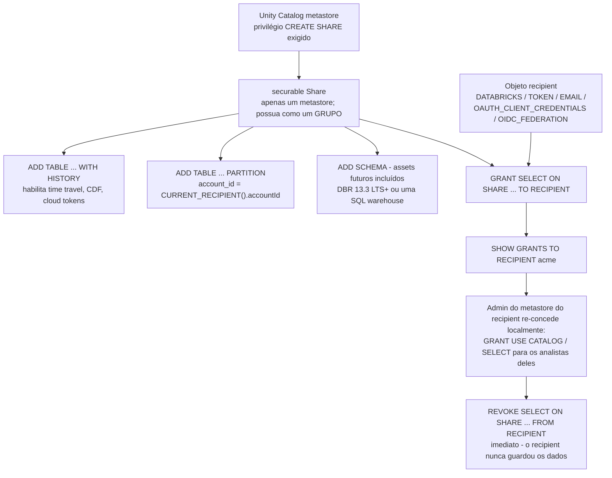
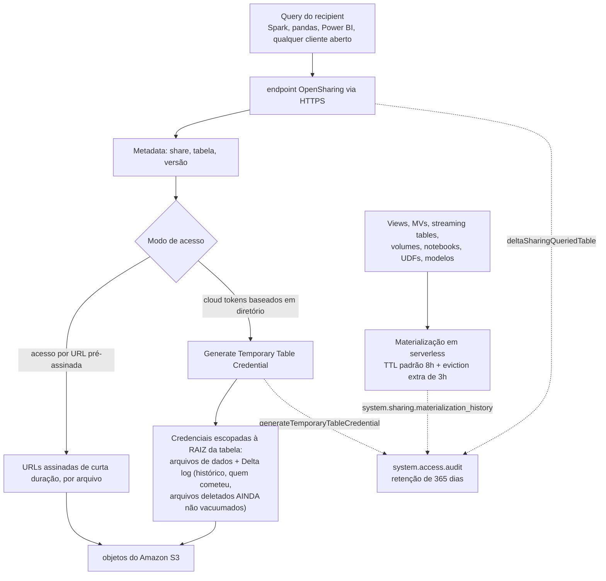
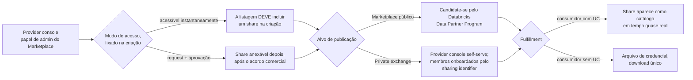
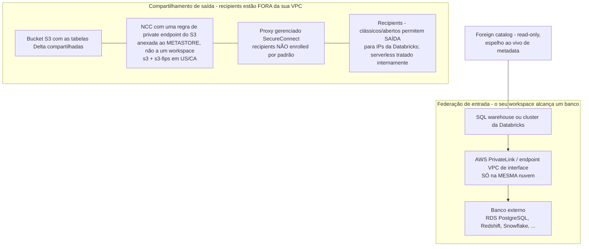

# Compartilhamento de Dados na Databricks on AWS: OpenSharing, Marketplace e Lakehouse Federation

As lições 01–11 construíram e governaram um lakehouse que guarda *os seus* dados. No momento em que uma segunda organização precisa ler esses dados — um parceiro, um cliente, uma subsidiária, um regulador, um assinante pagante — três superfícies diferentes da plataforma se oferecem para ajudar, e rotineiramente se confundem entre si. **OpenSharing** (o produto; o protocolo aberto se chamava Delta Sharing até junho de 2026) entrega uma *visão ao vivo* de tabelas selecionadas a alguém que não é você. O **Databricks Marketplace** é uma vitrine que fica por cima desse repasse e acrescenta descoberta, aprovação e aquisição. A **Lakehouse Federation** faz o oposto dentro do mesmo vocabulário: deixa o *seu* SQL alcançar o banco de dados ou o catálogo ao vivo de outra pessoa sem copiar um byte. Cada uma é governada por securables do Unity Catalog, cada uma tem a sua própria história de rede na AWS, e cada uma falha de um jeito característico.

A regra de ensino desta lição, e a frase para guardar quando a sintaxe embaçar: **um share é um ponteiro ao vivo, um foreign catalog é uma dependência ao vivo, uma listagem do Marketplace é uma vitrine sobre o ponteiro — e só uma cópia de ETL é uma coisa que você possui.** Acerte essa ordem e cada recurso abaixo cai no seu lugar.

```text
=====================================================================
 MAPA DA LIÇÃO 12 - superfícies de colaboração na AWS, em outubro de 2026
---------------------------------------------------------------------
 SUPERFÍCIE 1 - OpenSharing (protocolo: Linux Foundation; produto: DBX)
   modelos ...... Databricks-to-Databricks  (sharing identifier,
                                            sem arquivo de credencial,
                                            conjunto de assets mais rico)
                  Databricks-to-Open        (token ou federação OIDC,
                                            assets tabulares, sem UC
                                            no lado do recipient)
                  Open-to-Databricks        (servidor OSS -> DBX recipient)
   securables .. share (um metastore), recipient, grants ON SHARE
   bytes ....... URLs pré-assinadas  OU  cloud tokens baseados em
                 diretório (elegíveis: WITH HISTORY, sem filtro de
                 partição; D2O também só Delta gerenciado/externo)
   auditoria ... system.access.audit (365 dias) + histórico de
                 materialização (365 dias)
   penhasco .... bearer tokens no máximo 1 ano; tokens emitidos antes
                 de 2025-12-08 com expiração longa ou nenhuma expiram
                 automaticamente em 2026-12-08
 SUPERFÍCIE 2 - Marketplace (construída SOBRE o OpenSharing)
   listagem .... instant (share obrigatório na criação) vs
                 request (share anexável depois)
   alvo ........ Marketplace público (Data Partner Program) vs
                 private exchange (self-serve, sharing identifiers)
   dinheiro .... sem taxa de listagem, sem corte de receita; Universal
                 Commit drawdown <= 10%, contrato após 2026-06-15
 SUPERFÍCIE 3 - Lakehouse Federation (entrada, read-only)
   securables .. connection -> foreign catalog -> grants comuns
   variantes ... query federation (pushdown JDBC, 11 fontes)
                 catalog federation (varredura de metadata, 7 fontes)
   creds ....... secret() scope/keys, ou UC service credential +
                 AWS IAM role (RDS Postgres IAM, DBR 18 LTS+)
   rede ........ PrivateLink / interface endpoint, SÓ na MESMA nuvem
 REDE AWS - dois problemas diferentes, não resolva um duas vezes
   saída ....... proxy SecureConnect + regra de private endpoint da NCC
                 anexada ao METASTORE (não a um workspace)
   entrada ..... PrivateLink entre a VPC do workspace e a VPC do banco
 ARMADILHA DA LIÇÃO - um share é um PONTEIRO AO VIVO:
   DELETE do provider propaga na próxima leitura do recipient;
   VACUUM (retenção padrão de 7 dias de arquivos) quebra o
   time travel e o streaming do recipient em shares WITH HISTORY;
   tokens de diretório expõem o Delta log, passado não vacuumado
   incluído
=====================================================================
```

Nesta lição você vai:

- separar as **três superfícies** — OpenSharing, Marketplace, Lakehouse Federation — e rotear seis pedidos realistas de colaboração para a superfície certa (e saber quando a resposta certa é uma cópia deliberada);
- aplicar corretamente o **rename de junho de 2026**: produto e docs dizem **OpenSharing**, a superfície SQL ainda diz `CREATE SHARE` / `GRANT ... ON SHARE`, o cliente OSS ainda é `delta_sharing` e os eventos de auditoria ainda começam com `deltaSharing*`;
- construir um share do jeito que os documentos de outubro de 2026 especificam: `CREATE SHARE` no metastore, `ALTER SHARE ... ADD TABLE ... WITH HISTORY`, parametrizado por partição com `CURRENT_RECIPIENT()`, `CREATE RECIPIENT`, `GRANT SELECT ON SHARE`, verificado com `SHOW GRANTS TO RECIPIENT`;
- escolher a história de autenticação com base em evidências — **Databricks-to-Databricks** (nenhum artefato), **federação OIDC** (nenhum segredo emitido pela Databricks) ou **bearer token** (arquivo de credencial de uso único, IP ACL, rotação agendada) — e explicar o **penhasco de tokens de 2026-12-08** a quem ainda depende de um;
- ler a linha: **acesso por URL pré-assinada** versus **cloud tokens baseados em diretório**, quais assets são elegíveis para cada modo e por que as credenciais de diretório entregam ao recipient o **Delta log, incluindo os dados deletados ainda não vacuumados**;
- governar shares como qualquer outro securable do Unity Catalog: quem pode criá-los, o que `SHOW GRANTS TO RECIPIENT` responde, como funciona a **revogação imediata** e como rodar uma **revisão trimestral de acesso** contra `system.access.audit`;
- publicar pelo **Databricks Marketplace**: listagens instant vs request, Marketplace público vs private exchange, a economia **sem taxa e sem corte** para o provider e a aritmética do **Universal Commit Drawdown** de 10%;
- implantar a **Lakehouse Federation** com `CREATE CONNECTION` e `CREATE FOREIGN CATALOG`, usando `secret()` (ou uma UC service credential mais uma AWS IAM role no RDS PostgreSQL), e dizer exatamente o que o **join pushdown** empurra para onde;
- manter os dois problemas de rede separados: **compartilhamento de saída** (SecureConnect, private endpoints da NCC no metastore, IP ACLs de recipient) versus **federação de entrada** (PrivateLink, só na mesma nuvem);
- posicionar **clean rooms**, um **veredito comparativo de Delta Sharing vs S3 cross-account com Lake Formation vs cópias de ETL**, três estudos de caso nomeados da AWS, uma **caixa de atualização de outubro de 2026** com fontes, **oito exemplos resolvidos**, **cinco diagramas**, **quatro verificações interativas** e **doze questões de prática**.

---

## 1. Três superfícies, uma pergunta: como os dados saem — ou chegam — sem se mover?

### 1.1 O mapa das superfícies

| Superfície | Direção | Objeto central | O que o outro lado precisa | Modo de falha que você herda |
|---|---|---|---|---|
| **OpenSharing** (antigo Delta Sharing) | **saída** | `share` + `recipient` + `GRANT ... ON SHARE` | workspace com UC da Databricks (D2D), ou qualquer cliente aberto / Power BI / Tableau (D2O) | indisponibilidade do provider, delete acidental e VACUUM agressivo se propagam ao recipient |
| **Databricks Marketplace** | **saída + comércio** | `listing` → aponta para um `share` | cliente Databricks para um private exchange; qualquer pessoa para uma listagem pública | uma listagem sem um share corretamente governado é uma vitrine sem estoque |
| **Lakehouse Federation** | **entrada** | `connection` + `foreign catalog` | um SQL warehouse ou cluster da Databricks | uma **dependência ao vivo**: a latência e o downtime da fonte agora são seus |
| **Cópia de ETL** (arquivos, `COPY INTO`, extract de fornecedor) | saída | arquivos na conta do consumidor | absolutamente qualquer pessoa, offline | desatualização, sem revogação, sem ideia de quem ainda guarda uma cópia |

"OpenSharing é a plataforma segura de compartilhamento de dados da Databricks que permite compartilhar ativos de dados e de IA com usuários fora da sua organização, independentemente de usarem ou não Databricks. O OpenSharing também é a base do Databricks Marketplace, um fórum aberto para a troca de produtos de dados, e dos Clean Rooms" (docs, *What is OpenSharing?*, AWS, acesso em 2026-10). Essa frase é a arquitetura em miniatura: **Marketplace e Clean Rooms são construídos sobre a camada de compartilhamento**, e é por isso que uma lição que cobre as três começa com o objeto share e não com a vitrine.

Duas fronteiras que vale fixar antes de qualquer sintaxe aparecer:

- Workspaces no **mesmo metastore do Unity Catalog** não usam OpenSharing nenhum — o Unity Catalog já governa o acesso entre eles. "O compartilhamento Databricks-to-Databricks entre metastores do Unity Catalog na mesma conta está sempre habilitado"; compartilhar **para fora** da conta exige que um admin de conta ou de metastore marque "Allow OpenSharing with parties outside your organization" e defina o lifetime padrão do recipient token (mesma página de docs).
- Federation não é sharing. Federation é *o seu* computo consultando *o banco deles* via JDBC (ou varrendo *o object storage deles* depois de uma varredura de metadata); nada é concedido a uma parte externa, e nada é compartilhado para fora.

### 1.2 Exemplo resolvido E1 — roteando seis pedidos de colaboração

```text
PEDIDOS NA MESA DA EQUIPE DE PLATAFORMA (em out de 2026)
 1. "Nosso banco parceiro roda Databricks em outra conta AWS e
     precisa do revenue gold de ontem."
    -> share Databricks-to-Databricks. Eles enviam o sharing
       identifier do metastore deles ::aws:us-east-1:<uuid>;
       nenhum arquivo de credencial existe em lugar nenhum do fluxo.

 2. "Nosso cliente fundo de investimento não tem Databricks algum.
     Os analistas dele vivem no Power BI."
    -> Databricks-to-Open. Federação OIDC se o IdP deles consegue
       cunhar tokens (recomendado); bearer token + IP ACL + rotação
       se não consegue. O conjunto de assets estreita para Delta /
       Iceberg tabular.

 3. "Subsidiária adquirida no trimestre passado; conta Databricks
     separada, UC dos dois lados; executivos querem um dashboard."
    -> Databricks-to-Databricks de novo - dessa vez entre CONTAS.
       Mesma mecânica que (1); o sharing identifier é o único
       insumo novo.

 4. "Analistas precisam dos pedidos do RDS PostgreSQL JUNADOS a
     gold.customers em uma única query."
    -> Lakehouse Federation. CREATE CONNECTION + CREATE FOREIGN
       CATALOG; read-only; o pushdown faz o join na origem.

 5. "O regulador quer um arquivo fixo no fim do trimestre,
     air-gapped."
    -> Cópia de ETL deliberada. Um share é a ferramenta errada: ele
       é vivo, ele é revogável, e o regulador quer um artefato
       imutável com data de expiração.

 6. "O produto quer VENDER um produto de dados de fluxo de
     pedestres publicamente."
    -> listagem do Databricks Marketplace (instant se gratuito,
       by-request se comercial), apontando para um share governado;
       o Marketplace público exige o Data Partner Program.
```

**Leitura:** quatro dos seis pedidos são sharing, um é federation, um é cópia. O erro mais caro dessa lista é responder (4) com um share ou (5) com um share — ambos "funcionam" em uma demo e ambos falham no requisito real (uma dependência ao vivo onde se queria um snapshot; um ponteiro revogável onde se queria um artefato imutável).

- **📚 Você sabia?** A Databricks reporta a adoção do protocolo cinco anos após o lançamento em 2021 como "**28.000+ recipientes de dados e 33% dos shares fluindo entre plataformas** via conectores abertos" (blog da Databricks, *Introducing OpenSharing: the Next Evolution of Delta Sharing for the Agentic Era*, **2026-06-16**). O terço entre plataformas é o número que importa para este curso: um terço dos shares é consumido por algo que não é Databricks, e é exatamente por isso que o protocolo aberto — não uma API de plataforma — é o que a Linux Foundation agora hospeda.

---

## 2. OpenSharing: o protocolo, o produto e o rename de junho de 2026

### 2.1 Duas camadas, um nome para cada

O Delta Sharing foi lançado em 2021 como subprojeto do Delta Lake. Em **2026-06-10** a Databricks anunciou o **OpenSharing**, "Hospedado pela Linux Foundation … a próxima evolução do Delta Sharing" (release de imprensa da Databricks, 2026-06-10), e o blog técnico de 2026-06-16 desenhou o bolo de camadas explicitamente: "O OpenSharing existe em duas camadas. O protocolo open-source — agora hospedado pela Linux Foundation — é a especificação publicada… Databricks OpenSharing é a implementação corporativa do protocolo aberto, construída sobre outros recursos da Databricks, como Unity Catalog para governança e audit logging, Marketplace para descoberta e mais."

| Camada | O que é | Quem opera |
|---|---|---|
| **Protocolo OpenSharing** (open source, Linux Foundation) | a especificação publicada; qualquer fornecedor pode implementar o servidor e os clientes; o site da spec carrega a tag "Formerly Delta Sharing" | qualquer um — inclusive um provider que não é Databricks |
| **Databricks OpenSharing** (produto) | a implementação corporativa sobre o Unity Catalog: shares e recipients como securables, audit logging, Marketplace, Clean Rooms, SecureConnect | Databricks, no metastore da sua conta na AWS |

O escopo cresceu com o rename: de dados tabulares para **Agent Skills, modelos de IA e dados não estruturados**, mais **clientes do Iceberg REST catalog (IRC)** e parceiros de storage on-premises, de modo que "os clientes agora podem conectar seus ativos on-premises diretamente a plataformas em nuvem sem movimentação de dados" (release de imprensa, 2026-06-10).

### 2.2 Metade obsoleta, metade ao vivo: a tabela de vocabulário que você vai realmente precisar

| Conceito | Nome atual (docs, out de 2026) | Superfície legada que ainda circula |
|---|---|---|
| Produto / docs | **OpenSharing** — toda página sob `/aws/en/opensharing/` | o "Delta Sharing Console → aba Shares" dos tutorials antigos está errado; é **Catalog → engrenagem → OpenSharing** |
| Superfície SQL | inalterada | `CREATE SHARE`, `ALTER SHARE ... ADD TABLE`, `GRANT ... ON SHARE`, `SHOW GRANTS TO RECIPIENT` |
| Bibliotecas cliente OSS | inalteradas | Python `delta_sharing`, Spark connector `delta-sharing-spark` **3.1+** |
| Eventos de auditoria | inalterados | `deltaSharingQueriedTable`, `deltaSharingQueriedTableChanges`, `generateTemporaryTableCredential`, `generateTemporaryVolumeCredential` |
| Site da spec do protocolo | opensharing.io | com a marca "Formerly Delta Sharing" |

Para este curso: diga **OpenSharing** para o produto, **Delta Sharing** só quando quiser a linhagem do protocolo, as bibliotecas cliente ou os nomes dos eventos de auditoria — e nunca confie no caminho de UI de um tutorial antigo.

### 2.3 Os três modelos de compartilhamento

| Modelo | Lado do recipient | Autenticação | Conjunto de assets | Artefato de credencial |
|---|---|---|---|---|
| **Databricks-to-Databricks** | workspace com UC, metastore *diferente* (outra conta, nuvem ou região) | o **sharing identifier** do metastore do recipient `::<cloud>:<region>:<uuid>` | o mais rico — tabelas, views, volumes, modelos, notebooks, agents | **nenhum** — "nenhum arquivo de credencial é exigido… os dados compartilhados ficam automaticamente descobertos no seu workspace Databricks" (docs, 2026-07-13) |
| **Databricks-to-Open** | qualquer coisa: Spark, pandas, Power BI, Tableau, qualquer cliente aberto | **bearer token** (arquivo de credencial) ou **federação OIDC** para o IdP do recipient | tabular — Delta e dados Iceberg gerenciados | token: arquivo de credencial de uso único; OIDC: nenhum vindo da Databricks |
| **Open-to-Databricks** | workspace com UC | arquivo de credencial do servidor OSS OpenSharing *não-Databricks* | o que o servidor OSS implementar | arquivo de credencial enviado pelo recipient |

### 2.4 Unity Catalog: obrigatório e não obrigatório — a nuance verificada

Os docs respondem isso como FAQ, literalmente: "**Não, você não precisa do Unity Catalog para compartilhar (como provider) ou consumir dados compartilhados (como recipient). No entanto, o Unity Catalog traz benefícios como suporte ao compartilhamento de ativos não tabulares e de IA, governança pronta para uso, simplicidade e desempenho de query**" (docs, *What is OpenSharing?*, acesso em 2026-10). Decompondo, porque os dois extremos estão errados na prova:

1. **O compartilhamento hospedado pela Databricks exige UC na prática** — um share *é* um securable da UC, recipients são securables da UC e a configuração significa "Enable OpenSharing on a Unity Catalog metastore".
2. **O servidor OSS OpenSharing pode ser rodado por qualquer um, em qualquer plataforma, sem Databricks** — esse é o caminho de implementação gerenciada pelo cliente, e é o que torna "você não precisa de UC" verdadeiro em geral.
3. **Recipients nunca precisam de UC** no Databricks-to-Open.
4. **Databricks-to-Databricks precisa de um metastore UC nos dois lados.**
5. **Workspaces no mesmo metastore UC não usam OpenSharing nenhum.**

---

## 3. Um share é um securable do Unity Catalog

### 3.1 O objeto e seus privilégios

"Um share é um **securable object in Unity Catalog** que representa uma coleção de dados e ativos de IA que você quer compartilhar com um ou mais recipients" (docs, *Create shares for OpenSharing*, rodapé **2026-10-09**). Daí seguem três regras, e cada uma já derrubou uma integração em produção:

- **Criar** um share exige `CREATE SHARE` no metastore. Os docs recomendam que shares pertençam a um **grupo**, não a uma pessoa — pessoas saem, grupos não.
- **Adicionar assets** exige a propriedade do share *mais* `USE CATALOG` + `USE SCHEMA` + `SELECT` em cada asset. O aviso dos docs é explícito: "**Você deve manter esse privilégio para que o asset continue sendo compartilhado. Se você o perder, o recipient não poderá acessar o asset pelo share.**" Transferências de propriedade, reestruturações de grupo e limpezas de grant já quebraram shares vivos assim.
- **Delegar** usa `USE SHARE` + `SET SHARE PERMISSION` no share; o lado do recipient precisa de `USE RECIPIENT` (ou propriedade do recipient), e os fluxos de aprovação do Marketplace exigem ainda `CREATE RECIPIENT` / `USE RECIPIENT`. Um share pode conter assets de **apenas um metastore do Unity Catalog**.

### 3.2 O que pode entrar em um share (lista verificada, out de 2026)

Tabelas **e partições de tabela** (sim — `PARTITION(...)` e partições baseadas em propriedade com `CURRENT_RECIPIENT()`), **schemas inteiros** (`ADD SCHEMA`, que também concede os assets futuros), **views, incluindo dynamic views** (o mecanismo de restrição de linha/coluna para recipients abertos), **materialized views**, **metric views**, **streaming tables**, **tabelas Iceberg gerenciadas**, **tabelas Iceberg externas**, **tabelas Delta externas**, **schemas e tabelas externos**, **volumes**, **UDFs de Python**, **notebooks**, **modelos de IA**, **Genie Agents** e **`FeatureSpecs`** — a lista de assets compartilháveis na página de criação de share (docs, 2026-10-09). O que *não* viaja de graça: comentários de tabela/coluna e constraints de chave primária só fluem para shares Databricks-to-Databricks criados em ou depois de **2024-07-25**; grants mais antigos precisam ser revogados e concedidos de novo.

### 3.3 Os flags de history decidem o que os recipients podem fazer

| Flag / recurso | Exigência (docs, 2026-10-09) | O que você perde sem ele |
|---|---|---|
| `WITH HISTORY` / `WITHOUT HISTORY` | DBR **12.2 LTS+** | — |
| Flag padrão | `WITH HISTORY` no DBR **16.2+**; `WITHOUT HISTORY` antes disso | — |
| `ADD SCHEMA` | DBR **13.3 LTS+** ou uma SQL warehouse | só adições por tabela |
| Criação de share a partir de um notebook | DBR **11.3 LTS+** | use SQL/CLI |
| Partições por propriedade de recipient | DBR **12.2+** | sem divisão multi-tenant por partição |
| Tabelas com deletion vector / column mapping legíveis pelo recipient | DBR **14.1+** (batch), **14.2+** (CDF, streaming) ou `delta-sharing-spark` **3.1+** | o recipient não consegue ler essas tabelas |
| Change data feed para recipients | **CDF habilitado na tabela antes** de compartilhar `WITH HISTORY` | sem leituras de CDF, nunca, até recompartilhar |
| Acesso baseado em diretório (cloud token) | `WITH HISTORY` + sem filtro de partição (D2D); D2O também exige Delta gerenciado/externo, não CCv2, não storage padrão | o recipient volta para URLs pré-assinadas |

A armadilha nas duas últimas linhas: a configuração "mais barata" (`WITHOUT HISTORY`, ou um share com filtro de partição) desabilita silenciosamente **time travel, streaming e CDF** do recipient — e *também* desqualifica o caminho rápido de cloud token. "WITHOUT HISTORY está bom" é uma decisão que precisa ser refeita toda vez que os requisitos do recipient mudarem.

### 3.4 Exemplo resolvido E2 — o provider constrói um share (SQL real, em out de 2026)

```sql
-- Provider metastore M1 on AWS (S3-backed Delta tables), us-west-2
-- Requires: CREATE SHARE on the metastore; ownership of the assets
--           plus USE CATALOG / USE SCHEMA / SELECT on each asset added.

CREATE SHARE IF NOT EXISTS finance_q3
  COMMENT 'Q3 revenue for Acme - WITH HISTORY so they can time travel';

-- One metastore per share. WITH HISTORY (default on DBR 16.2+) is
-- what makes recipient time travel, CDF and cloud-token access possible.
ALTER SHARE finance_q3 ADD TABLE corp.gold.revenue WITH HISTORY;

-- Multi-tenant variant: ONE share, N recipients, each pinned to the
-- partition matching a recipient property. Default properties:
-- databricks.accountId, databricks.metastoreId, databricks.name.
ALTER SHARE finance_q3 ADD TABLE corp.raw.events
  PARTITION (account_id = CURRENT_RECIPIENT().accountId);

-- Whole schema, future assets included (DBR 13.3 LTS+ or a warehouse).
-- Tables carrying UC row filters / column masks / ABAC are EXCLUDED
-- when you share an entire schema - design row policy INTO the
-- shared object (dynamic views + CURRENT_RECIPIENT()), not around it.
ALTER SHARE finance_q3 ADD SCHEMA corp.silver;

-- Recipient object: the recipient's metastore sends its sharing
-- identifier ::aws:us-east-1:<uuid>; DATABRICKS type, no token exists.
CREATE RECIPIENT IF NOT EXISTS acme DATABRICKS SYNCED
  COMMENT 'Acme bank - cross-account, Databricks-to-Databricks';

-- Open the tap. This is the grant the recipient's reads ride on.
GRANT SELECT ON SHARE finance_q3 TO RECIPIENT acme;

-- Verify what a recipient can actually read (docs-verified command).
SHOW GRANTS TO RECIPIENT acme;
```

**Números em out de 2026:** o `WITH HISTORY` padrão exige **DBR 16.2+**; os dois flags de history exigem **12.2 LTS+**; `ADD SCHEMA` exige **13.3 LTS+** ou uma SQL warehouse; o share contém assets de **um** metastore; revogar depois é um único `REVOKE` porque o recipient nunca guardou os dados.



---

## 4. Recipients: cinco tipos de autenticação, três histórias

### 4.1 O enum `authentication_type`

O `CREATE RECIPIENT` gera um objeto cujo `authentication_type` é um de **`DATABRICKS`**, **`TOKEN`**, **`EMAIL`** (Beta; envolve um filho `DATABRICKS` ou `TOKEN` e exige que um admin de conta habilite o OpenSharing-by-email na página Previews do console de conta), **`OAUTH_CLIENT_CREDENTIALS`** ou **`OIDC_FEDERATION`** (docs, *Manage data recipients*, 2026-06-23). Recipients também carregam **IP access lists**, status de ativação, lifetime do token e — para OIDC — o endpoint do IdP mais o endpoint mTLS. `SHOW GRANTS TO RECIPIENT` lista os shares que um recipient pode ler.

### 4.2 Exemplo resolvido E3 — Databricks-to-Databricks, o fluxo sem artefato

```text
PROVIDER (metastore M1, AWS us-west-2)     RECIPIENT (metastore M2, us-east-1)
-----------------------------------------  ------------------------------------
CREATE RECIPIENT acme DATABRICKS SYNCED;   -> envia para você o sharing
GRANT SELECT ON SHARE finance_q3              identifier deles ::aws:us-east-1:
           TO RECIPIENT acme;                 b0c978c8-...
SHOW GRANTS TO RECIPIENT acme;                (sem token, sem arquivo de
                                              credencial, nada para
                                              rotacionar ou vazar)
                                            catálogo finance_q3 aparece
                                              como um catálogo em tempo
                                              quase real
                                            o admin de metastore deles:
                                              GRANT USE CATALOG ON CATALOG
                                                finance_q3 TO analysts;
                                              GRANT SELECT ON SCHEMA
                                                finance_q3.default TO analysts;
                                            SELECT region, sum(amount)
                                              FROM finance_q3.default.revenue
                                              GROUP BY region;
```

O acesso persiste "enquanto o token subjacente for válido **e o provider continuar compartilhando os dados**" (docs, 2026-07-13) — neste modelo não existe token, então ele persiste exatamente enquanto você mantiver o grant. Recipients "podem ler e fazer cópias dos dados compartilhados, mas… não podem modificar os dados de origem".

### 4.3 Exemplo resolvido E4 — Databricks-to-Open: bearer token e depois o lado do cliente

```text
PROVIDER RUNBOOK (forma derivada dos docs, out de 2026)
 1. CREATE RECIPIENT partner_bearer ...  -- authentication_type = TOKEN
    lifetime do token: 90 dias (configurado pelo provider; o lifetime
    padrão de recipient token do metastore é definido quando o
    OpenSharing é habilitado - "a Databricks recomenda que você
    configure tokens para expirar")
 2. Copie a URL de ativação UMA ÚNICA VEZ; entregue por fora do canal
    (email sharing é Beta - ainda não construa sobre ele)
 3. O recipient baixa partner.share - o arquivo de credencial "pode
    ser baixado apenas uma vez"; tokens "são válidos por no máximo
    um ano após a criação"
 4. Cliente do lado do recipient (protocolo aberto, sem Databricks):
```

```python
import delta_sharing

client = delta_sharing.SharingClient("partner.share")
print(client.list_all_tables())
# "partner.share#finance_q3.default.revenue" is the
# profile#share.schema.table address form every open client uses
df = delta_sharing.load_as_pandas(
    "partner.share#finance_q3.default.revenue", limit=1000
)
```

```text
 5. OPERAÇÕES
    - como a tabela é WITH HISTORY sem filtro de partição, as
      respostas usam cloud tokens BASEADOS EM DIRETÓRIO (Seção 5) e a
      auditoria do provider mostra linhas generateTemporaryTableCredential
    - coloque um IP ACL no objeto recipient: 198.51.100.0/24
    - rotacione no dia 80; acompanhe as duas URLs de ativação; dê
      REVOKE no recipient antigo quando o novo arquivo de credencial
      estiver confirmado no ar
 6. O PENHASCO - cite isto para quem ainda depende de tokens longos:
    "Todos os recipient tokens de compartilhamento Databricks-to-Open
     emitidos antes de 8 de dezembro de 2025, com datas de expiração
     depois de 8 de dezembro de 2026, ou sem data de expiração,
     expiram automaticamente em 8 de dezembro de 2026." (docs, acesso
     em outubro de 2026)
```

### 4.4 Federação OIDC: o fluxo em que a Databricks não emite segredo nenhum

"Este fluxo de autenticação usa federação OIDC, permitindo JSON Web Tokens (JWTs) emitidos pelo IdP do recipient como tokens OAuth de curta duração autenticados pela Databricks… **A Databricks não gera nem gerencia nenhum token ou credencial.** Em vez disso, o IdP do recipient gera um JWT contendo claims de identidade" (docs, *Enable OIDC federation for OpenSharing recipients*, acesso em 2026-10). O provider escreve uma **política de federação** contra o IdP *do recipient* — nome da política, URL do issuer, claim de subject (`oid` / `groups` / `azp` no Entra ID), subject, audiences — e a Databricks devolve uma **portal URL**. O recipient baixa um perfil `oauth_config.share` e o alimenta no cliente aberto:

```json
{
  "shareCredentialsVersion": 2,
  "endpoint": "https://sharing.cloud.databricks.com/api/2.0/delta-sharing/open-sharing/1",
  "tokenEndpoint": "https://login.microsoftonline.com/<tenant>/oauth2/v2.0/token",
  "type": "oauth_client_credentials",
  "clientId": "<recipient-owned client id>",
  "clientSecret": "<recipient-owned secret - never leaves the recipient>",
  "scope": "<api-scope>"
}
```

Dois fluxos documentados: **U2M** (Power BI / Tableau via OAuth Authorization Code Grant contra o app multi-tenant Entra da Databricks `64978f70-f6a6-4204-a29e-87d74bfea138`, consentimento único do admin do tenant) e **M2M** (OAuth Client Credentials com um service principal registrado no IdP do recipient — o caminho Python/Spark). "Nenhum segredo ou credencial é trocado entre a Databricks, o provider ou o recipient. Toda a gestão de segredos permanece interna a cada organização." Grants continuam usando o mesmo SQL `GRANT ... ON SHARE`.

**A escada de postura, em ordem:** recipient Databricks → **Databricks-to-Databricks** (nenhum artefato); parceiro não-Databricks → **federação OIDC** (nenhum segredo emitido pela Databricks); só quando o recipient não tem um IdP utilizável → **token + IP ACL + rotação agendada** — e confira o penhasco de 2026-12-08 antes de construir sobre qualquer token cunhado antes de 2025-12-08.

- **📚 Você sabia?** Três fatos sobre credenciais bearer que surpreendem as pessoas: o arquivo de credencial "pode ser baixado apenas **uma vez**" — se você o perder, você re-emite o objeto recipient, não o arquivo; o provider deve "configurar o lifetime padrão do recipient token quando habilita o OpenSharing para o seu metastore do Unity Catalog", então um padrão para a organização inteira existe antes de qualquer recipient individual; e existe também **federação OIDC para recipients Iceberg REST**, entregue por um link de portal de geração de perfil — a mesma postura de nenhum segredo emitido pela Databricks, apontada para um cliente Iceberg REST em vez do cliente tabular (docs, acesso em outubro de 2026).

---

## 5. Como os bytes realmente se movem: URLs pré-assinadas vs cloud tokens

### 5.1 Dois modos de acesso na linha

| Modo | O que o recipient recebe | Evento de auditoria | Elegibilidade |
|---|---|---|---|
| **Acesso por URL pré-assinada** | URLs assinadas de curta duração por arquivo, devolvidas pelo servidor de compartilhamento | `deltaSharingQueriedTable` (e `deltaSharingQueriedTableChanges` para o CDF) | tudo que é elegível |
| **Acesso baseado em diretório (cloud tokens)** | "o local de storage em nuvem da tabela ao lado de credenciais temporárias em nuvem (cloud tokens)"; o recipient chama *Generate Temporary Table Credential* e lê o storage diretamente, `accessModes: ["url","dir"]` | `generateTemporaryTableCredential` | D2D: `WITH HISTORY` + sem filtro de partição; D2O também exige Delta gerenciado/externo, não CCv2, não storage padrão |

Views, materialized views, streaming tables, volumes, notebooks, UDFs e modelos **não são elegíveis para cloud token de forma explícita**, então são entregues por **materialização**: a página de configuração do provider documenta o TTL da materialização dos dados — "Por padrão, o TTL é **oito horas**. O cache em si será evicted pela materialização após mais **três horas**" — e toda materialização cai na tabela **`system.sharing.materialization_history`** (retenção de 365 dias). Materializações ocorrem "quando um recipient consulta dynamic views, materialized views, streaming tables e foreign tables compartilhados".

### 5.2 A exposição do Delta log: a surpresa de privacidade no modo diretório

Os docs de criação de share afirmam que as credenciais de cloud token são escopadas ao **diretório raiz da tabela** — arquivos de dados *e o Delta log*, que "contém o histórico de commits de cada versão da tabela, informações sobre quem cometeu, e **dados deletados que ainda não foram vacuumados**". Duas consequências em torno das quais você precisa projetar:

1. Um recipient com acesso de diretório vê mais do que "as linhas atuais" — ele vê o **passado não vacuumado** do provider, até a janela de retenção do VACUUM (arquivos de dados: **7 dias** por padrão; o log em si: **30 dias** via `delta.logRetentionDuration`, docs.delta.io, acesso em outubro de 2026).
2. Se a sua história de privacidade assumiu "eles só veem o que a view mostra", use **acesso por URL pré-assinada**, compartilhe uma **dynamic view** em vez da tabela base, ou limpe com VACUUM *antes* do share sair — não depois.

### 5.3 Exemplo resolvido E5 — lendo a linha a partir da trilha de auditoria

```sql
-- Prerequisite: an account admin has ENABLED SYSTEM TABLES.
-- Retention: system.access.audit keeps 365 days of rows.
SELECT event_time, user_identity.email, action_name, request_params
FROM system.access.audit
WHERE action_name IN (
  'deltaSharingQueriedTable',            -- pre-signed URL path
  'deltaSharingQueriedTableChanges',     -- CDF, pre-signed path
  'generateTemporaryTableCredential',    -- directory/cloud-token path
  'generateTemporaryVolumeCredential'    -- volumes (STS)
)
ORDER BY event_time DESC
LIMIT 100;

-- What each row tells you:
--   deltaSharingQueriedTable          -> response.result shows what was
--                                        returned on the URL path
--   generateTemporaryTableCredential  -> request_params shows the table
--                                        and the STS-scoped credential
-- Provider audit logs "record actions taken by the provider and
-- actions taken by recipients on the provider's shared data" (docs,
-- 2026-06-23). The error string to grep runbooks for:
--   DatabricksServiceException: FEATURE_DISABLED:Delta Sharing is not
--   enabled   (sharing not enabled on the metastore)
```

**Leitura:** a mistura de modos nesta query é, em si, um sinal de segurança. Um recipient que você pretendia estar em URLs pré-assinadas aparecendo de repente em `generateTemporaryTableCredential` significa que a elegibilidade do share dele mudou (flag de history adicionado, filtro de partição removido) — o que pode ser exatamente o que você configurou, ou exatamente o que você não configurou.



---

## 6. Governando shares: grants, auditoria, revogação — e a armadilha do ponteiro ao vivo

### 6.1 O modelo de privilégios, comprimido

| Ação | Privilégio exigido |
|---|---|
| Criar um share | `CREATE SHARE` no metastore |
| Adicionar assets a um share | propriedade do share **e** `USE CATALOG` + `USE SCHEMA` + `SELECT` no asset — e você **precisa manter** o `SELECT` |
| Delegar a concessão | `USE SHARE` + `SET SHARE PERMISSION` no share |
| Tocar no objeto recipient | `USE RECIPIENT` ou propriedade do recipient; `CREATE RECIPIENT` para fluxos de aprovação do Marketplace |
| Ver o que um recipient lê | `SHOW GRANTS TO RECIPIENT <name>` |
| Fechar a torneira | `REVOKE SELECT ON SHARE <name> FROM RECIPIENT <name>` |

A revogação é instantânea e total por causa da frase que sustenta o modelo inteiro: o recipient nunca guardou os dados, apenas o direito de ler. Essa é a propriedade que cópias de ETL não conseguem oferecer, e a razão pela qual um share vence uma bucket policy sempre que "podemos precisar de tirar isso de volta" é um requisito real.

### 6.2 Exemplo resolvido E6 — a revisão trimestral de acesso

```text
ENTRADAS (todas nativas da Databricks, em out de 2026)
  a. SHOW GRANTS TO RECIPIENT partner;      -- para cada recipient
  b. system.access.audit com action_name nos quatro eventos de sharing
  c. as tabelas previstas no contrato (um registro que você mantém)

MÉTODO
  1. Liste cada objeto recipient e seus shares (a)
  2. LEFT JOIN contra a atividade de auditoria dos últimos 90 dias (b)
  3. Diff da membrosia de shares contra as tabelas previstas no
     contrato (c)
  4. Compartilhado mas nunca consultado  -> revisar para revogar
  5. Consultado mas não previsto         -> incidente
  6. Revogue grants obsoletos:
       REVOKE SELECT ON SHARE finance_q3 FROM RECIPIENT old_partner;
  7. Rotacione qualquer recipient TOKEN perto do fim do seu lifetime;
     confirme que as políticas OIDC ainda apontam para um IdP ativo
```

```sql
-- Step 2's core query (365-day retention on system.access.audit)
SELECT
  request_params AS what_was_shared,
  count(*)       AS reads,
  max(event_time) AS last_read
FROM system.access.audit
WHERE action_name IN ('deltaSharingQueriedTable',
                      'generateTemporaryTableCredential')
  AND event_time >= current_date() - INTERVAL 90 DAYS
GROUP BY 1, 3
ORDER BY last_read DESC;
```

### 6.3 ⚠️ WARNING: um share é um PONTEIRO AO VIVO — e o VACUUM está mirado nos seus recipients

> [!WARNING]
> ⚠️ **"O acesso persiste enquanto… o provider continuar compartilhando os dados" — e tudo o que o provider faz na tabela propaga.** Quatro formas documentadas (e uma contratual) de isso morder:
> - **Deletes e updates propagam na próxima leitura do recipient.** Um `DELETE` ou `UPDATE` acidental na tabela do provider fica visível para todo recipient imediatamente — não existe área de estagiamento nem gate de aprovação.
> - **`VACUUM` quebra o time travel e o streaming do recipient.** Um share `WITH HISTORY` promete aos recipients time travel, CDF e leituras de streaming — tudo isso precisa de arquivos antigos. A retenção padrão de arquivos de dados do VACUUM é de **7 dias** (`delta.logRetentionDuration` é **30 dias** por padrão para o log); rode o VACUUM de forma agressiva e "a capacidade de voltar no tempo até uma versão anterior ao período de retenção é perdida" — para você *e* para todo recipient no meio de um stream. Alinhe a janela de retenção com o objetivo de recuperação do recipient mais lento, ou compartilhe uma **dynamic view** com o próprio TTL de materialização em vez da tabela base.
> - **No modo baseado em diretório, as credenciais temporárias do recipient expõem o Delta log inteiro**, incluindo "dados deletados que ainda não foram vacuumados" (Seção 5.2) — uma surpresa de privacidade se o share foi justificado como "somente as linhas atuais".
> - **Mudanças de schema fluem sem gate de revisão.** Uma coluna nova, um tipo alargado, uma coluna removida chegam no próximo plano de query dos recipients. Use `ADD SCHEMA` de forma deliberada e avise os recipients — ou compartilhe uma view que você controla.
> - **Perder o `SELECT` na origem mata o share**: "Se você o perder, o recipient não poderá acessar o asset pelo share." Transferências de propriedade e limpezas de grant já encerraram integrações assim.

**Regras de projeto que daí saem:** (1) nunca aponte um share `WITH HISTORY` para uma tabela que alguém roda VACUUM com timer curto sem acordar a janela de retenção; (2) prefira compartilhar **views** (incluindo dynamic views com lógica de linha `CURRENT_RECIPIENT()`) quando o contrato do recipient for mais estreito que a tabela base; (3) trate o caminho de leitura do recipient como uma **dependência de produção das operações de ciclo de vida da sua tabela** — a mesma disciplina que você aplicaria a um job downstream que você não controla, porque é exatamente isso que ele é.

---

## 7. Databricks Marketplace: a vitrine por cima do share

### 7.1 Anatomia de uma listagem

Uma **listing** aponta para um **share**. Duas escolhas de acesso, **fixadas na criação**: "Data assets are instantly accessible" versus "Os consumidores devem solicitar acesso à listagem". Dois alvos de publicação: **Marketplace público** ou um **private exchange**. Tipos de asset: **tabelas · arquivos (Volumes) · modelos · notebooks · servidores MCP** — mais **apps** desde junho de 2026 (Public Preview). O wizard permite anexar até **10 notebooks de exemplo** por listagem.

| Tipo de listagem | Exigência de share | Forma comercial | Quem pode vê-la |
|---|---|---|---|
| **Instant** | "uma listagem instant precisa incluir um share quando é criada" | gratuita, apenas aceitação dos ToS | quem o alvo de publicação expuser |
| **By-request** | "uma listagem by-request pode deixar de fora o share e anexá-lo depois" — anexe após o acordo comercial | exige aprovação; pode envolver transação | igual |
| **Marketplace público** | como acima | transações entre consumidor e provider diretamente | o público; exige o **Databricks Data Partner Program** |
| **Private exchange** | como acima | vitrine restrita a membros | "listagens de private exchange não aparecem no marketplace público"; membros "precisam ser clientes da Databricks e ter acesso a um workspace anexado a um metastore do Unity Catalog", com onboard inserindo "o **sharing identifier** do metastore deles" |

O fulfillment é a camada de compartilhamento fazendo o que já faz: "Se o consumidor estiver em um workspace Databricks habilitado para Unity Catalog, ele ganha acesso ao share como um catálogo no seu workspace Databricks **em tempo quase real**. Se o consumidor não estiver em um workspace Databricks habilitado para Unity Catalog, um **arquivo de credencial** é gerado e disponibilizado para download" (docs, 2026-06-23).

### 7.2 Virar provider, e as políticas que te travam

"Para ser um **provider apenas de private exchange**, você pode se inscrever pelo provider console. **Para criar listagens públicas, você se candidata pelo Databricks Data Partner Program**" (docs, 2026-04-09). Depois da aprovação você "deve conceder a pelo menos um usuário o **papel de admin do Marketplace**" — um admin de conta da Databricks concede esse papel — e listagens com aprovação exigem ainda `CREATE RECIPIENT` / `USE RECIPIENT`. A página de políticas para providers (2023-10-10) é curta e absoluta: toda listagem deve declarar a frequência de atualização e os termos de uso provider/consumidor, e "se o seu Produto incluir Dados Pessoais, você precisa estar legalmente autorizado a compartilhar tais Dados Pessoais. No entanto, **um Produto nunca deve incluir Dados Pessoais Sensíveis.**"

### 7.3 O dinheiro: sem corte e um drawdown de 10% do commit

- **Economia da listagem:** "Não há taxa para os providers listarem seus ativos no Databricks Marketplace. Hospedamos listagens gratuitas e pagas, mas **não pegamos nenhum corte da receita que os providers recebem**. As transações de listagens pagas acontecem entre consumidores e providers diretamente" (blog da Databricks, *Top 10 Marketplace Questions, Answered*, **2024-11-11**).
- **Economia de aquisição (nova, junho de 2026):** o programa **Universal Commit Drawdown** permite que consumidores usem "até **10%** dos seus Universal Commits para comprar produtos de parceiros terceiros elegíveis pelo Databricks Marketplace" (docs, acesso em outubro de 2026). Condições: o contrato "deve ser assinado depois de **15 de junho de 2026**"; a fatura tem de ter "no máximo **45 dias**" e ser "denominada em USD"; o parceiro "valida a transação em **10 dias úteis**"; e "não há **taxas de transação**" neste caminho. A própria aritmética dos docs: "Universal Commit de US$ 50M = até US$ 5M de drawdown no Marketplace".
- **Ainda roadmap, não GA:** a **transactability** dentro da plataforma — gasto pré-pago como checkout, "menos uma taxa pequena (padrão da indústria)" — foi anunciada para "mais tarde em 2026" (blog, **2026-06-17**). Nenhuma porcentagem foi publicada; não modele uma taxa que você não consegue citar.

### 7.4 Exemplo resolvido E7 — runbook de listagem e a matemática do drawdown

```text
PROVIDER RUNBOOK - commercial listing, by-request (Oct 2026)
 1. Provider console -> Create listing
 2. Access = "Consumers must request access to the listing"
    Publish target = Public Marketplace (apply via the Data Partner
    Program first) OR a private exchange (self-serve)
 3. Assets = tables + volumes + up to 10 sample notebooks; state
    update frequency and ToS; NEVER include Sensitive Personal Data
 4. Do NOT attach the share yet - by-request allows attaching after
    the commercial agreement; an INSTANT listing would have forced
    the share at creation
 5. Consumer requests -> pending; you approve (needs CREATE RECIPIENT
    / USE RECIPIENT); status is irreversible once fulfilled/denied
 6. On Fulfill: UC consumer gets the share as a catalog in near-real
    time; non-UC consumer gets a one-time credential file
 7. Provider analytics: Marketplace system tables (Public Preview)
    + the Provider Analytics Dashboard for views/requests/installs

CONSUMER SIDE - commit drawdown math (docs example, as of Oct 2026)
  Universal Commit ................. $50,000,000
  Drawdown cap (10%) .............. $ 5,000,000   <- hard ceiling
  Contract signed ................. must be AFTER 2026-06-15
  Invoice age ..................... <= 45 days, USD only
  Partner validation window ....... 10 business days
  Transaction fee on this path .... $0
  Anything ABOVE the 10% cap ...... not "Eligible Databricks
                                    Marketplace Purchases" under the
                                    published legal terms
```



```plot
{
  "type": "bar",
  "title": "Teto do Universal Commit drawdown em função do tamanho do commit (regra dos 10%, exemplo dos docs, em out de 2026)",
  "data": [
    {"Universal Commit": "$10M", "Maximum Marketplace drawdown": 1},
    {"Universal Commit": "$25M", "Maximum Marketplace drawdown": 2.5},
    {"Universal Commit": "$50M", "Maximum Marketplace drawdown": 5},
    {"Universal Commit": "$100M", "Maximum Marketplace drawdown": 10}
  ],
  "xKey": "Universal Commit",
  "dataKeys": ["Maximum Marketplace drawdown"],
  "xLabel": "Tamanho do Universal Commit (USD, milhões)",
  "yLabel": "Teto de gasto elegível no Marketplace (USD, milhões)"
}
```

Passe o mouse sobre uma barra: o teto é **linear e rígido** — 10% do Universal Commit, os 10% inteiros disponíveis desde o primeiro dia do commit, contrato assinado depois de **2026-06-15**, fatura com ≤ **45 dias**, parceiro valida em **10 dias úteis**, sem taxas de transação no caminho da fatura. A cifra resolvida pelos docs é a terceira barra: um Universal Commit de **US$ 50M** equivale a até **US$ 5M** de drawdown no Marketplace.

- **📚 Você sabia?** O Marketplace tem duas histórias de aquisição que as pessoas misturam. O caminho do **drawdown** é baseado em fatura e sem taxa hoje; o caminho da **transactability** (checkout na plataforma contra gasto pré-pago, "menos uma taxa pequena padrão da indústria") foi anunciado em 2026-06-17 para "mais tarde em 2026" e é um item de roadmap — modele o primeiro, não orce o segundo. Enquanto isso, **Apps on Databricks Marketplace** estão em **Public Preview** (2026-06-16): apps de provider saem como containers de código fechado, o egress controlado pelo consumidor é governado pela política do **Serverless Egress Gateway** do workspace, e cada app roda em compute serverless dedicado.

---

## 8. Lakehouse Federation: consultando sem mover

### 8.1 Duas variantes, três securables

Lakehouse Federation é **consultas read-only** sobre um sistema externo ao vivo, expressas por três objetos do Unity Catalog: uma **connection** ("um securable object in Unity Catalog que especifica um caminho e credenciais para acessar um sistema de banco de dados externo"), um **foreign catalog** ("um securable object in Unity Catalog que espelha um banco de dados em um sistema de dados externo, permitindo que você execute consultas read-only") e **grants** comuns nesse foreign catalog "no nível de catálogo, schema ou tabela, como você faria com securables comuns" (docs, acesso em 2026-06-16 / 2026-06-29).

| Variante | O que federá | Quem executa a varredura | Centro de custo |
|---|---|---|---|
| **Query federation** | JDBC para um DBMS ao vivo; predicados, projeções, joins e agregações empurrados para baixo | majoritariamente o banco externo; um SQL warehouse ou cluster da Databricks o dirige | a própria capacidade do banco externo, mais os DBUs do seu warehouse |
| **Catalog federation** | a metadata de uma *plataforma de catálogos* externa (Glue, metastore Hive externo/legado, Snowflake Horizon, Palantir Foundry, Workday Data Connect, Salesforce Data 360) | **compute da Databricks varrendo o object storage diretamente** — "mais econômico e otimizado para desempenho" porque só a metadata é federada | sempre o seu compute da Databricks |

"A Databricks mantém a definição dos schemas do catálogo e suas relações **in sync** com a fonte externa" — um foreign catalog é um **espelho ao vivo e read-only de metadata**, não um snapshot. Toda query acerta a origem; não existe camada de cache a menos que você construa uma (`CREATE TABLE AS SELECT` para uma tabela Delta).

### 8.2 As listas verificadas de fontes de outubro de 2026 — ensine-as como listas

**Query federation (11):** MySQL · PostgreSQL · Teradata · Oracle · **Amazon Redshift** · Salesforce Data 360 · Snowflake · Microsoft SQL Server · Azure Synapse (SQL Data Warehouse) · Google BigQuery · Databricks.

**Catalog federation (7):** metastore Hive legado da Databricks · metastore Hive externo · **AWS Glue metastore** · Salesforce Data 360 · Snowflake · Palantir Foundry · Workday Data Connect.

Três observações de nível de prova, cada uma tirada das próprias listas: **Amazon Athena não aparece em nenhuma das duas** — não ensine federação com Athena; **AWS Glue é uma fonte de catalog federation, não de query federation**; e **Amazon Redshift está na query federation**, enquanto a página do Redshift carrega a própria restrição de que "Você não pode executar consultas federadas sobre dados externos do Amazon Redshift". O `CREATE CONNECTION` aceita exatamente **8** valores de `TYPE`: `DATABRICKS`, `HTTP`, `MYSQL`, `POSTGRESQL`, `REDSHIFT`, `SNOWFLAKE`, `SQLDW`, `SQLSERVER`.

### 8.3 Exemplo resolvido E8 — catalog PostgreSQL federado (DDL real, AWS)

```sql
-- Prerequisites: metastore admin OR CREATE CONNECTION; CREATE CATALOG
-- on the metastore + connection owner OR CREATE FOREIGN CATALOG.
-- Docs recommend Databricks secrets instead of plaintext strings.

CREATE CONNECTION pg_conn TYPE POSTGRESQL OPTIONS (
  host     'postgres-demo.lb123.us-west-2.rds.amazonaws.com',
  port     '5432',
  user     secret('secrets.r.us', 'pgUser'),
  password secret('secrets.r.us', 'pgPassword'),
  userProvidedServerCertificate '<pem>'   -- vs trustServerCertificate;
                                         -- sslmode=verify-full checks hostname
);

CREATE FOREIGN CATALOG IF NOT EXISTS pg_catalog
  USING CONNECTION pg_conn
  OPTIONS (database 'postgresdb');

-- Delegation surface, exactly like any other securable:
GRANT CREATE FOREIGN CATALOG ON CONNECTION pg_conn TO data_engineer;
GRANT USE CONNECTION ON CONNECTION pg_conn TO pipeline_svc;
GRANT SELECT ON CATALOG pg_catalog TO analysts;

-- The query. Predicates, the join and the aggregation are pushed to
-- Postgres where the connector supports it; only needed rows return.
SELECT p.category, count(*)
FROM pg_catalog.public.products p
JOIN corp.gold.orders o ON o.product_id = p.id
WHERE o.dt >= current_date() - INTERVAL 7 DAYS
GROUP BY 1;
```

**Variante nativa da AWS (verificada):** "Execute consultas federadas no Amazon RDS for PostgreSQL (autenticação IAM)" está "disponível **apenas na Databricks on AWS**, porque depende de uma AWS IAM role referenciada por uma **service credential**"; exige **DBR 18 LTS ou superior** e modo de acesso Standard ou Dedicated, uma IAM role na conta do RDS com uma trust policy de auto-assumção que carrega o external ID da service credential, e a conexão acrescenta `aws_region '<region>'` mais `credential '<service-credential-name>'` em vez de uma senha (docs, 2026-08-19). O Snowflake suporta adicionalmente **OAuth** (`client_id`, `client_secret`).

### 8.4 Semântica de pushdown — o que acontece de fato com o seu SQL

As queries rodam no compute da Databricks (SQL warehouse ou cluster). Predicados, projeções, joins e agregações são empurrados para baixo na fonte externa onde o connector suporta, e só as linhas necessárias voltam. O **join pushdown** é suportado por "Oracle, PostgreSQL, MySQL, SQL Server, Teradata, Redshift, Snowflake, BigQuery", e "Este recurso está **Generally Available e habilitado por padrão para Redshift, Snowflake e BigQuery**" (docs, 2026-03-26). A catalog federation não empurra nada disso — a varredura acontece na Databricks contra o S3. Consequências: latência de federation = latência da query no lado da origem + transferência; uma origem lenta ou fora do ar significa queries lentas ou fora do ar na Databricks; e um catálogo federado é uma **dependência ao vivo**, não um snapshot.

### 8.5 Rede: dois problemas que se parecem e não são

> "**Private Link (somente quando o banco de dados externo está na mesma nuvem que o compute da Databricks)**" (docs, *Networking recommendations for Lakehouse Federation*, acesso em outubro de 2026).

| | **Entrada: federation** | **Saída: sharing** |
|---|---|---|
| Direção | a VPC do seu workspace → o banco de dados externo | recipients externos → o seu storage |
| Mecanismo | AWS PrivateLink / endpoint VPC de interface entre as duas VPCs; a Glue federation "pode atravessar a internet pública, mas conectividade privada é recomendada"; o egress do Snowflake PrivateLink é um recurso **preview** na AWS | **SecureConnect**: "o SecureConnect simplifica a rede para compartilhamento de dados, permitindo que providers compartilhem com diferentes recipients **sem fazer allowlisting de cada recipient** nas regras de rede do seu storage… Em seguida, a Databricks roteia as requisições dos recipients por um **proxy gerenciado**" |
| Detalhes AWS | só na mesma nuvem | para storage atrás de um endpoint privado, anexe uma **NCC com uma regra de private endpoint do S3 ao METASTORE (não a um workspace)**; crie regras para `s3` e `s3-fips` nas regiões US/CA |
| Defaults | você constrói o endpoint | "Por padrão, recipients novos e existentes **não são enrolled** no SecureConnect" |
| Deveres do recipient | n/a | recipients de compute clássico e abertos "devem permitir conexões de saída para os endereços IP da Databricks"; o SecureConnect nunca inicia conexões de entrada; recipients serverless são roteados internamente |
| Lacunas residuais | — | os **IP access lists** do recipient existem apenas para recipients Databricks-to-Open e, sem o SecureConnect, cobrem só o endpoint — as URLs de storage continuam alcançáveis de qualquer IP de cliente; no máximo **cinco providers** usam SecureConnect com conectividade privada para leituras serverless na mesma região |

Resolver um não resolve o outro. Um PrivateLink entre o seu workspace e o RDS não faz nada por um recipient que bate no firewall do seu bucket S3; um proxy SecureConnect não faz nada pela sua conexão federada com o Postgres.



- **📚 Você sabia?** As credenciais de federation têm exatamente três casas documentadas, e só uma delas é idiomática na AWS: a função `secret('<scope>','<key>')` dentro do `CREATE CONNECTION` ("Recomendamos que você use segredos da Databricks em vez de strings em texto plano para valores sensíveis"); uma **service credential do Unity Catalog** apontando para uma AWS IAM role na autenticação IAM do RDS PostgreSQL (DBR **18 LTS+**, Standard/Dedicated, só AWS); e — para o Snowflake — **OAuth** com `client_id` / `client_secret`. Nunca uma senha literal em um notebook, em uma entrada de query history, em `system.access.audit.request_params` ou no state do Terraform. Vale também saber: `CREATE CONNECTION` é a API da Lakehouse Federation; **ingestion connections são uma API diferente** (`databricks connections create`, a família Lakeflow Connect) — mesma palavra, produto diferente.

---

## 9. Clean rooms em uma página

Databricks Clean Rooms é "um recurso da Databricks que usa **OpenSharing e compute serverless** para fornecer um ambiente seguro e protetor de privacidade onde múltiplas partes podem trabalhar juntas sobre dados corporativos sensíveis **sem acesso direto aos dados umas das outras**" (docs, 2026-10-08) — um *consumidor da camada de compartilhamento*, não um protocolo separado. Cada parte detém um securable de clean room no próprio metastore da UC, mais um ambiente **central** efêmero gerenciado pela Databricks onde a computação roda; os chegam via OpenSharing sob aliases; os colaboradores veem nomes e tipos de coluna, mas não as linhas uns dos outros.

| Propriedade | Limite verificado (docs, 2026-10-08 / 2026-07-13) |
|---|---|
| Modelos de colaboração | **Approval-based** (padrão: todos os colaboradores revisam e aprovam as análises antes de poderem rodar) · **Packaged** (um colaborador fornece código e assets ocultos para o outro rodar) |
| Colaboradores | **≤ 10 por sala** |
| Nome | imutável uma vez salvo; sem espaços, pontos ou barras normais; único em todos os metastores dos colaboradores |
| Membrosia | "Depois que um clean room é criado, ele é **locked down** para impedir que novos colaboradores entrem" |
| Exclusão | qualquer colaborador que apague a sala invalida a sala central para todos |
| Permissões | `CREATE CLEAN ROOM` ou admin de metastore |
| Observabilidade | uma **system table de eventos de clean room** registra as execuções |
| Materialização | mesmo TTL de 8 horas + janela de eviction de 3 horas dos demais assets de share materializados |

O ponto de ensino honesto: a garantia de privacidade repousa sobre **aprovação humana de notebook**, não sobre um limite matemático. Aprovar código que você não leu é o modo de falha — e é o único que a plataforma não consegue pegar por você.

---

## 10. As armadilhas que esta lição não vai deixar você manter

1. **Tratar "Delta Sharing" como se nada tivesse mudado.** Junho de 2026: produto e docs são **OpenSharing**; a SQL, o cliente OSS e os eventos de auditoria mantêm os nomes antigos. Os tutorials antigos também erram o caminho de UI.
2. **Acreditar que um share é uma cópia.** Ele é um ponteiro ao vivo (Seção 6.3): deletes propagam, o VACUUM quebra os recipients, mudanças de schema chegam sem gate, tokens de diretório expõem o Delta log não vacuumado.
3. **Assumir que `WITHOUT HISTORY` "está bom".** Sem time travel, sem streaming, sem CDF, sem caminho rápido de cloud token — a configuração de share mais barata desabilita silenciosamente a maioria dos recursos do recipient.
4. **Compartilhar um schema inteiro esperando que os filtros de linha/coluna da UC aguentem.** A restrição do lado do recipient é **dynamic views + `CURRENT_RECIPIENT()`** ou filtros de partição; tabelas com row filters da UC, column masks ou ABAC ficam **de fora** dos shares de schema.
5. **Perder o `SELECT` na origem.** "Você deve manter esse privilégio" — limpezas de grant, transferências de propriedade e reorganizações de time quebram shares vivos assim.
6. **Tratar um arquivo de credencial bearer como um anexo casual.** Download único, segredo bearer, com IP ACL, rotacionável — e se ele vazar, quem o tem lê tudo o que o share concede até você revogar. Prefira D2D > OIDC > token.
7. **Perder o penhasco de tokens de 2026-12-08.** Tokens cunhados antes de 2025-12-08 com expiração longa ou nenhuma param de funcionar nesse dia.
8. **Esperar que federation seja cópia ou cache.** Um foreign catalog é um espelho ao vivo e read-only de metadata; a latência é a da origem; construa uma tabela Delta se você precisar de um snapshot.
9. **Colocar senhas de federation na SQL da connection como literais.** Elas acabam no query history, nos `request_params` de auditoria e no state do Terraform. Use `secret()` ou uma UC service credential + IAM role.
10. **Assumir que Athena pode ser federada porque é AWS.** As listas de out de 2026 **não têm nenhuma entrada de Athena**; Glue é catalog federation; Redshift é query federation com a própria restrição de dados externos.
11. **Confundir rede de federation com rede de sharing.** PrivateLink de entrada (mesma nuvem) vs SecureConnect/NCC/IP ACLs de saída — resolver um não resolve o outro.
12. **Achar que o Marketplace cobra um corte de receita.** Ele não cobra em listagens nem em transações de listagens pagas, e o caminho do drawdown não tem taxas de transação; a "taxa pequena" anunciada pertence a um futuro recurso de transactability.
13. **Confundir uma listagem privada com um private exchange.** Uma listagem privada é invisível fora do seu exchange; um private exchange é uma vitrine restrita a membros que são clientes da Databricks com metastores UC. Nenhum dos dois substitui o OpenSharing para um parceiro que não é Databricks.
14. **Confiar demais em clean rooms.** ≤10 colaboradores, nomes imutáveis, membrosia travada, qualquer exclusão invalida a sala — e a garantia de privacidade é a aprovação humana de um notebook.

---

> **Veredito Comparativo — OpenSharing (Delta Sharing) vs S3 cross-account com Lake Formation vs cópias de ETL (AWS, em out de 2026)**
> - **OpenSharing / Delta Sharing — o ponteiro aberto, zero-copy e revogável.** A única opção aqui que é um **protocolo aberto** (Linux Foundation desde 2026-06-10) com clientes que funcionam fora da plataforma: 33% dos shares já fluem entre plataformas (blog, 2026-06-16). Zero copy, revogação imediata (o recipient nunca guardou os dados, apenas o direito de ler), o conjunto de assets mais rico no Databricks-to-Databricks (views, volumes, modelos, notebooks) e custo de egress zero para leituras na mesma região. O preço desse poder é o contrato de ponteiro ao vivo da Seção 6: a sua política de VACUUM, os seus deletes e as suas mudanças de schema agora são o incidente de outra pessoa. Escolha quando o recipient não pode estar na sua plataforma, quando a revogabilidade vence um snapshot offline garantido, e quando "um grant, nenhum job de entrega para falhar" vence uma landing zone.
> - **S3 cross-account + AWS Lake Formation — o grant nativo da AWS, dentro da bolha da AWS.** O Lake Formation "usa o AWS Resource Access Manager (AWS RAM) para compartilhar o recurso"; shares na mesma organização valem imediatamente, shares fora da organização precisam de convite; **LF-TBAC é o método de grant recomendado**; e "serviços integrados como Athena e Amazon Redshift Spectrum exigem resource links" (docs da AWS, acesso em outubro de 2026). Você ganha granularidade de linha/coluna/célula, escala por atributos com LF-Tag e permissões a US$ 0 — mas o consumidor precisa de uma **conta AWS**, o catálogo é o **Glue**, e nada disso alcança uma shop de Power BI que nunca ouviu falar de IAM. Escolha dentro do perímetro da AWS, quando os consumidor são as suas próprias contas ou parceiros que já vivem na AWS.
> - **Cópias de ETL — a coisa que você possui, e a coisa de que você perde o controle.** Extracts funcionam com absolutamente todo mundo (inclusive o regulador air-gapped do E1-5), dão ao consumidor um snapshot estável e próprio, e sobrevivem às suas indisponibilidades. Mas o extract não pode ser revogado, ninguém sabe quem ainda o guarda, você paga duas vezes (construir + reconciliar) e a desatualização está embutida. Escolha de forma deliberada, com data de expiração e um dono — nunca por padrão.
> - **Nota lateral — o Snowflake Secure Data Sharing** é igualmente zero-copy e igualmente fechado: "o compartilhamento de dados só é suportado entre contas Snowflake"; qualquer outra coisa significa que o provider mantém uma **reader account** (≤ **75** por padrão, as descartadas contam por 7 dias) e paga os créditos do warehouse dele (docs do Snowflake, acesso em outubro de 2026).
> - **Veredito em uma linha:** *recipient Databricks → Databricks-to-Databricks; parceiro não-Databricks → OpenSharing com OIDC (token só se for forçado); consumidores no mesmo estate da AWS → Lake Formation cross-account; ninguém online e um regulador quer um arquivo → uma cópia de ETL, deliberada, com data de expiração.*

---

### Atualizações de 2026 (em outubro de 2026)

> [!NOTE]
> **O que mudou na stack de compartilhamento / Marketplace / federation de que esta lição depende — cada linha conferida contra uma fonte primária:**
> - **2026-06-10 — Delta Sharing virou OpenSharing, sob a Linux Foundation.** "Hospedado pela Linux Foundation, o OpenSharing é a próxima evolução do Delta Sharing… usado por Amadeus, Atlassian, LSEG, SAP, Stripe, TheTradeDesk"; novo suporte a **clientes do Iceberg REST catalog** e parceiros de storage on-premises que "conectam seus ativos on-premises diretamente a plataformas em nuvem sem movimentação de dados" (release de imprensa da Databricks, 2026-06-10).
> - **2026-06-15/16 — os anúncios de plataforma caem juntos.** **Commit Drawdown** do Marketplace ("usar seus universal commits existentes da Databricks"); **Apps on Databricks Marketplace** em Public Preview (containers de código fechado, egress controlado pelo consumidor via Serverless Egress Gateway); e o blog do OpenSharing reportando "**28.000+ recipientes de dados e 33% dos shares fluindo entre plataformas**" (blogs da Databricks, 2026-06-15 e 2026-06-16).
> - **2026-06-17 — o drawdown por fatura está no ar; a transactability, não.** Clientes "com um Universal Commit podem enviar faturas para soluções de parceiros elegíveis"; a transactability na plataforma com "uma taxa pequena (padrão da indústria)" foi anunciada para "mais tarde em 2026" — ainda roadmap em out de 2026, e **nenhuma porcentagem foi publicada** (blog da Databricks, 2026-06-17).
> - **2026-08-13 / 2026-08-31 — SecureConnect é agora uma primitiva de rede documentada para compartilhamento.** Páginas de recipient e provider: proxy gerenciado, sem allowlisting por recipient, NCC com regra de private endpoint do S3 anexada ao **metastore** (`s3` + `s3-fips` em US/CA), recipients **não enrolled por padrão**, recipients clássicos/abertos permitem saída para IPs da Databricks, e "a Databricks está expandindo a cobrança de rede do SecureConnect para incluir encargos de recipients acessando dados compartilhados entre regiões ou nuvens" (docs, 2026-08-13 / 2026-08-31).
> - **2026-10-08 / 2026-10-09 — as páginas atuais de registro.** Clean Rooms (teto de 10 colaboradores, approval-based vs packaged, membrosia travada) e Create Shares (lista completa de assets, `WITH HISTORY` padrão no DBR 16.2+, partições com `CURRENT_RECIPIENT()`) carregam essas datas de rodapé; a página de bearer token ainda carrega o penhasco: tokens emitidos antes de **2025-12-08** com expiração longa ou nenhuma "**expiram automaticamente em 8 de dezembro de 2026.**"
> - **2026-10-12 — o peso de certificação que paga esta lição.** O guia do exame Data Engineer Professional lista **Data Sharing & Federation com 5%** da nota — o menor domínio, e exatamente aquele que os exemplos resolvidos desta lição foram desenhados para cobrir (páginas de certificação e guia de exame da Databricks, verificado em 2026-10-12).

---

## Casos Reais

> **📋 Caso A — Block (Square, Cash App, TIDAL) (serviços financeiros, Cloud: AWS)**
> **Desafio.** 12PB de dados de grafo e analíticos fragmentados entre unidades de negócio, mais um fluxo IAM doloroso de dois passos — anexar políticas IAM a roles, depois a buckets S3 — que transformava o acesso entre times em uma fila de tickets.
> **Stack na AWS.** Databricks, Delta Lake, **Unity Catalog**, Spark Declarative Pipelines, **Delta Sharing** (com clean rooms planejados), S3 como storage co-localizado — `Cloud: AWS` na página da história (https://www.databricks.com/customers/block/unity-catalog, página sem data, acesso em outubro de 2026).
> **Resultado reportado.** "**12X Reduction in compute cost · 20% Reduction in data egress cost · 12PB Of data managed and governed**", ~70 times, 500 usuários power ativos — e o tempo de permissão de compartilhamento de dados cortado "**from days to seconds**" (mesma URL, sem data, acesso em outubro de 2026).
> **Citação.** "Introduction to Databricks coincided with the launch of Unity Catalog, eliminating the need for evaluating alternative data governance tools." — Joseph Kesting (mesma URL).
> **Mapeia para esta lição.** Seções 6 e 9 — "de dias para segundos" é precisamente a delta entre uma fila de permissões IAM/S3 e um `GRANT ... ON SHARE` em um securable da UC, e os clean rooms planejados são o modelo de aprovação por notebook da Seção 9 em uma escala em que 12PB não pode se mover fisicamente.
> ⏳ *Nota temporal: página sem data, acesso em out de 2026 — trate cada cifra como o que a Block reportou, não como uma garantia da plataforma.*

> **📋 Caso B — nCino (software bancário, Cloud: AWS)**
> **Desafio.** Consolidar 13 anos de dados bancários e "trillions in loan history" mantendo a postura de compliance apertada e a informação financeira sensível sob controle total.
> **Stack na AWS.** Databricks on AWS, **Unity Catalog**, **AI/BI Genie** — `Cloud: AWS` na página da história; os casos de uso listam explicitamente Analytics e BI, AI, Data Warehousing, Governance and Security (https://www.databricks.com/customers/ncino, página sem data, acesso em outubro de 2026).
> **Citação.** "Keeping data within a single AWS ecosystem reduces complexity, strengthens compliance and gives teams full control over sensitive financial information." (mesma URL).
> **Mapeia para esta lição.** Seção 1 — nCino é o contra-exemplo que deixa o mapa das superfícies honesto: quando o argumento de compliance é "ficar dentro do perímetro de uma única conta AWS", a resposta é Lakehouse Federation (Seção 8) para bancos de fora e grants no estilo Lake Formation para contas de dentro, **não** um share externo. Saber quando *não* compartilhar faz parte do projeto.
> ⏳ *Nota temporal: página sem data, acesso em out de 2026.*

> **📋 Caso C — Atlassian, e os adotantes nomeados do protocolo (software, multi-indústria)**
> **Desafio.** Liberar o acesso a dados críticos de nuvem para clientes que nem todos estão em uma única plataforma — exatamente o problema entre plataformas que existe para resolver um protocolo aberto.
> **Evidência.** O release de imprensa do OpenSharing da Databricks (**2026-06-10**) nomeia **Amadeus, Atlassian, LSEG, SAP, Stripe e The Trade Desk** como usuários do padrão (https://www.databricks.com/company/newsroom/press-releases/databricks-announces-opensharing, 2026-06-10); a página de produto (acesso em outubro de 2026) nomeia ainda Shell, Nasdaq, Deutsche Börse, SafeGraph e YipitData. Atlassian: "Atlassian Analytics launched data shares, leveraging OpenSharing from Databricks, to unlock access to critical cloud data for our customers at scale" (opensharing.io, acesso em outubro de 2026).
> **Mapeia para esta lição.** Seção 2 — estes são os nomes ligados à estatística dos "33% dos shares fluindo entre plataformas", e são a razão pela qual o protocolo (Linux Foundation), e não a API do produto, é a coisa durável contra a qual projetar.
> ⏳ *Nota temporal: as afirmações de adoção são reportadas pelo fornecedor a partir dos anúncios de 2026-06.*

---

> [!SUCCESS]
> **Pontos Principais (Key Takeaways):**
> 1. **Três superfícies, três direções.** OpenSharing envia um *ponteiro ao vivo* para fora; Marketplace é uma vitrine sobre esse ponteiro; Lakehouse Federation puxa *queries ao vivo* para dentro via JDBC ou varredura de metadata. Uma cópia de ETL é a única coisa que o consumidor possui — e a única que você não consegue revogar.
> 2. **O rename está meio vivo.** Produto e docs dizem **OpenSharing** (protocolo hospedado pela Linux Foundation desde **2026-06-10**); a SQL ainda diz `CREATE SHARE` / `GRANT ... ON SHARE`; o cliente ainda é `delta_sharing`; eventos de auditoria ainda começam com `deltaSharing*`; o caminho de UI é Catalog → engrenagem → OpenSharing.
> 3. **Um share é um securable da UC, um metastore por share.** `CREATE SHARE` no metastore; propriedade (possua como grupo) mais `USE CATALOG` / `USE SCHEMA` / `SELECT` para adicionar assets — e você **precisa manter o `SELECT`** ou o recipient perde o asset. `SHOW GRANTS TO RECIPIENT` verifica; `REVOKE ... ON SHARE` é imediato porque o recipient nunca guardou os dados.
> 4. **`WITH HISTORY` é o interruptor do recurso.** `WITH HISTORY` padrão no **DBR 16.2+**; os dois flags exigem **12.2 LTS+**; `ADD SCHEMA` exige **13.3 LTS+** ou uma warehouse; CDF precisa estar habilitado *antes* de compartilhar `WITH HISTORY`; tabelas DV/column-mapped exigem **14.1+/14.2+** ou connector **3.1+**; acesso por cloud token exige `WITH HISTORY` sem filtro de partição.
> 5. **A escada de autenticação:** recipient Databricks → **Databricks-to-Databricks** (sharing identifier, nenhum artefato); não-Databricks com IdP → **federação OIDC** ("a Databricks não gera nem gerencia nenhum token ou credencial"); caso contrário **TOKEN** — arquivo de credencial baixado **uma vez**, lifetime máximo de **1 ano**, IP ACL, roteie em agenda — e todo token cunhado antes de **2025-12-08** com expiração longa ou nenhuma morre em **2026-12-08**.
> 6. **O caminho de bytes decide a história de privacidade.** URLs pré-assinadas (`deltaSharingQueriedTable`) vs cloud tokens baseados em diretório (`generateTemporaryTableCredential`): estes são escopados à **raiz** da tabela, então expõem o Delta log, incluindo **dados deletados ainda não vacuumados**. Views/MVs/streaming/volumes/modelos nunca são elegíveis para cloud token — eles **materializam** (TTL **8h** + eviction de **3h**, registrados em `system.sharing.materialization_history`).
> 7. **⚠️ Um share é um ponteiro ao vivo.** Deletes do provider propagam na próxima leitura; **VACUUM** (retenção de 7 dias de arquivos, 30 dias de log por padrão) quebra o time travel e o streaming do recipient; mudanças de schema chegam sem gate; perder o `SELECT` de origem mata o share. Compartilhe views quando o contrato for mais estreito que a tabela e acorde janelas de retenção com os recipients.
> 8. **O dinheiro do Marketplace é simples hoje.** Sem taxa de listagem, sem corte de receita, transações entre consumidor e provider; o **Universal Commit Drawdown** deixa o consumidor gastar **≤10%** de um commit (contrato depois de **2026-06-15**, fatura ≤45 dias, USD, validação em 10 dias úteis, sem taxas de transação) — "Universal Commit de US$ 50M = até US$ 5M". A transactability na plataforma ainda é roadmap.
> 9. **Federation = connection + foreign catalog + grants, read-only.** Query federation tem **11** fontes verificadas (Redshift dentro, **Athena fora**); catalog federation tem **7** (AWS Glue dentro, como fonte de catálogo); `CREATE CONNECTION` tem **8** valores de TYPE; use `secret()` ou uma UC service credential + IAM role (RDS Postgres IAM: **DBR 18 LTS+**, só AWS); join pushdown é GA e padrão para **Redshift, Snowflake, BigQuery**.
> 10. **Dois problemas de rede.** Federação de entrada: PrivateLink / endpoint de interface, **só na mesma nuvem**. Sharing de saída: proxy **SecureConnect** + regra de private endpoint da NCC no **metastore** (`s3` + `s3-fips` em US/CA), recipients não enrolled por padrão, recipients clássicos/abertos permitem saída para IPs da Databricks. Resolver um não resolve o outro.
> 11. **Clean rooms repousam sobre aprovação humana.** OpenSharing + compute serverless, ≤**10** colaboradores, approval-based (padrão) ou packaged, membrosia travada, nome imutável, qualquer exclusão invalida a sala — e a garantia de privacidade é uma pessoa lendo um notebook antes de aprová-lo.
> 12. **Âncoras de caso na AWS:** **Block** — "12X compute cost · 20% egress · 12PB governed", permissões de compartilhamento "de dias para segundos" (sem data, acesso em outubro de 2026); **nCino** — "Keeping data within a single AWS ecosystem" como o motivo para *não* compartilhar para fora (sem data, acesso em outubro de 2026); **Atlassian** entre os adotantes do OpenSharing nomeados no release de **2026-06-10**.

---

## Perguntas de Prática (Practice Questions)

```question
{
  "id": "dbl-12-q1",
  "type": "multiple-choice",
  "question": "Após o rebrand de junho de 2026, qual afirmação sobre nomenclatura está correta?",
  "options": [
    "O produto e a documentação são OpenSharing e o protocolo aberto é hospedado pela Linux Foundation, enquanto a superfície SQL (CREATE SHARE, GRANT ... ON SHARE), o cliente OSS (delta_sharing) e os eventos de auditoria (deltaSharingQueriedTable, ...) mantêm os nomes Delta Sharing",
    "O Delta Sharing foi aposentado por completo; toda instrução SQL, biblioteca cliente e evento de auditoria foi renomeado para opensharing* na mesma release",
    "O rename vale apenas para o Azure; workspaces na AWS ainda brandam o recurso como Delta Sharing em tudo, incluindo SQL",
    "OpenSharing é um produto pago separado, com seu próprio protocolo, sem relação com a especificação Delta Sharing"
  ],
  "correct": 0,
  "explanation": "O blog de 2026-06-16 e o FAQ dos docs dizem que o OpenSharing é a próxima evolução do Delta Sharing, com o protocolo open-source agora hospedado pela Linux Foundation e o Databricks OpenSharing como implementação corporativa - enquanto as páginas de create-share, recipient e auditoria recuperadas ainda mostram CREATE SHARE, GRANT ... ON SHARE e eventos deltaSharing*. A opção B inventa um rename completo da superfície SQL/telemetria; C contradiz a documentação escopada na AWS; D separa o protocolo do produto, o que o blog explicitamente não faz."
}
```

```question
{
  "id": "dbl-12-q2",
  "type": "true-false",
  "question": "Uma organização recipient sem workspace Databricks nenhum pode consumir um share do OpenSharing usando os clientes do protocolo aberto (Spark, pandas, Power BI) - Unity Catalog não é exigido no lado do recipient.",
  "options": ["Verdadeiro", "Falso"],
  "correct": 0,
  "explanation": "Verdadeiro. O FAQ dos docs responde literalmente: 'Não, você não precisa do Unity Catalog para compartilhar (como provider) ou consumir dados compartilhados (como recipient). No entanto, o Unity Catalog traz benefícios como suporte ao compartilhamento de ativos não tabulares e de IA, governança pronta para uso, simplicidade e desempenho de query.' No compartilhamento Databricks-to-Open o recipient se autentica com um bearer token ou federação OIDC e lê com qualquer cliente aberto - UC é exigência do lado do provider (e do lado do recipient no D2D), não uma exigência do protocolo."
}
```

```question
{
  "id": "dbl-12-q3",
  "type": "multiple-choice",
  "question": "Uma limpeza trimestral de grants remove o SELECT em corp.gold.revenue do service principal da equipe de plataforma. Os recipients do share que contém aquela tabela reportam imediatamente erros de acesso. O que aconteceu?",
  "options": [
    "Adicionar um asset a um share exige USE CATALOG + USE SCHEMA + SELECT, e 'Você deve manter esse privilégio para que o asset continue sendo compartilhado. Se você o perder, o recipient não poderá acessar o asset pelo share'",
    "Shares fazem snapshot do grant na hora do ADD TABLE, então a revogação não deveria ter importado - isso é um bug de plataforma",
    "Recipients só perdem acesso quando o objeto SHARE é derrubado, não quando um privilégio da tabela de origem é revogado",
    "Os sharing identifiers dos recipients expiraram e precisam ser reemitidos depois de qualquer mudança de grant do lado do provider"
  ],
  "correct": 0,
  "explanation": "A página de criação de share (rodapé 2026-10-09) afirma que o privilégio precisa ser mantido para o asset continuar sendo compartilhado. B é a armadilha da ilusão de cópia: um share é um ponteiro ao vivo, e a elegibilidade é reavaliada, não snapshotada. C confunde privilégios de nível de share com privilégios de nível de asset. D inventa um TTL de identifier - o sharing identifier é a identidade do metastore, não uma credencial."
}
```

```question
{
  "id": "dbl-12-q4",
  "type": "multiple-choice",
  "question": "Um provider compartilha uma tabela WITHOUT HISTORY com um recipient Databricks para 'manter tudo minimalista'. Quais capacidades do recipient são perdidas?",
  "options": [
    "Time travel, leituras de streaming e CDF - e a tabela também fica inelegível para acesso baseado em diretório por cloud token, então o recipient fica limitado a URLs pré-assinadas",
    "Só o CDF é perdido; o time travel continua funcionando por 30 dias via Delta log",
    "Nada é perdido; WITHOUT HISTORY afeta apenas a cobrança do lado do provider",
    "Só o streaming é perdido; time travel em batch e CDF continuam funcionando"
  ],
  "correct": 0,
  "explanation": "A matriz de recursos dos docs amarra o time travel do recipient, as consultas de time travel do Delta Lake, o CDF e o streaming ao compartilhamento de history, e a elegibilidade por cloud token (baseada em diretório) exige explicitamente WITH HISTORY mais ausência de filtro de partição. C inventa um efeito de cobrança. B e D mantêm metade dos recursos vivos; a posição documentada é que WITHOUT HISTORY desabilita o conjunto inteiro de recursos que dependem de history - é por isso que a configuração de share 'mais barata' é a que quebra os recipients em silêncio."
}
```

```question
{
  "id": "dbl-12-q5",
  "type": "true-false",
  "question": "No modo de acesso baseado em diretório (cloud token), as credenciais temporárias de um recipient ficam escopadas apenas aos arquivos de dados individuais, de modo que ele nunca pode ver linhas deletadas - nem linhas deletadas mas ainda não vacuumadas.",
  "options": ["Verdadeiro", "Falso"],
  "correct": 1,
  "explanation": "Falso. Os docs de criação de share afirmam que as credenciais de cloud token são escopadas ao DIRETÓRIO RAIZ DA TABELA - arquivos de dados mais o Delta log, que 'contém o histórico de commits de cada versão da tabela, informações sobre quem cometeu, e dados deletados que ainda não foram vacuumados'. Essa é a surpresa de privacidade do modo diretório: um share justificado como 'somente as linhas atuais' ainda expõe o passado não vacuumado. Acesso por URL pré-assinada, uma dynamic view compartilhada ou um VACUUM deliberado antes do share são as mitigações documentadas."
}
```

```question
{
  "id": "dbl-12-q6",
  "type": "multiple-choice",
  "question": "Um recipient faz streaming de um share WITH HISTORY. As operações do provider rodam o VACUUM com os defaults documentados (retenção de 7 dias para arquivos de dados, 30 dias para o log). Qual é o risco documentado?",
  "options": [
    "O time travel e as leituras de streaming do recipient para versões mais antigas que a janela de retenção quebram - 'a capacidade de voltar no tempo até uma versão anterior ao período de retenção é perdida depois de rodar o vacuum' - e leituras concorrentes podem falhar ou tabelas podem ser corrompidas se a retenção for agressiva demais",
    "O VACUUM não tem efeito nos recipients porque shares fixam a versão que leram pela primeira vez",
    "Recipients são trocados automaticamente para cópias materializadas quando o VACUUM roda",
    "O VACUUM afeta apenas o provider; recipients leem de um snapshot restaurado da AWS"
  ],
  "correct": 0,
  "explanation": "A página de comandos utilitários do Delta (acesso em outubro de 2026) documenta o default de retenção de 7 dias para arquivos de dados, o default de 30 dias para o log e exatamente essa consequência de perda de time travel, alertando que retenção curta demais pode derrubar leituras concorrentes ou corromper tabelas. B é a ilusão de cópia de novo. C e D inventam comportamentos de plataforma (auto-materialização, restauração de snapshot) que nenhuma página recuperada descreve."
}
```

```question
{
  "id": "dbl-12-q7",
  "type": "multiple-choice",
  "question": "Você está criando uma listagem INSTANT no Marketplace (acessível instantaneamente, gratuita). O que a documentação exige na hora da criação?",
  "options": [
    "Uma listagem instant deve incluir um share quando é criada; uma listagem by-request pode deixar de fora o share e anexá-lo depois, após o acordo comercial",
    "Os dois tipos de listagem podem ser criados sem share e preenchidos a qualquer momento",
    "Uma listagem instant exige um contrato assinado do marketplace antes de qualquer share ser anexado",
    "Uma listagem instant fica limitada a arquivos (Volumes) e não pode incluir tabelas"
  ],
  "correct": 0,
  "explanation": "A página de criação de listagem (2026-09-28) fixa a escolha de acesso na criação e afirma que a listagem instant deve incluir um share na criação, enquanto a by-request pode anexar o share depois. B apaga a assimetria documentada; C confunde o caminho comercial (by-request/aprovação) com o caminho instant; D contradiz a lista verificada de tipos de asset (tabelas, arquivos, modelos, notebooks, servidores MCP)."
}
```

```question
{
  "id": "dbl-12-q8",
  "type": "multiple-choice",
  "question": "Qual afirmação sobre a economia do Marketplace está correta em out de 2026?",
  "options": [
    "Não há taxa para listar e não há corte da receita do provider; transações de listagens pagas acontecem entre consumidor e provider diretamente - e o Universal Commit Drawdown deixa o consumidor gastar até 10% de um Universal Commit em produtos de parceiros elegíveis, sem taxas de transação nesse caminho de fatura",
    "O Marketplace retém 15% da receita de listagens pagas, e o teto do drawdown é 25% do Universal Commit",
    "O drawdown vale para contratos assinados antes de 15 de junho de 2026, e as faturas podem ter qualquer idade",
    "A transactability na plataforma com uma taxa pequena está generally available e substitui o caminho do drawdown por fatura"
  ],
  "correct": 0,
  "explanation": "O FAQ Top-10 (2024-11-11) afirma que não há taxa de listagem e que 'não pegamos nenhum corte da receita que os providers recebem'; o guia de faturas e os termos legais (acesso em outubro de 2026) fixam o teto de 10%, a regra do contrato depois de 2026-06-15, as regras de fatura de 45 dias/USD, a validação do parceiro em 10 dias úteis e a ausência de taxas de transação. B inventa as duas porcentagens; C inverte a regra de data; D promove um item de roadmap - a transactability foi anunciada em 2026-06-17 para 'mais tarde em 2026' e não está GA."
}
```

```question
{
  "id": "dbl-12-q9",
  "type": "multiple-choice",
  "question": "Usando as listas verificadas de outubro de 2026, qual pareamento está correto?",
  "options": [
    "Query federation inclui o Amazon Redshift; catalog federation inclui o AWS Glue; Amazon Athena aparece em NENHUMA das listas",
    "Amazon Athena é uma fonte de query federation, e AWS Glue é uma fonte de query federation",
    "AWS Glue é uma fonte de query federation e Amazon Redshift é uma fonte de catalog federation",
    "Amazon Athena é uma fonte de catalog federation e Redshift não pode ser usado com federation de modo algum"
  ],
  "correct": 0,
  "explanation": "As páginas de docs recuperadas em 2026-10 listam 11 fontes de query federation (incluindo Amazon Redshift) e 7 fontes de catalog federation (incluindo AWS Glue); Athena está ausente das duas - ensine a lista como lista. B, C e D remisturam a composição verificada. A página do Redshift acrescenta sim a própria restrição - 'você não pode executar consultas federadas sobre dados externos do Amazon Redshift' - mas o próprio Redshift está na lista de query federation."
}
```

```question
{
  "id": "dbl-12-q10",
  "type": "multiple-choice",
  "question": "Para quais connectors o join pushdown é Generally Available e habilitado por padrão na Lakehouse Federation?",
  "options": [
    "Redshift, Snowflake e BigQuery - oito connectors no total suportam join pushdown (somando Oracle, PostgreSQL, MySQL, SQL Server e Teradata) com limitações adicionais nesses cinco",
    "Todas as onze fontes de query federation, uniformemente e por padrão",
    "Apenas PostgreSQL e MySQL, porque join pushdown ainda está em preview nos demais",
    "Join pushdown aplica-se apenas à catalog federation, não à query federation"
  ],
  "correct": 0,
  "explanation": "A página de recomendações de desempenho (2026-03-26) nomeia os oito connectors suportados e afirma que o recurso 'está Generally Available e habilitado por padrão para Redshift, Snowflake e BigQuery'. B generaliza demais para a lista inteira; C inventa um status de preview e derruba o conjunto documentado; D confunde as duas variantes - a catalog federation não empurra trabalho JDBC porque a própria Databricks varre o object storage."
}
```

```question
{
  "id": "dbl-12-q11",
  "type": "multiple-choice",
  "question": "Um time quer as duas coisas: (a) que o SQL warehouse deles consulte o RDS PostgreSQL de forma privada, e (b) que recipients externos leiam shares apoiados no S3 sem fazer allowlisting dos IPs de cada recipient. Qual pareamento está correto?",
  "options": [
    "(a) AWS PrivateLink / um endpoint VPC de interface entre a VPC do workspace e a VPC do banco - só na mesma nuvem; (b) SecureConnect, com uma NCC carregando uma regra de private endpoint do S3 anexada ao METASTORE (não a um workspace), recipients não enrolled por padrão",
    "(a) SecureConnect para o caminho de entrada do banco; (b) PrivateLink para o acesso de saída dos recipients",
    "(a) e (b) são ambos resolvidos por um PrivateLink entre o workspace e a VPC do recipient",
    "(a) exige internet pública sem opção de PrivateLink; (b) exige fazer allowlisting manual de todo IP de recipient, sem proxy disponível"
  ],
  "correct": 0,
  "explanation": "As páginas de rede separam os dois problemas: para federation os docs recomendam 'Private Link (somente quando o banco de dados externo está na mesma nuvem que o compute da Databricks)'; para saída de sharing usa-se o proxy gerenciado do SecureConnect mais uma regra de private endpoint da NCC no metastore (s3 e s3-fips em US/CA), com recipients não enrolled por padrão e recipients clássicos/abertos permitindo saída para IPs da Databricks. B troca as direções; C colapsa dois mecanismos distintos; D contradiz os dois caminhos documentados."
}
```

```question
{
  "id": "dbl-12-q12",
  "type": "multiple-choice",
  "question": "Qual conjunto de propriedades dos Databricks Clean Rooms está correto segundo os docs de 2026-10-08?",
  "options": [
    "No máximo dez colaboradores; modelos approval-based (padrão) ou packaged; a sala é locked down após a criação; o nome é imutável; qualquer colaborador que apague a sala a invalida para todos - e as análises rodam em notebooks que precisam ser revisados e aprovados antes da execução",
    "Colaboradores ilimitados com um plano pago; salas podem ser renomeadas; a exclusão afeta apenas a cópia da parte que excluiu",
    "Clean rooms usam um protocolo separado do OpenSharing e não envolvem compute serverless",
    "A garantia de privacidade é imposta matematicamente, então a aprovação de notebook é opcional"
  ],
  "correct": 0,
  "explanation": "As páginas de clean rooms (2026-10-08, 2026-07-13) afirmam o teto de dez colaboradores, os dois modelos de colaboração com approval-based como padrão, membrosia travada, nomes imutáveis, e que a exclusão por qualquer parte invalida a sala central; o recurso 'usa OpenSharing e compute serverless', e o trabalho acontece em notebooks que os colaboradores precisam aprovar - a aprovação humana É o mecanismo de privacidade, e é por isso que confiar demais em clean rooms está listado como armadilha na seção 10."
}
```

```fillblank
{
  "question": "Preencha os quatro números de governança que um runbook de operações do OpenSharing precisa carregar, exatamente como os docs de outubro de 2026 os definem:",
  "template": "Bearer tokens valem no máximo {{1}} após a criação, e todo recipient token Databricks-to-Open emitido antes de 8 de dezembro de 2025 com expiração depois de 8 de dezembro de 2026 - ou sem expiração nenhuma - expira automaticamente em {{2}}. Views compartilhadas, materialized views e streaming tables são entregues por materialização com TTL padrão de {{3}} horas mais uma janela de eviction de três horas, e a trilha de auditoria de sharing em system.access.audit é retida por {{4}} dias.",
  "answers": {
    "1": "um ano",
    "2": "8 de dezembro de 2026",
    "3": "8",
    "4": "365"
  },
  "distractors": [
    "90 dias",
    "dois anos",
    "seis meses",
    "8 de janeiro de 2027",
    "8 de dezembro de 2025",
    "15 de junho de 2026",
    "4",
    "24",
    "72",
    "30",
    "180",
    "730"
  ],
  "explanation": "A página de recipient tokens afirma que tokens 'são válidos por no máximo um ano após a criação' e traz literalmente o penhasco de expiração automática de 8 de dezembro de 2026; a página de configuração do provider documenta o TTL da materialização: 'Por padrão, o TTL é oito horas. O cache em si será evicted pela materialização após mais três horas'; as páginas de system tables e de audit logs dão a retenção de 365 dias para system.access.audit e system.sharing.materialization_history. Os distratores são números vizinhos plausíveis - 90 dias é o lifetime escolhido no exemplo resolvido, 30 dias é o default de retenção do Delta log, e 730 dias é o dobro do máximo do token."
}
```

```matching
{
  "question": "Associe cada securable de colaboração ao que ele realmente é na plataforma de outubro de 2026:",
  "pairs": [
    {"left": "Share", "right": "Um securable do Unity Catalog que guarda uma coleção de dados e ativos de IA de UM metastore; assets são adicionados com ALTER SHARE ... ADD TABLE/SCHEMA, com ou sem HISTORY, opcionalmente PARTICIONados por propriedades de CURRENT_RECIPIENT()"},
    {"left": "Recipient", "right": "Um securable da UC cujo authentication_type é DATABRICKS, TOKEN, EMAIL, OAUTH_CLIENT_CREDENTIALS ou OIDC_FEDERATION; carrega IP access lists e lifetime de token; grants ON SHARE são feitos para ele e verificados com SHOW GRANTS TO RECIPIENT"},
    {"left": "Listing", "right": "Um objeto de vitrine do Marketplace que aponta para um share; modo de acesso (instant vs request) fixado na criação; listagens instant devem incluir o share na criação; alvo de publicação é o Marketplace público ou um private exchange"},
    {"left": "Connection", "right": "Um securable da UC que especifica um caminho e credenciais para um sistema de banco de dados externo; criado com CREATE CONNECTION (8 valores de TYPE); segredos passam por secret() ou uma UC service credential, nunca literais"},
    {"left": "Foreign catalog", "right": "Um securable da UC que espelha um banco de dados em um sistema de dados externo para consultas read-only, mantido em sincronia com a origem; criado com CREATE FOREIGN CATALOG ... USING CONNECTION; uma dependência ao vivo, não um snapshot"},
    {"left": "Clean room", "right": "Um securable mais um ambiente central efêmero gerenciado pela Databricks, construído sobre OpenSharing e compute serverless; no máximo dez colaboradores; a aprovação de notebook é o mecanismo de privacidade"}
  ],
  "explanation": "Todos os seis são securables da UC com funções distintas: o share é o pacote de assets, o recipient é a identidade em que o grant aterrissa, a listagem é comércio, a connection é o caminho de credencial, o foreign catalog é o espelho read-only ao vivo, e o clean room é o limite de computação multi-parte. As armadilhas são tratar uma listagem como um share (uma listagem instant precisa INCLUIR um), tratar um foreign catalog como uma cópia (ele fica em sincronia - toda query acerta a origem) e assumir que a privacidade de um clean room é matemática em vez de aprovação humana de um notebook."
}
```

```dragdrop
{
  "question": "Ordene o fluxo Databricks-to-Databricks de um metastore frio até a primeira query de um analista recipient, terminando com o passo de auditoria:",
  "items": [
    "O admin de conta habilita o OpenSharing para compartilhar fora da organização e define o lifetime padrão do recipient token - o compartilhamento metastore-to-metastore DENTRO de uma conta já está habilitado",
    "O provider roda CREATE SHARE finance_q3 e depois ALTER SHARE finance_q3 ADD TABLE corp.gold.revenue WITH HISTORY",
    "O recipient envia o sharing identifier do metastore dele ::aws:us-east-1:<uuid> para o provider por fora do canal",
    "O provider roda CREATE RECIPIENT acme DATABRICKS SYNCED e depois GRANT SELECT ON SHARE finance_q3 TO RECIPIENT acme",
    "O provider verifica com SHOW GRANTS TO RECIPIENT acme",
    "O catálogo finance_q3 aparece no workspace do recipient em tempo quase real; o admin do metastore deles concede USE CATALOG e SELECT aos analistas deles",
    "O analista recipient consulta finance_q3.default.revenue - nenhum arquivo de credencial existe em lugar nenhum do fluxo",
    "O provider audita a atividade do recipient em system.access.audit, filtrando os nomes de ação de sharing"
  ],
  "correctOrder": [
    "O admin de conta habilita o OpenSharing para compartilhar fora da organização e define o lifetime padrão do recipient token - o compartilhamento metastore-to-metastore DENTRO de uma conta já está habilitado",
    "O provider roda CREATE SHARE finance_q3 e depois ALTER SHARE finance_q3 ADD TABLE corp.gold.revenue WITH HISTORY",
    "O recipient envia o sharing identifier do metastore dele ::aws:us-east-1:<uuid> para o provider por fora do canal",
    "O provider roda CREATE RECIPIENT acme DATABRICKS SYNCED e depois GRANT SELECT ON SHARE finance_q3 TO RECIPIENT acme",
    "O provider verifica com SHOW GRANTS TO RECIPIENT acme",
    "O catálogo finance_q3 aparece no workspace do recipient em tempo quase real; o admin do metastore deles concede USE CATALOG e SELECT aos analistas deles",
    "O analista recipient consulta finance_q3.default.revenue - nenhum arquivo de credencial existe em lugar nenhum do fluxo",
    "O provider audita a atividade do recipient em system.access.audit, filtrando os nomes de ação de sharing"
  ],
  "explanation": "A ordem documentada é: habilitar o compartilhamento externo (pule se for na mesma conta) -> construir o share com o flag de history -> receber o sharing identifier -> criar o recipient DATABRICKS -> conceder SELECT ON SHARE -> verificar -> grants internos do lado do recipient -> query -> auditoria. Os passos que as pessoas pulam são a verificação (SHOW GRANTS TO RECIPIENT é a única verdade de campo sobre o que um recipient pode ler) e o re-grant do lado do recipient: o share chegando como catálogo não concede nada aos analistas deles até que o admin deles faça isso. Note também que WITH HISTORY no DBR 16.2+ é o default que torna possível time travel, CDF e acesso por cloud token para o recipient."
}
```

```plot
{
  "type": "bar",
  "title": "Teto de capacidade do recipient por configuração de share (modelo didático derivado dos docs, em out de 2026)",
  "data": [
    {"Configuration": "WITHOUT HISTORY", "Capabilities unlocked": 1},
    {"Configuration": "WITH HISTORY + partition filter", "Capabilities unlocked": 2},
    {"Configuration": "WITH HISTORY, no filter (pre-signed URLs)", "Capabilities unlocked": 4},
    {"Configuration": "WITH HISTORY, no filter (directory cloud tokens)", "Capabilities unlocked": 5}
  ],
  "xKey": "Configuration",
  "dataKeys": ["Capabilities unlocked"],
  "xLabel": "Configuração de share",
  "yLabel": "Teto relativo de capacidade do recipient (escala didática)"
}
```

Passe o mouse sobre uma barra: `WITHOUT HISTORY` deixa apenas leituras básicas em batch (1); adicionar history mas colocar um filtro de partição recupera o time travel, mas ainda bloqueia o acesso por cloud token (2); `WITH HISTORY` completo sem filtro de partição libera leituras por URL pré-assinada mais time travel, CDF e streaming (4); o mesmo share adicionalmente fica **elegível para cloud tokens baseados em diretório** (5) — com a exposição do Delta log que a Seção 5.2 e o ⚠️ WARNING anexam a esse modo. A escala é um modelo didático da matriz de recursos documentada, não uma métrica de plataforma.
