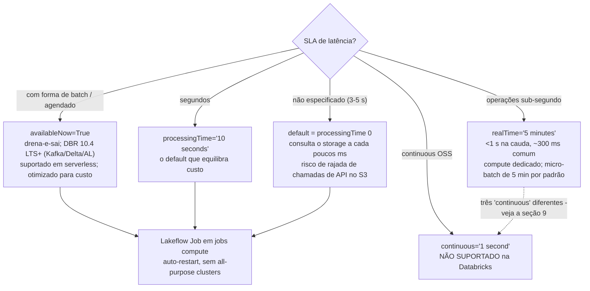
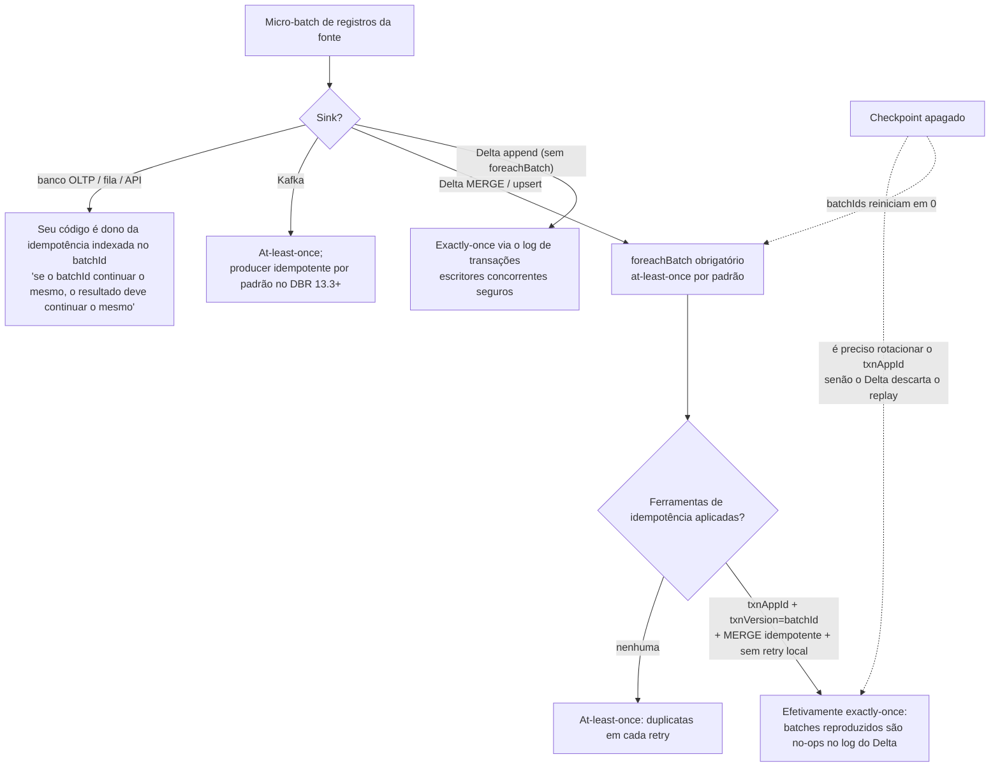
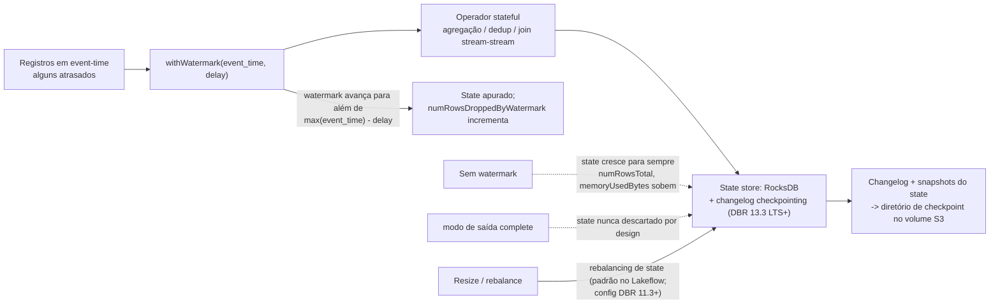

# Structured Streaming no Lakehouse da AWS: Triggers, Checkpoints, foreachBatch e Exactly-Once

Uma streaming query na Databricks é uma tabela não limitada e um plano em estilo batch que o motor re-executa sobre o próximo fatiamento de entrada. É por esse modelo que "converter jobs batch existentes em jobs streaming exige mudanças mínimas de código" (blog da Databricks, 2026-04-20) — e é também por isso que todo incidente de produção nesse espaço volta a quatro objetos: o **trigger**, que decide quando um micro-batch roda; o **checkpoint**, que lembra o que foi lido e o que teve commit; o **contrato do sink**, que decide se um batch reproduzido duplica linhas; e o **watermark**, que decide quando o state pode ser descartado. Acerte esses quatro e o lakehouse se preenche quase em tempo real; erre um e você reprocesse uma semana, duplica uma tabela silver ou vê o state crescer até o cluster morrer.

Esta lição é a metade de streaming do curso. A lição 05 ensinou como os dados *chegam* (Auto Loader, autenticação MSK, eventos de arquivo); esta lição ensina como eles *continuam chegando corretamente* — triggers e sua física de custo na AWS, higiene de checkpoint em volumes apoiados no S3, `foreachBatch` MERGE com `txnAppId`/`txnVersion`, fan-out de change data feed, state limitado por watermark, exactly-once de ponta a ponta e a postura de produção (Lakeflow Jobs, não all-purpose clusters) que a Databricks documenta hoje.

Todo fato abaixo vem da documentação de AWS da Databricks — os triggers (rodapé **2026-10-08**), checkpoints (**2026-09-11**), foreach, Delta streaming (ambos **2026-08-24**), CDF, Kafka (**2026-09-11**), api-options (**2026-10-05**), stream-monitoring (**2026-09-23**), watermarks (**2026-09-11**), stateful-streaming (**2026-10-09**), production, schema-evolution (**2026-08-05**) e as páginas de streaming/dashboards do Databricks SQL — mais blogs datados da Databricks — todos acessados ou datados em **outubro de 2026**. O escopo da plataforma é **Databricks on AWS**: Amazon MSK, S3, Kinesis e volumes do Unity Catalog são o substrato; Azure Event Hubs não existe aqui e está fora do escopo.

```text
 =============================================================
  STRUCTURED STREAMING NA DATABRICKS/AWS - FORMATO (out 2026)
 -------------------------------------------------------------
  Triggers (docs .../triggers, rodapé 2026-10-08)
    padrão ~3-5 s de latência; processingTime 0;
                       consulta o storage a cada poucos ms
                       (custo de API!)
    processingTime='10 seconds'   o default que equilibra custo
    availableNow=True  drena tudo o que está disponível e sai;
                       substitui o Trigger.Once descontinuado (11.3+);
                       único trigger suportado em serverless
                       (com o Once descontinuado); mínimos de DBR:
                       files 9.1 LTS, Delta/AL/Kafka 10.4 LTS,
                       Kinesis 13.1
    realTime='5 minutes'  modo sub-segundo; a string = tamanho do
                       micro-batch (default 5 min); <1 s na cauda,
                       ~300 ms comum, até 5 ms E2E
    continuous='1 second'  NÃO SUPORTADO (experimental no OSS);
                       use o modo real-time
  Checkpoint (um por query, S3 via volume do UC, sem lifecycle)
    offsets | commits | state | metadata
  Garantias
    Delta sink  -> exactly-once (log de transações)
    foreachBatch -> at-least-once; exactly-once via
                    txnAppId + txnVersion (= batchId)
    Kafka sink  -> at-least-once; producer idempotente DBR 13.3+
  State
    watermark limita o state; dropDuplicatesWithinWatermark
    (DBR 13.3 LTS+, exige watermark); RocksDB + changelog
    checkpointing DBR 13.3+ recomendado para TODAS as
    queries stateful; transformWithState DBR 16.2+
 =============================================================
```

Nesta lição você vai:

- configurar **todo trigger suportado** e defender a escolha diante das restrições de latência, custo e serverless — incluindo por que o trigger `continuous` da OSS está morto na Databricks e quais dos três recursos "continuous" que as pessoas confundem;
- dissecar um **checkpoint** (offsets, commits, state, metadata), colocá-lo em um caminho de volume do Unity Catalog no S3 e decorar a matriz de reinicialização — o que você pode alterar em uma query viva versus o que silenciosamente força um início do zero;
- escrever o **job de streaming principal**: Amazon MSK → parse → watermark + `dropDuplicatesWithinWatermark` → `foreachBatch` **MERGE** em uma tabela Delta silver com `txnAppId`/`txnVersion`, mais um caminho de dead-letter;
- transmitir o **change data feed** para o gold — `readChangeFeed=true`, semântica de `_change_type`, `startingVersion` e o replay em batch com `table_changes()` para backfill e auditoria;
- limitar a **agregação stateful** com watermarks: append vs update vs complete, o watermark obrigatório em outer joins, a política global de múltiplos watermarks com mínimo, e o modo de falha de inflação do state com seu remédio no RocksDB;
- observar uma stream como um operador: campos de progresso (`numInputRows`, `batchDuration`, `stateOperators`), a aba **Streaming** do Spark UI, `StreamingQueryListener` e `df.observe`;
- montar com honestidade a **pilha de dashboards quase em tempo real**: streaming tables do DBSQL em pipelines serverless, e por que um cache do Lakeview de até 24 horas não é "tempo real";
- estudar **três histórias nomeadas de streaming de clientes da AWS** (Burberry, Shell, Asurion), ler a **caixa de atualização de 2026** e praticar com **14 questões no estilo de exame** mais quatro verificações interativas.

---

## 1. O modelo micro-batch e o menu de triggers

O Structured Streaming planeja as suas transformações de DataFrame uma única vez e as executa de forma incremental. No motor **micro-batch** padrão, o driver pergunta repetidamente à fonte "o que é novo desde o último offset?", planeja um batch, roda no cluster, faz o commit do offset e da escrita no sink, e registra o progresso no checkpoint. O **modo real-time** é o caminho de execução separado e suportado de baixa latência da Databricks — não o experimento de processamento contínuo da OSS. Batch e streaming compartilham uma superfície de API; só o reader, o trigger e o checkpoint diferem. Essa é a lição de unificação que a lição 05 usou para rodar o mesmo código bronze como um job noturno e como uma stream de baixa latência.

### 1.1 A tabela de triggers verificada (docs, rodapé 2026-10-08)

| Trigger | Como definir | Comportamento documentado | Use quando |
|---|---|---|---|
| **Padrão não especificado** | omita `.trigger(...)` | "Streaming de uso geral com latência de **3–5 segundos**. Equivalente ao trigger processingTime com intervalos de **0 ms**." Verifica dados novos a cada poucos milissegundos — "pode gerar um grande volume de chamadas de API de storage por dia e resultar em cobranças inesperadas" | Somente prototipagem; nunca um default de produção que respeite orçamento |
| **Intervalo fixo** | `.trigger(processingTime='10 seconds')` | Um micro-batch por intervalo; latência limitada pelo intervalo | O default que equilibra custo para ETL quase em tempo real em compute clássico |
| **Available-now** | `.trigger(availableNow=True)` | "Processa a maior quantidade de dados disponível no momento em que o job de streaming é acionado", ao longo de quantos micro-batches os rate limits exigirem, e então sai. Substitui o `Trigger.Once`, **descontinuado no DBR 11.3 LTS+**. DBRs mínimos: fontes de arquivo **9.1 LTS**; Delta / Auto Loader / Kafka **10.4 LTS**; Kinesis **13.1** | Ingestão agendada quase em tempo real (jobs horários/diários); o **único** cenário de trigger em serverless além do `Once` descontinuado ("Em compute serverless, apenas `Trigger.AvailableNow()` e `Trigger.Once()` são suportados. A Databricks recomenda `Trigger.AvailableNow()`") |
| **Modo real-time** | `.trigger(realTime='5 minutes')` | "Cargas de trabalho operacionais de latência ultra-baixa que exigem processamento sub-segundo"; "'5 minutes' indica o tamanho de um micro-batch". Latência "tão baixa quanto **cinco milissegundos**" de ponta a ponta (página de conceitos, 2026-09-11); "abaixo de 1 segundo na cauda, e nos casos comuns ao redor de 300 ms" (triggers, 2026-10-08). Requer compute dedicado | Bloqueio de fraude, personalização em tempo real — os próprios exemplos da página |
| **Processamento contínuo** | `.trigger(continuous='1 second')` | "**Não suportado.** Este é um recurso experimental incluído no Spark OSS. Use o modo real-time." "A Databricks não suporta nem recomenda este modo." | Nunca, na Databricks |



### 1.2 Exemplo resolvido E1 — escolhendo um trigger, com a conta da AWS anexada

Cenário: uma landing zone no S3 solta arquivos em rajadas; a especificação do produto diz "quase em tempo real, minutos são aceitáveis". Três configurações candidatas, precificadas em dois eixos: **compute** (jobs cluster) e **custo de requisição do S3** (o multiplicador oculto do trigger padrão).

```python
# E1 - three ways to run the same bronze Auto Loader query
# (checkpoint and schema paths on UC volumes; S3-backed, no lifecycle policy)

# A. Default trigger - fastest to write, most expensive to operate
(brz.writeStream.format("delta")
   .option("checkpointLocation", "/Volumes/lake/ops/ckpt/orders_bronze")
   .toTable("lake.bronze.orders"))          # implicit processingTime = 0

# B. Fixed interval - the cost-balancing production default
(brz.writeStream.format("delta")
   .option("checkpointLocation", "/Volumes/lake/ops/ckpt/orders_bronze")
   .trigger(processingTime="10 seconds")
   .toTable("lake.bronze.orders"))

# C. Available-now as a scheduled job - cheapest shape for hourly arrival
(brz.writeStream.format("delta")
   .option("checkpointLocation", "/Volumes/lake/ops/ckpt/orders_bronze")
   .trigger(availableNow=True)              # DBR 10.4 LTS+; serverless-recommended
   .toTable("lake.bronze.orders"))
```

Esboço de compute (nosso, sobre a semântica documentada): a execução horária de `availableNow` drena em **20 minutos** em um jobs cluster de 4 nós — **12 DBU/h × 0,33 h = 4 DBU/execução**; a **Jobs Compute $0,15/DBU** (tabela de preços Premium da AWS em out de 2026, mesma base documental da E7 da lição 05 — sempre reconfira `system.billing.list_prices` na sua conta) dá **$0,60/execução → $14,40/mês**. Uma stream com `processingTime='10 seconds'` no mesmo cluster roda continuamente: 720 h/mês × 12 DBU = **8.640 DBU ≈ $1.296/mês**, com ou sem dados chegando. O trigger padrão (verifica "a cada poucos milissegundos") multiplica o volume de API `LIST`/`GET` do S3 contra a mesma taxa de $0,005 por 1.000 `LIST` calculada na lição 05 — em um prefixo de 2 milhões de arquivos, o modo de listagem de diretório com triggers de segundo custa **$2.592–$25.920/mês** só em `LIST`, contra **$28,80** com um `availableNow` de 15 minutos. O trigger é uma decisão de custo, não uma preferência de latência.

- **📚 Você sabia?** O `Trigger.Once` está descontinuado desde o **DBR 11.3 LTS** — "Use `Trigger.AvailableNow` para todas as cargas de trabalho de processamento incremental em batch" (triggers, 2026-10-08) — mas o `Once` ainda aparece na frase de suporte a serverless porque notebooks antigos ainda o chamam. O `AvailableNow` é o upgrade estrito: a mesma semântica de drenar-e-sair, mais **rate limiting** entre micro-batches (`maxFilesPerTrigger`, `maxOffsetsPerTrigger`), algo que o `Once` não tinha. Qualquer tutorial que ensine o `Once` como atual está ensinando uma API de 2022.

---

## 2. Checkpoints: a memória da query, no S3

### 2.1 Anatomia

"Um diretório de checkpoint contém **Offsets**, **Commits**, **State** e **Metadata**" (checkpoints, 2026-09-11):

| Entrada | O que guarda | Por que importa |
|---|---|---|
| **Offsets** | Offsets da fonte processados em cada micro-batch | Ponto de retomada após falha; o limite do replay |
| **Commits** | Quais micro-batches fizeram commit no sink | A razão exactly-once — um batch só está "concluído" quando tanto o commit do sink quanto a entrada no commit-log se materializam |
| **State** | Metadados do operador stateful, schema do state, conteúdo do state store | Janelas de watermark, chaves de dedup, state de agregação; com backing de RocksDB nos DBRs modernos |
| **Metadata** | ID único da query e configuração | Identidade da query para a UI e para as checagens de reinício |

Na AWS o checkpoint vive em storage durável — o exemplo documentado grava `checkpointLocation` sob um caminho de **volume do Unity Catalog** (`/Volumes/catalog/schema/volume/path`), que aterrissa no S3 através da sua storage credential. "Dê a cada query o seu próprio diretório de checkpoint em cloud storage durável" (página de production). Nunca DBFS local `/tmp`, nunca o prefixo de chegada, nunca um caminho com política de lifecycle.

```mermaid
sequenceDiagram
  participant LB as Lakeflow Job (auto-restart)
  participant Q as Streaming query
  participant CP as Checkpoint no S3 (/Volumes/.../ckpt)
  participant S as Fonte (MSK / arquivos S3 / Delta CDF)
  participant D as Delta sink (silver)
  LB->>Q: start(query config)
  Q->>CP: lê offsets + state + metadata
  Q->>S: busca registros após o último offset
  Note over Q: planeja micro-batch N (determinístico)
  Q->>D: grava batch N (append ou foreachBatch MERGE)
  D-->>Q: commit (Delta txn N)
  Q->>CP: grava entrada de commit N + novos offsets (+ changelog do state)
  Note over Q,D: falha DEPOIS do commit no sink, ANTES de gravar o commit-log?<br/>o reinício reproduz o batch N; txnAppId/txnVersion do Delta tornam isso um no-op
  Note over Q,D: falha ANTES do commit no sink?<br/>o reinício reproduz o batch N; o MERGE roda de novo (idempotente por chave)
  Q-->>LB: query terminada / crash
  LB->>Q: auto-restart com backoff (mesmo checkpoint)
  Note over CP: apagar ou expirar este diretório por lifecycle<br/>= query começa do ZERO (reprocesso completo, state reconstruído)
```

### 2.2 A matriz de reinicialização

Nem toda mudança de código é segura para reiniciar em um checkpoint existente. As regras da página de checkpoints, comprimidas:

| Mudança entre reinicializações | Permitido? |
|---|---|
| Filtros, projeções, mudanças de intervalo do trigger, rate limits (`maxFilesPerTrigger`, `maxOffsetsPerTrigger`) | Geralmente seguro |
| Adicionar/remover/reordenar **fontes**, mudar quantidade ou tipo de fonte | **Não** — novo checkpoint exigido (DBR **18.2+** permite evolução de fontes nomeadas via `.name()` + `spark.sql.streaming.queryEvolution.enableSourceEvolution`, irreversível por checkpoint) |
| Mudar o **state schema** (outras chaves de agregação, outro tipo de coluna de watermark) | **Não** — novo checkpoint |
| Mudar o **tipo de sink** (ex.: sink Kafka → sink de arquivo não é permitido; arquivo → Kafka é) | Depende da matriz; muitas trocas de sink são de sentido único |
| Mudar o **backend do state store** (HDFS ↔ RocksDB) | **Não** — não pode ser trocado entre reinicializações |
| Mudar a contagem de shuffle partitions em uma query stateful | **Não** em DBRs antigos (congelada na criação do checkpoint); **DBR 18 LTS+** pode reparticionar via repartitioning de state sob demanda sem novo checkpoint |
| Mudar o **access mode** do compute com `dropDuplicates`/`dropDuplicatesWithinWatermark` presentes | Pode falhar em uma **checagem de compatibilidade de state schema** — fixe o access mode enquanto a query viver |

> [!WARNING]
> **⚠️ Apagar um checkpoint é uma porta de mão única — e a inflação do state é a versão em câmera lenta do mesmo desastre.** "Quando você apaga os arquivos de um diretório de checkpoint ou muda para um novo local de checkpoint, a próxima execução da query começa do zero" (doc de checkpoints): o Kafka reproduz conforme `startingOffsets` (default **latest** — o backlog que você acumulou pode ser pulado), o Auto Loader re lista o prefixo, o watermark reseta e toda chave de dedup/agregação é reconstruída do zero. Pior: se a query grava Delta com marcadores de idempotência, um checkpoint novo reinicia os batch IDs em **0** — e o Delta vai **descartar silenciosamente** os batches reproduzidos, a menos que você também mude o `txnAppId` (docs .../structured-streaming/delta-lake, 2026-08-24). A falha oposta é a inflação do state: sem watermark em um dedup ou agregação, `stateOperators.numRowsTotal` e `memoryUsedBytes` sobem para sempre até o executor morrer — e no modo de saída `complete` "o state de agregação não é descartado" por design. Checkpoints também nunca podem ficar sob uma política de lifecycle de objeto de nuvem: a página de produção do Auto Loader é direta — se regras de lifecycle limparam o checkpoint, "o state da stream fica corrompido", e você recomeça do zero. Trate `/_checkpoints` (o sublinhado sobrevive ao `VACUUM`) e caminhos de volume da UC como dados de produção, com dono, política de acesso e uma declaração IAM de não-delete.

---

## 3. Fontes na AWS: Kafka/MSK a fundo, Delta CDF de dentro

A lição 05 cobriu o Auto Loader de ponta a ponta; esta seção acrescenta o que um *operador* de streaming precisa: controles de taxa do Kafka, a tabela Delta como fonte e o CDF como caminho de mudança recomendado.

### 3.1 Kafka / Amazon MSK: as quatro opções que decidem a sua semana

A leitura mínima é `spark.readStream.format("kafka")` com `kafka.bootstrap.servers` e `subscribe` — e então as opções que importam (api-options, 2026-10-05; doc do Kafka, 2026-09-11):

| Opção | Default | Comportamento |
|---|---|---|
| `startingOffsets` | **`latest`** (streaming) / `earliest` (batch) | Aplica-se **apenas a uma query nova**; "Queries retomadas sempre usam o checkpoint." Uma armadilha de perda silenciosa de backlog na primeira execução |
| `maxOffsetsPerTrigger` | nenhum | Máximo de registros por micro-batch, "distribuídos proporcionalmente entre as partições do tópico" — o limitador de taxa de recuperação |
| `minOffsetsPerTrigger` + `maxTriggerDelay` | nenhum / **`15m`** | Acumula tráfego pequeno; quando `maxTriggerDelay` é atingido, o micro-batch roda de qualquer jeito |
| `failOnDataLoss` | **`true`** | Falha em tópicos deletados ou offsets truncados em vez de pular silenciosamente; "a Databricks estima de forma conservadora… isso pode causar falsos alarmes" |

O reader devolve `key` e `value` como **binário** — sempre `cast`/`from_json`/`from_avro` explicitamente. Autenticação na AWS, na ordem recomendada pela Databricks: **service credentials do Unity Catalog** (`databricks.serviceCredential`, **DBR 16.1+**, preferido para clusters compartilhados e serverless — *não* configure `sasl.*` você mesmo), depois **MSK IAM** por instance profile (`AWS_MSK_IAM` + classes shaded `shadedmskiam.*`, `SASL_SSL`, porta **9098**), depois JAAS baseado em role (`awsRoleArn=`), depois SASL/PLAIN/SCRAM, depois mTLS com material em um volume da UC e senhas em um secret scope. Os security groups do MSK precisam permitir o SG do compute da Databricks na **9092** (PLAINTEXT) / **9094** (SASL/SSL) / **9098** (IAM); VPC peering ou PrivateLink conecta as duas VPCs.

### 3.2 Exemplo resolvido E2 — MSK → Delta bronze, com limitação de taxa e deduplicação

```python
# E2 - Amazon MSK (IAM via UC service credential) -> Delta bronze
# DBR 15.4 LTS jobs cluster; checkpoint on a UC volume (S3-backed)

from pyspark.sql.functions import from_json, col, expr
from pyspark.sql.types import StructType, StructField, StringType, DoubleType, TimestampType

schema = StructType([
    StructField("event_id", StringType()),
    StructField("order_ts", TimestampType()),
    StructField("customer_id", StringType()),
    StructField("amount", DoubleType()),
])

raw = (spark.readStream.format("kafka")
       .option("kafka.bootstrap.servers", "b-1.msk.acme.amazonaws.com:9098")
       .option("subscribe", "orders")
       .option("databricks.serviceCredential", "msk-orders-cred")   # DBR 16.1+; no sasl.* below
       .option("startingOffsets", "earliest")   # FIRST run only; checkpoint wins after
       .option("maxOffsetsPerTrigger", 500_000) # ~16,600 msg/s at a 30 s interval
       .option("failOnDataLoss", "true")
       .load())

parsed = (raw.select(col("value").cast("string").alias("json"), col("timestamp").alias("ingest_ts"))
          .select(from_json(col("json"), schema).alias("e"), col("ingest_ts"))
          .select("e.*", "ingest_ts"))

deduped = (parsed
           .withWatermark("order_ts", "1 hour")                       # lateness bound
           .dropDuplicatesWithinWatermark(["event_id"]))              # DBR 13.3 LTS+

(deduped.writeStream.format("delta")
   .option("checkpointLocation", "/Volumes/lake/ops/ckpt/orders_bronze")
   .trigger(processingTime="30 seconds")
   .toTable("lake.bronze.orders"))
```

Duas armadilhas documentadas vivem naquelas vinte linhas. `startingOffsets=latest` é o default de streaming — em um checkpoint totalmente novo, a query pula silenciosamente tudo o que já está no tópico; defina `earliest` na primeira execução e depois confie no checkpoint para sempre. E no **DBR 17.1+** os offsets mais recentes do Kafka são buscados *depois* que cada micro-batch termina, então as métricas de backlog (`avgOffsetsBehindLatest` etc.) "podem mostrar valores pequenos e persistentes, diferentes de zero. Este é o comportamento esperado" — não acorde ninguém às 03:00 por um "lag" de 12 offsets.

### 3.3 Delta como fonte, e CDF como caminho de mudança recomendado

"O Structured Streaming aceita apenas entradas em **append** e lança uma exceção se quaisquer modificações ocorrerem na tabela Delta Lake de origem" (docs .../structured-streaming/delta-lake, 2026-08-24) — razão pela qual "a Databricks recomenda fazer streaming a partir do feed CDC de uma tabela Delta Lake em vez de diretamente da tabela sempre que possível". O change data feed automático "usa as mesmas APIs `table_changes()` e `readChangeFeed` do change data feed legado e funciona com queries batch, Structured Streaming…" (página do CDF). Habilite-o **na criação da tabela** (`delta.enableChangeDataFeed=true`) — nada é capturado antes desse momento. A seção 5 constrói o fan-out completo.

- **📚 Você sabia?** O projeto "Spark Streaming" da era das DStreams "é agora um projeto legado e novas aplicações de streaming devem usar Structured Streaming" (blog da Databricks, 2026-04-20). Se o seu currículo ou runbook ainda diz "Spark Streaming" ou `Dstream`, você está anunciando uma tecnologia que o próprio criador aposentou. O blog de Structured Streaming da mesma data observa que a API "tornou-se production-ready no Spark 2.2" — o modelo que você está aprendendo aqui é o padrão há quase uma década.

---

## 4. foreachBatch e a história do exactly-once

### 4.1 O contrato

"**Você deve usar `foreachBatch` para operações de merge do Delta Lake no Structured Streaming**" — MERGE é uma operação de batch, então um upsert a partir de uma stream só pode acontecer dentro do callback do micro-batch (docs .../structured-streaming/foreach, 2026-08-24). A mesma página fixa a garantia: "`foreachBatch()` fornece apenas garantias de escrita **at-least-once**. No entanto, você pode usar o `batchId` fornecido à função como forma de deduplicar a saída e obter uma garantia exactly-once." No **DBR 14.0+** o caminho Delta exige a API explícita de idempotência: "**Você deve usar as opções de escrita `txnAppId` e `txnVersion`, vinculando `txnVersion` a `batchId`**" — e "Não capture e repita exceções localmente"; deixe os erros se propagarem para que o orquestrador repita o micro-batch inteiro de forma limpa. Para destinos personalizados/externos (banco OLTP, fila, API HTTP): "Implemente a sua própria idempotência" — se o `batchId` for o mesmo, o seu efeito colateral precisa ser o mesmo.

Três corolários que os docs declaram e que engenheiros juniores violam constantemente:

1. **Checkpoint novo ⇒ `txnAppId` novo.** "Se você apagar o checkpoint de streaming e reiniciar a query com um checkpoint novo, precisa fornecer um `txnAppId` diferente." Checkpoints novos começam no batch ID 0; com o appId antigo, o Delta trata o replay como duplicata e o descarta.
2. **Uma escrita de streaming por sink.** "A Databricks recomenda configurar uma escrita de streaming separada para cada sink que você deseja atualizar, em vez de usar `foreachBatch`. Escritas em múltiplos sinks dentro de foreachBatch reduzem o paralelismo e aumentam a latência geral, porque as escritas em múltiplas tabelas são serializadas."
3. **MERGE idempotente.** "Verifique que a sua declaração `merge` dentro de `foreachBatch` é **idempotente**. Caso contrário, reinicializações da query de streaming podem aplicar a operação no mesmo batch de dados mais de uma vez." Estreite a cláusula `ON` para as chaves do batch.

### 4.2 Exemplo resolvido E3 — o job principal: MSK → MERGE em silver com caminho de dead-letter

```python
# E3 - foreachBatch MERGE into Delta silver, idempotent, with DLQ
# At-least-once callback + txnAppId/txnVersion = effectively exactly-once

from delta.tables import DeltaTable

APP_ID = "orders-silver-msk"   # change IFF you intentionally start a NEW checkpoint

def upsert_to_silver(batch_df, batch_id):
    if batch_df.isEmpty():
        return
    # batch_df is consumed twice (valid + rejects): persist, or you re-read the source
    batch_df.persist()

    valid = batch_df.filter("order_id IS NOT NULL AND amount >= 0")
    rejects = batch_df.filter("order_id IS NULL OR amount < 0")

    (DeltaTable.forName(spark, "lake.silver_orders")
       .merge(valid.alias("s"), "s.order_id = t.order_id")     # pruned ON clause
       .whenMatchedUpdateAll(condition="s.order_ts > t.order_ts")
       .whenNotMatchedInsertAll()
       .execute())                                             # must be idempotent

    (rejects.write.format("delta").mode("append")
       .option("txnAppId", f"{APP_ID}-dlq").option("txnVersion", batch_id)
       .saveAsTable("lake.quarantine.orders_rejects"))

    # if you also plain-append rows from foreachBatch, stamp them:
    # valid.write.format("delta").mode("append") \
    #   .option("txnAppId", APP_ID).option("txnVersion", batch_id)...

    batch_df.unpersist()   # never catch/retry inside this function - let the job retry the batch

(deduped.writeStream.format("delta")
   .option("checkpointLocation", "/Volumes/lake/ops/ckpt/orders_silver")
   .outputMode("update")            # accepted by foreachBatch; the table itself gets append/complete
   .foreachBatch(upsert_to_silver)
   .trigger(processingTime="30 seconds")
   .start())
```

### 4.3 A árvore de decisão do exactly-once



---

## 5. Change data feed de saída: o fan-out para o gold

### 5.1 O padrão

Crie a tabela silver com CDF habilitado; todo consumidor downstream que precisa de *mudanças* faz streaming do feed CDC em vez de reler a tabela. Cada registro do CDF carrega `_change_type` ∈ `insert` / `update_preimage` / `update_postimage` / `delete`. O replay em batch usa `table_changes('tbl', v1, v2)` para backfill e auditoria — a mesma mecânica que o próprio blog do CDF da Databricks (2021-06-09) usou para construir o padrão de CDC medalhão.

### 5.2 Exemplo resolvido E4 — stream de CDF para o gold mais um replay em batch

```python
# E4a - silver created with CDF enabled (forward-looking only)
spark.sql("""
  CREATE TABLE lake.silver_orders (
    order_id STRING, order_ts TIMESTAMP, customer_id STRING,
    amount DOUBLE, updated_at TIMESTAMP
  ) USING DELTA
  TBLPROPERTIES (delta.enableChangeDataFeed = true)
""")

# E4b - gold consumer streams the change feed (serverless-friendly: availableNow)
changes = (spark.readStream.format("delta")
           .option("readChangeFeed", "true")
           .option("startingVersion", 70)      # skip history you already backfilled
           .table("lake.silver_orders"))

(gold_df.writeStream.format("delta")
   .option("checkpointLocation", "/Volumes/lake/ops/ckpt/orders_gold")
   .trigger(availableNow=True)                 # deterministic nightly replay
   .toTable("lake.gold.orders_daily"))
```

```python
# E4c - batch replay / audit via table_changes (mirrors the docs' recovery example)
replay = spark.read.format("delta")
  .option("readChangeFeed", "true")
  .option("startingVersion", 70)
  .option("endingVersion", 75)
  .table("lake.silver_orders")
# or the SQL form: SELECT * FROM table_changes('silver_orders', 70, 75)
```

"Você deve usar Structured Streaming para que a Databricks rastreie automaticamente as versões do change data feed da sua tabela" — o rastreamento de versões é um comportamento de consumidor de streaming, razão pela qual parear CDF com `availableNow` em um agendamento é o padrão documentado de replay determinístico. Os Lakeflow pipelines acrescentam **AUTO CDC** (o Applier) para DB→Delta e Delta→Delta sem MERGE escrito à mão — coberto na lição 07; esta seção é a versão em notebook puro que você agora entende por dentro.

---

## 6. Watermarks, state e o modo de falha por inflação

### 6.1 Para que serve um watermark

"Watermarks removem automaticamente dados state antigos para prevenir erros de memória e aumento da latência de processamento" (watermarks, 2026-09-11). Você afirma um atraso máximo — `withWatermark("event_time", "10 minutes")` — e o motor avança um watermark global para além de `max(event_time) − delay`. "Queries sempre processam registros que chegam dentro do limite. Queries ainda podem processar registros que chegam fora do limite, mas isso não é garantido." O modo de saída muda o que você vê:

| Modo de saída | Emissões | State | Sink Delta? |
|---|---|---|---|
| **append** (padrão) | Somente linhas finalizadas, depois que o watermark passa | Limitado pelo watermark | Suportado |
| **update** | Linhas alteradas em cada trigger | Apurado pelo watermark quando ele avança | **Não suportado pelo Delta** — use MERGE em `foreachBatch` |
| **complete** | Cada linha que o operador já produziu | "O state de agregação não é descartado" — ilimitado por design | Suportado, mas "pode ter desempenho ruim conforme os dados crescem" |

Joins stream-stream "suportam apenas o modo append"; "Para outer joins, o watermark é obrigatório"; para inner joins é fortemente recomendado. Com múltiplos watermarks "o Structured Streaming usa o mínimo como watermark global" por padrão; `spark.sql.streaming.multipleWatermarkPolicy=max` reduz a latência, mas "descarta dados das streams mais lentas… aplique com cautela." Durações de janela vão "de microssegundos até dias. Durações de mês ou mais não são suportadas."



### 6.2 Exemplo resolvido E5 — agregação com janelas e a matemática do state visível

```python
# E5 - 5-minute tumbling windows per ad, append mode, watermark 10 minutes
clicks = spark.readStream.format("kafka") \
  .option("kafka.bootstrap.servers", "...").option("subscribe", "clicks") \
  .option("maxOffsetsPerTrigger", 200_000).load()

parsed = clicks.select(from_json(col("value").cast("string"), click_schema).alias("e")).select("e.*")

windowed = (parsed
  .withWatermark("event_time", "10 minutes")
  .groupBy(window(col("event_time"), "5 minutes"), col("ad_id"))
  .count())

query = (windowed.writeStream.format("delta")
  .outputMode("append")                                   # finalized windows only
  .option("checkpointLocation", "/Volumes/lake/ops/ckpt/clicks_5m")
  .trigger(processingTime="1 minute")
  .toTable("lake.silver.clicks_5m"))

# Inspect the state after a few batches:
# query.lastProgress["stateOperators"][0]["numRowsTotal"]
# query.lastProgress["stateOperators"][0]["numRowsDroppedByWatermark"]
# query.lastProgress["eventTime"]["watermark"]
```

Lógica de dimensionamento (nossa, sobre a semântica documentada): chaves vivas ≈ anúncios × janelas dentro do watermark = 5.000 anúncios × 3 janelas (watermark de 10 min ÷ janela de 5 min) ≈ **15.000 linhas de state** — trivial. Remova o watermark e o state retém todo `(window, ad_id)` para sempre; acrescente o modo `complete` e cada linha histórica é reemitida a cada trigger. A variante de dedup importa tanto: `dropDuplicates(["event_id"])` puro mantém state para **toda chave para sempre**; `dropDuplicatesWithinWatermark(["event_id"])` (DBR **13.3 LTS+**, **exige um watermark**) mantém apenas as chaves dentro da janela de atraso — "o default correto para ingestão de eventos idempotente quando duplicatas chegam próximas em event time."

### 6.3 Exemplo resolvido E6 — defaults de state de produção e state personalizado

Para todas as queries stateful nos DBRs atuais, a postura documentada da Databricks é: **state store RocksDB + changelog checkpointing** (DBR 13.3 LTS+) — "a Databricks recomenda habilitar changelog checkpointing para todas as queries stateful do Structured Streaming"; async state checkpointing e async progress tracking na página de production; **sem autoscaling** para clusters de job de Structured Streaming puro ("Compute auto-scaling tem limitações para escalar para baixo"); e rebalancing de state em resize (ativado por padrão nos Lakeflow pipelines; config `spark.sql.streaming.statefulOperator.stateRebalancing.enabled` desde o DBR 11.3+). State personalizado por chave além de agregação/dedup/joins: `transformWithState` (**DBR 16.2+**) substitui o legado `mapGroupsWithState`/`flatMapGroupsWithState` em código novo. A contagem de shuffle partitions fica congelada na criação do checkpoint para operadores stateful (repartitioning sob demanda chega no **DBR 18 LTS+**) — uma armadilha silenciosa quando alguém "só aumenta o paralelismo" em uma query existente.

- **📚 Você sabia?** O `VACUUM` "pula quaisquer diretórios que começam com `_`", razão pela qual os docs de Delta streaming sugerem armazenar checkpoints "usando uma estrutura de diretórios como `/_checkpoints`". Uma convenção de nomes de um caractere é a diferença entre um comando de manutenção de rotina e um state de streaming apagado — pareie-a com um caminho de volume da UC e uma política IAM que proíba `s3:DeleteObject` no prefixo do checkpoint, e a exclusão de checkpoint deixa de ser uma possibilidade às 3 da manhã.

---

## 7. Schema evolution em streams: planos travados, sinks aditivos

"O schema de uma streaming query é **travado durante a fase de planejamento**… Se o schema da fonte mudar no meio da execução, a query falha, e o usuário precisa reiniciar a streaming query" (schema-evolution, 2026-08-05) — razão pela qual streams de produção precisam rodar sob um job com auto-restart. No lado do sink, o Delta aceita apenas mudança aditiva: `.option("mergeSchema", "true")` na escrita de streaming "suporta apenas a adição de novas colunas". Prefira a opção por escrita (ou `WITH SCHEMA EVOLUTION` no SQL) em vez do `spark.databricks.delta.schema.autoMerge.enabled` de sessão, que é legado. No lado da fonte: novas colunas fluem com `mergeSchema`; renomes e drops exigem `spark.databricks.delta.streaming.allowSourceColumnRename` / `…allowSourceColumnDrop`; alargamento de tipo é **DBR 16.4 LTS+**; "Outras mudanças de tipo: não suportadas." E o fato nuclear — "Atualizar o schema de uma tabela encerra quaisquer streams que leem daquela tabela" (update-schema, 2026-08-19). O próprio loop de evolução do Auto Loader (falhar com `UnknownFieldException` e depois reiniciar, `schemaEvolutionMode=addNewColumns` / `rescue`) era a série E da lição 05; a história da fonte Delta aqui é a mesma disciplina impulsionada por reinicialização em uma camada diferente.

---

## 8. Observabilidade e o dashboard quase em tempo real

### 8.1 Três camadas de monitoramento de stream (stream-monitoring, 2026-09-23)

1. **Progresso da query** — o `StreamingQuery` retornado pelo notebook, a aba **Streaming** do Spark UI (`.queryName()` para desambiguar) e o JSON de progresso. Campos-chave: `numInputRows`, `inputRowsPerSecond`, `processedRowsPerSecond`, `batchId`, `batchDuration`, a decomposição de `durationMs` (`getBatch`, `addBatch`, `commitOffsets`, `walCommit`), `eventTime.watermark` e `stateOperators` (`numRowsTotal`, `memoryUsedBytes`, `numRowsDroppedByWatermark`, `customMetrics` do RocksDB). Métricas da fonte incluem `numBytesOutstanding` / `numFilesOutstanding` do Delta/Auto Loader; `reservoirId` mapeia para o `id` do `DESCRIBE DETAIL <tabela>`.
2. **`StreamingQueryListener`** (Python e Scala, **DBR 11.3 LTS+**; floors de access mode da UC **15.1+** dedicado, **16.1+** Scala padrão) — envie para Prometheus/Grafana/Kafka. Mantenha os callbacks minúsculos: "A latência de processamento com listeners pode afetar significativamente as velocidades de processamento da query."
3. **`df.observe(name, agg…)`** — agregações arbitrárias por época emitidas em `observedMetrics` (ex.: uma proporção de linhas malformadas que dispara antes de o frescor do downstream falhar).

### 8.2 Dashboards: baseados em pull, com cache, honestos

Os dashboards do DBSQL/Lakeview são **baseados em pull**: os datasets rodam em um SQL warehouse e os resultados caem em um cache que "pode retornar resultados com até 24 horas de idade, mesmo quando os dados subjacentes mudaram" — apenas um agendamento explícito (ou um cache miss) o atualiza, e "Servir resultados do cache do dashboard não inicia o SQL warehouse" (dashboards caching, 2026-07-16). O formato quase em tempo real suportado na AWS é, portanto: a stream grava Delta em segundos; uma **streaming table independente** no Databricks SQL (`CREATE OR REFRESH STREAMING TABLE … SCHEDULE EVERY …` / `TRIGGER ON UPDATE AT MOST EVERY INTERVAL 5 MINUTES`, intervalo mínimo de `TRIGGER ON UPDATE` de **1 minuto**, rodando em um pipeline serverless criado automaticamente) mantém a tabela fresca; o dashboard consulta essa tabela no seu próprio cron. Um *push* de dashboard com menos de um minuto não é um recurso documentado do DBSQL — não prometa isso em uma revisão de design.

```sql
-- Worked example E7 - SQL-native streaming table feeding a scheduled dashboard
CREATE OR REFRESH STREAMING TABLE orders_5m
TRIGGER ON UPDATE AT MOST EVERY INTERVAL 5 MINUTES AS
SELECT window(event_time, '5 minutes') AS w, count(*) AS orders, sum(amount) AS revenue
FROM STREAM(main.bronze.orders)
GROUP BY window(event_time, '5 minutes');
```

---

## 9. Postura de produção: Lakeflow Jobs e os três "continuous"

A página de produção da Databricks é incomumente direta: "Execute cargas de trabalho de Structured Streaming de produção como Lakeflow Jobs agendados na Databricks"; "Não execute cargas de trabalho de Structured Streaming usando compute de uso geral"; "Agende Lakeflow Jobs usando o modo Continuous. Isso se refere ao recurso de agendamento de jobs da Databricks, não ao intervalo de trigger do Structured Streaming"; "Não habilite autoscaling de compute para jobs de Structured Streaming" (compensado por state em RocksDB, async state checkpointing e async progress tracking). E a recomendação de plataforma: "A Databricks recomenda usar Lakeflow pipelines para novos pipelines de Structured Streaming."

A armadilha de nomenclatura que derruba revisões de arquitetura — três coisas diferentes chamadas "continuous":

| Nome | O que realmente é | Status (out de 2026) |
|---|---|---|
| `Trigger.Continuous` da OSS | Trigger de processamento contínuo do Spark | "**Não suportado**… experimental… Use o modo real-time" |
| **Modo contínuo** dos Lakeflow pipelines | Refresh contínuo gerenciado da Databricks de pipelines declarativos | Suportado; o caminho *streaming* contínuo recomendado (lição 07) |
| Agendamento **continuous** do Jobs | Um modo de agendamento do Workflows que evita execuções concorrentes e reinicia a tarefa automaticamente | Sem relação com qualquer trigger; o *veículo de execução* recomendado pela página de production para streams |

Mais duas incompatibilidades das mesmas páginas: o async progress tracking "não é compatível com os triggers `AvailableNow` ou `Once`" — você não pode combinar o trigger otimizado para custo com aquela otimização de latência; e "Se você tentar recuperar de uma falha de query com um batch incremental, uma mudança de intervalo de trigger não resolve o problema" — um micro-batch travado e falho ainda precisa completar; aumente a escala ou inicie um checkpoint novo.

---

## 10. As armadilhas: catorze confusões que esta lição não vai deixar você manter

1. **Trigger padrão como default de produção.** Latência de 3–5 s com checagens de storage a cada poucos milissegundos — o cenário documentado de "cobranças inesperadas". Defina um trigger explícito; prefira `availableNow` para ingestão agendada.
2. **Apagar um checkpoint para "consertar lag".** Início do zero, replay completo, watermark resetado — e o Delta descarta o replay silenciosamente, a menos que o `txnAppId` rotacione.
3. **Compartilhar um checkpoint entre queries.** Explicitamente proibido: "Cada query deve ter um local de checkpoint diferente."
4. **Mesmo `txnAppId` depois de um checkpoint novo.** Os batch IDs reiniciam em 0; o Delta ignora as escritas. Documente o appId por stream; rotacione-o deliberadamente.
5. **Capturar exceções dentro de `foreachBatch`.** Quebra a contabilidade de at-least-once; deixe o orquestrador repetir o batch inteiro.
6. **Fan-out dentro de `foreachBatch`.** Múltiplos sinks serializam; prefira uma escrita de streaming por sink.
7. **Falta de `persist()` em `foreachBatch`.** Leia o DataFrame do micro-batch duas vezes sem ele e você relê a fonte.
8. **`dropDuplicates` sem limite.** State para toda chave para sempre; use `dropDuplicatesWithinWatermark` (DBR 13.3 LTS+) com um watermark.
9. **Modo `complete` em uma agregação que cresce.** O state nunca é descartado por design; "pode ter desempenho ruim conforme os dados crescem."
10. **Primeira execução do Kafka com `startingOffsets` default.** `latest` pula o backlog silenciosamente; defina `earliest` uma vez e depois confie no checkpoint.
11. **Tratar métricas pequenas de backlog do Kafka (DBR 17.1+) como incidente.** `*OffsetsBehindLatest` persistentemente diferente de zero é esperado por design.
12. **Os três "continuous".** Trigger OSS não suportado ≠ modo contínuo do Lakeflow ≠ agendamento continuous do Jobs.
13. **Serverless + trigger que não é `availableNow`.** Só `AvailableNow`/`Once` sobem em serverless — planeje o compute por trigger.
14. **"O dashboard é em tempo real porque a stream é."** O cache tem até 24 horas de staleness; é o agendamento — ou uma streaming table do DBSQL por baixo — que o mantém fresco.

> **Veredito Comparativo — notebooks de Structured Streaming puros vs Lakeflow Declarative Pipelines (em out de 2026)**
> - **Notebooks `writeStream` puros (o código desta lição) — a opção transparente.** Controle total sobre triggers, checkpoints, `foreachBatch` MERGE, disciplina de `txnAppId` e rate limits; a ferramenta de ensino certa e a escolha certa para jobs pontuais, sinks sob medida (upserts em OLTP, filas, APIs) e personalização máxima. A Databricks ainda os suporta totalmente — *quando* rodam como "Lakeflow Jobs agendados na Databricks" com auto-restart, em jobs compute, sem autoscaling. O custo desse controle é seu: você é dono do posicionamento do checkpoint, da configuração do state store (RocksDB + changelog), da ligação de reinício em mudança de schema e de cada linha de código de idempotência.
> - **Lakeflow Declarative Pipelines (antigo Delta Live Tables; lição 07) — o caminho de produção recomendado.** "A Databricks recomenda usar Lakeflow pipelines para novos pipelines de Structured Streaming" (página de production). Você declara fontes, sinks e expectations; a Databricks gerencia checkpoints e state, roda o modo contínuo para streaming verdadeiramente contínuo (incluindo serverless), aplica **AUTO CDC** em vez de MERGE escrito à mão, rebalanceia state por padrão em resize e oferece autoscaling aprimorado que jobs de streaming puros não devem usar. A troca: controle menos granular do loop micro-batch, um modelo de desenvolvimento em pipeline (não notebook) e mais um conceito para governar.
> - **A ingestão com Auto Loader (lição 05) divide do mesmo jeito:** "Lakeflow Spark Declarative Pipelines é a forma recomendada de rodar Auto Loader para a maioria das ingestões de produção… Se a sua carga de trabalho não tem requisitos de baixa latência e a sua prioridade é minimizar o custo de compute, você pode em vez disso agendar o Auto Loader como um job batch acionado que usa `Trigger.AvailableNow`."
> - **Veredito em uma frase:** *novos pipelines de streaming → Lakeflow; sinks sob medida, laboratórios de ensino e jobs batch `availableNow` ajustados com precisão de custo → Structured Streaming puro em Lakeflow Jobs com a higiene desta lição — e nunca um all-purpose cluster de qualquer lado.*

---

### Atualizações de 2026 (em outubro de 2026)

> [!NOTE]
> **O que mudou na plataforma de streaming da qual esta lição depende — cada linha conferida contra uma fonte primária:**
> - **2026-10-08 — a página de triggers, redação atual.** Latência padrão ≈ **3–5 s**; `realTime` documentado com "abaixo de 1 segundo na cauda, e nos casos comuns ao redor de 300 ms"; `continuous` "**Não suportado**… Use o modo real-time"; em serverless só `AvailableNow`/`Once` são suportados; `Trigger.Once` descontinuado desde o **11.3 LTS**; mínimos do availableNow: files **9.1 LTS**, Delta/Auto Loader/Kafka **10.4 LTS**, Kinesis **13.1** (docs .../structured-streaming/triggers, rodapé 2026-10-08).
> - **2026-10-09 — a página de stateful streaming.** RocksDB + changelog checkpointing "recomendado para todas as queries stateful do Structured Streaming" (DBR 13.3 LTS+); `transformWithState` **DBR 16.2+**; rebalancing de state padrão nos Lakeflow pipelines; repartitioning de state sob demanda **DBR 18 LTS+**; shuffle partitions de outra forma congeladas na criação do checkpoint (docs .../structured-streaming/stateful-streaming, rodapé 2026-10-09).
> - **2026-10-05 — a página de opções de rate limit.** `maxFilesPerTrigger` default **1000** para Delta/Auto Loader; `maxBytesPerTrigger` soft, arquivos nunca divididos; `maxTriggerDelay` do Kafka default **15m**; `failOnDataLoss` default **true**; rate limits do Auto Loader configurados dinamicamente no **DBR 18.0+** (docs .../spark/api-options, data da página 2026-10-05).
> - **2026-09-23 — a página de monitoramento.** Aba Streaming do Spark UI, floors do `StreamingQueryListener` (Python/Scala **11.3 LTS+**; UC dedicado **15.1+**, Scala padrão **16.1+**), campos de progresso incluindo `stateOperators` e a decomposição de `durationMs`, `df.observe` como a terceira camada (docs .../structured-streaming/stream-monitoring, rodapé 2026-09-23).
> - **2026-09-11 — as páginas de checkpoints e watermarks.** "Cada query deve ter um local de checkpoint diferente"; evolução de fonte (fontes nomeadas) **DBR 18.2+** e irreversível por checkpoint; `dropDuplicatesWithinWatermark` **DBR 13.3 LTS+** exigindo um watermark; durações de janela de microssegundos→dias, sem meses (docs, rodapés 2026-09-11).
> - **2026-08-24 — as páginas de foreach e Delta streaming.** `foreachBatch` at-least-once; DBR 14.0+ exige `txnAppId`/`txnVersion` para destinos Delta; "Não capture e repita exceções localmente"; escrita de streaming separada por sink é preferida; reinicializações com checkpoint novo exigem um `txnAppId` novo (docs, datados 2026-08-24).
> - **2026-10-12 — o peso de certificação que paga esta lição.** O blueprint do Data Engineer Associate (guia de exame no ar em 4 de maio de 2026) lista **Data Ingestion e Loading com 21%** — o segundo domínio mais pesado, e aquele para o qual os exemplos resolvidos de triggers, checkpoints e exactly-once desta lição foram construídos (páginas de certificação da Databricks, verificado em 2026-10-12).

---

## Estudos de Caso do Mundo Real

> **📋 Caso A — Burberry (varejo de luxo, Cloud: AWS)**
> **Desafio.** Lotes diários de clickstream chegando "entre **2:00 e 7:00 PM GMT**" e um data warehouse de nuvem que pré-agregava o detalhe necessário para o Customer 360.
> **Stack na AWS.** Databricks Data Intelligence Platform com Snowplow Behavioral Data Platform para Customer 360 em tempo real — a página da história carrega a própria tag `Cloud: AWS` da Databricks (https://www.databricks.com/customers/burberry, página sem data, acessada em **2026-10**).
> **Resultado relatado.** "**99% Reduction in latency** para dados de clickstream de clientes · **52x Increase in cookie duration**"; "nos libertamos dos lotes diários de dados e formamos uma visão em tempo real e precisa da atividade digital dos nossos clientes" (mesma URL, acessada em 2026-10; origem da história em 2023).
> **Mapeia para esta lição.** Seções 1 e 9 — um SLA de latência de clickstream é um requisito *de negócio*; a solução da Burberry foi um caminho de lakehouse orientado a eventos, não uma janela noturna maior. A escolha do trigger (`availableNow` na chegada de arquivos, ou uma stream de intervalo de segundos a partir de um bus) é exatamente a decisão da E1, e a promessa de frescor do dashboard pertence à honestidade de cache da seção 8.
> ⏳ *Nota temporal: um número de origem 2023 ainda exibido em 2026 — cite-o como o que a Burberry relatou na época, não como uma garantia da plataforma.*

> **📋 Caso B — Shell (energia, Cloud: AWS, Azure — história em nuvem dupla)**
> **Desafio.** Milhões de tags de séries temporais industriais, infraestrutura legada, crescimento exponencial de dados e escassez de habilidades de engenharia de dados — ETL em escala de IoT.
> **Stack.** A plataforma da Shell.ai na Databricks: "**Delta Live Tables**" (agora *Lakeflow / Spark Declarative Pipelines*), Delta Lake e ingestão de structured streaming através do framework de código aberto **RTDIP**; a página da história lista **AWS e Azure**, então ensinamos a metade da AWS como Delta apoiado no S3 mais ingestão de streaming (https://www.databricks.com/customers/shell, sem data, acessada em 2026-10).
> **Resultado relatado.** "**1.3 trillion rows of sensor data processed** with Delta Live Tables · Milhões de dólares economizados com operações orientadas a dados" (PDF do DLT da Shell, **agosto de 2021**); "O consumo de dados em tempo real aumentou **15 vezes** nos últimos 5 anos na Shell"; RTDIP "baixado mais de 25.000 vezes por mês" (https://www.databricks.com/blog/developing-time-series-lakehouse-shell, **2023-10-09**).
> **Mapeia para esta lição.** Seções 6 e 9 — um patrimônio de sensores de um trilhão de linhas só sobrevive com state limitado por watermark e pipelines contínuos declarativos; as habilidades de notebook puro desta lição são o que te permite depurar o pipeline gerenciado quando ele se comporta mal.
> ⏳ *Nota temporal: os números do PDF do DLT são de 2021, sob o nome histórico do produto; os números do RTDIP são de 2023. A história abrange AWS e Azure — só o padrão de streaming é portável entre nuvens.*

> **📋 Caso C — Asurion (seguros e proteção de dispositivos, Cloud: AWS)**
> **Desafio.** 8.000 tabelas, 10.000 views e ~600 data marts com mapeamentos de ETL por tabela e uma camada batch/speed duplicada que não conseguia absorvir novas fontes com custo baixo.
> **Stack na AWS.** **Structured Streaming** com Spark, **Auto Loader** e **`foreachBatch`** no Delta, ingerindo "database CDC feeds, APIs and flat files to streams from Kinesis, Kafka, SNS and SQS" — um data lake de produção explicitamente "on AWS" (https://www.databricks.com/blog/2021/09/16/large-scale-etl-and-lakehouse-implementation-at-asurion.html, **2021-09-16**).
> **Resultado relatado.** "O data lake da Asurion executa **mais de 4.000 streaming jobs** e hospeda mais de 4.000 tabelas em um data lake de produção na AWS" (https://www.databricks.com/blog/2021/05/10/aws-guide-to-data-ai-summit-featuring-disney-comcast-capital-one-and-mcdonalds.html, **2021-05-10**).
> **Mapeia para esta lição.** Seções 4 e 10 — com mais de 4.000 streaming jobs, a arquitetura *é* um framework de `foreachBatch`/checkpoint parametrizado (um padrão idempotente, muitos feeds), e a lista de fontes nativas da AWS (Kinesis, SNS, SQS, MSK) é a razão pela qual este curso ensina autenticação MSK IAM e higiene de checkpoint no S3 como habilidades de primeira classe.
> ⏳ *Nota temporal: números de 2021 relatados na época; reconfira qualquer afirmação de concorrência de workspace daquele blog nos docs atuais antes de reutilizá-la.*

---

> [!SUCCESS]
> **Pontos Principais (Key Takeaways):**
> 1. **Cinco triggers, quatro escolhas reais.** Padrão ≈ **3–5 s** (processingTime 0 — uma rajada de chamadas de API no S3); `processingTime='10 seconds'` o default que equilibra custo; `availableNow=True` drena-e-sai (DBR 10.4 LTS+ para Kafka/Delta/Auto Loader; o trigger recomendado para serverless; substitui o `Once` descontinuado); `realTime='5 minutes'` para operações sub-segundo (<1 s na cauda, ~300 ms comum, compute dedicado); `continuous` é **não suportado** — "use o modo real-time."
> 2. **O checkpoint é a query.** Offsets + commits + state + metadata em um caminho de volume da UC (S3); um por query; sem políticas de lifecycle; seguro de mudar no reinício = filtros/rate limits/triggers; inseguro = conjunto de fontes, state schema, backend, tipo de sink — e a exclusão significa início do zero, replay completo e uma rotação obrigatória de `txnAppId`, senão o Delta descarta as escritas.
> 3. **Exactly-once é uma corrente:** offsets com checkpoint → replay determinístico → sink idempotente. Appends do Delta dão isso via o log de transações; o `foreachBatch` dá apenas at-least-once até você vincular `txnAppId`/`txnVersion=batchId`, manter o MERGE idempotente, nunca repetir localmente e preferir uma escrita de streaming por sink.
> 4. **CDF é o caminho de mudança.** `delta.enableChangeDataFeed=true` na criação; streaming com `readChangeFeed=true` e `startingVersion`; linhas com `_change_type`; `table_changes()` para replay em batch; "a Databricks recomenda fazer streaming a partir do feed CDC… em vez de diretamente da tabela."
> 5. **Watermarks limitam o state; a ausência deles é inflação do state.** Append espera o watermark passar; update emite deltas; complete nunca descarta o state. Outer joins exigem watermarks; múltiplos watermarks combinam via **min** por padrão; `dropDuplicatesWithinWatermark` (DBR 13.3 LTS+) é o default de dedup limitado; RocksDB + changelog checkpointing é recomendado para **todas** as queries stateful (DBR 13.3 LTS+).
> 6. **⚠️ Observe `stateOperators`.** `numRowsTotal` e `memoryUsedBytes` subindo com `numRowsDroppedByWatermark` plano significa que o watermark está errado ou ausente — conserte o watermark, não apague o checkpoint.
> 7. **Streams travam o seu schema.** Travamento no planejamento; mudanças na fonte derrubam a query (job com auto-restart obrigatório); sinks aceitam colunas novas apenas via `mergeSchema=true`; ALTER TABLE em uma fonte encerra os leitores dela; alargamento de tipo é DBR 16.4 LTS+.
> 8. **Opere a partir do JSON de progresso.** `numInputRows`, `batchDuration`, decomposição de `durationMs`, `eventTime.watermark`, `stateOperators`; aba Streaming do Spark UI; `StreamingQueryListener` para o Prometheus (mantenha os callbacks minúsculos); `df.observe` para métricas customizadas por época.
> 9. **Dashboards são baseados em pull.** Cache de até **24 horas**, atualizado só por agendamento ou miss; streaming tables do DBSQL em pipelines serverless (`TRIGGER ON UPDATE` mínimo de **1 minuto**) são o substrato documentado quase em tempo real — push abaixo de um minuto não é um recurso do DBSQL.
> 10. **Postura de produção:** Lakeflow Jobs com *agendamento* contínuo e auto-restart, jobs compute (nunca all-purpose), sem autoscaling em streaming puro, state em RocksDB, async progress tracking (incompatível com `availableNow`) e — nas palavras da própria Databricks para pipelines novos — "a Databricks recomenda usar Lakeflow pipelines para novos pipelines de Structured Streaming."
> 11. **Âncoras de caso na AWS:** **Burberry** — redução de 99% na latência de clickstream, 52x de duração de cookie (sem data, acessada em 2026-10); **Shell** — 1,3 trilhão de linhas de sensores via DLT/RTDIP (2021/2023, nuvem dupla); **Asurion** — mais de 4.000 streaming jobs em um lake "on AWS" com `foreachBatch` (2021-05-10 / 2021-09-16).

---

## Perguntas de Prática (Practice Questions)

```question
{
  "id": "dbl-13-q1",
  "type": "multiple-choice",
  "question": "Uma stream de notebook em compute clássico omite .trigger(...). Segundo a página de triggers de outubro de 2026, qual é o comportamento documentado?",
  "options": [
    "Streaming de uso geral com latência de 3 a 5 segundos, equivalente a um trigger processingTime com intervalos de 0 ms, verificando dados novos a cada poucos milissegundos - o que pode gerar um grande volume de chamadas de API de storage de nuvem e cobranças inesperadas na nuvem",
    "A stream espera uma chamada explícita .awaitTermination() antes de planejar o primeiro micro-batch, com latência padrão de 30 minutos",
    "O default é a semântica availableNow: tudo o que está disponível é drenado uma vez e a query sai",
    "Em compute clássico o default é o modo realTime, com latência sub-segundo sem custo extra"
  ],
  "correct": 0,
  "explanation": "O doc de triggers (rodapé 2026-10-08) documenta o default não especificado como 'Streaming de uso geral com latência de 3 a 5 segundos. Equivalente ao trigger processingTime com intervalos de 0 ms' e avisa que ele 'verifica dados novos a cada poucos milissegundos. Isso pode gerar um grande volume de chamadas de API de storage por dia e resultar em cobranças inesperadas do seu provedor de nuvem.' A alternativa B inventa um default de 30 minutos; a alternativa C descreve o availableNow, que você precisa definir explicitamente; a alternativa D confunde o default com o modo realTime, que exige .trigger(realTime=...) e compute dedicado."
}
```

```question
{
  "id": "dbl-13-q2",
  "type": "true-false",
  "question": "Definir .trigger(continuous='1 second') em uma streaming query da Databricks habilita o processamento contínuo da OSS para uma latência menor que a dos micro-batches.",
  "options": ["Verdadeiro", "Falso"],
  "correct": 1,
  "explanation": "Falso. A página de triggers marca o continuous como '**Não suportado.** Este é um recurso experimental incluído no Spark OSS. Use o modo real-time', e acrescenta: 'A Databricks não suporta nem recomenda este modo.' O caminho de baixa latência suportado na Databricks é o modo realTime (ex.: .trigger(realTime='5 minutes')), cujo parâmetro de string é o tamanho do micro-batch, não um interruptor de execução contínua. A armadilha é a própria palavra 'continuous' - veja a desambiguação de três vias na seção 9."
}
```

```question
{
  "id": "dbl-13-q3",
  "type": "multiple-choice",
  "question": "Qual afirmação sobre as quatro coisas dentro de um diretório de checkpoint do Structured Streaming está correta em outubro de 2026?",
  "options": [
    "Ele contém offsets (o que foi lido), commits (quais micro-batches fizeram commit no sink - o razão exactly-once), state (dados e schema do operador stateful) e metadata (ID/config da query); cada query deve ter um local de checkpoint diferente, e políticas de lifecycle nunca devem limpá-lo",
    "Ele contém apenas os offsets da fonte; commits e state são reconstruídos a partir do _delta_log da tabela Delta a cada reinicialização",
    "É seguro compartilhar um diretório de checkpoint entre todas as streams de um workspace para economizar espaço no S3",
    "Ele pode ficar sob uma regra de lifecycle de 30 dias, desde que o state store seja RocksDB, porque o RocksDB reproduz do S3"
  ],
  "correct": 0,
  "explanation": "A página de checkpoints (2026-09-11) lista exatamente: Offsets, Commits, State, Metadata, e afirma 'Cada query deve ter um local de checkpoint diferente. Múltiplas queries nunca devem compartilhar o mesmo local.' A página de produção do Auto Loader acrescenta que a limpeza por lifecycle corrompe o state da stream. A alternativa B inverte o design: o checkpoint, não a tabela, é o ponto de retomada. A alternativa C viola a regra explícita de local único. A alternativa D inventa uma isenção de lifecycle para RocksDB que não aparece em nenhum doc - o changelog checkpointing armazena MAIS state no S3, ele não torna as regras de lifecycle seguras."
}
```

```question
{
  "id": "dbl-13-q4",
  "type": "multiple-choice",
  "question": "Um time apaga o checkpoint de uma query foreachBatch que grava Delta com txnAppId/txnVersion e a reinicia sem mudar nada. O que acontece?",
  "options": [
    "O novo checkpoint reinicia os batch IDs em 0, e o Delta identifica as escritas reproduzidas como duplicatas do appId antigo e as descarta silenciosamente - a tabela silver perde os dados reproduzidos até o time fornecer um txnAppId diferente",
    "A query falha na inicialização porque txnAppId não pode ser reutilizado com nenhum checkpoint",
    "O Delta acrescenta automaticamente um sufixo do novo caminho de checkpoint ao appId, de modo que as escritas caem normalmente",
    "A stream reprocessa tudo, mas o foreachBatch pula o MERGE para qualquer batchId abaixo do máximo anterior, que ele lê da tabela Delta"
  ],
  "correct": 0,
  "explanation": "Docs .../structured-streaming/delta-lake (2026-08-24): 'Se você apagar o checkpoint de streaming e reiniciar a query com um checkpoint novo, precisa fornecer um txnAppId diferente. Checkpoints novos começam com um batch ID de 0.' O Delta registra (txnAppId, txnVersion) no log da tabela e ignora duplicatas reproduzidas - então o mesmo appId com batchIds reiniciados transforma as suas escritas 'idempotentes' em dados descartados. A alternativa B está ao contrário (a reutilização é o bug, não a falha); C e D inventam comportamentos que não estão em nenhuma página da Databricks."
}
```

```fillblank
{
  "question": "Preencha os fatos de trigger e state exatamente como os docs de outubro de 2026 os definem:",
  "template": "Trigger.Once está descontinuado desde o Databricks Runtime {{1}} LTS em favor do availableNow; em compute serverless apenas Trigger.AvailableNow e o descontinuado Trigger.{{2}} são suportados; o parâmetro do modo realTime (por exemplo realTime='5 minutes') é o tamanho de um micro-batch, com latência documentada de ponta a ponta abaixo de 1 segundo na cauda, em torno de {{3}} ms nos casos comuns e tão baixa quanto 5 ms; dropDuplicatesWithinWatermark exige DBR {{4}} LTS ou superior e um watermark existente; e o processamento contínuo da OSS é {{5}} na Databricks.",
  "answers": {
    "1": "11.3",
    "2": "Once",
    "3": "300",
    "4": "13.3",
    "5": "não suportado"
  },
  "distractors": [
    "10.4",
    "13.3",
    "14.0",
    "15.4",
    "16.2",
    "18.2",
    "AvailableNow",
    "RealTime",
    "ProcessingTime",
    "50",
    "3000",
    "1000",
    "5",
    "1",
    "suportado",
    "experimental, mas suportado em jobs compute",
    "descontinuado"
  ],
  "explanation": "Os cinco valores vêm direto dos docs: Once descontinuado no DBR 11.3 LTS com 'Use Trigger.AvailableNow'; serverless suporta apenas AvailableNow e Once; realTime '~300 ms caso comum' e 'abaixo de 1 segundo na cauda' (triggers, 2026-10-08; concepts, 2026-09-11); dropDuplicatesWithinWatermark DBR 13.3 LTS+ exigindo um watermark (watermarks, 2026-09-11); continuous 'Não suportado.' Os distratores são números de DBR vizinhos de outros lugares deste curso (10.4 = piso do availableNow para Kafka/Delta, 14.0 = opções de txn do foreachBatch, 16.2 = transformWithState, 18.2 = evolução de fonte) e dígitos de latência plausíveis - a armadilha é citar um piso de DBR da função errada."
}
```

```question
{
  "id": "dbl-13-q5",
  "type": "multiple-choice",
  "question": "Um join stream-stream entre uma stream de pedidos e uma stream de pagamentos precisa emitir uma linha para cada pedido dentro de 30 minutos, mesmo que o pagamento nunca chegue. O que os docs de watermark de outubro de 2026 exigem?",
  "options": [
    "O watermark é obrigatório para outer joins, e joins suportam apenas o modo de saída append - então você marca as duas streams com watermark em event time e aceita que pedidos sem correspondência só finalizam depois que o watermark passa do limite de atraso",
    "Outer joins proíbem watermarks; use o modo complete para que nada seja descartado",
    "Um único watermark em qualquer uma das streams é sempre suficiente porque o engine usa o máximo de todos os watermarks por padrão",
    "Defina multipleWatermarkPolicy como max para que a stream mais lenta nunca perca dados"
  ],
  "correct": 0,
  "explanation": "A página de watermarks (2026-09-11): 'Joins entre múltiplas streams suportam apenas o modo append' e 'Para outer joins, o watermark é obrigatório.' Por padrão o watermark global é o MÍNIMO dos watermarks por stream; a política max 'descarta dados das streams mais lentas... aplique com cautela' - o oposto do que a alternativa D afirma. A alternativa B inventa um caminho de join em modo complete; a alternativa C inverte a política min/max padrão."
}
```

```question
{
  "id": "dbl-13-q6",
  "type": "multiple-choice",
  "question": "Um pipeline de ingestão deduplica em event_id porque os producers Kafka de montante fazem retry. Qual configuração é o default documentado e com state limitado em out de 2026?",
  "options": [
    "withWatermark('event_time', '1 hour').dropDuplicatesWithinWatermark(['event_id']) - DBR 13.3 LTS+; o state fica proporcional à janela do watermark em vez de para toda chave e para sempre",
    "dropDuplicates(['event_id']) sozinho - o state de dedup é sempre limitado pelo engine, com ou sem watermarks",
    "dropDuplicatesWithinWatermark sem um watermark - o requisito de watermark foi removido no DBR 15 LTS",
    "modo de saída complete com dropDuplicates, para que o histórico completo de chaves seja reemitido a cada batch, para fins de auditoria"
  ],
  "correct": 0,
  "explanation": "A página de watermarks documenta dropDuplicatesWithinWatermark (DBR 13.3 LTS+, watermark obrigatório) como dedup em uma chave dentro da janela do watermark, com state muito menor; o dropDuplicates puro mantém state das chaves até que um watermark em event time possa aposentá-las - sem watermark, para sempre. O modo complete reemite todas as linhas e nunca descarta o state, o que é o modo de falha por inflação, não um recurso de auditoria. A alternativa C remove exatamente a pré-condição que os docs impõem."
}
```

```matching
{
  "question": "Associe cada trigger ou conceito de execução à sua propriedade verificada de outubro de 2026:",
  "pairs": [
    {"left": "Trigger padrão não especificado", "right": "Latência de 3 a 5 segundos, equivalente a processingTime de 0 ms, consulta o storage a cada poucos milissegundos - risco de custo de API no S3, somente para prototipagem"},
    {"left": "Trigger.AvailableNow", "right": "Drena tudo o que está disponível no início (com rate limit entre micro-batches) e então sai; substitui o Once descontinuado; único trigger (junto com o Once) suportado em serverless; DBR 10.4 LTS+ para Kafka/Delta/Auto Loader"},
    {"left": "Trigger.realTime='5 minutes'", "right": "Modo operacional sub-segundo: abaixo de 1 s na cauda, ~300 ms comum, até 5 ms; a string é o tamanho do micro-batch (recomendação padrão de 5 minutos); exige compute dedicado"},
    {"left": "Trigger.Continuous (OSS)", "right": "Não suportado na Databricks; experimental no Spark desde o 2.3; os docs dizem para usar o modo real-time"},
    {"left": "Agendamento 'continuous' do Jobs", "right": "Um recurso do Workflows - sem execuções concorrentes, com auto-restart - sem relação com qualquer trigger do Structured Streaming; o veículo de execução recomendado para streams de produção"},
    {"left": "Modo contínuo dos Lakeflow pipelines", "right": "O caminho de streaming contínuo gerenciado e suportado pela Databricks (com rebalancing de state por padrão); a casa recomendada para NOVOS pipelines de streaming"}
  ],
  "explanation": "Seis conceitos, três dos quais são chamados de 'continuous' na fala comum - e apenas dois deles são qualquer coisa suportada (modo contínuo do Lakeflow, agendamento continuous do Jobs). O TRIGGER contínuo da OSS é não suportado; realTime é o trigger de baixa latência; availableNow é a forma agendada otimizada para custo; o default é a armadilha silenciosa da conta do S3. Revisões de arquitetura derrubam candidatos que misturam o agendamento continuous do Jobs com semântica de trigger - a página de production separa explicitamente os dois."
}
```

```question
{
  "id": "dbl-13-q7",
  "type": "multiple-choice",
  "question": "Qual afirmação sobre streaming de change data feed está correta segundo os docs de outubro de 2026?",
  "options": [
    "Habilite delta.enableChangeDataFeed na criação da tabela (nada é capturado antes disso), depois consuma com readChangeFeed=true e _change_type em (insert, update_preimage, update_postimage, delete); a Databricks recomenda fazer streaming a partir do feed CDC em vez de diretamente da tabela, e o rastreamento de versões funciona automaticamente quando você usa Structured Streaming",
    "O CDF captura automaticamente todas as versões históricas assim que você consulta table_changes em um notebook, sem nenhuma propriedade de tabela",
    "Leituras de streaming de uma tabela Delta com CDF habilitado veem as linhas de mudança mescladas automaticamente na tabela principal, então readChangeFeed é desnecessário",
    "Você deve usar foreachBatch para ler o CDF, porque table_changes é uma API só de batch"
  ],
  "correct": 0,
  "explanation": "A página do CDF: habilite a propriedade na criação (apenas voltado para o futuro), as mesmas APIs table_changes()/readChangeFeed para batch e streaming, registros carregam _change_type; a página de Delta streaming acrescenta 'a Databricks recomenda fazer streaming a partir do feed CDC de uma tabela Delta Lake em vez de diretamente da tabela sempre que possível' e 'Você deve usar Structured Streaming para que a Databricks rastreie automaticamente as versões do change data feed da sua tabela.' As alternativas B a D contradizem cada uma dessas frases - o CDF é opt-in na criação, opt-in na leitura e utilizável a partir de um readStream puro."
}
```

```question
{
  "id": "dbl-13-q8",
  "type": "multiple-choice",
  "question": "Uma streaming query totalmente nova do Kafka é iniciada com todos os defaults para fazer backfill de um tópico. Qual é o risco documentado?",
  "options": [
    "startingOffsets tem default 'latest' para streaming, então a query pula silenciosamente o backlog que já está no tópico; defina 'earliest' (ou um timestamp) para a primeira execução - queries retomadas depois usam sempre o checkpoint",
    "startingOffsets tem default 'earliest', reproduzindo o tópico inteiro e dobrando os dados que já estão na tabela Delta",
    "A query falha até que failOnDataLoss seja explicitamente definido como false, porque o default true falha em qualquer offset pré-existente",
    "Novas partições do Kafka são lidas a partir do offset mais recente em cada trigger, pulando dados para sempre de forma contínua"
  ],
  "correct": 0,
  "explanation": "Opções do Kafka (api-options 2026-10-05; doc do Kafka 2026-09-11): default de startingOffsets 'latest (streaming), earliest (batch)', aplicando-se 'apenas quando uma query nova inicia. Queries retomadas sempre usam o checkpoint.' failOnDataLoss=true falha em tópicos deletados/offsets truncados - ele não falha só porque existem dados. Novas partições COMEÇAM em earliest durante uma query (a alternativa D está meio errada). O armadilha do 'latest' na primeira execução é a história mais comum de perda silenciosa de dados na ingestão com Kafka."
}
```

```question
{
  "id": "dbl-13-q9",
  "type": "multiple-choice",
  "question": "Em um Amazon MSK com autenticação IAM e sem service credential do Unity Catalog, qual configuração de cliente está correta segundo a página de autenticação do Kafka de outubro de 2026?",
  "options": [
    "kafka.security.protocol=SASL_SSL, kafka.sasl.mechanism=AWS_MSK_IAM, kafka.sasl.jaas.config=shadedmskiam.software.amazon.msk.auth.iam.IAMLoginModule required, kafka.sasl.client.callback.handler.class=shadedmskiam.software.amazon.msk.auth.iam.IAMClientCallbackHandler, porta de bootstrap 9098; a política IAM precisa de kafka-cluster:Connect e kafka-cluster:ReadData",
    "security.protocol=SASL_SSL sem o prefixo kafka., mecanismo AWS_MSK_IAM, classe não shaded software.amazon.msk.auth.iam.IAMLoginModule, porta 9092",
    "kafka.security.protocol=SSL com um truststore só de certificados na porta 9098 - IAM não usa SASL",
    "kafka.sasl.mechanism=AWS_MSK_IAM com credenciais PLAIN do dbutils.secrets na porta 9094"
  ],
  "correct": 0,
  "explanation": "O doc de autenticação (2026-09-11) especifica os nomes de classe shaded, o prefixo kafka. em toda propriedade do cliente, SASL_SSL + AWS_MSK_IAM, porta 9098 para IAM (9092 PLAINTEXT, 9094 SASL/SSL), e as permissões kafka-cluster:Connect/ReadData; classes não shaded lançam RESTRICTED_STREAMING_OPTION_PERMISSION_ENFORCED. A alternativa B falha no prefixo e no shading; a alternativa C confunde mTLS SSL com IAM; a alternativa D mistura IAM com PLAIN - e quando uma UC service credential É usada (DBR 16.1+), você NÃO deve definir essas opções sasl."
}
```

```dragdrop
{
  "question": "Ordene a resposta ao incidente depois que uma query de MERGE em silver é encontrada descartando silenciosamente batches reproduzidos (em out de 2026):",
  "items": [
    "Sintoma: as contagens de linhas da silver ficam atrás do audit de replay da bronze; o log do Delta mostra entradas SetTransaction ignorando as novas escritas",
    "Causa raiz: alguém apagou o checkpoint para consertar o lag; os batchIds reiniciaram em 0 enquanto o txnAppId antigo continuava no código",
    "Correção imediata: pare a query; atribua um txnAppId NOVO e único (e documente-o no runbook da stream) antes de reiniciar",
    "Reparo dos dados: reconcilie o gap com um backfill em batch (replay com table_changes ou um MERGE em batch a partir da bronze) - os batches descartados não aparecem sozinhos",
    "Preventivo: mova o checkpoint para um caminho de volume da UC sem política de lifecycle e com uma negação IAM em DeleteObject; habilite o auto-restart do job para que reinícios por schema/falha sejam rotina",
    "Preventivo: troque o dedup por dropDuplicatesWithinWatermark com um watermark e habilite o changelog checkpointing do RocksDB (DBR 13.3 LTS+) para o state ficar limitado",
    "Verificação: compare stateOperators.numRowsTotal e numRowsDroppedByWatermark entre batches, depois faça um spot-check de DESCRIBE HISTORY na silver"
  ],
  "correctOrder": [
    "Sintoma: as contagens de linhas da silver ficam atrás do audit de replay da bronze; o log do Delta mostra entradas SetTransaction ignorando as novas escritas",
    "Causa raiz: alguém apagou o checkpoint para consertar o lag; os batchIds reiniciaram em 0 enquanto o txnAppId antigo continuava no código",
    "Correção imediata: pare a query; atribua um txnAppId NOVO e único (e documente-o no runbook da stream) antes de reiniciar",
    "Reparo dos dados: reconcilie o gap com um backfill em batch (replay com table_changes ou um MERGE em batch a partir da bronze) - os batches descartados não aparecem sozinhos",
    "Preventivo: mova o checkpoint para um caminho de volume da UC sem política de lifecycle e com uma negação IAM em DeleteObject; habilite o auto-restart do job para que reinícios por schema/falha sejam rotina",
    "Preventivo: troque o dedup por dropDuplicatesWithinWatermark com um watermark e habilite o changelog checkpointing do RocksDB (DBR 13.3 LTS+) para o state ficar limitado",
    "Verificação: compare stateOperators.numRowsTotal e numRowsDroppedByWatermark entre batches, depois faça um spot-check de DESCRIBE HISTORY na silver"
  ],
  "explanation": "A cadeia de falha documentada é: checkpoint apagado -> batchIds reiniciam em 0 -> mesmo txnAppId -> Delta descarta as escritas como duplicatas. O reparo é um backfill em batch, não um reinício. As duas medidas preventivas são higiene de checkpoint (caminho de volume, sem lifecycle, sem delete) e state limitado (watermark + dropDuplicatesWithinWatermark + changelog do RocksDB). Os passos que as pessoas pulam são o reparo dos dados - batches descartados nunca voltam sozinhos - e a rotação do appId, que silenciosamente reativa a mesma perda se for esquecida."
}
```

```question
{
  "id": "dbl-13-q10",
  "type": "multiple-choice",
  "question": "Qual postura de produção a página de considerações de produção da Databricks recomenda para o Structured Streaming em outubro de 2026?",
  "options": [
    "Execute streams como Lakeflow Jobs agendados em jobs compute, com agendamento contínuo de jobs e auto-restart; não use compute de uso geral; não habilite autoscaling para jobs de streaming; configure state em RocksDB, async state checkpointing e async progress tracking",
    "Execute streams em all-purpose clusters para que os engenheiros possam anexá-las interativamente; habilite autoscaling para minimizar custo; use AvailableNow com async progress tracking em conjunto",
    "Agende toda stream com agendamento de jobs Continuous E o trigger contínuo da OSS, para vazão máxima",
    "Habilite autoscaling em jobs de streaming e compense fazendo pin de shuffle partitions mais altas depois de cada reinício"
  ],
  "correct": 0,
  "explanation": "A página de production declara cada elemento: Lakeflow Jobs (não all-purpose), modo contínuo como recurso de AGENDAMENTO de jobs (não um trigger), sem autoscaling para jobs de streaming, com RocksDB/async state checkpointing/async progress tracking como as compensações recomendadas - e separadamente, o async progress tracking 'não é compatível com os triggers AvailableNow ou Once', matando a combinação da alternativa B. A alternativa C confunde o agendamento contínuo do Jobs com o trigger contínuo não suportado da OSS. A alternativa D repete o conselho de autoscaling que a página rejeita, mais a armadilha de re-fixar shuffle partitions (as partições ficam congeladas na criação do checkpoint para queries stateful, a menos que o repartitioning sob demanda do DBR 18 LTS+)."
}
```

```question
{
  "id": "dbl-13-q11",
  "type": "multiple-choice",
  "question": "Qual é o modelo de frescor documentado para um dashboard do Databricks SQL / Lakeview apoiado em uma tabela Delta escrita por streaming?",
  "options": [
    "Dashboards são baseados em pull: os resultados são servidos de um cache que pode ter até 24 horas; apenas um agendamento explícito (ou um cache miss) o atualiza; acertos de cache não iniciam o warehouse - então UX quase em tempo real exige um agendamento fino de dashboard, uma streaming table do DBSQL por baixo, ou outro caminho de serving",
    "Dashboards invalidam o cache automaticamente sempre que a tabela Delta subjacente recebe um commit de streaming, dando frescor sub-segundo",
    "Os datasets do dashboard rodam continuamente em background, como uma query de streaming com o trigger padrão",
    "Escritas de streaming no Delta atualizam os tiles do Lakeview via notificações push - nenhum warehouse é necessário"
  ],
  "correct": 0,
  "explanation": "Dashboards caching (2026-07-16): 'O cache do dashboard pode retornar resultados com até 24 horas de idade, mesmo quando os dados subjacentes mudaram... Para atualizar de forma confiável o cache do dashboard, configure um agendamento de dashboard' e 'Servir resultados do cache do dashboard não inicia o SQL warehouse.' O padrão quase em tempo real suportado é uma streaming table do DBSQL (TRIGGER ON UPDATE mínimo de 1 minuto, pipeline serverless) mais um dashboard agendado - não frescor por push. As alternativas B a D são a ilusão de que 'o dashboard é em tempo real porque a stream é', a qual a seção 8 desta lição existe para matar."
}
```

```plot
{
  "type": "bar",
  "title": "Latência vs postura de custo operacional por trigger (modelo didático derivado da semântica dos docs, em out de 2026)",
  "data": [
    {"Trigger": "availableNow (hourly job, 20 min run)", "Relative cost": 1},
    {"Trigger": "processingTime 10 s (continuous while data arrives)", "Relative cost": 36},
    {"Trigger": "default processingTime 0 (3-5 s, storage polled every few ms)", "Relative cost": 60},
    {"Trigger": "realTime 5-min micro-batch (dedicated compute)", "Relative cost": 80},
    {"Trigger": "continuous OSS (NOT SUPPORTED on Databricks)", "Relative cost": 0}
  ],
  "xKey": "Trigger",
  "dataKeys": ["Relative cost"],
  "xLabel": "Trigger (mesmo pipeline, mesma forma de cluster)",
  "yLabel": "Custo relativo - horas de compute x intensidade de API de storage (escala didática)"
}
```

Passe o mouse sobre uma barra: o `availableNow` roda ~20 minutos por agendamento horário (**1** na escala — ele se desliga sozinho); uma stream com `processingTime='10 seconds'` está de pé sempre que dados fluem (**36** — aproximadamente um mês inteiro de uptime contra um job de 20 minutos); o default não especificado acrescenta um poll de storage a cada poucos milissegundos por cima de compute contínuo (**60** — o multiplicador de chamadas de API documentado, que a lição 05 precificou em **$2.592–$25.920/mês** só em `LIST` em um prefixo de 2 milhões de arquivos, contra **$28,80** com um `availableNow` de 15 minutos); o modo real-time exige compute dedicado e checkpoints menos frequentes (**80** — o preço da latência sub-segundo, e a razão pela qual ele é reservado para fraude e personalização); o trigger contínuo da OSS é de graça porque você não pode rodá-lo (**0** — "Não suportado"). A escala é um modelo didático da semântica documentada, não uma métrica de plataforma — faça a aritmética de DBU com a forma do seu cluster e o `system.billing.list_prices`.
