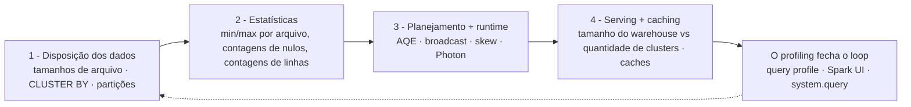
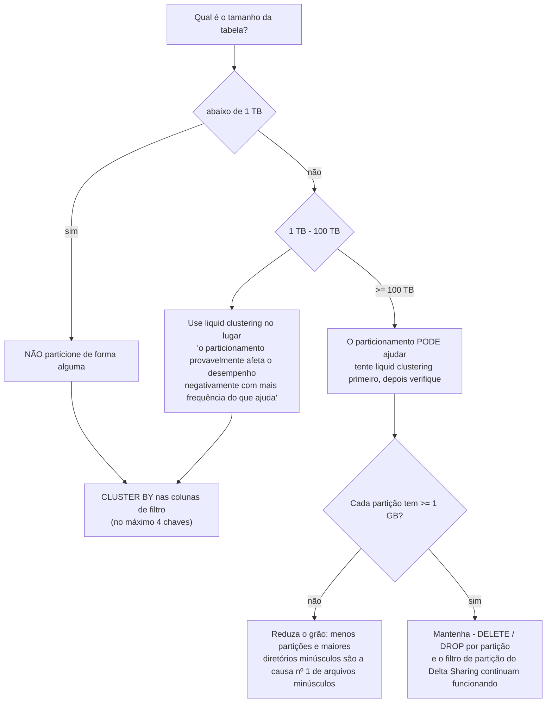
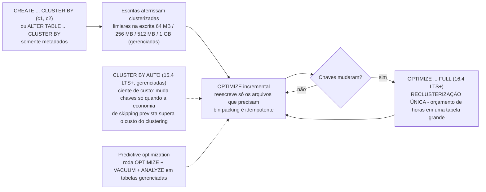
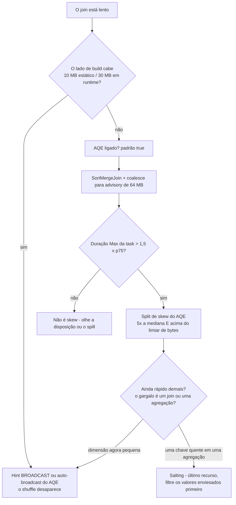
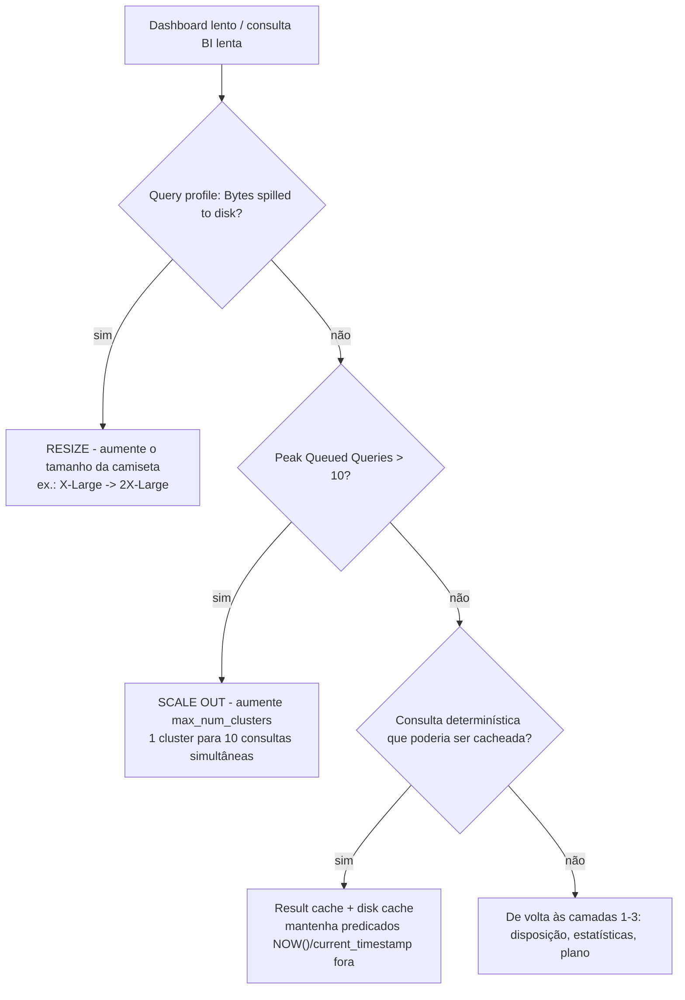
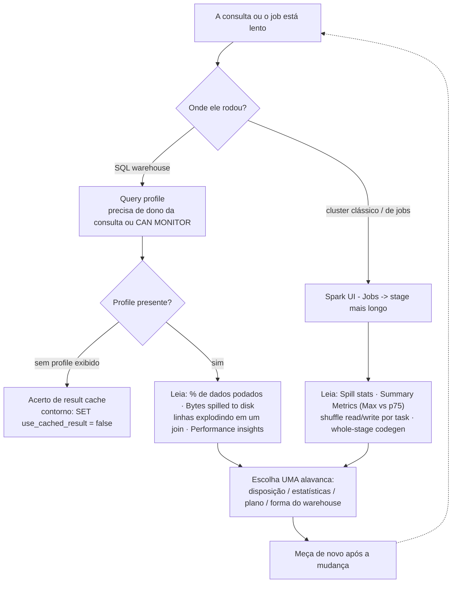

# Otimização de Desempenho na Databricks/AWS: Liquid Clustering, Layout de Arquivos, Skew e Ajuste de Warehouse

Consultas lentas no lakehouse quase nunca são "o Spark é lento". Elas são uma camada específica se comportando mal: arquivos pequenos demais no S3, uma coluna de filtro cujos intervalos min/max se sobrepõem em todos os arquivos, uma única chave de join quente carregando 38% das linhas, ou um warehouse com o *tamanho* certo e a *quantidade* errada. Esta lição ensina a pilha na ordem em que você deve consertá-la, **disposição → estatísticas → planejamento/runtime → serving**, e ela ensina a versão de 2026 dessa pilha, não a de 2019.

Essa distinção importa mais do que qualquer knob isolado. A documentação atual da Databricks é direta: "A Databricks recomenda usar liquid clustering em vez de partições, `ZORDER` ou outras abordagens de disposição de dados" (docs .../tables/operations/optimize, última atualização **2026-03-31**, espelho **2026-09-11**), e "Recomendações de ajuste manual não se aplicam a tabelas gerenciadas do Unity Catalog, que usam ajuste automático de tamanho de arquivo" (docs .../tables/tune-file-size, **2026-09-11**). Enquanto isso, a camada do motor continua se auto-ajustando: AQE está ativo por padrão desde o DBR 7.3, Photon é o motor de execução padrão nos SQL warehouses da Databricks, e a Databricks relata que "em 2025, o Databricks SQL entregou desempenho até 40% mais rápido em cargas de trabalho de produção, com melhorias aplicadas automaticamente" (blog, **2026-01-28**).

Então o enquadramento honesto para outubro de 2026 é: **o ajuste manual é mais valioso em tabelas externas, cargas de trabalho legadas de hive-metastore e clusters fora do padrão**, e entender *qual* camada está quebrada antes de mexer em qualquer coisa. Cada fato desta lição vem das páginas de documentação AWS da Databricks sobre optimize, tamanho de arquivo, partições, clustering, data skipping, AQE, hints, predictive optimization, caching, comportamento de warehouse e query profile (todas acessadas ou datadas em **outubro de 2026**), além de blogs datados de engenharia da Databricks. Nenhuma taxa de DBU aparece aqui, custo é o assunto da lição 15.

```text
 =============================================================
  A PILHA DE DESEMPENHO - conserte de cima para baixo, meça após cada passo
 -------------------------------------------------------------
  1. DISPOSIÇÃO DOS DADOS .. tamanhos de arquivo, CLUSTER BY, partições
  2. ESTATÍSTICAS ........... min/max por arquivo -> data skipping
  3. PLANEJAMENTO + RUNTIME  AQE, broadcast, skew, Photon
  4. SERVING + CACHING ...... tamanho vs quantidade de warehouse, caches
  O loop fecha com: DBSQL query profile (warehouses)
                    Spark UI (clusters clássicos / de jobs)
  Realidade da tabela gerenciada: predictive optimization roda
  OPTIMIZE + VACUUM + ANALYZE para você; ajuste automático de
  tamanho de arquivo escolhe as faixas de 256 MB / 1 GB; trabalho
  de layout é sobretudo para tabelas EXTERNAS e ambientes legados.
  Padrões verificados em out 2026, sem preços nesta lição.
 =============================================================
```

Nesta lição você vai:

- percorrer a **pilha de quatro camadas** e aprender qual sintoma pertence a qual camada antes de tocar em uma única configuração;
- dimensionar arquivos contra os **três alvos oficiais**, 128 MB do auto-optimize, a faixa de autotune de 256 MB → 1 GB e o teto manual de `OPTIMIZE` de 1 GiB, e calcular as contagens de arquivo na mão;
- aplicar a **escada de particionamento** (< 1 TB nunca · 1 to 100 TB clustering · ≥ 100 TB talvez) e a proteção de **≥ 1 GB por partição**, e então ver o anti-padrão de alta cardinalidade falhar na aritmética;
- ir a fundo no **liquid clustering**: `CLUSTER BY`, `CLUSTER BY AUTO`, ≤ 4 chaves, limiares de clustering na escrita, `OPTIMIZE` incremental vs `OPTIMIZE FULL`, chaves hierárquicas, idempotência do bin packing e os pisos de DBR com as suas datas;
- rodar uma **comparação resolvida de OPTIMIZE vs CLUSTER BY**, a mesma tabela de 8 TB, o SQL legado de partição+`ZORDER` ao lado do SQL de liquid clustering, e ler o gráfico de latência antes/depois;
- diagnosticar **skew de join** a partir de evidência real de profile e subir a escada documentada: hint de broadcast → split de skew do AQE → salting, com a trilha dos consertos errados ao lado;
- configurar o **AQE** com os padrões verificados (200 partições de shuffle, broadcast de 30 MB em runtime, advisory de 64 MB, fator de skew 5×);
- julgar o **Photon** por carga de trabalho, onde ele vence, onde Python UDFs o derrotam, e dimensionar um **Databricks SQL warehouse** com a doutrina de resize-vs-scale mais os níveis de cache;
- fazer profiling como operador: o **query profile** para warehouses, a **Spark UI** para clusters, e um cálculo de partições de shuffle que você faz no papel;
- estudar **três histórias nomeadas de desempenho de clientes na AWS**, ler a **caixa de atualização de 2026** e praticar com **doze questões no estilo de exame** mais quatro verificações interativas.

---

## 1. A pilha de quatro camadas, e como escolher uma camada

Toda latência de consulta deste curso é decidida em quatro camadas, nesta ordem. Conserte-as de cima para baixo e meça de novo após cada mudança: nunca duas mudanças de uma vez, ou você não consegue atribuir o ganho.



| Camada | A pergunta que ela responde | A evidência que você lê | A alavanca |
|---|---|---|---|
| 1. Disposição dos dados | As linhas certas estão nos mesmos arquivos? | contagem de arquivos, tamanho médio, `% < 20 MB`, `DESCRIBE DETAIL` | `OPTIMIZE`, `CLUSTER BY`, cadência de compactação |
| 2. Estatísticas | O motor consegue *provar* que um arquivo é irrelevante? | ícone "% of data pruned" no query profile | colunas de estatísticas, chaves de clustering, predicados sargable |
| 3. Planejamento + runtime | O plano e o shuffle estão saudáveis? | métricas de stage na Spark UI, `SortMergeJoin (isSkew=true)` | AQE, hints, salting, Photon, reescrita de UDF |
| 4. Serving + caching | O compute tem a forma certa? | "Bytes spilled to disk", Peak Queued Queries | tamanho do warehouse, `max_num_clusters`, caches |

Duas realidades de 2026 remolduram essa tabela. Primeiro, **as camadas 3 e 4 cada vez mais se auto-ajustam**: AQE está ligado por padrão (`spark.databricks.optimizer.adaptive.enabled` = **true**), Photon roda por padrão nos SQL warehouses da Databricks, e as tabelas gerenciadas ganham ajuste automático de tamanho de arquivo. Segundo, **a camada 2 não tem teto em tabelas gerenciadas**: para tabelas *externas* do Unity Catalog, as estatísticas são coletadas nas primeiras 32 colunas; em tabelas *gerenciadas* da UC, "o predictive optimization coleta estatísticas de pulsação de arquivo nas colunas mais usadas nos seus filtros de consulta, em vez de um conjunto fixo de colunas, de modo que essas tabelas **não têm limite de 32 colunas**" (docs .../tables/data-skipping, **2026-06-18**).

O resto desta lição é essa pilha, camada por camada.

---

## 2. Camada 1: dimensionamento de arquivos e o problema dos arquivos pequenos no S3

Arquivos pequenos machucam porque cada arquivo custa um round-trip de `LIST`/GET do S3, uma task do Spark e a análise do rodapé do Parquet. Como o próprio guia da Databricks coloca, parte do custo é simplesmente "o tempo gasto só para abrir e fechar esses arquivos minúsculos" (guia discover, **2026-05-06**). No S3 não existe camada de bloco: **o arquivo é a unidade de paralelismo, a unidade de estatísticas e a unidade que o `VACUUM` recupera.**

### 2.1 Três alvos oficiais, uma faixa saudável

Três números diferentes são todos "oficiais", e ensiná-los como um número só é o clássico erro de tutorial desatualizado:

| Mecanismo | Tamanho de arquivo alvo | Fonte (data) |
|---|---|---|
| Teto de saída do `OPTIMIZE` manual | **1.073.741.824 B = 1 GiB** (`spark.databricks.delta.optimize.maxFileSize`) | manual de linguagem do Delta `OPTIMIZE`; guia discover (**2026-05-06**) |
| Auto-optimize definido como `true` (`autoOptimize.optimizeWrite` + `autoCompact`) | **128 MB** | docs .../tables/tune-file-size (**2026-09-11**) |
| Alvo do autotune (comportamento padrão em tabelas gerenciadas da UC) | **< 2,56 TB → 256 MB** · **2,56 to 10 TB → linear 256 MB → 1 GB** · **> 10 TB → 1 GB** | mesma página (**2026-09-11**) |
| Faixa de orientação saudável | "**entre 16MB e 1GB**" | guia discover (**2026-05-06**) |

Duas consequências que evitam os dois erros de layout mais comuns:

1. **1 GiB é um teto, não uma meta para tabelas pequenas.** Compactar uma tabela de 300 GB em arquivos de 1 GiB deixa ~300 arquivos e destrói o paralelismo do scan podado.
2. **Aumentar um alvo nunca mescla nada por si só.** "Quando o tamanho de arquivo alvo de uma tabela cresce, os arquivos existentes não são re-otimizados em arquivos maiores pelo comando `OPTIMIZE`" (tune-file-size, **2026-09-11**): você precisa rodar `OPTIMIZE` depois.

### 2.2 Exemplo resolvido E1: como é a saída de 8 TB de Auto Loader

```text
Exemplo resolvido E1 - aritmética de arquivos para uma tabela de eventos de 8 TB no S3 (em out 2026)

ANTES (24 streams de Auto Loader, uma por frota de dispositivos)
  Contagem de arquivos ........ 19.000
  Média ....................... 8 TB / 19.000 ~= 440 MB   <- ENGANOSO
  Forma ....................... 60% dos arquivos abaixo de 20 MB (micro-batches de streaming)
  Consulta de serving ......... 12.000 arquivos escaneados após a poda por min/max
  p95 ......................... ~9,5 min em um warehouse X-Large, spill visível no profile

O ALVO (faixa de autotune 2.56 - 10 TB -> linear 256 MB -> 1 GB)
  8 TB interpola para ~768 MB por arquivo
  Teto do OPTIMIZE manual ............... 1 GiB (1.073.741.824 B)
  Faixa saudável ....................... 16 MB - 1 GB
  Contagens de referência da tabela dos docs:
    1 TB  @ 256 MB ....... 4.096 arquivos
    10 TB @ 1 GB ......... 24.437 arquivos
    100 TB @ 1 GB ........ 114.437 arquivos

DEPOIS (layout corrigido - veja o exemplo resolvido E4 para o SQL)
  Contagem de arquivos ........ ~10.000 arquivos próximos do alvo
  Poda ....................... > 95% dos arquivos excluídos pelos filtros customer_id / event_date
  p95 ......................... ~25-40 s  (faixa ilustrativa, coerente com os ganhos de leitura
                                 de 2-12x relatados pela Databricks e um relato de point query de 12x,
                                 blog 2024-05-22 - não é um benchmark medido desta tabela)
```

A lição de E1 não é a faixa de 15 to 25×; é que **contagem de arquivo e *forma* do arquivo são números diferentes**. Uma média de 440 MB com mediana de 20 MB significa que o motor ainda paga o overhead de uma task por arquivo na maior parte da tabela.

### 2.3 Três mecanismos combatem arquivos pequenos, em ordem crescente de autoridade

1. **Escritas otimizadas** (`autoOptimize.optimizeWrite` / `spark.databricks.delta.optimizeWrite.enabled`) fazem shuffle antes de escrever para que cada partição emita arquivos de ~128 MB. Elas estão ligadas por padrão para `MERGE`, `UPDATE`/`DELETE` com subconsultas, CTAS/INSERT em SQL warehouses, e "No Databricks Runtime 13.3 LTS e superior, todas as tabelas registradas no Unity Catalog têm escritas otimizadas habilitadas para instruções CTAS e operações INSERT em tabelas particionadas". O custo é real: "Gravar menos arquivos grandes é mais eficiente … mas você ainda pode ver um aumento na latência de escrita porque os dados são embaralhados antes de serem gravados."
2. **Auto compaction** (`autoOptimize.autoCompact`) "roda **sincronamente no cluster que faz a escrita, depois que a escrita tem sucesso**, e só compacta arquivos que ainda não foram compactados antes". No histórico da tabela ela aparece como uma operação `OPTIMIZE` com `operationParameters.auto` = `true`. Para `MERGE`, `UPDATE` e `DELETE` ela é obrigatória: "Você não pode desligar essa funcionalidade."
3. **`OPTIMIZE` agendado ou previsto**: "Para tabelas maiores que **1 TB**, a Databricks recomenda rodar `OPTIMIZE` em um agendamento", clássicamente "**diariamente**, de preferência à noite, quando os preços de spot estão baixos" e em um **job cluster separado**, e para tabelas quentes com liquid clustering, "agendar um job `OPTIMIZE` **a cada uma ou duas horas**" (docs de clustering, **2026-09-25**), porque o clustering é incremental e a maioria das execuções é rápida.

Auto compaction e escritas otimizadas "**não substituem completamente** o `OPTIMIZE`" (tune-file-size, **2026-09-11**), e se o predictive optimization estiver habilitado, "a Databricks recomenda desabilitar quaisquer jobs `OPTIMIZE` agendados" para você parar de pagar duas vezes (docs de clustering).

```fillblank
{
  "question": "Preencha os valores de layout de arquivo e do AQE exatamente como a documentação de outubro de 2026 os declara:",
  "template": "Auto-optimize definido como {{1}} mira arquivos de 128 MB; o teto de saída do OPTIMIZE manual é de {{2}} GiB; tabelas abaixo de 2,56 TB são autotunadas para um alvo de {{3}} MB; e o valor padrão de spark.sql.shuffle.partitions é {{4}}.",
  "answers": {
    "1": "true",
    "2": "1",
    "3": "256",
    "4": "200"
  },
  "distractors": ["false", "auto", "2", "4", "64", "128", "512", "1000"],
  "explanation": "Os quatro valores são literais da documentação acessada em 2026-10: auto-optimize 'true' significa 'Use 128 MB as the target file size'; spark.databricks.delta.optimize.maxFileSize tem padrão 1.073.741.824 bytes = 1 GiB; o autotune dá 256 MB abaixo de 2,56 TB; e spark.sql.shuffle.partitions tem padrão 200 (o valor 'auto' habilita shuffle auto-otimizado no lugar disso: aqui ele é um distrator porque é uma configuração válida, só que não é o padrão). 64 MB é o tamanho de partição advisory do AQE, 128 MB é a regra prática de shuffle por task, e 1.000 é o teto de fila do warehouse: três números diferentes que vivem em camadas diferentes."
}
```

> ⚠️ **AVISO, não brigue com o caminho de escrita usando as próprias mãos.** "Se você usa escritas otimizadas, a Databricks recomenda que você **não rode `coalesce(n)` ou `repartition(n)` imediatamente antes de uma escrita** para controlar a quantidade de arquivos gravados" (tune-file-size, **2026-09-11**), você paga dois shuffles para um trabalho só. Igualmente: nunca desligue a auto compaction no nível de sessão e esqueça. Ela não pode ser desabilitada para `MERGE`/`UPDATE`/`DELETE`, mas um `false` no nível de sessão *desliga silenciosamente* ela para appends e CTAS nessa carga de trabalho.

- **📚 Você sabia?** O `OPTIMIZE` é seguro por construção: "A otimização de bin-packing é *idempotente*, ou seja, se ela rodar duas vezes no mesmo dataset, a segunda execução não tem efeito", e "Como o `OPTIMIZE` não faz nenhuma mudança de dados na tabela, uma leitura antes e depois de um `OPTIMIZE` tem os mesmos resultados. Rodar `OPTIMIZE` em uma tabela que é fonte de streaming não afeta nenhuma stream atual ou futura com essa tabela como fonte" (docs.../operations/optimize, **2026-03-31**). O ZORDER, por contraste, nunca foi idempotente: era incremental e precisava ser reexecutado.

---

## 3. Camada 1, particionamento: a escada e a proteção de ≥ 1 GB

A orientação atual de particionamento é mais nova do que a maioria dos tutoriais e mais direta do que a maioria dos times espera: "A maioria das tabelas na Databricks com menos de **100 TB** de dados não precisa de particionamento" (docs .../tables/partitions, **2026-07-01**).



A segunda proteção é por partição: "verifique que cada partição contém **pelo menos 1 GB** de dados. Tabelas com menos partições e maiores tendem a superar tabelas com muitas partições menores" (mesma página). Contagem de partição é contagem de diretórios no seu bucket, então cada nível extra de cardinalidade multiplica chamadas `LIST`, entradas de `_delta_log`, varreduras de planejamento do `OPTIMIZE` e superfície de conflito do `MERGE`.

**Não particione quando:** a tabela estiver abaixo de 1 TB; a coluna de filtro tiver alta cardinalidade (`user_id`, `event_id`: clusterize em vez disso); os padrões de acesso mudarem (o particionamento "é estático e se manifesta como uma hierarquia de sistema de arquivos. Não existe um jeito fácil de mudar partições", página de best practices); a coluna for um timestamp que explodir em milhões de instantes (clusterize o timestamp bruto no lugar disso); ou você fosse particionar por um campo struct (`PARTITIONED BY` trata um struct como expressão, não como referência de coluna).

### 3.1 Exemplo resolvido E2, o anti-padrão de alta cardinalidade, em aritmética

```text
Exemplo resolvido E2 - particionando a mesma tabela de eventos de 8 TB por customer_id

PARTITIONED BY (customer_id) com ~200.000 clientes distintos
  Diretórios ................ 200.000
  Bytes médios por partição . 8 TB / 200.000 ~= 40 MB
  Proteção .................. >= 1 GB por partição  -> VIOLADA por 25x
  Sintoma .................... milhares de arquivos minúsculos por dia, a compactação
                               nunca acompanha, o listagem de _delta_log cresce, todo
                               OPTIMIZE e MERGE paga 200k listagens de diretório

CLUSTER BY (customer_id, event_date) no lugar
  Diretórios ................ nenhum (particionamento oculto, protocolo 3/7)
  Custo de reescrita ........ só metadados para declarar; um OPTIMIZE FULL uma vez
  Poda ...................... granularidade de arquivo, guiada pelas estatísticas
                             min/max de cada arquivo
  Mudança de ideia .......... ALTER TABLE ... CLUSTER BY (novas colunas) - sem reescrita
```

O particionamento mantém exatamente dois papéis legítimos em 2026: **movimentos de ciclo de vida por partição** (`DELETE`/`DROP PARTITION` em uma coluna de data em escala ≥ 100 TB) e **filtro de partição do Delta Sharing** em tabelas compartilhadas: que é também o motivo de converter uma tabela compartilhada particionada para clustering ser bloqueado.

---

## 4. Liquid clustering, a fundo

"O liquid clustering é uma técnica de otimização de disposição de dados que **substitui o particionamento da tabela e o `ZORDER`**" (docs .../tables/clustering, última atualização **2026-09-25**), e "você pode redefinir as chaves de clustering **sem reescrever os dados existentes**". Essa última cláusula é o design inteiro: o particionamento assenta uma hierarquia de sistema de arquivos que você não consegue mudar barato; o clustering guarda um conjunto declarado de chaves nos metadados da tabela e deixa o `OPTIMIZE` colocar fisicamente os intervalos juntos de forma incremental.

### 4.1 A superfície de declaração e os pisos de DBR

```sql
-- Declare at CREATE time (metadata only - no data is touched)
CREATE TABLE main.silver.events (
  customer_id STRING,
  event_date  DATE,
  event_type  STRING,
  payload     STRING
) USING DELTA
CLUSTER BY (customer_id, event_date);

-- Or attach clustering to an existing table
ALTER TABLE main.silver.events CLUSTER BY (customer_id, event_date);

-- Let the platform pick and evolve keys (15.4 LTS+, UC managed + predictive optimization)
ALTER TABLE main.silver.events CLUSTER BY AUTO;

-- Remove clustering
ALTER TABLE main.silver.events CLUSTER BY NONE;
```

Carregue esses números de versão **com as suas datas**: são os números que provas e revisões de arquitetura perguntam:

| Fato | Valor | Fonte (data) |
|---|---|---|
| Gatilho / clustering na escrita | DBR **13.3 LTS+** | docs de clustering (**2026-09-25**) |
| Anúncio de GA | "generally available in Databricks from DBR **15.2**" | blog (**2024-05-22**) |
| Afirmação atual de GA | "GA for Delta Lake tables with **DBR 15.4 LTS and above**"; Iceberg em Public Preview a partir do **16.4 LTS+** | docs de clustering (**2026-09-25**) |
| Recomendado para `OPTIMIZE` em tabela grande | **DBR 17.3 LTS+** | docs de clustering (**2026-09-25**) |
| `OPTIMIZE … FULL` (reclusterizar à força) | **DBR 16.4 LTS+** | docs de clustering (**2026-09-25**) |
| `OPTIMIZE … FULL WHERE …` (reclusterização parcial) | **DBR 18.1+** | docs de clustering (**2026-09-25**) |
| `CLUSTER BY AUTO` | **DBR 15.4 LTS+**, UC gerenciada + predictive optimization | docs de clustering (**2026-09-25**) |
| Clustering hierárquico | **DBR 17.1+** (`delta.liquid.hierarchicalClusteringColumns`) | docs de clustering (**2026-09-25**) |
| `REPLACE PARTITIONED BY WITH CLUSTER BY` | **DBR 18.1+** (leitura a partir do 13.3 LTS+) | docs de clustering (**2026-09-25**) |
| Máximo de chaves de clustering | **4**: abaixo de 10 TB, mais chaves "podem degradar o desempenho ao filtrar em uma única coluna" | docs de clustering (**2026-09-25**) |
| Estatísticas obrigatórias nas chaves | sim: primeiras **32 colunas** por padrão | docs de clustering + data-skipping (**2026**) |
| Protocolo da tabela | reader **3** / writer **7** ("particionamento oculto") | docs de compatibilidade de recursos (**2026-09-11**) |
| Compatível com particionamento ou `ZORDER`? | **Não**: "Clustering is not compatible with partitioning or `ZORDER`" | docs de clustering (**2026-09-25**) |

### 4.2 Clustering na escrita: como o streaming aterrissa pré-clusterizado

Você não precisa esperar por um job noturno. Quando a escrita é grande o suficiente, o clustering roda **durante a escrita**, por contagem de chaves (tabelas gerenciadas da UC / outras tabelas Delta):

| Chaves de clustering | Limiar em tabela gerenciada da UC | Outras tabelas Delta |
|---|---|---|
| 1 | **64 MB** | 256 MB |
| 2 | **256 MB** | 1 GB |
| 3 | **512 MB** | 2 GB |
| 4 | **1 GB** | 4 GB |

É por isso que um CTAS ou um micro-batch de streaming pode aterrissar fisicamente clusterizado sem nenhum manutenção agendada, e é por isso que o `OPTIMIZE` em uma tabela clusterizada costuma ser rápido: ele só reescreve o que ainda precisa de clustering.

### 4.3 O ciclo de vida, incluindo os dois momentos caros



Dois momentos nesse diagrama custam dinheiro de verdade e tempo de calendário de verdade:

> ⚠️ **AVISO: declarar chaves é grátis; fazer dados antigos baterem com elas não é.** "O comportamento padrão não aplica clustering a dados escritos anteriormente": você precisa rodar `OPTIMIZE <table> FULL`, o que "pode levar horas" em uma tabela grande não clusterizada (docs de clustering, **2026-09-25**). Orce isso como um job de migração único, no seu próprio cluster (instâncias compute-optimized, spot à noite), não como uma etapa de um pipeline de release. E nunca afirme "habilitar o clustering reescreveu a minha tabela": `ALTER TABLE … CLUSTER BY` é metadado; o `OPTIMIZE FULL` é a reescrita.

> ⚠️ **IMPORTANTE, o `OPTIMIZE` reescreve arquivos, então ele alimenta o `VACUUM`.** Toda reclusterização apaga e adiciona arquivos; as versões antigas sobrevivem apenas durante `delta.deletedFileRetentionDuration` (padrão de **7 dias**). Defina essa propriedade **antes** de habilitar o predictive optimization: "Se você definir `delta.deletedFileRetentionDuration` para menos de 7 dias, o predictive optimization ainda retém os arquivos de dados por um **mínimo de 7 dias** quando roda `VACUUM FULL`" (docs de predictive optimization, **2026-09-11**), e nunca rode `VACUUM` na mesma etapa de job que leitores ou streams de longa duração.

### 4.4 Exemplo resolvido E3: adotando clustering em uma tabela em produção

```sql
-- Worked example E3 - adopt liquid clustering on main.silver.events (8 TB, external on S3)
-- Step 1 - declare the keys your filters actually use (metadata only)
ALTER TABLE main.silver.events CLUSTER BY (customer_id, event_date);
-- correlated columns? one is enough: "If two columns are highly correlated,
-- you only need to include one of them in the clustering columns"

-- Step 2 - one-off full recluster, on its own job cluster, at night (DBR 16.4 LTS+)
OPTIMIZE main.silver.events FULL;

-- Step 3 - verify what actually ran (history disambiguates the operation type)
DESCRIBE HISTORY main.silver.events LIMIT 5;
--   operationParameters.clusterBy  -> liquid clustering
--   operationParameters.zOrderBy   -> legacy ZORDER
--   operationParameters.auto       -> auto compaction
SHOW TBLPROPERTIES main.silver.events;
--   delta.clusteringColumns -> [customer_id, event_date]

-- Step 4 - incremental maintenance: hot table, every one or two hours
OPTIMIZE main.silver.events WHERE event_date >= current_date() - 2;

-- Step 5 - per-quarter deep maintenance on older data, still incremental
OPTIMIZE main.silver.events WHERE event_date < current_date() - 90;
```

Por que um predicado no passo 4/5? `OPTIMIZE <table> WHERE <predicate>` limita a compactação/reclusterização a um subconjunto: mais barato, e ele encolhe a janela de conflito com escritores concorrentes, o mesmo motivo pelo qual as best practices empurram predicados de poda para dentro do `MERGE... ON`.

- **📚 Você sabia?** O `DESCRIBE HISTORY` também é a sua **trilha de auditoria de manutenção**: a auto compaction, o liquid clustering e o Z-ordering "aparecem todos no histórico da tabela como operações `OPTIMIZE`", e você só os distingue através de `operationParameters.{auto, clusterBy, zOrderBy, predicate}` (docs.../tables/history, **2026-09-11**). Um dashboard que conta "execuções de `OPTIMIZE`" portanto superconta a auto compaction em larga margem: filtre por `auto = 'false'` para as execuções manuais.

---

## 5. Exemplo resolvido E4: OPTIMIZE vs CLUSTER BY, lado a lado

Mesma tabela, mesmos 8 TB, duas gerações de doutrina de layout. É essa a comparação para a qual a lição existe.

```sql
-- ============================================================
-- PATH A - legacy: Hive partitioning + ZORDER (pre-2024)
-- ============================================================
CREATE TABLE main.silver.events (
  customer_id STRING, event_date DATE, event_type STRING, payload STRING
) USING DELTA
PARTITIONED BY (event_date);              -- date cardinality "seems" safe

-- props you had to remember to set yourself
ALTER TABLE main.silver.events SET TBLPROPERTIES (
  'autoOptimize.optimizeWrite' = 'true',
  'autoOptimize.autoCompact'    = 'true',
  'delta.targetFileSize'        = '536870912'   -- 512 MB, manual guess
);

-- ZORDER the column your dashboards filter on (non-partitioned, stats required)
OPTIMIZE main.silver.events
  WHERE event_date >= DATE'2026-10-01'
  ZORDER BY (customer_id);

-- and because ZORDER "is not idempotent but is incremental", and because MERGE
-- rewrites blunt it (low shuffle merge helps but does not remove the need),
-- you re-run it on a schedule, forever, inside the date partition.

-- ============================================================
-- PATH B - liquid clustering (Oct 2026 recommendation)
-- ============================================================
CREATE TABLE main.silver.events (
  customer_id STRING, event_date DATE, event_type STRING, payload STRING
) USING DELTA
CLUSTER BY (customer_id, event_date);     -- no PARTITIONED BY, no ZORDER

-- one-off, after keys are first set or changed (DBR 16.4 LTS+)
OPTIMIZE main.silver.events FULL;

-- incremental maintenance from then on; bin packing happens in the same command
OPTIMIZE main.silver.events WHERE event_date >= current_date() - 2;

-- managed tables: skip the cron job entirely and let predictive optimization
-- run OPTIMIZE/VACUUM/ANALYZE for you (serverless-billed), then delete yours.
```

O que mudou entre os dois caminhos:

| Dimensão | Caminho A: partição + `ZORDER` | Caminho B: `CLUSTER BY` |
|---|---|---|
| Declarado em | hierarquia de sistema de arquivos + um comando de reescrita | metadados da tabela (protocolo 3/7) |
| Mudar a chave | efetivamente um rebuild da tabela; "não existe jeito fácil de mudar partições" | `ALTER TABLE … CLUSTER BY`, sem reescrita |
| Manutenção | reexecutar o `ZORDER` (não é idempotente), dentro das partições | `OPTIMIZE` incremental, bin packing idempotente |
| Predictive optimization | "não roda `ZORDER` … ignora arquivos Z-ordered" | totalmente suportado: operações `CLUSTERING` aparecem no histórico |
| Coluna de alta cardinalidade | proibida como chave de partição | a *melhor* candidata a chave de clustering |
| Benchmark (carga de warehouse de 1 TB) | particionamento estilo Hive ~**uma ordem de magnitude** mais lento que o liquid; Z-order no meio | **clustering 2,5× mais rápido que Z-order** (blog, **2023-06-29**) |
| Resultados de campo |: | point queries até **12×** em uma firma de manufatura; desempenho de leitura **2 to 12×** relatado no GA (blog, **2024-05-22**) |

```plot
{
  "type": "bar",
  "title": "Latência p95 da consulta de serving em quatro estados de layout, tabela de eventos de 8 TB (exemplo resolvido E1/E4: faixa ilustrativa de arquitetura de referência, não um benchmark medido)",
  "xLabel": "Estado de layout da tabela",
  "yLabel": "Latência de consulta p95 (segundos)",
  "xKey": "layout_state",
  "dataKeys": ["p95_seconds"],
  "data": [
    {"layout_state": "Raw: 19k files, 60% under 20 MB, no clustering", "p95_seconds": 570},
    {"layout_state": "Optimized writes only (~128 MB files)", "p95_seconds": 420},
    {"layout_state": "+ OPTIMIZE bin packing (fewer, larger files)", "p95_seconds": 180},
    {"layout_state": "+ CLUSTER BY (customer_id, event_date) + FULL", "p95_seconds": 32}
  ]
}
```

Leia esse gráfico como uma *escada causal*: escritas otimizadas e bin packing (camada 1, tamanho de arquivo) compram um ganho sólido mas limitado porque a poda ainda não consegue provar nada; `CLUSTER BY` (camada 1 + camada 2 juntas) é o que faz o filtro de `customer_id` excluir >95% dos arquivos. A última barra é rotulada como ilustrativa porque é um esboço de arquitetura de referência restrito à faixa publicada de leitura de 2 to 12× da Databricks, não um número da sua tabela: meça a sua no query profile.

### 5.1 Camada 2: por que o clustering é o que faz o skipping funcionar

O Delta grava estatísticas por arquivo no momento do commit: "valores mínimo e máximo, contagens de nulos e total de registros" (docs de data skipping, **2026-06-18**), e no momento da consulta o motor pula qualquer arquivo cujas estatísticas provem que o predicado não pode casar. O clustering não muda o que *pode* ser pulado, "o modelo poda em granularidade de arquivo. Não existe um atalho em nível de diretório para perder" (blog da Databricks, **2026-01-06**), ele muda *quanto* é pulado, ao deixar os intervalos da chave fisicamente contíguos.

O skipping falha silenciosamente quando: o predicado não é sargable (`WHERE lower(col) = …`, `WHERE date_add(col, 1) = …`); a coluna de filtro não tem estatísticas; os valores são distribuídos de forma uniforme por todos os arquivos; ou você combina colunas de um jeito que o min/max não consegue provar. Knobs de estatísticas: `delta.dataSkippingNumIndexedCols` (posicional) e `delta.dataSkippingStatsColumns` (DBR 13.3 LTS+, lista explícita, substitui o numérico), e "atualizar essas propriedades não recalcula automaticamente as estatísticas dos dados existentes". Por fim: "A Databricks recomenda que você não use `ZORDER BY` em colunas que não têm estatísticas coletadas, porque isso é ineficaz e usa recursos de computação desnecessários."

---

## 6. Camada 3, joins: AQE, broadcast, skew e salting

### 6.1 Os padrões do AQE com os quais você realmente está rodando

O AQE está ligado por padrão e faz quatro coisas: converter sort-merge join em broadcast em runtime, coalescer partições pós-shuffle, dividir (e, se necessário, replicar) partições enviesadas, e propagar relações vazias (docs de AQE, página datada de **2023-10-12**, ainda atual em out 2026).

| Configuração | Padrão | Significado |
|---|---|---|
| `spark.databricks.optimizer.adaptive.enabled` | **true** | interruptor mestre do AQE |
| `spark.sql.shuffle.partitions` | **200** (valor `auto` = shuffle auto-otimizado) | contagem inicial de partições de shuffle |
| `spark.databricks.adaptive.autoBroadcastJoinThreshold` | **30 MB** | chave de runtime para broadcast join |
| `spark.sql.autoBroadcastJoinThreshold` | **10 MB** | limiar estático de planejamento (Spark upstream) |
| `spark.sql.adaptive.advisoryPartitionSizeInBytes` | **64 MB** | alvo de coalescência após o shuffle |
| `spark.sql.adaptive.skewJoin.enabled` | **true** | split automático de skew |
| `spark.sql.adaptive.skewJoin.skewedPartitionFactor` | **5** | enviesado se > 5× a mediana **e** acima do limiar de bytes |
| Limiar de bytes de skew | **256 MB** (padrão do Spark: verifique no seu DBR) | segunda condição do teste de skew |
| `spark.sql.broadcastTimeout` | **300 s** | timeout de construção do broadcast |

Regra prática para dimensionar o shuffle: "cada task deveria processar aproximadamente **128MB a 200MB** de dados" (guia discover, **2026-05-06**). E mantenha o AQE ligado: "É recomendado **manter o AQE habilitado**" (best practices, **2026-09-11**).

### 6.2 Exemplo resolvido E5: um join noturno de 52 minutos, diagnosticado

```text
Exemplo resolvido E5 - skew de join, quatro movimentos, da evidência ao conserto
Setup ........ orders 400 GB, customers 2 GB, join em cust_id
               uma chave (cust_id = 'ANON') carrega 38% de todas as linhas
Evidência ..... Spark UI stage mais longo: 200 tasks, mediana 12 s, Max 41 min
               "Se a duração do Max estiver 50% acima da duração do percentil 75,
                você pode estar sofrendo de skew"  -> 41 min >> 1,5 x p75  => SKEW
               uma task lê 180 GB de shuffle; a task mediana lê 0,4 GB
               plano: dois nós Exchange + SortMergeJoin (o AQE não broadcastou:
               customers filtrados = 40 MB, acima do limiar de runtime de 30 MB)
```

```sql
-- Move 1 - REMOVE the shuffle (always the best outcome if it fits)
SELECT /*+ BROADCAST(customers) */ c.region, SUM(o.amount) AS revenue
FROM main.silver.orders o
JOIN main.gold.customers c ON o.cust_id = c.cust_id
GROUP BY c.region;
-- hint priority: BROADCAST > MERGE > SHUFFLE_HASH > SHUFFLE_REPLICATE_NL
-- aliases: MAPJOIN, BROADCASTJOIN for BROADCAST; result: job 52 min -> ~6 min

-- Move 2 - dimension too big to broadcast (4 GB): let AQE split the hot partition
--   plan marker: SortMergeJoin (isSkew=true)  ->  job 52 min -> ~18 min
SET spark.sql.adaptive.skewJoin.enabled = true;                 -- default true
SET spark.sql.adaptive.skewJoin.skewedPartitionFactor = 5;      -- default 5
-- Databricks' own recommendation: "rely on AQE skew join handling rather than
-- use the skew join hint ... completely automatic and in general performs better"

-- Move 3 - the documented DataFrame escape hatch when AQE cannot see it
--   df_orders.hint("skew", "cust_id", "ANON")
--   df_orders.hint("skew", ["cust_id", "store_region_id"])

-- Move 4 - LAST RESORT: salting (hand-rolled, maintenance cost, query rewrite)
--   fact side : cust_id || '_' || CAST(FLOOR(RAND() * 16) AS INT)  for the hot key
--   dim side  : replicate the 'ANON' dimension row 16 times, one per salt value
--   join on the salted key, then GROUP BY partials and collapse
```

A **trilha dos consertos errados**: os três aparecem em código de produção e nenhum deles ajuda:

- `SET spark.sql.shuffle.partitions = 2000`: não divide *nada*; a chave quente ainda cai em exatamente uma partição.
- `.repartition("cust_id")`: a mesma falha, mais um shuffle extra.
- Um hint de skew quando o AQE já disparou: overhead para um conserto que já aconteceu; "A otimização de skew join tem algum overhead, então é melhor usá-la só quando necessário" (docs aposentadas de skew-join, página atualizada em **2024-05-13**).



- **📚 Você sabia?** Você lê as decisões do AQE direto do plano físico: `CustomShuffleReader` com a propriedade `Coalesced` significa que as partições foram mergeadas após o shuffle, `SortMergeJoin` com `isSkew=true` significa que o AQE dividiu uma partição quente, e um `LocalTableScan` significa que o AQE provou um lado do join vazio e cortou o caminho (docs de AQE, **2023-10-12**). Três strings que valem grepar no plano de qualquer consulta lenta antes de você mudar uma única configuração.

---

## 7. Photon: julgue-o pela carga de trabalho, não pelo slogan

Photon é o motor vetorial em C++ que processa dados em lotes colunares, e "o Photon é usado **por padrão nos SQL warehouses da Databricks**" (best practices, **2026-09-11**). A evidência publicada, com as suas ressalvas:

| Afirmação | Número | Fonte (data) |
|---|---|---|
| Ganhos de SQL de clientes | média **3×**, máximo **acima de 10×** | artigo Photon SIGMOD 2022 |
| TPC-DS / ETL vs baseline sem Photon | até **5,3×** analítico, **4,4×** ETL | blog (**2025-10-16**): *instâncias Azure, benchmark da era do DBR 11.2: evidência do efeito do Photon, não uma afirmação de preço da AWS* |
| Databricks SQL, 5 anos de trabalho no motor | **5×** desde 2022, **+25%** na versão de 2025 (Photon Vectorized Shuffle = **1,5×** de throughput de shuffle) | blog (**2025-06-17**) |
| Cargas de trabalho de produção em 2025 | até **40% mais rápido** no total: exploratório ~**40%**, BI ~**20%**, ETL ~**10%**, espacial até **17×** | blog (**2026-01-28**) |
| Feature engineering de ML (ML Runtime 15.2+) | **~2×**; point-in-time joins de **2,0 to 2,4×** no AWS `r6id.xlarge` | blog (**2026-02-13**) |

Os vereditos por carga de trabalho:

- **SQL pesado / BI / dashboards**: os maiores ganhos (scans, joins e agregações vetorizados). Já ligado por padrão nos SQL warehouses.
- **ETL / Spark batch**: sólido, porém menor; caminhos dominados por `MERGE` são dominados no lugar pelo **low shuffle merge** (GA desde o DBR 10.4 LTS, "até 5x … em média na ordem de 2-3x").
- **Código com muito Python e UDFs**, o Photon não consegue acelerar a execução de Python UDFs: "Serialização é necessária para transferir dados entre Python e Spark. Isso desacelera significativamente as consultas" (best practices). O movimento vencedor é reescrever em SQL nativo (ou pandas UDFs se uma UDF for inevitável) *primeiro*, Photon depois. (Este é um raciocínio a partir da orientação documentada de UDFs, não um benchmark de Python publicado.)
- **Loops de treino de ML construídos sobre RDDs/gráfico/código próprio**, o Photon é em grande parte irrelevante ali.

---

## 8. Camada 4: dimensionamento de warehouse e os níveis de cache

### 8.1 Resize vs scale out: dois sintomas, dois knobs

A doutrina de dimensionamento da Databricks (docs de comportamento de warehouse, acessados em **2026-10**; blog de alta concorrência, **2025-02-09**): **resize** (aumentar o tamanho) quando as consultas precisam de mais memória por consulta (agregações, joins multi-tabela: observe o spill de disco); **scale out** (adicionar clusters) quando as consultas esperam (observe a fila). "Se as consultas estão fazendo spill para disco, aumente o tamanho do cluster. Verifique os spills no query profile." Warehouses clássicos e pro têm "um limite fixo de **um cluster para cada 10 consultas simultâneas**", a profundidade da fila é limitada com dureza em **1.000** consultas para todo tipo de warehouse, e um limiar prático de alerta é **pico de consultas enfileiradas > 10** que não resolve quando o autoscaling dispara.



### 8.2 Exemplo resolvido E6: dimensionando um warehouse de 60 analistas

```text
Exemplo resolvido E6 - 60 analistas simultâneos em um warehouse de dashboard (em out 2026)
Evidência ..... query profile: "Bytes spilled to disk" na agregação principal
                monitoramento do warehouse: Peak Queued Queries = 27

Passo 1 TAMANHO ..... spill => aumente o tamanho do cluster: X-Large -> 2X-Large
                      (spill é um problema de memória/disco por consulta, não de quantidade)
Passo 2 QUANTIDADE .. 60 simultâneos / 10 por cluster = 6 clusters
                      27 enfileirados >> heurística de alerta de 10 => max_num_clusters >= 6
                      lembrete do teto rígido: a fila guarda no máximo 1.000 consultas
Passo 3 OCIOSO ....... auto-stop: serverless padrão 10 min (mín. de UI 5, mín. de API 1);
                      pro/classic padrão 45 min (mín. 10) - defina deliberadamente
Passo 4 COLD START ... serverless reinicia em 2-6 s; pro/classic ~4 min;
                      clusters são reciclados após 24 h de qualquer forma
Passo 5 REABRIR ...... profile de novo: spill sumiu? fila vazia? Se não, o
                      gargalo nunca foi o serving - são as camadas 1-3
```

Para a maioria das cargas de trabalho "a Databricks recomenda usar um SQL warehouse **serverless**", e o conselho de dimensionamento dele é contraintuitivo mas correto: "Comece com um único warehouse maior e deixe os recursos serverless gerenciarem concorrência e desempenho. Geralmente é mais eficiente **reduzir o tamanho** se necessário do que começar pequeno e escalar para cima."

### 8.3 Quatro caches, quatro vidas úteis

| Cache | O que ele guarda | Vida útil / invalidação |
|---|---|---|
| **Local result cache** | resultados de consulta, em memória | vida útil do cluster ou até encher; limpo no stop/restart |
| **Remote result cache** | resultados de consulta, persistidos como dados de sistema do workspace (só serverless) | sobrevive ao stop/restart do warehouse, compartilhado entre warehouses; invalidado quando as tabelas base atualizam |
| **Disk cache** (antes "Delta cache") | cópias de arquivos de dados remotos no SSD local | gerenciado automaticamente, "no máximo metade" do SSD dos workers; invalidado quando os arquivos mudam; perdido na descomissionação do worker |
| **Spark cache** (`df.cache()`/`persist()`) | DataFrames arbitrários | ciclo de vida manual; envelhece entre commits |

Regras que evitam os bugs clássicos de cache: cache de resultado precisa de consultas **determinísticas**, um predicado no estilo `NOW()` nunca atinge ele; `SET use_cached_result = false` o contorna (só para teste/benchmark); o cache de disco "funciona por padrão com todos os tipos de instância que têm **SSDs locais**", e em compute clássico isso significa escolher workers com SSD; "Nos SQL warehouses e no Databricks Runtime 14.2 e superior, o comando `CACHE SELECT` é ignorado", o disk cache aprimorado é usado no lugar dele.

> ⚠️ **AVISO, o cache do Spark é a armadilha, não o padrão.** "usar locais incorretos em uma consulta pode consumir toda a memória disponível e desacelerar significativamente as consultas. **Como regra prática, evite o cache do Spark**" (best practices, **2026-09-11**), e a página de best practices do Delta diz sem rodeios "**Não use o cache do Spark com o Delta Lake**" (atualizada em **2026-09-11**). DataFrames cacheados comem memória de executor que shuffle e joins depois despejam em disco, a assinatura reveladora é *spill subindo enquanto a aba Storage mostra grandes blocos cacheados*. Os usos legítimos são estreitos: um dataset não-Delta verdadeiramente imutável e escaneado repetidamente dentro de uma única sessão, sempre pareado com `unpersist()`; além do **prewarming** de um cluster frio antes da correria da manhã.

- **📚 Você sabia?** O disk cache é o Delta cache renomeado: "O disk cache (**antes conhecido como 'Delta cache'**) guarda cópias de dados remotos nos discos locais (por exemplo, SSD) das máquinas virtuais… A maneira recomendada (e mais fácil) de usar disk caching é escolher um tipo de worker com volumes SSD" (best practices, **2026-09-11**). E como o autoscaling descomissiona workers, "se o **autoscaling está habilitado, há alguma instabilidade com o cache**": job clusters sensíveis a cache querem scale-down conservador ou pools.

---

## 9. Profiling: o query profile e a Spark UI

Profiling é o que faz a pilha virar um loop em vez de uma lista de verificação. Escolha a ferramenta pelo tipo de compute: **query profile** para SQL warehouses e serverless, **Spark UI** para clusters clássicos e de jobs.



O que cada sinal diz, e a única resposta documentada:

| Sinal | Onde | Camada | Resposta |
|---|---|---|---|
| "% de dados podados" baixo | nó de scan do query profile | 1 to 2 | chaves de clustering / colunas de estatísticas / predicado sargable |
| "Bytes spilled to disk" | shuffle/sort do query profile | 4 | aumentar o tamanho do cluster do warehouse |
| Max da task ≫ 1,5× p75 | Summary Metrics da Spark UI | 3 | broadcast → split de skew do AQE → salting |
| Uma task lendo 10× os bytes de shuffle da mediana | métricas por task da Spark UI | 3 | chave quente: escada de skew |
| Peak Queued Queries > 10 | monitoramento do warehouse | 4 | aumentar `max_num_clusters` |
| "Query profile is not available" | query profile |: | acerto de result cache, não é bug |

Dois detalhes de acesso que economizam um ticket de suporte: acessar o profile exige dono da consulta "ou pelo menos a permissão **CAN MONITOR** no SQL warehouse", e "Um query profile **não está disponível para consultas que rodam a partir do cache de consulta**. Para contornar o cache de consulta, faça uma mudança trivial na consulta, como mudar ou remover o `LIMIT`."

### 9.1 Exemplo resolvido E7: dimensionando `spark.sql.shuffle.partitions` no papel

```text
Exemplo resolvido E7 - quantas partições de shuffle para um shuffle de 400 GB em 16 cores?
Regra .......... 128 - 200 MB por task (guia discover, 2026-05-06)
Volume ......... 400 GB = 409.600 MB ; cores = 16
Limite sup. .... 409.600 / (128 MB x 16) = 200 partições   <- 128 MB por task
Limite inf. .... 409.600 / (200 MB x 16) = 128 partições   <- 200 MB por task
Decisão ........ manter 200 (o padrão), ou SET spark.sql.shuffle.partitions = 'auto'
                 e deixar o AQE coalescer em direção ao alvo advisory de 64 MB
Movimento ruim . 2000 partições => ~2 MB por task => overhead de agendamento vence
Também ruim .... coalesce/repartition logo antes de uma escrita com escritas
                 otimizadas ligadas - dois shuffles, um job (tune-file-size, 2026-09-11)
Nota de leitura: o Spark lê ~128 MB por task por core de Parquet/Delta, e é por isso
                 que 128 MB é o piso da faixa e não um número arbitrário
```

Uma ressalva de streaming: `spark.sql.shuffle.partitions` "não pode ser alterado entre reinicializações de consulta a partir da mesma localização de checkpoint" (docs de AQE): escolha-o antes do primeiro start de uma streaming query.

- **📚 Você sabia?** Uma consulta servida pelo result cache **não tem query profile nenhum**: "Query profile is not available" na UI geralmente significa *a sua consulta foi rápida porque estava cacheada*, não que o profiling está quebrado. Durante benchmarks, `SET use_cached_result = false` (docs.../query-caching, acessado em **2026-10**), e mantenha o nondeterminismo no estilo `NOW()` fora das consultas de BI que você quer cacheadas em produção.

---

## 10. A camada de automação: predictive optimization e materialized views

Dois recursos de 2026 tiram trabalho do seu runbook, mas só se você souber o que eles substituem.

**Predictive optimization** "roda automaticamente `OPTIMIZE`, `VACUUM` e `ANALYZE` em tabelas gerenciadas do Unity Catalog (Delta Lake e Iceberg)", está "habilitado por padrão para contas criadas em ou depois de **11 de novembro de 2024**" com o rollout gradual das contas existentes "esperado para ser concluído até **agosto de 2026**", roda em compute **serverless** cobrado como um SKU de jobs serverless, e, a pegadinha, "**o `OPTIMIZE` não roda `ZORDER` quando executado pelo predictive optimization. Em tabelas que usam Z-order, o predictive optimization ignora arquivos Z-ordered.**" Ele se aplica **apenas a tabelas gerenciadas**; tabelas externas continuam com a escada manual das seções 2 to 4. Observe-o com `DESCRIBE TABLE EXTENDED … AS JSON` → `predictive_optimization_evaluations`, o filtro "Automatic runs" do Catalog Explorer History, ou `system.storage.predictive_optimization_operations_history`.

**Materialized views** são a contraparte da camada de serving: "uma view onde resultados pré-computados ficam disponíveis para consulta e podem ser atualizados para refletir mudanças na entrada. **Todas as materialized views são suportadas por um pipeline de ETL**", criadas "usando um **SQL warehouse Pro ou Serverless**, ou dentro de um pipeline", atualizadas por **pipelines serverless do Lakeflow**, com a saída cacheada materializada em armazenamento de nuvem. A elegibilidade para refresh *incremental* é verificável antes de você commitar: `EXPLAIN CREATE MATERIALIZED VIEW …` (DBR 17.3+) relata "a Materialized View pode ser atualizada de forma incremental" ou não: um filtro/projeção/agregação sobre Delta se qualifica, `LIMIT` e fontes não-Delta (`INPUT_NOT_IN_DELTA`) não se qualificam, e uma expectation dentro da definição força um refresh **completo**. Tanto materialized views quanto streaming tables aceitam liquid clustering: "O liquid clustering se aplica a streaming tables e materialized views."

---

## 11. As armadilhas: dezesseis confusões que esta lição não vai deixar você manter

1. **"O tamanho de arquivo alvo é 1 GiB."** O `OPTIMIZE` manual bate no teto de 1 GiB; o auto-optimize mira 128 MB; o autotune escolhe 256 MB abaixo de 2,56 TB. Compactar uma tabela de 300 GB em arquivos de 1 GiB *prejudica* o paralelismo do scan podado.
2. **Assumir que tabelas gerenciadas precisam de rituais manuais de `OPTIMIZE`.** Autotune + predictive optimization são donos delas; um job cron noturno paga duas vezes.
3. **Particionar uma tabela de 50 GB "por desempenho."** Abaixo de 1 TB você não deveria particionar de forma alguma, e toda partição precisa de ≥ 1 GB.
4. **`ZORDER` em uma coluna sem estatísticas**, ou esperar que tabelas com ZORDER continuem mantidas sob o predictive optimization ("ignora arquivos Z-ordered").
5. **Mudar chaves de clustering e esperar resultado instantâneo.** Você precisa do `OPTIMIZE FULL`, e ele "pode levar horas" em uma tabela grande não clusterizada.
6. **Chaves de clustering em excesso / de cardinalidade alta demais.** Máximo de **4**; abaixo de 10 TB chaves extras degradam filtros de coluna única; chaves hierárquicas devem ser de baixa cardinalidade.
7. **A interação `VACUUM` ↔ clustering.** Toda reclusterização apaga e adiciona; defina `delta.deletedFileRetentionDuration` **antes** de habilitar o predictive optimization (piso de 7 dias) e nunca faça vacuum junto com leitores de longa duração.
8. **`coalesce(n)`/`repartition(n)` logo antes de uma escrita** com escritas otimizadas ligadas: dois shuffles, um job.
9. **Um `autoOptimize.autoCompact = false` no nível de sessão** que você esqueceu: obrigatório para `MERGE`/`UPDATE`/`DELETE`, silenciosamente desligado para os seus appends.
10. **`spark.sql.shuffle.partitions = 2000` "porque o padrão é baixo demais."** A regra é 128 to 200 MB por task; com AQE prefira `auto` ou comece alto e deixe a coalescência mergear.
11. **Ir direto para um hint de skew quando o AQE já trata disso, ou salting antes de tentar broadcast.** Se um dos lados couber em 10/30 MB, um hint `BROADCAST` apaga o shuffle: estritamente melhor do que dividi-lo.
12. **Abuso do cache do Spark.** "Como regra prática, evite o cache do Spark"; "Não use o cache do Spark com o Delta Lake".
13. **Confusão com o result cache durante o debug.** Uma consulta cacheada não tem profile; a latência do dashboard pode ser latência de cache.
14. **Ler skew só pelo relógio de parede.** O teste é Max > 1,5× p75 nos Summary Metrics, não "o job pareceu lento".
15. **Assumir que o Photon conserta pipelines de Python UDF.** Serialização domina; reescreva em SQL nativo primeiro.
16. **Rodar `OPTIMIZE … ZORDER BY` em doze colunas, no meio do dia, no cluster interativo.** Técnica legada, hora errada, cluster errado: use clustering, um job cluster de spot separado e um agendamento.

---

> **Veredito Comparativo: partição tradicional + ZORDER vs liquid clustering (AWS, em out de 2026)**
> - **Partição tradicional + ZORDER, o playbook de 2019 to 2023, agora legado.** Você declara uma hierarquia de diretórios estilo Hive (`PARTITIONED BY (event_date)`) para poda, e então periodicamente `OPTIMIZE … ZORDER BY (hot_col)` para colocar fisicamente uma coluna não-particionada junto nos arquivos. Funciona, e em ≥ 100 TB com uma chave de data genuinamente de baixa cardinalidade, o particionamento ainda pode pagar o seu custo para `DELETE`/`DROP` por partição e para o filtro de partição do Delta Sharing. Os custos: a hierarquia é "estática … não existe jeito fácil de mudar partições"; o ZORDER é uma reescrita que "não é idempotente mas é incremental" e é quebrada pelo `MERGE` (o low shuffle merge ameniza, mas não remove isso); o ZORDER precisa de estatísticas ou é "ineficaz e um desperdício de recursos"; colunas de alta cardinalidade não podem ser chaves de partição de forma alguma; e, o prego operacional, **o predictive optimization nunca roda `ZORDER` e "ignora arquivos Z-ordered"**, então tabelas legadas com ZORDER param silenciosamente de serem mantidas.
> - **Liquid clustering, o padrão documentado para todas as tabelas novas.** `CLUSTER BY` (até 4 chaves, estatísticas obrigatórias, protocolo 3/7) é só metadados para declarar ou mudar; o clustering na escrita aterrissa tráfego de CTAS e streaming já clusterizado nos limiares de 64 MB/256 MB/512 MB/1 GB (gerenciadas); o `OPTIMIZE` então faz clustering *e* bin packing juntos, de forma incremental, idempotente, em um cadência de 1 to 2 horas para tabelas quentes; o `CLUSTER BY AUTO` deixa a plataforma escolher as chaves com consciência de custo; e o predictive optimization mantém isso para você. Evidência: **clustering 2,5× mais rápido que Z-order** em uma carga de warehouse de 1 TB, com o particionamento Hive "uma ordem de magnitude mais lento" (blog, 2023-06-29), point queries até **12×** e leituras **2 to 12×** no GA (blog, 2024-05-22). Os custos: um `OPTIMIZE FULL` único quando as chaves são definidas ou mudadas (horas em uma tabela grande), incompatibilidade com particionamento/ZORDER existentes, e um teto de 4 chaves.
> - **Veredito em uma linha:** *tabela nova → `CLUSTER BY` (ou `CLUSTER BY AUTO` em uma tabela gerenciada) com predictive optimization ligado; tabela existente particionada/com ZORDER → migre com `ALTER TABLE … REPLACE PARTITIONED BY WITH CLUSTER BY` (18.1+) mais um `OPTIMIZE FULL`, mantendo particionamento apenas onde uma tabela ≥ 100 TB genuinamente precisa de movimentos de ciclo de vida por partição ou de sharing com filtro de partição.* Cada número de versão nessa frase está datado na seção 4.1; carregue as datas, não só os números.

---

### Atualizações de 2026 (em outubro de 2026)

> [!NOTE]
> **O que mudou na pilha de desempenho da qual esta lição depende: cada linha verificada contra uma fonte primária:**
> - **2026-09-25: a página de clustering é o regimento atual.** "O liquid clustering é uma técnica de otimização de disposição de dados que substitui o particionamento da tabela e o `ZORDER`"; GA "para tabelas Delta Lake com Databricks Runtime **15.4 LTS e superior**"; até quatro chaves; `CLUSTER BY AUTO` (15.4 LTS+); clustering hierárquico (17.1+); `OPTIMIZE FULL` (16.4 LTS+) e `OPTIMIZE FULL WHERE` (18.1+); `REPLACE PARTITIONED BY WITH CLUSTER BY` (18.1+); limiares de clustering na escrita 64 MB/256 MB/512 MB/1 GB para tabelas gerenciadas (docs.../aws/en/tables/clustering, atualizado em **2026-09-25**).
> - **2026-09-11: as páginas de autotune de tamanho de arquivo e de predictive optimization foram atualizadas juntas.** Faixas de autotune **< 2,56 TB → 256 MB**, **2,56 to 10 TB → linear 256 MB → 1 GB**, **> 10 TB → 1 GB**; auto compaction e escritas otimizadas "sempre habilitadas para `MERGE`, `UPDATE` e `DELETE`"; predictive optimization ligado por padrão para contas criadas **em ou depois de 2024-11-11**, com rollout "esperado para ser concluído até **agosto de 2026**", cobrado como serverless, e explicitamente sem rodar `ZORDER` (docs.../tables/tune-file-size e.../optimizations/predictive-optimization, atualizados em **2026-09-11**).
> - **2026-07-01: a escada de particionamento ficou explícita.** "A maioria das tabelas na Databricks com menos de **100 TB** … não precisa de particionamento"; < 1 TB não particione, 1 to 100 TB use liquid clustering, ≥ 100 TB "o particionamento pode melhorar o desempenho, mas a Databricks recomenda usar liquid clustering primeiro"; **≥ 1 GB por partição** (docs.../tables/partitions, datado de **2026-07-01**).
> - **2026-06-18: as páginas de data skipping e de hints trazem a redação atual.** Estatísticas por arquivo são "valores mínimo e máximo, contagens de nulos e total de registros"; tabelas gerenciadas da UC **não têm teto de 32 colunas de estatísticas**; `delta.dataSkippingStatsColumns` substitui `dataSkippingNumIndexedCols`; a gramática de hints cobre `BROADCAST`/`MERGE`/`SHUFFLE_HASH`/`SHUFFLE_REPLICATE_NL` mais `REBALANCE` (ignorado se o AQE estiver desligado) (docs.../tables/data-skipping e.../sql-ref-syntax-qry-select-hints, datados de **2026-06-18**).
> - **2026-05-06, o guia de ajuste foi re-datado com a regra por task intacta.** Tamanho de arquivo saudável "entre 16MB e 1GB"; ajuste de shuffle "cada task deveria processar aproximadamente **128MB a 200MB**"; "Sempre rode o comando OPTIMIZE em um job cluster separado"; instâncias compute-optimized recomendadas para `OPTIMIZE` (databricks.com/discover/pages/optimize-data-workloads-guide, datado de **2026-05-06**).
> - **2026-01-28, ganhos do lado do motor chegaram sem ajuste.** "Em 2025, o Databricks SQL entregou desempenho **até 40% mais rápido** em cargas de trabalho de produção, com melhorias aplicadas automaticamente", exploratório ~40%, BI ~20%, ETL ~10%, espacial até 17×, vindos do Predictive Query Execution e do Photon Vectorized Shuffle (blog, **2026-01-28**; blog companheiro de 5×/25%, **2025-06-17**).

---

## Casos Reais

> **📋 Caso A: Comcast (comunicações e mídia, Nuvem: AWS)**
> **Desafio.** Petabytes de telemetria e bilhões de interações de voz de mais de 20 milhões de remotas de voz, com pipelines frágeis, dor de ingestão de arquivos pequenos e centenas de modelos para implantar em nuvem, on-prem e edge.
> **Stack na AWS.** Databricks, Delta Lake para ingest/enriquecimento/**otimização de arquivos pequenos**, MLflow gerenciado, autoscaling + **spot instances**, notebooks, Tableau a jusante: `Cloud: AWS` na página da história.
> **Resultado relatado.** "**10x de redução nos custos globais de compute para processar dados · 90% de redução nos recursos de DevOps necessários**"; "O Delta Lake permitiu à Comcast otimizar a ingestão de dados, **substituindo 640 máquinas por 64 enquanto melhorava o desempenho**"; implantação de modelo "de semanas para minutos" (https://www.databricks.com/customers/comcast, página sem data, acessada em 2026-10). A Comcast também é citada entre clientes "already leveraging Databricks on AWS" no press release do AWS Marketplace da Databricks (2022-05-10), e a telemetria RDK dela é descrita como "petabytes de dados, coletados a cada 15 minutos de 70 milhões de dispositivos" (databricks.com/blog, 2021-05-10).
> **Mapeia para esta lição.** Seções 2 e 8, o destaque é um ganho *estrutural*: o tratamento de arquivos do Delta colapsou 640 máquinas em 64 **antes** de qualquer ajuste de consulta, que é exatamente a ordenação de camada primeiro que esta lição ensina, mais spot instances para a janela de compactação.
> ⏳ *Nota temporal: origem da história 2019, página sem data acessada em out de 2026: um resultado de cliente relatado, não uma garantia de 2026.*

> **📋 Caso B: Rivian (veículos elétricos, Nuvem: AWS)**
> **Desafio.** Mais de 70.000 veículos na estrada "gerando terabytes de dados todos os dias", com ferramentas legadas que "lutavam para escalar pipelines de forma custo-eficiente", alimentando ML de manutenção preditiva e de previsão de carga.
> **Stack na AWS.** Databricks SQL, Delta Lake, Unity Catalog, e, explicitamente, "**Liquid Clustering para disposição de dados**" ao lado de "Unity Catalog para governança de dados, Delta Tables para armazenamento" para ML de previsão de carga em tempo real (databricks.com/blog, **2025-07-09**); `Cloud: AWS` na página da história.
> **Resultado relatado.** "**50% better runtime performance**" (https://www.databricks.com/your-ai/customers/rivian, **2024-05-30**); "mais de 1.000 usuários de plataforma, um aumento de 75% em relação a um ano atrás" (https://www.databricks.com/customers/rivian, sem data, acessada em 2026-10).
> **Mapeia para esta lição.** Seções 4 e 5: a Rivian é o exemplo nomeado na AWS exatamente da alavanca que o exemplo resolvido E4 desta lição exercita: a telemetria de veículos é de alta cardinalidade, cresce rápido e é consultada por colunas de filtro, que é a lista documentada de casos ideais para clustering ("consultas que filtram em colunas de alta cardinalidade", "tabelas de crescimento rápido", "tabelas com padrões de acesso variados ou em mudança").
> ⏳ *Nota temporal: a cifra de 50% é de 2024-05-30; a menção ao stack de liquid clustering é de 2025-07-09.*

> **📋 Caso C: Punchh (fidelidade de varejo / tecnologia para restaurantes, Nuvem: AWS)**
> **Desafio.** MySQL da AWS superado, um warehouse caro demais para manter, e relatórios do Tableau lentos por joins executados do zero a cada relatório: "Quando você faz join de 12 tabelas em tempo real toda vez que um relatório é executado por um cliente, o custo para gerar o relatório pode ser alto."
> **Stack na AWS.** Databricks SQL, Delta Lake bronze/silver/gold, notebooks, Tableau por cima: `Cloud: AWS` na página da história.
> **Resultado relatado.** "**10x Faster time-to-insight · 30% Lower operational costs · 12% Increase in customer satisfaction**" (https://www.databricks.com/customers/punchh, página sem data, acessada em 2026-10; origem da história 2021).
> **Mapeia para esta lição.** Seções 8 e 10, o join mais barato é o que você não roda: uma tabela gold pré-joinada (ou uma materialized view com refresh incremental) vence tanto um join de 12 vias no momento do relatório quanto qualquer resize de warehouse que teria forçado tudo na marra.
> ⏳ *Nota temporal: história de origem 2021 ainda exibida em 2026: ensine o mecanismo, date as métricas.*

---

> [!SUCCESS]
> **Pontos Principais (Key Takeaways):**
> 1. **Conserte de cima para baixo, meça após cada mudança:** disposição → estatísticas → planejamento/runtime → serving. O query profile diz qual camada: "% de dados podados" baixo = camadas 1 to 2, skew/spill no plano = camada 3, "Bytes spilled to disk" ou fila = camada 4.
> 2. **Três números de tamanho de arquivo, três empregos:** auto-optimize `true` = **128 MB**; autotune = **256 MB abaixo de 2,56 TB → 1 GB acima de 10 TB**; teto do `OPTIMIZE` manual = **1 GiB** (1.073.741.824 B). Faixa saudável **16 MB, 1 GB**; 1 GiB é um teto, não uma meta para tabela pequena; aumentar um alvo nunca mescla arquivos existentes, rode o `OPTIMIZE` depois.
> 3. **O particionamento agora é exceção:** < 1 TB → nunca; 1 to 100 TB → liquid clustering ("o particionamento provavelmente afeta o desempenho negativamente com mais frequência do que ajuda"); ≥ 100 TB → talvez, verifique; e nunca abaixo de **1 GB por partição**.
> 4. **O liquid clustering substitui tanto o particionamento quanto o `ZORDER`:** `CLUSTER BY` na criação ou no `ALTER TABLE`, ≤ **4** chaves, estatísticas obrigatórias, protocolo **3/7**, incompatível com partições/ZORDER, GA no **DBR 15.4 LTS+** (gatilho **13.3 LTS+**, `FULL` **16.4 LTS+**, `AUTO` **15.4 LTS+**). Declarar chaves é metadado; o `OPTIMIZE FULL` é a reescrita única: orce horas.
> 5. **O `OPTIMIZE` é incremental e idempotente:** o bin packing não tem efeito na segunda execução, leituras antes/depois são idênticas, fontes de streaming não são afetadas; tabelas clusterizadas quentes querem uma execução **a cada 1 to 2 horas**, tabelas > 1 TB um agendamento, e o predictive optimization deveria substituir o seu cron (desligue o duplicado).
> 6. **Escada de skew:** detecte com **Max > 1,5× p75**, depois `BROADCAST` (10 MB estático / 30 MB em runtime), depois o split automático do AQE (5× a mediana **e** acima do limiar de bytes, padrão do Spark de 256 MB), depois, só então, DataFrame `.hint("skew")` ou salting. Nunca conserte skew com `shuffle.partitions`.
> 7. **O Photon vence por carga de trabalho:** SQL/BI/ETL sim (5× desde 2022, +25% em 2025, até 40% mais rápido em cargas de produção de 2025); código com muitas Python UDFs não: reescreva em SQL nativo primeiro. O AQE continua ligado; partições de shuffle miram **128 to 200 MB por task**.
> 8. **O dimensionamento de warehouse são dois knobs:** spill → aumente o tamanho; fila (pico enfileirado **> 10**) → aumente `max_num_clusters` em **1 cluster para cada 10 consultas simultâneas** (teto da fila de **1.000**). Cacheie de forma determinística: uma consulta cacheada não tem profile, o cache de disco precisa de SSDs locais, e o cache do Spark no Delta é explicitamente desaconselhado.

---

## Perguntas de Prática (Practice Questions)

```question
{
  "id": "dbl-14-q1",
  "type": "multiple-choice",
  "question": "Uma tabela de 8 TB atende um dashboard cujo query profile mostra 94% de dados podados mas 'Bytes spilled to disk' na agregação principal, e o monitoramento do warehouse não mostra fila. Qual é a camada gargalo e qual é o primeiro movimento documentado?",
  "options": [
    "Camada de serving: aumentar o tamanho do cluster do warehouse: 'Se as consultas estão fazendo spill para disco, aumente o tamanho do cluster'",
    "Camada de disposição: adicionar mais duas chaves de clustering para que mais arquivos sejam podados",
    "Camada de estatísticas: definir delta.dataSkippingStatsColumns para toda coluna da tabela",
    "Camada de runtime: desligar o AQE para que as partições de shuffle parem de ser coalescidas"
  ],
  "correct": 0,
  "explanation": "Poda em 94% significa que as camadas 1 e 2 já estão fazendo o seu trabalho; spill é pressão de memória/disco por consulta, e a página de comportamento de warehouse (out 2026) responde com 'aumente o tamanho do cluster. Verifique os spills no query profile.' A alternativa B lê um sintoma da camada 4 como um problema da camada 1 (e o clustering trava em 4 chaves de qualquer forma); C não consertaria o spill, e 'atualizar essas propriedades não recalcula automaticamente as estatísticas dos dados existentes'; D está de cabeça para baixo: os docs recomendam manter o AQE habilitado, e coalescência não é o que causa spill."
}
```

```question
{
  "id": "dbl-14-q2",
  "type": "multiple-choice",
  "question": "Qual conjunto de valores de tamanho de arquivo está correto segundo a documentação de outubro de 2026?",
  "options": [
    "Auto-optimize definido como true mira 128 MB; o autotune mira 256 MB abaixo de 2,56 TB, subindo linearmente para 1 GB acima de 10 TB; a saída do OPTIMIZE manual é limitada a 1 GiB (1.073.741.824 bytes)",
    "Toda tabela Delta na Databricks deve ser compactada exatamente em arquivos de 1 GiB, independentemente do tamanho da tabela",
    "O auto-optimize mira 1 GiB, enquanto o OPTIMIZE manual mira 128 MB; o autotune é só para tabelas Iceberg",
    "O autotune mira 512 MB para qualquer tamanho de tabela, e o teto do OPTIMIZE manual é configurável, sem limite superior"
  ],
  "correct": 0,
  "explanation": "Os três valores são literais de tune-file-size (2026-09-11) e do manual de linguagem do OPTIMIZE: 'true Use 128 MB as the target file size', '<2.56 TB → 256 MB; 2.56 to 10 TB linear 256 MB → 1 GB; >10 TB → 1 GB', e spark.databricks.delta.optimize.maxFileSize com padrão 1.073.741.824 bytes. A alternativa B é a regra de tutorial desatualizado mais destrutiva de todas: 1 GiB em uma tabela pequena destrói o paralelismo do scan podado; C inverte os dois mecanismos; D inventa uma faixa plana e um teto que não existe (só o OPTIMIZE respeita targetFileSize em tabelas gerenciadas)."
}
```

```question
{
  "id": "dbl-14-q3",
  "type": "true-false",
  "question": "Uma tabela pode declarar chaves de clustering com CLUSTER BY mantendo também a sua cláusula PARTITIONED BY e um ZORDER existente: as três técnicas se empilham.",
  "options": ["Verdadeiro", "Falso"],
  "correct": 1,
  "explanation": "Falso. A página de clustering (2026-09-25) diz sem rodeios: 'Clustering is not compatible with partitioning or ZORDER': é um erro, não uma otimização bônus, e o liquid clustering existe justamente para substituir os dois. O clustering implementa particionamento oculto no protocolo reader 3 / writer 7, então uma hierarquia física de partições e uma reescrita de ZORDER seriam duas disposições concorrentes para os mesmos arquivos."
}
```

```question
{
  "id": "dbl-14-q4",
  "type": "multiple-choice",
  "question": "Uma tabela com liquid clustering recebe escritas concorrentes pesadas. Qual cadência de manutenção os docs da Databricks recomendam, e por que ela é barata?",
  "options": [
    "A cada uma ou duas horas, porque o liquid clustering é incremental e a maioria dos jobs OPTIMIZE em tabelas clusterizadas roda rápido",
    "Uma vez por semana, porque o clustering só passa a valer nas fronteiras do mês",
    "Depois de cada escrita, porque o clustering nunca é incremental",
    "Somente diariamente: execuções por hora não são suportadas em tabelas maiores que 10 TB"
  ],
  "correct": 0,
  "explanation": "Docs de clustering (2026-09-25): 'Para tabelas que recebem muitos updates ou inserts, a Databricks recomenda agendar um job OPTIMIZE a cada uma ou duas horas. Como o liquid clustering é incremental, a maioria dos jobs OPTIMIZE para tabelas clusterizadas roda rápido.' A alternativa B inventa uma regra de calendário; C contradiz o design incremental ('o OPTIMIZE só reescreve dados conforme necessário'); D inverte a orientação: tabelas quentes recebem a cadência de 1 to 2 horas, enquanto o conselho clássico para tabelas comuns é diurno à noite, e a cifra de 10 TB pertence à orientação de contagem de chaves, não a um teto de execuções."
}
```

```question
{
  "id": "dbl-14-q5",
  "type": "multiple-choice",
  "question": "Nos Summary Metrics da Spark UI de um stage longo, a duração da task do percentil 75 é 12 s. Qual leitura dispara a suspeita de skew documentada?",
  "options": [
    "Duração Max de 41 minutos: bem acima de 1,5× o percentil 75",
    "Duração Max de 14 s: logo acima da mediana",
    "Duração mediana de 12 s sem Max relatado",
    "Shuffle write de 400 GB distribuído uniformemente entre 200 tasks"
  ],
  "correct": 0,
  "explanation": "O guia de skew e spill (2026-09-11): 'Se a duração do Max estiver 50% acima da duração do percentil 75, você pode estar sofrendo de skew': ou seja, Max > 1,5× p75. 41 min contra 12 s passa por esse limiar com três ordens de grandeza; 14 s é apenas 1,17× e fica abaixo do limiar; 400 GB uniformes em 200 tasks (~2 GB cada) é volume de shuffle saudável, o que é uma questão de dimensionamento (128 to 200 MB por task valem por core, não para o total), não uma questão de skew."
}
```

```question
{
  "id": "dbl-14-q6",
  "type": "multiple-choice",
  "question": "O AQE converte um sort-merge join em broadcast join em runtime quando um dos lados fica abaixo de qual limiar documentado?",
  "options": [
    "10 MB: spark.sql.autoBroadcastJoinThreshold, que também é o limiar de runtime",
    "64 MB: spark.sql.adaptive.advisoryPartitionSizeInBytes",
    "30 MB: spark.databricks.adaptive.autoBroadcastJoinThreshold (a chave de runtime), enquanto o limiar estático de planejamento segue em 10 MB",
    "256 MB, o limiar de bytes de skew"
  ],
  "correct": 2,
  "explanation": "A página de AQE (2023-10-12, atual em out 2026) documenta spark.databricks.adaptive.autoBroadcastJoinThreshold com padrão 30MB como 'The threshold to trigger switching to broadcast join at runtime'; spark.sql.autoBroadcastJoinThreshold segue nos 10 MB do Spark para o planejamento estático. A alternativa A colapsa os dois; B é o alvo de coalescência pós-shuffle; D é o limiar de bytes de skew (padrão do Spark de 256 MB): uma camada completamente diferente. Lembre também de que o AQE pode recusar o broadcast se partições vazias diluírem a estimativa (nonEmptyPartitionRatioForBroadcastJoin)."
}
```

```question
{
  "id": "dbl-14-q7",
  "type": "true-false",
  "question": "Rodar o OPTIMIZE duas vezes seguidas no mesmo dataset dobra o benefício da compactação, e o OPTIMIZE muda os resultados da consulta porque ele reescreve arquivos.",
  "options": ["Verdadeiro", "Falso"],
  "correct": 1,
  "explanation": "Falso nos dois pontos. A página de optimize (2026-03-31) diz que o bin-packing 'é idempotente, ou seja, se ele rodar duas vezes no mesmo dataset, a segunda execução não tem efeito', e 'como o OPTIMIZE não faz nenhuma mudança de dados na tabela, uma leitura antes e depois de um OPTIMIZE tem os mesmos resultados': ele também não afeta streams atuais ou futuras que usem a tabela como fonte. Reescrever arquivos não é mudar dados: o log de transações registra a mudança de layout, e os leitores continuam vendo linhas idênticas."
}
```

```question
{
  "id": "dbl-14-q8",
  "type": "multiple-choice",
  "question": "Um pipeline com muito Python e várias Python UDFs roda em um cluster com Photon e continua lento. O que a orientação de outubro de 2026 manda fazer primeiro?",
  "options": [
    "Aumentar spark.sql.shuffle.partitions, porque lentidão de UDF é sempre um problema de shuffle",
    "Reescrever as UDFs em funções SQL nativas (ou pandas UDFs se inevitável): a serialização entre Python e Spark domina, e o Photon acelera operadores do Spark, não código Python",
    "Desligar o Photon, já que o Photon deixa cargas de Python mais lentas",
    "Cachear todo DataFrame de entrada com df.cache() para que as UDFs vejam dados quentes"
  ],
  "correct": 1,
  "explanation": "Best practices (2026-09-11): 'Não use UDFs de Python ou Scala se existir uma função nativa: serialização é necessária para transferir dados entre Python e Spark. Isso desacelera significativamente as consultas': com pandas UDFs como o fallback quando uma UDF é inevitável. Os ganhos publicados do Photon têm forma SQL/ETL/BI; este é um raciocínio a partir da orientação documentada de UDFs, não um benchmark de Python publicado. A não faz nada pela fronteira de serialização; C está errado (o Photon está ligado por padrão nos SQL warehouses e não deixa Python mais lento); D conflita com 'Não use o cache do Spark com o Delta Lake'."
}
```

```question
{
  "id": "dbl-14-q9",
  "type": "multiple-choice",
  "question": "Um warehouse de dashboard mostra Peak Queued Queries = 27 que não cai quando o autoscaling dispara, e os query profiles não mostram spill de disco. Qual é a resposta documentada?",
  "options": [
    "Aumentar max_num_clusters: fila é um problema de quantidade de clusters, e classic/pro são limitados a um cluster para cada 10 consultas simultâneas",
    "Aumentar o tamanho do cluster do warehouse, porque tamanhos de camiseta maiores limpam filas",
    "Habilitar o auto-stop, já que um warehouse ocioso é o que causa fila",
    "Aumentar spark.sql.shuffle.partitions para 2.000 para que as consultas terminem mais rápido"
  ],
  "correct": 0,
  "explanation": "Dois sintomas, dois knobs (comportamento de warehouse, out 2026; blog de dimensionamento, 2025-02-09): resize para spill, scale out para fila, o blog marca 'peak queued queries are >10' como o alerta, e os docs dão 'um limite fixo de um cluster para cada 10 consultas simultâneas' com teto de fila de 1.000 consultas. A alternativa B é a resposta certa para o sintoma errado (spill é o que diz 'aumente o tamanho'); auto-stop não tem nexo causal com uma fila viva; D é uma configuração de nível de consulta, sem efeito na concorrência de nível de warehouse."
}
```

```question
{
  "id": "dbl-14-q10",
  "type": "multiple-choice",
  "question": "Um time propõe PARTITIONED BY (user_id) em uma tabela Delta de 300 GB no S3 para acelerar dashboards por usuário. O que a orientação atual diz?",
  "options": [
    "Não particione de forma alguma: a tabela está abaixo de 1 TB, e colunas de alta cardinalidade deveriam ser chaves de clustering em vez disso",
    "Particione imediatamente, já que toda tabela Delta abaixo de 100 TB se beneficia de poda de partição",
    "Particione apenas se cada partição guardasse pelo menos 1 MB, o que 300 GB garante",
    "Faça ZORDER BY (user_id) primeiro, depois adicione PARTITIONED BY (user_id) na mesma instrução"
  ],
  "correct": 0,
  "explanation": "Docs de particionamento (2026-07-01): 'Para tabelas: com menos de 1 TB de dados, não particione'; 1 to 100 TB → use liquid clustering no lugar; e cada partição precisa guardar 'pelo menos 1 GB' de dados: não 1 MB. O user_id é exatamente o caso de alta cardinalidade para o qual o clustering foi projetado ('consultas que filtram em colunas de alta cardinalidade'). A alternativa D falha duas vezes: ZORDER e particionamento não podem coexistir com clustering, e ZORDER em uma coluna sem estatísticas é apontado como ineficaz."
}
```

```question
{
  "id": "dbl-14-q11",
  "type": "true-false",
  "question": "Em uma tabela gerenciada do Unity Catalog, o predictive optimization vai manter uma tabela legada com ZORDER rodando ZORDER para você.",
  "options": ["Verdadeiro", "Falso"],
  "correct": 1,
  "explanation": "Falso. A página de predictive optimization (2026-09-11) é explícita: 'o OPTIMIZE não roda ZORDER quando executado pelo predictive optimization. Em tabelas que usam Z-order, o predictive optimization ignora arquivos Z-ordered.' O predictive optimization roda OPTIMIZE, VACUUM e ANALYZE (cobrados como serverless) em tabelas gerenciadas, e em tabelas clusterizadas ele roda operações CLUSTERING. Tabelas legadas com ZORDER param portanto silenciosamente de serem mantidas, que é a razão operacional para migrar colunas de ZORDER para chaves de clustering."
}
```

```question
{
  "id": "dbl-14-q12",
  "type": "multiple-choice",
  "question": "Qual predicado derrota o data skipping do Delta com mais confiança, mesmo que a coluna tenha estatísticas por arquivo?",
  "options": [
    "WHERE event_date >= DATE'2026-10-01'",
    "WHERE customer_id = 'C-4821'",
    "WHERE lower(event_type) = 'click'",
    "WHERE amount BETWEEN 10 AND 50"
  ],
  "correct": 2,
  "explanation": "O skipping funciona no min/max de cada arquivo, então ele precisa de uma comparação sargable que as estatísticas possam refutar. Envolver a coluna em lower() torna o predicado não-sargable, o motor não consegue comparar 'click' com o min/max armazenado de event_type, que é o jeito clássico de o skipping falhar em silêncio. A, B e D são todos predicados de intervalo/igualdade sobre colunas com estatísticas, que é exatamente o caso que o clustering foi projetado ao explorar ao deixar os intervalos juntos (e, em tabelas gerenciadas, as estatísticas são coletadas sem teto de 32 colunas)."
}
```

```matching
{
  "question": "Associe cada sintoma à camada à qual ele pertence e à alavanca documentada:",
  "pairs": [
    {"left": "Milhares de arquivos minúsculos, média bem abaixo de 20 MB", "right": "Camada 1 (disposição): escritas otimizadas em 128 MB, auto compaction após a escrita, depois OPTIMIZE agendado em um job cluster separado"},
    {"left": "Query profile mostra uma porcentagem baixa de dados podados", "right": "Camada 2 (estatísticas): CLUSTER BY nas colunas de filtro, verifique delta.dataSkippingStatsColumns e torne o predicado sargable"},
    {"left": "Uma task roda 41 minutos enquanto a task mediana roda 12 segundos", "right": "Camada 3 (runtime): hint de broadcast primeiro, depois split de skew do AQE (5x a mediana), salting só como último recurso"},
    {"left": "Bytes spilled to disk em uma agregação de warehouse", "right": "Camada 4 (serving): aumentar o tamanho do cluster do warehouse, não a quantidade de clusters"},
    {"left": "Peak Queued Queries = 27 e nenhum spill em lugar nenhum", "right": "Camada 4 (serving): aumentar max_num_clusters em um cluster para cada 10 consultas simultâneas (teto da fila de 1.000)"}
  ],
  "explanation": "A pilha de quatro camadas (seção 1) existe para você parar de chutar: cada sintoma tem exatamente uma camada e uma primeira resposta documentada. As armadilhas são palpites entre camadas: adicionar chaves de clustering para consertar spill, dar resize em um warehouse para consertar poda, ou aumentar as partições de shuffle para consertar skew. Dois números para manter separados: 10 consultas simultâneas por cluster (capacidade) versus a heurística de pico enfileirado >10 (alerta); e observe de que uma consulta cacheada não mostra profile nenhum, então 'profile ausente' é um sinal de cache, não uma falha de ferramenta."
}
```

```dragdrop
{
  "question": "Ordene a sequência de depuração de skew de join exatamente como esta lição a constrói (evidência primeiro, conserto mais barato primeiro, reescrita por último):",
  "items": [
    "Leia a evidência: Summary Metrics da Spark UI onde a duração Max está mais de 1,5x acima do percentil 75, mais uma task lendo muito mais bytes de shuffle que a mediana",
    "Verifique o plano e os limiares: o AQE não broadcastou porque a dimensão filtrada excedeu o limiar de auto-broadcast de runtime de 30 MB",
    "Tente o conserto que remove o shuffle: SELECT /*+ BROADCAST(customers) */...: se um dos lados couber, apagar o shuffle vence dividi-lo",
    "Deixe o AQE tratar disso: skewJoin.enabled tem padrão true, dividindo partições acima de 5x a mediana e acima do limiar de bytes (SortMergeJoin isSkew=true no plano)",
    "Se o AQE não conseguir ver: DataFrame .hint('skew', 'cust_id', 'ANON') como a saída de emergência documentada",
    "Só como último recurso: faça salt na chave quente, replique a linha da dimensão pelos valores de salt, junte pela chave com salt e depois collapse as agregações parciais",
    "Meça de novo no profile e nunca 'conserte' skew com spark.sql.shuffle.partitions ou repartition(): a chave quente ainda cai em uma partição"
  ],
  "correctOrder": [
    "Leia a evidência: Summary Metrics da Spark UI onde a duração Max está mais de 1,5x acima do percentil 75, mais uma task lendo muito mais bytes de shuffle que a mediana",
    "Verifique o plano e os limiares: o AQE não broadcastou porque a dimensão filtrada excedeu o limiar de auto-broadcast de runtime de 30 MB",
    "Tente o conserto que remove o shuffle: SELECT /*+ BROADCAST(customers) */...: se um dos lados couber, apagar o shuffle vence dividi-lo",
    "Deixe o AQE tratar disso: skewJoin.enabled tem padrão true, dividindo partições acima de 5x a mediana e acima do limiar de bytes (SortMergeJoin isSkew=true no plano)",
    "Se o AQE não conseguir ver: DataFrame .hint('skew', 'cust_id', 'ANON') como a saída de emergência documentada",
    "Só como último recurso: faça salt na chave quente, replique a linha da dimensão pelos valores de salt, junte pela chave com salt e depois collapse as agregações parciais",
    "Meça de novo no profile e nunca 'conserte' skew com spark.sql.shuffle.partitions ou repartition(): a chave quente ainda cai em uma partição"
  ],
  "explanation": "A ordem é evidência -> limiares -> remover o shuffle -> conserto automático -> hint explícito -> reescrita feita à mão -> medir de novo, o que espelha o menu de remediação documentado (filtrar/inspecionar, hints de skew, otimização de skew do AQE, salting), enquanto traz à frente a preferência da própria Databricks: 'confie no tratamento de skew join do AQE em vez de usar o hint de skew join, porque o skew join do AQE é completamente automático e em geral performa melhor que o hint.' Os dois erros de ordem mais comuns são fazer salting antes de tentar broadcast (um lado de 10/30 MB faz o shuffle desaparecer por completo) e ajustar as partições de shuffle para consertar skew; isso muda a contagem de tasks, nunca em qual partição uma chave quente cai."
}
```
