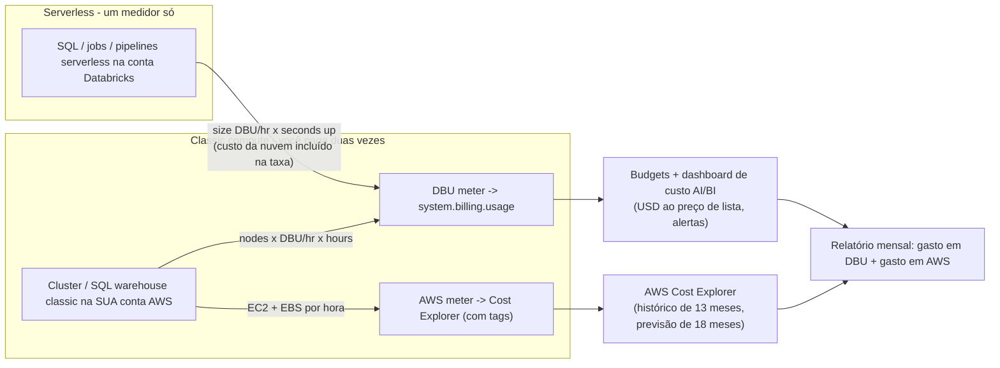
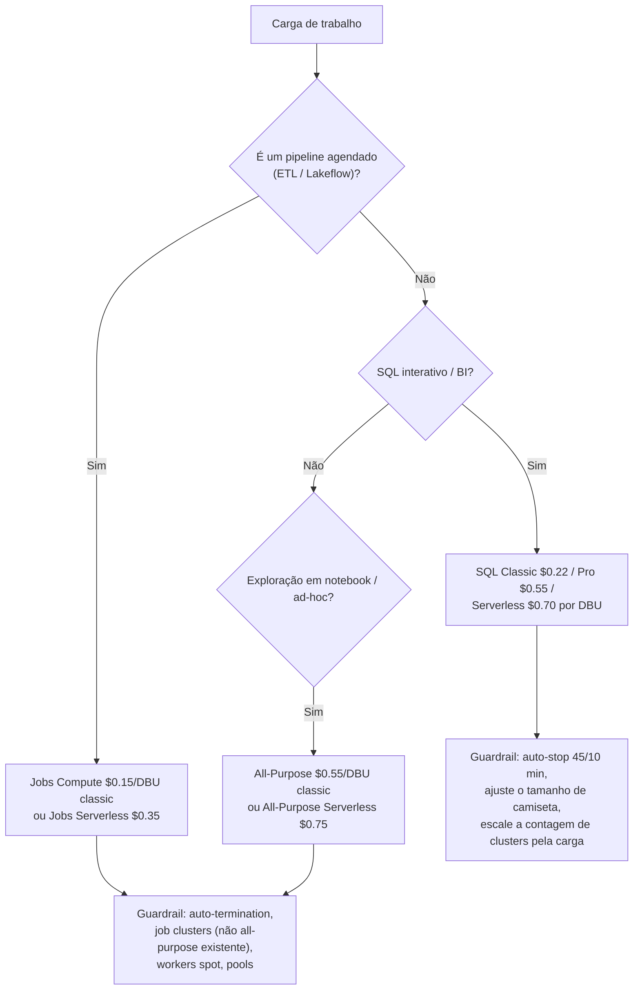
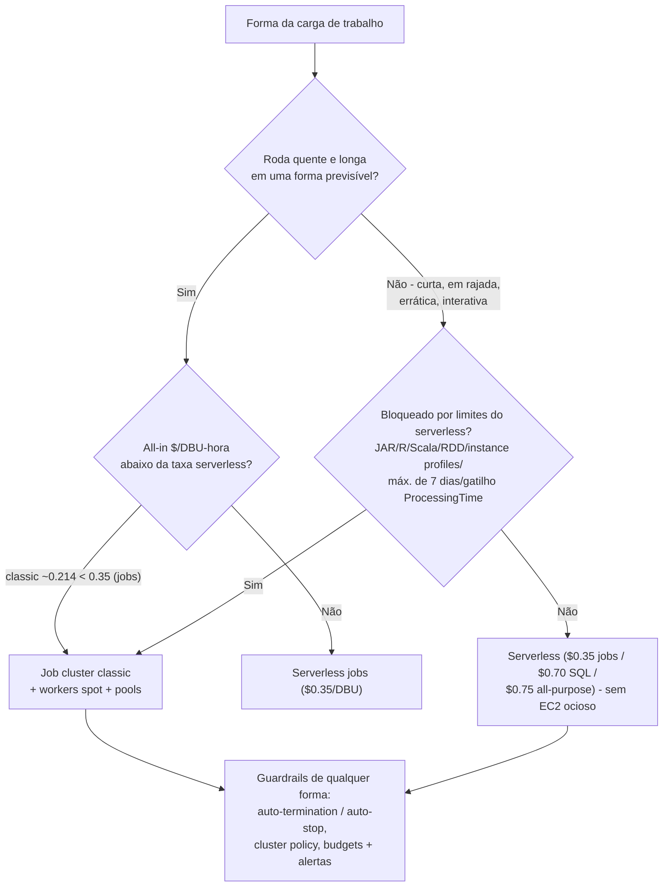
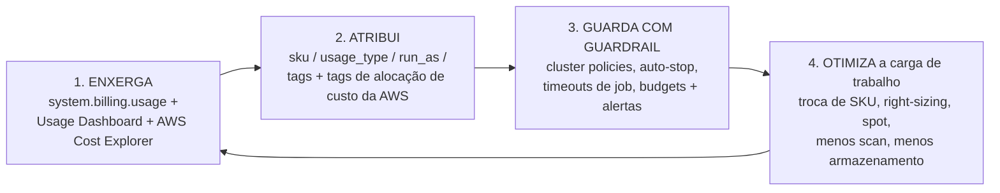

# Otimização de Custo e Economia de DBU na AWS

Todas as outras lições deste curso constroem alguma coisa; esta mantém a fatura honesta. Um lakehouse de dados da Databricks na AWS gera **duas faturas independentes** — a Databricks cobra você em **DBUs** (Databricks Units, a licença da plataforma, medida por segundo) e a AWS cobra o EC2, EBS, S3, NAT e CloudWatch que estão por baixo. Esqueça qualquer um dos dois medidores e sua "otimização de custo" é ficção: a metade de DBU pode estar perfeitamente ajustada enquanto um NAT Gateway adiciona discretamente $0.045 por GB de tráfego do S3, e a metade da AWS pode ser toda spot enquanto um cluster all-purpose fica ocioso a $0.55/DBU o fim de semana inteiro.

A boa notícia é que o custo da Databricks é *aritmética*, não *vibe*. Toda taxa desta lição está datada de **outubro de 2026** e rastreada até uma fonte primária ou documental: as páginas de preços e os arquivos page-data da Databricks (lidos em 2026-10), o registro de fornecedor UK G-Cloud 15 das taxas de lista de Jobs/All-Purpose (capturado em 2026-09-25), a documentação da Databricks para as tabelas de cobrança e o auto-stop (atualizada em 2026-09-11 / 2026-10-08), o AWS Price List para EC2/S3 (lido em 2026-10-12) e as páginas de preços da AWS para NAT, Spot e CloudWatch (lidas em 2026-10). Faça as contas você mesmo — é a única maneira de operar um lakehouse que ainda seja acessível no terceiro ano.

Nesta lição você vai:

- ler a **tabela de preços de DBU de out-2026 por SKU de compute** — jobs, all-purpose, SQL Classic/Pro/Serverless, Lakeflow pipelines — com a procedência de cada número explicada;
- aplicar as **duas equações** (clusters: nós × emissão × taxa × horas; warehouses: taxa do tamanho × tempo ligado) em cinco exemplos resolvidos à mão;
- tomar a decisão de **break-even serverless vs classic** com aritmética em vez de doutrina;
- configurar **auto-stop, auto-termination, workers spot, instance pools e cluster policies** como controles de custo, com os padrões documentados e seus mínimos;
- atribuir cada dólar com **`system.billing.usage`**, budgets e tags — e saber exatamente quais custos *nunca* aparecem lá;
- rodar o **caso TCO mensal resolvido** para um time de cinco pessoas (três pipelines, um warehouse de BI, S3/NAT/logs) e cortá-lo em **34.1%** com três alavancas;
- pesar o **Veredito Comparativo** — DBUs vs créditos do Snowflake vs os $5/TB escaneados do Athena;
- estudar **histórias nomeadas de custo de clientes na AWS** (Addepar, Nubank, Comcast), ler a **caixa de atualização de 2026** e praticar com **doze questões** mais cinco verificações interativas.

---

## 1. Duas faturas, não uma: o modelo de custo da Databricks na AWS

### 1.1 O que é um DBU

A própria definição da Databricks: *"A Databricks cobra com base em unidades Databricks (DBUs), que são unidades de capacidade de processamento por hora com base no tipo de instância de VM"* (docs.databricks.com/aws/en/getting-started/concepts, data do doc 2026-09-25). A página de preços diz o contrário: *"A Databricks Unit (DBU) é uma unidade normalizada de poder de processamento na Databricks Lakehouse Platform usada para fins de medição e precificação"* e *"Pague apenas pelos produtos que você usa, com granularidade de segundo"* (databricks.com/product/pricing, lida em 2026-10).

Três consequências decidem tudo o que segue:

1. **Para compute de cluster, consumo de DBU = (nós) × (DBU/h daquele tipo de nó) × horas** — o blog de gestão de custos de 2022 diz isso sem rodeios: *"Com exceção de um SQL Warehouse, a quantidade de DBUs consumida se baseia no número de nós e no poder computacional dos tipos de instância de VM subjacentes"* (databricks.com/blog/best-practices-cost-management-databricks, 2022-10-18; a aritmética continua valendo nas taxas de out-2026).
2. **Para SQL warehouses, consumo de DBU = (o DBU/h fixo do tamanho) × horas em que o warehouse está ligado** — rodando ou não, o medidor gira enquanto o warehouse está ativo (docs de preços, lidos em 2026-10).
3. **O medidor é por segundo, e ele não sabe se você está trabalhando.** Um cluster all-purpose ocioso e um que está processando emitem DBUs na mesma taxa. É por isso que *tempo ocioso*, e não *velocidade de consulta*, é o problema central de otimização de custo em compute classic.

### 1.2 Os dois medidores



**Serverless custa a máquina dentro de uma taxa de DBU mais alta.** SQL Serverless a **$0.70/DBU** contra SQL Classic a **$0.22/DBU** (databricks.com/product/pricing/databricks-sql, instantâneo de página 2026-10) é um prêmio de **$0.48 por DBU-hora** que paga a frota, a operação e o tempo ocioso que você deixou de possuir. Jobs Serverless **$0.35** menos Jobs Classic **$0.15** é o mesmo quadro a **$0.20 por DBU-hora**. Classic não é grátis — ele só move metade da fatura para a AWS, onde você pode atacá-la com spot e right-sizing.

> ⚠️ **`system.billing.usage` não é sua fatura total.** A Databricks é explícita: *"O `system.billing.usage` contém apenas custos da Databricks. Isso significa que em qualquer caso em que compute não-serverless está sendo usado, o gasto com infraestrutura de nuvem não está incluído e precisaria ser revisado pelo console de nuvem relevante (compute, rede, armazenamento etc.)"* (databricks.com/blog/top-5-system-table-queries-understanding-your-databricks-costs, 2026-09-22). Um budget só de Databricks subconta o número real pela coluna inteira da AWS.

- **📚 Você sabia?** A Databricks mede DBUs **por segundo** (FAQ de preços, lido em 2026-10), enquanto o Snowflake cobra créditos *"por segundo com mínimo de 60 segundos"* (visão geral de warehouses do Snowflake + tabela de consumo de serviço, lida em 2026-10). Em jobs curtos e frequentes, essa diferença de 55 segundos é uma linha de conta real — um dos motivos discretos pelas quais cargas de trabalho em rajada preferem jobs Databricks serverless a uma frota classic sempre retomada.

### 1.3 A tabela de preços de out-2026 (AWS, regiões dos EUA, tier Premium, lista)

| SKU de compute | Classic $/DBU | Serverless $/DBU | Notas | Fonte (data) |
|---|---|---|---|---|
| **Jobs Compute** (Lakeflow Jobs) | **0.15** | **0.35** | tier Enterprise: 0.20 / 0.45 | registro de fornecedor UK G-Cloud 15 (Databricks Inc., capturado em 2026-09-25); corroborado por seis leituras independentes (Flexera, licenseware 2026-10-06, costanalist, lakesentry, agentsql, hejlsvig) |
| **All-Purpose Compute** | **0.55** | **0.75** | tier Enterprise: 0.65 / 0.95 | mesmo conjunto documental acima (2026-09-25 / 2026-10) |
| **SQL Classic / Pro / Serverless** | **0.22 / 0.55** | **0.70** | nota de rodapé do serverless: "Inclui o custo da instância de nuvem" | instantâneo de página databricks.com/product/pricing/databricks-sql, 2026-10 (corroborado pelo instantâneo do digest L08) |
| **Lakeflow Pipelines (DLT) — tier Standard legado** | **0.20 Core / 0.25 Pro / 0.36 Advanced** | — | tier legado, ainda na página | page-data JSON da página de preços (HTTP 200, 2026-10-12) |
| **DLT serverless** | — | **0.35** | | leituras licenseware + Flexera, 2026-10 |
| **Jobs "Standard" (aposentado)** | ~~0.10~~ | — | EOL do tier Standard: AWS/GCP **2025-10-01**, Azure **2026-10-01** | databricks.com/product/pricing/lakeflow-jobs, lida em 2026-10 |

**Leia a coluna de procedência antes de citar uma taxa.** Os valores de SQL e Lakeflow Pipelines vêm das próprias superfícies de preços da Databricks (instantâneos de página e o arquivo page-data do site de preços). Os valores de Jobs e All-Purpose são *documentais e corroborados* — o registro público de fornecedor UK G-Cloud 15 (uma declaração legal da Databricks Inc.) mais seis leituras independentes de 2026 que concordam entre si — porque o databricks.com renderiza esses cartões no cliente. Trate todo valor como **lista dos EUA, tier Premium**: o FAQ de preços afirma *"Os preços da Databricks e os preços da Infraestrutura de Nuvem podem variar conforme a região geográfica e o provedor de serviços de nuvem"* (lido em 2026-10), e a verdade dentro da conta vive em `system.billing.list_prices` (o preço do seu contrato).

Duas regras práticas com respaldo oficial:

- **Mesmo pipeline, all-purpose vs jobs = 3.7× a taxa por DBU** ($0.55 ÷ $0.15 ≈ 3.7) — antes de você contar um único minuto ocioso.
- **Serverless custa ~1.3×–2.3× mais por DBU que o classic** para a mesma família de SKU, e remove junto a fatura de EC2, a gestão de pools e o tempo ocioso.

**Efeito de região:** as taxas classic são planas entre as regiões da AWS *porque você paga o preço local do EC2 separadamente*; **as taxas serverless acompanham a infraestrutura regional** — SQL Serverless **$0.70** em us-east-1 contra **$0.91** em eu-central-1 (leitura de hejlsvigconsulting.com do arquivo de dados de preços, 2026-08-07). Uma cotação dos EUA nunca se transfere para Frankfurt.

### 1.4 Exemplo resolvido E1 — a equação básica e uma fatura combinada

O próprio padrão resolvido do blog de gestão de custos de 2022, reprecificado na taxa Premium de jobs de hoje (blog, 2022-10-18; lista de preços do EC2, us-east-1, lida em 2026-10-12):

```text
Exemplo resolvido E1 - um cluster de jobs de 4 nós, uma hora (em out 2026)
  nós .................... 4
  emissão (ilustrativa) .. 3 DBU/hr por nó  (o tipo de nó do exemplo do blog)
  DBU/hr ................... 4 x 3 = 12 DBU/hr
  custo DBU, Premium Jobs . 12 x $0.15/DBU = $1.80 / h
  custo DBU, Enterprise ... 12 x $0.20/DBU = $2.40 / h  (a própria cifra do blog)
  custo AWS ............... 4 x m5.xlarge @ $0.192/h = $0.768 / h
  total classic combinado . $1.80 + $0.768 = $2.568 / h  (Premium)
  all-in por DBU emitido .. $2.568 / 12 = $0.214 por DBU-hora
```

Essa última linha é o número que você vai reusar a lição inteira: **$0.214 all-in por DBU-hora em jobs classic** contra **$0.35** de jobs serverless — é por isso que o classic vence em formas quentes, longas e previsíveis, e o serverless vence em formas curtas, em rajada ou erráticas (seção 3). A ressalva que o próprio blog implica: pareie a taxa de emissão do *seu* tipo de nó com o preço de EC2 *daquele tipo de nó*, e leia ambos na calculadora de preços ou em `system.billing.list_prices` — o par 3 DBU/hr + m5.xlarge acima é ilustrativo, não é uma forma pareada.

---

## 2. A escada de SKU: sua alavanca de precificação mais poderosa

Antes de ajustar uma única consulta, verifique se a carga de trabalho está no SKU certo. A escolha de SKU é grátis, instantânea e — segundo os próprios relatos de campo da Databricks — vale mais que a maior parte do trabalho de performance.



### 2.1 Os três crimes da escada

1. **Um pipeline em compute all-purpose.** Um job apontado para um cluster all-purpose *existente* é cobrado nas taxas de **All-Purpose** e marcado como uma carga de trabalho **interativa** (Jobs API 2.0; digest 06, lido em 2026-10). A Databricks *"não recomenda essa configuração para jobs de produção."* A diferença de taxa sozinha é de **$0.55 → $0.15** por DBU.
2. **O tier Standard aposentado no seu runbook.** Jobs a $0.10/DBU era o Standard; workspaces Standard da AWS/GCP foram atualizados para Premium em **2025-10-01** (Azure **2026-10-01**) conforme a página de preços (lida em 2026-10). Qualquer tabela de taxas anterior a 2025 que você copiar está desatualizada em 50%.
3. **Confusão Premium-vs-Enterprise entre clouds.** O "Premium" da AWS/GCP é o cartão "Enterprise" do Azure: Jobs na AWS é **$0.15 Premium / $0.20 Enterprise** (uma diferença de 33%) e todo SKU serverless se move junto (registro G-Cloud 2026-09-25; licenseware 2026-10-06). Sempre rotule a cloud *e* o tier.

### 2.2 Exemplo resolvido E2 — um pipeline, um mês, all-purpose vs jobs

O mesmo pipeline de 12 DBU/hr, 400 horas de cluster por mês, os mesmos 4 × m5.xlarge no lado da AWS (taxas em out 2026):

```text
Exemplo resolvido E2 - custo do pipeline por SKU, um mês (em out 2026)
  All-Purpose Compute:
    DBU .... 12 DBU/hr x 400 h x $0.55 ....... = $2,640.00
    AWS .... 4 x $0.192/h x 400 h ............ = $  307.20
    total .................................... = $2,947.20
  Jobs Compute (novo job cluster):
    DBU .... 12 DBU/hr x 400 h x $0.15 ....... = $  720.00
    AWS .... 4 x $0.192/h x 400 h ............ = $  307.20
    total .................................... = $1,027.20
  ECONOMIA ................................. = $1,920.00 / mês
       (65% da fatura combinada, 73% da metade de DBU)
```

Um pipeline. Um dropdown na definição do job. O próprio resumo da Databricks sobre a versão em toda a base: *"Vimos clientes que economizaram dezenas de milhares de dólares simplesmente movendo apenas dez por cento de suas cargas de trabalho de clusters all-purpose para job clusters"* (blog de gestão de custos, 2022-10-18 — fonte antiga, aritmética inalterada).

```matching
{
  "question": "Associe cada SKU de compute ou regra de cobrança à sua economia de lista de out-2026 na AWS (tier Premium):",
  "pairs": [
    {"left": "Jobs Compute, classic (novo job cluster)", "right": "$0.15 por DBU - o SKU mais barato da escada; job clusters terminam automaticamente quando o run termina"},
    {"left": "All-Purpose Compute, classic", "right": "$0.55 por DBU - cerca de 3.7x o Jobs para o mesmo trabalho; a taxa que um job paga quando roda em um cluster all-purpose existente"},
    {"left": "SQL Classic / Pro / Serverless", "right": "$0.22 / $0.55 / $0.70 por DBU - serverless inclui o custo da instância de nuvem na taxa, classic não inclui"},
    {"left": "Jobs Serverless / All-Purpose Serverless", "right": "$0.35 / $0.75 por DBU - cerca de $0.20 / $0.20 por DBU-hora de máquina+ops absorvidos em relação ao classic"},
    {"left": "Lakeflow Pipelines no tier Standard legado", "right": "$0.20 Core / $0.25 Pro / $0.36 Advanced por DBU - um tier aposentado que ainda aparece no arquivo page-data de preços (2026-10-12)"},
    {"left": "Jobs Compute 'Standard' a $0.10 por DBU", "right": "Sumiu: workspaces do tier Standard atualizados para Premium em 2025-10-01 (AWS/GCP) e 2026-10-01 (Azure)"},
    {"left": "Nós de instance pool ociosos dentro do pool", "right": "$0 DBUs da Databricks - mas as cobranças de instância e EBS da AWS continuam enquanto o nó existir"}
  ],
  "explanation": "A escada corre Jobs 0.15 -> SQL Classic 0.22 -> SQL Pro / âncora all-purpose 0.55 -> Jobs Serverless 0.35 (incluído) -> SQL Serverless 0.70 (incluído) -> All-Purpose Serverless 0.75 (incluído), com os tiers DLT Standard legados entre jobs e SQL Classic. As armadilhas: tratar $0.15 vs $0.70 como uma lacuna de custo total de 4.7x (não é - classic carrega uma segunda fatura EC2); confiar em uma tabela anterior a 2025 que ainda mostra $0.10 Standard; e acreditar que pools são grátis (são grátis apenas de DBUs - o medidor da AWS continua rodando)."
}
```

- **📚 Você sabia?** Atualizações de materialized view são cobradas como uso de **pipeline serverless**, não como uso de warehouse — então uma aba de custo de "warehouse" não vai mostrá-las (blog da Databricks, 2026-10-07). O predictive optimization está **ligado por padrão para contas criadas em ou depois de 2024-11-11**, e ele também é cobrado sob registros de uso serverless. Se suas consultas de atribuição agrupam apenas por warehouse, esses dois SKUs são vazios invisíveis.

---

## 3. Serverless vs classic: a aritmética de break-even

"Serverless é 4× mais caro" é a frase mais cara das discussões de custo da Databricks, porque compara taxas de DBU enquanto ignora a coluna da AWS no lado classic. A comparação honesta é o all-in por DBU-hora emitido.

```text
Exemplo resolvido E3 - onde fica a linha classic/serverless (em out 2026)
  Deltas Premium (máquina + ops absorvidos pelo serverless):
    SQL ....... $0.70 - $0.22 = $0.48 por DBU-hora
    Jobs ...... $0.35 - $0.15 = $0.20 por DBU-hora
  Cluster classic de jobs, all-in (de E1):
    ($1.80 DBU + $0.768 AWS) / 12 DBU = $0.214 por DBU-hora
  Decisão:
    $0.214 (classic, quente e longo)  <  $0.35 (jobs serverless)  -> classic vence
    rajada / curto / errático / interativo -> serverless vence
      (sem EC2 ocioso, sem admin de pool, sem start de warehouse classic de 4 minutos)
  Teste de break-even que você pode rodar em qualquer forma:
    (EC2 $/h + DBU $/h) / emissão  vs  serverless $/DBU
```



Três leituras práticas:

- **O classic vence** quando o cluster roda quente e longo em uma forma previsível — janelas de ETL batch, backfills noturnos grandes, treino de ML com contagem de nós conhecida. Você já está pagando cerca de $0.192/h por um m5.xlarge (lista de preços do EC2, lida em 2026-10-12); o classic dobra isso em uma licença de $0.15/DBU em vez de um pacote de $0.35/DBU.
- **O serverless vence** em trabalho curto, em rajada, interativo ou imprevisível — dashboards com intervalos entre refreshes, notebooks ad-hoc, jobs orientados a eventos — porque *"você não é cobrado enquanto ele está ocioso"* (Databricks Answers, 2026-08-27) e a frota, o patching e o planejamento de capacidade desaparecem.
- **As restrições operacionais pesam tanto quanto o preço.** Jobs serverless têm **tempo máximo de execução documentado de 7 dias**, sem tarefas JAR/Spark-Submit, sem notebooks R/Scala, sem APIs RDD, sem instance profiles, e gatilhos de Structured Streaming limitados a `Trigger.AvailableNow()` (recomendado) — enquanto o classic existe justamente onde essas restrições apertam (digest 06, docs lidos em 2026-10). Migrate o *padrão* (volumes em vez de DBFS, DataFrame API em vez de RDDs) antes de virar o SKU.

```fillblank
{
  "question": "Complete a aritmética serverless vs classic com os números de out-2026 (AWS, lista do tier Premium):",
  "template": "SQL Serverless menos SQL Classic igual a {{1}} por DBU-hora de máquina e operações absorvidas, e Jobs Serverless menos Jobs Classic igual a {{2}} por DBU-hora. Um cluster classic de jobs com 4 nós emitindo 12 DBU/hora a $0.15/DBU mais 4 x m5.xlarge a $0.192/hora custa ${{3}} por hora all-in, ou seja, cerca de ${{4}} por DBU-hora emitido - abaixo da taxa de $0.35 do jobs serverless, e é por isso que formas quentes, longas e previsíveis ficam no classic. As taxas de SQL serverless também variam por região: $0.70 em us-east-1 contra ${{5}} em eu-central-1.",
  "answers": {
    "1": "0.48",
    "2": "0.20",
    "3": "2.568",
    "4": "0.214",
    "5": "0.91"
  },
  "distractors": ["0.35", "0.55", "0.22", "2.40", "2.400", "0.2140", "0.70", "0.81", "0.45"],
  "explanation": "Os deltas são $0.70-$0.22=$0.48 e $0.35-$0.15=$0.20 por DBU-hora (páginas de preços, lidas em 2026-10). O cluster classic de E1 é 12 x 0.15 = $1.80 DBU mais 4 x 0.192 = $0.768 AWS = $2.568/h, ou seja, $2.568/12 = $0.214 por DBU-hora emitido. SQL Serverless é $0.70 em us-east-1 e $0.91 em eu-central-1 (arquivo de dados da página de preços lido em 2026-08-07) porque as taxas serverless acompanham a infraestrutura regional enquanto as taxas classic são planas (você paga o EC2 local separadamente). Os distratores são o degrau vizinho da escada ($0.22/$0.35/$0.45/$0.55), a cifra de hora Enterprise do blog ($2.40) e uma versão com vírgula decimal deslocada do número de break-even."
}
```

---

## 4. Tempo ocioso: auto-stop, auto-termination e a regra de cobrado-enquanto-ligado

A própria frase da Databricks sobre warehouses: *"SQL warehouses ociosos continuam acumulando DBU e cobranças de instância de nuvem até serem parados"* (docs.databricks.com/aws/en/compute/sql-warehouse/create, última atualização 2026-09-11). Não existe maneira mais branda de dizer isso: **um warehouse que está ligado é um warehouse que é cobrado.** Dez horas deixadas ligadas para quarenta minutos de dashboards cobram dez horas.

### 4.1 Os padrões documentados (em out 2026)

| Recurso | Padrão de auto-stop / auto-termination | Mínimo | Fonte (data) |
|---|---|---|---|
| SQL warehouse, **Pro / Classic** | **45 minutos** de inatividade | **10 minutos** | blog 2026-10-07; doc create-warehouse 2026-09-11 |
| SQL warehouse, **Serverless** | **10 minutos** | **5 minutos** (UI) / **1 minuto** (API) | as mesmas duas fontes |
| **Cluster all-purpose** | uma janela de inatividade que você define (`autotermination_minutes`; range da API 10–10,000, **0 = desativado**) | 10 minutos | bundle-schema / referência de policy, lida em 2026-10; norma histórica de cerca de uma hora (blog 2022-10-18) |
| **Job clusters / DLT clusters** | terminam **ao concluir** o run | — | blog 2022-10-18; docs de Jobs |

Duas sutilezas. Primeiro, os padrões de auto-stop diferem por um fator de 4.5 entre classic/Pro (45 min) e serverless (10 min) — se seus dashboards dão refresh a cada 20 minutos, o padrão classic *garante* que você pague por 25 minutos ociosos após cada sessão. Segundo, `autotermination_minutes = 0` (desativado) é um valor legal de API e a fonte mais comum de gasto descontrolado de fim de semana; uma policy imposta vence uma varredura manual semanal (seção 6.3).

### 4.2 Exemplo resolvido E4 — aritmética de auto-stop no warehouse de BI

Do caso TCO mensal da seção 9: um SQL warehouse serverless que atende o BI fica ligado **10 horas por dia** por 21 dias úteis (210 horas, 2,520 DBU com uma emissão de camiseta assumida de 12 DBU/h). O uso medido mostra que os dashboards realmente consultam em uma janela de **6 horas**:

```text
Exemplo resolvido E4 - apertando o auto-stop do BI de 10 h para 6 h/dia (em out 2026)
  horas removidas ...... (10 - 6) h/dia x 21 dias = 84 h/mês
  DBU removidos ........ 84 h x 12 DBU/h ......... = 1,008 DBU
  economia ............. 1,008 x $0.70/DBU ....... = $705.60 / mês
  custo de BI restante . (2,520 - 1,008) x $0.70 . = $1,058.40 / mês
  -> um corte de 40% na linha do BI com uma única configuração de warehouse
```

Nenhuma consulta foi reescrita. Nenhum dado foi movido. O warehouse simplesmente não foi deixado ligado. (A cifra de 12 DBU/h é a emissão de camiseta Small assumida por este caso — os tamanhos de medidor por camiseta de warehouse não são publicados como tabela oficial, então leia o seu em `system.billing.list_prices` na sua conta antes de reusar a aritmética.)

### 4.3 Exemplo resolvido E5 — uma policy de auto-stop / auto-termination imposta

Cluster policies são conjuntos de regras JSON gerenciados por admin sobre atributos da Clusters-API, cujos benefícios incluem *"controle de custo via atributos que dirigem o preço"* (docs, lidos em 2026-10). A referência de policies (lida em out 2026) documenta o caminho do atributo `autotermination_minutes` e um range virtual de `dbus_per_hour` que atua como um teto duro de DBU; a restrição de node-type é igualmente uma capacidade de policy. Uma policy mínima de guardrail de custo para um workspace de time:

```json
{
  "name": "team-analytics-cost-guardrail",
  "description": "Enforced idle kill + node allowlist + DBU ceiling (verify keys in your workspace)",
  "spark_version": {
    "type": "fixed",
    "value": "auto:latest-lts"
  },
  "autotermination_minutes": {
    "type": "fixed",
    "value": 60
  },
  "node_type_id": {
    "type": "allowlist",
    "defaultValue": "m5.xlarge",
    "values": ["m5.xlarge", "m5.2xlarge", "r5.xlarge"]
  },
  "num_workers": {
    "type": "range",
    "min": 1,
    "max": 10,
    "defaultValue": 2
  },
  "dbus_per_hour": {
    "type": "range",
    "min": 0,
    "max": 24
  }
}
```

A mecânica que faz isso ser um *guardrail* e não uma sugestão: uma limitação por atributo; compute criado por API **ignora os valores padrão da policy a menos que `apply_policy_default_values: true`** seja definido; `spark_version: auto:latest-lts` só resolve quando o compute é *editado*, não continuamente; e o entitlement **Unrestricted** contorna tudo, então ele *"deve ser suprimido para usuários não-admin"* (orientação de onboarding de policy, blog 2025-04-17). A grafia das chaves de atributo varia entre superfícies de API — confirme-as no editor de policies do seu workspace antes de depender deste JSON literalmente.

> ⚠️ **Budgets e policies monitoram e restringem; eles não param um gastador determinado.** Budgets são *"monitoramento e alertas, não um teto rígido"* (doc de budgets, atualizada em 2026-10-07) — um usuário com permissões suficientes ainda pode criar um warehouse que roda além do tempo ou fica escalado além do esperado. O próprio enquadramento da Databricks: *"Bons controles via compute policies, configurações de timeout de job e budgets ajudam os administradores da plataforma Databricks a manter o gasto dentro de limites, mas sempre existe a possibilidade de um usuário com permissões suficientes criar um job ou warehouse que roda além do tempo ou fica escalado além do esperado e causa um pico inesperado de gasto"* (blog das top-5 consultas de system table, 2026-09-22). Guardrails são em camadas ou são teatro.

```dragdrop
{
  "question": "Ordene a escada de controle de tempo ocioso da alavanca mais barata e automatizada para a mais manual - a ordem em que esta lição a constrói:",
  "items": [
    "Job clusters: criados por run, terminam ao concluir - o tempo ocioso é estruturalmente zero",
    "Auto-stop em SQL warehouses: padrão 45 min Pro/Classic, 10 min serverless; aperte para o seu intervalo real de refresh (mínimo 10 / 5 min na UI, 1 min na API)",
    "Auto-termination em clusters all-purpose: autotermination_minutes 10-10,000; 0 desativa e é o runaway clássico de fim de semana",
    "Cluster policies impostas: auto-termination fixa, allowlist de node-type, teto de num_workers, range de dbus_per_hour - mais apply_policy_default_values true pela API",
    "Instance pools: nós quentes cortam o startup, $0 DBUs enquanto em pool - mas a cobrança de instância e EBS da AWS continua nos nós ociosos do pool",
    "Varredura humana semanal do workspace: ainda necessária como rede de segurança, nunca como controle principal"
  ],
  "correctOrder": [
    "Job clusters: criados por run, terminam ao concluir - o tempo ocioso é estruturalmente zero",
    "Auto-stop em SQL warehouses: padrão 45 min Pro/Classic, 10 min serverless; aperte para o seu intervalo real de refresh (mínimo 10 / 5 min na UI, 1 min na API)",
    "Auto-termination em clusters all-purpose: autotermination_minutes 10-10,000; 0 desativa e é o runaway clássico de fim de semana",
    "Cluster policies impostas: auto-termination fixa, allowlist de node-type, teto de num_workers, range de dbus_per_hour - mais apply_policy_default_values true pela API",
    "Instance pools: nós quentes cortam o startup, $0 DBUs enquanto em pool - mas a cobrança de instância e EBS da AWS continua nos nós ociosos do pool",
    "Varredura humana semanal do workspace: ainda necessária como rede de segurança, nunca como controle principal"
  ],
  "explanation": "A escada é primeiro-automação porque automação não esquece: job clusters tornam a ociosidade estruturalmente impossível; auto-stop e auto-termination matam a ociosidade residual em compute compartilhado; policies tornam essas configurações não opcionais; pools trocam um custo pequeno sempre-ligado da AWS por zero de ociosidade em DBU e startups mais rápidos; e a varredura humana é a camada que você adiciona por último, não por primeiro. Os dois erros que essa ordem evita: depender de varreduras (elas param de acontecer em semanas de pressão) e tratar pools como grátis (eles deslocam custo da coluna de DBU para a coluna da AWS - digests 06 e 15, lidos em 2026-10)."
}
```

---

## 5. Spot na AWS: o que ele economiza e o que ele nunca toca

Spot Instances da AWS *"economizam até 90% nos preços sob demanda"* (aws.amazon.com/ec2/spot, lido em 2026-10), e a AWS emite um **aviso de interrupção de dois minutos** antes de parar ou terminar uma instância Spot (docs do EC2 da AWS, lidos em 2026-10). Na Databricks a regra de topologia é fixa: quando você marca spot, *"o driver node é sempre on-demand, as instâncias seguintes serão spot"* (doc de configuração de compute, atualizado em 2026-10-06).

### 5.1 Exemplo resolvido E6 — aritmética de spot, e a coluna que ele nunca toca

Cinco workers m5.xlarge por 200 horas por mês (lista do EC2, us-east-1, lida em 2026-10-12):

```text
Exemplo resolvido E6 - spot em 5 workers, 200 h/mês (em out 2026)
  Coluna AWS sob demanda . 5 x $0.192/h x 200 h = $192.00
  Spot a -60% ........... 5 x $0.0768/h x 200 h = $ 76.80   -> economiza $115.20/mês
  Spot a -90% (máx) ..... 5 x $0.0192/h x 200 h = $ 19.20   -> economiza $172.80/mês
  Coluna DBU ............ INALTERADA
    ($/DBU e a emissão de DBU do nó são idênticas em spot e sob demanda)
  -> spot é uma alavanca do lado AWS, ponto final
```

Quatro fatos operacionais para precificar no design: o driver continua sob demanda (docs de compute 2026-10-06); a evicção de dois minutos chega no meio da task, então pipelines precisam de estágios reiniciáveis e idempotentes (docs da AWS 2026-10) — o gatilho `AVAILABLE_NOW` e o Structured Streaming com checkpoint das lições 05 e 13 são os padrões compatíveis; **pools são todos-spot ou todos-sob-demanda** (a API adiciona `SPOT_WITH_FALLBACK`), e a orientação da Databricks é *"Não use um pool com spot instances como o seu driver type"*; e spot **não economiza nada em serverless** — serverless é embutido, e nenhuma fonte afirma que descontos de EC2 spot fluem para as taxas de DBU serverless.

- **📚 Você sabia?** Spot pode economizar até 90% e *ainda* ser a decisão errada para um job de 20 minutos com SLA estrito: a orientação atual da Databricks pareia **pools spot para cargas de trabalho tolerantes a custo** com **pools sob demanda para jobs curtos e de SLA estrito**, e recomenda **serverless em vez de pools** sempre que a carga de trabalho suportar (docs, lidos em 2026-10). Spot é uma decisão de *carga de trabalho*, não um interruptor de economia para a conta inteira.

---

## 6. Right-sizing, autoscaling, pools e desempenho-como-custo

### 6.1 Right-sizing do warehouse (a alavanca proporcional)

Para um warehouse, o custo de DBU é **taxa do tamanho × tempo ligado**, então **um tamanho de camiseta para baixo é um corte proporcional de DBU por cada hora em que o warehouse está ligado** — a economia linear mais limpa da plataforma. A escada classic/Pro é construída sobre workers i3.2xlarge (2X-Small = 1 worker, dobrando até X-Large = 32, até 4X-Large = 256) com *"um cluster para cada 10 consultas concorrentes"* como regra de concorrência (docs, lidos em 2026-10). Dimensione para a concorrência que você atende, não para o pico que você já viu; adicione clusters (autoscaling no nível do warehouse) em vez de inflar a camiseta para uma fila que esvazia em minutos.

### 6.2 Autoscaling, pools e `AVAILABLE_NOW`

- **Autoscaling encolhe o pico.** Autoscaling otimizado (Premium+) vai de min→max em **≤2 eventos de resize**, escala para baixo em uma janela de subutilização de **40 segundos** para compute de jobs e **150 segundos** para all-purpose (docs, atualizados em 2026-10-06). Nunca combine isso com `spark.dynamicAllocation.enabled` — os docs alertam sobre churn de executores e `NODES_LOST`.
- **Pools custam zero DBUs enquanto ociosos — e AWS cheio enquanto ociosos.** *"A Databricks não cobra DBUs enquanto as instâncias estão ociosas no pool. A cobrança do provedor de instâncias se aplica"* (melhores práticas de custo, 2026-09-11). Dimensione `min_idle_instances` e `idle_instance_autotermination_minutes` deliberadamente; mantenha o tamanho máximo do cluster ≤ `max_capacity` do pool, ou o scale-out falha com `INSTANCE_POOL_MAX_CAPACITY_FAILURE`.
- **`AVAILABLE_NOW` dá forma ao pipeline.** Rode um pipeline acionado (`Trigger.AvailableNow()`) em um job cluster que termina ao concluir, em vez de um cluster contínuo que fica ocioso entre micro-batches — a lista oficial de alavancas recomenda isso (melhores práticas, 2026-09-11).

### 6.3 Photon como alavanca de custo (com cuidado)

Photon é o engine vetorial em C++ que *"substitui o engine de execução Spark SQL baseado no JVM"* enquanto o Catalyst ainda planeja a consulta (docs do Photon, atualizados em 2026-09-11). A história de custo dele é **segundos faturáveis, não desconto**: terminar mais cedo significa menos segundos medidos por segundo — mas o Photon também *"consome DBUs a uma taxa diferente da mesma tipo de instância rodando o runtime não-Photon"*, então *"Photon é mais rápido"* nunca implica *"Photon é mais barato"* (docs; faça benchmark da sua própria carga de trabalho). Ele acelera SQL, ETL com DataFrame e streaming **stateless**, e **não** acelera corpos de UDF Python, RDDs, Datasets nem streaming stateful — consultas abaixo de ~2 segundos não veem ganho significativo (docs, 2026-09-11). Photon está ligado por padrão em serverless, SQL warehouses e na UI; **clusters criados por API precisam definir `runtime_engine: "PHOTON"` explicitamente** (lição 06).

### 6.4 O loop de quatro estágios

O próprio enquadramento da Databricks para controlar gasto (Databricks Answers, lido em 2026-10):



A maioria dos times inverte essa ordem e começa no estágio 4 — reescrevendo consultas enquanto um cluster all-purpose ocioso cobra $0.55/DBU no canto. Os estágios 1 e 2 são baratos (os dados do medidor já estão na sua conta); o estágio 3 é configuração; só o estágio 4 é engenharia.

---

## 7. Atribuição de custo: system tables, budgets e o console da AWS

### 7.1 `system.billing.usage` — todo DBU tem um endereço

A system table de cobrança (docs, atualizados em 2026-10-08) traz, entre outros: `account_id`, `workspace_id`, `workspace_name`, `region`, `billable_usage_timestamp`, `billing_origin_time`, `billing_month`, `cloud`, `sku`, `usage_type`, `product_feature`, `record_type`, `run_as`, `metered_quantity`, `list_price`, `unblended_cost`, `databricks_contract_quantity`, `aws_public_list_price` e `tags`. As três que fazem o trabalho em toda consulta de atribuição:

- **`sku` / `usage_type` / `product_feature`** — *que tipo* de compute (jobs vs all-purpose vs SQL vs pipelines serverless);
- **`run_as`** — *se o run foi interativo, um job, serverless* e assim por diante;
- **`tags` / `workspace_name`** — *de quem* é.

`record_type` separa linhas de uso de linhas de preço, e a Databricks entrega joins prontos para `system.billing.list_prices` e `system.compute.clusters`, mais instruções para publicar o resultado em um dashboard AI/BI e levantar um alerta (docs, 2026-09-11). Também existe um **Usage Dashboard** pronto (blog, 2026-09-22) — comece por ele antes de escrever SQL.

### 7.2 Exemplo resolvido E7 — a auditoria de "cortar a fatura" em SQL

```sql
-- Worked example E7a - what did we spend, by SKU, this month?
-- (system.billing.usage, docs updated 2026-10-08)
SELECT  sku,
        usage_type,
        product_feature,
        SUM(metered_quantity) AS dbus,
        SUM(unblended_cost)   AS cost_usd
FROM    system.billing.usage
WHERE   billing_month = DATE_FORMAT(CURRENT_DATE, 'yyyy-MM')
  AND   record_type = 'USAGE'
GROUP BY 1, 2, 3
ORDER BY cost_usd DESC;
```

```sql
-- Worked example E7b - which clusters are the whales?
-- join the usage meter to the cluster dimension (sample queries, docs 2026-09-11)
SELECT  u.tags['cluster_id']        AS cluster_id,
        c.cluster_name,
        c.owner_id,
        SUM(u.unblended_cost)       AS cost_usd,
        SUM(u.metered_quantity)     AS dbus
FROM    system.billing.usage u
JOIN    system.compute.clusters c
  ON    u.tags['cluster_id'] = c.cluster_id
WHERE   u.billing_month = DATE_FORMAT(CURRENT_DATE, 'yyyy-MM')
GROUP BY 1, 2, 3
ORDER BY cost_usd DESC
LIMIT 20;
```

Classifique a saída e trabalhe **de cima para baixo** na lista de alavancas: (1) clusters all-purpose ociosos e a configuração de auto-termination deles → (2) warehouses com auto-stop "never" ou 45 minutos atendendo dashboards de 20 minutos → (3) cargas de trabalho em All-Purpose que na verdade são jobs → (4) um tamanho para baixo / autoscaling → (5) spot para workers → (6) pool nos nós quentes → (7) lifecycle do S3 + um gateway endpoint → (8) budgets + alertas para isso não regenerar. Duas tabelas de apoio fecham o loop: `system.billing.list_prices` (os preços do seu contrato — o substituto dentro da conta de qualquer tabela pública de taxas) e `system.compute.warehouse_events` para forense do ciclo de vida dos warehouses.

### 7.3 Budgets, tags e o lado da AWS

Budgets (doc, atualizada em 2026-10-07): até **1,000 budgets por conta**, cada um com até **4 thresholds (%)**, expressos em **USD ao preço de lista incluindo add-ons** (sem descontos/créditos aplicados), com escopo por time/projeto/workspace com filtros, criados por admins de conta (admins de workspace para budgets com escopo de UC). De novo: budgets **monitoram, não limitam**.

Tags são a junta entre as duas faturas — com uma pegadinha. Tags da Databricks e *tags customizadas impostas via compute policies e serverless usage policies* caem em `system.billing.usage` (blog, 2026-09-22), e a propagação de tags para recursos de nuvem é o caminho documentado para a atribuição do lado da AWS (melhores práticas, 2026-09-11). Mas uma tag `team` definida apenas em um cluster Databricks **não** se torna por si só uma tag de alocação de custo da AWS; e **tags não fazem backfill** — a dimensão `CostCenter` da fatura da AWS só existe a partir do dia em que você a cria. No lado da AWS, o **Cost Explorer** mantém *"até os últimos 13 meses"* de histórico e projeta *"os próximos 18 meses"* (docs da AWS, lidos em 2026-10).

```fillblank
{
  "question": "Complete os fatos de atribuição de custo com os valores documentados de out-2026:",
  "template": "A tabela de medidor da Databricks é {{1}}; sua coluna {{2}} diz se um run foi interativo, job ou serverless, e metered_quantity x list_price igual a {{3}}. Budgets permitem até {{4}} por conta com até {{5}} thresholds cada, denominados em USD ao preço de lista, e eles {{6}} limitam rigidamente o uso. O AWS Cost Explorer retém {{7}} meses de histórico e projeta {{8}} meses. Já as cobranças de S3, NAT, EBS e CloudWatch aparecem apenas no {{9}}.",
  "answers": {
    "1": "system.billing.usage",
    "2": "run_as",
    "3": "unblended_cost",
    "4": "1000",
    "5": "4",
    "6": "não",
    "7": "13",
    "8": "18",
    "9": "AWS Cost Explorer"
  },
  "distractors": ["system.billing.list_prices", "sku", "metered_cost", "100", "10", "12", "24", "o console da Databricks", "system.query.history"],
  "explanation": "system.billing.usage é o medidor (docs, atualizados em 2026-10-08); run_as carrega a distinção interativo/job/serverless; metered_quantity x list_price = unblended_cost. Budgets: 1,000 por conta, 4 thresholds, USD ao preço de lista, monitoramento e não tetos rígidos (doc de budgets 2026-10-07). Cost Explorer: 13 meses de histórico / 18 meses de previsão (docs da AWS 2026-10). A coluna da AWS da fatura - S3, NAT, EBS, CloudWatch - nunca aparece em system.billing.usage (blog 2026-09-22). Os distratores são as system tables vizinhas e números plausíveis porém errados."
}
```

- **📚 Você sabia?** As novas **query tags (Public Preview)** caem em `system.query.history`, o `dbt-databricks` 1.11.0 adiciona auto-tagging, e uma **Governance Hub Cost page (Beta)** agrega a superfície de gasto (blog da Databricks, 2026-10-07). O RBI reconstruiu monitoramento e previsão de custo sobre as system tables e relatou isso rodando **3–4× mais rápido** do que o processo anterior (mesmo blog) — os dados do medidor já estão na sua conta; o dashboard é a parte barata.

---

## 8. O lado AWS da fatura: EC2, EBS, S3, NAT, CloudWatch

As ofertas do AWS Price List (us-east-1; EC2 lido em 2026-10-12, oferta do S3 publicada em 2026-09-28) e as páginas de preços da AWS (lidas em 2026-10):

| Item | Preço | Fonte (data) |
|---|---|---|
| m5.xlarge / m6i.xlarge sob demanda | **$0.192/h** | JSON da lista de preços do EC2 (2026-10-12) |
| m5.2xlarge / r5.xlarge / c6i.xlarge | $0.384 / $0.252 / $0.170 por h | JSON da lista de preços do EC2 (2026-10-12) |
| i3.2xlarge / i3.4xlarge (nós de SQL warehouse classic) | $0.624 / $1.248 por h | JSON da lista de preços do EC2 (2026-10-12) |
| Workers spot | **até 90% de desconto** sob demanda; aviso de 2 minutos | aws.amazon.com/ec2/spot; docs da AWS (2026-10) |
| EBS | cobrado enquanto o cluster existe (GP3; capacidade padrão do workspace 50 TiB) | docs de compute da Databricks (2026-10-06) |
| S3 Standard | **$0.023/GB-month** (primeiros 50 TB; depois 0.022, 0.021) | lista de preços do S3 (pub. 2026-09-28) |
| NAT Gateway | **$0.045/h + $0.045/GB processados** | aws.amazon.com/vpc/pricing (2026-10) |
| **Gateway endpoint** do S3 / DynamoDB | **$0** | docs de VPC da AWS (2026-10) |
| IPv4 público | $0.005/h por endereço | aws.amazon.com/vpc/pricing (2026-10) |
| Ingestão de CloudWatch Logs | **$0.50/GB** (primeira faixa de 10 TB) | aws.amazon.com/cloudwatch/pricing (2026-10) |
| Athena (comparador nativo da AWS) | **$5/TB escaneado** nos exemplos oficiais | aws.amazon.com/athena/pricing (2026-10) |

Três vazios discretos vivem nesta tabela. **Processamento de dados da NAT no tráfego do S3**: cada list/get do S3 por um NAT Gateway custa $0.045/GB mais $0.045/h, enquanto um **gateway endpoint do S3 é grátis** — a correção de rede mais barata da AWS (a seção 9 a usa). **CloudWatch a $0.50/GB ingerido** é o preço de deixar os logs do driver e do cluster rodarem sem gestão. E **o desperdício de armazenamento compõe silenciosamente**: a própria orientação de custo da Databricks cita um bucket de cliente de 2.5 PB onde só 800 TB eram dados reais e **1.7 PB eram versões antigas de objetos** — a $0.023/GB-month isso dá cerca de **$39,000 por mês de puro desperdício**, deletável por uma regra de lifecycle do S3 sem tocar um único DBU (blog de gestão de custos, 2022-10-18; taxa do S3 da oferta de 2026-09-28).

---

## 9. O caso TCO mensal: $3,011 → $1,985 em três alavancas

### 9.1 Premissas declaradas (AWS us-east-1, lista, out 2026)

Um time de dados de cinco pessoas: **21 dias úteis**; um **cluster de dev all-purpose** compartilhado (4 × m5.xlarge, emissão 12 DBU/h — a aritmética ilustrativa de nós do E1 — ligado 6 h/dia); **3 pipelines em jobs compute** (4 nós, 0.5 h/dia cada, 30 dias); **BI em um SQL warehouse serverless** medido em **2,520 DBU** no mês (10 h/dia × 21 dias com uma emissão de camiseta assumida de 12 DBU/h — confirme a taxa do tamanho em `system.billing.list_prices`); **5 TB no S3**; **500 GB de processamento de NAT**; **60 GB de logs** para o CloudWatch.

### 9.2 O quadro antes

```text
Exemplo resolvido E8 - TCO mensal antes da otimização (lista, us-east-1, out 2026)
  Dev/interativo (DBU) .. All-Purpose 1,512 DBU x $0.55 ........ $  831.60
  Dev/interativo (AWS) .. 4 x m5.xlarge x 126 h x $0.192 ....... $   96.77
  3 pipelines (DBU) ...... Jobs 540 DBU x $0.15 .................. $   81.00
  3 pipelines (AWS) ...... 4 x m5.xlarge x 45 h x $0.192 ........ $   34.56
  BI (DBU) ............... SQL Serverless 2,520 DBU x $0.70 ..... $1,764.00
  Armazenamento .......... S3 5,120 GB x $0.023/GB-mo ........... $  117.76
  NAT fixo ............... 730 h x $0.045/h ..................... $   32.85
  Processamento da NAT ... 500 GB x $0.045/GB ................... $   22.50
  Logs ................... CloudWatch 60 GB x $0.50/GB .......... $   30.00
  ------------------------------------------------------------------------
  TOTAL .................. DBU $2,676.60 + AWS $334.44 ......... $3,011.04
  Participação do DBU na fatura ................................. 88.9%
```

### 9.3 Três alavancas com fonte

| Alavanca | Mecanismo | Economia mensal |
|---|---|---|
| **Auto-stop do BI de 10 h → 6 h/dia** | 84 h × 12 DBU/h × $0.70 (E4) | **$705.60** |
| **Auto-termination do dev: apenas 4 h/dia realmente usadas** | 504 DBU × $0.55 + 42 h × 4 × $0.192 | **$309.46** |
| **Gateway endpoint do S3 no lugar da NAT para o egress do S3** | corta pela metade a linha de processamento da NAT ($0.045/GB) | **$11.25** |
| *(já aplicado)* SKU de jobs para pipelines, warehouse não deixado ligado 24/7 | seções 2 e 4 | — |
| **Novo total** | **DBU $1,693.80 + AWS $290.93** | **$1,984.73** |

```text
Exemplo resolvido E8 (continuação) - o corte (em out 2026)
  antes .......... $3,011.04 / mês
  depois ......... $1,984.73 / mês
  CORTE .......... $1,026.31 / mês  =  34.1%
  -> produzido inteiramente por (a) compute abandonado no tempo e (b) um
     gateway endpoint do S3 - sem desconto, sem contrato, sem reescrita
  -> bem dentro da faixa de 20-40% de 'quick wins' que praticantes
     relatam em faturas não auditadas (afirmações de consultores: DataLane 25-40% em
     duas semanas, 2026-04-08; SELECT 20-40% quick wins, 2026-07-16;
     Cyfra Dane 15-40% em 30 dias, 2026-07-15 - alegações de fornecedor, não
     medições independentes; resultados de cliente documentados são as
     cifras de Lumen 30-40% e GetYourGuide ~20% na seção 11)
```

```plot
{
  "type": "bar",
  "title": "Custo mensal por segmento antes e depois da otimização (exemplo resolvido E8, AWS us-east-1 lista, em out 2026)",
  "xLabel": "Segmento de custo",
  "yLabel": "Custo mensal (USD)",
  "xKey": "segment",
  "dataKeys": ["before_usd", "after_usd"],
  "data": [
    {"segment": "Dev / interactive (DBU + EC2)", "before_usd": 928.37, "after_usd": 618.91},
    {"segment": "3 pipelines on jobs compute", "before_usd": 115.56, "after_usd": 115.56},
    {"segment": "BI on serverless SQL", "before_usd": 1764.0, "after_usd": 1058.4},
    {"segment": "S3 + NAT + CloudWatch", "before_usd": 203.11, "after_usd": 191.86},
    {"segment": "TOTAL", "before_usd": 3011.04, "after_usd": 1984.73}
  ]
}
```

Leia o gráfico de cima para baixo e a estratégia aparece: a **linha do BI** é a baleia (59% da fatura original) e cai 40% com uma única configuração de auto-stop; o **cluster de dev** cai 33% com auto-termination; os **pipelines** mal se movem porque já estavam no SKU mais barato (jobs) com ociosidade estrutural zero. O gráfico de cada conta é diferente — é exatamente por isso que o passo de atribuição da seção 7 vem antes de qualquer otimização.

---

## 10. Armazenamento, disposição e scan: as alavancas que não tocam nenhuma taxa de DBU

- **Higiene de lifecycle e versionamento do S3** — o exemplo de desperdício de versões de $39,000/mês da seção 8 é o modelo: regras de lifecycle deletam ou fazem tier de versões antigas de objetos nas taxas do S3 ($0.023/GB-month, oferta de 2026-09-28) e nunca tocam um DBU.
- **`OPTIMIZE`, liquid clustering e particionamento** (lições 04 e 14) — menos bytes escaneados por consulta significam menos segundos faturáveis em um medidor por segundo, e o autoscaling baseado em carga vê menos picos.
- **Propagação de tags para recursos de nuvem** (melhores práticas, 2026-09-11) — sem ela, o lado da AWS da fatura não pode ser dividido por time.
- **NAT → gateway endpoint para S3** (seção 9) e right-sizing da retenção de logs do CloudWatch, a $0.50/GB ingerido.
- **O anti-padrão de BI:** a intuição por TB não se aplica na Databricks — o warehouse cobra *tempo × forma*, então um `SELECT *` que re-escaneia 400 GB cem vezes por dia cobra os mesmos DBUs por janela de scan… até que o trabalho extra alonge o tempo de execução, dispare o autoscaling baseado em carga para mais clusters e empurre o warehouse para uma camiseta maior. O custo aparece como *forma*, não como bytes.

---

## 11. Prova do mundo real: o que as alavancas entregaram para os clientes

Resultados documentados de clientes (todos do blog de budgets/alertas da Databricks, **2026-10-07**, salvo indicação):

- **Lumen** migrou relatórios baseados em Looker para **SQL warehouses serverless** e relatou custos de compute **30–40%** menores com consultas **~90% mais rápidas** contra ~7 GB escaneados a cada 10 minutos — a economia veio de eliminar tempo ocioso de warehouse classic e a fatura de EC2, não de um desconto.
- **GetYourGuide** rodou o mesmo padrão de migração em serving de BI e relatou custos **~20%** menores com consultas **~35% mais rápidas**.
- **RBI** reconstruiu monitoramento e previsão de custo sobre as system tables e relatou **3–4× mais rápido** do que o processo anterior.

As faixas de praticantes ao redor desses números são consistentes: vitórias rápidas de configuração (migração para jobs compute, auto-termination, workers spot, desligar warehouses ociosos) são relatadas na faixa de **20–40%** em semanas (DataLane, 2026-04-08; SELECT, 2026-07-16; Cyfra Dane, 2026-07-15 — posts escritos por consultores, ou seja, alegações de fornecedor). Tudo além dessa faixa é redesenho de carga de trabalho, não configuração.

> **Veredito Comparativo — Databricks (DBU) vs Snowflake (créditos) vs nativo da AWS (Athena, $/TB escaneado)**
> - **Medidores.** A Databricks cobra **DBU/h da forma mais, no classic, a fatura de EC2** — dois medidores, as alavancas mais expostas (jobs 0.15 · all-purpose 0.55 · SQL 0.22/0.55/0.70 por DBU, lista de out 2026). O Snowflake cobra **créditos com a máquina embutida** — X-Small = 1 crédito/hora, dobrando por tamanho (Small 2, Medium 4, Large 8, X-Large 16), por segundo com mínimo de 60 segundos, a **$2.00 Standard / $3.00 Enterprise / $4.00 Business Critical por crédito** na AWS US East (tabela de consumo de serviço do Snowflake + FAQ da calculadora, lida em 2026-10). O nativo da AWS, representado pelo **Athena**, cobra **dólares por TB escaneado** — os exemplos oficiais precificam consultas em **$5/TB** com mínimo de 10 MB por consulta (aws.amazon.com/athena/pricing, 2026-10) — zero custo ocioso, mas orquestração, estado e governança são seus.
> - **Ociosidade.** O classic da Databricks cobra EC2 (e DBUs) enquanto está ligado — auto-stop de 45/10 min, auto-termination e pools são a defesa. O Snowflake auto-suspend para zero. O Athena não tem ociosidade alguma. *Se você deixar o compute da Databricks ligado, ele é o mais caro dos três; se você o vigiar, o compute de jobs é o medidor de engenharia de longa duração mais barato.*
> - **Ilustração (168 h = 8 h × 21 d; tamanhos de medidor assumidos como camisetas, confirme dentro da conta):** SQL Serverless Small 12 × 168 × $0.70 = **$1,411.20**; SQL Classic 2X-Small 4 × 168 × $0.22 = **$147.84 + máquina**; Snowflake X-Small 168 × $2 = **$336** (Standard) e Large 168 × 8 × $2 = **$2,688**; Athena 1 TB/dia × 30 = 30 TB × $5 = **$150**. Mesmo time, mesmos dados, três medidores — o número depende de qual medidor você esqueceu de vigiar.
> - **Veredito.** **Athena** vence cargas raras, leves em scan e de forma serverless, e perde no momento em que você precisa de estado de ETL, streaming ou ML. **Snowflake** tem a fatura mais simples (um medidor, que para sozinho) e é difícil de vencer para BI elástico nos tamanhos X-Small–Large. **Databricks** é o mais caro *se deixado ocioso* e o mais econômico para engenharia de longa duração + ML em jobs compute, porque as alavancas — escolha de SKU, auto-termination, spot, pools, atribuição por system table — ficam expostas no nível da carga de trabalho. Escolha o medidor que você está disposto a operar.

### Atualizações de 2026 (em outubro de 2026)

> [!NOTE]
> **O que mudou na gestão de custo da Databricks de que esta lição depende:**
> - **2026-10-07 — controles de custo viraram superfície da plataforma.** Padrões de auto-stop reafirmados (45 min Pro/Classic, 10 min Serverless, até 5 na UI e 1 via API); refreshes de materialized view confirmados como uso de **pipeline serverless** em vez de uso de warehouse; **query tags (Public Preview)** chegam em `system.query.history`; **Governance Hub Cost page (Beta)**; auto-tagging do `dbt-databricks` 1.11.0; predictive optimization ligado por padrão para contas criadas em ou depois de **2024-11-11**; os resultados de Lumen 30–40%, GetYourGuide ~20% e RBI 3–4× publicados (blog da Databricks, *Set budgets and alerts for cloud data warehouse costs*, 2026-10-07).
> - **2026-10-08 — os docs da tabela de cobrança estão atuais**: lista de colunas de `system.billing.usage` incluindo `record_type`, `run_as`, `unblended_cost`, `aws_public_list_price` e `tags` (docs .../admin/system-tables/billing, atualizado em 2026-10-08).
> - **2026-10-07 — semântica dos budgets inalterada mas reafirmada**: até 1,000 budgets por conta, 4 thresholds cada, USD ao preço de lista incluindo add-ons, monitoramento **não** um teto rígido (doc de budgets, atualizada em 2026-10-07).
> - **2026-09-22 — o playbook de atribuição de cinco consultas publicado**: gasto diário por produto, tendências de custo de warehouse, atribuição por tag, uma faixa de anomalia móvel de 14 dias e uma projeção `AI_FORECAST` de 30 dias; mais o lembrete de que tags customizadas podem ser **impostas via compute policies e serverless usage policies** (blog da Databricks, 2026-09-22).
> - **2025-10-01 — o tier Standard terminou na AWS/GCP** (Azure 2026-10-01): toda cifra de Jobs de $0.10/DBU em tutoriais antigos está desatualizada; Premium é o cartão mínimo agora (página de preços, lida em 2026-10).
> - **2026-10-06 — topologia de spot fixada nos docs**: driver sempre on-demand, instâncias seguintes spot; capacidade padrão de EBS do workspace 50 TiB GP3 (doc de configuração de compute, atualizado em 2026-10-06).

---

## Casos Reais

> **📋 Caso A — Addepar (gestão de wealth, Cloud: AWS): $2 milhões a menos em infraestrutura, entrega 5× mais rápida**
> **Desafio.** Times de engenharia e de dados em silos; entrega lenta de pipelines; custo de infraestrutura crescente em uma plataforma que modela mais de $8 trilhões em investimentos.
> **Stack na AWS.** Databricks rodando na AWS, Unity Catalog, notebooks compartilhados, Databricks SQL — `Cloud: AWS` na página da história.
> **Resultado relatado.** *"A Addepar modela mais de $8 trilhões em investimentos na Databricks rodando na AWS. Notebooks compartilhados, Unity Catalog e acesso colaborativo a dados unem os times de engenharia e de dados em um só lugar, acelerando a entrega de pipelines em 5x e cortando custos de infraestrutura em $2 milhões."* (https://www.databricks.com/customers/addepar/aws, página sem data, acessada em 2026-10).
> **Ângulo da lição.** A clássica história de que "unificação é a estratégia de custo": uma plataforma compartilhada em uma única escada de SKU substituiu stacks duplicados, e a métrica de colaboração e a métrica de gasto se moveram juntas. Mapeamento principal: esta lição (L15), secundária L11.

> **📋 Caso B — Nubank (fintech LATAM, armazenamento em AWS S3): +40% de economia anual de custo enquanto o volume de consultas dobrou**
> **Desafio.** Uma base altamente regulada e em rápido crescimento (100MM+ de clientes) precisando de eficiência de custo e continuidade através de uma migração de plataforma de warehouse de 12 meses.
> **Stack.** Databricks SQL e Unity Catalog; a camada de armazenamento *"mostly is based on AWS in S3"* (transcript do Databricks Answers, 2026-08-27).
> **Resultado relatado.** *"Zero-downtime durante todo o período de migração de 12 meses … Escala bem-sucedida da plataforma para absorver 100% de crescimento de consultas (20MM para 40MM de consultas mensais) … 17k usuários globalmente … +40% de economia anual de custo … Uso de UC para governança centralizada de dados em uma indústria FSI altamente regulada"* (https://www.databricks.com/dataaisummit/session/how-nubank-migrated-databricks-sql-reducing-costs-40-and-doubling, página de sessão sem data, acessada em 2026-10).
> **Ângulo da lição.** **Custo por consulta, não gasto total, é a métrica honesta** — gasto total praticamente estável enquanto o volume dobrou é uma redução de custo unitário da classe de 50% obtida ao migrar para o medidor certo (Databricks SQL) com governança (UC) acoplada. Mapeamento principal: L15; secundária L08 e L11.

> **📋 Caso C — Comcast (comunicações e mídia, Cloud: AWS): redução de custo de compute de 10×, 640 máquinas → 64**
> **Desafio.** Petabytes de telemetria e bilhões de interações de voz de 20MM+ de remotes de voz; pipelines frágeis; dor de ingestão de arquivos pequenos; centenas de modelos implantados em cloud, on-prem e edge.
> **Stack na AWS.** Databricks, Delta Lake (ingest/enrich/optimize de arquivos pequenos), MLflow gerenciado, autoscaling + **spot instances**, notebooks; Tableau a jusante — `Cloud: AWS` na página da história; listado entre clientes *"already leveraging Databricks on AWS"* (press release, 2022-05-10).
> **Resultado relatado.** *"10x Reduction in overall compute costs to process data · 90% Reduction in required DevOps resources"*; *"Delta Lake has enabled Comcast to optimize data ingestion, replacing 640 machines with 64 while improving performance"*; implantação de modelos *"weeks to minutes"* (https://www.databricks.com/customers/comcast, página sem data — origem da história 2019 — acessada em 2026-10).
> **Ângulo da lição.** A otimização mais barata é **estrutural**: o manejo de arquivos do Delta colapsou a frota em 10× *antes* de qualquer ajuste de taxa ou de tempo ocioso, e as spot instances atacaram depois a coluna restante da AWS. Ensine as métricas como *o que a Comcast relatou na época* (história de 2019), não como capacidade atual da plataforma. Mapeamento principal: L14; secundária esta lição.

> **📋 Caso D — Lumen e GetYourGuide (da seção 11): SQL serverless como corte de custo**
> A migração do Looker para serverless da Lumen cortou o SQL compute em **30–40%** com consultas ~90% mais rápidas; a GetYourGuide cortou o serving de BI em **~20%** com consultas ~35% mais rápidas (blog da Databricks, 2026-10-07). Ambas as economias são histórias de *tempo ocioso e eliminação de frota* — a mesma aritmética do exemplo resolvido E4, em escala de enterprise.

> [!WARNING]
> ⚠️ **Armadilhas de custo desta lição — confira cada uma no seu workspace esta semana:**
> - **Comparar taxas de DBU como se fossem custo total.** $0.15 Jobs vs $0.70 SQL Serverless não significa nada sem a coluna de EC2 no lado classic — classic é DBU *mais* máquina; serverless é máquina *dentro* do DBU.
> - **Um warehouse ligado é um warehouse cobrado.** Os padrões de auto-stop são 45 min (Pro/Classic) e 10 min (Serverless); 10 horas deixadas ligadas para 40 minutos de consulta cobram 10 horas.
> - **`autotermination_minutes = 0` é legal e letal.** A API aceita 10–10,000, e 0 desativa o matador de ociosidade — o runaway clássico de GPU no fim de semana.
> - **All-purpose para pipelines.** Mesma carga de trabalho, ~3.7× a taxa por DBU, e você ainda é dono do tempo ocioso; um job em um cluster all-purpose *existente* é cobrado e marcado como interativo.
> - **Spot economiza só o lado da AWS** — a coluna de DBU é idêntica; o driver é sempre on-demand; uma evicção de 2 minutos cai no meio da task.
> - **Pools não são grátis.** $0 DBUs enquanto em pool, mas as cobranças de instância e EBS da AWS continuam — pools deslocam a fatura entre colunas, não a deletam.
> - **`system.billing.usage` ≠ fatura total** (sem S3/NAT/EBS/CloudWatch), e refreshes de MV + predictive optimization são cobrados sob SKUs de *pipeline* serverless que a aba do warehouse não mostra.
> - **Budgets não são tetos** — monitoramento e alertas ao preço de lista (sem descontos/créditos), até 1,000 budgets e 4 thresholds cada.
> - **Tags não fazem backfill, e tags da Databricks ≠ tags de alocação de custo da AWS** a menos que a propagação seja configurada.
> - **A nomenclatura Premium vs Enterprise muda por cloud** (Jobs na AWS $0.15 Premium vs $0.20 Enterprise), e o **tier Standard de $0.10 está aposentado** (AWS/GCP 2025-10-01).
> - **As taxas serverless são regionais** ($0.70 us-east-1 vs $0.91 eu-central-1 para SQL Serverless); as taxas classic são planas porque você paga o EC2 local separadamente.
> - **Tabelas de taxas envelhecem rápido** — relia a página de preços ou, melhor, seu `system.billing.list_prices` dentro da conta antes de citar uma cifra para qualquer pessoa.

---

## Perguntas de Prática (Practice Questions)

```question
{
  "id": "dbl-15-q1",
  "type": "multiple-choice",
  "question": "Em outubro de 2026, qual é a taxa de DBU lista dos EUA (tier Premium) para Jobs Compute, classic, na AWS — e qual é a taxa de All-Purpose Compute para a carga de trabalho idêntica?",
  "options": [
    "Jobs $0.15/DBU vs All-Purpose $0.55/DBU — cerca de 3.7× para o mesmo trabalho",
    "Jobs $0.10/DBU vs All-Purpose $0.45/DBU — cerca de 4.5× para o mesmo trabalho",
    "Jobs $0.22/DBU vs All-Purpose $0.70/DBU — cerca de 3.2× para o mesmo trabalho",
    "Ambos $0.55/DBU — taxas de DBU não variam por tipo de compute"
  ],
  "correct": 0,
  "explanation": "Jobs Compute é $0.15/DBU e All-Purpose $0.55/DBU na AWS Premium (registro de fornecedor UK G-Cloud 15 capturado em 2026-09-25, corroborado por seis leituras independentes de 2026), então o mesmo pipeline custa ~3.7× mais por DBU em all-purpose antes de contar tempo ocioso. A opção B cita o tier Standard aposentado ($0.10, EOL 2025-10-01 em AWS/GCP); a opção C cita o par SQL Classic/Serverless; a opção D é a crença mais comum de iniciante e tornaria qualquer escolha de SKU irrelevante."
}
```

```question
{
  "id": "dbl-15-q2",
  "type": "multiple-choice",
  "question": "Um cluster de jobs de 4 nós roda 400 horas em um mês, cada nó emitindo 3 DBU/hora (a emissão ilustrativa do blog de gestão de custos da Databricks). Usando as taxas AWS Premium de out-2026 ($0.15/DBU jobs, m5.xlarge $0.192/h), qual é a fatura combinada mensal?",
  "options": [
    "$1,027.20 — DBU $720.00 + AWS $307.20",
    "$2,947.20 — DBU $2,640.00 + AWS $307.20",
    "$1,027.20 — DBU $192.00 + AWS $835.20",
    "$720.00 — só DBUs; os custos de AWS estão incluídos na taxa de DBU em compute classic"
  ],
  "correct": 0,
  "explanation": "Emissão 4 x 3 = 12 DBU/h; DBU = 12 x 400 x $0.15 = $720; AWS = 4 x $0.192 x 400 = $307.20; total $1,027.20 (exemplo resolvido E2). A opção B é a cifra do SKU all-purpose ($0.55) — exatamente o contrafactual que faz da escolha de SKU a alavanca mais barata ($1,920/mês economizados). A opção C embaralha as duas metades. A opção D descreve a cobrança serverless, não a classic: em classic você sempre paga a coluna de EC2 separadamente (lista de preços do EC2, lida em 2026-10-12)."
}
```

```question
{
  "id": "dbl-15-q3",
  "type": "multiple-choice",
  "question": "Usando as taxas de out-2026, SQL Serverless custa $0.70/DBU e SQL Classic $0.22/DBU na AWS. O que representa a diferença de $0.48 por DBU-hora?",
  "options": [
    "O custo de máquina e de operações que o serverless absorve na taxa — compare o all-in $/DBU-hora, não as taxas de lista, antes de julgar",
    "Um markup puro da Databricks sem carga de trabalho por trás — classic é sempre mais barato",
    "O desconto de Spot da AWS aplicado ao compute serverless",
    "O acréscimo regional que vale para todos os warehouses classic"
  ],
  "correct": 0,
  "explanation": "O delta ($0.70 − $0.22 = $0.48 para SQL; $0.35 − $0.15 = $0.20 para jobs) é o pacote de máquina + ops que o serverless carrega — o cartão do SQL Serverless até traz na nota de rodapé 'Inclui o custo da instância de nuvem' (página de preços, 2026-10). O classic move esse custo para a fatura de EC2/EBS da AWS, onde spot e right-sizing podem atacá-lo. A opção B é a armadilha que o E3 existe para matar (um cluster classic quente pode chegar a cerca de $0.214 all-in por DBU-hora, abaixo da taxa de $0.35 do jobs serverless). A opção C está errada: nenhuma fonte afirma que o preço de spot do EC2 flui para as taxas de DBU serverless. A opção D confunde a variação regional do serverless ($0.70 us-east-1 vs $0.91 eu-central-1) com as taxas classic, que são planas entre as regiões da AWS."
}
```

```question
{
  "id": "dbl-15-q4",
  "type": "true-false",
  "question": "Um SQL warehouse Pro com o auto-stop deixado no padrão de 45 minutos atende dashboards que rodam por 20 minutos, quatro vezes por dia. Como o medidor cobra enquanto o warehouse está ligado, apertar o auto-stop para ~25 minutos ou menos remove até três caudas ociosas por dia da fatura de DBU.",
  "options": ["Verdadeiro", "Falso"],
  "correct": 0,
  "explanation": "Verdadeiro. 'SQL warehouses ociosos continuam acumulando DBU e cobranças de instância de nuvem até serem parados' (doc create-warehouse, 2026-09-11), e o auto-stop padrão de Pro/Classic é de 45 minutos (mínimo 10) — uma sessão de dashboard de 20 minutos paga, portanto, por 25+ minutos ociosos após cada uso a menos que a janela seja apertada (blog, 2026-10-07). A armadilha do Falso é acreditar que o medidor conta apenas o tempo de consulta: os DBUs do warehouse são cobrados pelo tempo ligado, não por linhas ou segundos de execução de consulta."
}
```

```question
{
  "id": "dbl-15-q5",
  "type": "multiple-choice",
  "question": "Cinco workers m5.xlarge spot rodam 200 horas em um mês com 60% de desconto sobre o sob demanda ($0.192/h). Quanto o spot economiza — e em qual fatura?",
  "options": [
    "$115.20/mês, apenas na coluna de EC2 da AWS; a coluna de DBU não muda",
    "$115.20/mês, na coluna de DBU; a Databricks dá desconto de DBUs para spot",
    "$172.80/mês na coluna da AWS, garantido no máximo de 90%",
    "$307.20/mês, dividido igualmente entre as duas colunas"
  ],
  "correct": 0,
  "explanation": "Sob demanda 5 x $0.192 x 200 = $192; spot a −60% = $76.80; economia de $115.20 (exemplo resolvido E6). O spot muda o preço da instância, nunca a emissão de DBU — a taxa por DBU e o DBU/hora do nó são idênticos em spot e sob demanda (aws.amazon.com/ec2/spot 'até 90%', 2026-10; o 90% é um teto, não uma garantia). A opção B é a confusão clássica; C trata o máximo de marketing como piso; D inventa um desconto de DBU que não existe."
}
```

```question
{
  "id": "dbl-15-q6",
  "type": "multiple-choice",
  "question": "Seu time mantém um cluster de dev all-purpose ligado entre sessões e um analista cria clusters pessoais para notebooks. Qual conjunto de controles endereça essa classe de desperdício, na ordem em que esta lição o ensina?",
  "options": [
    "auto-termination (autotermination_minutes) imposta por cluster policy, mais job clusters para trabalho agendado — job clusters terminam ao concluir",
    "Aumentar o tamanho do warehouse e habilitar Photon — velocidade remove o custo ocioso",
    "Comprar um desconto de uso comprometido maior — a ociosidade é um problema de precificação",
    "Habilitar dynamic allocation ao lado do autoscaling da Databricks — mais executores encolhem a janela de ociosidade"
  ],
  "correct": 0,
  "explanation": "Compute all-purpose ocioso é morto por auto-termination (range da API 10–10,000 minutos; 0 desativa) tornado não opcional por uma policy, e o trabalho agendado migra para job clusters que terminam quando o run conclui (docs, lidos em 2026-10). A opção B confunde desempenho com ociosidade — um motor mais rápido ainda cobra cada segundo ocioso. A opção C negocia a taxa enquanto o medidor gira. A opção D é explicitamente desaconselhada nos docs de compute: dynamic allocation mais autoscaling da Databricks causa churn de executores e erros NODES_LOST, e nenhuma das duas configurações desliga clusters ociosos."
}
```

```question
{
  "id": "dbl-15-q7",
  "type": "multiple-choice",
  "question": "Você consulta o system.billing.usage para montar um relatório de custo do time. Qual afirmação sobre a cobertura dele está correta segundo os docs de out-2026?",
  "options": [
    "Ele contém apenas custos da Databricks — as cobranças de S3, NAT, EBS e CloudWatch precisam ser lidas no AWS Cost Explorer",
    "Ele contém a fatura completa, incluindo EC2 e S3, porque as tags se propagam automaticamente",
    "Ele contém custos da Databricks mais custos da AWS apenas para serverless",
    "Ele contém apenas uso de SQL warehouse; custos de jobs e all-purpose estão excluídos"
  ],
  "correct": 0,
  "explanation": "A Databricks é explícita: 'O system.billing.usage contém apenas custos da Databricks… o gasto com infraestrutura de nuvem não está incluído e precisaria ser revisado pelo console de nuvem relevante' (blog, 2026-09-22; docs da lista de colunas atualizados em 2026-10-08). A opção B é a armadilha da propagação de tags: uma tag Databricks não se torna uma tag de alocação de custo da AWS a menos que você configure a propagação, e mesmo assim o gasto da AWS continua na AWS. A opção C confunde o empacotamento do serverless (sem linha de EC2 para aquele compute) com cobertura da fatura inteira. A opção D contradiz as dimensões sku/usage_type/product_feature da tabela, que incluem SKUs de jobs, all-purpose e serverless."
}
```

```question
{
  "id": "dbl-15-q8",
  "type": "multiple-choice",
  "question": "No caso TCO mensal resolvido (E8), o time corta $3,011.04 para $1,984.73 — 34.1% — com três alavancas. Qual é esse conjunto?",
  "options": [
    "Auto-stop do BI de 10 h → 6 h/dia, auto-termination do dev para o uso real, e um gateway endpoint do S3 no lugar da NAT para o egress do S3",
    "Um desconto de uso comprometido de 50%, migrar todos os jobs para spot, e deletar metade das tabelas",
    "Reduzir a camiseta do warehouse de BI, habilitar Photon em todos os clusters, e mover o S3 para Deep Archive",
    "Converter todo pipeline para serverless, comprar Savings Plans, e cortar a retenção de logs para zero"
  ],
  "correct": 0,
  "explanation": "As três alavancas são tempo ocioso (BI $705.60 + dev $309.46) e o gateway endpoint gratuito do S3 ($11.25 na linha de processamento da NAT) — tudo configuração, sem desconto, sem reescrita (exemplos resolvidos E4 e E8). A opção B assume descontos negociados em contrato e não verificáveis, e o spot nunca toca DBUs. A alavanca de Photon da opção C é real como segundos faturáveis, mas não foi o que produziu este corte, e o Deep Archive viola os requisitos de acesso de consulta para dados de BI. A opção D inverte a decisão serverless (os pipelines deste caso foram corretamente mantidos em jobs classic de $0.15) e retenção de logs em zero não é uma alavanca documentada."
}
```

```question
{
  "id": "dbl-15-q9",
  "type": "multiple-choice",
  "question": "Qual afirmação sobre os budgets da Databricks (docs, atualizados em 2026-10-07) está correta?",
  "options": [
    "Até 1,000 budgets por conta, 4 thresholds cada, denominados em USD ao preço de lista — monitoramento e alertas, não um teto rígido",
    "Budgets ilimitados que param todo compute quando um threshold é violado",
    "Budgets são medidos apenas em DBUs e não podem usar USD",
    "Budgets aplicam primeiro os créditos da AWS e depois o preço de lista"
  ],
  "correct": 0,
  "explanation": "A página de budgets afirma: até 1,000 budgets por conta, até 4 thresholds (%) cada, USD ao preço de lista incluindo add-ons (sem descontos/créditos aplicados), criados por admins de conta (admins de workspace para budgets com escopo de UC) — e explicitamente monitoramento, não teto. A opção B é a expectativa que gera falta-de-quando-não-acontece e estouro-de-quando-ninguém-vigiou; a opção C confunde budgets com o medidor de DBU em si; a opção D contradiz a base 'sem descontos/créditos aplicados'."
}
```

```question
{
  "id": "dbl-15-q10",
  "type": "true-false",
  "question": "Na Databricks na AWS, as taxas classic são planas entre regiões enquanto as taxas serverless variam por região — SQL Serverless é listado a $0.70/DBU em us-east-1 e $0.91/DBU em eu-central-1 segundo as leituras da página de preços de 2026.",
  "options": ["Verdadeiro", "Falso"],
  "correct": 0,
  "explanation": "Verdadeiro. As taxas classic de DBU são planas porque você paga o preço local do EC2 separadamente; o serverless dobra a infraestrutura regional dentro da taxa, então acompanha a região ($0.70 vs $0.91, arquivo de dados da página de preços lido em 2026-08-07; FAQ de preços 'os preços da Databricks e os preços da Infraestrutura de Nuvem podem variar conforme a região geográfica', lido em 2026-10). A armadilha do Falso é aplicar uma cotação serverless dos EUA a um caso de negócio de Frankfurt — o erro de precificação entre regiões mais comum de todos."
}
```

```question
{
  "id": "dbl-15-q11",
  "type": "multiple-choice",
  "question": "Qual pareamento de fatos de custo nativos da AWS (todos em out 2026) está correto?",
  "options": [
    "NAT Gateway $0.045/h + $0.045/GB processados; gateway endpoint de S3/DynamoDB $0; S3 Standard $0.023/GB-month; ingestão de CloudWatch Logs $0.50/GB",
    "NAT Gateway $0.045/h com processamento de dados grátis; S3 Standard $0.046/GB-month",
    "Gateway endpoints do S3 cobram $0.045/GB; a ingestão de CloudWatch Logs é grátis nos primeiros 10 TB",
    "Endereços IPv4 públicos são grátis; o processamento da NAT é cobrado apenas por hora"
  ],
  "correct": 0,
  "explanation": "As quatro cifras são os preços de lista da AWS usados em toda esta lição (aws.amazon.com/vpc/pricing e cloudwatch/pricing lidos em 2026-10; oferta do S3 publicada em 2026-09-28): NAT $0.045/h + $0.045/GB, gateway endpoints grátis, S3 Standard $0.023/GB-month, CloudWatch $0.50/GB ingerido. A opção B dobra a taxa do S3 e torna grátis o processamento da NAT (o vazamento que o exemplo resolvido E8 remove com um gateway endpoint); a opção C inverte tanto o endpoint quanto a precificação da ingestão de logs; a opção D esquece o IPv4 público a $0.005/h e a cobrança por GB da NAT."
}
```

```question
{
  "id": "dbl-15-q12",
  "type": "multiple-choice",
  "question": "O relato de cliente na AWS da Addepar reporta qual resultado de custo junto com seu ganho de velocidade de entrega (databricks.com/customers/addepar/aws, página sem data, acessada em 2026-10)?",
  "options": [
    "Custos de infraestrutura cortados em $2 milhões, com entrega de pipelines acelerada 5×",
    "Gasto em DBU reduzido 40% enquanto o volume de consultas dobrou",
    "Custos de compute reduzidos 10× ao substituir 640 máquinas por 64",
    "Custos de SQL compute reduzidos 30–40% com consultas 90% mais rápidas após mover o BI para serverless"
  ],
  "correct": 0,
  "explanation": "A página da Addepar afirma $8 trilhões em investimentos modelados na Databricks na AWS, 'acelerando a entrega de pipelines em 5x e cortando custos de infraestrutura em $2 milhões' (acessada em 2026-10). A opção B é da Nubank (+40% de economia anual enquanto as consultas foram de 20MM para 40MM); a opção C é a história da Comcast de 2019 (640 → 64 máquinas, redução de 10× no custo de compute); a opção D é o resultado de SQL serverless da Lumen de 2026-10-07. As quatro são fatos reais da lição — a habilidade de exame é ligar o número à empresa certa."
}
```

> [!SUCCESS]
> **Pontos Principais (Key Takeaways):**
> 1. **Duas faturas, sempre.** Compute classic = licença de DBU **mais** AWS EC2/EBS (e o S3/NAT/CloudWatch da conta); serverless dobra a máquina em uma taxa de DBU mais alta. `system.billing.usage` cobre só a metade da Databricks (blog, 2026-09-22); o AWS Cost Explorer (histórico de 13 meses, previsão de 18 meses) cobre a outra.
> 2. **A tabela de preços de out-2026 (AWS, EUA, Premium lista):** Jobs **$0.15** classic / **$0.35** serverless · All-Purpose **$0.55** / **$0.75** · SQL Classic **$0.22** / Pro **$0.55** / Serverless **$0.70** · DLT Standard legado **$0.20/$0.25/$0.36** · Jobs Standard aposentado $0.10 (EOL AWS/GCP 2025-10-01). Taxas de SQL da página de preços da Databricks (2026-10); Jobs/All-Purpose do registro G-Cloud 15 (2026-09-25) mais seis leituras corroborantes de 2026. Verifique de novo em `system.billing.list_prices`.
> 3. **A escolha de SKU é a alavanca grátis:** o mesmo pipeline em all-purpose custa ~**3.7×** por DBU contra jobs; o exemplo resolvido E2 transforma isso em **$1,920/mês** em um único pipeline de 400 horas. Um job em um cluster all-purpose *existente* é cobrado em taxas all-purpose e marcado como interativo.
> 4. **Prêmio de serverless = máquina absorvida:** SQL **$0.48**/DBU-hora, Jobs **$0.20**/DBU-hora. O cluster classic de jobs do E1 é **$2.568/h** all-in ≈ **$0.214 por DBU-hora emitido** — abaixo do jobs serverless ($0.35), então quente/longo/previsível fica classic; curto/em rajada/errático vai para serverless. As taxas serverless são regionais ($0.70 us-east-1 vs $0.91 eu-central-1); as classic são planas.
> 5. **Tempo ocioso é o inimigo:** padrões de auto-stop de warehouse **45 min** (Pro/Classic, mín. 10) e **10 min** (Serverless, mín. 5 UI / 1 API); range de `autotermination_minutes` em all-purpose **10–10,000** (**0 = desativado**); clusters de jobs/DLT terminam ao concluir. E4: apertar o BI de 10 h para 6 h/dia economiza **$705.60/mês** a $0.70/DBU.
> 6. **Spot economiza só a coluna da AWS** (até 90% de desconto, aviso de 2 minutos; driver sempre on-demand; E6: **$115.20/mês** a −60% em cinco workers). **Pools cobram $0 DBUs enquanto ociosos, mas a AWS ainda cobra.** Nunca combine dynamic allocation com autoscaling da Databricks.
> 7. **Guardrails, não boas intenções:** cluster policies podem impor auto-termination, allowlists de node-type, tetos de workers e um range de `dbus_per_hour` (confirme as chaves dentro da conta); lembre-se de `apply_policy_default_values: true` pela API e suprima o bypass Unrestricted para usuários não-admin. Budgets: **1,000 por conta, 4 thresholds, USD ao preço de lista — monitoramento, nunca um teto.**
> 8. **O caso TCO manchete (E8):** $3,011.04 → **$1,984.73**/mês (**−34.1%**) com auto-stop, auto-termination e um gateway endpoint gratuito do S3 — dentro da faixa de vitórias rápidas de 20–40% dos praticantes, com resultados documentados de clientes Lumen **30–40%**, GetYourGuide **~20%** (blog, 2026-10-07), Addepar **$2M** de corte de infraestrutura (página acessada em 2026-10) e Nubank **+40%** de economia anual com o dobro do volume de consultas (página de sessão acessada em 2026-10).
> 9. **Os vazios do lado da AWS:** NAT **$0.045/h + $0.045/GB** contra gateway endpoints grátis; CloudWatch **$0.50/GB** ingerido; S3 **$0.023/GB-month** com desperdício de versões (o exemplo de 1.7 PB ≈ **$39,000/mês**); EBS cobrado enquanto os clusters existem (50 TiB GP3 padrão do workspace).
> 10. **Veredito Comparativo em uma linha:** o Snowflake tem a fatura mais simples (um medidor de créditos que para sozinho, X-Small 1 crédito/h a $2–$4/credito na AWS US), o Athena é o mais barato para trabalho raro e leve em scan ($5/TB, zero ociosidade, o ETL é seu), e a Databricks é a mais cara se deixada ociosa, mas a mais econômica para engenharia de longa duração + ML em jobs compute — porque cada alavanca é exposta no nível da carga de trabalho.
