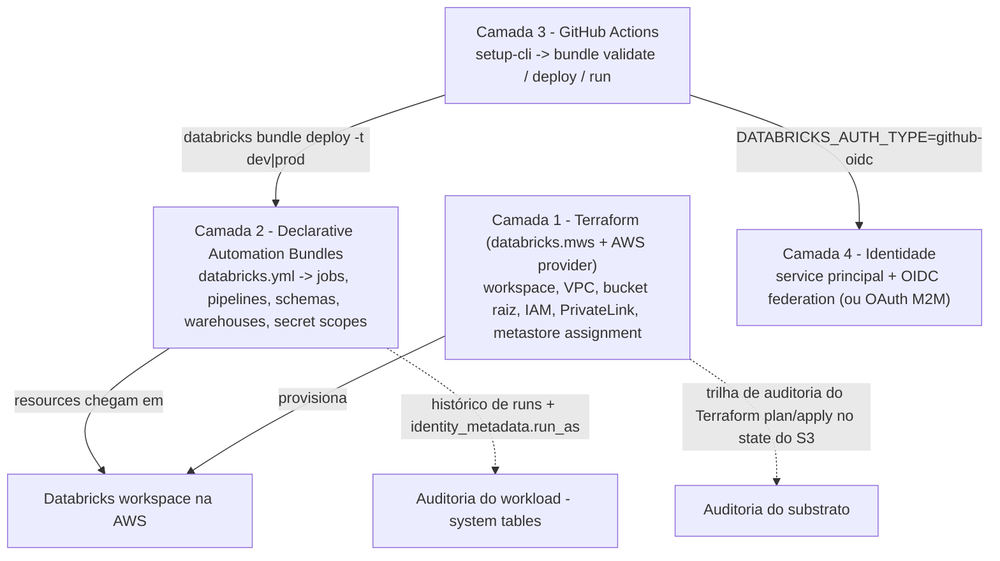
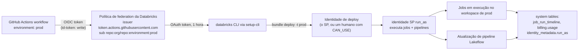
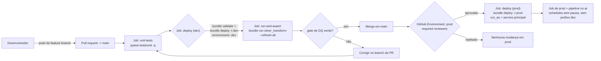
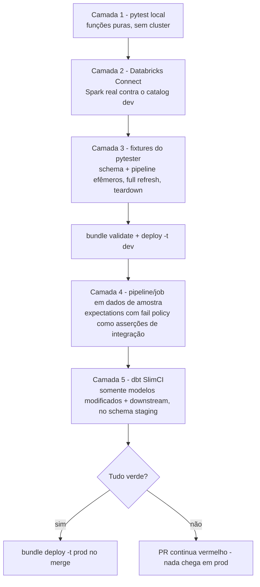
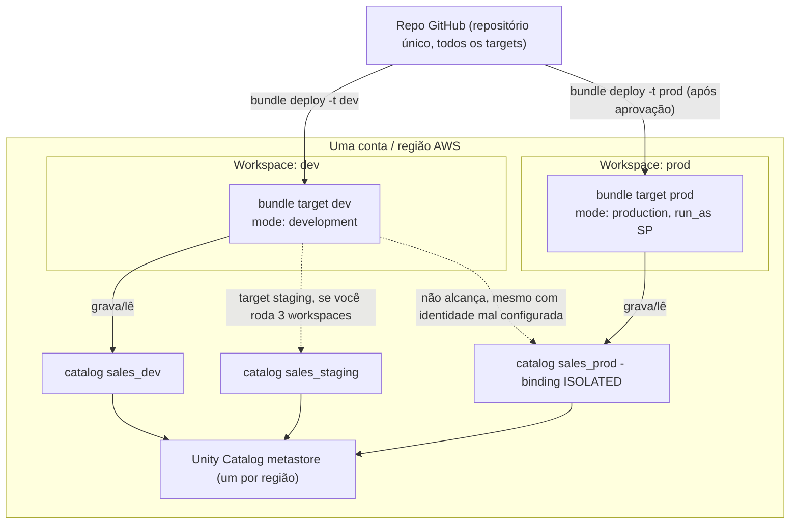
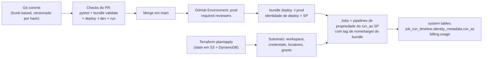

# CI/CD para o Lakehouse Databricks na AWS: Declarative Automation Bundles, Terraform e GitHub Actions

Todo lakehouse deste curso acaba encontrando o mesmo penhasco: os notebooks funcionam, os pipelines estão verdes, e então alguém cria um job à mão no workspace de produção numa tarde de sexta-feira: ou pior, a saída de alguém da empresa leva junto o schedule das 3 da manhã. O penhasco é a **costura de deploy**, e a solução é chata de propósito: tudo o que vive no workspace é declarado no Git, revisado em pull request, validado por CI e implantado por um service principal que não é nenhum ser humano.

Isto agora é a posição documentada, não folclore. "Declarative Automation Bundles são a **abordagem recomendada de CI/CD na Databricks**" (docs.databricks.com/aws/en/dev-tools/ci-cd, **2026-07-10**), e o fluxo específico da nuvem para **AWS** na mesma página diz "**GitHub Actions e Declarative Automation Bundles ou Terraform**". Note o nome que você precisa aprender: o produto antes chamado **Databricks Asset Bundles** é documentado desde 2026 como **Declarative Automation Bundles** (página overview de bundles, última atualização **2026-09-11**): mesmos verbos de CLI, mesmo `databricks.yml`, nome novo. E o filename importa mais do que você imagina: "Um bundle deve conter **um (e somente um)** arquivo de configuração chamado **`databricks.yml`** na raiz da pasta do projeto do bundle" (configurações de bundles, **2026-03-16**). Não existe `bundle.yaml`. Nunca.

Todo fato desta lição está carimbado com sua fonte Databricks ou AWS e datado de **outubro de 2026**; o que os documentos não dizem é deixado de fora em vez de adivinhado.

```text
 =============================================================
  MAPA DA LIÇÃO 16 - CI/CD + IaC para Databricks na AWS, out 2026
 ------------------------------------------------------------
  Camada 1  substrato IaC - Terraform, alias de provider databricks.mws
           databricks_mws_credentials | _networks |
           _storage_configurations | _vpc_endpoint |
           _private_access_settings | _workspaces
           + AWS provider: VPC, endpoints, bucket S3 raiz, IAM
  Camada 2  workload como código - Declarative Automation Bundles
           (antes Databricks Asset Bundles)
           exatamente UM databricks.yml + globs de include ->
           jobs, pipelines, schemas, sql_warehouses, dashboards,
           secret_scopes, catalogs ... targets dev / staging / prod
  Camada 3  orquestração de CI - GitHub Actions
           databricks/setup-cli -> bundle validate|deploy|run
           pull_request -> target dev ; push para main -> prod
           (+ GitHub Environment required reviewers como gate)
  Camada 4  identidade - service principals, nunca um PAT humano
           workload identity federation (OIDC) preferido
           OAuth M2M (tokens de 1 hora) em segundo ; token de SP por último
           run_as SP desacopla a identidade de deploy da de execução
  Números  token de acesso OAuth 1 h | <= 5 secrets por SP
           validade do secret <= 730 dias | CLI 0.218.0 = DABs GA
           engine key CLI 0.295.0, padrão direct
           provider v1.137.0 (2026-10-06), ~ vários releases/mês
           jobs classic a partir de $0.15/DBU (página de preços, 2026-10)
 =============================================================
```

Nesta lição você vai:

- separar as **quatro camadas** da pilha de entrega Databricks-on-AWS e atribuir exatamente um dono a cada classe de recurso (nenhum job definido duas vezes);
- ler um **`databricks.yml`** completo, nome do bundle, `include`, `artifacts`, `variables`, `workspace`, `run_as`, `permissions`, `resources`, `targets`, e implantá-lo através do loop **validate → deploy → run**;
- aplicar a semântica de **development mode** vs **production mode**, os **presets** que a sobrepõem, o vocabulário de substitution e a **precedência exata de resolução de variáveis em cinco passos**;
- separar a **identidade de deploy** da **identidade de execução** com service principals em `run_as`, incluindo a regra "somente jobs e pipelines são suportados" quando as duas identidades diferem;
- provisionar o substrato AWS com **Terraform**: o módulo com o alias `databricks.mws` (credentials, networks, storage configuration, objetos PrivateLink, workspace) mantido em um **módulo separado** dos recursos de nível de workspace (storage credentials, external locations, grants), com state remoto em S3 + DynamoDB;
- construir o **pipeline de PR no GitHub Actions** com `databricks/setup-cli`, `bundle validate` (a validação roda como parte de todo deploy) e **workload identity federation (OIDC)** para que nenhum personal access token entre no CI;
- testar em cinco camadas: pytest local, Databricks Connect, fixtures do `databricks-labs-pytester`, o **framework de testes em pipeline do DBR 18.1+** e **dbt SlimCI**;
- projetar a topologia de ambientes, **um metastore por região, 3 to 10 catalogs, binding de produção `ISOLATED`, 2 to 3 workspaces**, e calcular à mão um rascunho mensal de DBUs de CI nos floors publicados de out de 2026;
- estudar **três casos nomeados de AWS** (NAB, Addepar, Mastercard), ler a **caixa de atualização de 2026** e responder **doze questões no estilo de exame** mais quatro verificações interativas.

---

## 1. A pilha de quatro camadas: um dono por classe de recurso

O erro de CI/CD mais caro da Databricks não é um teste faltando: é definir o mesmo job em dois sistemas e deixá-los brigar. Antes de qualquer YAML, conserte o modelo de posse. A pilha documentada da Databricks tem quatro camadas que precisam ficar distintas:

| Camada | Ferramenta | Dono | Cadência |
|---|---|---|---|
| **1. Substrato da nuvem** | Terraform (alias `databricks.mws` + AWS provider) | Workspace, VPC, subnets, security groups, VPC endpoints, bucket S3 raiz, IAM role cross-account, objetos PrivateLink, metastore assignment | Muda semanalmente/mensalmente; revisado como plan/apply |
| **2. Config do workspace e workloads** | **Declarative Automation Bundles** (`databricks.yml`) | Jobs, pipelines Lakeflow, schemas, catalogs, SQL warehouses, dashboards, secret scopes, alerts, endpoints de model serving, permissões, `run_as` | Muda diariamente; revisado como PR em YAML |
| **3. Orquestração de CI** | GitHub Actions (+ action oficial `databricks/setup-cli`) | O pipeline: testes de unidade, `bundle validate`, `bundle deploy`, `bundle run`, aprovações | Todo PR e todo merge |
| **4. Identidade e secrets** | Console de conta + GitHub Environments | Service principals, políticas de federation, secrets OAuth M2M, secrets criptografados do GitHub, secret scopes da Databricks | Rotacionados por política, nunca à mão em YAML |



Duas regras fazem o diagrama se sustentar. Primeira, **um dono por classe de recurso**: jobs, pipelines e dashboards pertencem aos bundles; o workspace, storage credentials, external locations e grants de metastore pertencem ao Terraform. Definir um `databricks_job` no Terraform *e* o mesmo job em um bundle cria brigas de import/posse que aparecem como diffs misteriosos, não como erros limpos. Segunda, **bundles são a recomendação para tudo dentro do workspace**, enquanto o Terraform é o instrumento documentado para provisionamento: "Você usa o provider Terraform da Databricks para provisionar workspaces da Databricks, assim como o AWS Provider para provisionar os recursos AWS necessários para esses workspaces" (docs do provider Terraform, **2026-09-11**).

> **📚 Você sabia?** A própria config do bundle pode declarar `bundle.engine: terraform | direct`, e "**O valor padrão é `direct`**" (referência de configuração, **2026-08-18**, adicionado na CLI **0.295.0**), com as release notes confirmando "**Direct deployment engine é GA**" e "**Deploy sem Terraform**". Esse engine interno é encanaria exclusiva *de deploys de bundle*: ele definitivamente não é o state do Terraform da sua infraestrutura, e confundir os dois é um antipadrão documentado de times (armadilha 5 do digest de CI/CD). CLIs antigas usavam o engine Terraform por padrão; as CLIs atuais, não.

---

## 2. Anatomia do bundle: o arquivo único, suas chaves e o mapa de resources

### 2.1 O filename é um gate de validação

Copie esta frase para a wiki do seu time: **a raiz de um bundle contém exatamente um `databricks.yml`** (configurações de bundles, **2026-03-16**). Configuração adicional é puxada via o array `include` de globs, e "os globs de `include` são relativos ao `databricks.yml` que os declara". O `bundle validate` falha imediatamente no clássico copy-paste de outras ferramentas que assume `bundle.yaml`: não existe alias documentado, agora nem historicamente.

### 2.2 Chaves de nível superior (a superfície toda, em out de 2026)

| Chave | Papel |
|---|---|
| `bundle` | Obrigatória; carrega `bundle.name`, o nome lógico usado em paths e substitutions |
| `include` | Lista de globs de arquivos YAML extras (ex.: `resources/*.yml`): a única maneira de dividir a config entre arquivos |
| `sync` | `include`/`exclude`/`paths`: arquivos extras sincronizados no workspace; "especialmente útil quando você tem um único repositório que hospeda vários bundles" |
| `artifacts` | Binários construídos: `type: whl|jar|maven|...`, comando `build` (ex.: `poetry build`), `path`, `files[].source`, `dynamic_version` |
| `variables` | Variáveis customizadas com `description`, `default`, `lookup`, `type: complex` |
| `workspace` | `host`, `root_path`, `state_path`, `artifact_path`, `resource_path`, `profile`: "A Databricks recomenda que você use o mapeamento `host` em vez do mapeamento `default` sempre que possível, pois isso torna seus arquivos de configuração de bundle mais portáteis" |
| `permissions` | Entradas de ACL por recurso ou de nível de bundle (level + user/group/SP) |
| `run_as` | Identidade de execução de bundle/target: `user_name` **ou** `service_principal_name` |
| `resources` | Mapa tipado de tudo o que o bundle possui: **jobs, pipelines, dashboards, sql_warehouses, catalogs, schemas, secret_scopes, model_serving_endpoints, apps, alerts, quality_monitors, registered_models, volumes, clusters** e mais |
| `targets` | Uma coleção por ambiente (`dev`, `staging`, `prod`), exatamente uma com `default: true`; cada target pode sobrescrever `artifacts`, `bundle`, `git`, `mode`, `permissions`, `presets`, `resources`, `sync`, `variables`, `workspace`, `run_as` |
| `scripts` | Hooks de ciclo de vida executados pela CLI ao redor das operações |

Os tipos de objeto suportados por `lookup` (buscar um objeto existente do workspace pelo nome em vez de declará-lo) são: alert, cluster_policy, cluster, dashboard, instance_pool, job, metastore, notification_destination, pipeline, query, service_principal, warehouse (docs de variáveis, **2026-03-16**).

Um layout de projeto saudável para um repositório que hospeda um projeto (melhores práticas de desenvolvedor da Databricks, **2026-06-11**: "use um **repositório único para todo o seu código**… Se você tem múltiplos bundles para ciclos de deployment separados, mantenha-os em um único repositório"):

```text
sales-lakehouse/                      # um repo Git
├── databricks.yml                    # o ÚNICO arquivo raiz do bundle
├── resources/
│   ├── silver_transform.job.yml      # jobs ficam aqui
│   ├── medallion_pipeline.pipeline.yml
│   └── schemas.yml
├── src/
│   ├── build_silver.py               # sincronizado com o workspace
│   └── my_lib/                       # fonte do wheel, construída pelos artifacts
├── tests/
│   ├── unit/                         # pytest local, sem Databricks
│   └── integration/                  # pytester + Databricks Connect
└── .github/workflows/
    └── lakehouse-cicd.yml            # Camada 3
```

### 2.3 Exemplo resolvido E1, o bundle mínimo com formato de produção

Este é o esqueleto do padrão da documentação de bundles da Databricks (páginas de settings + deployment modes + run-as, todas acessadas em out de 2026): um job, um schema, dois targets, uma identidade de execução SP em prod.

```yaml
# databricks.yml - the ONLY valid bundle root filename
bundle:
  name: sales_lakehouse

include:
  - resources/*.yml

variables:
  catalog:
    description: Target catalog for this environment
  schema:
    description: Schema (database) name
    default: silver

workspace:
  root_path: /Workspace/Users/${workspace.current_user.userName}/.bundle/${bundle.name}/${bundle.target}

resources:
  jobs:
    silver_transform:
      name: "Silver transform (${bundle.target})"
      schedule:
        quartz_cron_expression: "0 0 3 * * ?"
        timezone_id: UTC
        pause_status: PAUSED          # dev mode pauses anyway; explicit is safer
      email_notifications:
        on_failure: ["data-eng@example.com"]
      tasks:
        - task_key: build_silver
          job_cluster_key: default
          notebook_task:
            notebook_path: ./src/build_silver.py
          libraries:
            - whl: ./dist/my_lib-*.whl
      job_clusters:
        - job_cluster_key: default
          new_cluster:
            spark_version: 15.4.x-scala2.12
            node_type_id: m5.xlarge
            num_workers: 2
  schemas:
    silver_schema:
      name: ${var.schema}
      catalog_name: ${var.catalog}
      comment: "Silver tables (managed by bundle ${bundle.name})"

targets:
  dev:
    default: true
    mode: development
    variables:
      catalog: sales_dev
      schema: ${workspace.current_user.short_name}
  prod:
    mode: production
    git:
      branch: main
    workspace:
      host: https://dbc-a1b2345c-d6e7.cloud.databricks.com   # prod workspace
      root_path: /Workspace/Users/ci-deployer/.bundle/${bundle.name}/${bundle.target}
    run_as:
      service_principal_name: 68ed9cd5-8923-4851-a0c1-c7536c67ff99
    permissions:
      - level: CAN_MANAGE
        service_principal_name: 68ed9cd5-8923-4851-a0c1-c7536c67ff99
    variables:
      catalog: sales_prod
```

O loop local tem três comandos, e é o mesmo loop que o CI roda:

```bash
databricks bundle validate -t dev          # schema/syntax gate (also runs inside deploy)
databricks bundle deploy  -t dev           # sync files + create/update resources
databricks bundle run silver_transform -t dev --refresh-all
```

Três detalhes do E1 que as questões de amam: `notebook_path` é **relativo ao bundle** (nunca hard-code paths `/Workspace/Users/...` vindos do seu laptop, eles quebram sob um `root_path` diferente); o wheel é declarado onde o job o consome (`libraries: - whl:`), enquanto o comando `build` fica em `artifacts:`; e a variável `schema` de prod é deliberadamente *não* definida por usuário, schemas de prod vêm das `variables` do target, não de quem implantou.

> **📚 Você sabia?** O `databricks bundle init` gera um projeto a partir de um template, e as release notes registram que "O template default-python agora usa **uv**" e "O template default-python usa **serverless** por padrão" (release notes de bundles, **2026-04-29**). Dois verbos companions economizam dias de migração: o `bundle generate` faz engenharia reversa de YAML a partir de resources que já existem na UI ("bundle generate job --as-code" contra um job construído por cliques), e o `bundle deployment bind` liga sua config a um objeto pré-existente do workspace quando os nomes colidem. O `bundle schema` (CLI ≥ **0.218.0**) emite o JSON schema que o seu IDE usa para completion e validação inline.

---

## 3. Targets, modes, presets, variáveis: os guardrails

### 3.1 Development mode vs production mode

Todo bundle prático declara `targets.dev` e `targets.prod` (opcionalmente `staging`), com exatamente um marcado `default: true`. O `mode:` em cada target não é decoração: os dois modes têm semânticas de segurança opostas (docs de deployment-modes, última atualização **2026-09-11**):

| Comportamento | `mode: development` | `mode: production` |
|---|---|---|
| Nomes de recursos | Prefixados `[dev ${workspace.current_user.short_name}]` | Sem prefixo: os nomes declarados |
| Tags de job/pipeline | Tag Databricks `dev` adicionada | Sem tag dev |
| Pipelines Lakeflow | Marcados `development: true` | Validados para serem `development: false` |
| Schedules e triggers | "**Pausa todos os schedules e triggers** nos resources implantados" | Ativos como declarados |
| Execuções concorrentes | "**Habilita execuções concorrentes em todos os jobs implantados**" | Padrão (`max_concurrent_runs` como definido) |
| Overrides de cluster | Overrides no estilo `--cluster-id` permitidos | **Não permitidos**: sem sobrescrever definições de cluster existentes |
| Deployment lock | "**Desativa o deployment lock** para iteração mais rápida" | Lock imposto |
| Verificação de branch do Git | nenhuma | Se `git.branch` estiver definido no target, o branch atual deve corresponder (override: `--force`, que em si é uma bandeira vermelha de auditoria) |
| Paths e identidade | Paths com escopo de usuário ok | Valida que `artifact_path`/`file_path`/`root_path`/`state_path` **não** foram sobrescritos para um usuário específico; `run_as` e `permissions` devem ser especificados, a menos que o deploy seja feito como um SP |

O production mode também "recomenda que você faça o deploy do seu bundle para uma **pasta imutável, somente leitura**" (a configuração `immutable_folder`). Promoção, em uma frase: **o mesmo commit imutável do Git é reimplantado no próximo target**: nada é reconstruído, e a promoção de dados acontece rodando o job contra o catalog daquele target.

### 3.2 Presets ajustam o mode; resources sobrepõem os presets

Presets personalizam os defaults do mode: `name_prefix`, `pipelines_development`, `trigger_pause_status`, `jobs_max_concurrent_runs`, `tags` e (release notes, **2026-04-29**) `artifacts_dynamic_version`. A precedência dentro da plataforma cabe em uma frase: "**se `mode` e `presets` estiverem definidos, os presets sobrepõem o comportamento padrão do mode, e as configurações de resources individuais sobrepõem os presets**" (deployment-modes, **2026-09-11**).

### 3.3 Substitutions, variáveis e a ordem de resolução

Substitutions embutidas resolvem no momento do deploy: `${bundle.name}`, `${bundle.target}` (use este, não o mais antigo `${bundle.environment}`), `${workspace.host}`, `${workspace.current_user.userName}`, `${workspace.current_user.short_name}`, `${workspace.file_path}`, `${workspace.root_path}` e até `${resources.jobs.<key>.id}` para cross-references. Variáveis customizadas são `${var.<name>}` e resolvem percorrendo esta lista, **parando no primeiro acerto** (docs de variáveis, **2026-03-16**):

1. `--var="name=value"` na CLI
2. Variáveis de ambiente que começam com **`BUNDLE_VAR_`** (ex.: `BUNDLE_VAR_catalog=sales_prod`)
3. `variable-overrides.json` em `.databricks/bundle/<target>/`
4. `targets.<name>.variables`
5. `variables.<name>.default` de nível superior

```fillblank
{
  "question": "A resolução de variáveis do bundle percorre cinco fontes e para no primeiro acerto. Preencha os dois passos que faltam: opções --var na CLI, depois {{1}}, depois variable-overrides.json em .databricks/bundle/<target>/, depois variáveis de nível de target, então o {{2}} de nível superior.",
  "template": "A resolução de variáveis do bundle percorre cinco fontes e para no primeiro acerto. Preencha os dois passos que faltam: opções --var na CLI, depois {{1}}, depois variable-overrides.json em .databricks/bundle/<target>/, depois variáveis de nível de target, então o {{2}} de nível superior.",
  "answers": {
    "1": "variáveis de ambiente BUNDLE_VAR_*",
    "2": "default"
  },
  "distractors": [
    "variáveis de ambiente TF_VAR_*",
    "o workspace profile em .databrickscfg",
    "somente targets.prod.variables",
    "a mensagem do commit no Git"
  ],
  "explanation": "A ordem documentada (página de variáveis, 2026-03-16) é --var > variáveis de ambiente BUNDLE_VAR_* > variable-overrides.json > targets.*.variables > default de nível superior. TF_VAR_* é o mecanismo do Terraform e pertence a uma camada inteiramente diferente; profiles do .databrickscfg fornecem auth/host, não valores de variáveis; variáveis de target são o passo 4 de 5, não um caso especial; e metadados do Git nunca entram na resolução do bundle."
}
```

### 3.4 Exemplo resolvido E2: overrides na prática

Mesmo bundle do E1, três momentos de promoção diferentes:

```bash
# Laptop: Alice iterates on her own schema, no schedule, no prod risk
databricks bundle deploy -t dev
databricks bundle run silver_transform -t dev --refresh-all

# CI: a one-off override without editing YAML (highest-precedence source)
BUNDLE_VAR_catalog=sales_staging databricks bundle deploy -t staging

# Prod pipeline: the target's own variables + run_as SP do the work
databricks bundle deploy -t prod
# equivalent one-shot: databricks bundle deploy -t prod --var="catalog=sales_prod"
```

> ⚠️ **ALERTA: os efeitos colaterais do dev mode cortam nos dois sentidos.** Esquecer `mode: development` no target dev significa que um deploy disparado por PR pode reativar schedules reais contra recursos compartilhados; esperar que o nome *exato* de um job implantado em dev ainda exista em prod falha, porque o dev renomeou tudo para `[dev <user>]`. E lembre o que o dev mode compra para você: schedules pausados, pipelines com `development: true` e execuções concorrentes existem para que vinte pull requests possam fazer deploy em um único workspace dev compartilhado sem dispararem os calendários um do outro (deployment-modes, **2026-09-11**). Se PRs paralelos colidirem nos mesmos resource keys, dê a cada PR seu próprio `root_path`/variáveis ou serialize com um grupo `concurrency:` no GitHub.

---

## 4. Identidade: implantar como uma coisa, executar como outra

### 4.1 As regras de run_as que decidem o que seu pipeline pode fazer

`run_as` pode ser definido como um `user_name` ou um `service_principal_name`, e "Não-admins só podem definir este campo para o próprio e-mail deles" (docs de run-as, última atualização **2026-10-07**). Quatro regras importam em produção:

1. "**Definir uma identidade `run_as` como um service principal para targets de produção é a maneira mais segura de rodar um workflow de produção**"; isso "desacopla a permissão de rodar o workflow de produção da identidade que criou ou implantou o bundle".
2. Se a identidade de deploy difere do `run_as`, "**somente jobs e pipelines são suportados**": qualquer outro tipo de recurso no bundle então falha ao implantar limposamente.
3. `run_as` de nível de job pode aceitar um `group_name`; `run_as` de nível de bundle/target **não pode**.
4. Endpoints de model serving não suportam `run_as` de forma alguma.

### 4.2 Exemplo resolvido E3: a separação de identidades

```yaml
# Top-level default for everyone on the team (dev loop)
run_as:
  user_name: ${workspace.current_user.userName}

targets:
  prod:
    mode: production
    run_as:
      service_principal_name: 68ed9cd5-8923-4851-a0c1-c7536c67ff99   # SP application ID
    permissions:
      - level: CAN_MANAGE
        service_principal_name: 68ed9cd5-8923-4851-a0c1-c7536c67ff99
      - level: CAN_VIEW
        group: data-analysts
```

O que acontece às 3 da manhã quando o engenheiro de plantão está dormindo: o job de prod continua rodando, porque a identidade dele é o service principal, e o run é auditável como aquele SP em `system.lakeflow.job_run_timeline` (digest de CI/CD, seção de lineage; cross-ref lição 09). O que acontece quando Alice sai da empresa: nada em prod quebra, porque Alice nunca foi a identidade de prod: apenas a de dev.



> **📚 Você sabia?** Tokens OAuth machine-to-machine são curtos por design: "Cada access token é válido por **uma hora**, depois da qual um novo token é automaticamente solicitado", um service principal pode ter **até cinco OAuth secrets**, e cada secret é válido "por até dois anos (máximo **730 dias**)", e secrets podem ser **escopados** para APIs como `sql` ou `jobs` em vez de `all-apis` (docs de OAuth M2M, acessados em out de 2026). Escope o secret do seu CI para as APIs que o pipeline toca; um secret escopado que vaza é um incidente menor do que um `all-apis`.

---

## 5. Terraform para o substrato: dois providers, dois módulos, state separado

### 5.1 Exemplo resolvido E4, o módulo de provisionamento do workspace (`provider = databricks.mws`)

A criação de workspaces na AWS usa recursos de **nível de conta** sob um alias de provider dedicado. O guia oficial é inequívoco quanto à forma: "Inicialize o provider com `alias = \"mws\"` e use `provider = databricks.mws` para todos os resources `databricks_mws_*`. Exigimos que todos os resources `databricks_mws_*` sejam criados dentro de um módulo terraform dedicado do seu ambiente. Normalmente, esse módulo também cria VPC e IAM roles" (guia de workspace da AWS, acessado em out de 2026).

```hcl
# modules/account/main.tf  - creates the workspace (Layer 1, phase A)
terraform {
  required_providers {
    databricks = { source = "databricks/databricks", version = "~> 1.137" }
    aws        = { source = "hashicorp/aws",         version = "~> 5.0" }
  }
  backend "s3" {
    bucket         = "acme-tfstate-prod"
    key            = "databricks/account/terraform.tfstate"
    region         = "us-east-1"
    dynamodb_table = "terraform-locks"
    encrypt        = true
  }
}

provider "databricks" {
  alias      = "mws"
  host       = "https://accounts.cloud.databricks.com"
  account_id = var.databricks_account_id
  # auth via OAuth M2M env vars in CI; username/password acceptable for bootstrap
}

resource "databricks_mws_credentials" "this" {
  provider         = databricks.mws
  account_id       = var.databricks_account_id
  credentials_name = "acme-crossaccount"
  role_arn         = aws_iam_role.crossaccount.arn      # AWS provider creates the role
}

resource "databricks_mws_networks" "this" {
  provider            = databricks.mws
  account_id          = var.databricks_account_id
  network_name        = "acme-vpc"
  vpc_id              = module.vpc.vpc_id                # terraform-aws-modules/vpc/aws
  subnet_ids          = module.vpc.private_subnets
  security_group_ids  = [aws_security_group.databricks.id]
}

resource "databricks_mws_storage_configurations" "this" {
  provider              = databricks.mws
  account_id            = var.databricks_account_id
  storage_configuration_name = "acme-root"
  storage_root_url     = "s3://${aws_s3_bucket.root.id}"  # the workspace root bucket
}

resource "databricks_mws_workspaces" "this" {
  provider           = databricks.mws
  account_id         = var.databricks_account_id
  workspace_name     = "acme-prod"
  credentials_id     = databricks_mws_credentials.this.credentials_id
  network_id         = databricks_mws_networks.this.network_id
  storage_configuration_id = databricks_mws_storage_configurations.this.storage_configuration_id
  # PrivateLink variant adds: private_access_settings_id + pricing_tier = "ENTERPRISE"
}
```

A própria VPC, subnets privadas/públicas, NAT, o **S3 gateway endpoint** e os **endpoints de interface STS/Kinesis**, vem do **AWS provider** (o guia usa `terraform-aws-modules/vpc/aws` mais o módulo de endpoints dele). Para PrivateLink, o conjunto de exemplos verificado (`aws-databricks-modular-privatelink` em `databricks/terraform-databricks-examples`, acessado em out de 2026) adiciona `aws_vpc_endpoint` para o REST de backend + relay, depois `databricks_mws_vpc_endpoint`, `databricks_mws_private_access_settings` (com `public_access_enabled`), e liga `private_access_settings_id` no `databricks_mws_workspaces` com `pricing_tier = "ENTERPRISE"`.

### 5.2 Exemplo resolvido E5, o módulo de gestão do workspace (provider de nível de workspace)

A regra dura do mesmo guia: "**Código que cria workspaces e código que gerencia workspaces devem estar em módulos terraform separados**": state separado, aliases de provider separados (`databricks.mws` vs um provider de nível de workspace que, no CI, autentica com as variáveis de ambiente OAuth M2M `DATABRICKS_HOST` + `DATABRICKS_CLIENT_ID` + `DATABRICKS_CLIENT_SECRET`). Misturar os dois significa que um apply pode autenticar contra o endpoint errado.

```hcl
# modules/workspace/main.tf  - manages resources INSIDE an existing workspace
resource "databricks_storage_credential" "ext" {
  name    = aws_iam_role.external_data_access.name
  aws_iam_role {
    role_arn = aws_iam_role.external_data_access.arn
  }
  comment = "Managed by TF"
}

resource "databricks_external_location" "silver" {
  name            = "silver-external"
  url             = "s3://${aws_s3_bucket.silver.id}/silver"   # s3://[bucket]/[dir] on AWS
  credential_name = databricks_storage_credential.ext.id
  # workspace-level only! also: skip_validation, fallback, read_only,
  # access_point (S3 access point ARN), isolation_mode
}

resource "databricks_grants" "silver_eng" {
  external_location = databricks_external_location.silver.id
  grant {
    principal  = "data-engineers"
    privileges = ["CREATE_EXTERNAL_TABLE", "READ_FILES", "WRITE_FILES"]
  }
}
```

Fatos que você precisa carregar daquele bloco: `databricks_external_location` "**pode ser usado apenas com um provider de nível de workspace**" e "requer databricks_storage_credential"; `databricks_storage_credential` na AWS é a forma `aws_iam_role { role_arn = ... }`, importável por nome no nível do workspace ou `<metastore_id>|<name>` no nível da conta; e credentials/locations carregam um `isolation_mode` (`ISOLATION_MODE_ISOLATED` / `OPEN`) que interage com o workspace binding (lições 02 e 03).

> ⚠️ **ALERTA, `databricks_grants` é autoritativo e vai remover silenciosamente os grants das outras pessoas.** "Este resource é **autoritativo** para grants em securables. Configurar este resource para um securable vai **SOBRESCREVER quaisquer grants existentes**, e mudanças feitas fora do Terraform serão resetadas" (Terraform Registry, resources/grants, publicado em **2026-10-06**). Se alguém concedeu acesso pela UI ou pelo SQL do Unity Catalog desde o último apply, o próximo apply remove isso. Use o singular `databricks_grant` para gestão incremental quando outros atores compartilham a posse, e lembre que os resources companions de nível de conta `databricks_metastore` + `databricks_metastore_assignment` (um metastore por região) pertencem ao módulo da conta, não ao módulo do workspace.

### 5.3 Versões e state: duas regras de higiene com comprovação

O provider anda rápido: "vários releases por mês" (página de releases do Registry, acessada em out de 2026): **v1.137.0 (2026-10-06)**, v1.136.0 (2026-10-05), v1.135.0 (2026-09-28), v1.134.0 (2026-09-23), v1.128.0 (2026-08-19), com v1.65.0 (2025-02-04) um parâmetro útil de quanto a superfície se moveu em 20 meses. Fixe com uma restrição pessimista (`version = "~> 1.137"`); nunca flutue para `latest`. Higiene de state, dos próprios exemplos da Databricks: "**Recomendamos usar armazenamento remoto, como S3, para o armazenamento de state, em vez do backend local padrão**" com `backend "s3"` { bucket, key, region, `dynamodb_table` para locks, `encrypt = true` }, e "Você deve criar a infra do backend remoto em **outro projeto Terraform**" (`aws-remote-backend-infra`). Um `terraform.tfstate` local no laptop é drift irrecuperável *e* um vazamento de segredo, porque o state armazena atributos dos resources.

---

## 6. GitHub Actions: o pipeline de PR e a federation que o protege

### 6.1 O padrão documentado

A página oficial do GitHub Actions (datada de **2026-03-16**) lista exatamente uma action oficial: **`databricks/setup-cli`**, "Uma composite action que configura a Databricks CLI em um workflow do GitHub Actions", seguida de verbos crus de CLI. O fluxo que ela documenta: PR contra main → o job "Deploy bundle" roda `databricks bundle deploy` com `DATABRICKS_BUNDLE_TARGET: dev` → o job "Run pipeline update" roda o job/pipeline. "**A validação do bundle é executada automaticamente como parte deste deployment. Se a validação falhar, este workflow falha.**" Produção é a mesma forma em `push` para main com target `prod`, serializada com `concurrency: 1`. Trunk-based branching com versionamento por commit hash é a postura Git recomendada (página de fluxos de CI/CD, **2026-07-10**).



### 6.2 Exemplo resolvido E6, o workflow completo de PR + prod com OIDC

```yaml
# .github/workflows/lakehouse-cicd.yml
name: lakehouse-cicd
concurrency: ${{ github.ref }}
on:
  pull_request: { branches: [main] }
  push: { branches: [main] }
permissions:
  id-token: write        # REQUIRED for workload identity federation
  contents: read
jobs:
  unit-tests:
    runs-on: ubuntu-latest
    steps:
      - uses: actions/checkout@v4
      - uses: actions/setup-python@v5
        with: { python-version: "3.11" }
      - run: pip install pytest "pyspark>=4.0.0,<5.0.0" && pytest tests/unit -q
  deploy:
    needs: unit-tests
    runs-on: ubuntu-latest
    environment: ${{ github.event_name == 'push' && 'prod' || 'dev' }}
    env:
      DATABRICKS_AUTH_TYPE: github-oidc
      DATABRICKS_HOST: ${{ vars.DATABRICKS_HOST }}
      DATABRICKS_CLIENT_ID: ${{ vars.DATABRICKS_CLIENT_ID }}
      DATABRICKS_BUNDLE_TARGET: ${{ github.event_name == 'push' && 'prod' || 'dev' }}
    steps:
      - uses: actions/checkout@v4
      - uses: databricks/setup-cli@main       # pin to a tag in regulated environments
      - run: databricks bundle validate        # explicit gate (deploy also validates)
      - run: databricks bundle deploy
  run-and-assert:
    needs: deploy
    runs-on: ubuntu-latest
    environment: ${{ github.event_name == 'push' && 'prod' || 'dev' }}
    env:
      DATABRICKS_AUTH_TYPE: github-oidc
      DATABRICKS_HOST: ${{ vars.DATABRICKS_HOST }}
      DATABRICKS_CLIENT_ID: ${{ vars.DATABRICKS_CLIENT_ID }}
      DATABRICKS_BUNDLE_TARGET: ${{ github.event_name == 'push' && 'prod' || 'dev' }}
    steps:
      - uses: actions/checkout@v4
      - uses: databricks/setup-cli@main
      - run: databricks bundle run silver_transform --refresh-all
      # CLI non-zero exit fails the job; add a DQ gate notebook or dbt test step after
```

Estates Java/Scala trocam uma etapa por upload de um artifact versionado para um **Volume do Unity Catalog** antes do deploy: a forma documentada: `mvn clean verify` → `databricks fs cp target/my-app-1.0.jar dbfs:/Volumes/artifacts/my-app-${{ github.sha }}.jar --overwrite` → `bundle validate` → `bundle deploy --target prod`, com o deploy gated por `if: github.event_name == 'push' && github.ref == 'refs/heads/main'` (docs do GitHub Actions, **2026-03-16**). Volumes, não os mounts legados `dbfs:/mnt`, são o armazenamento governado de artifacts (lição 12).

### 6.3 Workload identity federation: nenhum secret no cofre

"A federation de token OAuth da Databricks, também conhecida como OpenID Connect (OIDC), permite que seus workloads automatizados rodando fora da Databricks acessem a Databricks com segurança **sem secrets da Databricks**" (docs de provider-github, **2026-10-02**), e "A Databricks recomenda fortemente o uso de workload identity federation para autenticar na Databricks a partir de workloads automatizados sempre que possível" (oauth-federation-provider, **2026-06-16**). IdPs suportados além do GitHub Actions: Azure DevOps, GitLab CI/CD, CircleCI, **workloads do AWS IAM**, Jenkins, Terraform Cloud, Bitbucket Pipelines.

A ligação verificada: uma **política de federation** de SP com issuer `https://token.actions.githubusercontent.com` e um subject para o qual a Databricks "recomenda usar **Environment**", ex.: `repo:my-github-org-or-user/my-repo:environment:Prod` (workflows reutilizáveis usam `subject_claim: job_workflow_ref`); o workflow então precisa de apenas três variáveis de ambiente: `DATABRICKS_AUTH_TYPE: github-oidc`, `DATABRICKS_HOST`, `DATABRICKS_CLIENT_ID` (o application ID do SP): mais `permissions: id-token: write`. E os docs apontam a armadilha explicitamente: "Defina `permissions: id-token: write` no workflow **chamador**, não no workflow reutilizável". Os SDKs e a CLI trocam o token OIDC por um token OAuth da Databricks automaticamente: nada para rotacionar, nada no secret store do repo, e um subject de federation que precisa casar *exatamente* com o claim `sub` do token (uma política escrita para `environment:Prod` rejeita tokens de workflows sem `environment: Prod`).

> ⚠️ **ALERTA: nunca coloque um personal access token em CI, e nunca cole nenhum token no YAML de um workflow.** Um PAT acopla deploys de produção ao ciclo de vida de conta de um único funcionário e superprivilégia o pipeline; quando aquela pessoa sai, o pipeline morre com a conta dela, e a trilha de auditoria aponta para um humano em vez de um serviço. A própria orientação da Databricks: "Como prática de segurança recomendada, a Databricks recomenda que você não insira um access token da Databricks diretamente no corpo de um arquivo do GitHub Actions. Você deve registrar o access token da Databricks com o GitHub Actions usando **secrets criptografados do GitHub**" (docs de service-principals, **2026-01-24**), e esse é o *degrau* de baixo da escada (token de SP como `DATABRICKS_TOKEN`), não o topo. Prefira OIDC federation; caia de volta para OAuth M2M (`DATABRICKS_CLIENT_ID`/`DATABRICKS_CLIENT_SECRET` em secrets criptografados do GitHub); trate um access token de SP como último recurso. E depure falhas de auth antes de reescrever o YAML: "Nenhuma variável conflitante definida como `DATABRICKS_TOKEN`, `DATABRICKS_USERNAME`. Rode `env | grep DATABRICKS` e retire os conflitos" (docs de OAuth M2M): uma variável de ambiente de token velha em um runner self-hosted sombreia OIDC/M2M toda vez.

A variante legada documentada do E6 troca o bloco `env:` de federation por `DATABRICKS_TOKEN: ${{ secrets.SP_TOKEN }}` (um access token gerado por SP em um secret criptografado do GitHub): ainda nos docs, ainda um secret de longa duração, e o default errado para um design review de 2026. Para o gate de aprovação humana, os **Environments** do GitHub carregam as vars e "permitem que você **exija aprovação manual antes de os deployments rodarem**": configure o environment `prod` com required reviewers (regras de proteção de deployment) e fixe a chave `environment:` do workflow por target, exatamente como o E6 faz (página de CI do Databricks Apps, acessada em out de 2026, mesmo padrão).

> **📚 Você sabia?** O `databricks bundle deploy` executa a validação para você, "A validação do bundle é executada automaticamente como parte deste deployment. Se a validação falhar, este workflow falha" (docs do GitHub Actions, **2026-03-16**), é por isso que a etapa explícita de `bundle validate` do E6 é cinto e suspensário, não estrutural. Mantenha-a mesmo assim: ela falha mais rápido, antes de qualquer sync começar, e dá aos revisores um gate nomeado na UI de checks.

---

## 7. Testes: cinco camadas, uma pirâmide, tudo no pipeline

CI/CD em um lakehouse é tão bom quanto aquilo que consegue provar. A stack verificada (seção 9 do digest de CI/CD, fontes datadas de 2023 to 2026):

| Camada | Ferramentas | Onde roda | Pins / restrições verificados |
|---|---|---|---|
| 1. Testes de unidade locais | `pytest` comum + PySpark local | Runner de CI, sem Databricks | `pytest>=8.3.4`, `pyspark>=4.0.0,<5.0.0` (blog da comunidade, **2026-07-28**) |
| 2. Integração remota | `databricks-connect` substitui o grupo local do pyspark | Runner de CI → workspace | exemplo de pin `databricks-connect==17.1.0` |
| 3. Fixtures efêmeras | `databricks-labs-pytester` (`make_schema`, `make_pipeline`, `make_job`, `env_or_skip`, `ws`) | CI → workspace, teardown automático | pin do README `~=0.7.5` + `databricks-sdk~=0.30`; fixtures "incubadas dentro do projeto Unity Catalog Automated Migrations" |
| 4. Testes de unidade em pipeline | `from pyspark.pipelines.testing import TestPipeline, test_spark` | Editor web do Lakeflow Pipelines | **modo triggered (não contínuo) + DBR 18.1+**, somente Python, apenas no editor |
| 5. Testes SQL/dbt | `dbt build --select state:modified+` (SlimCI) + `dbt lint` | CI, schema staging, identidade `dbt_test_sp` | docs de CI do dbt **2026-10-06**; status postado de volta no PR |



Duas restrições impedem times de usar a camada 4 como hook de CI de forma errada. O framework de testes em pipeline "deve rodar no **Databricks Runtime 18.1 ou acima**", apenas em modo **triggered**, "execução somente no editor", "somente testes Python", o CI não consegue chamá-lo sem cabeça hoje, então o CI usa o padrão externo pytester (docs de unit-testing, acessados em out de 2026; o blog da comunidade de **2026-07-28** nota que o framework "está atualmente em preview e rumo ao beta": confira o status atual antes de apostar o CI de prod nele). E o isolamento dele tem falhas que valem a pena conhecer antes de confiar em um run verde: o `test_spark` "redireciona operações de tabela para um schema de teste temporário" **por nome**: "leituras ou escritas por path ou conector… agem sobre dados de produção", a função tabelada `event_log()` é proibida para testes, e "dados de mock não herdam row filters nem column masks", então testes verdes não provam comportamento governado.

O padrão de integração mais antigo, mas ainda canônico, para Delta Live Tables/Lakeflow é diferente: adicione **expectations com `fail`** extras para que o próprio pipeline seja a asserção: "abordagem recomendada… sem recursos de compute adicionais" (blog de DevOps para DLT, **2023-04-28**). Times de dbt ganham o equivalente do lado SQL no SlimCI: "o dbt rastreia o estado do que está rodando no seu ambiente de produção… apenas os data assets modificados no seu pull request e suas dependências downstream são construídos e testados em um **schema staging**", com um catálogo de teste dedicado e um service principal `dbt_test_sp` (docs do dbt, **2026-08-19** e **2026-10-06**).

### 7.1 Exemplo resolvido E7: quanto custa um mês de compute de CI

A Databricks não publica nenhuma linha de surcharge para deploys de bundle ou uso do GitHub Actions; o que o pipeline *dispara* é compute regular medido em DBU. Nos floors publicados (databricks.com/pricing, instantâneo **2026-10**: jobs classic **a partir de $0.15/DBU**, DBSQL **a partir de $0.22/DBU**):

```text
 =============================================================
  RASCUNHO DE COMPUTE DE CI - um mês, aritmética ilustrativa
 ------------------------------------------------------------
  40 execuções de validação de PR x 1.5 DBU cada =   60 DBU  x $0.15
                                          = $  9.00
  30 execuções noturnas de prod x 30 DBU cada   =  900 DBU  x $0.15
                                          = $135.00
  DBSQL do gate de DQ (warehouse pequeno)       =   25 DBU  x $0.22
                                          = $  5.50
                                          -------------
  Compute de CI disparado no mês                        $149.50
  + sessões interativas de smoke de dev (floor de DBU $0.40, lição 15)
  Nota: aritmética a partir dos floors publicados em out de 2026 -
  seu DBU/run depende do volume de dados. Trate a execução do PR
  como o custo que você paga para NÃO encontrar o bug em prod.
 =============================================================
```

Duas alavancas de custo pertencem ao design do pipeline em si: os schedules pausados do dev mode significam que um deploy de PR nunca duplica um calendário de prod, e o "rodar e testar apenas os modelos modificados… reduz o gasto de compute" do dbt SlimCI (docs do dbt, **2026-08-19**) mantém as execuções de PR proporcionais ao diff, não ao estate.

```plot
{
  "type": "bar",
  "title": "Gasto ilustrativo mensal em DBUs de CI disparado por etapa do pipeline (aritmética do exemplo resolvido E7 nos floors publicados de out de 2026: não é uma fatura medida)",
  "xLabel": "Etapa do pipeline",
  "yLabel": "DBUs por mês",
  "xKey": "stage",
  "dataKeys": ["dbu_per_month"],
  "data": [
    {"stage": "PR validation runs (40 x 1.5 DBU)", "dbu_per_month": 60},
    {"stage": "Prod nightly job (30 x 30 DBU)", "dbu_per_month": 900},
    {"stage": "DBSQL data-quality gate", "dbu_per_month": 25},
    {"stage": "dbt SlimCI (modified models only)", "dbu_per_month": 40}
  ]
}
```

Leia as alturas das barras como um argumento de design, não como um orçamento: o noturno de prod engole os runs de PR por uma ordem de grandeza, é por isso que auto-stop, política de scaling e right-sizing (lição 15) importam muito mais para a fatura do que aparar minutos da validação de PR: enquanto os runs de PR são o que impedem o noturno de entregar uma regressão.

---

## 8. Ambientes: um metastore, catalogs ISOLATED, 2 to 3 workspaces

Bundles dão você targets; o Unity Catalog dá a esses targets algo para apontar. A orientação documentada (melhores práticas de UC **2026-06-03**, melhores práticas de desenvolvedor **2026-06-11**, guia de deployment de lakehouse **2026-06-26**):

- "**Você pode ter apenas um metastore por região.** Todos os workspaces naquela região compartilham aquele metastore", e "Metastores fornecem isolamento regional, mas não se destinam a ser unidades padrão de isolamento de dados. **O isolamento de dados normalmente começa no nível do catalog.**"
- Use **catalogs** separados por escopo de SDLC (`dev` / `staging` / `prod`, ou híbrido `sales_dev`/`sales_prod`), mantendo "tipicamente **3 to 10 por metastore**"; "Use seu metastore de região única para **todos os escopes do ciclo de vida de desenvolvimento de software**."
- "**Faça o bind do catalog de produção em modo `ISOLATED`** apenas ao workspace de produção… garante que dados de produção sejam inalcançáveis a partir de ambientes de desenvolvimento ou staging, mesmo que uma identidade esteja mal configurada."
- "Sempre atribua a posse de catalogs e schemas de produção a **grupos, não a usuários individuais**."
- "Cada bundle deve cobrir **todos os ambientes** de um determinado projeto… em vez de usar bundles separados por ambiente."
- A topologia de workspace escala com o tamanho do time: ≤5 engenheiros de dados → **2 workspaces** (dev, prod); 5+ → **3** (acrescente staging); indústrias reguladas → "Isole fisicamente workspaces e contas de nuvem". "Um metastore por ambiente" existe, mas é "menos comum".



A costura bundle-to-catalog é um par de variáveis: `catalog: sales_dev` no target dev, `catalog: sales_prod` em prod, referenciadas em todo lugar como `${var.catalog}`, o mesmo YAML, o mesmo código, dois destinos governados. A promoção é então literalmente um re-deploy: mesmo commit, próximo target, catalog diferente.

---

## 9. Lineage de código → jobs: a cadeia de auditoria que você pode consultar

A cadeia que auditores deveriam conseguir percorrer, ponta a ponta (seção 12 do digest de CI/CD):

1. **Commit no Git** (trunk-based, artifacts versionados por commit hash).
2. **Checks do PR**: testes de unidade, `bundle validate`, deploy em dev, `bundle run` em dados de amostra; status postado de volta no PR (o dbt posta o próprio status do mesmo jeito).
3. **Merge** → aprovação opcional de GitHub Environment (required reviewers em `prod`).
4. **`bundle deploy -t prod`** como a identidade de deploy, com `run_as` definido para o service principal de produção.
5. **Objetos de job/pipeline** no workspace de prod, de propriedade daquele SP, marcados com nome/target do bundle via presets, com seus runs registrados com `identity_metadata.run_as` em **`system.lakeflow.job_run_timeline`**, e seu compute medido em **`system.billing.usage`**.
6. **Histórico de plan/apply do Terraform** no backend S3+DynamoDB cobrindo o substrato de movimento mais lento: workspace, storage credentials, external locations, grants.



Se qualquer elo estiver faltando, um job sem tag de bundle, um run cuja identidade é um humano que saiu da empresa, uma mudança de grant sem plan do Terraform, a solução é processo, não ferramenta: acrescente a camada que falta, não acrescente um segundo dono.

---

## 10. As armadilhas: treze confusões que esta lição não vai deixar você manter

1. **`bundle.yaml` não existe.** Exatamente um `databricks.yml` na raiz do bundle; os globs de `include` são relativos a ele.
2. **Um personal access token em CI.** Nunca; no máximo um token de SP em um secret criptografado; prefira OIDC federation.
3. **Variáveis de ambiente de auth velhas.** Um `DATABRICKS_TOKEN` esquecido em um runner self-hosted sombreia OIDC/M2M: `env | grep DATABRICKS` antes de depurar qualquer outra coisa.
4. **Amnésia do dev mode.** Sem `mode: development` em dev → deploys de PR podem reativar schedules de prod; esperar que prod mantenha os nomes `[dev user]` do dev → referências quebradas.
5. **Dois "Terraforms" diferentes.** O engine interno do bundle (padrão `direct`) não é o state da sua infra; e um job definido *tanto* no Terraform quanto em um bundle é uma briga de posse, não redundância.
6. **State do Terraform no laptop.** Backend S3 remoto + lock do DynamoDB + `encrypt = true`, infra do backend em seu próprio projeto.
7. **Esmagamento do `databricks_grants`.** Sobrescrita autoritativa de todo grant no securable; use `databricks_grant` para posse incremental.
8. **Mismatches de host/subject.** URL do workspace (sem `/api`) para APIs de workspace, `https://accounts.cloud.databricks.com` para APIs de conta; o `sub` de federation deve casar exatamente com o claim do token.
9. **Escopo da external location.** Apenas no nível de workspace; crie storage credentials e locations somente depois do metastore assignment, e atenção ao `isolation_mode`.
10. **Paths `dbfs:` para artifacts.** Os exemplos de CI dos docs enviam para **Volumes do UC** (`/Volumes/...`); mounts legados não são governados da mesma forma, e `notebook_path`s absolutos de dev quebram sob o `root_path` de prod.
11. **Ilusões do modo de teste de pipeline.** Redirecionamento apenas por nome; leituras por path/conector e `event_log()` ainda batem em produção; apenas no editor, então o CI usa pytester.
12. **Concorrência de PR para o dev compartilhado.** O dev mode derruba o deployment lock e habilita execuções concorrentes para velocidade de iteração: PRs paralelos no mesmo bundle/target precisam de paths por PR ou de um grupo `concurrency:`.
13. **Lacunas do `run_as`.** Deploy-como-Alice/execução-como-SP funciona apenas para jobs e pipelines; outros tipos de recurso falham; não-admins só podem definir `run_as` para si mesmos.

---

> **Veredito Comparativo: Declarative Automation Bundles vs só Terraform vs só Git folder (AWS, em out de 2026)**
> - **Declarative Automation Bundles, a recomendação documentada para tudo dentro do workspace.** "Declarative Automation Bundles são a abordagem recomendada de CI/CD na Databricks" (docs, **2026-07-10**). Um `databricks.yml` mais globs de `include` declara jobs, pipelines Lakeflow, SQL warehouses, schemas, catalogs, secret scopes, dashboards, alerts e permissões, coisas que um Git folder estruturalmente *não consegue* declarar, com targets dev/prod, guardrails de `mode`, identidades `run_as`, tagging baseada em presets, substitution de variáveis, builds de artifacts e validação embutidos em todo deploy. O engine de deployment direct (padrão desde a CLI **0.295.0**, GA segundo as release notes de **2026-04-29**) removeu o atrito do antigo engine Terraform. Fraqueza: ele não provisiona workspaces, VPCs, buckets raiz nem metastore assignments, a Camada 1 simplesmente está fora do escopo dele.
> - **Só Terraform, o rei do substrato, o retardatário do workload.** O módulo `databricks.mws` mais o AWS provider é a forma verificada de criar credentials, networks, storage configurations, objetos PrivateLink e o próprio workspace, com histórico de plan/apply em state S3 criptografado; os recursos de nível de workspace (`databricks_storage_credential`, `databricks_external_location`, `databricks_grant(s)`, cluster policies) são igualmente de primeira classe. Fraqueza para workloads: cada edição de notebook vira um ciclo do Terraform, paths de notebook e artifacts são mais desajeitados, as comodidades do dev mode (schedules pausados, prefixos `[dev]`, schemas por usuário) não existem, e um bloco autoritativo `databricks_grants` vai remover grants que outras equipes fizeram na UI. Use-o onde auditoria e infra idempotente importam mais; não use-o como seu inner loop.
> - **Só Git folder, o fallback documentado, e apenas um fallback.** "Use esta abordagem quando você não tem acesso a pipelines externos de CI/CD" (docs, **2026-07-10**): um repo espelhado no workspace mais `databricks repos update /Workspace/<path> --branch <branch>` no push (autenticado com WIF). Excelente para desenvolvimento interativo com a extensão IDE/Databricks. Ele versiona *arquivos*, não *recursos*, sem warehouse, sem cluster policy, sem secret scope, sem permissões, sem `run_as`, sem promoção multi-ambiente. O próprio conselho híbrido da Databricks: Git folders para iteração rápida, bundles para qualquer coisa que alcance staging ou prod, em "**um único repositório**" hospedando todos os seus bundles.
> - **Veredito em uma linha:** *Terraform é dono do substrato (workspace, credentials, external locations, grants) → Declarative Automation Bundles são donos de tudo o que é declarado dentro do workspace (jobs, pipelines, schemas, warehouses) → Git folders são o fallback do loop de dev*, com exatamente um dono por classe de recurso, identidades de service principal em todo lugar, e OIDC federation para que nenhum secret de longa duração exista no CI.

---

### Atualizações de 2026 (em outubro de 2026)

> [!NOTE]
> **O que mudou na camada de CI/CD e IaC de que esta lição depende: cada linha conferida contra uma fonte primária:**
> - **2026-10-07: a página de run-as reafirma a separação de identidades.** `run_as` aceita `user_name` ou `service_principal_name`; não-admins apenas a si mesmos; quando a identidade de deploy ≠ identidade de execução "somente jobs e pipelines são suportados"; `run_as` de nível de job pode usar `group_name`, mas o de nível de bundle/target não pode; "definir uma identidade `run_as` como um service principal para targets de produção é a maneira mais segura de rodar um workflow de produção" (docs.../dev-tools/bundles/run-as).
> - **2026-10-02, federation OIDC do GitHub Actions documentada de ponta a ponta.** Issuer `https://token.actions.githubusercontent.com`; a Databricks "recomenda usar Environment" nos subjects (`repo:<org>/<repo>:environment:<env>`); workflows reutilizáveis usam `subject_claim: job_workflow_ref`; o workflow precisa de `DATABRICKS_AUTH_TYPE: github-oidc`, `DATABRICKS_HOST`, `DATABRICKS_CLIENT_ID` mais `permissions: id-token: write`, "no workflow chamador, não no workflow reutilizável" (docs.../dev-tools/auth/provider-github).
> - **2026-09-11: overview de bundles, deployment modes e docs do provider Terraform atualizados juntos.** Bundles continuam sendo "a abordagem recomendada de CI/CD na Databricks"; o development mode ainda "pausa todos os schedules e triggers" e "habilita execuções concorrentes"; o production mode ainda valida pipelines `development: false`, correspondência de branch, paths com escopo de usuário, `run_as`/`permissions` explícitos; os docs do provider reafirmam a divisão `databricks.mws` + AWS provider para provisionamento de workspace.
> - **2026-08-18: a referência de configuração fixa o engine.** Valores de `bundle.engine` `terraform|direct`, "**O valor padrão é `direct`**", adicionado na CLI **0.295.0**; `bundle.uuid` adicionado na **0.236.0**; `sync.paths` confirmado para monorepos com múltiplos bundles; `include` continua obrigatório além do arquivo raiz.
> - **2026-10-06: provider Terraform v1.137.0 é publicado** (Registry, publicado em 2026-10-06), o mais recente de vários releases por mês (v1.136.0 em 10-05, v1.135.0 em 09-28, v1.134.0 em 09-23); o aviso de sobrescrita autoritativa do `databricks_grants` e a restrição de `databricks_external_location` apenas no nível de workspace continuam nas páginas de resources atuais. Fixe `~> 1.137`, não flutue.
> - **2026-07-10: a landing page de CI/CD fixa o pareamento de ferramentas.** "Declarative Automation Bundles são a abordagem recomendada de CI/CD na Databricks"; fluxo AWS: "**GitHub Actions e Declarative Automation Bundles ou Terraform**"; Git folders continuam sendo o fallback documentado; recomenda-se trunk-based branching e versionamento por commit hash, com workspaces escalando 2 (≤5 engenheiros) → 3 (5+) → isolados fisicamente (regulados).

---

## Casos Reais

> **📋 Caso A: National Australia Bank (bancário, Nuvem: AWS)**
> **Desafio.** Um **warehouse Teradata de 26 anos** com ~1.000 casos de uso e 140 suítes de relatórios, mais ETL escrito à mão em Spark/SQL legado com "DML de 5.000 to 8.000 linhas e até 64 `union-all` por pipeline", mantido de forma inconsistente por 300 to 400 engenheiros.
> **Stack na AWS.** Databricks SQL, **Auto Loader**, Spark Declarative Pipelines no **Lakeflow**, Unity Catalog (lineage, masking, controle de acesso), e, explicitamente listados na página da história, **asset bundles para CI/CD**, `Cloud: AWS` na página do customer-story.
> **Resultado relatado.** "**Warehouse Teradata de 26 anos descomissionado · 456 casos de uso migrados para o Databricks SQL · 1.200+ usuários habilitados**" (https://www.databricks.com/customers/nab/dbsql, sem data, acessado em 2026-10); "**1.800 Spark Declarative Pipelines rodando no Databricks Lakeflow · 99.6% de taxa de sucesso de jobs · 80% menos complexidade de transformação**", latência ponta a ponta "abaixo de 15 minutos", qualidade de dados "+38%" (https://www.databricks.com/customers/national-australian-bank-nab, sem data, acessado em 2026-10).
> **Mapeia para esta lição.** Seções 2 to 4 e 6: a NAB é o exemplo nomeado de AWS de toda a pilha funcionando junto: milhares de pipelines só podem ser operados a uma **taxa de sucesso de 99.6%** quando cada um é declarado em bundle, revisado em PR e executado por service principal, não feito por click-ops. O número de 80% menos complexidade é o que a padronização parece quando a unidade de deployment é um repo, não um notebook.
> ⏳ *Nota temporal: páginas de customer-story sem data, acessadas em out de 2026: resultados relatados à época da história, não uma garantia de 2026.*

> **📋 Caso B: Addepar (gestão de patrimônio, Nuvem: AWS)**
> **Desafio.** Times de engenharia e de dados silotados em uma plataforma que modela mais de $8 trilhões em investimentos, com entrega lenta de pipelines e custo de infraestrutura crescente, precisando de uma fundação de IA governada.
> **Stack na AWS.** Databricks rodando na AWS, Unity Catalog, notebooks compartilhados, Databricks SQL: `Cloud: AWS` na página da história.
> **Resultado relatado.** "A Addepar modela mais de **$8 trilhões** em investimentos no Databricks rodando na AWS… acelerando a **entrega de pipelines em 5x** e cortando **custos de infraestrutura em $2 milhões**" (https://www.databricks.com/customers/addepar/aws, sem data, acessado em 2026-10).
> **Mapeia para esta lição.** Seções 6 e 9: uma **aceleração de entrega de 5x** é a assinatura clássica do loop de pipeline de PR substituindo deploy manual: o pipeline é o mecanismo de entrega, e a redução de $2M é o que unificação mais atribuição (bundles taggeados com centros de custo, compute medido em `system.billing.usage`) parece em uma fatura.
> ⏳ *Nota temporal: página sem data, acessada em out de 2026: os números de entrega e custo são o resultado relatado pelo cliente, não benchmarks da plataforma.*

> **📋 Caso C: Mastercard (serviços financeiros, Nuvem: AWS)**
> **Desafio.** Uma framework de governança que precisa provar confiança, acessibilidade e compliance em sistemas de dados enquanto aplicações de IA generativa vão para produção.
> **Stack na AWS.** Databricks Data + AI Platform na AWS com governança do Unity Catalog; dois breakouts do AWS re:Invent 2024: "Governança Unificada e Aberta para Dados e IA" e "Build and Deploy Production-Ready Generative AI Applications".
> **Resultado relatado.** "**A Databricks foi destacada em 4 das 5 keynotes**" no re:Invent 2024 (https://www.databricks.com/blog/databricks-and-aws-partnership-took-reinvent-2024-storm, **2024-12-11**). **Nenhuma métrica numérica de cliente é publicada naquela página: cite as sessões, não números inventados.**
> **Mapeia para esta lição.** Seções 4 e 9: IA governada na AWS precisa da mesma cadeia de identidades que esta lição constrói: um SP em `run_as`, CI autenticado por OIDC e uma trilha de auditoria através das system tables. É também o caso de literacia de evidência: títulos de sessão são evidência qualitativa, e uma lição pode dizer o que as sessões *cobriram*, nunca o que *mediram*.
> ⏳ *Nota temporal: recap da conferência datado de 2024-12-11: evidência de sessão, não uma página de métricas.*

---

> [!SUCCESS]
> **Pontos Principais (Key Takeaways):**
> 1. **Um dono por classe de recurso:** o Terraform é dono do substrato (workspace, VPC, bucket raiz, credentials, external locations, grants); **Declarative Automation Bundles** são donos de tudo dentro do workspace (jobs, pipelines, schemas, warehouses, secret scopes); Git folders são o fallback do loop de dev. Nunca defina o mesmo job duas vezes.
> 2. **O arquivo de configuração é o `databricks.yml`, exatamente um, na raiz do bundle**, não existe `bundle.yaml`, com globs de `include` para arquivos divididos, `resources` como o mapa tipado (jobs, pipelines, schemas, sql_warehouses, secret_scopes…) e cada projeto cobrindo todos os targets em um único repositório.
> 3. **Modes são guardrails:** o development mode prefixa `[dev user]`, pausa schedules, habilita execuções concorrentes, derruba o lock; o production mode valida pipelines `development: false`, correspondência de branch, paths não-usuário, `run_as`/`permissions` explícitos. Presets sobrepõem os defaults do mode; configurações individuais de resources sobrepõem os presets.
> 4. **A resolução de variáveis para no primeiro acerto:** `--var` > env `BUNDLE_VAR_*` > `variable-overrides.json` > `variables` do target > `default` de nível superior; substitutions como `${bundle.target}` e `${workspace.current_user.short_name}` resolvem no momento do deploy.
> 5. **Separe a identidade de deploy da identidade de execução:** `run_as` como service principal nos targets de prod (mais seguro); quando as identidades diferem, "somente jobs e pipelines são suportados"; não-admins só podem definir `run_as` para si mesmos.
> 6. **Higiene de Terraform:** `alias = "mws"` para todos os resources de provisionamento `databricks_mws_*` em um módulo dedicado, separado do módulo que gerencia o workspace; state remoto em S3 + DynamoDB com `encrypt = true` em seu próprio projeto; fixe `~> 1.137` (v1.137.0, 2026-10-06); `databricks_grants` é autoritativo e sobrescreve tudo: use `databricks_grant` para grants incrementais.
> 7. **O pipeline de PR é `setup-cli` + `bundle validate|deploy|run`:** PR → target dev, push para main → target prod atrás de um GitHub Environment com required reviewers; a validação roda como parte de todo deploy; artifacts vão para Volumes do UC, versionados por commit hash.
> 8. **Nunca um PAT em CI.** Prefira workload identity federation (OIDC, `DATABRICKS_AUTH_TYPE=github-oidc`, `id-token: write` no workflow *chamador*); caia de volta para OAuth M2M (tokens de 1 hora, ≤5 secrets por SP, secrets de ≤730 dias, APIs escopadas); trate access tokens de SP como último recurso e depure com `env | grep DATABRICKS`.

---

## Perguntas de Prática (Practice Questions)

```question
{
  "id": "dbl-16-q1",
  "type": "multiple-choice",
  "question": "Um colega adiciona um segundo arquivo de configuração chamado `bundle.yaml` na raiz do repo e roda `databricks bundle validate`. O que a documentação de outubro de 2026 diz que acontece, e por quê?",
  "options": [
    "A validação falha: um bundle deve conter um (e somente um) arquivo de configuração chamado databricks.yml na raiz da pasta do projeto do bundle",
    "A validação passa: bundle.yaml é um alias documentado, aceito por retrocompatibilidade",
    "A validação passa somente se a versão da CLI for 0.295.0 ou superior, quando o engine direct virou o padrão",
    "A validação falha apenas no Azure; na AWS qualquer arquivo *.yml na raiz é aceito"
  ],
  "correct": 0,
  "explanation": "A página de configurações de bundles (2026-03-16) enuncia o requisito do filename literalmente, e nenhum alias existe histórico ou atualmente - 'bundle.yaml' é uma armadilha importada de outras ferramentas. A opção B inventa um alias de compatibilidade que nunca foi documentado; C confunde a introdução da engine key (CLI 0.295.0, referência de configuração 2026-08-18) com o gate de filename, que não tem nada a ver com versões de CLI; D é falsa: a regra do filename é independente de nuvem, e a página de docs usada aqui é a da AWS."
}
```

```question
{
  "id": "dbl-16-q2",
  "type": "multiple-choice",
  "question": "Quais comportamentos o `mode: development` aplica a cada recurso implantado?",
  "options": [
    "Antepõe prefixos de nome [dev <short_name>], marca jobs/pipelines com tag dev, marca pipelines como development: true, pausa todos os schedules e triggers, habilita execuções concorrentes e desativa o deployment lock",
    "Pausa schedules apenas em jobs, deixa pipelines ativos e exige um git.branch correspondente",
    "Renomeia recursos com sufixo UUID, habilita overrides por cluster-id e impõe uma pasta imutável somente leitura",
    "Marca pipelines como development: false, valida o branch do Git e reativa todos os triggers para testes mais rápidos"
  ],
  "correct": 0,
  "explanation": "Todos os seis comportamentos são listados juntos na página de deployment-modes (última atualização 2026-09-11). A opção B incorretamente isenta os pipelines (eles são marcados development: true, não deixados ativos) e importa a verificação de branch do production mode; C inventa um esquema de UUID e traz a recomendação da pasta imutável (uma dica do production mode) para o dev; D é o espelho do production mode: o production valida pipelines como development: false e checa o branch."
}
```

```question
{
  "id": "dbl-16-q3",
  "type": "multiple-choice",
  "question": "Um job de produção precisa continuar rodando quando o engenheiro que o implantou sai da empresa. Qual configuração garante isso, e qual é a restrição documentada?",
  "options": [
    "run_as.service_principal_name definido no target de prod, sendo o run_as a opção mais segura para workflows de produção; quando a identidade de deploy difere do run_as, somente jobs e pipelines são suportados",
    "run_as.user_name definido como o e-mail do engenheiro de plantão, porque não-admins só podem definir run_as para si mesmos, o que é exigido para jobs",
    "Um personal access token armazenado em um secret criptografado do GitHub, para que o job herde as permissões de quem implantou",
    "run_as.group_name definido no nível do bundle, porque run_as de nível de target aceita grupos em todo lugar"
  ],
  "correct": 0,
  "explanation": "A página de run-as (2026-10-07) chama um run_as de service principal de 'a maneira mais segura de rodar um workflow de produção' e enuncia a regra da lacuna de identidade: 'somente jobs e pipelines são suportados' quando as identidades de deploy e de execução diferem. A opção B inverte a restrição de não-admin (é uma limitação, não um requisito, e ela acopla prod a um ciclo de vida humano); C é o antipadrão que esta lição bane de cara: PATs morrem com o funcionário; D está errada duas vezes: run_as de nível de job pode usar group_name, mas run_as de nível de bundle/target não pode."
}
```

```question
{
  "id": "dbl-16-q4",
  "type": "true-false",
  "question": "Um bloco `databricks_grants` do Terraform em uma external location mescla de forma aditiva com grants que engenheiros concederam pela UI do Unity Catalog desde o último apply.",
  "options": ["Verdadeiro", "Falso"],
  "correct": 1,
  "explanation": "Falso. A página do Terraform Registry (publicada em 2026-10-06) é explícita: databricks_grants 'é autoritativo para grants em securables. Configurar este resource para um securable vai SOBRESCREVER quaisquer grants existentes, e mudanças feitas fora do Terraform serão resetadas.' Gestão incremental: o caso em que humanos ou outras ferramentas também concedem acesso: é exatamente para o que existe o resource singular databricks_grant. Tratar o resource plural como aditivo é um bug silencioso de remoção de acesso que aparece como uma indisponibilidade, não como um erro de plan."
}
```

```question
{
  "id": "dbl-16-q5",
  "type": "multiple-choice",
  "question": "Qual configuração de workflow satisfaz os requisitos documentados da Databricks para federation OIDC no GitHub Actions?",
  "options": [
    "permissions: id-token: write e contents: read no workflow chamador, mais env DATABRICKS_AUTH_TYPE=github-oidc, DATABRICKS_HOST e DATABRICKS_CLIENT_ID (o application ID do service principal)",
    "permissions: id-token: write definido apenas no workflow reutilizável, mais DATABRICKS_TOKEN de um secret do repositório",
    "Um DATABRICKS_CLIENT_SECRET armazenado nos secrets de Actions do repositório com DATABRICKS_AUTH_TYPE=oauth-m2m, sem permissão id-token",
    "DATABRICKS_USERNAME e DATABRICKS_PASSWORD como variáveis do repositório, com a política de federation escopada apenas para o claim da default branch"
  ],
  "correct": 0,
  "explanation": "A página de provider-github (2026-10-02) documenta exatamente essas três variáveis de ambiente mais id-token: write: e avisa 'Defina permissions: id-token: write no workflow chamador, não no workflow reutilizável' (o modo de falha da opção B). A opção C descreve OAuth M2M, um fallback válido, mas não federation, e M2M conflita com um DATABRICKS_TOKEN velho; D usa autenticação de usuário interativo, que nunca é uma identidade de CI, e os docs especificamente recomendam subjects baseados em environment em vez da entidade da default branch."
}
```

```question
{
  "id": "dbl-16-q6",
  "type": "multiple-choice",
  "question": "Por que a Databricks exige que o código que cria workspaces e o código que gerencia workspaces fiquem em módulos Terraform separados?",
  "options": [
    "Porque todos os resources databricks_mws_* devem usar o alias de provider databricks.mws, enquanto resources dentro do workspace usam um provider de nível de workspace: misturá-los em um módulo faz applies autenticarem contra o endpoint errado",
    "Porque o Terraform Cloud não pode rodar mais de um tipo de resource por arquivo de state",
    "Porque o AWS provider não pode ser usado no mesmo módulo que o provider Databricks",
    "Porque a criação de workspace sempre deve rodar em uma conta AWS diferente da gestão do workspace"
  ],
  "correct": 0,
  "explanation": "O guia de workspace da AWS exige provider alias = 'mws' para todos os resources databricks_mws_* e afirma que criar vs gerenciar workspaces 'deve estar em módulos terraform separados' para evitar confusão entre as duas configurações de provider: o modo de falha é um apply conversando com o endpoint de accounts quando pretendia um endpoint de workspace (ou vice-versa). As opções B, C e D inventam restrições: módulos multiprovider são Terraform normal, e o guia não exige contas AWS separadas (ele isola fisicamente apenas para designs de indústrias reguladas)."
}
```

```question
{
  "id": "dbl-16-q7",
  "type": "multiple-choice",
  "question": "A variável `catalog` de um bundle tem um default de nível superior, um valor de nível de target, e o pipeline exporta BUNDLE_VAR_catalog=sales_staging enquanto um desenvolvedor também passa --var=\"catalog=sales_ci\". Qual valor vence, e em que ordem as fontes são consultadas?",
  "options": [
    "sales_ci: --var vence a env BUNDLE_VAR_*, que vence variable-overrides.json, que vence as variáveis de target, que vencem o default de nível superior",
    "sales_staging: a env BUNDLE_VAR_* é a fonte de mais alta precedência",
    "sales_ci somente se o target for prod; em dev o valor de nível de target vence",
    "O default de nível superior sempre vence uma vez declarado, porque defaults são imutáveis"
  ],
  "correct": 0,
  "explanation": "A página de variáveis (2026-03-16) documenta a ordem: opções --var, depois variáveis de ambiente BUNDLE_VAR_*, depois variable-overrides.json, depois targets.*.variables, depois default de nível superior: parando no primeiro acerto, então --var='catalog=sales_ci' vence aqui. A opção B promove a env var um degrau alto demais; C inventa uma precedência dependente do mode (targets definem valores, eles não reordenam a escada); D é ao contrário: defaults são o fallback de mais baixa prioridade por design."
}
```

```question
{
  "id": "dbl-16-q8",
  "type": "multiple-choice",
  "question": "Qual classe de recurso pertence a qual ferramenta, dada a regra de posse que esta lição ensina?",
  "options": [
    "SQL warehouses, pipelines Lakeflow e secret scopes -> Declarative Automation Bundles; workspace, storage credentials, external locations e metastore assignment -> Terraform",
    "Todos os jobs e warehouses -> resources Terraform databricks_job e databricks_sql_warehouse; todos os notebooks -> apenas Git folders",
    "Tudo -> bundles, incluindo criação de VPC e políticas de bucket raiz",
    "Tudo -> Git folders, com Terraform usado apenas para a tabela de locks do DynamoDB"
  ],
  "correct": 0,
  "explanation": "O mapa de resources documentado dos bundles inclui jobs, pipelines, sql_warehouses, schemas, secret_scopes e mais (página de settings, 2026-03-16), enquanto os docs do provider Terraform (2026-09-11) reservam o provisionamento de workspace: credentials/networks/storage configs/workspaces mws, metastore assignment: e objetos de substrato para o Terraform. A opção B cria a clássica briga de posse (o mesmo job em dois sistemas); C coloca o trabalho de VPC da Camada 1 dentro de uma ferramenta que não toca em rede da AWS; D colapsa a pilha inteira em um mecanismo de sync de arquivos que não consegue declarar um warehouse nem um grant."
}
```

```question
{
  "id": "dbl-16-q9",
  "type": "true-false",
  "question": "Deploys em production mode falham quando o branch do Git checkado não corresponde ao git.branch configurado do target, a menos que --force seja fornecido: e usar --force é em si uma bandeira vermelha em uma auditoria.",
  "options": ["Verdadeiro", "Falso"],
  "correct": 0,
  "explanation": "Verdadeiro nas duas contagens. A página de deployment-modes (2026-09-11) diz que o production mode 'valida que o branch Git atual é igual ao branch Git especificado no target... pode ser sobrescrevido especificando --force'. A leitura de auditoria é da lição: a verificação existe para que prod só receba o que main contém; --force é precisamente o bypass que um auditor deve questionar, é por isso que trunk-based branching com versionamento por commit hash (página de fluxos de CI/CD, 2026-07-10) é a postura recomendada em vez disso."
}
```

```question
{
  "id": "dbl-16-q10",
  "type": "multiple-choice",
  "question": "Quais são os limites OAuth M2M verificados para um service principal de CI, segundo os docs da Databricks (acessados em out de 2026)?",
  "options": [
    "Access tokens válidos por 1 hora; até 5 OAuth secrets por service principal; cada secret válido por até 730 dias; secrets podem ser escopados para APIs como jobs ou sql",
    "Access tokens válidos por 24 horas; secrets ilimitados; secrets válidos por 10 anos; nenhum escopo disponível",
    "Access tokens válidos por 12 horas; até 2 secrets por SP; secrets válidos por 90 dias",
    "Access tokens nunca expiram quando emitidos para um service principal; 1 secret por SP"
  ],
  "correct": 0,
  "explanation": "A página de OAuth M2M afirma que cada access token 'é válido por uma hora', um SP 'pode ter até cinco OAuth secrets', cada um 'válido por até dois anos (máximo 730 dias)', e que secrets podem ser escopados para APIs selecionadas: com os docs desencorajando o escopo all-apis para automação de rotina. Cada alternativa aqui contradiz pelo menos um desses quatro números, e a vida útil de 1 hora é exatamente a razão de os SDKs/CLI renovarem automaticamente e de a OIDC federation (que remove secrets armazenados por completo) ser o modo de CI preferido."
}
```

```question
{
  "id": "dbl-16-q11",
  "type": "multiple-choice",
  "question": "O CI precisa rodar testes de unidade contra a lógica de tabelas de um pipeline Lakeflow, mas o framework de testes em pipeline não pode ser chamado sem cabeça. O que a orientação verificada prescreve?",
  "options": [
    "Usar o padrão externo pytester: fazer o deploy do bundle em dev, depois usar as fixtures do databricks-labs-pytester para criar um schema UC e um pipeline efêmeros a partir da spec implantada, rodar um full refresh, afirmar via Databricks Connect e fazer o teardown",
    "Chamar TestPipeline.active() a partir do runner do GitHub Actions: o framework é totalmente chamável por CI no DBR 18.1+",
    "Pular testes de integração inteiramente; expectations de DLT/Lakeflow tornam o teste redundante",
    "Instalar o plugin oficial pytest-databricks da Databricks, que vem com os runners de CI"
  ],
  "correct": 0,
  "explanation": "O framework de testes de unidade de pipeline exige modo triggered, DBR 18.1+, somente Python, e 'execução somente no editor' (docs de unit-testing, acessados em out de 2026), então o CI usa o padrão externo documentado no blog da comunidade de 2026-07-28: as fixtures make_schema/make_pipeline do pytester criam resources efêmeros a partir da spec já implantada, o Databricks Connect lê os outputs, tudo é desfeito. A opção B contradiz a execução somente no editor; C está errada: expectations são um gate adicional útil, não um substituto de testes de unidade; D nomeia um pacote de terceiros que não é oficial da Databricks (o pacote oficial de Labs é databricks-labs-pytester)."
}
```

```question
{
  "id": "dbl-16-q12",
  "type": "multiple-choice",
  "question": "Qual topologia de ambiente os docs da Databricks recomendam para um time em crescimento (5+ engenheiros) na AWS, e por que um único metastore?",
  "options": [
    "Três workspaces (dev, staging, prod) em uma região, ligados ao metastore regional único, com catalogs separados dev/staging/prod e o catalog de prod com binding ISOLATED: porque existe apenas um metastore por região e o isolamento de dados começa no catalog",
    "Um metastore por ambiente (dev, staging, prod) para máximo isolamento, porque metastores são a unidade de isolamento de dados",
    "Um único catalog compartilhado com grants em nível de tabela como única separação, porque expansão descontrolada de catalogs é sempre preferível",
    "Quatro workspaces no mínimo, porque cada target de bundle requer seu próprio metastore"
  ],
  "correct": 0,
  "explanation": "As melhores práticas de UC (2026-06-03) afirmam 'Você pode ter apenas um metastore por região' e que 'O isolamento de dados normalmente começa no nível do catalog'; as melhores práticas de desenvolvedor (2026-06-11) prescrevem 2 workspaces para <=5 engenheiros, 3 para 5+, e binding ISOLATED do catalog de produção; o guia de deployment (2026-06-26) chama metastores por ambiente de 'menos comuns' e limita catalogs a aproximadamente 3-10 por metastore. A opção B inverte a unidade de isolamento (metastores são regionais, catalogs são a fronteira); C pula a divisão de ambientes que os docs tratam como padrão; D é fisicamente impossível em uma região e contradiz a regra de um metastore por região."
}
```

```matching
{
  "question": "Associe cada artefato de CI/CD ao seu dono único sob a regra de posse (um dono por classe de recurso):",
  "pairs": [
    {"left": "databricks_mws_workspaces + mws_networks + bucket S3 raiz", "right": "módulo account do Terraform (alias de provider databricks.mws + AWS provider), state no S3 com lock do DynamoDB"},
    {"left": "databricks_external_location + databricks_storage_credential + grants", "right": "módulo workspace do Terraform (provider de nível de workspace) - external locations são apenas no nível de workspace"},
    {"left": "Job multi-task com schedule, retries, run_as SP", "right": "Declarative Automation Bundles: resources.jobs no databricks.yml ou em um arquivo de include"},
    {"left": "SQL warehouse, secret scope, schema dev/prod por target", "right": "Declarative Automation Bundles: resources.sql_warehouses, resources.secret_scopes, resources.schemas com ${var.catalog}"},
    {"left": "Loop de iteração de notebook enquanto você escreve código", "right": "Git folder (sync de repo do workspace) - o fallback documentado e acelerador de dev, versiona arquivos, não resources"},
    {"left": "O próprio deploy: validate, deploy -t dev/prod, run, aprovações", "right": "GitHub Actions com databricks/setup-cli, OIDC federation e um Environment de prod com required reviewers"}
  ],
  "explanation": "A regra que torna verdadeiras todas as seis linhas é 'um dono por classe de recurso': objetos de substrato para o Terraform, resources declarados no workspace para os bundles, iteração interativa para Git folders, e a orquestração dos deploys para o GitHub Actions. As duas violações mais comuns são definir o mesmo job tanto no Terraform quanto em um bundle (brigas de import/posse) e declarar warehouses ou secret scopes em um Git folder (impossível: folders sincronizam arquivos, não resources). Lembre também que databricks_grants é autoritativo: se o Terraform é dono dos grants de uma external location, um grant na UI será resetado no próximo apply."
}
```

```dragdrop
{
  "question": "Ordene o pipeline de pull request exatamente como esta lição o constrói (evidência e testes primeiro, deploy em dev depois, prod com gate por último):",
  "items": [
    "O desenvolvedor faz push de uma feature branch e abre um PR contra main (trunk-based, versionamento por commit hash)",
    "Job 1: unit-tests: pytest local com pyspark fixado no runner, nenhum recurso Databricks tocado",
    "Job 2: deploy em dev: actions/checkout, databricks/setup-cli, depois bundle validate + bundle deploy com DATABRICKS_BUNDLE_TARGET=dev via OIDC (environment: dev)",
    "Os efeitos colaterais do dev mode aparecem: prefixos de nome [dev user], schedules pausados, pipelines marcados development: true, execuções concorrentes habilitadas",
    "Job 3: run-and-assert: bundle run <job> --refresh-all; exit code diferente de zero na CLI falha o PR; opcionalmente um gate de DQ ou etapa de teste dbt",
    "Merge em main após checks verdes",
    "Job 4: deploy em prod: environment prod com required reviewers, mesmo padrão de identidade OIDC, bundle deploy -t prod como o service principal run_as",
    "As validações do prod mode disparam: pipelines development: false, branch igual a main, root_path não-usuário, run_as e permissions explícitos"
  ],
  "correctOrder": [
    "O desenvolvedor faz push de uma feature branch e abre um PR contra main (trunk-based, versionamento por commit hash)",
    "Job 1: unit-tests: pytest local com pyspark fixado no runner, nenhum recurso Databricks tocado",
    "Job 2: deploy em dev: actions/checkout, databricks/setup-cli, depois bundle validate + bundle deploy com DATABRICKS_BUNDLE_TARGET=dev via OIDC (environment: dev)",
    "Os efeitos colaterais do dev mode aparecem: prefixos de nome [dev user], schedules pausados, pipelines marcados development: true, execuções concorrentes habilitadas",
    "Job 3: run-and-assert: bundle run <job> --refresh-all; exit code diferente de zero na CLI falha o PR; opcionalmente um gate de DQ ou etapa de teste dbt",
    "Merge em main após checks verdes",
    "Job 4: deploy em prod: environment prod com required reviewers, mesmo padrão de identidade OIDC, bundle deploy -t prod como o service principal run_as",
    "As validações do prod mode disparam: pipelines development: false, branch igual a main, root_path não-usuário, run_as e permissions explícitos"
  ],
  "explanation": "A ordem espelha o fluxo documentado do GitHub Actions (2026-03-16): deploy disparado por PR no target dev, depois run-and-assert, depois deploys de prod no push-to-main atrás de um gate: com os schedules pausados do dev mode garantindo que o deploy de PR não possa disparar duas vezes um calendário de produção. Os dois erros clássicos de sequência são rodar o deploy de prod no mesmo job do PR (derrotando o gate de environment) e tratar a validação como um sistema separado do deploy (ela está embutida no deploy, mas manter a etapa explícita de validate falha mais rápido e mostra um check nomeado aos revisores). O último passo é uma propriedade do target, não um pipeline separado: o production mode revalida identidade, branch e paths em todo deploy de prod."
}
```
