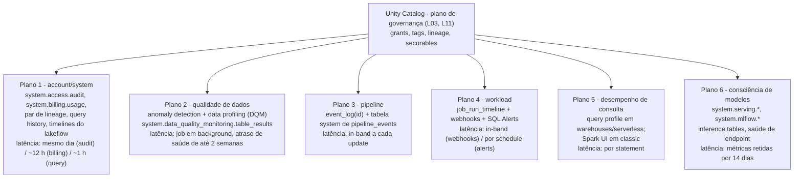
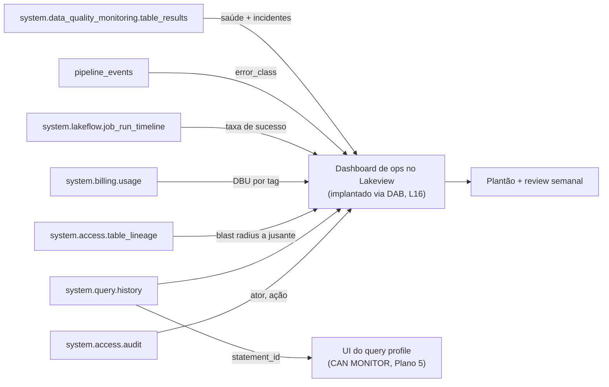
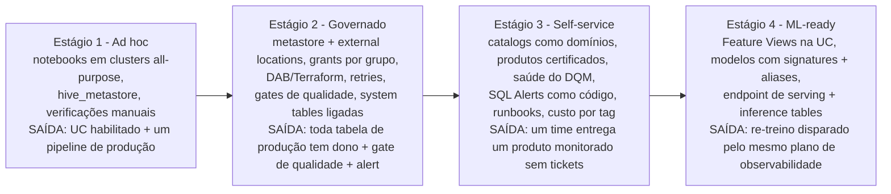
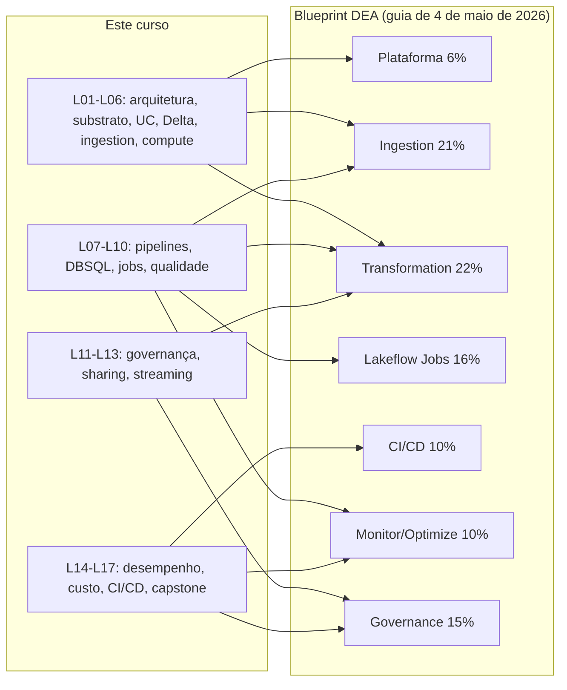

# Arquitetura de Referência do Capstone: Observabilidade, Ativação de ML e o Plano de 90 Dias para Databricks na AWS

Dezesseis lições construíram a máquina. A lição 01 te deu o conceito de lakehouse e a separação plano de controle / plano de compute na AWS; a lição 02, o substrato de VPC, bucket raiz, KMS e PrivateLink; a lição 03, o metastore do Unity Catalog e as external locations; a lição 04, o log de transações do Delta e o liquid clustering; a lição 05, o Auto Loader; a lição 06, DBR, Photon e economia de clusters; a lição 07, os pipelines declarativos do Lakeflow com expectations; a lição 08, os SQL warehouses do Databricks SQL e o Lakeview; a lição 09, os Lakeflow Jobs; a lição 10, os gates de qualidade de dados e a quarentena; a lição 11, grants, views dinâmicas e auditoria; a lição 12, Delta Sharing e Marketplace; a lição 13, Structured Streaming; a lição 14, desempenho; a lição 15, custo em DBU; a lição 16, Declarative Automation Bundles e Terraform. Este capstone faz uma coisa só: **monta essas dezesseis camadas em uma única arquitetura de referência, acrescenta as duas camadas que as lições anteriores apenas esboçaram — a pilha de observabilidade e uma fatia de ML governada — e te entrega um plano sequenciado para realmente construir tudo isso.**

A camada de observabilidade merece cuidado especial, porque é onde lakehouses de produção falham em silêncio. "As system tables fornecem uma store analítica hospedada pela Databricks com os dados operacionais da sua conta, localizada no catalog `system`" — e "As system tables são gratuitas. Você só é cobrado pelo compute usado para consultá-las" (docs.databricks.com/aws/en/admin/system-tables, rodapé **Oct 8, 2026**). Gratuito não é o mesmo que automático: a retenção começa a contar a partir da habilitação, o histórico nunca é preenchido retroativamente e os docs são diretos ao dizer que há "**No support for real-time monitoring. Data is updated throughout the day.**" Cada fato desta lição carrega sua fonte Databricks ou AWS e um carimbo de outubro de 2026; tudo o que os documentos não confirmam é deixado de fora ou marcado explicitamente como autoral do curso.

```text
 =============================================================
  MAPA DA LIÇÃO 17 - Capstone na AWS, out 2026
 ------------------------------------------------------------
  Plano 1  account/system  - catalog system: audit, billing,
           lineage, query history, timelines do lakeflow,
           pipeline_events, table_results, alert.*, mlflow.*,
           serving.*   (tabelas gratuitas, você paga o compute)
  Plano 2  qualidade      - DQM = anomaly detection (Public
           Preview, com escopo de schema) + data profiling (antes
           Lakehouse Monitoring)
  Plano 3  pipeline       - event_log(<id>) + system.
           lakeflow_pipeline_events_preview.pipeline_events
  Plano 4  workload       - job_run_timeline + notifications
           (email/Slack/Teams/PagerDuty/webhook, máx 3 por
           tipo de evento) + SQL Alerts (GA, 2026-05-19)
  Plano 5  query perf     - query profile (CAN MONITOR) vs
           Spark UI em classic
  Plano 6  model (aware)  - models na UC, aliases, serving
           endpoint, inference tables, system.serving.*
  Plano    30/60/90 dias (autoral do curso) sobre as
           10 fases de planejamento de produção da Databricks;
           Fase 9 = Observability cai nos dias 61-90
  Números  system tables grátis | query history ~1 h | billing
           ~12 h | retenção grátis 365 d (maioria das tabelas) |
           3 destinos por evento de job | snapshot profile 4 TB |
           serving >25K QPS, overhead <50 ms | DEA 45 Q /
           90 min / $200 / 2 anos
 =============================================================
```

Nesta lição você vai:

- modelar **observabilidade como cinco planos distintos, todos sobre o Unity Catalog**, mais um sexto plano de consciência de modelos, e aprender exatamente qual latência cada plano carrega;
- inventariar os **nomes atuais das system tables** (referência de 8 de outubro de 2026), suas retenções gratuitas e suas latências por tabela, e rodar um **dashboard de auditoria de seis consultas** contra elas;
- usar o **monitoramento de qualidade de dados** — anomaly detection mais data profiling, a família de produto que absorveu o "Lakehouse Monitoring" — com seus indicadores de saúde, incidentes e regras de alerta;
- fechar o ciclo com um **runbook de alerta → incidente → replay**, ligado por webhooks de jobs, regras de alerta do DQM e SQL Alerts-as-code;
- desenhar o **diagrama completo de ponta a ponta do capstone**: AWS VPC/S3/KMS, os dois planos do Databricks, Unity Catalog, pipelines do Lakeflow, serving do DBSQL, Delta Sharing e a pilha de observabilidade em uma página só;
- sequenciar um **roadmap autoral do curso de 30/60/90 dias** contra as 10 fases de planejamento de produção da Databricks, com um placar de marcos que nomeia a system table que prova cada marco;
- posicionar seu time em um **modelo de maturidade de quatro estágios** (ad hoc → governado → self-service → ML-ready) com critérios de saída;
- ativar uma **fatia de ML governada** — modelos MLflow no Unity Catalog, signatures, aliases, observabilidade de serving e de inference tables — respeitando a fronteira entre este curso e um curso dedicado de ML;
- estudar **Rivian, Block e NAB na AWS**, ler a **caixa de atualização de outubro de 2026**, mapear o curso no **blueprint do Data Engineer Associate** e responder **doze questões no estilo de exame** mais quatro verificações interativas.

---

## 1. Cinco planos de observabilidade, um plano de governança

O erro arquitetural mais comum nesta camada é tratar observabilidade como um produto que você "liga". Não é: são cinco planos com donos diferentes, privilégios diferentes e — criticamente — **latências diferentes**. Todos os cinco ficam sobre o Unity Catalog, e as próprias system tables são securables governados pela UC: "Users with both the account admin and metastore admin roles have access to system tables by default… `USE CATALOG` on the system catalog, `USE SCHEMA` on the system schemas, and `SELECT` on the system schemas" (referência de system tables, **2026-10-08**). Todo o resto precisa desses grants de forma explícita, ou de uma view dinâmica. **Observabilidade é algo que se concede — não é algo que já está lá.**



Três consequências se seguem, e cada uma já mordiu times de produção:

1. **Os planos não se substituem uns aos outros.** Expectations e constraints do Delta *impedem* escritas ruins no momento da escrita (lição 10); anomaly detection *detecta* desvio em um schema; profiling *mede* e armazena métricas de desvio; alerts de SQL e de job *notificam*. Privilégios diferentes também: `MANAGE` em um schema para habilitar anomaly detection, `SELECT` nas tabelas de métricas para construir alerts, `CAN MONITOR` em um warehouse para abrir o query profile de outra pessoa. Misturar tudo em "nós temos DQ" esconde qual camada está faltando.
2. **Reação em nível de minutos precisa ser in-band.** As system tables são atualizadas "throughout the day" — tudo que precisa disparar em minutos é uma policy `fail` de expectation, um webhook de job, uma regra de alerta do DQM ou um SQL Alert dentro de um job, e não um scan de `system.access.audit`.
3. **Latência é um insumo de projeto, não curiosidade.** Os registros de query history ficam "typically available within one hour" (referência de query history, **2026-10-06**); o uso faturável, "typically available within 12 hours" para `record_type = 'ORIGINAL'` (referência de billing, **2026-09-15**). Um dashboard de "anomalia de custo por hora" sobre `system.billing.usage` é um erro de categoria — a tabela não suporta isso.

> **📚 Você sabia?** Os schemas antigos `system.operational_data` e `system.lineage` estão "descontinuados e conterão tabelas vazias" (referência de system tables, 2026-10-08). Qualquer runbook, notebook ou dashboard de fornecedor ainda apontando para eles está lendo nada em silêncio. As casas atuais são `system.lakeflow.*` para timelines de job/pipeline e `system.access.table_lineage` / `system.access.column_lineage` para lineage.

```fillblank
{
  "question": "As system tables são gratuitas - você paga apenas pela {{1}} usada para consultá-las. Os registros de query history ficam tipicamente disponíveis em cerca de {{2}} hora(s), e os registros de uso faturável em cerca de {{3}} horas.",
  "template": "As system tables são gratuitas - você paga apenas pela {{1}} usada para consultá-las. Os registros de query history ficam tipicamente disponíveis em cerca de {{2}} hora(s), e os registros de uso faturável em cerca de {{3}} horas.",
  "answers": {
    "1": "computação",
    "2": "uma",
    "3": "12"
  },
  "distractors": [
    "armazenamento",
    "memória",
    "24",
    "5 minutos",
    "tempo real",
    "48"
  ],
  "explanation": "A referência de system tables (2026-10-08) diz que as tabelas em si são gratuitas e 'You are only charged for the compute used to query them'; a página de query history (2026-10-06) diz que os registros ficam 'typically available within one hour'; a página de billing (2026-09-15) diz 'typically available within 12 hours' para registros ORIGINAL. Armadilhas: 'armazenamento' inverte o modelo de cobrança (a store analítica é gratuita); 24 e 48 inventam números redondos; 'tempo real' é negado explicitamente pelo próprio banner dos docs 'No support for real-time monitoring'; '5 minutos' confunde system tables com sinais in-band como webhooks."
}
```

---

## 2. Plano 1: system tables como plano da conta

### 2.1 O inventário que importa (verificado em 8 de outubro de 2026)

Você não precisa de toda tabela do catalog `system` no dia um — você precisa destas, com suas retenções, para que seus dashboards e políticas de retenção batam com a realidade:

| Tabela | Retenção grátis | Escopo | Latência / notas |
|---|---|---|---|
| `system.access.audit` | 365 dias | Regional (workspace) + global (conta; `workspace_id` = 0) | "updated throughout the day"; Public Preview |
| `system.billing.usage` | 365 dias | **Global** | ~12 h para `record_type = 'ORIGINAL'` |
| `system.billing.list_prices` | Indefinida | Global | consulta de preço para a matemática de custo |
| `system.access.table_lineage` + `column_lineage` | 365 dias | Regional | janela móvel de 1 ano; histórico mais profundo via Catalog Explorer / API de lineage |
| `system.query.history` | 365 dias | Regional | ~1 h; `statement_text` é `<REDACTED>` para não-admins |
| `system.lakeflow.jobs`, `job_tasks`, `job_run_timeline`, `job_task_run_timeline` | 365 dias | Regional | streams; nomes atuais (não `system.workflow.*`) |
| `system.lakeflow.pipelines`, `pipeline_update_timeline` | 365 dias | Regional | streams |
| `system.lakeflow_pipeline_events_preview.pipeline_events` | 365 dias | Regional | **Beta**; "the recommended way to query events" |
| `system.data_quality_monitoring.table_results` | 13 meses | Regional | Public Preview; resultados de scan de anomalias |
| `system.alert.alerts`, `alert_evaluation_history` | 365 dias | Regional | preview — o status difere entre o blog de maio de 2026 e a referência de outubro de 2026; confira os docs atuais |
| `system.compute.warehouses`, `warehouse_events` | 365 dias | Regional | streams; `node_timeline` só 90 dias |
| `system.mlflow.experiments_latest`, `runs_latest`, `run_metrics_history` | 180 dias | Regional | Public Preview |
| `system.serving.served_entities` | 365 dias | Regional | `endpoint_usage` só 90 dias; o rastreamento de uso precisa estar habilitado |
| `system.ai_gateway.usage` | 365 dias | Regional | governança de token/requisição |

Fontes: referência de system tables (2026-10-08); referência de audit-logs (2026-07-01); referência de query history (2026-10-06); referência de billing (2026-09-15); referência de lineage (acessada em 2026-10). A **retenção configurável** existe em Beta — opt-in, padrão de 395 dias, configurável de 30 a 3.650 dias — mas "does not apply to `system.data_classification`, `system.data_quality_monitoring`, `system.lakebase`" (2026-10-08). E observe as ressalvas de streaming se você quiser *fazer stream* das system tables para suas próprias tabelas Delta: DBR **16.4+** para stream, **17.3+** para CDF, `Trigger.AvailableNow` em **18.0+**, e os próprios schemas system usam "the default 7 days retention for `VACUUM`".

### 2.2 Exemplo resolvido E1 — o dashboard de auditoria de seis consultas

Este é o centro da lição: um único dashboard Lakeview, seis consultas, todas válidas contra os schemas acima, implantadas como código por meio de um bundle (lição 16). Rode-o semanalmente; publique-o para um grupo `platform-ops` com `USE CATALOG` / `USE SCHEMA` / `SELECT` concedidos — ou, melhor, uma **view dinâmica por grupo** (a própria recomendação da página de query history).

```sql
-- Q1: Who changed grants / securables in the last 7 days?
--     Always predicate on event_date (audit-logs page, 2026-07-01).
SELECT event_date,
       user_identity.email AS actor,
       service_name,
       action_name,
       request_params['name'] AS target
FROM   system.access.audit
WHERE  event_date >= current_date() - 7
  AND  service_name = 'unityCatalog'
  AND  action_name RLIKE 'Grant|Revoke|Update|Create|Delete'
ORDER  BY event_date DESC, actor;

-- Q2: What did humans and service principals actually run?
--     statement_text is <REDACTED> unless account admin / databricks_pii_access.
SELECT executed_by,
       executed_as,
       statement_type,
       compute.type           AS compute_type,
       client_application,
       count(*)               AS statements,
       round(sum(total_duration_ms)/1000/60, 1) AS total_minutes
FROM   system.query.history
WHERE  start_time >= current_timestamp() - INTERVAL 7 DAYS
GROUP  BY 1,2,3,4,5
ORDER  BY total_minutes DESC
LIMIT  25;

-- Q3: Expensive / queue-bound warehouse statements (the FLEET view).
SELECT statement_id,
       executed_by,
       round(total_duration_ms/1000,1)               AS total_s,
       round(waiting_for_compute_duration_ms/1000,1) AS wait_compute_s,
       round(waiting_at_capacity_duration_ms/1000,1) AS wait_queue_s,
       read_bytes, written_rows,
       query_tags['team']                            AS team
FROM   system.query.history
WHERE  start_time >= current_timestamp() - INTERVAL 1 DAY
  AND  compute.type = 'WAREHOUSE'
ORDER  BY total_duration_ms DESC
LIMIT  20;   -- statement_id -> "See query profile" in Query History UI

-- Q4: Blast radius - who reads the sensitive gold table?
SELECT source_table_full_name, created_by, event_time, statement_id
FROM   system.access.table_lineage
WHERE  event_time >= current_timestamp() - INTERVAL 30 DAYS
  AND  source_table_full_name = 'acme.sales.orders_daily'
ORDER  BY event_time DESC;

-- Q5: Cost attribution by domain/team (DBUs only; AWS spend is elsewhere).
SELECT billing_origin_product,
       coalesce(tags['team'],'(untagged)') AS team,
       coalesce(workspace_name,'-')        AS workspace,
       round(sum(metered_quantity),1)      AS dbus,
       round(sum(unblended_cost),2)        AS usd
FROM   system.billing.usage
WHERE  billing_month = date_format(current_date(), 'yyyy-MM')
  AND  record_type   = 'ORIGINAL'
GROUP  BY 1,2,3
ORDER  BY usd DESC;

-- Q6: Job reliability - success rate per production job, last 14 days.
SELECT j.name AS job_name,
       count(*)                                             AS runs,
       sum(CASE WHEN r.state = 'SUCCESS' THEN 1 ELSE 0 END) AS ok,
       round(100.0*sum(CASE WHEN r.state='SUCCESS' THEN 1 ELSE 0 END)/count(*),1) AS pct_ok,
       round(avg(r.duration)/1000/60,1)                     AS avg_min
FROM   system.lakeflow.job_run_timeline r
JOIN   system.lakeflow.jobs j ON j.job_id = r.job_id
WHERE  r.start_time >= current_timestamp() - INTERVAL 14 DAYS
GROUP  BY 1
ORDER  BY pct_ok ASC, avg_min DESC;
```

Notas de ensino, cada uma extraída de uma armadilha documentada. **Q1** é sua consulta de evidência de conformidade — sempre com predicado em `event_date`, porque a página de audit diz "To improve query performance, filter on `event_date` rather than `event_time`". **Q3** é a ponte da visão de *fleet* para a visão de *uma consulta só*: clique em qualquer `statement_id` na Query History UI e você cai no **query profile** daquele statement. **Q5** precisa ser pareada com um tile do Cost Explorer da AWS, porque `system.billing.usage` contém **zero** de gasto da AWS — nem EC2, nem S3, nem NAT (lição 15). Scans sem filtro de qualquer uma dessas tabelas podem bater no guard documentado: "System Table query returned too much data. Please repeat query with more selective predicates." E a Databricks "highly discourages" exportar system tables para fora da plataforma — o dado "can expose sensitive data and put your deployment at risk".



> **⚠️ WARNING — observabilidade adicionada por último é observabilidade que começa vazia.** A retenção começa a contar **a partir da habilitação**, e o histórico nunca é preenchido retroativamente: um dashboard construído no dia 200 tem 200 dias de dados; construído no dia 400, ainda tem 200 dias. A própria melhor prática da página de system tables (levada para a Fase 9 do deployment guide, **2026-09-11**) é "Enable system tables for all metastores to capture comprehensive usage data" durante a fundação — que é exatamente por que o roadmap de 30/60/90 da seção 8 coloca a habilitação em **dias 1–30**, e não no dia 89.

---

## 3. Plano 2: monitoramento de qualidade de dados (o produto que comeu o "Lakehouse Monitoring")

### 3.1 Os nomes, de uma vez por todas

Se um tutorial de 2024, um slide de fornecedor ou até um post do blog da Databricks de setembro de 2026 diz **Lakehouse Monitoring**, a resposta de outubro de 2026 é: essa capacidade agora é **data profiling**, uma das duas capacidades sob **monitoramento de qualidade de dados** no Unity Catalog, sendo a outra o **anomaly detection** (página de data quality monitoring, **2026-09-11**: "Data profiling was formerly known as Lakehouse Monitoring"; página de produto, acessada em 2026-10). Ensine o nome novo, reconheça o antigo e saiba que até material atual da Databricks escorrega — o deployment guide ainda intitula uma seção "**Lakehouse Monitoring** capabilities" (2026-09-11).

### 3.2 Anomaly detection: com escopo de schema, aprendido e paciente

O anomaly detection é habilitado em um **schema ou catalog** — "up to 50 schemas at a time" pela UI do catalog, exigindo `MANAGE` — e "Databricks creates a background job that monitors tables for *freshness* and *completeness*" (página de anomaly detection, **2026-10-09**, Public Preview). Freshness: "If a commit is unusually late, the table is marked as stale." Completeness: "Se o número de linhas enviadas nas últimas 24 horas for menor que o limite inferior deste intervalo, a tabela é marcada como incompleta." Os resultados caem em `system.data_quality_monitoring.table_results`; os indicadores de saúde (Healthy / Unhealthy / Training / Error / Excluded / Not enabled) aparecem nas páginas de tabela e nos nós de lineage; e "Intelligent scanning prioritizes high-impact tables as determined by popularity and downstream usage" — apoiando-se no lineage e na certificação da UC, então **uma organização que nunca certifica nada tem monitoramento mais fraco**. Espere "Smart scanning might delay the population of health indicators for some tables by up to two weeks", incidentes que podem ser atribuídos ("Assign to me" persiste 7 dias) ou dispensados ("Not an issue"), e o gatilho irreversível: "When you disable anomaly detection, the anomaly detection job and all anomaly detection tables and information are deleted. This action cannot be undone."

### 3.3 Data profiling: duas tabelas de métricas, três tipos de profile

O profiling é por tabela e produz exatamente o que um dashboard de desvio precisa: "Profiling creates two metric tables and a dashboard… The profile metric table contains summary statistics… The drift metrics table contains statistics related to the data's drift over time" (página de data profiling, **2026-09-11**). As tabelas de métricas são tabelas Delta em um schema da UC que você escolhe. Três tipos de profile: **time series** (métricas ao longo de janelas de tempo), **inference** (logs de requisições de modelo) e **snapshot** ("A tabela completa é processada a cada refresh. O tamanho máximo da tabela para um profile snapshot é **4 TB**"). Profiles de time series e de inference "calculam apenas métricas dos últimos 30 dias". O profiling roda em compute serverless "mas não exige que sua conta esteja habilitada para compute serverless", é cobrado como DBUs serverless sob `billing_origin_product = 'DATA_QUALITY_MONITORING'` (resultados a partir de fevereiro de 2026) e — um alívio para estates regulados — "Data quality monitoring **does not** modify any tables it monitors, nor does it add overhead to any jobs that populate these tables."

### 3.4 Exemplo resolvido E2 — ligando a camada de alerting de ponta a ponta

Três planos de entrada, um único vocabulário de destinos. (i) **Webhook de job** — um admin configura um sistema de destino uma vez (email, Slack, Microsoft Teams, PagerDuty ou qualquer webhook); cada job então define `notifications.on_failure`, limitado a "a maximum of **three system destinations** for each notification event type" por job ou task (página de notifications de jobs, **2026-10-09**). O payload é JSON estável:

```json
{
  "event_type": "jobs.on_failure",
  "workspace_id": "1234567890123456",
  "run": { "run_id": "987654321" },
  "job": { "job_id": "42", "name": "orders_prod" }
}
```

(ii) **Regra de alerta do DQM** (Beta) — com escopo em `catalog.acme` ou `catalog.acme.sales`, exigindo `MANAGE`, entregando no mesmo vocabulário de destinos quando uma tabela fica Unhealthy. (iii) **SQL Alert como código** — "Databricks SQL Alerts is Generally Available (GA), with more than 4,000 customers already using Alerts in production" (blog da Databricks, **2026-05-19**); um alert agrupa "a SQL query, an evaluation condition, a schedule, and a set of notification destinations", é versionável em Git e implantável por bundles/Terraform, e pode rodar como uma **task SQL Alert de Lakeflow Job** (Public Preview) cuja saída `OK` / `TRIGGERED` / `ERROR` decide a próxima task via `run_if`. Uma verificação de custo de monitoramento que você vai realmente rodar:

```sql
SELECT sku_name, sum(usage_quantity) AS dbus
FROM   system.billing.usage
WHERE  billing_origin_product = 'DATA_QUALITY_MONITORING'
GROUP  BY 1;
```

- **📚 Você sabia?** A própria pilha interna de confiabilidade da Databricks, **RADAR**, são os quatro planos desta lição rodando em produção: métricas de confiabilidade → anomaly detection SPOT (um modelo não supervisionado de streaming que aprende o "normal" do passado **14 dias**) → alerting → dashboards de causa raiz. Resultado publicado: "**95% reduction in incident-discovery time, at over 90% precision**" (blog da Databricks, **2026-09-19**). O mapa de construção naquele post — métricas em Delta, um detector treinado no MLflow servido em um endpoint do Model Serving, recorrência do Workflows, SQL Alerts, Genie para causa raiz, tudo implantado como um único DAB — é este capstone, por dentro.

---

## 4. Planos 3–5: pipelines, workloads e desempenho de consulta

### 4.1 O event log do pipeline — e a exclusão que quebra o Auto Loader

Os pipelines do Lakeflow expõem três superfícies de observabilidade aninhadas: a UI (página de monitoring, grafo, métricas de dataset, aba Data quality); o **event log por pipeline**, uma tabela Delta oculta legível via `SELECT * FROM event_log(<pipelineId>)` e publicável em uma tabela UC nomeada; e a `system.lakeflow_pipeline_events_preview.pipeline_events` em escopo regional (**Beta**), que os docs agora chamam de "the recommended way to query events", com um JSON de dashboard Lakeview pronto para importar na página de monitoring (datada de **2026-10-09**). Os resultados das expectations viajam nos eventos `flow_progress`: `details:flow_progress.data_quality.expectations` é um `array<struct<name: string, dataset: string, passed_records: int, failed_records: int>>`. Atribuição de custo de um pipeline: `SELECT sku_name, sum(usage_quantity) FROM system.billing.usage WHERE usage_metadata.dlt_pipeline_id = :pipeline_id GROUP BY 1`.

> **⚠️ IMPORTANT — nunca apague o event log de um pipeline.** "O local do event log também serve como o local do schema para quaisquer queries de Auto Loader no pipeline… Não apague o event log nem o catálogo ou schema pai" (página de pipeline event log, 2026-10-09). Apagá-lo não custa só o histórico — ele quebra updates futuros, porque o estado exactly-once do Auto Loader vive lá (lição 05).

Um detalhe operacional que vale levar para os seus runbooks: updates acionados pela UI/API usam "fast-start, debugging-focused behavior", enquanto "Updates iniciados pelo **Jobs ou pela Pipelines API, e todos os updates de pipelines contínuos**, usam **retry e reinício automáticos**" — que é exatamente por que pipelines de produção precisam ser disparados a partir de um job (lição 09), e não da UI.

### 4.2 Notifications de job: a camada de paging, com duas armadilhas documentadas

As notifications de job cobrem eventos de início, conclusão bem-sucedida, falha, limiar de duração, limiar de backlog de streaming e manutenção contínua, entregues por email ou pelos sistemas de destino configurados pelo admin (Slack, Teams, PagerDuty, webhook), no máximo **três destinos por tipo de evento por job ou task**. Os códigos `event_type` de webhook são estáveis: `jobs.on_start`, `jobs.on_success`, `jobs.on_failure`, `jobs.on_duration_warning_threshold_exceeded`. Alerts de backlog de streaming avaliam "average backlog over a **10-minute period**" e notificam de novo após **30 minutos**. As armadilhas: "**Job-level notifications aren't sent when failed tasks are retried**" (silencie até a última retentativa, ou use notifications por task), e "Succeeded with failures" conta como sucesso. Para contexto de escala: um workspace é limitado a **2.000 execuções de task simultâneas**, pode guardar até **12.000 jobs salvos**, criar **10.000 jobs por hora** e um único job pode conter até **1.000 tasks** (visão geral do Lakeflow Jobs, **2026-10-09**).

### 4.3 Query profiles: o plano por statement

Para SQL warehouses e compute serverless, o **query profile** é o diagnóstico por statement: DAG de operadores com Time spent / Memory peak / Rows, um painel de Top operators, Performance insights ranqueados "by their projected effect on total task duration" e reescritas assistidas por código do Genie apresentadas para sua aprovação (página de query profile, **2026-09-11**). O acesso é um fato de permissão com consequências reais de organização: "você precisa ser o owner da query ou ter pelo menos a permissão **CAN MONITOR** no SQL warehouse que executou a query". Não existem profiles para queries com cache hit, e a exportação/importação de JSON de profile não é persistida. Cargas de trabalho em clusters classic usam a **Spark UI** em vez disso — a Fase 9 do deployment guide diz a divisão sem rodeios: "Para compute serverless e SQL warehouses, use o query profile… Para clusters classic, use a Spark UI". A Q3 do E1 é a visão de fleet em `system.query.history`; o profile é a visão de uma consulta só; `statement_id` as une.

```mermaid
stateDiagram-v2
    [*] --> Healthy
    Healthy --> Detected: anomaly detection marca a tabela Unhealthy / SQL Alert TRIGGERED / webhook de job jobs.on_failure
    Detected --> Triaged: plantão abre incidente (UI de incidentes do DQM: "Assign to me")
    Triaged --> RootCaused: lineage da UC -> job/pipeline a montante; pipeline_events error.exceptions[0].error_class
    RootCaused --> Repaired: correção de código/config mesclada (PR de DAB, alvo dev primeiro, L16)
    Repaired --> Replayed: repair run do job / replay direcionado de pipeline / re-drive idempotente em lote
    Replayed --> Validated: expectations passam + profile/drift de volta na faixa + saúde Healthy
    Validated --> Closed: incidente "Not an issue" ou auto-resolvido; runbook atualizado
    Detected --> FalsePositive: limiar ajustado, alert silenciado
    FalsePositive --> Healthy
```



O corpo do runbook, cada passo nomeando sua ferramenta: **1. Detectar** por qualquer um dos três planos. **2. Classificar**: freshness (stale) vs completeness vs pico de `failed_records` em expectation vs falha de compute. **3. Delimitar** com `system.access.table_lineage` / `column_lineage`. **4. Causa raiz** em `pipeline_events` (`error.exceptions[0].error_class`) e no array de expectations. **5. Reparar** em dev via um PR de DAB (lição 16). **6. Reexecutar** de forma idempotente — o **repair** do job reroda apenas os subconjuntos falhados/pulados; o Auto Loader faz replay do prefixo de chegada exatamente uma vez. **7. Validar e fechar**, considerando até duas semanas de atraso do scan de indicadores de saúde, e escrever o novo limiar de volta no runbook (Fase 9: "Document runbooks for common operational scenarios", **2026-09-11**).

---

## 5. Plano 6: a fatia de ML — governança primeiro, algoritmos em outro lugar

### 5.1 A linha de fronteira, dita uma vez

Este curso é dono do **substrato de lakehouse onde o ML roda**: UC como plano de governança para modelos e features (nomes de três níveis, grants, aliases, lineage), observabilidade de inference tables e de endpoints de serving como o mesmo padrão de observabilidade aplicado a modelos, e onde os artefatos de ML ficam na arquitetura de referência. Um curso dedicado de ML é dono de algoritmos, metodologia de treino e de hiperparâmetros, AutoML, disciplina de experiment tracking, design de feature engineering, desenvolvimento de LLM/agente, autoria de política de AI Gateway e ajuste de desempenho de deploy. O corte limpo: **nós ensinamos governança e observabilidade de modelos, não como construí-los.**

### 5.2 Models in Unity Catalog — a mecânica verificada

"Models in Unity Catalog, which Databricks recommends" (página de ciclo de vida do modelo, **2026-10-09**) é "a hosted version of MLflow Model Registry in Unity Catalog… including centralized access control, auditing, lineage, and model discovery across workspaces". Mecânica para saber de cor:

- o URI de registro padrão no MLflow 3 é **`databricks-uc`**; modelos ganham nomes de três níveis `<catalog>.<schema>.<model>`;
- modelos são um **subtipo do securable `FUNCTION`** — conceda com `GRANT ON FUNCTION`, crie com `GRANT CREATE MODEL ON SCHEMA`, use com `EXECUTE`;
- "Novas versões de modelo em UC precisam ter uma **signature** de modelo" — sem ela você perde imposição de entrada, uso de funções de IA e exemplos de entrada de serving gerados automaticamente;
- **aliases substituem stages**: "Stages não são suportados para modelos no Unity Catalog" — uma referência nomeada mutável como `Champion` é o mecanismo de promoção;
- a promoção entre ambientes é feita "by deploying ML pipelines as code" (preferido) ou `copy_model_version()` (MLflow 2.8.0+);
- lineage tabela→modelo via `mlflow.log_input` (MLflow 2.11.0+) aparece na aba Lineage da versão do modelo no Catalog Explorer;
- não suportado em modelos da UC: webhooks, notifications por email, threads de comentário, activity log — use audit logs e gates de CI em vez disso.

Pareamento de versão do MLflow por runtime (release notes, **2026-09-11**): DBR **19** → MLflow **3.12.0**; **18 LTS** → **3.8.1**; **17.3 LTS** → **3.0.1**; **16.4 LTS** → **2.21.3**.

### 5.3 Exemplo resolvido E3 — a fatia de ativação de ML com governança primeiro

Vinte linhas que satisfazem todas as regras de UC acima, e então observe o modelo como observe dados:

```python
import mlflow
mlflow.set_registry_uri("databricks-uc")          # default in MLflow 3 anyway
mlflow.sklearn.log_model(
    sk_model=clf, name="model",
    input_example=X.iloc[[0]],                    # signature inferred -> required in UC
    registered_model_name="acme.ml.churn_model")
# promote by alias, not stage (stages unsupported in UC)
from mlflow import MlflowClient
MlflowClient().set_registered_model_alias(
    "acme.ml.churn_model", "Champion", version=v)
# consume by alias in batch or on a serving endpoint
m = mlflow.pyfunc.load_model("models:/acme.ml.churn_model@Champion")
```

Grants: `GRANT CREATE MODEL ON SCHEMA acme.ml TO` o principal de treino; `GRANT EXECUTE ON FUNCTION acme.ml.churn_model TO` os consumidores. Observabilidade: uma **inference table** registra predições para análise de desvio; `system.serving.endpoint_usage` (retenção de 90 dias, o rastreamento de uso precisa estar habilitado) e `system.serving.served_entities` dão a visão de frota; `system.mlflow.runs_latest` / `run_metrics_history` (180 dias) carregam a telemetria de treino. O próprio Model Serving é uma superfície REST serverless que "suporta mais de **25K queries por segundo** com latência de overhead de **menos de 50 ms**" (página de model serving, **2026-10-06**) — com duas ressalvas em torno das quais você precisa projetar: os dados de métricas ficam retidos por apenas **14 dias** (logs de build de container, 30 dias), e "Model Serving does not provide security patches to existing model images because of the risk of destabilization to production deployments". **Feature Store** está atual e é UC-first: Feature Views (declarativo, **Public Preview**, recomendado) e feature tables publicam ambos no Online Feature Store com joins point-in-time que eliminam o skew entre treino e serving; o Workspace Feature Store está obsoleto.

> **📚 Você sabia?** A Databricks anunciou o **Genie ZeroOps** em **2026-06-16** — "an autonomous background agent that monitors your data and AI assets… and takes action before or when things go wrong", com validação de correções propostas por shallow clone contra dados reais sem tocar em produção. Sua disponibilidade declarada no anúncio era "entering **private preview** in the coming weeks"; esta lição o cita apenas como uma direção anunciada para a camada de runbook, nunca como uma capacidade da qual você possa depender hoje.

---

## 6. O capstone completo: AWS + Databricks de ponta a ponta

Aqui está o curso inteiro em uma página. Leia de cima para baixo: fontes à esquerda da sua mente, armazenamento na conta AWS do cliente, governança no Unity Catalog, pipelines medallion no meio, serving e sharing à direita, observabilidade envolvendo tudo — e os dois medidores de cobrança (fatura da AWS vs DBU) que a lição 15 te ensinou a nunca confundir.

```mermaid
flowchart TB
    subgraph SRC["Fontes (L05, L13)"]
        S1["Arquivos / SaaS / CDC"]
        S2["Kinesis / MSK / Kafka"]
        S3["JDBC / RDS / DynamoDB"]
    end
    subgraph AWS["Conta da AWS do cliente - substrato (L02)"]
        VPC["VPC: >=2 subnets privados /17-/26, AZs separadas<br/>conectabilidade segura de cluster - sem IPs públicos"]
        NAT["NAT gateway + VPC endpoints / PrivateLink"]
        KB["Chaves KMS gerenciadas pelo cliente<br/>(bucket raiz, storage gerenciado, external locations)]
        SL["Bucket de chegada do S3"]
        SD["Buckets de dados do S3: bronze / silver / gold<br/>(S3 Standard $0.023/GB-mo, lista us-east-1 de 2026-09-28)"]
        SR["Bucket workspace/raiz do S3 - apenas dados do sistema"]
        IAM["Role IAM cross-account (trust 414351767826)"]
    end
    subgraph CP["Plano de controle do Databricks (conta Databricks)"]
        CTRL["Web UI, metadados de notebook, cluster manager,<br/>orquestador de jobs, controle do Unity Catalog"]
    end
    subgraph DP["Planos de compute"]
        CLS["Plano de compute classic - EC2 na VPC do cliente (L06)"]
        SRV["Plano de compute serverless - DBSQL serverless,<br/>jobs serverless, model serving"]
    end
    subgraph UC["Metastore do Unity Catalog - um por região (L03, L11)"]
        MST["catalog.schema.table / volume / model / feature"]
        SCD["Storage credential (role IAM) + external locations"]
        GR["Grants, tags, views dinâmicas de linha/coluna, lineage"]
    end
    subgraph PIPE["Ingest + transform (L04, L05, L07, L10, L13)"]
        AL["Auto Loader bronze (cloudFiles, schema location)"]
        SDP["Lakeflow Spark Declarative Pipelines silver<br/>expectations + tabela de quarentena"]
        GOLD["Tabelas gold / materialized views<br/>constraints do Delta, liquid clustering (L14)"]
    end
    subgraph SERV["Serve + share (L08, L12)"]
        WH["Warehouse DBSQL serverless + Lakeview / dashboards AI-BI"]
        BI["Tableau / Power BI via JDBC/ODBC"]
        SH["Delta Sharing / Marketplace / Lakehouse Federation"]
        MS["Endpoint do Model Serving + inference tables"]
    end
    subgraph ORCH["Orquestrar + entregar (L09, L16)"]
        JOB["Lakeflow Jobs multi-task: retries, gates run_if,<br/>run_as de service principal, notifications por webhook"]
        CICD["Declarative Automation Bundles + Terraform + GitHub Actions (OIDC)"]
    end
    subgraph OBS["Pilha de observabilidade (L10, L11, L17)"]
        SYS["System tables: audit, billing, lineage, query history,<br/>timelines do lakeflow - gratuitas, pague o compute"]
        DQM["Monitoramento de qualidade de dados: anomaly detection + profiling"]
        PEV["pipeline_events + webhooks de job + SQL Alerts"]
        QP["Query profiles (CAN MONITOR) / Spark UI"]
    end
    SRC --> SL
    SL --> AL
    S2 --> AL
    AL --> SDP
    SDP --> GOLD
    SD --> SCD
    SCD --> MST
    MST --> GR
    GR --> WH
    GOLD --> WH
    GOLD --> MS
    WH --> BI
    MST --> SH
    JOB --> AL
    JOB --> SDP
    CICD --> JOB
    CLS --> SD
    SRV --> WH
    SRV --> MS
    VPC --> CLS
    NAT --> VPC
    KB --> SD
    KB --> SR
    IAM --> CLS
    CTRL -.->|"HTTPS/443 SCC relay"| CLS
    CTRL -.-> SRV
    SYS -.-> OBS
    DQM -.-> OBS
    PEV -.-> OBS
    QP -.-> OBS
    SDP -.->|"flow_progress + expectations"| PEV
    JOB -.->|"job_run_timeline + webhooks"| PEV
    WH -.->|"statement_id -> query profile"| QP
```

### 6.1 Exemplo resolvido E4 — o checklist de 17 componentes

Cada componente abaixo foi construído em uma lição anterior; a coluna "prova" nomeia a system table ou o artefato que demonstra que ele existe. Esta é a tabela que você revisa no dia 90.

| # | Componente | Construído em | Artefato de prova |
|---|---|---|---|
| 1 | Workspaces dev/prod, Premium, SSO | L01, L02 | console da conta / Terraform `databricks_mws_workspaces` |
| 2 | VPC do cliente, SCC, endpoints/PrivateLink | L02 | plan do Terraform; sem IPs públicos no compute |
| 3 | Bucket raiz + buckets externos de dados, KMS | L02, L03 | policies de bucket; ARNs de CMK |
| 4 | Metastore da UC por região, workspaces anexados | L03 | página de metastore do console da conta |
| 5 | Storage credential + external location por prefixo | L03 | `CREATE EXTERNAL LOCATION` + grants |
| 6 | Auto Loader bronze com schema location | L05 | tabela bronze + diretório de checkpoint |
| 7 | Lakeflow SDP silver, expectations + quarentena | L07, L10 | métricas de expectations em `flow_progress` |
| 8 | Tabelas/MVs gold com constraints do Delta | L04, L10 | `DESCRIBE DETAIL`; violações de constraint = 0 |
| 9 | Liquid clustering + higiene de OPTIMIZE/VACUUM | L04, L14 | chaves de clustering; log de retenção do VACUUM |
| 10 | Warehouses DBSQL serverless, auto-stop, Lakeview | L08 | `system.compute.warehouses` |
| 11 | Lakeflow Jobs: retries, `run_if`, `run_as` de SP, webhooks | L09 | `system.lakeflow.job_run_timeline` |
| 12 | DABs + Terraform + GitHub Actions (OIDC) | L16 | checks de PR; deploys de bundle |
| 13 | Delta Sharing / Marketplace / Federation | L12 | shares, recipients, catalogs federados |
| 14 | Pilha de observabilidade (planos 1–5) | L11, L17 | o dashboard desta lição |
| 15 | Governança de custo: tags, budgets, auto-stop/spot | L15 | `system.billing.usage` por tag |
| 16 | Camada de ML: models na UC, serving, inference tables | L17 | `system.serving.*`; aba Lineage do modelo |
| 17 | Runbooks + SLAs (alerta → incidente → replay) | L09, L10, L17 | doc de runbook publicado + evidência de game day |

---

## 7. 30/60/90 dias: um roadmap autoral do curso sobre as 10 fases da Databricks

> **📌 Nota de procedência.** Não existe nenhum cronograma de adoção "30/60/90-day" publicado pela Databricks; o cronograma abaixo é uma **síntese do curso** ancorada na sequência oficial de 10 fases de planejamento de produção (página do deployment guide, **2026-09-11** — cuja própria página de introdução em outro lugar diz 9 fases; nós ensinamos a tabela de 10 fases, a página que de fato lista as fases). Os *nomes* das fases são da Databricks; os *dias* são nossos.

```mermaid
gantt
    title Roadmap de adoção 30/60/90 (autoral do curso) sobre as fases de planejamento de produção da Databricks
    dateFormat  X
    axisFormat %s
    section Dias 1-30 Fundação
    Fases 1-5: account, workspace, UC, rede, storage :done, a1, 0, 30
    section Dias 31-60 Pipeline + qualidade
    Fases 6-8: Delta, IaC, compute + DQM + CI/CD :active, a2, 30, 30
    section Dias 61-90 Operar + estender
    Fase 9 Observability + Fase 10 HA/DR : a3, 60, 30
```

**Dias 1–30 — Fundação (fases 1–5: conta, estratégia de workspace, Unity Catalog, rede, storage).** Conta + metastore no ar; SSO/SCIM; um metastore por região; buckets S3 raiz + externos com KMS; storage credential + external location para o prefixo de chegada; workspaces dev/prod; um módulo Terraform para recursos de nível de conta; **system tables habilitadas**; `USE CATALOG` / `USE SCHEMA` / `SELECT` concedidos a um grupo `platform-ops`. *Marco:* uma primeira tabela bronze do Auto Loader aterrissa no S3 por uma external location, fica consultável na UC e `system.access.audit` retorna linhas dela.

**Dias 31–60 — Pipeline + qualidade (fases 6–8: Delta Lake, IaC, compute).** Pipeline do Lakeflow bronze→silver→gold com expectations e uma tabela de quarentena; constraints do Delta no silver; job multi-task com gates `run_if`, retries, `run_as` de service principal; DABs implantando targets `dev`/`prod`; cluster policies + instance pools + auto-stop; um warehouse DBSQL serverless com auto-stop; **anomaly detection habilitado no schema silver** e um profile de time series na tabela gold de KPI; um webhook `jobs.on_failure` para o canal do time. *Marco:* um arquivo corrompido de propósito dispara métricas de expectation → quarentena → saúde do DQM vira Unhealthy → webhook dispara, de ponta a ponta, em um drill de game day.

**Dias 61–90 — Operar + estender (fases 9–10: observabilidade, HA/DR).** Um dashboard "Ops" no Lakeview sobre `system.lakeflow.job_run_timeline`, `system.query.history`, `system.billing.usage` e `pipeline_events`; SQL Alerts para KPIs de frescor/contagem de linhas com versionamento em Git/DAB; o dashboard de auditoria do E1 revisado semanalmente; runbooks publicados (seção 4.3); política de retenção de backup/time travel + VACUUM documentada; atribuição de custo por tag com <5% de gasto sem tag. *Marco:* o plantão resolve uma página usando apenas o dashboard de ops e um runbook.

### 7.1 Exemplo resolvido E5 — o placar de marcos

| Gate | Fases da Databricks | Entregável | Marco mensurável | System table que o prova |
|---|---|---|---|---|
| Dia 30 | 1–5 | UC + S3 + Auto Loader bronze | Primeira leitura de external location bem-sucedida; eventos de grant visíveis | `system.access.audit` mostra os eventos de grant/create |
| Dia 60 | 6–8 | Pipelines + qualidade + CI/CD | Game day: arquivo corrompido → quarentena + DQM Unhealthy + webhook recebido | saúde em `table_results` + log de entrega do webhook |
| Dia 90 | 9–10 | Observabilidade + HA/DR | Plantão resolve uma página só com o dashboard de ops + runbook; <5% de gasto em DBU sem tag | `system.billing.usage` por tag; taxa de sucesso em `job_run_timeline` |

```dragdrop
{
  "question": "Ordene o roadmap autoral do curso de 30/60/90 dias para um lakehouse Databricks-on-AWS, fundação primeiro e operação por último:",
  "items": [
    "Dias 1-30: conta + metastore regional no ar, SSO/SCIM, workspaces dev/prod, Terraform para recursos de nível de conta",
    "Dias 1-30: buckets S3 raiz + externos com KMS; storage credential + external location para o prefixo de chegada",
    "Dias 1-30: system tables habilitadas para todos os metastores; grupo platform-ops com grant de USE CATALOG / USE SCHEMA / SELECT",
    "Dias 31-60: pipeline do Lakeflow bronze-silver-gold com expectations + quarentena; constraints do Delta no silver",
    "Dias 31-60: job multi-task com gates run_if, retries, run_as de service principal; DABs targets dev/prod; auto-stop do warehouse",
    "Dias 31-60: anomaly detection habilitado no schema silver; profile de time series na tabela gold de KPI; webhook jobs.on_failure",
    "Dias 61-90: dashboard de Ops no Lakeview sobre job_run_timeline, query history, billing.usage e pipeline_events",
    "Dias 61-90: SQL Alerts como código, revisão semanal do dashboard de auditoria, runbooks publicados, atribuição de custo por tag <5% sem tag"
  ],
  "correctOrder": [
    "Dias 1-30: conta + metastore regional no ar, SSO/SCIM, workspaces dev/prod, Terraform para recursos de nível de conta",
    "Dias 1-30: buckets S3 raiz + externos com KMS; storage credential + external location para o prefixo de chegada",
    "Dias 1-30: system tables habilitadas para todos os metastores; grupo platform-ops com grant de USE CATALOG / USE SCHEMA / SELECT",
    "Dias 31-60: pipeline do Lakeflow bronze-silver-gold com expectations + quarentena; constraints do Delta no silver",
    "Dias 31-60: job multi-task com gates run_if, retries, run_as de service principal; DABs targets dev/prod; auto-stop do warehouse",
    "Dias 31-60: anomaly detection habilitado no schema silver; profile de time series na tabela gold de KPI; webhook jobs.on_failure",
    "Dias 61-90: dashboard de Ops no Lakeview sobre job_run_timeline, query history, billing.usage e pipeline_events",
    "Dias 61-90: SQL Alerts como código, revisão semanal do dashboard de auditoria, runbooks publicados, atribuição de custo por tag <5% sem tag"
  ],
  "explanation": "A ordem espelha as 10 fases documentadas de planejamento de produção da Databricks (deployment guide, 2026-09-11) comprimidas pelo curso em três gates: conta/UC/rede/storage (fases 1-5) precisam existir antes que pipelines possam pousar dados por uma external location; Delta/IaC/compute (fases 6-8) precisam existir antes que gates de qualidade e alerts tenham algo para observar; observabilidade e HA/DR (fases 9-10) vêm por último na construção, mas dependem de as system tables terem sido habilitadas no dia 1 - a retenção começa a contar a partir da habilitação e o histórico nunca é preenchido retroativamente. A falha clássica que essa ordem previne: construir o dashboard de ops na semana 12 e descobrir que ele só enxerga 12 dias de histórico."
}
```

### 7.2 Exemplo resolvido E6 — um rascunho mensal de custo de observabilidade

As system tables são gratuitas; as *consultas e os dashboards* não. Considere um warehouse de ops (serverless, $0.70/DBU na lista, página de preços de SQL acessada em 2026-10) rodando o dashboard do E1 mais triagem ad hoc 2 horas/dia × 20 dias/mês a ~4 DBU/hora: **160 DBU × $0.70 = $112/mês** do lado Databricks, além de zero de armazenamento para as próprias tabelas. Some um profile snapshot em uma tabela gold de 500 GB (sob o teto de 4 TB) e anomaly detection em dois schemas — ambos cobrados como DBUs serverless sob `billing_origin_product = 'DATA_QUALITY_MONITORING'`; a *taxa* não é publicada, então meça quantidades em `system.billing.usage` e precifique contra o seu contrato corporativo em vez de assumir a taxa de lista. Do lado da AWS, não acrescente nada além do armazenamento em S3 já contado na lição 15 ($0.023/GB-mês) e do tráfego de NAT da sua VPC. A lição de projeto: **o plano de observabilidade é uma margem de arredondamento ao lado do plano de pipeline — desde que o auto-stop esteja ligado e o warehouse do dashboard não fique nos padrões de 45 minutos sem ninguém olhando.**

---

## 8. O modelo de maturidade: ad hoc → governado → self-service → ML-ready

> **📌 Nota de procedência.** Não existe nenhuma página oficial de "maturity model" da Databricks; os quatro estágios são um construto do curso mapeado sobre funcionalidades verificadas, com as recomendações da Fase 9 e o post de data products de setembro de 2026 como a linguagem oficial de suporte mais próxima.



Cada critério de saída é observável em uma system table ou em um objeto da UC — que é o ponto. O estágio 2→3 é bloqueado pelo *design de organização* (propriedade de catalog, `MANAGE` delegado, contratos de dados), não por funcionalidades faltando; times que instalam o DQM sem donos ganham alerts que ninguém responde, o que é pior do que não ter alerts. O estágio 3→4 exige lineage que atravessa tabela → feature → modelo, o que só existe se o treino usou `mlflow.log_input` e as features estão registradas na UC. O post de data products da Databricks de 2026-09-03 prescreve "data contracts upfront that include quality metrics, schema definitions, usage policies and security parameters" mais uma fase de "Operate and Govern" — o vocabulário do estágio 3, nas palavras da própria Databricks.

---

## 9. Síntese do curso: lições 01–16 mapeadas no blueprint do Data Engineer Associate

O último ato acadêmico do capstone é conectar este curso à credencial para a qual ele mais diretamente te prepara. O guia de exame vigente da **Databricks Certified Data Engineer Associate** está datado de **4 de maio de 2026**: **45 questões objetivas pontuadas, 90 minutos, $200, validade de 2 anos**, com o blueprint de sete domínios abaixo (página de certificação e PDF do exam guide, acessados em 2026-10-12). Note o rebranding que o guia de 2026 absorveu: o texto de público antigo "Databricks Workflows" agora é "**Lakeflow Jobs**".

### 9.1 Exemplo resolvido E7 — mapeamento curso → domínio DEA

| Domínio DEA | Peso | Lições do curso | Cobertura |
|---|---|---|---|
| 1. Databricks Intelligence Platform | 6% | L01 (arquitetura, planos na AWS), L02 (VPC/S3), L06 (DBR, Photon, compute) | Forte |
| 2. Data Ingestion and Loading | 21% | L05 (Auto Loader), L07 (Lakeflow Connect), L13 (fontes de streaming), L02 (S3) | Forte |
| 3. Data Transformation and Modeling | 22% | L04 (log de transações, CDF, constraints, clustering), L05/L07 (medallion), L14 (skew, arquivos), L10 (qualidade) | Forte |
| 4. Working with Lakeflow Jobs | 16% | L09 (jobs multi-task), L07 (pipelines), L16 (jobs definidos por bundle) | Forte — responda com o nome atual, anote o alias |
| 5. Implementing CI/CD | 10% | L16 (DABs, Terraform, pipeline de PR), L09 (job como código) | Bom |
| 6. Troubleshooting, Monitoring, Optimization | 10% | L14 (profiling, Spark UI), L15 (custo em DBU), L17 (system tables, DQM), L10 (alerta→replay) | Bom |
| 7. Governance and Security | 15% | L11 (grants, policies, audit), L03 (metastore, external locations), L12 (sharing), L02 (KMS, PrivateLink) | Forte — e específico de AWS |



Onde o curso para e o **Data Engineer Professional** (59 itens, 120 min, os mesmos $200, dez domínios) começa: o domínio mais pesado do DEP, "Developing Code for Data Processing" com 22%, mais triagem sistemática de falhas e teoria de modelagem, ficam em nível de consciência aqui — este curso demonstra *padrões* de produção; o DEP assume *propriedade* de produção (plantão, backfills, incidentes de quebra de schema, estouros de custo). A **certificação gratuita AWS Platform Architect** (20 questões, tempo ilimitado, aprovação com 80%, validade de 1 ano) é a contraparte do lado do substrato e cobre exatamente o território da lição 02: "Customer-managed VPCs · Customer-managed keys · Cloud service integrations". Linha de orçamento em outubro de 2026: uma tentativa de certificação = **$200**, sem retakes gratuitos, espera de **14 dias** entre tentativas; badges (Fundamentals, accreditations) são gratuitas, 10–25 questões, aprovação com **80%**, via **Accredible** — não Credly.

---

> **Veredito Comparativo — Databricks-on-AWS vs AWS nativo vs Snowflake (final, em outubro de 2026)**
> - **Databricks na AWS — convergência.** Uma camada de armazenamento (S3 + Delta, lição 04), uma camada de governança (UC, lições 03/11), uma camada de observabilidade (system tables + DQM + event logs, esta lição), uma camada de orquestração (Lakeflow Jobs, lição 09), um mecanismo de entrega (DABs/Terraform, lição 16), um registro de modelos (models na UC). O inventário de painel único mais largo desta comparação — e as tabelas são gratuitas, você paga só o compute das consultas. O custo honesto: um segundo fornecedor, medição de DBU por cima da sua fatura da AWS, e um inventário de observabilidade que vale exatamente o tanto quanto valem os seus grants, as suas tags e a sua disposição de rodar o dashboard toda semana.
> - **AWS nativo (S3 + Glue + Athena + Lake Formation + QuickSight + CloudWatch/CloudTrail) — montagem.** Cada capacidade acima é um serviço separado que você costura junto: Glue Catalog e crawlers ($0.44/DPU-hora), Athena SQL serverless ($5.00/TB escaneado, mínimo de 10 MB por consulta), Lake Formation para grants, CloudTrail como plano de auditoria. Serve a times só de SQL, majoritariamente em lote, que não querem um fornecedor de plataforma e querem controle de cobrança por serviço. Fraquezas que este curso encontrou repetidamente: sem uma história de MERGE/CDF ACID tão rica quanto a do Delta, lote e streaming são toolchains diferentes, ML vive em outro produto (SageMaker), e o plano de auditoria é o CloudTrail — não tabelas de governança consultáveis em SQL dentro do mesmo catalog dos seus dados. A própria AWS documenta a interoperabilidade com o Delta (o Athena lê Delta registrado no Glue, somente leitura, engine v3, sem time travel), então a porta de saída é real.
> - **Snowflake — a abstração de warehouse.** Formato de armazenamento proprietário, boa concorrência SQL/BI, operação mínima, observabilidade em grande medida por `ACCOUNT_USAGE` mais suíte nativa de qualidade de dados dentro de uma única abstração de warehouse. Escolha quando a carga de trabalho é pura SQL/BI com concorrência previsível e você quer a simplicidade do warehouse. É mais fraco quando ML/AI, Python/Spark, ingestão de streaming e portabilidade em formato aberto são requisitos de primeira classe — e ambos os fornecedores publicam números de páginas de comparação mutuamente contraditórios (trate todos como alegações de marketing carimbadas em data, nunca como fatos).
> - **Veredito em uma frase:** *Databricks-on-AWS é a escolha certa quando uma cópia governada dos dados precisa servir BI, streaming e ML com observabilidade consultável em SQL; AWS nativo é a escolha certa quando você quer cobrança por serviço e vai aceitar montar os planos você mesmo; Snowflake é a escolha certa quando a carga é só SQL e você quer a superfície operacional mais simples possível* — e os estudos de caso abaixo mostram clientes reais da AWS chegando na primeira opção exatamente pelo motivo da convergência.

---

### Atualizações de 2026 (em outubro de 2026)

> [!NOTE]
> **O que mudou nas camadas das quais este capstone depende — cada linha verificada contra uma fonte primária:**
> - **2026-10-08 — referência de system tables atualizada.** Nomes atuais confirmados (`system.lakeflow.*` timelines de job/pipeline; `system.lakeflow_pipeline_events_preview.pipeline_events`; `system.data_quality_monitoring.table_results` com retenção de 13 meses); retenção configurável em Beta com padrão de 395 dias / faixa de 30–3.650, excluindo data_classification, data_quality_monitoring e lakebase; confirmado o esvaziamento dos schemas obsoletos `system.operational_data` / `system.lineage`.
> - **2026-10-09 — páginas de anomaly detection (Public Preview) e de eventos de pipeline datadas juntas.** Habilitação em nível de schema (≤50 schemas), verificações de freshness + completeness, indicadores de saúde com atraso de scan de até duas semanas, desabilitação irreversível; `pipeline_events` reafirmado como "the recommended way to query events" com um JSON de dashboard Lakeview pronto.
> - **2026-05-19 — SQL Alerts GA.** "More than 4,000 customers" em produção; alerts-as-code via Git/DABs/Terraform; a task SQL Alert dentro do Lakeflow Jobs (Public Preview) expondo `OK`/`TRIGGERED`/`ERROR`; novas system tables de alert anunciadas em preview — o status difere entre este blog e a referência de 8 de outubro, então carimbe a data em qualquer afirmação de status.
> - **2026-02-04 — Data Quality Monitoring em Public Preview (agentic).** Baselines aprendidos substituem limiares estáticos; habilitação em nível de schema; priorização por lineage e certificação; causa raiz "surfaced directly in upstream Lakeflow jobs and pipelines" (blog da Databricks).
> - **2026-09-19 — internos do RADAR publicados.** Modelo de anomalia SPOT em janela de 14 dias; "95% reduction in incident-discovery time, at over 90% precision"; a construção em quatro estágios (métricas → detecção → alerting → causa raiz) entregue como um único DAB.
> - **2026-05-04 — guia de exame vigente do DEA.** 45 itens pontuados / 90 min / $200 / validade de 2 anos; o texto de público agora diz "Lakeflow Jobs" (o guia de 30 de julho de 2025 dizia "Databricks Workflows"); pesos do blueprint 6/21/22/16/10/10/15 usados no E7.
> - **2026-07-29 — Context Engineer Associate** virou a credencial proctorizada mais recente (~45 itens, 90 min, inglês); o **AI Prep Guide** gratuito (junho de 2026) formaliza o estudo assistido por IA ancorado no exam guide + docs — exatamente a postura deste curso.
> - **2026-06-16 — Genie ZeroOps anunciado** como entrada em private preview: um agente autônomo (Detect → Assess → Remediate → Verify) com validação de correções por shallow clone. Cite apenas como direção anunciada; disponibilidade não reverificada em outubro de 2026.

---

## Casos Reais

> **📋 Caso A — Rivian (veículos elétricos, manufatura, nuvem: AWS)**
> **Desafio.** Terabytes de dados de veículos e de campo por dia em mais de 70.000 veículos; tooling de nuvem legado que "struggled to scale pipelines cost-effectively and spent significant resources on maintenance"; times em silos bloqueando ML de manutenção preditiva e de eficiência de bateria.
> **Stack na AWS.** Databricks SQL, Delta Lake, Unity Catalog, Agent Bricks / Mosaic AI, **Liquid Clustering** — `Cloud: AWS` na página de customer story.
> **Resultado relatado.** "Mais de 1.000 usuários da plataforma, um aumento de 75% em relação a um ano atrás" e "o Unity Catalog nos dá um catálogo de dados verdadeiramente centralizado em todos os nossos times" (https://www.databricks.com/customers/rivian, não datada, acessada em 2026-10); "50% melhor desempenho de runtime"; "Mais de 70.000 Rivians nas ruas, gerando terabytes de dados todos os dias" (https://www.databricks.com/your-ai/customers/rivian, **2024-05-30**); "Unity Catalog para governança de dados, tabelas Delta para armazenamento e Liquid Clustering para layout de dados" para ML de predição de carga em tempo real (https://www.databricks.com/blog/data-intelligence-action-100-data-and-ai-use-cases-databricks-customers, **2025-07-09**).
> **Mapeia para esta lição.** Seções 5–6 — Rivian é o exemplo nomeado de AWS do capstone: um lakehouse governado alimentando dashboards *e* ML de produção, com liquid clustering (lições 04/14) sob as feature tables e UC (lição 11) como catalog único entre times.
> ⏳ *Nota temporal: números da página de story acessados em out. 2026; as métricas dos blogs de 2024 e 2025 são resultados relatados à época, não garantias de 2026.*

> **📋 Caso B — Block (Square, Cash App, TIDAL — serviços financeiros, nuvem: AWS)**
> **Desafio.** 12PB de dados de grafo + análise fragmentados entre unidades de negócio; fluxo de IAM doloroso em dois passos (policies para roles, depois para buckets S3); governança de PII sob GDPR/CCPA.
> **Stack na AWS.** Databricks, Delta Lake, **Unity Catalog**, Spark Declarative Pipelines, Delta Sharing (clean rooms planejadas); S3 como armazenamento co-localizado — `Cloud: AWS`.
> **Resultado relatado.** "Redução de 12x no custo de compute · Redução de 20% no custo de egress de dados · 12PB de dados gerenciados e governados"; tempo de permissão de compartilhamento de dados cortado "de dias para segundos"; "a adoção do Unity Catalog promoveu a coleta de dados em buckets S3, resultando em latência melhorada e na co-localização de compute e armazenamento" (https://www.databricks.com/customers/block/unity-catalog, não datada, acessada em 2026-10).
> **Mapeia para esta lição.** Seções 2 e 6 — Block é a prova de governança-e-custo: a UC substituiu uma ferramenta de governança *e* um pedaço da canalização de IAM/S3, e o dashboard de auditoria E1 é a superfície operacional que mantém um estate de 12PB cobrável por respostas.
> ⏳ *Nota temporal: página não datada, acessada em out. 2026 — resultados relatados por clientes, não benchmarks de plataforma.*

> **📋 Caso C — National Australia Bank (bancário, nuvem: AWS)**
> **Desafio.** Um warehouse Teradata de 26 anos com ~1.000 casos de uso e 140 suítes de relatórios; ETL escrito à mão com até 64 `union-all` por pipeline em uma equipe de 300–400 engenheiros.
> **Stack na AWS.** Databricks SQL, **Auto Loader**, Spark Declarative Pipelines no **Lakeflow**, Unity Catalog (lineage, masking, controle de acesso), asset bundles para CI/CD — `Cloud: AWS`.
> **Resultado relatado.** "Warehouse Teradata de 26 anos descontinuado · 456 casos de uso migrados para o Databricks SQL · mais de 1.200 usuários habilitados" (https://www.databricks.com/customers/nab/dbsql, não datada, acessada em 2026-10); "1.800 Spark Declarative Pipelines rodando no Databricks Lakeflow · 99,6% de taxa de sucesso de jobs · 80% menos complexidade de transformação", latência "abaixo de 15 minutos", qualidade de dados "+38%" (https://www.databricks.com/customers/national-australian-bank-nab, não datada, acessada em 2026-10).
> **Mapeia para esta lição.** Seções 6–7 — uma **taxa de sucesso de jobs de 99,6%** em 1.800 pipelines é como a camada de workload (lição 09) mais o runbook de alerta→replay (seção 4.3) se parecem em escala de banco nacional; é o marco do dia 90 deste roadmap, alcançado por um time real.
> ⏳ *Nota temporal: páginas de customer story não datadas, acessadas em out. 2026 — resultados relatados à época do story.*

---

> [!SUCCESS]
> **Pontos Principais (Key Takeaways):**
> 1. **Observabilidade são cinco planos sobre um plano de governança:** account/system (system tables), qualidade de dados (DQM), pipeline (event log + `pipeline_events`), workload (timelines de job + webhooks + SQL Alerts) e desempenho de consulta (profiles / Spark UI) — mais um plano de consciência de modelos. Cada um tem privilégios *e latências diferentes*: audit no mesmo dia, billing ~12 h, query history ~1 h, e "No support for real-time monitoring."
> 2. **As system tables são gratuitas, mas não automáticas.** Você paga só o compute das consultas; a retenção começa a contar a partir da habilitação e o histórico nunca é preenchido retroativamente — habilite-as entre os dias 1 e 30. Os nomes atuais importam: `system.lakeflow.*` (não o obsoleto `system.workflow.*` nem o esvaziado `system.operational_data` / `system.lineage`); `statement_text` é `<REDACTED>` para não-admins; sempre use predicado em `event_date` nas consultas de audit.
> 3. **Monitoramento de qualidade de dados = anomaly detection (com escopo de schema, freshness + completeness, indicadores de saúde, atraso de scan de até 2 semanas) + data profiling (antes Lakehouse Monitoring; time series / inference / snapshot ≤4 TB; duas tabelas Delta de métricas).** Prevenção continua sendo expectations + constraints (lições 07/10); o DQM detecta, mede e notifica — não confunda as camadas.
> 4. **Feche cada alerta com um runbook:** detectar (regra do DQM / SQL Alert / webhook `jobs.on_failure`) → classificar → delimitar o blast radius via lineage → causa raiz em `pipeline_events` → reparar via PR de DAB → replay idempotente → validar e documentar. Nunca apague um event log de pipeline: ele também é o schema location do Auto Loader.
> 5. **ML é governado, não improvisado:** models no Unity Catalog com signatures obrigatórias, aliases no estilo `Champion` em vez de stages, mecânica de `GRANT ON FUNCTION`, lineage com `mlflow.log_input` e observabilidade de serving por inference tables e `system.serving.*` — enquanto os algoritmos continuam sendo trabalho de um curso dedicado de ML.
> 6. **O capstone são 17 componentes que você já construiu** nas lições 01–16, sequenciados por um roadmap autoral do curso de 30/60/90 dias sobre as 10 fases de planejamento de produção da Databricks, provados por um placar de marcos cujo gate sempre nomeia sua system table — e mapeados no blueprint oficial do DEA (45 Q / 90 min / $200 / 2 anos), a credencial que filtra exatamente por essas habilidades.
> 7. **O veredito final:** Databricks-on-AWS vence na convergência (uma cópia, uma camada de governança, um inventário de observabilidade consultável em SQL); AWS nativo vence no controle de cobrança por serviço para times só de SQL; Snowflake vence na simplicidade de warehouse para BI puro — e Rivian, Block e NAB são os clientes nomeados da AWS que escolheram a convergência e publicaram os números.

---

## Perguntas de Prática (Practice Questions)

```question
{
  "id": "dbl-17-q1",
  "type": "multiple-choice",
  "question": "Segundo a referência de system tables da Databricks (rodapé de 8 de outubro de 2026), qual é o modelo de custo das system tables?",
  "options": [
    "As tabelas são gratuitas; você é cobrado apenas pelo compute usado para consultá-las",
    "As system tables custam $0.10 por GB-mês de retenção, com teto de 365 dias",
    "As system tables só são gratuitas no plano Enterprise; outros planos pagam por consulta",
    "As system tables são gratuitas nos primeiros 30 dias e depois são cobradas como DBUs serverless"
  ],
  "correct": 0,
  "explanation": "A página de referência diz literalmente: 'System tables are free to use. You are only charged for the compute used to query them.' A opção B inventa uma taxa estilo armazenamento; C inventa um gate de plano (a regra de acesso é por papel - account admin + metastore admin por padrão, senão grants); D inventa uma janela de teste - os níveis de retenção (365 d, 13 meses, 180 d, 90 d, 30 d) tratam de por quanto tempo o dado fica guardado de graça, não de quando a cobrança começa."
}
```

```question
{
  "id": "dbl-17-q2",
  "type": "multiple-choice",
  "question": "Um stakeholder exige um dashboard que reaja a mudanças de grant em 60 segundos usando system tables. O que os documentos de outubro de 2026 permitem que você prometa?",
  "options": [
    "Nada em escala de minutos: as system tables têm 'No support for real-time monitoring. Data is updated throughout the day' - reação em nível de minutos precisa ser um sinal in-band (expectations, webhooks, regras de alerta do DQM, SQL Alerts em um job)",
    "Sim: os audit logs são transmitidos continuamente, então um SLA de 60 segundos é realista em system.access.audit",
    "Sim, se você habilitar a retenção configurável no mínimo de 30 dias, a latência cai para perto de tempo real",
    "Sim, mas apenas em compute serverless, que atualiza as system tables a cada 60 segundos"
  ],
  "correct": 0,
  "explanation": "A referência de system tables (2026-10-08) traz o banner explícito 'No support for real-time monitoring. Data is updated throughout the day', e as latências por tabela reforçam isso (query history ~1 h, billing ~12 h). A opção B confunde 'streamable' (DBR 16.4+ pode fazer stream das system tables para as suas próprias tabelas) com 'fonte em tempo real'; C confunde retenção (por quanto tempo o dado fica guardado) com latência; D inventa um cadência de atualização serverless que nenhuma página documenta."
}
```

```question
{
  "id": "dbl-17-q3",
  "type": "true-false",
  "question": "Apagar o event log de um pipeline do Lakeflow perde apenas eventos históricos; as consultas do Auto Loader no pipeline continuam funcionando porque o estado delas de schema é armazenado em outro lugar.",
  "options": ["Verdadeiro", "Falso"],
  "correct": 1,
  "explanation": "Falso. A página de pipeline event log (2026-10-09) diz: 'The event log location also serves as the schema location for any Auto Loader queries in the pipeline… Do not delete the event log or the parent catalog or schema.' A exclusão quebra updates futuros, não apenas o histórico - o local de schema/estado exactly-once do Auto Loader é o mesmo caminho (a higiene de schema location da lição 05)."
}
```

```question
{
  "id": "dbl-17-q4",
  "type": "multiple-choice",
  "question": "Um runbook de 2024 manda o time configurar 'Lakehouse Monitoring'. Qual é a resposta correta em outubro de 2026?",
  "options": [
    "Essa capacidade agora é data profiling, uma das duas capacidades do monitoramento de qualidade de dados no Unity Catalog - a outra sendo o anomaly detection",
    "Lakehouse Monitoring foi aposentado sem substituto; use apenas SQL Alerts",
    "Lakehouse Monitoring agora se chama observabilidade do Lakeflow Declarative Pipelines",
    "Lakehouse Monitoring continua existindo sem mudanças; o runbook de 2024 está atual"
  ],
  "correct": 0,
  "explanation": "A página de data quality monitoring (2026-09-11) diz 'Data profiling was formerly known as Lakehouse Monitoring', e a página de produto confirma que o monitoramento de qualidade de dados inclui anomaly detection e data profiling. A opção B está errada - o conjunto de capacidades expandiu (anomaly detection, indicadores de saúde, regras de alerta); C confunde outro rebranding (DLT -> Lakeflow); D ignora a renomeação documentada - ainda que até material atual da Databricks por vezes volte ao nome antigo, e é por isso que a lição ensina os dois."
}
```

```question
{
  "id": "dbl-17-q5",
  "type": "multiple-choice",
  "question": "Qual afirmação sobre o anomaly detection (Public Preview, out. 2026) está correta?",
  "options": [
    "Ele é habilitado em um schema ou catalog (MANAGE obrigatório, até 50 schemas por vez), monitora freshness e completeness por um job em background, e os resultados caem em system.data_quality_monitoring.table_results - com indicadores de saúde que o smart scanning pode atrasar em até duas semanas",
    "Ele é habilitado por tabela pelo dono da tabela, verifica apenas contagem de linhas e atualiza os indicadores de saúde em tempo real",
    "Ele exige MANAGE no metastore e escreve linhas de quarentena diretamente nas tabelas monitoradas",
    "Desabilitá-lo apenas pausa o job; os resultados históricos permanecem consultáveis indefinidamente"
  ],
  "correct": 0,
  "explanation": "As quatro cláusulas vêm da página de anomaly detection (2026-10-09): escopo de schema/catalog com MANAGE e o teto de 50 schemas; freshness ('if a commit is unusually late… stale') e completeness (contagem de linhas de 24 h contra a faixa aprendida); resultados em table_results; 'Smart scanning might delay the population of health indicators for some tables by up to two weeks.' A opção B inverte o escopo; C contradiz a afirmação dos docs de que o monitoramento 'does not modify any tables it monitors'; D contradiz o aviso de exclusão irreversível: desabilitar 'deletes the anomaly detection job and all anomaly detection tables and information.'"
}
```

```question
{
  "id": "dbl-17-q6",
  "type": "multiple-choice",
  "question": "Segundo a página de notifications de jobs (2026-10-09), qual par de configuração e armadilha está correto?",
  "options": [
    "No máximo três sistemas de destino por tipo de evento de notificação por job ou task - e notificações de falha nível job NÃO são enviadas enquanto tasks com falha ainda estão sendo retentadas",
    "Destinos ilimitados - e notificações de falha disparam em cada tentativa de retentativa",
    "No máximo três destinos no total por workspace - e 'Succeeded with failures' conta como falha",
    "Destinos limitados a apenas email - e os payloads de webhook omitem o run_id"
  ],
  "correct": 0,
  "explanation": "A página documenta o teto de três destinos por tipo de evento por job ou task, o comportamento de silenciar até a última retentativa ('Job-level notifications aren't sent when failed tasks are retried'), os códigos estáveis de webhook (jobs.on_failure etc.) que incluem run.run_id, e que os sistemas de destino Slack/Teams/PagerDuty/webhook todos existem. 'Succeeded with failures' conta como SUCCESS (não falha) - a segunda metade da opção C é o inverso da armadilha documentada."
}
```

```question
{
  "id": "dbl-17-q7",
  "type": "multiple-choice",
  "question": "Qual conjunto de fatos sobre Models in Unity Catalog está correto segundo a página de ciclo de vida do modelo (2026-10-09)?",
  "options": [
    "O registry URI databricks-uc é o padrão do MLflow 3; novas versões de modelo devem ter signature; modelos são um subtipo do securable FUNCTION; aliases substituem stages, que não são suportados; a promoção entre catalogs acontece de preferência implantando os pipelines de treino como código",
    "Stages continuam sendo o mecanismo de promoção recomendado; signatures são opcionais; modelos são um subtipo de SCHEMA",
    "Webhooks e notifications por email são suportados em modelos da UC; o activity log substitui os audit logs",
    "O registry do workspace é o que a Databricks recomenda para novos modelos; modelos da UC não podem compartilhar lineage com tabelas de treino"
  ],
  "correct": 0,
  "explanation": "Toda cláusula de A é um fato documentado: 'Models in Unity Catalog, which Databricks recommends'; registry URI padrão databricks-uc no MLflow 3; 'New ML model versions in UC must have a model signature'; modelos são um subtipo de FUNCTION (GRANT ON FUNCTION); 'Stages are not supported for models in UC'; promoção code-first (copy_model_version como alternativa). As opções C e D estão invertidas: webhooks, notifications por email, threads de comentário e activity log NÃO são suportados (use audit logs); o lineage de tabela para modelo existe via mlflow.log_input (MLflow 2.11.0+)."
}
```

```question
{
  "id": "dbl-17-q8",
  "type": "multiple-choice",
  "question": "Um analista precisa abrir o query profile de um colega a partir da Query History UI. O que os documentos exigem?",
  "options": [
    "O analista deve ser dono da query ou ter pelo menos CAN MONITOR no SQL warehouse que a executou",
    "Qualquer usuário com SELECT na tabela consultada pode abrir qualquer profile no workspace",
    "Somente account admins podem ver query profiles",
    "Os profiles são públicos para o workspace por padrão; CAN MONITOR controla apenas a edição"
  ],
  "correct": 0,
  "explanation": "A página de query profile (2026-09-11): 'To view a query profile, you must either be the owner of the query or you must have at least CAN MONITOR permission on the SQL warehouse that executed the query.' Esta é uma restrição real de design de organização (analistas nem sempre conseguem ver os profiles uns dos outros). A opção B confunde acesso a dados com acesso a diagnóstico; C exagera - a propriedade basta sem ser admin; D inventa uma permissão de edição que a página nunca menciona."
}
```

```question
{
  "id": "dbl-17-q9",
  "type": "multiple-choice",
  "question": "Qual pareamento de system tables está correto para as duas consultas de capstone mais comuns?",
  "options": [
    "Blast radius de uma tabela gold -> system.access.table_lineage; gasto em DBU por time -> system.billing.usage (com tag, record_type ORIGINAL) - que NÃO contém gasto de EC2/S3/NAT da AWS",
    "Blast radius -> system.query.history; gasto da AWS -> system.billing.usage",
    "Blast radius -> system.access.audit; gasto em DBU -> system.mlflow.runs_latest",
    "As duas consultas devem rodar contra system.operational_data, que continua sendo o schema recomendado"
  ],
  "correct": 0,
  "explanation": "table_lineage 'includes a record for each read or write event on a Unity Catalog table or path' (referência de lineage); billing.usage é o medidor de DBU e, pelo escopo verificado na lição 15, contém zero de gasto do lado da AWS - a visão de custo de dois planos é obrigatória. O query history da opção B é para statements, não para lineage; o audit de C é quem-fez-o-que, e as tabelas mlflow são telemetria de treino; D cita o schema obsoleto e esvaziado system.operational_data."
}
```

```question
{
  "id": "dbl-17-q10",
  "type": "multiple-choice",
  "question": "Segundo o guia de exame vigente do DEA datado de 4 de maio de 2026, qual par de formato e blueprint está correto?",
  "options": [
    "45 questões objetivas pontuadas, 90 minutos, $200, validade de 2 anos; domínios com pesos Plataforma 6% / Ingestion 21% / Transformation 22% / Lakeflow Jobs 16% / CI/CD 10% / Monitor-Optimize 10% / Governance 15%",
    "59 questões pontuadas, 120 minutos, $300; sete domínios com Transformation em 30%",
    "45 questões, 90 minutos, porém gratuitas com um retake gratuito incluído",
    "45 questões cobrindo seis domínios com nota de aprovação publicada de 70%"
  ],
  "correct": 0,
  "explanation": "A página de certificação e o PDF do exam guide de 4 de maio de 2026 afirmam 45 itens pontuados, 90 minutos, $200 (+ impostos locais), validade de 2 anos e a divisão de domínios 6/21/22/16/10/10/15 (agora dizendo 'Lakeflow Jobs' onde o guia de julho de 2025 dizia 'Databricks Workflows'). A opção B descreve o formato do Data Engineer Professional com uma taxa inventada (a FAQ diz que todos os exames de certificação custam $200 - não existe faixa de $300); C inventa retakes gratuitos ('no free retakes', espera de 14 dias); D inventa uma nota de aprovação publicada - a FAQ diz que as notas de aprovação são 'set through statistical analysis' e não são publicadas."
}
```

```question
{
  "id": "dbl-17-q11",
  "type": "multiple-choice",
  "question": "No veredito comparativo final, qual é a vantagem honesta de painel único do Databricks na AWS sobre a stack nativa da AWS, e qual é o seu custo honesto?",
  "options": [
    "Vantagem: um inventário único e convergido de governança + observabilidade (UC + system tables gratuitas e consultáveis em SQL + Delta + Lakeflow) em formatos abertos; custo: um segundo fornecedor e medição de DBU por cima da fatura da AWS, e um inventário que vale exatamente o quanto valem seus grants, suas tags e sua disciplina semanal",
    "Vantagem: preços de armazenamento menores que os do S3 Standard; custo: formato de armazenamento proprietário obrigatório",
    "Vantagem: nenhuma fatura da AWS - tudo está incluído nos DBUs; custo: lock-in de fornecedor mais longo",
    "Vantagem: system tables em tempo real que o CloudWatch da AWS não consegue igualar; custo: cobranças extras de KMS"
  ],
  "correct": 0,
  "explanation": "A síntese (ancorada no que foi verificado, seções 1-6 acima): a Databricks converge os planos e as tabelas são gratuitas (cobrança só de compute) em Parquet/Delta abertos no seu S3; os custos são o segundo fornecedor, a cobrança dupla (DBUs + AWS) e a disciplina operacional. A opção B está ao contrário - o armazenamento É o seu S3 nas taxas de lista da AWS ($0.023/GB-mês); C é falsa - EC2/NAT/S3 continuam na sua fatura da AWS (DBUs serverless embutem o custo de instância, os classic não); D repete o mito de tempo real que os docs negam explicitamente."
}
```

```question
{
  "id": "dbl-17-q12",
  "type": "true-false",
  "question": "A Databricks recomenda exportar system tables rotineiramente para um warehouse externo ou ferramenta de BI para análise, porque o catalog system é somente de leitura.",
  "options": ["Verdadeiro", "Falso"],
  "correct": 1,
  "explanation": "Falso nos dois pontos. A referência de system tables diz que a Databricks 'highly discourages you from moving this data outside the platform because it can expose sensitive data and put your deployment at risk' - analise no lugar, e se a exportação for imposta, trate-a como um projeto próprio de classificação de dados. E o catalog system é totalmente consultável em SQL (esse é o produto); dashboards Lakeview, SQL Alerts e views dinâmicas por grupo são os padrões de consumo documentados."
}
```

```matching
{
  "question": "Relacione cada system table do capstone à pergunta que ela responde:",
  "pairs": [
    {"left": "system.access.audit", "right": "Quem alterou grants, securables ou configurações do workspace, e quando (filtre por event_date)"},
    {"left": "system.query.history", "right": "Visão de frota da duração de statements, espera em fila e query_tags; statement_id liga à UI do query profile"},
    {"left": "system.access.table_lineage", "right": "Blast radius a jusante de uma tabela gold antes de você reexecutar ou revogar"},
    {"left": "system.billing.usage", "right": "Atribuição de DBU e USD por tag, workspace e billing_origin_product - o gasto da AWS não está aqui"},
    {"left": "system.data_quality_monitoring.table_results", "right": "Status de saúde do anomaly detection e detalhe do incidente por tabela monitorada"},
    {"left": "system.lakeflow_pipeline_events_preview.pipeline_events", "right": "Superfície Beta recomendada para erros de pipeline, contagens de linhas do flow_progress e expectations falhas"}
  ],
  "explanation": "Cada coluna da direita é o propósito documentado nas páginas de referência de out. 2026 (system tables 2026-10-08, query history 2026-10-06, audit 2026-07-01, billing 2026-09-15, anomaly detection 2026-10-09, pipeline events 2026-10-09). Os dois erros de atribuição mais comuns: esperar que billing.usage inclua EC2/S3/NAT da AWS (não inclui - pareie-o com o Cost Explorer), e consultar os schemas obsoletos system.operational_data / system.lineage em vez de system.lakeflow.* e system.access.*_lineage."
}
```

```plot
{
  "type": "bar",
  "title": "Pesos dos domínios do blueprint DEA - guia de exame vigente de 4 de maio de 2026 (percentuais oficiais, soma 100)",
  "xLabel": "Domínio DEA",
  "yLabel": "Peso (%)",
  "xKey": "domain",
  "dataKeys": ["weight_pct"],
  "data": [
    {"domain": "Intelligence Platform", "weight_pct": 6},
    {"domain": "Ingestion & Loading", "weight_pct": 21},
    {"domain": "Transformation & Modeling", "weight_pct": 22},
    {"domain": "Lakeflow Jobs", "weight_pct": 16},
    {"domain": "CI/CD", "weight_pct": 10},
    {"domain": "Troubleshoot/Monitor/Optimize", "weight_pct": 10},
    {"domain": "Governance & Security", "weight_pct": 15}
  ]
}
```

Leia as barras como uma alocação de estudo, não como trivia: Transformation (22%) mais Ingestion (21%) mais Lakeflow Jobs (16%) são **59% do exame** — as lições 04, 05, 07, 09, 13 e 14 são seu caminho majoritário — enquanto Governance (15%) é onde a profundidade específica de AWS deste curso (storage credentials vs instance profiles, KMS, PrivateLink, tabelas de audit da UC) te diferencia de um candidato genérico de Spark.

```dragdrop
{
  "question": "Ordene o runbook de alerta até o fechamento que esta lição ensina, detecção primeiro e documentação por último:",
  "items": [
    "Detectar - regra de alerta do DQM, SQL Alert TRIGGERED, ou webhook de job jobs.on_failure chega",
    "Classificar - freshness (stale) vs completeness (linhas de 24h abaixo da faixa aprendida) vs pico de failed_records de expectation vs falha de compute",
    "Delimitar - system.access.table_lineage / column_lineage para consumidores a jusante; a visão de incidente do DQM rastreia até os jobs do Lakeflow a montante",
    "Causa raiz - pipeline_events: error.exceptions[0].error_class; explode details:flow_progress.data_quality.expectations por dataset",
    "Reparar - correção mesclada via PR de DAB no alvo dev primeiro (mode development), depois promovida para prod no merge",
    "Reexecutar - repair run do job para tasks falhadas/puladas, ou re-drive idempotente em lote; o Auto Loader faz replay exatamente uma vez do prefixo de chegada",
    "Validar - passed_records das expectations de volta ao baseline; profile/drift na faixa; saúde volta a Healthy (considere até 2 semanas de atraso de scan)",
    "Fechar - incidente marcado 'Not an issue' ou auto-resolvido; runbook atualizado com o novo limiar (Fase 9: documentar runbooks)"
  ],
  "correctOrder": [
    "Detectar - regra de alerta do DQM, SQL Alert TRIGGERED, ou webhook de job jobs.on_failure chega",
    "Classificar - freshness (stale) vs completeness (linhas de 24h abaixo da faixa aprendida) vs pico de failed_records de expectation vs falha de compute",
    "Delimitar - system.access.table_lineage / column_lineage para consumidores a jusante; a visão de incidente do DQM rastreia até os jobs do Lakeflow a montante",
    "Causa raiz - pipeline_events: error.exceptions[0].error_class; explode details:flow_progress.data_quality.expectations por dataset",
    "Reparar - correção mesclada via PR de DAB no alvo dev primeiro (mode development), depois promovida para prod no merge",
    "Reexecutar - repair run do job para tasks falhadas/puladas, ou re-drive idempotente em lote; o Auto Loader faz replay exatamente uma vez do prefixo de chegada",
    "Validar - passed_records das expectations de volta ao baseline; profile/drift na faixa; saúde volta a Healthy (considere até 2 semanas de atraso de scan)",
    "Fechar - incidente marcado 'Not an issue' ou auto-resolvido; runbook atualizado com o novo limiar (Fase 9: documentar runbooks)"
  ],
  "explanation": "A ordem é a máquina de estados da seção 4.3, cada passo nomeando a ferramenta: planos de detecção (regras do DQM precisam de MANAGE no schema; webhooks carregam event_type/run_id; SQL Alerts são GA desde 2026-05-19), delimitação via lineage da UC, causa raiz na tabela Beta pipeline_events, reparo pelo loop de PR de DAB da lição 16, replay idempotente (o repair do job reroda apenas os subconjuntos falhados/pulados), validação considerando o atraso documentado de até duas semanas nos indicadores de saúde, e fechamento que escreve o novo limiar de volta no runbook. Os dois pecados de sequência: fazer replay antes de achar a causa raiz (você reingere o mesmo arquivo venenoso), e fechar sem validação (o indicador de saúde pode ainda estar em Training)."
}
```
