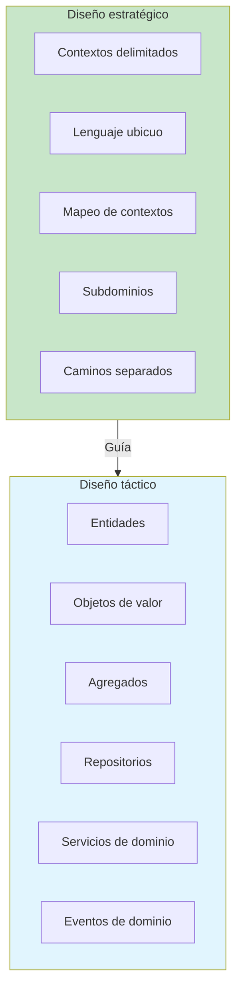
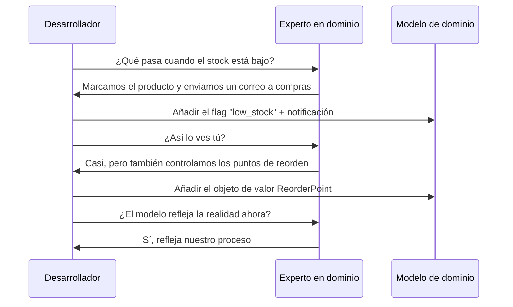
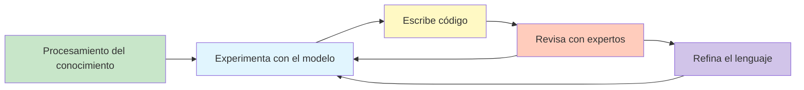

# Introducción al Diseño Dirigido por el Dominio

El Diseño Dirigido por el Dominio (DDD) es un enfoque de desarrollo de software que Eric Evans introdujo en su seminal libro de 2003 *Domain-Driven Design: Tackling Complexity in the Heart of Software*. DDD enfatiza que la **complejidad central** de la mayoría de los proyectos de software no está en la infraestructura técnica sino en el propio dominio: el problema de negocio que el software pretende resolver.

> [!NOTE]
> DDD no es una tecnología, un framework ni un patrón de arquitectura. Es una **filosofía y metodología** que coloca el modelo de dominio en el centro del diseño de software. El objetivo es crear software que refleje los modelos mentales de los expertos en dominio.

## Los orígenes de DDD

DDD surgió de la observación de proyectos de software fallidos. La causa raíz casi nunca fue mala tecnología: fue **mala comunicación** entre los expertos en dominio (personas de negocio) y los desarrolladores. Cada grupo hablaba un idioma distinto, lo que producía modelos que no coincidían con la realidad.

| Era | Problema | Solución |
|-----|---------|----------|
| Década de 1990 | Métodos en cascada, requisitos rígidos | Metodologías ágiles |
| Principios de los años 2000 | Software empresarial complejo | DDD, Eric Evans |
| Década de 2010 | Complejidad de los sistemas distribuidos | Microservicios + DDD |
| Década de 2020 | Sistemas dirigidos por IA y orientados a eventos | DDD + Event Storming |

```python
# Without DDD: the model is anemic and disconnected from the domain
class Order:
    def __init__(self):
        self.id = ""
        self.status = ""
        self.items: list = []
        self.total = 0.0

    # Getters and setters only — no domain behavior
    def get_id(self): return self.id
    def set_id(self, v): self.id = v
    def get_status(self): return self.status
    def set_status(self, v): self.status = v

# With DDD: the model captures business rules and behavior
from dataclasses import dataclass, field
from enum import Enum
from datetime import datetime

class OrderStatus(Enum):
    PENDING = "pending"
    CONFIRMED = "confirmed"
    SHIPPED = "shipped"
    DELIVERED = "delivered"
    CANCELLED = "cancelled"

@dataclass
class OrderLine:
    product_id: str
    product_name: str
    quantity: int
    unit_price: float

    def subtotal(self) -> float:
        return self.quantity * self.unit_price

@dataclass
class Order:
    id: str
    customer_id: str
    lines: list[OrderLine] = field(default_factory=list)
    status: OrderStatus = OrderStatus.PENDING
    created_at: datetime = field(default_factory=datetime.now)

    def add_line(self, line: OrderLine) -> None:
        if self.status != OrderStatus.PENDING:
            raise ValueError("Cannot add items to a non-pending order")
        self.lines.append(line)

    def confirm(self) -> None:
        if not self.lines:
            raise ValueError("Cannot confirm an empty order")
        self.status = OrderStatus.CONFIRMED

    def cancel(self) -> None:
        if self.status in (OrderStatus.SHIPPED, OrderStatus.DELIVERED):
            raise ValueError("Cannot cancel shipped or delivered order")
        self.status = OrderStatus.CANCELLED
```

## Diseño estratégico vs. táctico

DDD se divide en dos niveles: **estratégico** y **táctico**. Ambos son esenciales, pero abordan escalas distintas del problema.



### Diseño estratégico

El DDD estratégico se centra en el **panorama general**: cómo se relacionan entre sí las distintas partes del sistema y con el dominio de negocio.

| Concepto | Descripción | Ejemplo |
|---------|-------------|---------|
| Dominio | El espacio del problema de negocio | Comercio electrónico |
| Subdominio | Un subárea del dominio | Inventario, Envíos, Pagos |
| Dominio principal | El subdominio más valioso | Lógica de checkout |
| Dominio de apoyo | Necesario pero no principal | Autenticación de usuarios |
| Dominio genérico | Dominio genérico (commodity) | Notificaciones por correo |
| Contexto delimitado | Un límite de modelo específico | Contexto de ventas, contexto de almacén |
| Lenguaje ubicuo | Lenguaje común para devs y expertos | «Pedido», «Línea de pedido», «Factura» |

```python
# Strategic DDD: identifying subdomains and their relationships
class DomainCatalog:
    """A conceptual model of how domains are organized."""

    CORE_DOMAINS = {
        "sales": "Order management, pricing, checkout",
        "inventory": "Stock tracking, reorder points",
    }

    SUPPORTING_DOMAINS = {
        "user_management": "Customer accounts, authentication",
        "payment": "Payment processing, refunds",
    }

    GENERIC_DOMAINS = {
        "notifications": "Email, SMS, push",
        "audit_logging": "Change tracking, compliance",
    }

    @classmethod
    def classify(cls, domain_name: str) -> str:
        if domain_name in cls.CORE_DOMAINS:
            return "core"
        if domain_name in cls.SUPPORTING_DOMAINS:
            return "supporting"
        return "generic"
```

### Diseño táctico

El DDD táctico proporciona **bloques de construcción** para implementar el modelo de dominio dentro de un solo contexto delimitado.

```python
from abc import ABC, abstractmethod
from decimal import Decimal

# Entity: has identity and continuity through time
class Customer:
    def __init__(self, customer_id: str, name: str, email: str):
        self._id = customer_id
        self._name = name
        self._email = email
        self._loyalty_points = 0

    @property
    def id(self) -> str:
        return self._id

    @property
    def name(self) -> str:
        return self._name

    def add_loyalty_points(self, points: int) -> None:
        if points < 0:
            raise ValueError("Points cannot be negative")
        self._loyalty_points += points

# Value Object: immutable, defined by attributes
@dataclass(frozen=True)
class Money:
    amount: Decimal
    currency: str

    def __add__(self, other: "Money") -> "Money":
        if self.currency != other.currency:
            raise ValueError("Currency mismatch")
        return Money(self.amount + other.amount, self.currency)

    def __mul__(self, factor: int) -> "Money":
        return Money(self.amount * factor, self.currency)

# Aggregate Root: consistency boundary
class ShoppingCart:
    def __init__(self, cart_id: str, customer_id: str):
        self._id = cart_id
        self._customer_id = customer_id
        self._items: list[CartItem] = []
        self._is_checked_out = False

    def add_item(self, product_id: str, name: str, price: Money, quantity: int) -> None:
        if self._is_checked_out:
            raise ValueError("Cart already checked out")
        self._items.append(CartItem(product_id, name, price, quantity))

    def remove_item(self, product_id: str) -> None:
        self._items = [i for i in self._items if i.product_id != product_id]

    def checkout(self) -> "Order":
        if self._is_checked_out:
            raise ValueError("Cart already checked out")
        if not self._items:
            raise ValueError("Cannot checkout empty cart")
        self._is_checked_out = True
        return Order(self._items)

@dataclass(frozen=True)
class CartItem:
    product_id: str
    name: str
    price: Money
    quantity: int
```

## La mentalidad DDD

DDD exige un cambio en la forma en que los desarrolladores piensan el software:

1. **Exploración del modelo**: El modelo de dominio no se diseña de antemano, sino que surge mediante la colaboración
2. **Refinamiento continuo**: El modelo evoluciona a medida que se profundiza la comprensión
3. **Contextos delimitados**: Las distintas partes del sistema pueden tener modelos diferentes
4. **El lenguaje importa**: Las palabras que usas dan forma al modelo que construyes

> [!WARNING]
> Un error común es saltar directamente a los patrones tácticos (entidades, agregados, repositorios) sin hacer el trabajo de diseño estratégico. El DDD estratégico responde **qué** construir y **dónde**; el DDD táctico responde **cómo** construirlo. Ambos son necesarios.

## El papel de los expertos en dominio

Los expertos en dominio son el recurso más valioso de un proyecto DDD. No son solo partes interesadas: son **cocreadores** del modelo de dominio.



## Procesamiento del conocimiento

Eric Evans llama **procesamiento del conocimiento** (*knowledge crunching*) al proceso de modelado de DDD: destilar enormes cantidades de conocimiento del dominio en un modelo preciso y útil.

```python
# Knowledge crunching in action: evolving from simple to rich model

# Phase 1: Anemic model (no DDD)
class Product:
    def __init__(self, pid, name, price, stock):
        self.pid = pid
        self.name = name
        self.price = price
        self.stock = stock

# Phase 2: Adding domain logic
class Product:
    def __init__(self, pid: str, name: str, price: Decimal, stock: int):
        self._pid = pid
        self._name = name
        self._price = price
        self._stock = stock

    def is_in_stock(self) -> bool:
        return self._stock > 0

    def can_fulfill(self, quantity: int) -> bool:
        return self._stock >= quantity

    def reserve(self, quantity: int) -> None:
        if not self.can_fulfill(quantity):
            raise ValueError(f"Insufficient stock for {self._name}")
        self._stock -= quantity

# Phase 3: Rich domain model with business invariants
from dataclasses import dataclass
from typing import Optional

@dataclass
class StockKeepingUnit:
    """A SKU represents a unique product variant."""
    product_id: str
    variant: str  # e.g., "RED-XL", "BLUE-M"
    quantity_on_hand: int
    quantity_reserved: int
    reorder_point: int

    @property
    def available_quantity(self) -> int:
        return self.quantity_on_hand - self.quantity_reserved

    def reserve(self, quantity: int) -> None:
        if quantity <= 0:
            raise ValueError("Reservation quantity must be positive")
        if quantity > self.available_quantity:
            raise ValueError(f"Only {self.available_quantity} available")
        self.quantity_reserved += quantity

    def needs_reorder(self) -> bool:
        return self.available_quantity <= self.reorder_point

    def receive_stock(self, quantity: int) -> None:
        if quantity <= 0:
            raise ValueError("Received quantity must be positive")
        self.quantity_on_hand += quantity
```

## Cuándo usar DDD

DDD es potente, pero no siempre es la herramienta adecuada. Este es un marco de decisión:

| Factor | DDD encaja bien | DDD es excesivo |
|--------|-------------|-----------------|
| Complejidad del dominio | Alta | Baja (CRUD simple) |
| Reglas de negocio | Complejas y cambiantes | Simples y estables |
| Tamaño del equipo | Varios equipos | Equipo pequeño |
| Vida útil del sistema | Larga | Corta |
| Necesidades de colaboración | Altas | Bajas |

> [!NOTE]
> DDD es una **inversión**. El costo inicial de modelar con expertos en dominio es significativo, pero se rentabiliza cuando el dominio es complejo y el sistema evolucionará durante años.

## Anti-patrones comunes

| Anti-patrón | Síntoma | Solución |
|-------------|---------|-----|
| Modelo de dominio anémico | Clases con solo getters y setters | Mover el comportamiento al modelo |
| Diseño dirigido por la base de datos | El modelo refleja las tablas de la BD | Diseñar primero el modelo |
| Sesgo técnico | El código huele a framework | Usar el lenguaje ubicuo |
| Big Ball of Mud | Sin límites claros | Definir contextos delimitados |
| Martillo dorado | DDD para todo | Usar DDD solo en dominios complejos |

```python
# Anti-pattern: Anemic Domain Model
class UserAnemic:
    """This is NOT DDD — it is a data container."""
    def __init__(self):
        self.id = None
        self.name = None
        self.email = None
        self.status = None
        self.role = None

# DDD: Rich Domain Model
class User:
    def __init__(self, user_id: str, name: str, email: str, role: str):
        self._id = user_id
        self._name = name
        self._email = email
        self._status = "active"
        self._role = role

    def deactivate(self) -> None:
        if self._role == "admin":
            raise ValueError("Cannot deactivate admin users")
        self._status = "inactive"

    def change_email(self, new_email: str) -> None:
        if not self._is_valid_email(new_email):
            raise ValueError("Invalid email format")
        self._email = new_email

    def has_permission(self, permission: str) -> bool:
        permissions = {
            "admin": ["read", "write", "delete", "manage_users"],
            "editor": ["read", "write"],
            "viewer": ["read"],
        }
        return permission in permissions.get(self._role, [])

    @staticmethod
    def _is_valid_email(email: str) -> bool:
        return "@" in email and "." in email
```

## El proceso DDD

El flujo de trabajo típico de DDD consiste en ciclos iterativos de colaboración:



1. **Procesamiento del conocimiento**: Reúnete con expertos en dominio, haz preguntas y esboza modelos
2. **Experimenta con el modelo**: Prueba distintos enfoques de modelado en una pizarra
3. **Escribe código**: Implementa el modelo como software ejecutable
4. **Revisa con expertos**: Muestra el código en ejecución a los expertos y afínalo
5. **Refina el lenguaje**: Actualiza el lenguaje ubicuo a partir de los hallazgos

## Los eventos de dominio como conocimiento

> [!TIP]
> Los eventos de dominio suelen revelar los hallazgos de modelado más importantes. Cuando un experto en dominio dice «cuando pasa esto, necesitamos hacer aquello», está describiendo un evento de dominio. Captúralo de forma explícita en el modelo.

```python
from dataclasses import dataclass
from datetime import datetime
from typing import Protocol

# Domain event: something meaningful that happened in the domain
@dataclass
class OrderPlaced:
    order_id: str
    customer_id: str
    total_amount: float
    occurred_at: datetime = datetime.now()

@dataclass
class InventoryAdjusted:
    product_id: str
    quantity_change: int
    reason: str

# Domain event publisher interface
class EventPublisher(Protocol):
    def publish(self, event: object) -> None:
        ...

# Using domain events in the model
class InventoryService:
    def __init__(self, publisher: EventPublisher):
        self._publisher = publisher

    def adjust_stock(self, product_id: str, quantity: int, reason: str) -> None:
        # Perform the adjustment
        event = InventoryAdjusted(product_id, quantity, reason)
        self._publisher.publish(event)
```

## El lenguaje ubicuo en el código

> [!SUCCESS]
> Cuando DDD se hace bien, el código se lee como hablan los expertos en dominio. Un experto en dominio debería poder leer tu código y validar su lógica sin entender de programación.

```python
# The code speaks the domain language
from dataclasses import dataclass

# A domain expert would understand this:
class OverdueInvoiceNotifier:
    """When an invoice is overdue for more than 30 days,
    we send a reminder and apply a late fee."""

    def process(self, invoice: "Invoice") -> None:
        if invoice.is_overdue():
            days_overdue = invoice.days_overdue()
            if days_overdue > 30:
                invoice.apply_late_fee()
                self._send_reminder(invoice)
                self._raise_credit_flag(invoice.customer_id)

    def _send_reminder(self, invoice) -> None:
        print(f"Sending overdue reminder for invoice {invoice.id}")

    def _raise_credit_flag(self, customer_id: str) -> None:
        print(f"Raising credit flag for customer {customer_id}")
```

## Lecturas esenciales

DDD se aprende mejor combinando teoría y práctica. Recursos esenciales:

| Recurso | Tipo | Enfoque |
|----------|------|-------|
| *Domain-Driven Design* (Evans, 2003) | Libro azul | Panorama completo de DDD |
| *Implementing Domain-Driven Design* (Vernon, 2013) | Libro rojo | Implementación práctica |
| *Domain-Driven Design Distilled* (Vernon, 2016) | Guía de bolsillo | Referencia rápida |
| *Event Storming* (Brandolini, 2018) | Taller | Modelado colaborativo |

## Ejercicios prácticos

1. **Identifica los subdominios**: Elige un negocio que conozcas (p. ej., un servicio de entrega de pizzas). Enumera sus subdominios principal, de apoyo y genérico. Justifica cada clasificación.

2. **Modelo anémico vs. rico**: Toma el siguiente modelo anémico y transfórmalo en un modelo DDD rico con reglas de negocio:
   ```python
   class Account:
       def __init__(self):
           self.number = ""
           self.balance = 0.0
           self.owner = ""
           self.is_frozen = False
           self.overdraft_limit = 0.0
   ```

3. **Entrevista a un experto en dominio**: Anota 5 preguntas que le harías a un experto en dominio para un sistema de banca en línea. ¿Qué aspectos del dominio explorarías?

4. **Simulación de procesamiento del conocimiento**: Dada esta regla de negocio — «Un cliente no puede hacer un pedido si su cuenta está vencida, salvo que el total del pedido sea menor a $50 y que lleve más de 2 años como cliente» — modélala como código Python con reglas de dominio explícitas.

5. **Estratégico vs. táctico**: Clasifica cada uno de los siguientes como DDD estratégico o táctico: contexto delimitado, repositorio, lenguaje ubicuo, mapeo de contextos, entidad, evento de dominio, subdominio, agregado.

6. **Detección de anti-patrones**: Busca un modelo de dominio anémico en un proyecto en el que trabajes o en un proyecto de código abierto. Documenta 3 lugares donde el comportamiento debería moverse al modelo.

7. **Extracción de eventos de dominio**: Anota 5 eventos de dominio que ocurrirían en un sistema de comercio electrónico. Para cada uno, indica qué información transporta y qué otras partes del sistema reaccionarían a él.

8. **Desafío de revisión de código**: Revisa este código e identifica 3 violaciones de los principios de DDD:
   ```python
   class OrderService:
       def process(self, data):
           db = Database.connect()
           order = Order()
           order.id = data["id"]
           order.status = "pending"
           db.insert("orders", order)
           send_email(data["email"], "Order received")
           return order
   ```

> [!SUCCESS]
> Has completado la Lección 1. Ahora entiendes los fundamentos del Diseño Dirigido por el Dominio: sus orígenes, la distinción entre el diseño estratégico y el táctico, y los cambios de mentalidad que exige. Las próximas lecciones profundizarán en cada concepto.
