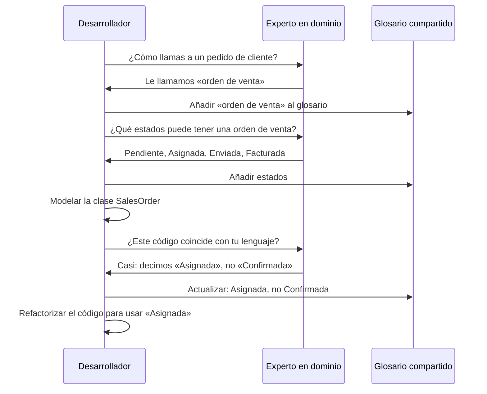

# Lenguaje Ubicuo

El lenguaje ubicuo es la piedra angular del Diseño Dirigido por el Dominio. Es un **lenguaje compartido y estructurado** que los desarrolladores y los expertos en dominio usan juntos para describir el dominio. Cada término de este lenguaje tiene un significado preciso e inequívoco, y ese significado se refleja directamente en el código.

> [!NOTE]
> El término «Lenguaje Ubicuo» lo acuñó Eric Evans en su libro sobre DDD. La idea clave: la mayoría de los fallos de software no se deben a problemas técnicos, sino a **errores de traducción** entre los equipos de negocio y los técnicos. El lenguaje ubicuo elimina esa traducción.

## El problema de la traducción

En el desarrollo de software tradicional, los requisitos pasan por múltiples traducciones:

```mermaid
flowchart LR
    A[Experto en dominio] -->|"Lenguaje natural\n(impreciso)"| B[Analista de negocio]
    B -->|"Documento de requisitos\n(ambiguo)"| C[Líder técnico]
    C -->|"Especificación técnica\n(con pérdidas)"| D[Desarrollador]
    D -->|"Código\n(¿coincide?)"| E[Software]
    A -.->|"Retroalimentación\n(costoso)" E

    style A fill:#c8e6c9
    style D fill:#ffccbc
    style E fill:#e1f5fe
```

Cada paso de traducción introduce ambigüedad, pérdida de significado y errores potenciales. El desarrollador escribe código basándose en un documento que ya era una aproximación de lo que dijo el experto.

> [!WARNING]
> Sin lenguaje ubicuo, terminas con dos modelos: el modelo de negocio (en la cabeza de los expertos) y el modelo de software (en el código). Con el tiempo, estos dos modelos **siempre divergen**, lo que hace que el software sea cada vez más difícil de mantener y de hacer evolucionar.

## Cómo se ve el lenguaje ubicuo

Un lenguaje ubicuo consta de:

1. **Sustantivos**: Conceptos del dominio (pedido, factura, cliente, producto)
2. **Verbos**: Acciones del dominio (hacer un pedido, cancelar una factura, archivar un producto)
3. **Reglas**: Invariantes de negocio (no se pueden enviar pedidos sin pagar)
4. **Eventos**: Ocurrencias del dominio (OrderPlaced, PaymentReceived)

```python
# Without Ubiquitous Language: technical terms dominate
class DataEntity:
    def __init__(self):
        self.pk = 0
        self.fk_customer = 0
        self.dt = ""
        self.st = ""
        self.amnt = 0.0

    def proc(self):
        if self.st == "P" and self.amnt > 0:
            self.st = "C"

# With Ubiquitous Language: domain terms are everywhere
from dataclasses import dataclass
from enum import Enum
from datetime import datetime

class OrderStatus(Enum):
    PENDING = "pending"
    CONFIRMED = "confirmed"
    IN_TRANSIT = "in_transit"
    DELIVERED = "delivered"

@dataclass
class Order:
    order_id: str
    customer_id: str
    placed_at: datetime
    status: OrderStatus
    total_amount: float

    def confirm(self) -> None:
        if self.status != OrderStatus.PENDING:
            raise ValueError("Only pending orders can be confirmed")
        self.status = OrderStatus.CONFIRMED
```

## Construir un lenguaje ubicuo

Construir un lenguaje ubicuo es un **proceso iterativo y colaborativo**. No es algo que una sola persona cree y documente; surge de la conversación.



### Paso 1: escucha a los expertos en dominio

Registra las palabras y frases exactas que usan los expertos en dominio. Evita traducirlos a jerga técnica.

```python
# Domain expert says:
# "When a sales order is allocated, we reserve the stock."

# Developer captures this directly in code:
class SalesOrder:
    def allocate(self, warehouse_id: str) -> None:
        """Reserve stock when a sales order is allocated."""
        if self.status != SalesOrderStatus.PENDING:
            raise ValueError("Can only allocate pending orders")
        self._warehouse_id = warehouse_id
        self.status = SalesOrderStatus.ALLOCATED

    @property
    def is_allocated(self) -> bool:
        return self.status == SalesOrderStatus.ALLOCATED
```

### Paso 2: crea un glosario compartido

Un glosario garantiza que todos usen las mismas palabras para significar lo mismo.

| Término | Definición | Sinónimos a evitar |
|------|-----------|-------------------|
| Orden de venta | Solicitud de un cliente para comprar productos | Pedido, ticket, solicitud |
| Asignar | Reservar inventario para una orden de venta | Confirmar, comprometer, reservar |
| Lista de picking | Documento que enumera los artículos a retirar del almacén | Lista de empaque, hoja de extracción |
| Backorder | Artículo de un pedido que no se puede cumplir con el stock actual | Artículo en backorder, artículo OOS |

```python
# The glossary is enforced in code through type names and docstrings
from typing import NewType

# These types exist because the domain language defines them
SalesOrderId = NewType("SalesOrderId", str)
WarehouseId = NewType("WarehouseId", str)
PickListNumber = NewType("PickListNumber", str)
BackorderItemId = NewType("BackorderItemId", str)

# Every type tells a story about the domain
```

### Paso 3: usa el lenguaje en todos los artefactos

El lenguaje ubicuo debería aparecer en:
- **Código**: nombres de clases, de métodos y de variables
- **Pruebas**: descripciones de pruebas y datos de prueba
- **Documentación**: README, documentación de la API, documentación de arquitectura
- **Conversaciones**: reuniones diarias, planificación, revisiones
- **UI**: etiquetas, menús, mensajes de error

```python
# Tests speak the Ubiquitous Language
def test_a_sales_order_can_be_allocated_when_pending():
    order = SalesOrder("SO-001", customer_id="CUST-42")
    warehouse = Warehouse("WH-EAST")

    order.allocate(warehouse.id)

    assert order.is_allocated
    assert order.warehouse_id == "WH-EAST"

def test_a_sales_order_cannot_be_allocated_twice():
    order = SalesOrder("SO-001", customer_id="CUST-42")
    order.allocate("WH-EAST")

    with raises(ValueError, match="already allocated"):
        order.allocate("WH-WEST")
```

## Cómo evitar la traducción

La regla más importante: **nunca traduzcas entre el lenguaje de negocio y el lenguaje técnico**. Haz que el código hable el lenguaje de negocio.

```python
# Translation approach (BAD):
# Domain expert: "Cancel the order and refund the customer"
# Developer translates to:

def update_record_and_process_refund(order_id: str):
    """Developer's translation of 'cancel and refund'."""
    db.execute("UPDATE orders SET status = 'X' WHERE id = ?", order_id)
    db.execute("UPDATE customers SET balance = balance + ? WHERE ...")
    queue.send("refund.notification", {"order": order_id})

# Ubiquitous Language approach (GOOD):
# Same requirement, directly captured:

class CancelOrderHandler:
    """Handles: 'Cancel the order and refund the customer'."""

    def handle(self, command: CancelOrder) -> None:
        order = self._orders.find(command.order_id)
        order.cancel()
        refund = self._refunds.initiate_for(order)
        self._event_publisher.publish(OrderCancelled(order.id, refund.id))
```

> [!TIP]
> Si te encuentras explicando conceptos de dominio a un integrante nuevo del equipo con palabras distintas de las que aparecen en el código, tu lenguaje ubicuo se ha erosionado. Vuelve a alinear el código con el lenguaje que realmente usas.

## El lenguaje en los eventos de dominio

Los eventos de dominio son especialmente importantes para el lenguaje ubicuo porque capturan **cosas que ocurrieron** en el dominio. Sus nombres deberían ser verbos en tiempo pasado que los expertos en dominio reconozcan.

```python
from dataclasses import dataclass, field
from datetime import datetime
from typing import Optional

# These event names come from the domain language:
# "When an order is placed..."
# "When payment is received..."
# "When a shipment is delayed..."

@dataclass
class OrderPlaced:
    order_id: str
    customer_id: str
    item_count: int
    total: float
    occurred_at: datetime = field(default_factory=datetime.now)

@dataclass
class PaymentReceived:
    order_id: str
    transaction_id: str
    amount: float
    occurred_at: datetime = field(default_factory=datetime.now)

@dataclass
class ShipmentDelayed:
    order_id: str
    tracking_number: str
    original_delivery_date: datetime
    new_delivery_date: datetime
    reason: str
    occurred_at: datetime = field(default_factory=datetime.now)

# Domain services that react to these events
class ShippingService:
    def on_shipment_delayed(self, event: ShipmentDelayed) -> None:
        """Domain expert says: 'If a shipment is delayed,
        notify the customer and update the ETA.'"""
        self._notification_service.notify_customer(
            event.order_id,
            f"Your shipment is delayed. New ETA: {event.new_delivery_date.date()}"
        )
        self._tracking_service.update_eta(
            event.tracking_number,
            event.new_delivery_date
        )
```

## Refinar el lenguaje

Un lenguaje ubicuo nunca está «terminado». Evoluciona a medida que se profundiza la comprensión. Siempre que un término se vuelva ambiguo o surjan conceptos nuevos, hay que refinar el lenguaje.

```python
# Early version: "Order" was good enough
class Order:
    def place(self): ...
    def cancel(self): ...

# Later, the team realized "Sales Order" and "Purchase Order"
# are different concepts with different lifecycle rules

class SalesOrder:
    """An order placed by a customer."""
    def place(self): ...
    def cancel(self): ...
    def dispatch(self): ...

class PurchaseOrder:
    """An order placed with a supplier."""
    def place(self): ...
    def receive(self): ...
    def close(self): ...
```

### Señales de que el lenguaje necesita refinamiento

| Señal | Ejemplo | Solución |
|------|---------|-----|
| Término ambiguo | «Pedido» puede significar venta o compra | Crear términos distintos |
| Término sobrecargado | «Estado» significa cosas distintas según el contexto | Usar tipos de estado específicos |
| Jerga de desarrollador | «Persistir», «Ejecutar», «Procesar» en lugar de verbos del dominio | Reemplazarlos por términos del dominio |
| Concepto no expresado | Los expertos dicen «ya sabes, como siempre» | Hacer explícito lo implícito |
| Traducción necesaria | Desarrollador: «Ah, quieres decir que _x_ se mapea a _y_» | Alinear el código con el lenguaje del experto |

## El lenguaje ubicuo en el Event Storming

El Event Storming, creado por Alberto Brandolini, es una técnica de taller que produce de forma natural un lenguaje ubicuo. Los post-its naranjas representan eventos de dominio, y el lenguaje que se usa en esos post-its se convierte en el lenguaje ubicuo.

```python
# After an Event Storming session, the events become code
# Each orange sticky becomes a domain event class:

class CustomerCheckedIn:
    """Orange sticky: 'Customer checked in'"""
    pass

class RoomKeyIssued:
    """Orange sticky: 'Room key issued'"""
    pass

class EarlyCheckoutFeeApplied:
    """Orange sticky: 'Early checkout fee applied'"""
    pass

class MinibarChargeRecorded:
    """Orange sticky: 'Minibar charge recorded'"""
    pass
```

> [!SUCCESS]
> El Event Storming es la forma más rápida de construir un lenguaje ubicuo. En un solo taller, un equipo puede mapear todo el proceso de negocio y acordar la terminología de cada paso.

## El lenguaje y los contextos delimitados

Cada contexto delimitado tiene su propio lenguaje ubicuo. La misma palabra puede significar cosas distintas en contextos diferentes.

```python
# "Customer" means different things in different contexts

# Sales Context
class Customer:
    """Represents a buyer with purchasing history."""
    def __init__(self, customer_id: str, name: str, credit_limit: float):
        self._id = customer_id
        self._name = name
        self._credit_limit = credit_limit
        self._lifetime_value = 0.0

    def record_purchase(self, amount: float) -> None:
        self._lifetime_value += amount

    def can_place_order(self, order_total: float) -> bool:
        return order_total <= self._credit_limit

# Support Context
class Customer:
    """Represents a person seeking help with a product."""
    def __init__(self, customer_id: str, name: str, tier: str):
        self._id = customer_id
        self._name = name
        self._tier = tier  # "standard", "premium", "enterprise"

    @property
    def priority(self) -> int:
        return {"standard": 1, "premium": 2, "enterprise": 3}.get(self._tier, 0)

    def escalate(self) -> None:
        if self._tier == "enterprise":
            self._assign_to_senior_agent()

# Billing Context
class Customer:
    """Represents a debtor responsible for payments."""
    def __init__(self, customer_id: str, name: str):
        self._id = customer_id
        self._name = name
        self._balance = 0.0
        self._is_overdue = False

    def apply_charge(self, amount: float) -> None:
        self._balance += amount

    def mark_overdue(self) -> None:
        self._is_overdue = True
```

## El lenguaje ubicuo y el modelado

El lenguaje da forma directa al modelo. Si el lenguaje cambia, el modelo debería cambiar. Si el modelo se desvía del lenguaje, debería corregirse el modelo, no el lenguaje.

```python
# Example: evolving language → evolving model

# Phase 1: Experts say "User"
class User:
    def login(self): ...
    def change_password(self): ...

# Phase 2: Experts distinguish "Customer" from "Staff"
class Customer:
    def place_order(self): ...
    def view_order_history(self): ...

class StaffMember:
    def process_order(self): ...
    def update_inventory(self): ...

# Phase 3: Experts identify "Premium Customer" with VIP treatment
class PremiumCustomer(Customer):
    @property
    def free_shipping(self) -> bool:
        return True

    def concierge_request(self, request: str) -> None:
        self._assign_to_vip_team()
```

## Trampas comunes

| Trampa | Descripción | Prevención |
|---------|-------------|-----------|
| Podredumbre del glosario | El glosario existe pero nunca se actualiza | Mantener el glosario versionado junto con el código |
| Experto no involucrado | El lenguaje se define sin expertos en dominio | Incluir a los expertos en todas las sesiones de modelado |
| Deriva entre lenguaje y código | El código usa términos viejos mientras el lenguaje evolucionó | Refactorizar el código con energía para que coincida con el lenguaje |
| Demasiado genérico | Términos como «item», «data», «info» | Exigir términos concretos y específicos |
| Silos de equipo | Equipos distintos desarrollan lenguajes distintos | Sesiones de mapeo de contextos entre equipos |

> [!WARNING]
> El peor destino para un lenguaje ubicuo es convertirse en un **documento que nadie lee**. El lenguaje debe vivir en el código, en las conversaciones y en el trabajo diario, no en un PDF que se escribió una vez y se olvidó.

## Cómo medir la calidad del lenguaje ubicuo

¿Cómo sabes si tu lenguaje ubicuo está sano? Estos son algunos indicadores:

| Métrica | Sano | Enfermo |
|--------|---------|-----------|
| Comentarios de revisión de código | «Este nombre de método no coincide con el término que usamos» | «Esta variable debería renombrarse» |
| Tiempo de incorporación | Los devs nuevos entienden el dominio en días | Los devs nuevos necesitan semanas de explicación del dominio |
| Participación de los expertos | Los expertos pueden leer el código | Los expertos necesitan a un traductor |
| Cambios en el lenguaje | Refinamientos frecuentes | Nunca se discute |
| Consistencia de términos | El mismo término = el mismo concepto en todas partes | El mismo término se usa para conceptos distintos |

```python
# Healthy Ubiquitous Language: domain expert could read this
class PremiumSubscription:
    """A subscription with VIP benefits."""

    def __init__(self, subscriber: "Subscriber", plan: "Plan"):
        self._subscriber = subscriber
        self._plan = plan
        self._is_active = True
        self._benefits: list[str] = ["priority_support", "exclusive_content"]

    def renew(self, payment_method: str) -> None:
        if not self._is_active:
            raise ValueError("Cannot renew an inactive subscription")
        self._plan.renew()
        self._subscriber.charge(payment_method, self._plan.price)

    def upgrade(self, new_plan: "Plan") -> None:
        if new_plan.price < self._plan.price:
            raise ValueError("Upgrade must be to a more expensive plan")
        self._plan = new_plan
```

## Ejercicios prácticos

1. **Construye un glosario**: Elige un dominio que conozcas (p. ej., gestión de una biblioteca, reservas de hotel, programación de un hospital). Crea un glosario de 10 términos con definiciones y sinónimos a evitar.

2. **Traduce al lenguaje ubicuo**: Reescribe el siguiente código usando el lenguaje ubicuo:
   ```python
   def process_data(x):
       db = get_db()
       r = db.query("SELECT * FROM tbl_ords WHERE st = 'P'")
       for row in r:
           row.st = 'A'
           db.update(row)
           notify(row.c_id, "Your order is ready")
   ```

3. **Encuentra errores de traducción**: Mira un proyecto en el que trabajes. Encuentra 3 lugares donde el código usa lenguaje técnico donde debería usarse lenguaje de dominio (p. ej., «execute» en vez de «place order», «data» en vez de «invoice»).

4. **Simulación de event storming**: Enumera 8 eventos de dominio para un sistema de gestión de un restaurante. Escribe cada evento como un dataclass de Python con los campos apropiados.

5. **Lenguaje entre contextos**: El término «Paciente» aparece en el contexto de programación de citas y en el contexto de historias clínicas de un hospital. Define la clase Patient para cada contexto, destacando los atributos y comportamientos distintos.

6. **Refina el lenguaje**: Un equipo usa «Item» para significar tanto «elemento del menú» como «línea de pedido». Crea dos clases distintas con nombres apropiados y diferencia su comportamiento.

7. **Transcripción de entrevista con un experto**: Escribe una entrevista simulada entre un desarrollador y el responsable de recepción de un hotel. Extrae 5 términos de dominio de la conversación y muestra cómo se convertirían en código.

8. **Revisión de código del lenguaje**: Revisa este código en busca de violaciones del lenguaje ubicuo:
   ```python
   class EntityManager:
       def __init__(self):
           self._items = []

       def add_item(self, obj):
           self._items.append(obj)

       def remove_item(self, idx):
           self._items.pop(idx)

       def get_active(self):
           return [x for x in self._items if x.flg == 1]

       def proc_all(self):
           for x in self._items:
               x.st = 2
   ```

> [!SUCCESS]
> Has completado la Lección 2. El lenguaje ubicuo es la base de DDD: sin él, los contextos delimitados, los agregados y todos los demás patrones pierden su fuerza. Mantén el lenguaje vivo en cada conversación y en cada línea de código.
