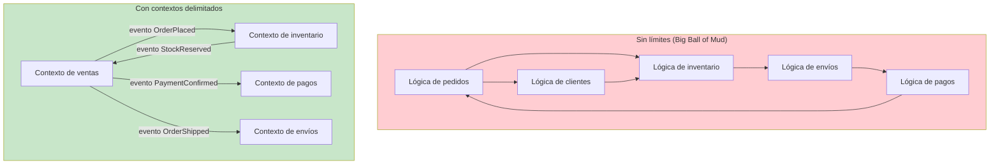
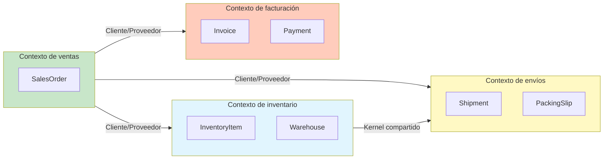
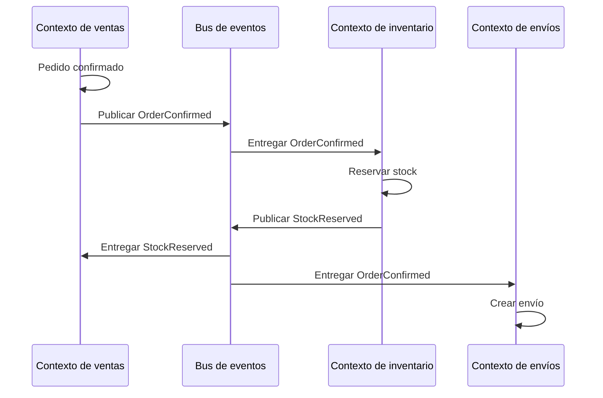

# Contextos Delimitados

Un contexto delimitado es un **límite semántico** dentro del cual se aplica un modelo de dominio concreto. Dentro del límite, todos los términos del lenguaje ubicuo tienen significados precisos y coherentes. Fuera del límite, pueden aplicarse otros términos u otros significados.

> [!NOTE]
> El término «contexto delimitado» se malinterpreta a menudo. No es lo mismo que un microservicio, un módulo o un namespace, aunque a menudo se corresponda con uno. Un contexto delimitado es, ante todo, un **límite lingüístico**. El código y los servicios se derivan de ese límite.

## Por qué importan los límites

Sin límites explícitos, los modelos de dominio se mezclan entre sí. Los términos se vuelven ambiguos, las responsabilidades se difuminan y el sistema se convierte en una «Big Ball of Mud».



### Qué contiene un límite

Dentro de un contexto delimitado tienes un **modelo completo y autosuficiente**:

1. **Entidades y objetos de valor** propios de ese contexto
2. **Agregados** que hacen cumplir los límites de consistencia
3. **Eventos de dominio** que representan ocurrencias
4. **Repositorios** para la persistencia
5. **Servicios de dominio** para operaciones que no encajan de forma natural en las entidades

```python
# Sales Context's complete model — it stands alone
from dataclasses import dataclass, field
from enum import Enum
from datetime import datetime
from typing import Protocol

class SalesOrderStatus(Enum):
    PENDING = "pending"
    CONFIRMED = "confirmed"
    IN_TRANSIT = "in_transit"
    DELIVERED = "delivered"

@dataclass
class SalesOrderLine:
    product_id: str
    product_name: str
    quantity: int
    unit_price: float

    def subtotal(self) -> float:
        return self.quantity * self.unit_price

@dataclass
class SalesOrder:
    order_id: str
    customer_id: str
    lines: list[SalesOrderLine] = field(default_factory=list)
    status: SalesOrderStatus = SalesOrderStatus.PENDING
    created_at: datetime = field(default_factory=datetime.now)

    def add_line(self, line: SalesOrderLine) -> None:
        if self.status != SalesOrderStatus.PENDING:
            raise ValueError("Order already confirmed")
        self.lines.append(line)

    def confirm(self) -> None:
        if not self.lines:
            raise ValueError("Cannot confirm empty order")
        self.status = SalesOrderStatus.CONFIRMED

class SalesOrderRepository(Protocol):
    def save(self, order: SalesOrder) -> None: ...
    def find_by_id(self, order_id: str) -> SalesOrder | None: ...
```

## Mapeo de contextos

El mapeo de contextos es la práctica de **identificar y documentar las relaciones** entre contextos delimitados. Cada relación de contextos tiene un patrón que describe cómo se integran los dos contextos.



### Patrones de integración

| Patrón | Descripción | Acoplamiento | Cuándo usarlo |
|---------|-------------|----------|-------------|
| Asociación | Dos contextos cooperan en la integración | Estrecho | Dos equipos que trabajan de cerca |
| Kernel compartido | Subconjunto compartido del modelo | Estrecho | Dominios solapados |
| Cliente/proveedor | El upstream suministra, el downstream consume | Flojo | Productor/consumidor estándar |
| Conformista | El downstream se conforma al modelo del upstream | Flojo | Sin control sobre el upstream |
| Capa anticorrupción | Una capa de traducción protege al downstream | Muy flojo | Evitar que los cambios del upstream se filtren |
| Servicio host abierto | El upstream proporciona un protocolo de integración | Muy flojo | Múltiples consumidores downstream |
| Lenguaje publicado | Formato de integración bien documentado y versionado | Muy flojo | API pública |
| Caminos separados | Sin integración; cada contexto opera de forma independiente | Ninguno | Funcionalidad independiente |

## Capa anticorrupción (ACL)

La capa anticorrupción es uno de los patrones más importantes. **Impide que un contexto downstream se contamine** con el modelo de un contexto upstream.

```python
# The upstream system has its own model — we cannot change it
# Upstream's "Order" (legacy system):

class LegacyOrder:
    """This comes from the mainframe. We cannot modify it."""
    def __init__(self):
        self.ord_no = ""
        self.cust_id = ""
        self.ord_dt = ""
        self.ln_itms: list[LegacyLineItem] = []
        self.ord_st = ""

class LegacyLineItem:
    def __init__(self):
        self.itm_id = ""
        self.itm_qty = 0
        self.itm_pr = 0.0
        self.itm_st = ""

# Anti-Corruption Layer: translates Legacy → Sales Context

class LegacyOrderTranslator:
    """Protects our Sales Context from the legacy model."""

    def to_sales_order(self, legacy: LegacyOrder) -> "SalesOrder":
        order = SalesOrder(
            order_id=legacy.ord_no,
            customer_id=legacy.cust_id,
            status=self._translate_status(legacy.ord_st),
        )
        for item in legacy.ln_itms:
            order.add_line(SalesOrderLine(
                product_id=item.itm_id,
                quantity=item.itm_qty,
                unit_price=item.itm_pr,
            ))
        return order

    def _translate_status(self, legacy_status: str) -> SalesOrderStatus:
        mapping = {
            "N": SalesOrderStatus.PENDING,
            "C": SalesOrderStatus.CONFIRMED,
            "S": SalesOrderStatus.IN_TRANSIT,
            "D": SalesOrderStatus.DELIVERED,
        }
        return mapping.get(legacy_status, SalesOrderStatus.PENDING)

# The ACL adapter
class LegacyOrderRepository:
    """Adapter that uses the ACL to translate."""

    def __init__(self, legacy_db, translator: LegacyOrderTranslator):
        self._db = legacy_db
        self._translator = translator

    def find_by_id(self, order_id: str) -> "SalesOrder":
        legacy_data = self._db.query(f"SELECT * FROM orders WHERE ord_no = '{order_id}'")
        legacy_order = self._row_to_legacy(legacy_data)
        return self._translator.to_sales_order(legacy_order)

    def _row_to_legacy(self, row) -> LegacyOrder:
        legacy = LegacyOrder()
        legacy.ord_no = row["ord_no"]
        legacy.cust_id = row["cust_id"]
        legacy.ord_dt = row["ord_dt"]
        legacy.ord_st = row["ord_st"]
        # ... map line items
        return legacy
```

> [!WARNING]
> Sin una ACL, los cambios en el modelo del upstream pueden propagarse en cascada por todo tu sistema. Renombrar un campo en un sistema legacy nunca debería obligar a cambiar tu lógica de dominio. La ACL absorbe esos cambios.

## Servicio host abierto (OHS)

El servicio host abierto define un **protocolo publicado** que los contextos downstream usan para comunicarse con el contexto upstream. El contexto upstream se compromete a mantener ese protocolo.

```python
# Sales Context publishes an Open-Host Service protocol
from typing import Protocol
from dataclasses import dataclass

@dataclass
class OrderCreatedEvent:
    order_id: str
    customer_id: str
    items: list[dict]
    total: float
    version: int = 1

class SalesOrderNotifier(Protocol):
    """Published protocol for downstream consumers."""

    def on_order_created(self, event: OrderCreatedEvent) -> None:
        """Called when a new order is created. Ordered by order_id."""

    def on_order_cancelled(self, order_id: str, reason: str) -> None:
        """Called when an order is cancelled."""

# Downstream: Inventory Context implements the protocol
class InventoryOrderHandler:
    """Handles order events for inventory reservation."""

    def on_order_created(self, event: OrderCreatedEvent) -> None:
        for item in event.items:
            self._reserve_stock(item["product_id"], item["quantity"])

    def on_order_cancelled(self, order_id: str, reason: str) -> None:
        self._release_reservations(order_id)

    def _reserve_stock(self, product_id: str, quantity: int) -> None:
        print(f"Reserving {quantity} of {product_id}")

    def _release_reservations(self, order_id: str) -> None:
        print(f"Releasing reservations for {order_id}")
```

## Kernel compartido

El kernel compartido es un subconjunto cuidadosamente elegido del modelo de dominio que comparten dos contextos. Debe mantenerse pequeño, estable y acordado por ambos equipos.

```python
# Shared Kernel: both Sales and Shipping use this
from dataclasses import dataclass

@dataclass
class Address:
    """Shared across Sales and Shipping contexts."""
    street: str
    city: str
    state: str
    zip_code: str
    country: str

    def is_valid(self) -> bool:
        return all([self.street, self.city, self.zip_code, self.country])

@dataclass
class Money:
    """Shared value object for monetary values."""
    amount: float
    currency: str

    def __add__(self, other: "Money") -> "Money":
        if self.currency != other.currency:
            raise ValueError("Currency mismatch")
        return Money(self.amount + other.amount, self.currency)

# Sales Context uses Address and Money
class SalesOrder:
    def __init__(self, order_id: str, shipping_address: Address):
        self._id = order_id
        self._shipping_address = shipping_address
        self._total = Money(0.0, "USD")

# Shipping Context uses the same Address
class Shipment:
    def __init__(self, shipment_id: str, destination: Address):
        self._id = shipment_id
        self._destination = destination
```

## Patrón conformista

Cuando un contexto downstream no tiene control sobre el contexto upstream, puede optar por **conformarse** al modelo del upstream en lugar de construir una ACL.

```python
# Upstream ERP system defines the product catalog model
# Downstream Sales Context conforms to it

# ERP's Product model (upstream — we cannot change it)
class ERPProduct:
    def __init__(self, code: str, desc: str, list_price: float):
        self.code = code
        self.desc = desc
        self.list_price = list_price

# Sales Context conforms — uses the same terms
class SalesProduct:
    """Conforms to ERP model. Same terms, same meaning."""

    def __init__(self, code: str, desc: str, list_price: float):
        self.code = code
        self.desc = desc
        self.list_price = list_price

    def calculate_discount(self, percentage: float) -> float:
        return self.list_price * (1 - percentage / 100)
```

## Patrón de asociación

En una asociación, dos equipos **coordinan** su integración. Los cambios se planifican juntos y ambos equipos ajustan sus modelos para trabajar en conjunto.

```python
# Sales and Billing teams agree on the "Invoice" concept together

# Partnership agreement: both teams define this jointly
@dataclass
class InvoiceData:
    """Jointly agreed data format for invoicing."""
    invoice_number: str
    order_id: str
    customer_tax_id: str
    line_items: list[dict]
    subtotal: float
    tax_total: float
    grand_total: float

# Sales Context: produces invoice data
class SalesInvoicingService:
    def generate_invoice_data(self, order: "SalesOrder") -> InvoiceData:
        return InvoiceData(
            invoice_number=f"INV-{order.order_id}",
            order_id=order.order_id,
            customer_tax_id=order.customer_tax_id,
            line_items=[
                {"description": line.product_name, "amount": line.subtotal()}
                for line in order.lines
            ],
            subtotal=sum(line.subtotal() for line in order.lines),
            tax_total=self._calculate_tax(order),
            grand_total=order.total,
        )

# Billing Context: consumes invoice data
class InvoiceGenerator:
    def create_from(self, data: InvoiceData) -> "Invoice":
        invoice = Invoice(
            number=data.invoice_number,
            customer_tax_id=data.customer_tax_id,
        )
        for item in data.line_items:
            invoice.add_line(item["description"], item["amount"])
        return invoice
```

## Caminos separados

A veces, dos contextos **no tienen nada que ver entre sí**. Operan de forma independiente, sin integración. Esto es perfectamente válido.

```python
# Marketing Context and Warehouse Context — Separate Ways

# Marketing Context: campaigns, newsletters, analytics
class EmailCampaign:
    def send_promotion(self, segment: str, offer: str) -> None:
        print(f"Sending '{offer}' to {segment} segment")

# Warehouse Context: inventory, receiving, shipping
class WarehouseBin:
    def __init__(self, bin_id: str, location: str):
        self._id = bin_id
        self._location = location

    def store(self, product_id: str, quantity: int) -> None:
        print(f"Storing {quantity} of {product_id} in {self._location}")
```

## Definir los límites de los contextos

¿Cómo decides dónde termina un contexto y dónde empieza otro? Estas son las heurísticas más comunes:

| Heurística | Pregunta | Límite de ejemplo |
|-----------|----------|-----------------|
| Lenguaje distinto | ¿Los expertos usan términos distintos? | «Pedido» en ventas vs. «Orden de trabajo» en manufactura |
| Ciclo de vida distinto | ¿El concepto tiene un ciclo de vida distinto? | Registro de cliente vs. ticket de soporte |
| Propiedad de equipo | ¿Lo posee otro equipo? | Equipo de checkout vs. equipo de recomendaciones |
| Frecuencia de cambio | ¿Cambia a ritmos distintos? | Catálogo de productos (estable) vs. precios (dinámico) |
| Independencia de despliegue | ¿Se puede desplegar por separado? | API móvil vs. panel de administración |

```python
# Example: same company, different contexts for "Customer"

# 1. Sales Context — Customer as buyer
class Buyer:
    def __init__(self, buyer_id: str, email: str, credit_limit: float):
        self._id = buyer_id
        self._email = email
        self._credit_limit = credit_limit

    def place_order(self, order_total: float) -> bool:
        return order_total <= self._credit_limit

# 2. Marketing Context — Customer as target
class Lead:
    def __init__(self, lead_id: str, email: str, score: int):
        self._id = lead_id
        self._email = email
        self._score = score

    def nurture(self, campaign: str) -> None:
        print(f"Sending campaign '{campaign}' to lead {self._id}")

# 3. Support Context — Customer as ticket creator
class Requester:
    def __init__(self, requester_id: str, name: str, tier: str):
        self._id = requester_id
        self._name = name
        self._tier = tier

    @property
    def sla_minutes(self) -> int:
        return {"standard": 480, "premium": 120, "enterprise": 30}.get(self._tier, 1440)
```

## Integrar contextos delimitados

La integración se produce mediante la **traducción en el límite**. Los mecanismos de integración más comunes:



```python
# Integration via domain events (asynchronous)

from dataclasses import dataclass, field
from datetime import datetime
from typing import Callable

# The event
@dataclass
class OrderConfirmed:
    order_id: str
    confirmed_at: datetime = field(default_factory=datetime.now)

# Simple event bus
class EventBus:
    def __init__(self):
        self._handlers: dict[type, list[Callable]] = {}

    def subscribe(self, event_type: type, handler: Callable) -> None:
        self._handlers.setdefault(event_type, []).append(handler)

    def publish(self, event: object) -> None:
        for handler in self._handlers.get(type(event), []):
            handler(event)

# Sales Context publishes
class SalesContext:
    def __init__(self, bus: EventBus):
        self._bus = bus

    def confirm_order(self, order_id: str) -> None:
        print(f"[Sales] Confirming order {order_id}")
        self._bus.publish(OrderConfirmed(order_id))

# Inventory Context subscribes
class InventoryContext:
    def __init__(self, bus: EventBus):
        bus.subscribe(OrderConfirmed, self.on_order_confirmed)

    def on_order_confirmed(self, event: OrderConfirmed) -> None:
        print(f"[Inventory] Reserving stock for order {event.order_id}")
```

## El mapa de contextos como documentación viva

Un mapa de contextos debe mantenerse actualizado a medida que evoluciona el sistema. Es un **documento vivo** que muestra el estado actual de las relaciones entre contextos.

```python
# A context map expressed as code
from dataclasses import dataclass, field
from enum import Enum

class RelationshipType(Enum):
    PARTNERSHIP = "partnership"
    SHARED_KERNEL = "shared_kernel"
    CUSTOMER_SUPPLIER = "customer_supplier"
    CONFORMIST = "conformist"
    ACL = "anti_corruption_layer"
    OHS = "open_host_service"
    PUBLISHED_LANGUAGE = "published_language"
    SEPARATE_WAYS = "separate_ways"

@dataclass
class ContextRelationship:
    upstream: str
    downstream: str
    pattern: RelationshipType
    notes: str = ""

@dataclass
class ContextMap:
    contexts: list[str] = field(default_factory=list)
    relationships: list[ContextRelationship] = field(default_factory=list)

    def add_relationship(
        self, upstream: str, downstream: str,
        pattern: RelationshipType, notes: str = ""
    ) -> None:
        self.relationships.append(
            ContextRelationship(upstream, downstream, pattern, notes)
        )

# Define the context map
map = ContextMap(contexts=["Sales", "Inventory", "Shipping", "Billing", "Marketing"])
map.add_relationship("Sales", "Inventory", RelationshipType.CUSTOMER_SUPPLIER,
                     "Sales publishes OrderConfirmed, Inventory reserves stock")
map.add_relationship("Sales", "Shipping", RelationshipType.CUSTOMER_SUPPLIER,
                     "Sales publishes OrderShipped")
map.add_relationship("Sales", "Billing", RelationshipType.PARTNERSHIP,
                     "Jointly define InvoiceData format")
map.add_relationship("Inventory", "Shipping", RelationshipType.SHARED_KERNEL,
                     "Share Address and Money value objects")
map.add_relationship("Marketing", None, RelationshipType.SEPARATE_WAYS,
                     "Marketing operates independently")
```

> [!TIP]
> Mantén tu mapa de contextos en el control de versiones junto con tu código. Cuando se incorpore una persona nueva al equipo, el mapa de contextos es lo primero que debería estudiar para entender el panorama del sistema.

## Los peligros del contexto monolítico

Evita la tentación de meterlo todo en un único contexto delimitado gigante. Los síntomas de un contexto monolítico incluyen:

| Síntoma | Descripción | Solución |
|---------|-------------|-----|
| Modelo gigante | Cientos de entidades en un solo contexto | Dividir por subdominio |
| Cuellos de botella de equipo | Varios equipos tocando el mismo código | Dividir por propiedad de equipo |
| Compilaciones lentas | Tiempos largos de compilación y despliegue | Dividir para lograr despliegues independientes |
| Términos ambiguos | La misma palabra, distintos significados | Dividir por límite lingüístico |
| Conflictos de merge | Conflictos de git frecuentes | Dividir por propiedad |

> [!WARNING]
> Un contexto delimitado que contiene más de unos 10 agregados es un candidato claro para dividirse. Si el modelo es tan grande que ninguna persona puede entenderlo por completo, el límite es demasiado amplio.

## Ejercicios prácticos

1. **Identifica límites**: Para un sistema de gestión hospitalaria, enumera al menos 5 contextos delimitados. Para cada uno, describe el lenguaje ubicuo y qué entidades contiene.

2. **Mapeo de contextos**: Dibuja un mapa de contextos (en texto) para un marketplace en línea. Incluye al menos 6 contextos y etiqueta los patrones de relación entre ellos.

3. **Construye una ACL**: Un sistema CRM legacy tiene un modelo `Customer` con los campos `cust_id`, `cust_name`, `cust_email`, `cust_stat` (A=activo, I=inactivo). Construye una capa anticorrupción que traduzca esto a un modelo `Account` moderno del contexto de ventas, con nombres y tipos de campos apropiados.

4. **Contrato de asociación**: Dos equipos, Pagos y Detección de fraude, necesitan integrarse. Define el protocolo compartido (como interfaces de Python) en el que ambos equipos convienen.

5. **Decisión de límite de contexto**: Una empresa tiene «Catálogo de productos» y «Estrategia de precios». Actualmente forman un solo contexto. Enumera 3 razones por las que deberían dividirse y describe el patrón de integración que deberían usar.

6. **Diseño de kernel compartido**: Identifica un concepto que pueda compartirse entre los contextos de ventas y de envíos de un sistema de comercio electrónico. Diseña el objeto de valor o la entidad compartida con al menos 3 campos y 2 métodos.

7. **Justificación de caminos separados**: Describe un escenario en el que dos contextos de la misma empresa deban operar en modo «Caminos separados». Explica por qué la integración sería perjudicial.

8. **Refactorización de un contexto monolítico**: La siguiente clase proviene de un contexto monolítico. Divídela en al menos 3 contextos delimitados y muestra cómo se comunican entre sí:
   ```python
   class OrderManager:
       def create_order(self, customer, items): ...
       def process_payment(self, order, card_info): ...
       def reserve_inventory(self, order): ...
       def schedule_shipment(self, order): ...
       def generate_invoice(self, order): ...
       def send_confirmation_email(self, order): ...
       def update_loyalty_points(self, customer, order): ...
   ```

> [!SUCCESS]
> Has completado la Lección 3. Los contextos delimitados son la columna vertebral estratégica de DDD. Definen dónde viven tus modelos y cómo se relacionan entre sí. Comprender los patrones de mapeo de contextos es esencial para diseñar sistemas que puedan evolucionar de forma independiente.
