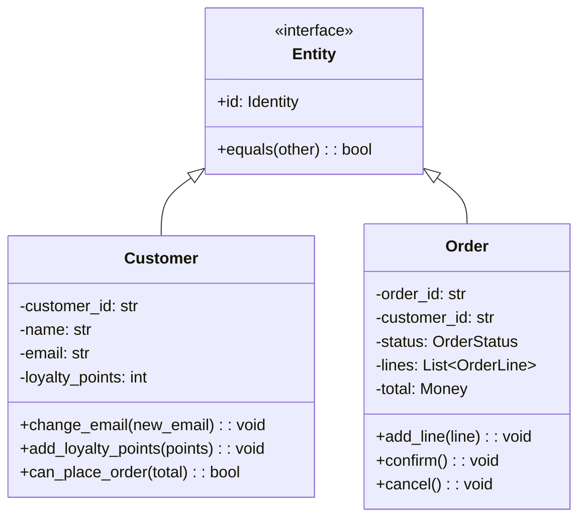
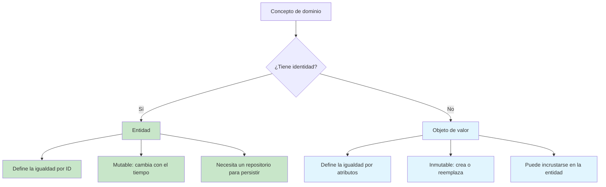
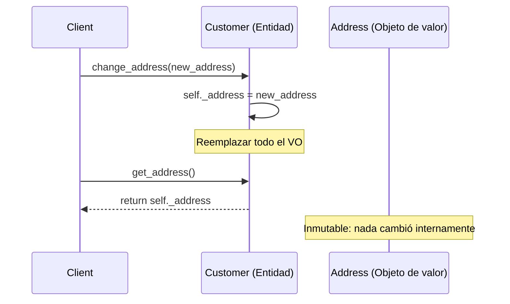

# Entidades y Objetos de Valor

Las entidades y los objetos de valor son los **dos bloques de construcción fundamentales** de un modelo de dominio en DDD. Juntos forman los átomos a partir de los cuales se construyen estructuras más ricas, como los agregados. Comprender la distinción entre ambos — y aplicarla correctamente — es esencial para un modelo de dominio limpio.

> [!NOTE]
> Eric Evans define una entidad como «un objeto que no se define por sus atributos, sino por un hilo de continuidad e identidad». Un objeto de valor es «un objeto que describe alguna característica o atributo, pero que no lleva ningún concepto de identidad».

## Entidades: objetos con identidad

Una entidad tiene una **identidad única** que persiste a lo largo del tiempo y de los cambios. Dos entidades pueden tener exactamente los mismos valores de atributos y seguir siendo objetos distintos porque tienen identidades distintas.



```python
from dataclasses import dataclass, field
from enum import Enum
from datetime import datetime
from typing import Optional

class OrderStatus(Enum):
    PENDING = "pending"
    CONFIRMED = "confirmed"
    SHIPPED = "shipped"
    DELIVERED = "delivered"

class Customer:
    """An Entity: identity is the customer_id, not the attributes."""

    def __init__(self, customer_id: str, name: str, email: str):
        self._id = customer_id
        self._name = name
        self._email = email
        self._loyalty_points = 0
        self._created_at = datetime.now()

    @property
    def id(self) -> str:
        return self._id

    @property
    def email(self) -> str:
        return self._email

    def change_email(self, new_email: str) -> None:
        if not self._is_valid_email(new_email):
            raise ValueError("Invalid email address")
        self._email = new_email

    def add_loyalty_points(self, points: int) -> None:
        if points < 0:
            raise ValueError("Points cannot be negative")
        self._loyalty_points += points

    def can_place_order(self, order_total: float) -> bool:
        return order_total <= self._credit_limit

    @staticmethod
    def _is_valid_email(email: str) -> bool:
        return "@" in email and "." in email

    def __eq__(self, other: object) -> bool:
        if not isinstance(other, Customer):
            return False
        return self._id == other._id

    def __hash__(self) -> int:
        return hash(self._id)
```

### Estrategias de generación de identidad

| Estrategia | Descripción | Ejemplo | Ventajas | Inconvenientes |
|----------|-------------|---------|------|------|
| Clave natural | ID proporcionado por el dominio | SSN, correo, SKU | Significativo | Puede cambiar o no existir |
| Clave sustituta | ID generado por el sistema | UUID, autoincremental | Estable, sencillo | Sin significado |
| Clave compuesta | Combinación de campos | (Almacén, Pasillo, Contenedor) | Ubicación precisa | Compleja |
| ID externo | ID de otro sistema | ID de transacción de pago | Vincula sistemas | Dependencia externa |

```python
import uuid
from dataclasses import dataclass

# Surrogate key: UUID
@dataclass
class OrderEntity:
    order_id: str = field(default_factory=lambda: f"ORD-{uuid.uuid4().hex[:8].upper()}")

# Natural key: SKU
class Product:
    def __init__(self, sku: str, name: str, price: float):
        self._sku = sku  # Natural key: Stock Keeping Unit
        self._name = name
        self._price = price

    @property
    def id(self) -> str:
        return self._sku  # Identity = SKU

# Composite key
@dataclass(frozen=True)
class WarehouseBinId:
    warehouse_code: str
    aisle: str
    rack: str
    shelf: str

    def __str__(self) -> str:
        return f"{self.warehouse_code}-{self.aisle}-{self.rack}-{self.shelf}"

class WarehouseBin:
    def __init__(self, bin_id: WarehouseBinId, capacity: int):
        self._id = bin_id
        self._capacity = capacity
        self._current_usage = 0
```

## Objetos de valor: igualdad por valor

Un objeto de valor **no tiene identidad**. Dos objetos de valor son iguales si todos sus atributos son iguales. Son inmutables: una vez creados, no pueden cambiar.

```python
from dataclasses import dataclass
from decimal import Decimal
from typing import Optional

# Value Object: immutable, equality by value, no identity
@dataclass(frozen=True)
class Money:
    amount: Decimal
    currency: str

    def __add__(self, other: "Money") -> "Money":
        if self.currency != other.currency:
            raise ValueError(f"Cannot add {self.currency} to {other.currency}")
        return Money(self.amount + other.amount, self.currency)

    def __sub__(self, other: "Money") -> "Money":
        if self.currency != other.currency:
            raise ValueError(f"Cannot subtract {self.currency} from {other.currency}")
        return Money(self.amount - other.amount, self.currency)

    def __mul__(self, multiplier: int) -> "Money":
        return Money(self.amount * multiplier, self.currency)

    def __repr__(self) -> str:
        return f"{self.currency} {self.amount:.2f}"

# Using the Value Object
price = Money(Decimal("29.99"), "USD")
tax = Money(Decimal("2.40"), "USD")
total = price + tax  # Money(32.39, "USD")

five_items = price * 5  # Money(149.95, "USD")
```

### Cuándo usar un objeto de valor

Un concepto debería ser un objeto de valor cuando:

1. **Describe una característica** de otra cosa
2. **No tiene identidad propia**
3. **Lo reemplazas, no lo modificas** cuando necesita cambiar
4. **Te importa qué es**, no cuál es exactamente
5. **Es inmutable**

```python
# Common Value Objects in a domain model
from dataclasses import dataclass
from enum import Enum

@dataclass(frozen=True)
class Email:
    address: str

    def __post_init__(self) -> None:
        if "@" not in self.address or "." not in self.address:
            raise ValueError(f"Invalid email: {self.address}")

    @property
    def domain(self) -> str:
        return self.address.split("@")[1]

@dataclass(frozen=True)
class PhoneNumber:
    country_code: str
    area_code: str
    number: str

    def __str__(self) -> str:
        return f"+{self.country_code} ({self.area_code}) {self.number}"

@dataclass(frozen=True)
class Address:
    street: str
    city: str
    state: str
    zip_code: str
    country: str

    def is_in_united_states(self) -> bool:
        return self.country.upper() == "US"

@dataclass(frozen=True)
class DateRange:
    start: "datetime"
    end: "datetime"

    def __post_init__(self) -> None:
        if self.start >= self.end:
            raise ValueError("Start must be before end")

    def overlaps_with(self, other: "DateRange") -> bool:
        return self.start < other.end and self.end > other.start

@dataclass(frozen=True)
class Dimension:
    width: float
    height: float
    depth: float
    unit: str

    @property
    def volume(self) -> float:
        return self.width * self.height * self.depth
```

## La distinción en la práctica

Así es como se usan juntas las entidades y los objetos de valor en un modelo de dominio:

```python
# Entity: Customer has identity
class Customer:
    def __init__(self, customer_id: str, name: str, email: str):
        self._id = customer_id
        self._name = name
        self._email = Email(email)  # Value Object inside Entity
        self._shipping_address: Optional[Address] = None  # Value Object
        self._phone: Optional[PhoneNumber] = None  # Value Object

    def update_shipping_address(self, address: Address) -> None:
        """Replace the Value Object entirely (immutable pattern)."""
        self._shipping_address = address

    def change_email(self, email: str) -> None:
        """Replace the Value Object."""
        self._email = Email(email)
```

> [!TIP]
> Los objetos de valor son los candidatos ideales para `dataclass(frozen=True)` en Python. La garantía de inmutabilidad asegura que se comporten correctamente como tipos de valor y que se puedan compartir y cachear de forma segura.

## Modelar con objetos de valor

Los objetos de valor ayudan a evitar la **obsesión por los primitivos** (*primitive obsession*): el anti-patrón de usar tipos primitivos (strings, ints, floats) para conceptos de dominio.

```python
# Primitive obsession (BAD)
class OrderPrimitive:
    def __init__(self, customer_id: str, amount: float, tax: float,
                 street: str, city: str, zip_code: str):
        self.customer_id = customer_id
        self.amount = amount
        self.tax = tax
        self.street = street
        self.city = city
        self.zip_code = zip_code

# With Value Objects (GOOD)
@dataclass(frozen=True)
class CustomerId:
    value: str

@dataclass(frozen=True)
class TaxRate:
    rate: float

    def apply_to(self, amount: Money) -> Money:
        return Money(amount.amount * self.rate, amount.currency)

class OrderRich:
    def __init__(self, customer_id: CustomerId, amount: Money,
                 tax_rate: TaxRate, shipping_address: Address):
        self._customer_id = customer_id
        self._amount = amount
        self._tax = tax_rate.apply_to(amount)
        self._shipping_address = shipping_address
```

## Inmutabilidad y funciones sin efectos secundarios

Los objetos de valor son inmutables. Cuando necesitas un valor «diferente», creas uno nuevo. Esto produce funciones sin efectos secundarios, fáciles de probar y de razonar.

```python
@dataclass(frozen=True)
class Percentage:
    value: float  # 0 to 100

    def __post_init__(self) -> None:
        if self.value < 0 or self.value > 100:
            raise ValueError(f"Percentage must be 0-100, got {self.value}")

    def of(self, amount: float) -> float:
        return amount * self.value / 100

    def add(self, other: "Percentage") -> "Percentage":
        return Percentage(self.value + other.value)

    def subtract(self, other: "Percentage") -> "Percentage":
        return Percentage(self.value - other.value)

# Used in a domain service
class DiscountCalculator:
    def apply_discount(self, price: Money, discount: Percentage) -> Money:
        discount_amount = price.amount * (discount.value / 100)
        return Money(price.amount - discount_amount, price.currency)
```

## Probar los objetos de valor

Los objetos de valor son lo más fácil de probar en un modelo de dominio porque no tienen dependencias y son inmutables.

```python
import pytest

def test_money_addition():
    a = Money(Decimal("10.00"), "USD")
    b = Money(Decimal("5.00"), "USD")
    result = a + b
    assert result == Money(Decimal("15.00"), "USD")

def test_money_currency_mismatch():
    usd = Money(Decimal("10.00"), "USD")
    eur = Money(Decimal("10.00"), "EUR")
    with pytest.raises(ValueError, match="Currency mismatch"):
        usd + eur

def test_money_immutability():
    original = Money(Decimal("10.00"), "USD")
    result = original * 3
    assert original == Money(Decimal("10.00"), "USD")  # Unchanged
    assert result == Money(Decimal("30.00"), "USD")

def test_percentage_validation():
    with pytest.raises(ValueError):
        Percentage(150)  # Invalid percentage
    with pytest.raises(ValueError):
        Percentage(-5)   # Invalid percentage

def test_email_validation():
    valid = Email("user@example.com")
    assert valid.domain == "example.com"

    with pytest.raises(ValueError):
        Email("not-an-email")
```

## Semántica de igualdad

Las entidades y los objetos de valor tienen reglas de igualdad distintas:

```python
# Entity: equality by identity
customer_a = Customer("123", "Alice", "alice@example.com")
customer_b = Customer("123", "Alice", "alice@example.com")
customer_c = Customer("456", "Alice", "alice@example.com")

assert customer_a == customer_b  # Same ID → equal
assert customer_a != customer_c  # Different ID → not equal

# Value Object: equality by value
money_a = Money(Decimal("10.00"), "USD")
money_b = Money(Decimal("10.00"), "USD")
money_c = Money(Decimal("20.00"), "USD")

assert money_a == money_b  # Same attributes → equal
assert money_a != money_c  # Different attributes → not equal
```



## Errores comunes

| Error | Incorrecto | Correcto |
|---------|-------|---------|
| Convertir una entidad en objeto de valor | `Customer` sin id | `Customer` tiene customer_id |
| Convertir un objeto de valor en entidad | `Address` con id | `Address` es un objeto de valor |
| Mutar un objeto de valor | `address.city = "NYC"` | `new_address = Address(...)` |
| No sobreescribir `__eq__` en la entidad | Comparación por defecto de objetos | Comparar por ID |
| Obsesión por los primitivos | `email: str` | `email: Email` (objeto de valor) |
| Entidad sin comportamiento | Solo getters y setters | Métodos de negocio en la entidad |

## Objetos de valor en la práctica: ejemplo real

Así es como un modelo de dominio rico usa tanto entidades como objetos de valor en un contexto de comercio electrónico:

```python
from dataclasses import dataclass, field
from enum import Enum
from datetime import datetime
from decimal import Decimal
from typing import List, Optional
import uuid

# --- Value Objects ---

@dataclass(frozen=True)
class Money:
    amount: Decimal
    currency: str

    def __add__(self, other: "Money") -> "Money":
        if self.currency != other.currency:
            raise ValueError("Currency mismatch")
        return Money(self.amount + other.amount, self.currency)

    def __mul__(self, quantity: int) -> "Money":
        return Money(self.amount * quantity, self.currency)

@dataclass(frozen=True)
class ProductSnapshot:
    """Immutable snapshot of product info at time of order."""
    product_id: str
    name: str
    price: Money
    category: str

@dataclass(frozen=True)
class ShippingAddress:
    street: str
    city: str
    state: str
    zip_code: str
    country: str

    def is_domestic(self) -> bool:
        return self.country.upper() == "US"

# --- Entities ---

class OrderStatus(Enum):
    PENDING = "pending"
    PAID = "paid"
    SHIPPED = "shipped"
    DELIVERED = "delivered"
    CANCELLED = "cancelled"

class Order:
    """Entity: an order has identity."""

    def __init__(self, customer_id: str, shipping_address: ShippingAddress):
        self._id = f"ORD-{uuid.uuid4().hex[:8].upper()}"
        self._customer_id = customer_id
        self._shipping_address = shipping_address
        self._lines: List["OrderLine"] = []
        self._status = OrderStatus.PENDING
        self._placed_at = datetime.now()

    @property
    def id(self) -> str:
        return self._id

    @property
    def status(self) -> OrderStatus:
        return self._status

    def add_product(self, product: ProductSnapshot, quantity: int) -> None:
        if self._status != OrderStatus.PENDING:
            raise ValueError("Cannot modify a non-pending order")
        self._lines.append(OrderLine(product, quantity))

    def calculate_total(self) -> Money:
        total = Money(Decimal("0.00"), "USD")
        for line in self._lines:
            total = total + line.subtotal()
        return total

    def mark_paid(self) -> None:
        if self._status != OrderStatus.PENDING:
            raise ValueError("Order is not pending")
        if not self._lines:
            raise ValueError("Cannot pay for empty order")
        self._status = OrderStatus.PAID

    def ship(self) -> None:
        if self._status != OrderStatus.PAID:
            raise ValueError("Can only ship paid orders")
        self._status = OrderStatus.SHIPPED

    def cancel(self) -> None:
        if self._status in (OrderStatus.SHIPPED, OrderStatus.DELIVERED):
            raise ValueError("Cannot cancel shipped or delivered order")
        self._status = OrderStatus.CANCELLED

    def __eq__(self, other: object) -> bool:
        if not isinstance(other, Order):
            return False
        return self._id == other._id

    def __hash__(self) -> int:
        return hash(self._id)


class OrderLine:
    """Entity within the Order aggregate (has local identity)."""

    def __init__(self, product: ProductSnapshot, quantity: int):
        self._line_id = f"LN-{uuid.uuid4().hex[:8].upper()}"
        self._product = product
        self._quantity = quantity

    @property
    def line_id(self) -> str:
        return self._line_id

    def subtotal(self) -> Money:
        return self._product.price * self._quantity

    def __eq__(self, other: object) -> bool:
        if not isinstance(other, OrderLine):
            return False
        return self._line_id == other._line_id

    def __hash__(self) -> int:
        return hash(self._line_id)
```

> [!SUCCESS]
> La distinción entre entidades y objetos de valor es una de las decisiones de modelado más importantes que tomarás. Si la aciertas, tu modelo es limpio, expresivo y mantenible. Si la fallas, terminas con entidades sin identidad o con objetos de valor sobreingenierados.

## Ciclo de vida de la entidad con objetos de valor



## Ejercicios prácticos

1. **Clasificación de entidad vs. objeto de valor**: Clasifica cada concepto como entidad u objeto de valor y explica por qué:
   - Una cuenta bancaria
   - Un número de tarjeta de crédito
   - Un recibo de transacción
   - Una sesión de cliente
   - Una coordenada geográfica
   - Un artículo de una factura
   - Un número de la seguridad social

2. **Refactoriza la obsesión por los primitivos**: El siguiente código sufre de obsesión por los primitivos. Refactóralo usando objetos de valor:
   ```python
   class Movie:
       def __init__(self, title: str, year: int, duration_minutes: int,
                    rating: str, genre: str):
           self.title = title
           self.year = year
           self.duration = duration_minutes
           self.rating = rating  # "PG-13", "R", etc.
           self.genre = genre
   ```

3. **Implementa un objeto de valor**: Crea un objeto de valor `Temperature` que soporte Celsius y Fahrenheit. Debe ser inmutable, tener una igualdad adecuada y proporcionar métodos de conversión.

4. **Diseño de identidad de entidad**: Diseña la estrategia de identidad para una entidad «MedicalRecord» en un sistema hospitalario. Considera: ¿qué hace que un registro médico sea único? ¿Podría haber varios registros para el mismo paciente? ¿Qué claves naturales existen?

5. **Igualdad de entidades**: Implementa `__eq__` y `__hash__` para una entidad `Document`. El documento tiene un `document_id` (UUID), `title`, `author`, `content_hash` y `version`. ¿Qué campo o campos deberían determinar la identidad?

6. **Composición de objetos de valor**: Crea un objeto de valor `GeoLocation` (latitud, longitud) con un método `distance_to(other: GeoLocation) -> Distance` que devuelva un objeto de valor `Distance`. Ambos deben ser dataclasses congeladas.

7. **Entidad con objetos de valor incrustados**: Diseña una entidad `FlightReservation` que incruste los siguientes objetos de valor: `FlightNumber`, `SeatAssignment`, `DateRange`, `PassengerName`. Cada objeto de valor debe tener validación en `__post_init__`.

8. **Refactoriza el modelo anémico**: El siguiente modelo usa solo primitivos. Refactóralo para usar objetos de valor y asegúrate de que las entidades tengan identidad y comportamiento adecuados:
   ```python
   class Book:
       def __init__(self):
           self.isbn = ""
           self.title = ""
           self.author = ""
           self.pages = 0
           self.publisher = ""
           self.publish_year = 0
           self.genre = ""
           self.available_copies = 0
           self.total_copies = 0

       def borrow(self):
           if self.available_copies > 0:
               self.available_copies -= 1

       def return_book(self):
           if self.available_copies < self.total_copies:
               self.available_copies += 1
   ```

> [!SUCCESS]
> Has completado la Lección 4. Las entidades aportan identidad y continuidad; los objetos de valor aportan poder descriptivo e inmutabilidad. Juntos, te dan bloques de construcción precisos para modelar cualquier dominio.
