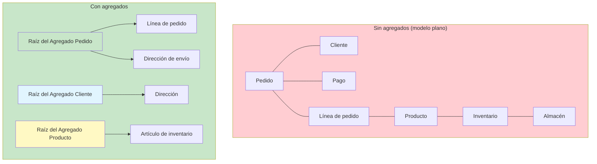
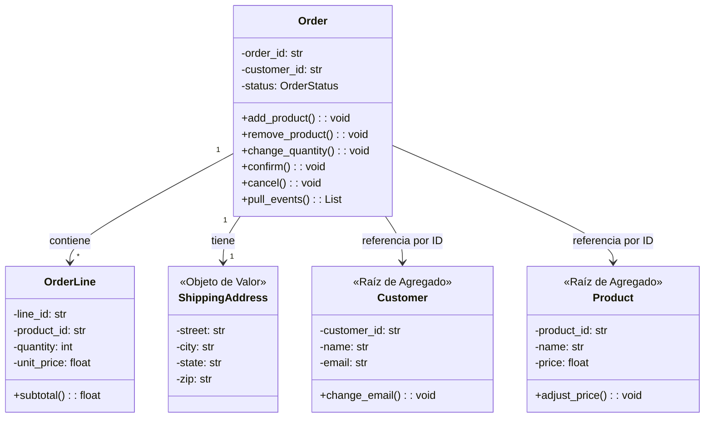

# Agregados y Raíces de Agregados

Un Agregado es un **clúster de objetos de dominio** que puede tratarse como una sola unidad. Cada Agregado tiene una **Raíz de Agregado**: una única Entidad que actúa como punto de entrada y controla el acceso a todo lo que hay dentro del límite.

> [!NOTE]
> El patrón Agregado es la respuesta de DDD a la consistencia. En cualquier sistema con acceso concurrente y datos complejos, garantizar los invariantes (reglas de negocio que deben cumplirse siempre) es difícil. Los Agregados definen **límites de consistencia** claros que hacen que los invariantes sean aplicables.

## Por qué importan los Agregados

Sin agregados, las transacciones se complican, los invariantes quedan dispersos por el código y el modelo de dominio no ofrece orientación sobre qué puede modificarse junto.



## La Raíz del Agregado

La Raíz del Agregado es el **único punto de entrada** al agregado. Los objetos externos solo pueden tener referencias a la raíz, no a las entidades internas. La raíz es responsable de:

1. **Hacer cumplir los invariantes**: reglas de negocio que involucran varios objetos internos
2. **Controlar el acceso**: los objetos externos no pueden modificar directamente las entidades internas
3. **Gestionar la persistencia**: la raíz se carga y se guarda como un todo
4. **Generar eventos**: los eventos de dominio son publicados por la raíz

```python
from dataclasses import dataclass, field
from enum import Enum
from datetime import datetime
from typing import List, Optional, Protocol
import uuid


class OrderStatus(Enum):
    PENDING = "pending"
    CONFIRMED = "confirmed"
    SHIPPED = "shipped"
    DELIVERED = "delivered"
    CANCELLED = "cancelled"


# --- Internal Entity (not a root) ---
class OrderLine:
    """Entity inside the Order aggregate.
    External code NEVER holds a direct reference to this.
    All access goes through the Order aggregate root."""

    def __init__(self, product_id: str, product_name: str,
                 quantity: int, unit_price: float):
        self._line_id = f"LN-{uuid.uuid4().hex[:8].upper()}"
        self._product_id = product_id
        self._product_name = product_name
        self._quantity = quantity
        self._unit_price = unit_price

    @property
    def product_id(self) -> str:
        return self._product_id

    def subtotal(self) -> float:
        return self._quantity * self._unit_price

    def change_quantity(self, new_quantity: int) -> None:
        if new_quantity <= 0:
            raise ValueError("Quantity must be positive")
        self._quantity = new_quantity


# --- Aggregate Root ---
class Order:
    """Aggregate Root.
    Controls all access to OrderLines inside the aggregate."""

    def __init__(self, customer_id: str):
        self._id = f"ORD-{uuid.uuid4().hex[:8].upper()}"
        self._customer_id = customer_id
        self._lines: List[OrderLine] = []
        self._status = OrderStatus.PENDING
        self._placed_at = datetime.now()
        self._events: List[object] = []  # Domain events to publish

    @property
    def id(self) -> str:
        return self._id

    @property
    def status(self) -> OrderStatus:
        return self._status

    @property
    def total(self) -> float:
        return sum(line.subtotal() for line in self._lines)

    # --- Commands (behavior) ---

    def add_product(self, product_id: str, product_name: str,
                    quantity: int, unit_price: float) -> None:
        if quantity <= 0:
            raise ValueError("Quantity must be positive")
        self._assert_is_pending()
        self._lines.append(OrderLine(product_id, product_name,
                                     quantity, unit_price))

    def remove_product(self, product_id: str) -> None:
        self._assert_is_pending()
        original_count = len(self._lines)
        self._lines = [l for l in self._lines
                       if l.product_id != product_id]
        if len(self._lines) == original_count:
            raise ValueError(f"Product {product_id} not in order")

    def change_quantity(self, product_id: str, new_quantity: int) -> None:
        self._assert_is_pending()
        for line in self._lines:
            if line.product_id == product_id:
                line.change_quantity(new_quantity)
                return
        raise ValueError(f"Product {product_id} not in order")

    def confirm(self) -> None:
        self._assert_is_pending()
        if not self._lines:
            raise ValueError("Cannot confirm an empty order")
        if self.total <= 0:
            raise ValueError("Cannot confirm order with zero total")
        self._status = OrderStatus.CONFIRMED
        self._events.append(OrderConfirmed(self._id, self._customer_id))

    def ship(self) -> None:
        if self._status != OrderStatus.CONFIRMED:
            raise ValueError("Can only ship confirmed orders")
        self._status = OrderStatus.SHIPPED

    def cancel(self) -> None:
        if self._status in (OrderStatus.SHIPPED, OrderStatus.DELIVERED):
            raise ValueError("Cannot cancel shipped or delivered order")
        self._status = OrderStatus.CANCELLED

    # --- Domain events ---

    def pull_events(self) -> List[object]:
        events = list(self._events)
        self._events.clear()
        return events

    # --- Internal helpers ---

    def _assert_is_pending(self) -> None:
        if self._status != OrderStatus.PENDING:
            raise ValueError(
                f"Cannot modify order in status {self._status.value}"
            )

    def __eq__(self, other: object) -> bool:
        if not isinstance(other, Order):
            return False
        return self._id == other._id

    def __hash__(self) -> int:
        return hash(self._id)


# --- Domain Event ---
@dataclass
class OrderConfirmed:
    order_id: str
    customer_id: str
    occurred_at: datetime = field(default_factory=datetime.now)
```

## Principios de diseño de Agregados

### 1. Mantén los Agregados pequeños

Cuanto más pequeño sea el agregado, menores serán los conflictos concurrentes. Carga y guarda el agregado completo como una sola unidad.

| Tamaño | Ejemplo | Usuarios concurrentes | Conflictos |
|------|---------|-----------------|-----------|
| Grande | Pedido con más de 1000 líneas | 5 | Frecuentes |
| Mediano | Pedido con 10-50 líneas | 100 | Poco frecuentes |
| Pequeño | Pedido con 1-5 líneas | 1000 | Muy poco frecuentes |

> [!WARNING]
> El error de diseño de agregados más común es hacerlos demasiado grandes. Una buena regla práctica: **si un agregado tiene más de 5-7 entidades internas, probablemente sea demasiado grande.** Divídelo.

### 2. Referencia otros Agregados solo por ID

Nunca mantengas una referencia de objeto a las entidades internas de otro agregado. Usa el ID del otro agregado.

```python
# Correct: Order references Customer by ID, not by object reference
class Order:
    def __init__(self, customer_id: str):
        self._customer_id = customer_id  # Just the ID
        # We do NOT hold a Customer object here

    @property
    def customer_id(self) -> str:
        return self._customer_id

# Wrong: holding reference to another aggregate's internal data
class OrderWrong:
    def __init__(self, customer: "Customer"):
        self._customer = customer  # Never reference another aggregate root
        self._lines: List[OrderLine] = []

    def get_customer_email(self) -> str:
        return self._customer.email  # Accessing internal data of another aggregate
```

### 3. Define invariantes claros

Cada agregado debe tener invariantes explícitos: reglas de negocio que deben cumplirse siempre.

```python
class ShoppingCart:
    """Aggregate with explicit invariants."""

    INVARIANT_MAX_ITEMS = 50
    INVARIANT_MAX_QUANTITY_PER_ITEM = 99
    INVARIANT_MIN_ORDER_AMOUNT = 10.0

    def __init__(self, cart_id: str, customer_id: str):
        self._id = cart_id
        self._customer_id = customer_id
        self._items: List[CartItem] = []
        self._is_checked_out = False

    def add_item(self, product_id: str, quantity: int, price: float) -> None:
        self._assert_not_checked_out()

        # Invariant 1: max items
        if len(self._items) >= self.INVARIANT_MAX_ITEMS:
            raise ValueError(f"Cannot exceed {self.INVARIANT_MAX_ITEMS} items")

        # Invariant 2: max quantity per item
        existing = self._find_item(product_id)
        new_qty = (existing._quantity if existing else 0) + quantity
        if new_qty > self.INVARIANT_MAX_QUANTITY_PER_ITEM:
            raise ValueError(
                f"Cannot exceed {self.INVARIANT_MAX_QUANTITY_PER_ITEM} "
                f"per item"
            )

        if existing:
            existing.change_quantity(new_qty)
        else:
            self._items.append(CartItem(product_id, quantity, price))

    def checkout(self) -> None:
        self._assert_not_checked_out()

        # Invariant 3: min order amount
        if self._calculate_total() < self.INVARIANT_MIN_ORDER_AMOUNT:
            raise ValueError(
                f"Minimum order amount is ${self.INVARIANT_MIN_ORDER_AMOUNT}"
            )

        # Invariant 4: cannot checkout empty
        if not self._items:
            raise ValueError("Cannot checkout empty cart")

        self._is_checked_out = True

    def _calculate_total(self) -> float:
        return sum(item.subtotal() for item in self._items)

    def _find_item(self, product_id: str):
        for item in self._items:
            if item.product_id == product_id:
                return item
        return None

    def _assert_not_checked_out(self) -> None:
        if self._is_checked_out:
            raise ValueError("Cart has already been checked out")
```

### 4. Las transacciones abarcan un solo Agregado

Una transacción debe modificar solo un agregado. Si necesitas modificar varios agregados, usa la consistencia eventual mediante eventos de dominio.

```python
# Correct: one transaction per aggregate
class OrderService:
    def confirm_order(self, order_id: str) -> None:
        order = self._repo.find_by_id(order_id)
        order.confirm()
        self._repo.save(order)
        # Publish events for eventual consistency with other aggregates
        for event in order.pull_events():
            self._event_publisher.publish(event)

# Wrong: modifying two aggregates in one transaction
class OrderServiceWrong:
    def confirm_order(self, order_id: str) -> None:
        order = self._repo.find_by_id(order_id)
        customer = self._customer_repo.find_by_id(order.customer_id)
        order.confirm()
        customer.increment_order_count()  # Another aggregate!
        self._repo.save(order)
        self._customer_repo.save(customer)  # Two saves = bad
```

## Diseño consistente de Agregados



## Límites de transacción

> [!TIP]
> El agregado define el **límite de transacción**. Todo lo que está dentro del agregado se guarda, o no se guarda nada. Todo lo que está dentro es consistente. Todo lo que está fuera es eventualmente consistente.

```python
from typing import Protocol, List
from dataclasses import dataclass

class UnitOfWork(Protocol):
    """Ensures atomicity for aggregate operations."""

    def begin(self) -> None: ...
    def commit(self) -> None: ...
    def rollback(self) -> None: ...

class OrderRepository(Protocol):
    def find_by_id(self, order_id: str) -> Order | None: ...
    def save(self, order: Order) -> None: ...

class ConfirmOrderHandler:
    """Use case that operates on one aggregate within a transaction."""

    def __init__(self, repo: OrderRepository, uow: UnitOfWork):
        self._repo = repo
        self._uow = uow

    def handle(self, order_id: str) -> None:
        self._uow.begin()
        try:
            order = self._repo.find_by_id(order_id)
            if not order:
                raise ValueError(f"Order {order_id} not found")
            order.confirm()
            self._repo.save(order)
            self._uow.commit()
        except Exception:
            self._uow.rollback()
            raise
```

## Cómo diseñar Agregados: un proceso paso a paso

### Paso 1: Identifica entidades y objetos de valor

Comprende los conceptos clave de tu contexto delimitado.

### Paso 2: Agrupa por invariante

¿Qué entidades deben ser consistentes entre sí? Agrúpalas en agregados.

### Paso 3: Elige la raíz

¿Qué entidad es el punto de entrada natural? La que controla el acceso y hace cumplir los invariantes.

### Paso 4: Define los límites

Decide qué está dentro y qué fuera del agregado. El acceso externo pasa únicamente por la raíz.

### Paso 5: Diseña para la consistencia

Define los invariantes que el agregado debe hacer cumplir. Diseña las operaciones alrededor de ellos.

```python
# Step-by-step: Designing a Reservation aggregate for a hotel

# Step 1: Candidate entities and value objects
# - Reservation (entity)
# - Guest (entity? value object?)
# - Room (entity)
# - DateRange (value object)
# - Money (value object)
# - BookingCharge (value object)

# Step 2: Invariants
# - A room cannot be double-booked for overlapping dates
# - A reservation has exactly one guest
# - Total charge must be paid before check-in

# Step 3: Aggregate Root = Reservation
# Step 4: Boundary = Reservation + Guest + DateRange + BookingCharge

class Reservation:
    """Aggregate Root for hotel reservations."""

    def __init__(self, room_id: str, guest_name: str,
                 guest_email: str, date_range: "DateRange"):
        self._id = f"RES-{uuid.uuid4().hex[:8].upper()}"
        self._room_id = room_id  # Reference to Room aggregate by ID
        self._guest = GuestInfo(guest_name, guest_email)
        self._date_range = date_range
        self._charges: List[BookingCharge] = []
        self._is_cancelled = False

    def add_charge(self, description: str, amount: "Money") -> None:
        if self._is_cancelled:
            raise ValueError("Cannot add charges to cancelled reservation")
        self._charges.append(BookingCharge(description, amount))

    def cancel(self) -> None:
        if self._is_cancelled:
            raise ValueError("Reservation already cancelled")
        self._is_cancelled = True
        # Domain event for eventual consistency
        self._publish(ReservationCancelled(self._id, self._room_id))

    def change_dates(self, new_range: "DateRange") -> None:
        if self._is_cancelled:
            raise ValueError("Cannot change dates of cancelled reservation")
        self._date_range = new_range

    @property
    def total_charge(self) -> "Money":
        total = Money(0, "USD")
        for charge in self._charges:
            total = total + charge.amount
        return total


@dataclass(frozen=True)
class GuestInfo:
    """Value Object inside Reservation aggregate."""
    name: str
    email: str


@dataclass(frozen=True)
class BookingCharge:
    """Value Object inside Reservation aggregate."""
    description: str
    amount: "Money"
```

## Patrones comunes de Agregados

| Patrón | Descripción | Ejemplo |
|---------|-------------|---------|
| Entidad única | El agregado es solo una entidad raíz | User, Customer |
| Raíz + hijos | Raíz con entidades propias | Order + OrderLines |
| Raíz + objetos de valor | Raíz solo con objetos de valor | Product + Money + Dimension |
| Composición | Raíz compuesta por subentidades | ShoppingCart + CartItems |
| Event sourcing | Agregado reconstruido a partir de eventos | BankAccount + Transactions |

## Consistencia eventual entre Agregados

Cuando un comando sobre un agregado debe afectar a otro agregado, usa **eventos de dominio** y un **saga/process manager**.

```python
# When Order is confirmed, Inventory must reserve stock
# These are different aggregates — handled with eventual consistency

@dataclass
class OrderConfirmed:
    order_id: str
    items: List[dict]

# This runs AFTER the Order aggregate transaction commits
class InventoryReservationHandler:
    """Reacts to OrderConfirmed with eventual consistency."""

    def __init__(self, inventory_repo, event_publisher):
        self._inventory_repo = inventory_repo
        self._event_publisher = event_publisher

    def handle(self, event: OrderConfirmed) -> None:
        for item in event.items:
            product = self._inventory_repo.find_by_id(item["product_id"])
            product.reserve_stock(item["quantity"])
            self._inventory_repo.save(product)
```

> [!SUCCESS]
> Los Agregados son el patrón táctico más importante de DDD para gestionar la consistencia. Definen límites claros que hacen que los invariantes sean aplicables, las transacciones manejables y el acceso concurrente predecible. Agregados pequeños, referenciados por ID, con consistencia eventual entre ellos: así se hace DDD.

## Pruebas de los invariantes de Agregados

```python
import pytest

def test_cannot_confirm_empty_order():
    order = Order(customer_id="CUST-001")
    with pytest.raises(ValueError, match="empty order"):
        order.confirm()

def test_cannot_add_product_to_confirmed_order():
    order = Order(customer_id="CUST-001")
    order.add_product("P1", "Widget", 2, 10.0)
    order.confirm()
    with pytest.raises(ValueError, match="modify order in status"):
        order.add_product("P2", "Gadget", 1, 20.0)

def test_cannot_ship_unconfirmed_order():
    order = Order(customer_id="CUST-001")
    with pytest.raises(ValueError, match="only ship confirmed"):
        order.ship()

def test_cancel_shipped_order():
    order = Order(customer_id="CUST-001")
    order.add_product("P1", "Widget", 1, 10.0)
    order.confirm()
    order.ship()
    with pytest.raises(ValueError, match="Cannot cancel shipped"):
        order.cancel()

def test_order_total():
    order = Order(customer_id="CUST-001")
    order.add_product("P1", "Widget", 2, 10.0)
    order.add_product("P2", "Gadget", 1, 20.0)
    assert order.total == 40.0

def test_aggregate_events_are_collected():
    order = Order(customer_id="CUST-001")
    order.add_product("P1", "Widget", 1, 10.0)
    assert order.pull_events() == []  # No events yet
    order.confirm()
    events = order.pull_events()
    assert len(events) == 1
    assert isinstance(events[0], OrderConfirmed)
```

## Ejercicios de Práctica

1. **Identifica los agregados**: para un sistema de gestión de una biblioteca, identifica los agregados. Justifica por qué cada clúster forma un agregado, quién es la raíz y qué invariantes hace cumplir.

2. **Diseña un agregado**: diseña un agregado `FlightBooking` para una aerolínea. Lista las entidades que contiene, los objetos de valor, la raíz del agregado y al menos 3 invariantes que el agregado hace cumplir.

3. **Corrige la violación de un agregado**: el siguiente código viola los principios de diseño de agregados. Identifica las violaciones y corrígelas:
   ```python
   class Order:
       def __init__(self, customer):
           self._customer = customer
           self._items = []
           self._status = "pending"

       def get_customer_name(self):
           return self._customer.name
   ```

4. **Diseño de consistencia eventual**: un sistema de comercio electrónico tiene agregados `Order` y `Customer` separados. Cuando se confirma un pedido, el `lifetime_value` del cliente debe actualizarse. Diseña esto usando eventos de dominio y consistencia eventual.

5. **Límite de transacción**: dados los siguientes agregados, `Payment`, `Order`, `Shipment`, describe un escenario en el que una sola operación del usuario desencadene cambios en los tres. Muestra cómo diseñarías esto usando consistencia eventual.

6. **Redimensiona un agregado**: un agregado `ShoppingCart` contiene actualmente entidades `CartItem` con todos los datos del `Product` (name, description, image_url, price, weight, dimensions). Refactoriza el agregado para que el carrito solo contenga IDs y referencias de producto. Explica los compromisos.

7. **Cumplimiento de invariantes**: diseña un agregado para una cuenta bancaria `Account` con estos invariantes:
   - El saldo nunca debe bajar del límite de sobregiro
   - El retiro máximo por día es de $10,000
   - La cuenta debe estar activa para realizar transacciones
   - Los depósitos de más de $10,000 requieren una marca de aprobación del gerente

8. **División de agregados**: un agregado monolítico `PatientRecord` contiene: información personal, historial médico, alergias, recetas médicas, resultados de laboratorio, información de facturación y detalles del seguro. Divídelo en al menos 3 agregados. Justifica cada división según los requisitos de consistencia.

> [!SUCCESS]
> Has completado la Lección 5. Los Agregados son la piedra angular de la consistencia en DDD. Diseña tus agregados pequeños, protege sus invariantes a través de la raíz y usa la consistencia eventual para las operaciones que cruzan varios agregados. Esa disciplina es lo que hace manejables a escala los dominios complejos.
