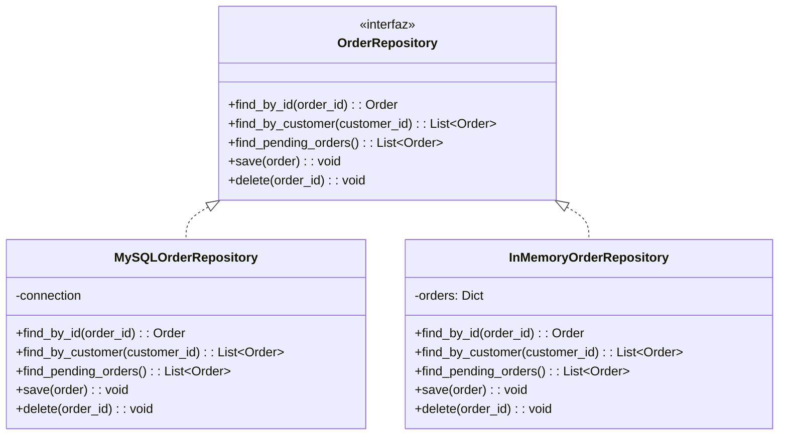
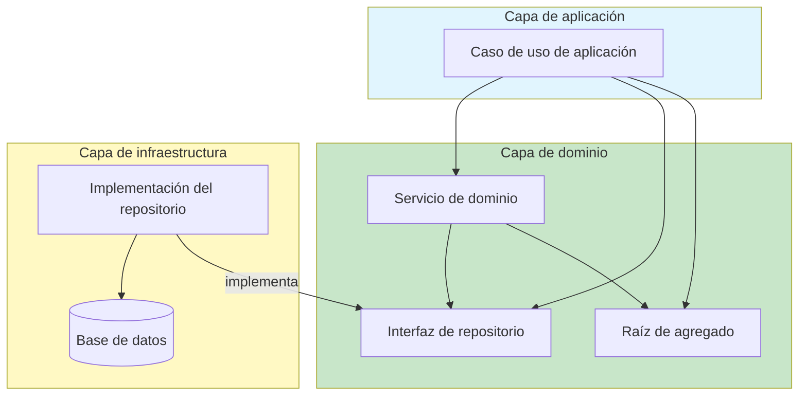

# Repositorios y Servicios de Dominio

Los Repositorios y los Servicios de Dominio son dos piezas tácticas más de DDD. Los **Repositorios** ofrecen una abstracción limpia para almacenar y recuperar agregados. Los **Servicios de Dominio** encapsulan la lógica de dominio que no pertenece de forma natural a una Entidad ni a un Objeto de Valor.

> [!NOTE]
> En DDD, un Repositorio no es un DAO (Data Access Object). Un DAO es un concepto técnico de acceso a datos. Un Repositorio es un **concepto de dominio** que habla el Lenguaje Ubicuo: le pides agregados en términos de dominio, no con consultas SQL.

## Repositorios: la metáfora de la colección

Un Repositorio actúa como una **colección en memoria** de agregados. Agregas elementos, los eliminas y consultas según criterios relevantes para el dominio. El almacenamiento subyacente (base de datos, sistema de archivos, API) queda oculto detrás de esta interfaz.



### Interfaz del Repositorio

La interfaz del repositorio se define en la **capa de dominio**. La implementación está en la **capa de infraestructura**. Esto sigue el Principio de Inversión de Dependencias.

```python
from abc import ABC, abstractmethod
from typing import List, Optional, Protocol


# --- Domain Layer: Repository interface ---

class OrderRepository(Protocol):
    """A repository for Order aggregates.
    Defined in the domain layer — speaks the Ubiquitous Language."""

    def find_by_id(self, order_id: str) -> Optional["Order"]:
        """Find an order by its unique identifier."""
        ...

    def find_by_customer(self, customer_id: str) -> List["Order"]:
        """Find all orders placed by a customer."""
        ...

    def find_pending_orders(self) -> List["Order"]:
        """Find all orders that have not been confirmed yet."""
        ...

    def find_orders_older_than(self, days: int) -> List["Order"]:
        """Find orders placed more than the specified days ago."""
        ...

    def save(self, order: "Order") -> None:
        """Persist an order aggregate (insert or update)."""
        ...

    def delete(self, order_id: str) -> None:
        """Remove an order from the repository."""
        ...
```

### Implementación del Repositorio

La implementación vive en la capa de infraestructura. Traduce entre el modelo de dominio y el mecanismo de persistencia.

```python
# --- Infrastructure Layer: Repository Implementation ---

import sqlite3
from typing import List, Optional
from datetime import datetime, timedelta


class SQLiteOrderRepository:
    """Implements OrderRepository using SQLite.
    This is infrastructure code — it depends on the domain interface."""

    def __init__(self, db_path: str):
        self._conn = sqlite3.connect(db_path, detect_types=sqlite3.PARSE_DECLTYPES)
        self._init_tables()

    def _init_tables(self) -> None:
        self._conn.execute("""
            CREATE TABLE IF NOT EXISTS orders (
                order_id TEXT PRIMARY KEY,
                customer_id TEXT NOT NULL,
                status TEXT NOT NULL,
                placed_at TIMESTAMP NOT NULL,
                total REAL NOT NULL,
                data TEXT NOT NULL
            )
        """)
        self._conn.execute("""
            CREATE TABLE IF NOT EXISTS order_lines (
                line_id TEXT PRIMARY KEY,
                order_id TEXT NOT NULL,
                product_id TEXT NOT NULL,
                product_name TEXT NOT NULL,
                quantity INTEGER NOT NULL,
                unit_price REAL NOT NULL,
                FOREIGN KEY (order_id) REFERENCES orders(order_id)
            )
        """)
        self._conn.commit()

    def find_by_id(self, order_id: str) -> Optional["Order"]:
        cursor = self._conn.execute(
            "SELECT order_id, customer_id, status, placed_at FROM orders WHERE order_id = ?",
            (order_id,)
        )
        row = cursor.fetchone()
        if not row:
            return None
        return self._row_to_aggregate(row)

    def find_by_customer(self, customer_id: str) -> List["Order"]:
        cursor = self._conn.execute(
            "SELECT order_id, customer_id, status, placed_at FROM orders WHERE customer_id = ?",
            (customer_id,)
        )
        return [self._row_to_aggregate(row) for row in cursor.fetchall()]

    def find_pending_orders(self) -> List["Order"]:
        cursor = self._conn.execute(
            "SELECT order_id, customer_id, status, placed_at FROM orders WHERE status = ?",
            ("pending",)
        )
        return [self._row_to_aggregate(row) for row in cursor.fetchall()]

    def save(self, order: "Order") -> None:
        # Serialize order data
        self._conn.execute(
            """INSERT OR REPLACE INTO orders
               (order_id, customer_id, status, placed_at, total)
               VALUES (?, ?, ?, ?, ?)""",
            (order.id, order.customer_id, order.status.value,
             order.placed_at, order.total)
        )
        # Delete old lines, insert current ones
        self._conn.execute("DELETE FROM order_lines WHERE order_id = ?", (order.id,))
        for line in order.lines:
            self._conn.execute(
                """INSERT INTO order_lines
                   (line_id, order_id, product_id, product_name, quantity, unit_price)
                   VALUES (?, ?, ?, ?, ?, ?)""",
                (line.id, order.id, line.product_id, line.product_name,
                 line.quantity, line.unit_price)
            )
        self._conn.commit()

    def delete(self, order_id: str) -> None:
        self._conn.execute("DELETE FROM order_lines WHERE order_id = ?", (order_id,))
        self._conn.execute("DELETE FROM orders WHERE order_id = ?", (order_id,))
        self._conn.commit()

    def _row_to_aggregate(self, row) -> "Order":
        order = Order(row["customer_id"])
        # Load from row data...
        return order

    def __del__(self):
        self._conn.close()
```

### Repositorio en memoria para pruebas

El beneficio de testeabilidad del patrón Repositorio es enorme. Puedes escribir una implementación en memoria para pruebas unitarias:

```python
class InMemoryOrderRepository:
    """In-memory implementation for testing.
    No database needed — tests run in milliseconds."""

    def __init__(self):
        self._orders: dict[str, "Order"] = {}

    def find_by_id(self, order_id: str) -> Optional["Order"]:
        return self._orders.get(order_id)

    def find_by_customer(self, customer_id: str) -> List["Order"]:
        return [o for o in self._orders.values()
                if o.customer_id == customer_id]

    def find_pending_orders(self) -> List["Order"]:
        return [o for o in self._orders.values()
                if o.status == "pending"]

    def save(self, order: "Order") -> None:
        self._orders[order.id] = order

    def delete(self, order_id: str) -> None:
        self._orders.pop(order_id, None)
```

> [!WARNING]
> Un Repositorio **no** debe usarse para consultas arbitrarias. Si te encuentras agregando métodos de consulta para cada patrón de acceso a datos posible, estás usando mal el Repositorio. El Repositorio es para la **recuperación de agregados**, no para informes ni exploración de datos.

## Uso del Repositorio en servicios de aplicación

```python
class ConfirmOrderHandler:
    """Application service using the Repository."""

    def __init__(self, repo: OrderRepository, uow: "UnitOfWork"):
        self._repo = repo
        self._uow = uow

    def handle(self, order_id: str) -> None:
        self._uow.begin()
        try:
            order = self._repo.find_by_id(order_id)
            if not order:
                raise ValueError(f"Order {order_id} not found")
            order.confirm()
            self._repo.save(order)
            self._uow.commit()
        except Exception:
            self._uow.rollback()
            raise
```

## Servicios de Dominio

Un Servicio de Dominio es una **operación que no pertenece de forma natural a una Entidad ni a un Objeto de Valor**. Coordina varios agregados o realiza cálculos que involucran lógica de dominio.

### Cuándo usar un Servicio de Dominio

| Situación | Ejemplo | Solución |
|-----------|---------|----------|
| La operación involucra varios agregados | Transferir dinero entre cuentas | AccountTransferService |
| La operación involucra el dominio externo | Calcular el costo de envío con reglas del transportista | ShippingCostService |
| La operación es un cálculo sin estado | Aplicar reglas de precios complejas | PricingService |
| La operación requiere conocimiento de dominio que ninguna entidad posee | Detectar patrones de fraude | FraudDetectionService |

```python
from dataclasses import dataclass
from typing import List, Protocol
from decimal import Decimal


# --- Domain Service: Pricing ---

@dataclass(frozen=True)
class Money:
    amount: Decimal
    currency: str

    def __add__(self, other: "Money") -> "Money":
        if self.currency != other.currency:
            raise ValueError("Currency mismatch")
        return Money(self.amount + other.amount, self.currency)

    def __mul__(self, quantity: int) -> "Money":
        return Money(self.amount * quantity, self.currency)


class PricingService:
    """Domain Service for pricing calculations.
    Not a natural fit for Order or Product — it involves
    multiple aggregates and external rules."""

    GOLD_DISCOUNT = Decimal("0.15")
    SILVER_DISCOUNT = Decimal("0.10")
    STANDARD_VAT = Decimal("0.20")

    def calculate_order_total(
        self,
        items: List["OrderLine"],
        customer_tier: str,
        coupon_code: str | None
    ) -> Money:
        subtotal = self._calculate_subtotal(items)
        discount = self._apply_discount(subtotal, customer_tier, coupon_code)
        vat = self._calculate_vat(discount)
        return discount + vat

    def _calculate_subtotal(self, items: List["OrderLine"]) -> Money:
        total = Money(Decimal("0.00"), "USD")
        for item in items:
            total = total + item.subtotal()
        return total

    def _apply_discount(
        self, subtotal: Money, tier: str, coupon: str | None
    ) -> Money:
        discount_rate = Decimal("0")
        if tier == "gold":
            discount_rate = self.GOLD_DISCOUNT
        elif tier == "silver":
            discount_rate = self.SILVER_DISCOUNT
        if coupon == "WELCOME10":
            discount_rate += Decimal("0.10")
        discount_amount = subtotal.amount * discount_rate
        return Money(subtotal.amount - discount_amount, subtotal.currency)

    def _calculate_vat(self, amount: Money) -> Money:
        vat_amount = amount.amount * self.STANDARD_VAT
        return Money(vat_amount, amount.currency)
```

### Ejemplo de Servicio de Dominio: transferir dinero

```python
class Account:
    """Aggregate Root for a bank account."""

    def __init__(self, account_id: str, owner: str):
        self._id = account_id
        self._owner = owner
        self._balance = Money(Decimal("0.00"), "USD")
        self._is_frozen = False

    @property
    def balance(self) -> Money:
        return self._balance

    def deposit(self, amount: Money) -> None:
        if self._is_frozen:
            raise ValueError("Account is frozen")
        if amount.amount <= 0:
            raise ValueError("Deposit amount must be positive")
        self._balance = self._balance + amount

    def withdraw(self, amount: Money) -> None:
        if self._is_frozen:
            raise ValueError("Account is frozen")
        if amount.amount <= 0:
            raise ValueError("Withdrawal amount must be positive")
        if self._balance.amount < amount.amount:
            raise ValueError("Insufficient funds")
        self._balance = self._balance - amount


class TransferService:
    """Domain Service for money transfers.
    Coordinates two Account aggregates."""

    MINIMUM_TRANSFER = Money(Decimal("1.00"), "USD")
    MAXIMUM_TRANSFER = Money(Decimal("10000.00"), "USD")

    def transfer(
        self, source: Account, destination: Account,
        amount: Money, reason: str
    ) -> None:
        if amount.amount < self.MINIMUM_TRANSFER.amount:
            raise ValueError("Transfer amount below minimum")
        if amount.amount > self.MAXIMUM_TRANSFER.amount:
            raise ValueError("Transfer amount exceeds maximum")
        source.withdraw(amount)
        destination.deposit(amount)
```

> [!TIP]
> Los Servicios de Dominio deben ser **sin estado**. No mantienen estado mutable propio. Sus dependencias (repositorios, otros servicios) se inyectan a través del constructor. Las operaciones que realizan son la razón de su existencia.

### Ejemplo de Servicio de Dominio: detección de fraude

```python
@dataclass
class FraudAssessment:
    risk_level: str  # "low", "medium", "high"
    score: int
    reasons: List[str]

class FraudDetectionService:
    """Domain Service that assesses fraud risk.
    Coordinates across multiple aggregates and external data."""

    def __init__(self, order_repo: "OrderRepository",
                 customer_repo: "CustomerRepository"):
        self._order_repo = order_repo
        self._customer_repo = customer_repo

    def assess_order_risk(self, order: "Order") -> FraudAssessment:
        reasons: List[str] = []
        score = 0

        # Rule 1: Large orders
        if order.total.amount > 5000:
            score += 30
            reasons.append("Order total exceeds $5,000")

        # Rule 2: Multiple orders in short time
        recent_orders = self._order_repo.find_by_customer(order.customer_id)
        recent_count = sum(
            1 for o in recent_orders
            if (datetime.now() - o.placed_at).hours < 24
        )
        if recent_count >= 3:
            score += 25
            reasons.append("More than 3 orders in 24 hours")

        # Rule 3: New customer with high value
        customer = self._customer_repo.find_by_id(order.customer_id)
        if customer and customer.account_age_days < 30 and order.total.amount > 2000:
            score += 20
            reasons.append("New customer with high-value order")

        risk = "low" if score < 30 else "medium" if score < 60 else "high"
        return FraudAssessment(risk, score, reasons)
```

## Repositorio vs DAO vs Unidad de trabajo

| Patrón | Propósito | Capa |
|---------|---------|-------|
| Repositorio | Acceso tipo colección a agregados | Interfaz de dominio |
| DAO | Acceso a datos de bajo nivel | Infraestructura |
| Unidad de trabajo | Gestión de transacciones | Infraestructura |
| Objeto de consulta | Consultas optimizadas para lectura | Aplicación |

```python
# Separate read model (CQRS) from the write model repository
class OrderQueryService:
    """Optimized for reads — not a repository.
    Returns read-only DTOs, not aggregates."""

    def __init__(self, connection):
        self._conn = connection

    def get_order_summary(self, order_id: str) -> dict | None:
        cursor = self._conn.execute("""
            SELECT o.order_id, o.customer_id, o.status,
                   COUNT(ol.line_id) as item_count,
                   o.total
            FROM orders o
            LEFT JOIN order_lines ol ON o.order_id = ol.order_id
            WHERE o.order_id = ?
            GROUP BY o.order_id
        """, (order_id,))
        row = cursor.fetchone()
        if not row:
            return None
        return dict(row)

    def get_customer_order_history(self, customer_id: str) -> List[dict]:
        cursor = self._conn.execute("""
            SELECT order_id, placed_at, status, total
            FROM orders
            WHERE customer_id = ?
            ORDER BY placed_at DESC
            LIMIT 50
        """, (customer_id,))
        return [dict(row) for row in cursor.fetchall()]
```

## Pruebas con Repositorios y Servicios de Dominio

El verdadero poder de estos patrones se hace evidente en las pruebas:

```python
import pytest
from datetime import datetime, timedelta


class TestTransferService:
    def setup_method(self):
        self.source = Account("ACC-001", "Alice")
        self.source.deposit(Money(Decimal("1000.00"), "USD"))

        self.destination = Account("ACC-002", "Bob")
        self.destination.deposit(Money(Decimal("100.00"), "USD"))

        self.service = TransferService()

    def test_successful_transfer(self):
        self.service.transfer(
            self.source, self.destination,
            Money(Decimal("200.00"), "USD"), "Payment"
        )
        assert self.source.balance == Money(Decimal("800.00"), "USD")
        assert self.destination.balance == Money(Decimal("300.00"), "USD")

    def test_transfer_insufficient_funds(self):
        with pytest.raises(ValueError, match="Insufficient funds"):
            self.service.transfer(
                self.source, self.destination,
                Money(Decimal("2000.00"), "USD"), "Overdraft"
            )


class TestOrderLifecycleWithRepo:
    def test_confirm_order_through_repo(self):
        # Arrange
        repo = InMemoryOrderRepository()
        order = Order(customer_id="CUST-001")
        order.add_product("P1", "Widget", 2, 10.0)
        repo.save(order)

        # Act
        loaded = repo.find_by_id(order.id)
        loaded.confirm()
        repo.save(loaded)

        # Assert
        confirmed = repo.find_by_id(order.id)
        assert confirmed.status == OrderStatus.CONFIRMED
```

## Resumen: directrices de Repositorios y Servicios de Dominio

| Aspecto | Repositorio | Servicio de Dominio |
|--------|------------|----------------|
| Propósito | Almacenar/recuperar agregados | Coordinar operaciones de dominio |
| Estado | Sin estado | Sin estado |
| Dependencia | Depende de la infraestructura | Depende de interfaces de dominio |
| Testeabilidad | Fácil (implementación en memoria) | Fácil (pruebas unitarias) |
| Capa | Interfaz de dominio, implementación de infraestructura | Dominio |
| Métodos | `find_by_*`, `save`, `delete` | Verbos específicos del dominio |
| Granularidad | Uno por raíz de agregado | Uno por capacidad de dominio |



> [!SUCCESS]
> Los Repositorios mantienen tu modelo de dominio ajeno a la persistencia. Los Servicios de Dominio evitan que la lógica de dominio se filtre en los servicios de aplicación. Juntos, aseguran que la capa de dominio siga siendo el centro de tu sistema, con las preocupaciones de infraestructura empujadas a los bordes.

## Ejercicios de Práctica

1. **Diseña una interfaz de Repositorio**: diseña un `CustomerRepository` para un sistema de gestión de suscripciones. Incluye métodos para buscar clientes, consultar por estado de suscripción y las operaciones estándar de save/delete. Escribe la interfaz usando `Protocol`.

2. **Implementa un Repositorio en memoria**: implementa el `CustomerRepository` del ejercicio 1 como un `InMemoryCustomerRepository`. Úsalo en una prueba que cree un cliente, lo guarde, lo recupere por ID y verifique los datos.

3. **Implementa un Repositorio SQLite**: escribe un `SQLiteCustomerRepository` que implemente la misma interfaz. Incluye el SQL de creación de la tabla y la lógica de mapeo.

4. **Diseña un Servicio de Dominio**: diseña un `SlotAllocationService` para un sistema de agenda hospitalaria. El servicio debe asignar a un paciente un horario de un médico. Considera: ¿qué pasa si el horario ya está ocupado? ¿Y si el paciente tiene un conflicto? ¿Y si el médico ya tiene la agenda saturada?

5. **Refactoriza un servicio de aplicación anémico**: el siguiente código tiene lógica de dominio filtrándose en la capa de aplicación. Extrae la lógica de dominio a un Servicio de Dominio:
   ```python
   class PlaceOrderController:
       def handle(self, request):
           order = Order()
           for item in request["items"]:
               if item["quantity"] > 10:
                   raise ValueError("Cannot order more than 10")
               if item["quantity"] <= 0:
                   raise ValueError("Quantity must be positive")
               order.add_line(item)
           if request["customer_tier"] == "gold":
               order.apply_discount(0.15)
           repo.save(order)
   ```

6. **Repositorio vs servicio de consultas**: tu equipo necesita mostrar un dashboard con: total de pedidos de hoy, valor promedio del pedido, los 5 productos principales y pedidos por hora. ¿Usarías un Repositorio o un servicio de consultas separado? Explica por qué.

7. **Servicio de Dominio con dependencias**: diseña un `SubscriptionRenewalService` que verifique si una suscripción debe renovarse, procese el pago a través de una pasarela de pago y envíe una confirmación. Lista sus dependencias y muestra la interfaz.

8. **Prueba con repositorio en memoria**: escribe una prueba para este escenario: un cliente puede tener hasta 5 pedidos activos. Cuando intente hacer un sexto, el sistema lo rechaza. Usa un `InMemoryOrderRepository` y un `OrderService` que coordine la comprobación.

> [!SUCCESS]
> Has completado la Lección 6. Los Repositorios mantienen los agregados independientes de la persistencia y los Servicios de Dominio mantienen bien modeladas las operaciones que abarcan varios agregados. Junto con las Entidades, los Objetos de Valor y los Agregados, forman la caja de herramientas táctica completa de DDD.
