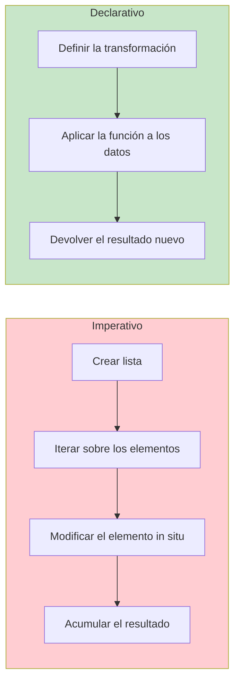
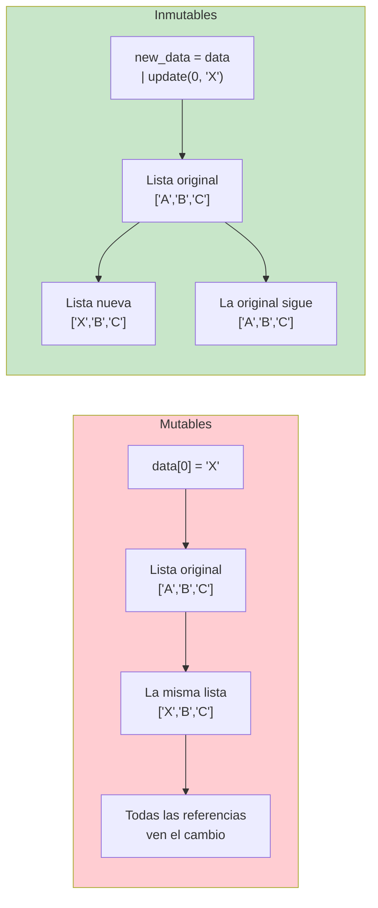
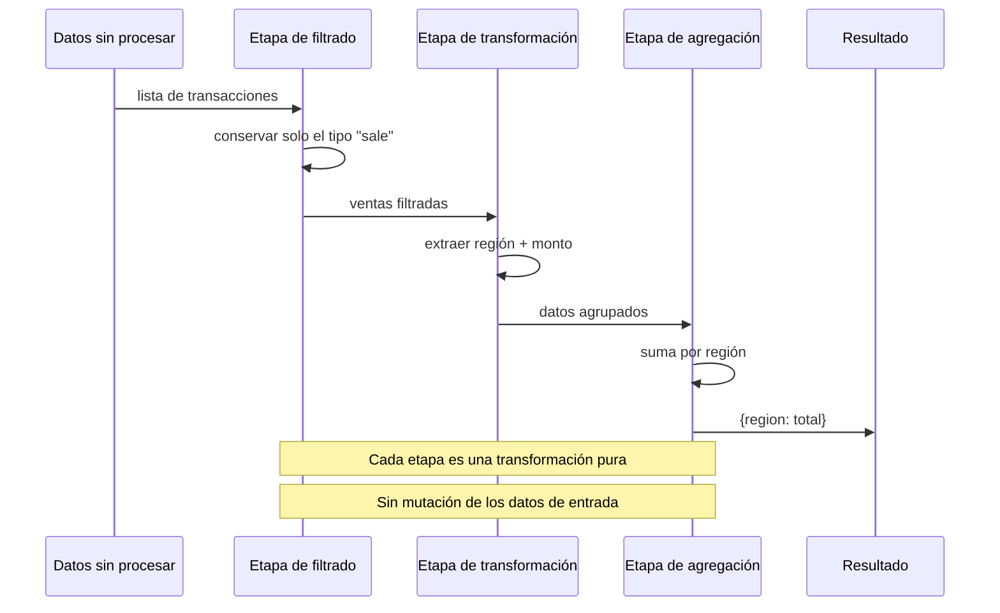
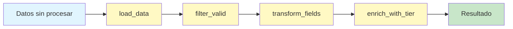

# Conceptos de programación funcional

La programación funcional (FP) es un paradigma que trata el cálculo como la evaluación de funciones matemáticas y evita cambiar el estado y los datos mutables. Esta lección introduce los conceptos fundamentales que hacen que la FP sea potente para construir software predecible, fácil de probar y concurrente.

## ¿Qué es la programación funcional?

En esencia, la programación funcional consiste en construir programas mediante la composición de funciones, donde las funciones son puras, los datos son inmutables y se prefieren las expresiones sobre las sentencias.

| Aspecto | Imperativo (Cómo) | Declarativo (Qué) |
|--------|-----------------|-------------------|
| **Enfoque** | Instrucciones paso a paso | Resultado deseado |
| **Estado** | Variables mutables | Datos inmutables |
| **Funciones** | Procedimientos con efectos secundarios | Funciones matemáticas puras |
| **Flujo de control** | Bucles, condicionales | Recursión, funciones componibles |
| **Asignación** | Reasignar variables | Vincular nombres a valores |
| **Paralelismo** | Bloqueo manual | Seguro de forma predeterminada (sin estado compartido) |



## Funciones puras

Una **función pura** siempre produce la misma salida para la misma entrada y no tiene efectos secundarios. Solo depende de sus argumentos y devuelve un nuevo valor sin modificar nada fuera de su ámbito.

```python
from typing import List, Dict, Any
import math

# IMPURE — mutates external state
total_sales = 0

def add_sale_impure(amount: float) -> float:
    global total_sales         # side effect: modifies global
    total_sales += amount       # side effect: mutation
    print(f"Sale added: {amount}")  # side effect: I/O
    return total_sales

# PURE — no side effects, deterministic
def add_sale_pure(
    current_total: float,
    amount: float
) -> float:
    return current_total + amount

# IMPURE — modifies input
def apply_discount_impure(prices: List[float]) -> None:
    for i in range(len(prices)):
        prices[i] *= 0.9       # mutates the list in place

# PURE — returns new collection
def apply_discount_pure(prices: List[float]) -> List[float]:
    return [p * 0.9 for p in prices]

# IMPURE — relies on external state
DISCOUNT_RATE = 0.1

def calculate_discount_impure(price: float) -> float:
    return price * DISCOUNT_RATE  # depends on external global

# PURE — takes all dependencies as arguments
def calculate_discount_pure(price: float, rate: float) -> float:
    return price * rate

# Example usage
original = [100.0, 200.0, 300.0]
discounted = apply_discount_pure(original)
print(f"Original: {original}")    # Unchanged — [100.0, 200.0, 300.0]
print(f"Discounted: {discounted}") # [90.0, 180.0, 270.0]

new_total = add_sale_pure(1500.0, 250.0)
print(f"New total: {new_total}")  # 1750.0
```

> [!NOTE]
> Las funciones puras son, en esencia, más fáciles de probar, de razonar y de paralelizar. Si una función es pura, nunca necesitas configurar un estado externo antes de probarla.

## Efectos secundarios

Un **efecto secundario** ocurre cuando una función interactúa con el estado del mundo exterior o lo modifica. En FP, aislamos los efectos secundarios en los límites de nuestro sistema.

```python
from typing import List
import json
import csv
from pathlib import Path

# Function with MULTIPLE side effects
def process_user_data_bad(path: str) -> None:
    with open(path, "r") as f:         # I/O side effect
        data = json.load(f)            # I/O side effect

    for user in data:
        user["score"] = user["score"] * 1.1  # mutation

    with open(path, "w") as f:         # I/O side effect
        json.dump(data, f)             # I/O side effect
    print("Done!")                     # console side effect

# Function with SIDE EFFECTS ISOLATED at the boundary
def load_json(path: str) -> List[dict]:
    with open(path, "r") as f:
        return json.load(f)

def boost_scores(users: List[dict], factor: float) -> List[dict]:
    return [
        {**user, "score": user["score"] * factor}
        for user in users
    ]

def save_json(path: str, data: List[dict]) -> None:
    with open(path, "w") as f:
        json.dump(data, f)

# Pure core, impure shell
data = load_json("/tmp/users.json")
updated = boost_scores(data, 1.1)
save_json("/tmp/users.json", updated)

# Common side effect categories:
# 1. Modifying a global variable or static local
# 2. Modifying an argument (mutable input)
# 3. I/O (files, network, database)
# 4. Throwing exceptions
# 5. Printing to console or logging
# 6. Random number generation (non-deterministic)
# 7. Getting current time or date
```

> [!WARNING]
> Las funciones que lanzan excepciones también producen efectos secundarios en forma de interrupción del flujo de control. En FP estricto, los errores se manejan mediante tipos de retorno como `Either` u `Optional`, no con excepciones.

## Inmutabilidad

**La inmutabilidad** significa que, una vez creados los datos, no pueden cambiarse. En lugar de modificar los datos existentes, creas copias nuevas con los cambios deseados.

```python
from typing import List, Dict, Tuple
from copy import deepcopy

# MUTABLE approach — dangerous
class ShoppingCartMutable:
    def __init__(self) -> None:
        self.items: List[str] = []

    def add_item(self, item: str) -> None:
        self.items.append(item)  # mutates in place

cart1 = ShoppingCartMutable()
cart1.add_item("apple")
cart1.add_item("banana")

# Someone else has a reference — BUG!
other_ref = cart1.items
cart1.add_item("cherry")
print(other_ref)  # ['apple', 'banana', 'cherry'] — unexpected!

# IMMUTABLE approach — safe
class ShoppingCartImmutable:
    def __init__(self, items: Tuple[str, ...] = ()) -> None:
        self._items = items

    @property
    def items(self) -> Tuple[str, ...]:
        return self._items

    def add_item(self, item: str) -> "ShoppingCartImmutable":
        return ShoppingCartImmutable(self._items + (item,))

    def remove_item(self, item: str) -> "ShoppingCartImmutable":
        new_items = tuple(i for i in self._items if i != item)
        return ShoppingCartImmutable(new_items)

cart2 = ShoppingCartImmutable()
cart2 = cart2.add_item("apple")
cart2 = cart2.add_item("banana")
other_ref2 = cart2.items
cart2 = cart2.add_item("cherry")
print(other_ref2)  # ('apple', 'banana') — stable!

# Immutable dict/pattern in practice
def update_user_bad(user: Dict[str, Any], key: str, value: Any) -> None:
    user[key] = value  # mutates input!

def update_user_good(user: Dict[str, Any], key: str, value: Any) -> Dict[str, Any]:
    return {**user, key: value}  # returns new dict

original = {"id": 1, "name": "Alice", "score": 100}
updated = update_user_good(original, "score", 150)
print(original)  # {'id': 1, 'name': 'Alice', 'score': 100} — intact
print(updated)   # {'id': 1, 'name': 'Alice', 'score': 150}
```



## Declarativo vs imperativo

El código declarativo expresa **qué** hacer, mientras que el código imperativo expresa **cómo** hacerlo.

```python
from typing import List

numbers = [1, 2, 3, 4, 5, 6, 7, 8, 9, 10]

# IMPERATIVE: Step by step
def sum_even_squares_imperative(nums: List[int]) -> int:
    result = 0
    for n in nums:            # how: manual loop
        if n % 2 == 0:        # how: explicit check
            result += n ** 2   # how: manual accumulation
    return result

# DECLARATIVE: Express intent
def sum_even_squares_declarative(nums: List[int]) -> int:
    return sum(                # what: sum
        n ** 2                 # what: squared
        for n in nums          # what: for each number
        if n % 2 == 0          # what: that are even
    )

print(sum_even_squares_imperative(numbers))    # 220
print(sum_even_squares_declarative(numbers))   # 220

# IMPERATIVE: Building a report
def build_report_imperative(students: List[Dict[str, Any]]) -> None:
    report = []
    for s in students:                          # how
        if s["grade"] >= 70:                    # how
            entry = {
                "name": s["name"],
                "status": "Passed",
                "grade": s["grade"]
            }
            report.append(entry)                # how
    for entry in report:
        print(f"{entry['name']}: {entry['status']} ({entry['grade']})")

# DECLARATIVE: Building a report
def build_report_declarative(students: List[Dict[str, Any]]) -> List[Dict[str, Any]]:
    return [
        {"name": s["name"], "status": "Passed", "grade": s["grade"]}
        for s in students
        if s["grade"] >= 70
    ]

students_data = [
    {"name": "Alice", "grade": 85},
    {"name": "Bob", "grade": 62},
    {"name": "Charlie", "grade": 91},
]

report = build_report_declarative(students_data)
for entry in report:
    print(f"{entry['name']}: {entry['status']} ({entry['grade']})")
```

## Transparencia referencial

Una expresión es **referencialmente transparente** si puede reemplazarse por su valor sin cambiar el comportamiento del programa. Esta es la base del razonamiento ecuacional.

```python
import random
from datetime import datetime

# REFERENTIALLY OPAQUE — can't replace with value
def roll_dice() -> int:
    return random.randint(1, 6)

# These two calls produce different values:
first = roll_dice()
second = roll_dice()
# Can't simplify: roll_dice() != roll_dice()

# REFERENTIALLY TRANSPARENT — always same result
def add(a: int, b: int) -> int:
    return a + b

# Can replace add(2, 3) with 5 anywhere:
result1 = add(2, 3) + add(2, 3)  # 10
result2 = 5 + 5                   # 10 — equivalent!
print(result1 == result2)         # True

# Benefits of referential transparency:
# - Memoization: cache results safely
# - Reordering: expressions can be parallelized
# - Reasoning: understand each part independently
# - Testing: no mocking needed
# - Refactoring: replace expression with value safely

# Example: memoizing a pure function
from functools import lru_cache

@lru_cache(maxsize=128)
def fibonacci(n: int) -> int:
    if n < 2:
        return n
    return fibonacci(n - 1) + fibonacci(n - 2)

print(fibonacci(50))  # 12586269025 — fast due to memoization
```

> [!TIP]
> La transparencia referencial es tu licencia para refactorizar sin miedo. Cuando cada expresión es referencialmente transparente, puedes extraer, inlinear, reordenar y paralelizar código con certeza matemática.

## Beneficios de la inmutabilidad

| Beneficio | Explicación | Ejemplo |
|---------|-------------|---------|
| **Seguridad en hilos** | No se necesitan bloqueos para los datos compartidos | Varios hilos leen la misma tupla |
| **Previsibilidad** | Los datos nunca cambian de forma inesperada | Se eliminan las copias defensivas |
| **Caché** | Los resultados pueden guardarse en caché con seguridad | `@lru_cache` en funciones puras |
| **Depuración** | Se conservan los valores de cada paso | Depuración con viaje en el tiempo |
| **Pruebas** | No hay preparación ni liberación de estado mutable | Pruebas del núcleo funcional |
| **Razonamiento** | El código es más fácil de entender | El razonamiento local basta |

## Las funciones como ciudadanas de primera clase

En FP, las funciones son valores. Pueden asignarse a variables, pasarse como argumentos y devolverse desde otras funciones. Esto se explora a fondo en la siguiente lección, pero aquí va una muestra:

```python
from typing import Callable, List

def apply_twice(f: Callable[[int], int], x: int) -> int:
    return f(f(x))

def square(n: int) -> int:
    return n * n

# Pass function as argument
result = apply_twice(square, 3)  # square(square(3)) = 81
print(result)  # 81

# Return a function
def make_multiplier(factor: int) -> Callable[[int], int]:
    def multiplier(n: int) -> int:
        return n * factor
    return multiplier

double = make_multiplier(2)
triple = make_multiplier(3)
print(double(5))  # 10
print(triple(5))  # 15

# Store functions in data structures
operations: Dict[str, Callable[[int, int], int]] = {
    "add": lambda a, b: a + b,
    "subtract": lambda a, b: a - b,
    "multiply": lambda a, b: a * b,
}

print(operations["add"](10, 5))      # 15
print(operations["multiply"](10, 5))  # 50
```

## Pipeline declarativo de procesamiento de datos

```python
from typing import List, Dict, Any

transactions = [
    {"id": 1, "amount": 150.0, "type": "sale", "region": "NA"},
    {"id": 2, "amount": 200.0, "type": "refund", "region": "EU"},
    {"id": 3, "amount": 99.0, "type": "sale", "region": "NA"},
    {"id": 4, "amount": 300.0, "type": "sale", "region": "APAC"},
    {"id": 5, "amount": 50.0, "type": "sale", "region": "NA"},
]

# IMPERATIVE pipeline
def process_sales_imperative(transactions: List[Dict[str, Any]]) -> Dict[str, float]:
    result: Dict[str, float] = {}
    for t in transactions:                          # manual filter
        if t["type"] != "sale":
            continue
        region = t["region"]
        if region not in result:                   # manual group
            result[region] = 0.0
        result[region] += t["amount"]               # manual accumulate
    return result

# DECLARATIVE pipeline
def process_sales_declarative(transactions: List[Dict[str, Any]]) -> Dict[str, float]:
    sales = [t for t in transactions if t["type"] == "sale"]
    regions = {t["region"] for t in sales}
    return {
        region: sum(t["amount"] for t in sales if t["region"] == region)
        for region in regions
    }

print(process_sales_imperative(transactions))
print(process_sales_declarative(transactions))
```



## Comparación de funciones puras e impuras

| Propiedad | Función pura | Función impura |
|----------|--------------|-----------------|
| **Determinista** | Siempre la misma salida para la misma entrada | Puede variar en cada llamada |
| **Efectos secundarios** | Ninguno | E/S, muta estado, usa aleatoriedad |
| **Testeabilidad** | Trivial (sin mocks) | Requiere mocks y fixtures |
| **Paralelismo** | Seguro (sin estado compartido) | Necesita bloqueos y coordinación |
| **Memoizable** | Sí (la salida se guarda en caché) | No (la salida depende del estado oculto) |
| **Componibilidad** | Fácil (sin dependencias ocultas) | Difícil (arrastra estado oculto) |
| **Razonamiento** | Local (solo la función) | Global (todo el estado del programa) |

## Recursión sobre bucles

En la programación funcional, la recursión reemplaza los bucles como mecanismo principal de iteración. Python admite la recursión pero tiene un límite de recursión.

```python
from typing import List

# IMPERATIVE: loop-based sum
def sum_list_imperative(nums: List[int]) -> int:
    total = 0
    for n in nums:
        total += n
    return total

# FUNCTIONAL: recursion-based sum
def sum_list_functional(nums: List[int]) -> int:
    if not nums:
        return 0
    return nums[0] + sum_list_functional(nums[1:])

# FUNCTIONAL with accumulator (tail-recursive style)
def sum_list_tail(nums: List[int], acc: int = 0) -> int:
    if not nums:
        return acc
    return sum_list_tail(nums[1:], acc + nums[0])

# FACTORIAL: imperative vs recursive
def factorial_imperative(n: int) -> int:
    result = 1
    for i in range(2, n + 1):
        result *= i
    return result

def factorial_recursive(n: int) -> int:
    return 1 if n <= 1 else n * factorial_recursive(n - 1)

print(sum_list_imperative([1, 2, 3, 4, 5]))   # 15
print(sum_list_functional([1, 2, 3, 4, 5]))   # 15
print(factorial_imperative(5))                 # 120
print(factorial_recursive(5))                  # 120
```

> [!WARNING]
> El límite de recursión de Python es ~1000 por defecto. Para recursión profunda, considera soluciones iterativas o usa `sys.setrecursionlimit()`. En producción, `functools.reduce` o los bucles suelen ser más prácticos.

## Arquitectura de pipelines

El paradigma funcional conduce de forma natural a una arquitectura de pipeline donde los datos fluyen a través de una cadena de transformaciones.

```python
from typing import List, Dict, Any, Callable
from functools import reduce

# Define pipeline stages as pure functions
def load_data(raw: List[Dict[str, Any]]) -> List[Dict[str, Any]]:
    return raw

def filter_valid(records: List[Dict[str, Any]]) -> List[Dict[str, Any]]:
    return [r for r in records if r.get("active", False) and r.get("value", 0) > 0]

def transform_fields(records: List[Dict[str, Any]]) -> List[Dict[str, Any]]:
    return [
        {
            "id": r["id"],
            "display_name": r["name"].strip().title(),
            "value_usd": r["value"] * 1.12,  # EUR to USD
            "category": r["category"].upper(),
        }
        for r in records
    ]

def enrich_with_tier(records: List[Dict[str, Any]]) -> List[Dict[str, Any]]:
    return [
        {
            **r,
            "tier": "premium" if r["value_usd"] > 1000 else "standard",
        }
        for r in records
    ]

def build_pipeline(*stages: Callable) -> Callable:
    """Compose multiple functions into a pipeline."""
    return lambda data: reduce(lambda d, fn: fn(d), stages, data)

pipeline = build_pipeline(
    load_data,
    filter_valid,
    transform_fields,
    enrich_with_tier,
)

input_data = [
    {"id": 1, "name": "  alice  ", "value": 1500.0, "active": True, "category": "electronics"},
    {"id": 2, "name": "bob", "value": -50.0, "active": True, "category": "food"},
    {"id": 3, "name": "charlie", "value": 200.0, "active": False, "category": "books"},
    {"id": 4, "name": "diana", "value": 800.0, "active": True, "category": "clothing"},
]

result = pipeline(input_data)
for item in result:
    print(f"{item['display_name']}: {item['value_usd']:.2f} ({item['tier']})")
# Alice: 1680.00 (premium)
# Diana: 896.00 (standard)
```



## Ejercicios de práctica

1. Convierte la siguiente función impura en una función pura:
   ```python
   tax_rate = 0.08
   def calculate_total(prices):
       total = sum(prices)
       print(f"Subtotal: {total}")
       return total * (1 + tax_rate)
   ```

2. Escribe una función `apply_discount` que reciba una lista de precios y una tasa de descuento, y que devuelva una lista **nueva** sin modificar la original. Verifica la inmutabilidad.

3. Implementa `sum_of_positive_squares` tanto en estilo imperativo como declarativo. La función debe sumar los cuadrados de todos los números positivos de una lista.

4. Identifica todos los efectos secundarios de esta función y refactorízala:
   ```python
   import random
   def process_order(order):
       global processed_count
       order["id"] = random.randint(1000, 9999)
       order["processed_at"] = "2025-01-01"
       processed_count += 1
       with open("log.txt", "a") as f:
           f.write(str(order))
       return True
   ```

5. Crea un pipeline de procesamiento de datos con funciones puras: carga filas de un CSV, filtra las filas donde `status == "active"`, extrae los pares `(id, score)` y calcula la puntuación media.

6. Explica por qué `random.randint(1, 6)` no es referencialmente transparente. Reescribe un programa de lanzamiento de dados para que la parte aleatoria quede aislada en el límite.

7. Implementa un `Counter` sencillo en estilo inmutable. En lugar de mutar un contador interno, devuelve un contador nuevo en cada llamada. Muestra las versiones mutable e inmutable lado a lado.

8. Refactoriza el siguiente código imperativo en un pipeline declarativo usando comprensiones de lista y funciones integradas:
   ```python
   def process_students(students):
       result = []
       for s in students:
           if s["score"] >= 80 and s["attendance"] >= 0.9:
               result.append({
                   "name": s["name"],
                   "grade": "A",
                   "honors": s["score"] >= 95,
               })
       return result
   ```

## Resumen

- **Las funciones puras** son deterministas, están libres de efectos secundarios y son componibles
- **La inmutabilidad** evita cambios de estado inesperados y permite la concurrencia segura
- **El código declarativo** expresa la intención (qué) en lugar de la mecánica (cómo)
- **La transparencia referencial** habilita la memoización, la paralelización y la refactorización sin miedo
- **Las funciones como ciudadanas de primera clase** abren paso a los patrones de orden superior
- **Los pipelines** componen transformaciones puras en flujos de datos legibles
- **La recursión** reemplaza a los bucles como mecanismo de iteración funcional
- Aísla los efectos secundarios en el límite; mantén el núcleo puro

> [!SUCCESS]
> Has dominado los conceptos fundamentales de la programación funcional. Estos principios serán tu guía a medida que explores las funciones de orden superior, los closures, la composición y los patrones declarativos en las próximas lecciones.
