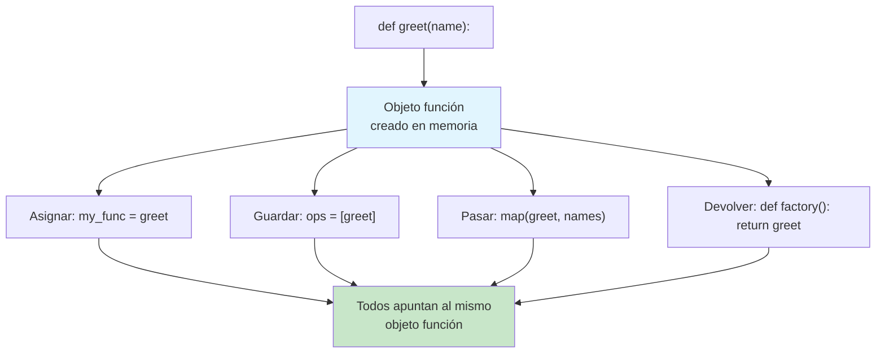
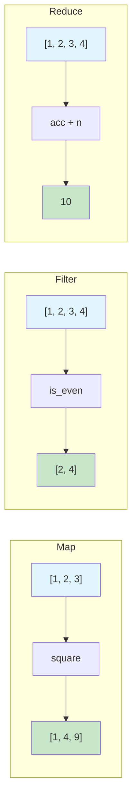
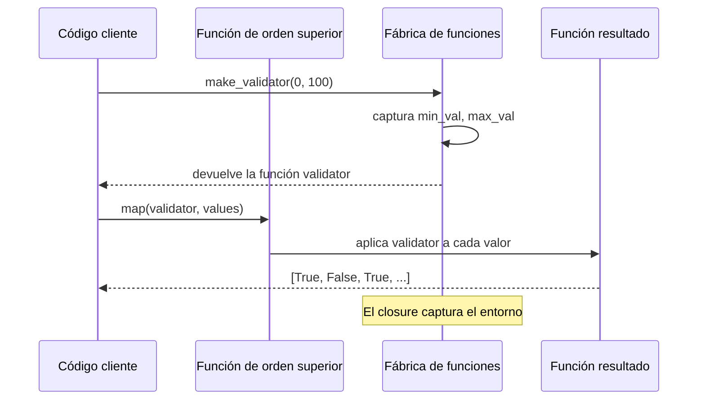

# Funciones de primera clase y de orden superior

En Python, las funciones son **ciudadanas de primera clase**: pueden asignarse a variables, pasarse como argumentos, devolverse desde otras funciones y almacenarse en estructuras de datos. Las **funciones de orden superior** aprovechan esto al recibir funciones como argumentos o al devolver funciones como resultado.

## Las funciones son objetos

Todo en Python es un objeto, y las funciones no son la excepción.

```python
from typing import Callable, List, Any, Optional
import math

# Functions have a type — just like any other object
print(type(len))           # <class 'builtin_function_or_method'>
print(type(str.upper))     # <class 'method_descriptor'>

# Functions have attributes
def greet(name: str) -> str:
    """Return a greeting string."""
    return f"Hello, {name}!"

print(greet.__name__)      # "greet"
print(greet.__doc__)       # "Return a greeting string."
print(greet.__code__)      # <code object greet at ...>

# Assign to a variable
my_func = greet
print(my_func("Alice"))    # "Hello, Alice!"

# Store in a list
operations = [greet, len, str.upper]
print(operations[0]("Bob"))    # "Hello, Bob!"
print(operations[1]("hello")) # 5
print(operations[2]("hello")) # "HELLO"

# Store in a dictionary
dispatch: Dict[str, Callable] = {
    "greet": greet,
    "double": lambda x: x * 2,
}
print(dispatch["double"](5))  # 10
```



## Pasar funciones como argumentos

Este es el uso más común de las funciones de orden superior.

```python
from typing import List, Callable, TypeVar

T = TypeVar("T")

# A higher-order function that applies a transform to every item
def transform_list(
    items: List[T],
    transform_fn: Callable[[T], T]
) -> List[T]:
    return [transform_fn(item) for item in items]

def double(x: int) -> int:
    return x * 2

def square(x: int) -> int:
    return x * x

numbers = [1, 2, 3, 4]
print(transform_list(numbers, double))  # [2, 4, 6, 8]
print(transform_list(numbers, square))  # [1, 4, 9, 16]

# Passing methods
words = ["hello", "world", "python"]
uppercased = transform_list(words, str.upper)
print(uppercased)  # ["HELLO", "WORLD", "PYTHON"]

# Custom sorting with key function
students = [
    {"name": "Alice", "grade": 85},
    {"name": "Bob", "grade": 72},
    {"name": "Charlie", "grade": 91},
]
by_grade = sorted(students, key=lambda s: s["grade"])
print(by_grade)
```

## La trinidad: map, filter, reduce

Estas tres funciones forman la columna vertebral del procesamiento de datos funcional en Python.

### map: transforma cada elemento

```python
from typing import List, Callable, Iterable, Any

# map() applies a function to each item in an iterable

# IMPERATIVE
def square_all_imperative(nums: List[float]) -> List[float]:
    result = []
    for n in nums:
        result.append(n ** 2)
    return result

# DECLARATIVE with map
def square_all_map(nums: List[float]) -> List[float]:
    return list(map(lambda n: n ** 2, nums))

# Real-world: convert temperatures
celsius = [0, 10, 20, 30, 40]
fahrenheit = list(map(lambda c: c * 9/5 + 32, celsius))
print(fahrenheit)  # [32.0, 50.0, 68.0, 86.0, 104.0]

# Map with multiple iterables
def add_pairs(a: int, b: int) -> int:
    return a + b

result = list(map(add_pairs, [1, 2, 3], [10, 20, 30]))
print(result)  # [11, 22, 33]

# Named function is clearer than lambda for complex logic
def clean_name(name: str) -> str:
    return name.strip().title()

raw_names = ["  alice ", "BOB", "CHARLIE  ", "  diana  "]
cleaned = list(map(clean_name, raw_names))
print(cleaned)  # ["Alice", "Bob", "Charlie", "Diana"]
```

### filter: conserva los elementos coincidentes

```python
from typing import List, Callable

# filter() keeps items where the predicate returns True

# IMPERATIVE
def get_even_imperative(nums: List[int]) -> List[int]:
    result = []
    for n in nums:
        if n % 2 == 0:
            result.append(n)
    return result

# DECLARATIVE with filter
def get_even_filter(nums: List[int]) -> List[int]:
    return list(filter(lambda n: n % 2 == 0, nums))

numbers = [1, 2, 3, 4, 5, 6, 7, 8, 9, 10]
print(get_even_filter(numbers))  # [2, 4, 6, 8, 10]

# Filtering complex data
products = [
    {"name": "Laptop", "price": 1200, "in_stock": True},
    {"name": "Mouse", "price": 25, "in_stock": False},
    {"name": "Keyboard", "price": 80, "in_stock": True},
    {"name": "Monitor", "price": 350, "in_stock": True},
]

def is_available(product: dict) -> bool:
    return product["in_stock"] and product["price"] < 100

available_under_100 = list(filter(is_available, products))
print([p["name"] for p in available_under_100])  # ["Keyboard"]

# filter with None removes falsy values
mixed = [0, 1, "", "hello", None, [], [1, 2]]
truthy = list(filter(None, mixed))
print(truthy)  # [1, "hello", [1, 2]]
```

> [!TIP]
> Prefiere funciones predicado con nombre sobre lambdas en `filter()` cuando la lógica no sea trivial. Las funciones con nombre documentan mejor la intención.

### reduce: acumula en un solo valor

```python
from functools import reduce
from typing import List, Callable

# reduce() repeatedly applies a function to accumulate a result

# IMPERATIVE
def sum_all_imperative(nums: List[int]) -> int:
    total = 0
    for n in nums:
        total += n
    return total

# DECLARATIVE with reduce
def sum_all_reduce(nums: List[int]) -> int:
    return reduce(lambda acc, n: acc + n, nums, 0)

numbers = [1, 2, 3, 4, 5]
print(sum_all_reduce(numbers))  # 15
print(sum(numbers))  # 15 — built-in is preferred for this case

# Custom reduce: find maximum
def find_max(nums: List[int]) -> int:
    return reduce(lambda a, b: a if a > b else b, nums)

print(find_max([3, 7, 2, 9, 5]))  # 9

# Reduce with complex data
orders = [
    {"id": 1, "items": [{"price": 10}, {"price": 20}]},
    {"id": 2, "items": [{"price": 30}]},
    {"id": 3, "items": [{"price": 15}, {"price": 25}, {"price": 5}]},
]

def total_revenue(acc: float, order: dict) -> float:
    order_total = sum(item["price"] for item in order["items"])
    return acc + order_total

revenue = reduce(total_revenue, orders, 0.0)
print(f"Total revenue: ${revenue}")  # $105.00

# Reduce to build a dictionary
def index_by_id(acc: dict, product: dict) -> dict:
    acc[product["id"]] = product
    return acc

catalog = [
    {"id": "p1", "name": "Widget", "price": 9.99},
    {"id": "p2", "name": "Gadget", "price": 24.99},
    {"id": "p3", "name": "Doohickey", "price": 4.99},
]

indexed = reduce(index_by_id, catalog, {})
print(indexed["p2"]["name"])  # "Gadget"
```



## Encadenar map, filter y reduce

El verdadero poder aparece cuando encadenas estas operaciones.

```python
from functools import reduce
from typing import List, Dict, Any

# Problem: Given a list of transactions, calculate the total
# value of all sales over $100 made in the "NA" region.

transactions = [
    {"id": 1, "amount": 150.0, "type": "sale", "region": "NA"},
    {"id": 2, "amount": 2000.0, "type": "sale", "region": "EU"},
    {"id": 3, "amount": 75.0, "type": "sale", "region": "NA"},
    {"id": 4, "amount": 300.0, "type": "refund", "region": "NA"},
    {"id": 5, "amount": 500.0, "type": "sale", "region": "NA"},
    {"id": 6, "amount": 25.0, "type": "sale", "region": "EU"},
]

# IMPERATIVE approach
def calculate_total_imperative(transactions: List[Dict[str, Any]]) -> float:
    total = 0.0
    for t in transactions:
        if t["type"] == "sale" and t["region"] == "NA" and t["amount"] > 100:
            total += t["amount"]
    return total

# FUNCTIONAL approach with chaining
def calculate_total_functional(transactions: List[Dict[str, Any]]) -> float:
    return reduce(
        lambda acc, t: acc + t["amount"],
        filter(
            lambda t: t["type"] == "sale" and t["region"] == "NA" and t["amount"] > 100,
            transactions
        ),
        0.0
    )

# FUNCTIONAL with intermediate variables (more readable)
def calculate_total_readable(transactions: List[Dict[str, Any]]) -> float:
    sales_only = filter(lambda t: t["type"] == "sale", transactions)
    na_sales = filter(lambda t: t["region"] == "NA", sales_only)
    big_sales = filter(lambda t: t["amount"] > 100, na_sales)
    return reduce(lambda acc, t: acc + t["amount"], big_sales, 0.0)

print(calculate_total_imperative(transactions))   # 650.0
print(calculate_total_functional(transactions))   # 650.0
print(calculate_total_readable(transactions))     # 650.0

# Complex pipeline: process user data
users = [
    {"name": "Alice", "age": 25, "scores": [85, 90, 78]},
    {"name": "Bob", "age": 17, "scores": [92, 88, 95]},
    {"name": "Charlie", "age": 30, "scores": [70, 65, 72]},
    {"name": "Diana", "age": 22, "scores": [95, 97, 99]},
]

def average_score(scores: List[float]) -> float:
    return sum(scores) / len(scores) if scores else 0.0

adults = filter(lambda u: u["age"] >= 18, users)
avg_scores = map(lambda u: {"name": u["name"], "avg": average_score(u["scores"])}, adults)
high_performers = filter(lambda u: u["avg"] >= 80, avg_scores)
result = list(high_performers)
print(result)
# [{'name': 'Alice', 'avg': 84.33}, {'name': 'Diana', 'avg': 97.0}]
```

## Aplicación parcial

`functools.partial` crea una nueva función con algunos argumentos ya rellenados.

```python
from functools import partial
from typing import Callable

def power(base: float, exponent: float) -> float:
    return base ** exponent

# Create specialized functions
square = partial(power, exponent=2)
cube = partial(power, exponent=3)
sqrt = partial(power, exponent=0.5)

print(square(5))   # 25
print(cube(3))     # 27
print(sqrt(16))    # 4.0

# Partial for data processing
def format_entry(name: str, score: float, precision: int) -> str:
    return f"{name}: {score:.{precision}f}"

format_2dp = partial(format_entry, precision=2)
format_0dp = partial(format_entry, precision=0)

print(format_2dp("Alice", 85.6789))  # "Alice: 85.68"
print(format_0dp("Bob", 72.1))       # "Bob: 72"

# Partial with map
def process_temperature(temp: float, scale: str, offset: float) -> float:
    if scale == "F":
        return temp * 9/5 + 32 + offset
    return temp + offset

to_fahrenheit = partial(process_temperature, scale="F", offset=0)
celsius_temps = [0, 10, 20, 30]
fahrenheit_temps = list(map(to_fahrenheit, celsius_temps))
print(fahrenheit_temps)  # [32.0, 50.0, 68.0, 86.0]
```

## Fábricas de funciones

Las funciones que **devuelven** funciones son potentes para crear comportamientos parametrizados.

```python
from typing import Callable, List, Any

# Simple function factory
def make_greeter(greeting: str) -> Callable[[str], str]:
    def greeter(name: str) -> str:
        return f"{greeting}, {name}!"
    return greeter

say_hello = make_greeter("Hello")
say_hi = make_greeter("Hi")
say_yo = make_greeter("Yo")

print(say_hello("Alice"))  # "Hello, Alice!"
print(say_hi("Bob"))       # "Hi, Bob!"
print(say_yo("Charlie"))   # "Yo, Charlie!"

# Factory for validation functions
def make_validator(min_val: float = 0, max_val: float = 100) -> Callable[[float], bool]:
    def validator(value: float) -> bool:
        return min_val <= value <= max_val
    return validator

is_percentage = make_validator(0, 100)
is_grade = make_validator(0, 10)
is_temperature_c = make_validator(-273.15, 1000)

print(is_percentage(150))    # False
print(is_grade(8.5))         # True
print(is_temperature_c(-300))  # False

# Factory for sorting keys
def make_sorter(key: str, reverse: bool = False) -> Callable:
    def sorter(collection: List[dict]) -> List[dict]:
        return sorted(collection, key=lambda x: x[key], reverse=reverse)
    return sorter

students = [
    {"name": "Alice", "grade": 85, "age": 22},
    {"name": "Bob", "grade": 92, "age": 19},
    {"name": "Charlie", "grade": 78, "age": 25},
]

sort_by_grade = make_sorter("grade")
sort_by_age_desc = make_sorter("age", reverse=True)

print(sort_by_grade(students))
print(sort_by_age_desc(students))
```

## Funciones de orden superior personalizadas

```python
from typing import Callable, List, TypeVar, Any
import time

T = TypeVar("T")
R = TypeVar("R")

# A decorator is a higher-order function
def timed(func: Callable[..., R]) -> Callable[..., R]:
    def wrapper(*args: Any, **kwargs: Any) -> R:
        start = time.perf_counter()
        result = func(*args, **kwargs)
        elapsed = time.perf_counter() - start
        print(f"{func.__name__} took {elapsed:.4f}s")
        return result
    return wrapper

@timed
def slow_square(n: int) -> int:
    sum([i ** 2 for i in range(1000000)])
    return n * n

print(slow_square(5))

# A function that applies a function N times
def apply_n_times(
    func: Callable[[T], T],
    n: int
) -> Callable[[T], T]:
    def applicator(value: T) -> T:
        result = value
        for _ in range(n):
            result = func(result)
        return result
    return applicator

double = lambda x: x * 2
double_3 = apply_n_times(double, 3)
print(double_3(5))  # 5 * 2 * 2 * 2 = 40

# Conditional application
def when(
    predicate: Callable[[T], bool],
    func: Callable[[T], T]
) -> Callable[[T], T]:
    def conditional(value: T) -> T:
        return func(value) if predicate(value) else value
    return conditional

to_upper_if_long = when(
    lambda s: len(s) > 5,
    lambda s: s.upper()
)

print(to_upper_if_long("hi"))      # "hi"
print(to_upper_if_long("hello!"))  # "HELLO!"
```



## Comparación de map/filter/reduce con bucles

| Aspecto | Bucle imperativo | Funcional (map/filter/reduce) |
|--------|----------------|-------------------------------|
| **Intención** | Enterrada en la mecánica del bucle | Expresada en el nombre de la función |
| **Estado** | Variable acumuladora | Pipeline inmutable |
| **Reutilización** | Reescribir el bucle cada vez | Componer las funciones existentes |
| **Pruebas** | Probar el bucle completo | Probar cada función de forma independiente |
| **Paralelismo** | Hilos manuales | `multiprocessing.Pool.map` |
| **Brevedad** | Verboso | Conciso |
| **Legibilidad** | Familiar para todos | Requiere conocimientos de FP |

## En la vida real: pipeline de procesamiento de datos

```python
from functools import reduce
from typing import List, Dict, Any, Callable
import json

# Simulated API response
api_response = [
    {"user_id": 1, "name": "Alice", "orders": [
        {"total": 150.0, "status": "completed"},
        {"total": 50.0, "status": "pending"},
    ]},
    {"user_id": 2, "name": "Bob", "orders": [
        {"total": 200.0, "status": "completed"},
    ]},
    {"user_id": 3, "name": "Charlie", "orders": [
        {"total": 75.0, "status": "cancelled"},
        {"total": 300.0, "status": "completed"},
        {"total": 25.0, "status": "completed"},
    ]},
]

# Step 1: Extract all completed orders
def get_completed_orders(users: List[Dict[str, Any]]) -> List[Dict[str, Any]]:
    return [
        {**order, "user_name": user["name"], "user_id": user["user_id"]}
        for user in users
        for order in user["orders"]
        if order["status"] == "completed"
    ]

# Step 2: Apply discount to large orders
def apply_volume_discount(
    orders: List[Dict[str, Any]],
    threshold: float = 200.0,
    discount: float = 0.1
) -> List[Dict[str, Any]]:
    return [
        {
            **order,
            "discounted_total": (
                order["total"] * (1 - discount)
                if order["total"] >= threshold
                else order["total"]
            ),
            "discount_applied": order["total"] >= threshold,
        }
        for order in orders
    ]

# Step 3: Summarize per user
def summarize_by_user(orders: List[Dict[str, Any]]) -> Dict[str, Dict[str, Any]]:
    return reduce(
        lambda acc, order: {
            **acc,
            order["user_name"]: {
                "user_id": order["user_id"],
                "total_orders": acc.get(order["user_name"], {}).get("total_orders", 0) + 1,
                "total_spent": acc.get(order["user_name"], {}).get("total_spent", 0.0) + order["discounted_total"],
                "discounts_received": acc.get(order["user_name"], {}).get("discounts_received", 0) + (1 if order["discount_applied"] else 0),
            }
        },
        orders,
        {}
    )

# Compose the pipeline
result = summarize_by_user(
    apply_volume_discount(
        get_completed_orders(api_response)
    )
)

for user, stats in result.items():
    print(f"{user}: ${stats['total_spent']:.2f} ({stats['total_orders']} orders, {stats['discounts_received']} discounts)")
```

> [!SUCCESS]
> Funciones de orden superior como map, filter y reduce te permiten expresar las transformaciones de datos como bloques de construcción componibles y testeables. Combinadas con closures y aplicación parcial, forman el conjunto de herramientas de la programación declarativa.

## Comparación de enfoques imperativo y funcional

| Problema | Imperativo | Funcional |
|---------|-----------|------------|
| **Suma de cuadrados** | `total = 0` → `for n in nums: total += n*n` | `reduce(lambda a,n: a+n*n, nums, 0)` |
| **Filtrar adultos** | `result = []` → `for p in people: if p.age >= 18: result.append(p)` | `list(filter(lambda p: p.age >= 18, people))` |
| **Extraer nombres** | `names = []` → `for p in people: names.append(p.name)` | `list(map(lambda p: p.name, people))` |
| **Agrupar por clave** | Construcción manual de diccionarios | `reduce` con fusión de diccionarios |
| **Bucles anidados** | Doble bucle `for` | Comprensiones anidadas / `itertools.product` |

## Ejercicios de práctica

1. Usa `map` para convertir una lista de temperaturas en Celsius a Fahrenheit: `[0, 10, 20, 30, 40]` → `[32, 50, 68, 86, 104]`.

2. Usa `filter` para extraer todas las cadenas de más de 5 caracteres de `["cat", "elephant", "dog", "butterfly", "ant"]`.

3. Usa `reduce` para encontrar el producto de todos los números de una lista. Luego usa `reduce` para aplanar una lista de listas: `[[1,2], [3,4], [5]]` → `[1,2,3,4,5]`.

4. Encadena `map`, `filter` y `reduce` para:
   - Partir de una lista de enteros
   - Filtrar para conservar solo los números pares
   - Mapear para elevar cada uno al cuadrado
   - Reducir para sumar los cuadrados

5. Crea una fábrica de funciones `make_discount` que reciba un porcentaje de descuento y devuelva una función que aplique ese descuento a un precio.

6. Implementa `my_map`, `my_filter` y `my_reduce` desde cero usando bucles. Verifica que producen los mismos resultados que las funciones integradas.

7. Usa `functools.partial` para crear las funciones `double`, `triple` y `quadruple` a partir de una función `multiply`.

8. Dada una lista de diccionarios con las claves `"city"` y `"population"`, usa `reduce` para construir un diccionario que asocie los nombres de las ciudades con sus poblaciones.

## Resumen

- **Las funciones de primera clase** pueden asignarse, pasarse y devolverse como cualquier valor
- **map** transforma cada elemento de una colección
- **filter** conserva los elementos que cumplen un predicado
- **reduce** acumula elementos en un solo valor
- **Encadenar** estas funciones crea pipelines de datos expresivos
- **La aplicación parcial** rellena de antemano argumentos para crear funciones especializadas
- **Las fábricas de funciones** devuelven funciones parametrizadas mediante closures
- Estos patrones eliminan el código repetido y hacen explícita la intención

> [!WARNING]
> No abuses de `reduce` cuando exista una alternativa más simple. Usa `sum()`, `any()`, `all()`, `max()`, `min()` para los casos comunes. Reserva `reduce` para acumulaciones genuinamente personalizadas.
