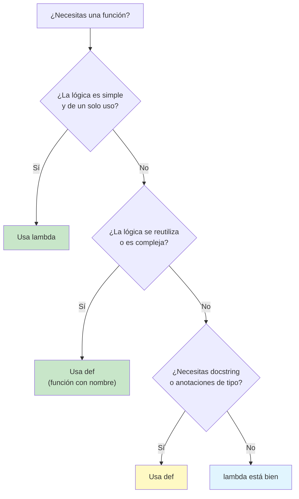
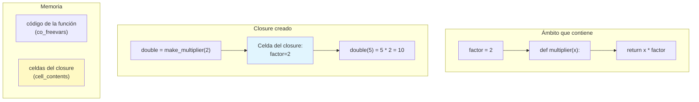

# Funciones lambda y closures

Las funciones lambda (funciones anónimas) y los closures son herramientas esenciales del kit del programador funcional. Las lambdas ofrecen definiciones de funciones concisas en línea, mientras que los closures capturan y recuerdan el entorno en el que fueron creados.

## Funciones lambda

Una **función lambda** es una función anónima pequeña definida con la palabra clave `lambda`. Puede recibir cualquier número de argumentos, pero solo devuelve una expresión.

```python
from typing import Callable, List, Any

# Syntax: lambda arguments: expression

# Named function equivalent
def add_one(x: int) -> int:
    return x + 1

# Lambda equivalent
add_one_lambda = lambda x: x + 1

print(add_one(5))          # 6
print(add_one_lambda(5))   # 6

# Multiple arguments
multiply = lambda a, b: a * b
print(multiply(3, 4))  # 12

# Default arguments
power = lambda base, exp=2: base ** exp
print(power(5))     # 25
print(power(2, 10)) # 1024

# Common use: sorting with custom key
students = [
    {"name": "Alice", "grade": 85},
    {"name": "Bob", "grade": 72},
    {"name": "Charlie", "grade": 91},
    {"name": "Diana", "grade": 88},
]

# Sort by grade descending
by_grade = sorted(students, key=lambda s: s["grade"], reverse=True)
print([s["name"] for s in by_grade])
# ["Charlie", "Diana", "Alice", "Bob"]

# Sort by name length
by_name_len = sorted(students, key=lambda s: len(s["name"]))
print([s["name"] for s in by_name_len])
# ["Bob", "Alice", "Diana", "Charlie"]
```

> [!NOTE]
> Los cuerpos de las lambdas se limitan a una sola expresión: no puedes usar sentencias como `return`, `if`/`elif`/`else` (aunque sí puedes usar la expresión condicional) ni bucles. Si necesitas más complejidad, usa una función con nombre.

## Cuándo usar lambdas

Las lambdas brillan cuando la lógica de la función es simple y solo se necesita en un solo lugar.

```python
from typing import List, Tuple

# 1. Inline with sorted, max, min
words = ["python", "java", "javascript", "c", "rust"]
longest = max(words, key=lambda w: len(w))
print(longest)  # "javascript"

# 2. With map, filter, reduce
from functools import reduce

numbers = [1, 2, 3, 4, 5]
squared = list(map(lambda x: x ** 2, numbers))
evens = list(filter(lambda x: x % 2 == 0, numbers))
product = reduce(lambda a, b: a * b, numbers)

print(squared)   # [1, 4, 9, 16, 25]
print(evens)     # [2, 4]
print(product)   # 120

# 3. As callback functions
import tkinter as tk
# root = tk.Tk()
# button = tk.Button(root, text="Click", command=lambda: print("Clicked!"))

# 4. In defaultdict factory
from collections import defaultdict

grouped = defaultdict(lambda: [])
items = [("fruit", "apple"), ("fruit", "banana"), ("color", "red")]
for category, value in items:
    grouped[category].append(value)

print(dict(grouped))
# {"fruit": ["apple", "banana"], "color": ["red"]}

# 5. Key functions for complex data
data = [
    (1, "zebra", 50),
    (2, "apple", 30),
    (3, "mango", 40),
]

# Sort by second element (string)
by_name = sorted(data, key=lambda t: t[1])
print([t[1] for t in by_name])  # ["apple", "mango", "zebra"]

# Sort by third element (number)
by_value = sorted(data, key=lambda t: t[2])
print([t[2] for t in by_value])  # [30, 40, 50]
```

## Cuándo NO usar lambdas

Las funciones con nombre son mejores cuando la lógica es compleja o se reutiliza.

```python
from typing import List, Dict, Any

# BAD: Complex lambda — hard to read
process_complex = lambda items: list(
    filter(
        lambda x: x["score"] >= 50 and x["status"] != "inactive",
        sorted(
            items,
            key=lambda x: (-x["score"], x["name"])
        )
    )
)

# GOOD: Named function — clear intent
def process_items(items: List[Dict[str, Any]]) -> List[Dict[str, Any]]:
    def is_active_high_scorer(item: Dict[str, Any]) -> bool:
        return item["score"] >= 50 and item["status"] != "inactive"

    def sort_key(item: Dict[str, Any]) -> Tuple[int, str]:
        return (-item["score"], item["name"])

    sorted_items = sorted(items, key=sort_key)
    return list(filter(is_active_high_scorer, sorted_items))

# BAD: Lambda assigned to variable (just use def)
double = lambda x: x * 2

# GOOD: Named function
def double(x: int) -> int:
    return x * 2

# BAD: Lambda with conditional logic
status = lambda x: "passed" if x >= 60 else "failed"

# GOOD: Named function
def get_status(score: float) -> str:
    return "passed" if score >= 60 else "failed"
```



## Closures

Un **closure** es una función que recuerda las variables del ámbito que la contiene, incluso después de que ese ámbito haya terminado de ejecutarse.

```python
from typing import Callable, List

# Basic closure example
def make_multiplier(factor: int) -> Callable[[int], int]:
    def multiplier(x: int) -> int:
        return x * factor  # factor is captured from enclosing scope
    return multiplier

double = make_multiplier(2)
triple = make_multiplier(3)

print(double(5))   # 10
print(triple(5))   # 15

# The closure captures the variable, not just the value
def make_counters() -> tuple:
    count = [0]  # mutable captured variable

    def increment() -> int:
        count[0] += 1
        return count[0]

    def reset() -> None:
        count[0] = 0

    return increment, reset

inc, reset = make_counters()
print(inc())  # 1
print(inc())  # 2
print(inc())  # 3
reset()
print(inc())  # 1
```

## Cómo funcionan los closures

Cuando una función anidada hace referencia a una variable de un ámbito exterior, Python empaqueta la función con las variables referenciadas en un closure.

```python
from typing import Callable

def outer(msg: str) -> Callable[[], str]:
    # msg is a free variable
    def inner() -> str:
        return f"Message: {msg}"
    return inner

fn = outer("Hello, World!")
print(fn())  # "Message: Hello, World!"

# Introspecting closure internals
print(fn.__closure__)       # (<cell at 0x...: str object at 0x...>,)
print(fn.__code__.co_freevars)  # ("msg",)
print(fn.__closure__[0].cell_contents)  # "Hello, World!"

# Multiple layers of closure
def make_formatter(prefix: str, suffix: str) -> Callable[[str], str]:
    def formatter(value: str) -> str:
        return f"{prefix}{value}{suffix}"
    return formatter

bracket = make_formatter("[", "]")
angle = make_formatter("<", ">")

print(bracket("Alice"))  # "[Alice]"
print(angle("Bob"))      # "<Bob>"
```

> [!WARNING]
> Los closures capturan las variables por referencia, no por valor. Si la variable capturada cambia después de que se crea el closure, el closure ve el valor nuevo. Esto puede producir un comportamiento sorprendente en los bucles.

## La trampa de lambda en los bucles

Este es un fallo clásico de Python:

```python
from typing import List, Callable

# WRONG: All closures capture the same variable
def build_functions_wrong() -> List[Callable[[], int]]:
    funcs = []
    for i in range(5):
        funcs.append(lambda: i ** 2)  # i is captured by reference
    return funcs

for f in build_functions_wrong():
    print(f(), end=" ")  # 16 16 16 16 16 — all use i=4!

# CORRECT: Capture the current value via default argument
def build_functions_correct() -> List[Callable[[], int]]:
    funcs = []
    for i in range(5):
        funcs.append(lambda x=i: x ** 2)  # default arg is evaluated NOW
    return funcs

for f in build_functions_correct():
    print(f(), end=" ")  # 0 1 4 9 16

# CORRECT: Use a factory function
def make_squarer(n: int) -> Callable[[], int]:
    return lambda: n ** 2  # n is captured in a new scope

def build_functions_factory() -> List[Callable[[], int]]:
    return [make_squarer(i) for i in range(5)]

for f in build_functions_factory():
    print(f(), end=" ")  # 0 1 4 9 16
```

## Closures para la encapsulación

Los closures pueden ofrecer estado privado sin clases.

```python
from typing import Callable, Tuple, Optional

# Counter using closure (no class needed)
def create_counter(start: int = 0) -> Tuple[Callable[[], int], Callable[[], int]]:
    count = start

    def increment() -> int:
        nonlocal count
        count += 1
        return count

    def get_count() -> int:
        return count

    return increment, get_count

inc, get = create_counter(10)
print(inc())  # 11
print(inc())  # 12
print(get())  # 12

# Bank account using closures
def create_account(owner: str, initial_balance: float = 0.0) -> dict:
    balance = initial_balance

    def deposit(amount: float) -> float:
        nonlocal balance
        if amount <= 0:
            raise ValueError("Amount must be positive")
        balance += amount
        return balance

    def withdraw(amount: float) -> float:
        nonlocal balance
        if amount <= 0:
            raise ValueError("Amount must be positive")
        if amount > balance:
            raise ValueError("Insufficient funds")
        balance -= amount
        return balance

    def get_balance() -> float:
        return balance

    def info() -> dict:
        return {"owner": owner, "balance": balance}

    return {
        "deposit": deposit,
        "withdraw": withdraw,
        "balance": get_balance,
        "info": info,
    }

acc = create_account("Alice", 1000)
acc["deposit"](500)
acc["withdraw"](200)
print(acc["info"]())  # {'owner': 'Alice', 'balance': 1300}
```



## Patrones prácticos de closures

```python
from typing import Callable, List, Any
import time

# 1. Memoization via closure
def make_memoized(func: Callable) -> Callable:
    cache = {}

    def memoized(*args: Any) -> Any:
        if args not in cache:
            cache[args] = func(*args)
        return cache[args]

    return memoized

def fib(n: int) -> int:
    if n < 2:
        return n
    return fib(n - 1) + fib(n - 2)

fib_memo = make_memoized(fib)

start = time.perf_counter()
print(fib_memo(35))  # 9227465
print(f"Memoized: {time.perf_counter() - start:.4f}s")

start = time.perf_counter()
print(fib_memo(35))  # 9227465 (instant from cache)
print(f"Cached: {time.perf_counter() - start:.4f}s")

# 2. Rate limiter
def make_rate_limiter(max_calls: int, period: float) -> Callable[[Callable], Callable]:
    calls = []

    def limiter(func: Callable) -> Callable:
        def wrapped(*args: Any, **kwargs: Any) -> Any:
            now = time.time()
            nonlocal calls
            calls = [t for t in calls if now - t < period]

            if len(calls) >= max_calls:
                raise RuntimeError(f"Rate limit exceeded ({max_calls}/{period}s)")

            calls.append(now)
            return func(*args, **kwargs)
        return wrapped
    return limiter

rate_limit = make_rate_limiter(3, 1.0)

@rate_limit
def api_call(name: str) -> str:
    return f"Processed {name}"

for i in range(5):
    try:
        print(api_call(f"req-{i}"))
    except RuntimeError as e:
        print(f"Blocked: {e}")

# 3. Lazy initialization
def make_lazy(initializer: Callable) -> Callable:
    value = None
    initialized = False

    def get_value() -> Any:
        nonlocal value, initialized
        if not initialized:
            value = initializer()
            initialized = True
        return value

    return get_value

config = make_lazy(lambda: {"host": "localhost", "port": 8080})
print(config())  # Computes and caches
print(config())  # Returns cached value
```

## Los decoradores son closures

Los decoradores son azúcar sintáctico para aplicar un closure a una función.

```python
from typing import Callable, Any
from functools import wraps
import time

# Manual decorator (closure)
def log_calls(func: Callable) -> Callable:
    @wraps(func)
    def wrapper(*args: Any, **kwargs: Any) -> Any:
        arg_str = ", ".join([repr(a) for a in args] + [f"{k}={v!r}" for k, v in kwargs.items()])
        print(f"Calling: {func.__name__}({arg_str})")
        result = func(*args, **kwargs)
        print(f"Returned: {result!r}")
        return result
    return wrapper

@log_calls
def add(a: int, b: int) -> int:
    return a + b

add(3, 5)
# Calling: add(3, 5)
# Returned: 8

# Decorator with arguments (factory + closure)
def retry(max_attempts: int = 3, delay: float = 0.1) -> Callable:
    def decorator(func: Callable) -> Callable:
        @wraps(func)
        def wrapper(*args: Any, **kwargs: Any) -> Any:
            for attempt in range(max_attempts):
                try:
                    return func(*args, **kwargs)
                except Exception as e:
                    if attempt == max_attempts - 1:
                        raise
                    time.sleep(delay)
            return None
        return wrapper
    return decorator

@retry(max_attempts=3, delay=0.05)
def unstable_call(n: int) -> int:
    import random
    if random.random() < 0.7:
        raise ConnectionError("Network error")
    return n * 2

# This will retry up to 3 times
try:
    result = unstable_call(10)
    print(f"Result: {result}")
except ConnectionError:
    print("Failed after retries")
```

## Patrones avanzados de lambda

```python
from typing import List, Dict, Any, Callable
from functools import reduce

# Using lambda for function composition helpers
def compose(*funcs: Callable) -> Callable:
    """Compose functions right-to-left: compose(f, g)(x) => f(g(x))"""
    return reduce(lambda f, g: lambda x: f(g(x)), funcs)

def pipe(*funcs: Callable) -> Callable:
    """Pipe functions left-to-right: pipe(f, g)(x) => g(f(x))"""
    return reduce(lambda f, g: lambda x: g(f(x)), funcs)

add_one = lambda x: x + 1
double = lambda x: x * 2
square = lambda x: x ** 2

# Compose: square(double(add_one(x)))
composed = compose(square, double, add_one)
print(composed(3))  # ((3 + 1) * 2) ** 2 = 64

# Pipe: add_one -> double -> square
piped = pipe(add_one, double, square)
print(piped(3))  # ((3 + 1) * 2) ** 2 = 64 (same result)

# Lambda in data transformation
def transform_pipeline(
    data: List[Dict[str, Any]],
    transforms: List[Callable]
) -> List[Dict[str, Any]]:
    result = data
    for transform in transforms:
        result = list(map(transform, result))
    return result

users = [
    {"name": "  Alice  ", "age": 25, "score": 85},
    {"name": "Bob", "age": 17, "score": 92},
    {"name": "  CHARLIE  ", "age": 30, "score": 78},
]

pipeline = [
    lambda u: {**u, "name": u["name"].strip().title()},
    lambda u: {**u, "is_adult": u["age"] >= 18},
    lambda u: {**u, "grade": "A" if u["score"] >= 90 else "B" if u["score"] >= 80 else "C"},
]

result = transform_pipeline(users, pipeline)
for r in result:
    print(f"{r['name']}: {r['grade']} (Adult: {r['is_adult']})")
```

## Comparación: funciones vs lambdas

| Aspecto | Función `def` | `lambda` |
|--------|---------------|----------|
| **Nombre** | Con nombre (obligatorio) | Anónima |
| **Sentencias** | Admite varias | Solo una expresión |
| **Retorno** | `return` explícito | Implícito (el resultado de la expresión) |
| **Documentación** | Puede tener docstring | Sin docstring |
| **Anotaciones de tipo** | Admitidas | No admitidas |
| **Reutilización** | Por nombre, en cualquier lugar | Solo en línea (salvo que se asigne, pero ¿para qué?) |
| **Recursión** | Admitida | No práctica (sin nombre) |
| **Legibilidad** | Mejor para lógica compleja | Mejor para transformaciones simples |
| **Depuración** | El stack trace muestra el nombre | El stack trace muestra `<lambda>` |

## Ejercicios de práctica

1. Usa una lambda con `sorted()` para ordenar una lista de tuplas `[(1, "z"), (3, "a"), (2, "c")]` por el segundo elemento de cada tupla.

2. Escribe un closure `make_counter(step)` que cree un contador que avance de acuerdo con el paso indicado. `counter = make_counter(3); counter()` → 3, `counter()` → 6.

3. Corrige el siguiente error de lambda en un bucle:
   ```python
   multipliers = [lambda x: x * i for i in range(5)]
   print([m(2) for m in multipliers])  # Expected: [0, 2, 4, 6, 8]
   ```

4. Crea un closure `make_password_checker` que reciba una contraseña válida y devuelva una función que compruebe si una contraseña dada coincide. Extra: añade un límite de intentos.

5. Escribe un decorador (que es un closure) `@validate_args` que compruebe si todos los argumentos de la función decorada son enteros positivos.

6. Usa una lambda con `filter` para extraer todos los palíndromos de una lista de cadenas: `["radar", "hello", "level", "world", "madam"]`.

7. Implementa `make_averager` como un closure que mantenga una media en ejecución. Cada llamada añade un número nuevo y devuelve la media actual.

8. Crea una función `make_comparator(key, reverse=False)` que devuelva una lambda apta para usarse como clave de `sorted()`. Compárala con `operator.attrgetter`.

## Resumen

- **Las funciones lambda** ofrecen definiciones de funciones concisas y anónimas
- Usa lambdas para operaciones simples y de un solo uso; prefiere `def` para lógica compleja
- **Los closures** capturan por referencia las variables del ámbito que los contiene
- Los closures permiten la encapsulación sin clases (estado privado mediante `nonlocal`)
- El error de **lambda en un bucle** ocurre porque todos los closures comparten la misma variable
- Corrígelo con argumentos predeterminados o con funciones de fábrica
- **Los decoradores** son closures que envuelven otras funciones
- Los closures impulsan la memoización, el límite de peticiones, la inicialización perezosa y más

> [!SUCCESS]
> Ya entiendes las lambdas y los closures, la base de la composición de funciones, la aplicación parcial y muchos patrones funcionales avanzados. Estas herramientas te permiten crear funciones especializadas al vuelo y encapsular estado sin clases.
