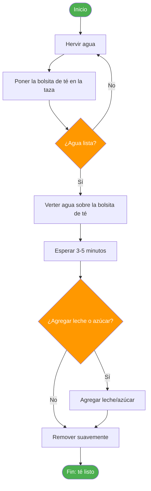
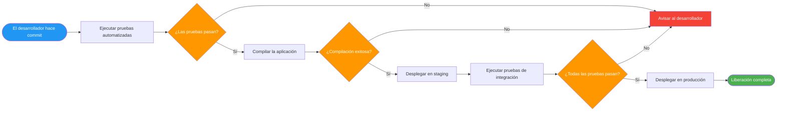
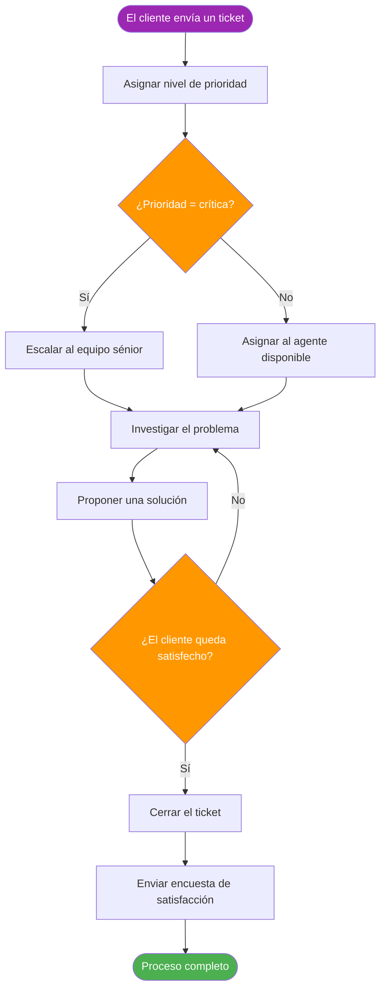

# ¿Qué son los procesos?

Los procesos están en todas partes. Desde el momento en que te despiertas hasta el momento en que te vas a dormir, interactúas con procesos: tanto de forma consciente como de forma inconsciente. Entender qué son los procesos y cómo funcionan es una habilidad fundamental para cualquier persona que trabaje en tecnología, negocios o en cualquier campo que requiera pensamiento sistemático.

## Definiendo un proceso

Un **proceso** es una serie de acciones o pasos realizados en un orden específico para alcanzar un fin determinado. Transforma entradas en salidas a través de una secuencia definida de operaciones.

> [!NOTE] Definición clave
> Un proceso es una **serie sistemática y repetible de acciones** diseñada para producir un resultado consistente. La palabra clave es *repetible*: si algo ocurre una vez por casualidad, no es un proceso.

### Características fundamentales de los procesos

Todo proceso bien definido comparte estas características fundamentales:

| Característica | Descripción | Ejemplo |
|---|---|---|
| **Orden** | Los pasos siguen un orden específico | No puedes hornear un pastel antes de mezclar los ingredientes |
| **Repetibilidad** | Puede ejecutarse varias veces con resultados consistentes | Preparar café todas las mañanas |
| **Entradas** | Requiere recursos para comenzar | Granos de café, agua, electricidad |
| **Salidas** | Produce un resultado o entregable | Una taza de café |
| **Límites** | Tiene un inicio y un fin claros | Desde el pedido hasta la entrega |
| **Propósito** | Diseñado para alcanzar un objetivo específico | Saciar el hambre del cliente |

## Ejemplos de procesos del mundo real

### Ejemplo 1: Preparar una taza de té

Esta actividad cotidiana y simple es en realidad un proceso bien estructurado:



### Ejemplo 2: Pipeline de despliegue de software

En la ingeniería de software, los procesos son esenciales para la confiabilidad:



### Ejemplo 3: Resolución de tickets de soporte al cliente



## Pensamiento de proceso

**El pensamiento de proceso** es una mentalidad que ve el trabajo como una serie de actividades interconectadas en lugar de tareas aisladas. Esta perspectiva es poderosa porque:

- Revela las dependencias entre pasos
- Identifica oportunidades de mejora
- Facilita el diagnóstico de los problemas
- Permite la automatización y la optimización

> [!TIP] Piensa en procesos
> La próxima vez que completes una tarea, haz una pausa y pregúntate:
> 1. ¿Qué fue lo que desencadenó esto?
> 2. ¿Qué pasos seguí?
> 3. ¿Qué decisiones tomé en el camino?
> 4. ¿Cuál fue la salida final?
> 
> ¡Te sorprenderá cuántas veces puedes identificar un proceso!

### La mentalidad de proceso en la ingeniería de software

En la ingeniería de software, el pensamiento de proceso se aplica a todo:

| Área | Ejemplo de proceso |
|---|---|
| **Desarrollo** | Solicitud de función → Diseño → Código → Revisión → Prueba → Despliegue |
| **Operaciones** | Alerta → Investigar → Diagnosticar → Corregir → Verificar → Documentar |
| **Seguridad** | Informe de vulnerabilidad → Evaluar → Priorizar → Parchear → Verificar |
| **Datos** | Ingesta de datos → Validación → Transformación → Almacenamiento → Análisis |

## Por qué importan los procesos

### Consistencia y calidad

Los procesos garantizan que el trabajo se haga de la misma manera cada vez, reduciendo errores y variabilidad.

```
Sin proceso:              Con proceso:
┌──────────────┐          ┌──────────────┐
│  Persona A   │ ────►    │  Paso 1      │
│  lo hace     │          │  Paso 2      │ ──► Resultados
│  a su manera │          │  Paso 3      │     consistentes
└──────────────┘          │  Paso 4      │
┌──────────────┐          └──────────────┘
│  Persona B   │
│  lo hace     │ ──► Diferentes
│  a su manera │     resultados
└──────────────┘
```

### Escalabilidad

Los procesos permiten que el trabajo escale más allá de la capacidad individual. Cuando un proceso está documentado, cualquier persona puede ejecutarlo.

### Mejora continua

No puedes mejorar lo que no puedes describir. Los procesos hacen posible la mejora porque proporcionan una línea base con la que medir.

> [!WARNING] Trampa común
> No confundas los **procesos** con la **burocracia**. Un buen proceso reduce la fricción; la burocracia la crea. Si un paso del proceso no aporta valor, no debería existir.

## Tipos de procesos

Los procesos se pueden clasificar de varias maneras:

### Por previsibilidad

| Tipo | Descripción | Ejemplo |
|---|---|---|
| **Determinista** | Las mismas entradas siempre producen las mismas salidas | Cálculos matemáticos |
| **Probabilista** | Los resultados tienen cierta variabilidad | Interacciones con atención al cliente |

### Por estructura

| Tipo | Descripción | Ejemplo |
|---|---|---|
| **Lineal** | Pasos secuenciales sin ramificaciones | Línea de montaje |
| **Condicional** | Los pasos dependen de las decisiones que se toman | Aprobación de un préstamo |
| **Iterativo** | Los pasos se repiten hasta que se cumple una condición | Depuración de software |
| **Paralelo** | Varios pasos ocurren simultáneamente | Etapas de un pipeline CI/CD |

### Por alcance

| Tipo | Descripción | Ejemplo |
|---|---|---|
| **Macro** | De alto nivel, organizacional | Ciclo de vida del desarrollo de un producto |
| **Micro** | Detallado, a nivel de tarea | Lista de verificación de revisión de código |

## Ejercicios prácticos

### Ejercicio 1: Identifica el proceso

Piensa en tu rutina de la mañana. Anota cada paso en orden e identifica:
- ¿Qué desencadena el proceso?
- ¿Cuáles son las entradas?
- ¿Cuáles son las salidas?
- ¿Dónde están los puntos de decisión?

### Ejercicio 2: Analiza un proceso

Considera el proceso de pedir comida por una aplicación de reparto. Dibuja un diagrama de flujo simple que muestre:
1. Los pasos principales, desde abrir la aplicación hasta recibir la comida
2. Al menos dos puntos de decisión
3. Los puntos de inicio y de fin

### Ejercicio 3: Proceso vs. no proceso

Determina cuáles de los siguientes son procesos y explica por qué:

1. Cepillarte los dientes cada mañana
2. Ganar la lotería
3. Responder a un correo electrónico de un cliente
4. Un generador de números aleatorios que produce 7
5. Desplegar una actualización de software

<details>
<summary>Haz clic para ver las respuestas</summary>

1. **Proceso**: Pasos repetibles y ordenados con un objetivo claro
2. **No es un proceso**: No es repetible ni controlable
3. **Proceso**: Enfoque sistemático para atender solicitudes
4. **No es un proceso**; Sin transformación ni objetivo, solo una salida aleatoria
5. **Proceso**: Pasos definidos para alcanzar un resultado específico

</details>

## Conclusiones Clave (Key Takeaways)

- Un proceso es una **serie repetible de pasos** que transforma entradas en salidas
- Los procesos tienen **límites claros**, **secuencias definidas** y **propósitos específicos**
- El **pensamiento de proceso** te ayuda a ver el trabajo como actividades interconectadas en lugar de tareas aisladas
- Entender los procesos es el primer paso para **optimizarlos** y **automatizarlos**
- En la próxima lección, profundizaremos en los **componentes** que conforman cualquier proceso

> [!SUCCESS] Has completado la lección 1
> Ahora entiendes qué son los procesos y puedes identificarlos en la vida cotidiana. En la próxima lección, exploraremos los bloques de construcción que hacen que los procesos funcionen: **entradas, salidas, transformaciones, puntos de decisión y actores**.
