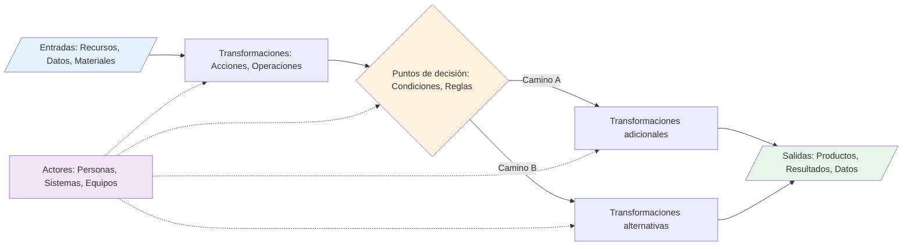
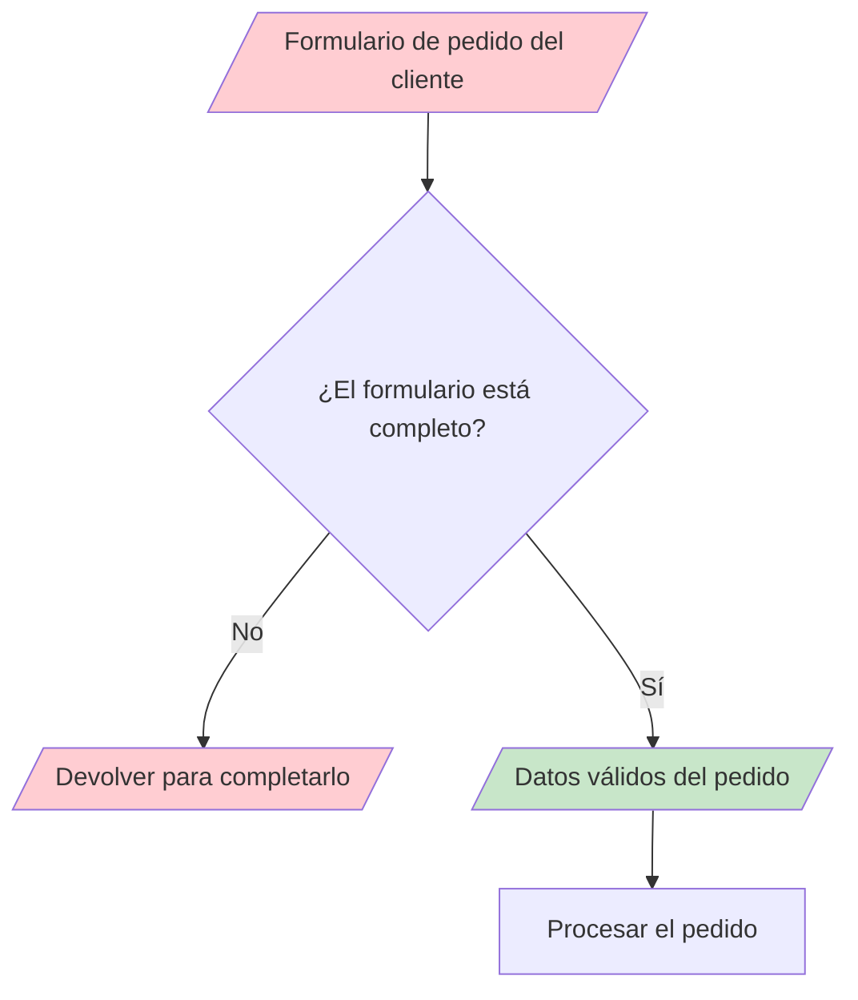
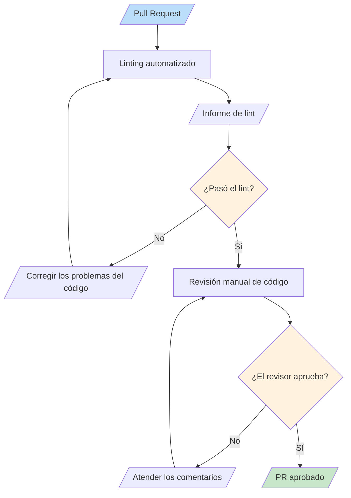
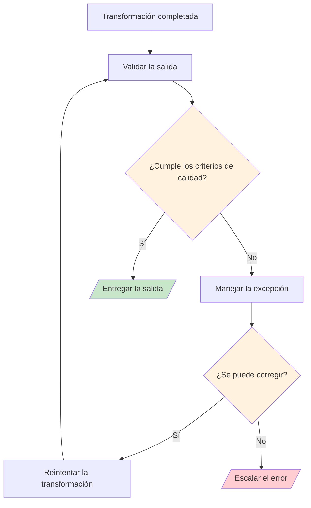
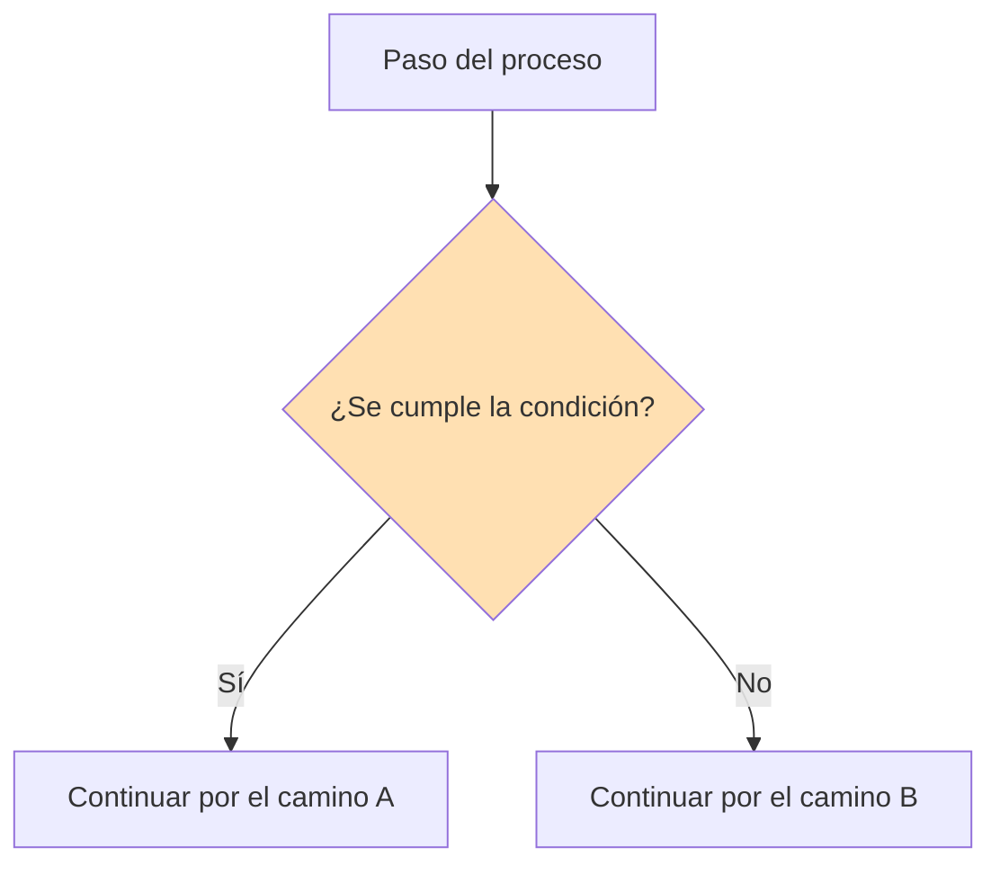
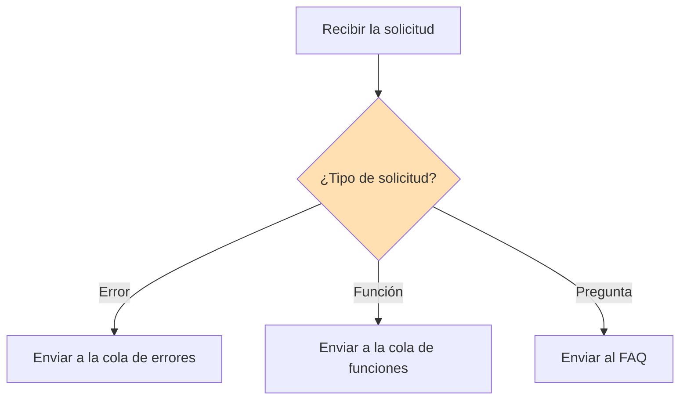
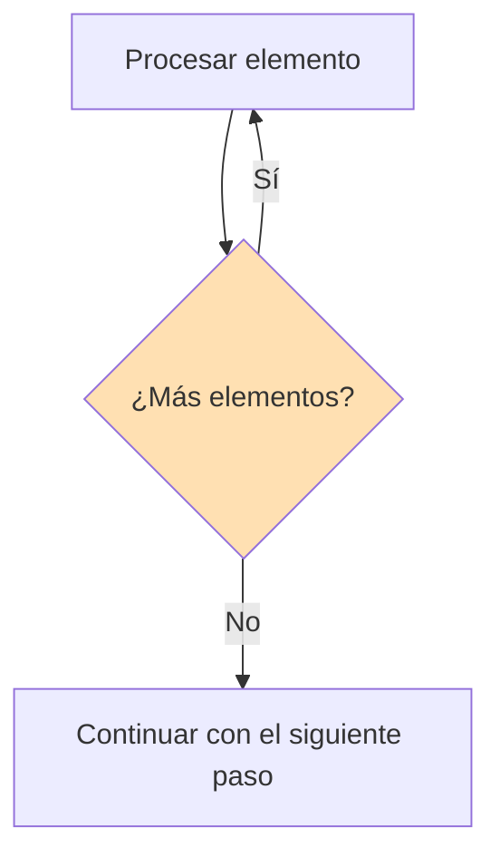
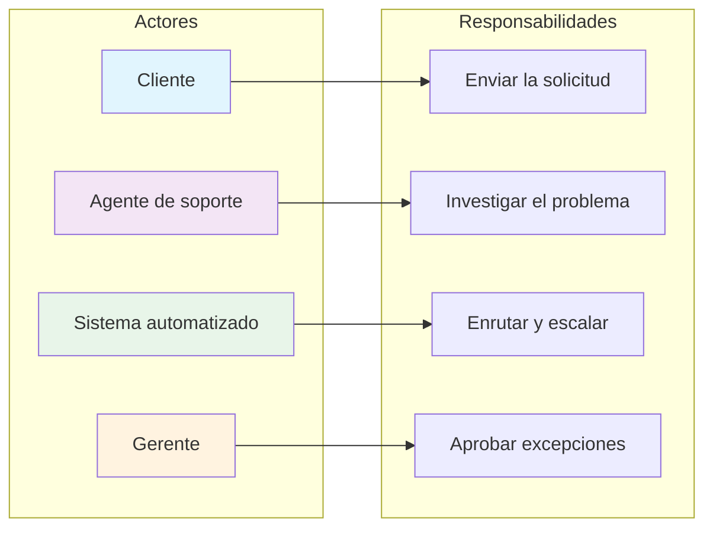
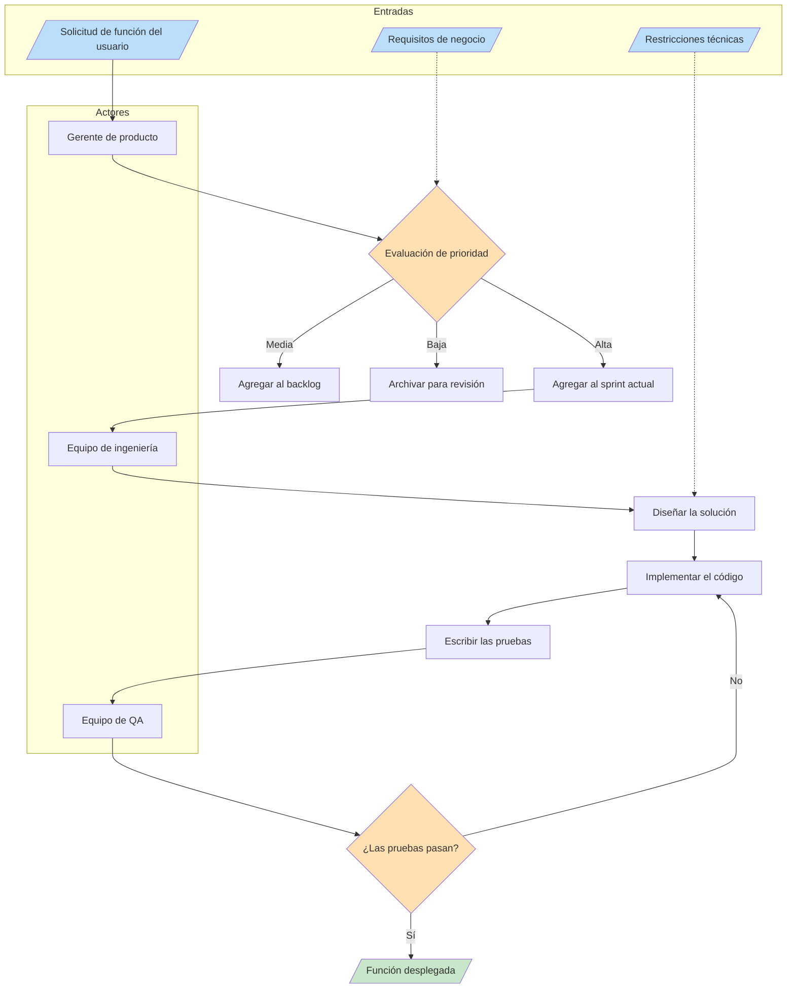

# Componentes del proceso

Todo proceso, por simple o complejo que sea, se construye a partir de un conjunto de componentes fundamentales. Entender estos componentes es esencial para analizar, documentar y mejorar procesos. En esta lección, desglosaremos cada componente y veremos cómo trabajan juntos.

## Los cinco componentes fundamentales

Todos los procesos consisten en cinco elementos fundamentales:

1. **Entradas**: Recursos que entran en el proceso
2. **Transformaciones**: Acciones que modifican las entradas
3. **Salidas**: Resultados que salen del proceso
4. **Puntos de decisión**: Lugares donde el proceso se ramifica
5. **Actores**: Entidades que realizan las acciones



## 1. Entradas

Las entradas son todo lo que un proceso necesita para iniciar y funcionar. Pueden ser tangibles o intangibles.

### Tipos de entradas

| Tipo | Descripción | Ejemplos |
|---|---|---|
| **Material** | Recursos físicos | Materia prima, documentación, hardware |
| **Información** | Datos o conocimiento | Solicitud del cliente, especificaciones, requisitos |
| **Energía** | Fuerza para impulsar el proceso | Electricidad, esfuerzo humano, recursos de cómputo |
| **Tiempo** | Duración asignada | Plazos, SLAs, ventanas programadas |

### La calidad de las entradas importa

> [!WARNING] Basura entra, basura sale
> La calidad de tus salidas está directamente limitada por la calidad de tus entradas. Un proceso no puede producir resultados de alta calidad a partir de entradas de baja calidad.



### Ejemplo real: las entradas de una cocina de restaurante

```
Entradas para un pedido de pizza:
├── Material: masa, salsa, queso, ingredientes extra
├── Información: pedido del cliente (tamaño, tipo, extras)
├── Energía: calor del horno, trabajo del chef
└── Tiempo: ventana de preparación de 15-20 minutos
```

## 2. Transformaciones

Las transformaciones son las acciones que convierten las entradas en salidas. Son el "trabajo" del proceso.

### Tipos de transformaciones

| Tipo | Descripción | Ejemplo |
|---|---|---|
| **Física** | Cambiar forma o estado | Cortar, ensamblar, cocinar |
| **Informacional** | Cambiar datos o conocimiento | Calcular, traducir, analizar |
| **De ubicación** | Cambiar la posición | Enviar, enrutar, transferir |
| **Transaccional** | Cambiar la propiedad o el estado | Aprobar, comprar, registrar |

### Ejemplo de transformación: el proceso de revisión de código



### Mejores prácticas para las transformaciones

> [!TIP] Mantén las transformaciones atómicas
> Cada paso de transformación debe hacer **una sola cosa bien**. Si un paso hace varias cosas, considera dividirlo en pasos más pequeños. Esto hace que los procesos sean más fáciles de entender, probar y mejorar.

## 3. Salidas

Las salidas son los resultados producidos por el proceso. Pueden ser el entregable principal o subproductos secundarios.

### Salidas primarias vs. secundarias

| Tipo | Descripción | Ejemplo (compilación de software) |
|---|---|---|
| **Primaria** | El resultado principal que se busca | Binario de la aplicación compilada |
| **Secundaria** | Resultados útiles adicionales | Registros de compilación, informes de prueba, artefactos |
| **Residuos** | Subproductos no deseados | Archivos temporales, compilaciones fallidas |

### Validación de las salidas

Todo proceso debe validar sus salidas antes de completarse:



## 4. Puntos de decisión

Los puntos de decisión son el lugar donde un proceso evalúa condiciones y elige entre diferentes caminos.

### Patrones de puntos de decisión

#### Patrón 1: decisión binaria



#### Patrón 2: decisión múltiple



#### Patrón 3: decisión en bucle



### Mejores prácticas para los puntos de decisión

| Práctica | Por qué importa |
|---|---|
| **Criterios claros** | Todos deben entender cuándo se toma cada camino |
| **Reglas documentadas** | La lógica de decisión debe ser explícita, no implícita |
| **Caminos de respaldo** | Define siempre qué sucede cuando ninguna condición coincide |
| **Rastro de auditoría** | Registra qué camino se tomó y por qué |

> [!NOTE] Advertencia sobre la complejidad de las decisiones
> Si un punto de decisión tiene más de 4-5 ramificaciones, considera si el proceso puede simplificarse. Las decisiones complejas suelen indicar que un proceso debe dividirse en subprocesos.

## 5. Actores

Los actores son las entidades que realizan el trabajo en un proceso. Pueden ser humanos o automatizados.

### Tipos de actores

| Tipo | Descripción | Ejemplos |
|---|---|---|
| **Humano** | Personas que realizan tareas | Desarrollador, gerente, cliente |
| **Sistema** | Software que realiza tareas | Servidor de CI, base de datos, API |
| **Híbrido** | Una persona que usa un sistema | Analista que usa un panel |
| **Externo** | Fuera de la organización | Pasarela de pago, transportista |

### Matriz de responsabilidades de los actores



### Modelo RACI para los actores de un proceso

El modelo RACI ayuda a aclarar las responsabilidades de los actores:

| Rol | Significado | Ejemplo en una revisión de código |
|---|---|---|
| **R**esponsable | Realiza el trabajo | Desarrollador que escribe el código |
| **A**ccountable | Responde por el resultado | Líder técnico que aprueba los cambios |
| **C**onsultado | Aporta información | Equipo de seguridad que revisa |
| **I**nformado | Se mantiene al tanto | Gerente de proyecto que recibe el aviso |

## Poniéndolo todo junto: ejemplo completo de proceso

Examinemos un proceso completo con los cinco componentes:

### Proceso de solicitud de una función de software



## Ejercicios prácticos

### Ejercicio 1: Identificación de componentes

Para el proceso de "retirar dinero de un cajero automático", identifica:
1. Todas las entradas
2. Todas las transformaciones
3. Todas las salidas
4. Todos los puntos de decisión
5. Todos los actores

### Ejercicio 2: Dibuja un proceso

Dibuja un diagrama de flujo para el proceso de "publicar una entrada de blog" que incluya:
- Al menos 3 entradas
- Al menos 4 transformaciones
- Al menos 2 puntos de decisión
- Al menos 2 actores diferentes
- Salidas claras

### Ejercicio 3: Analiza un proceso roto

Considera este proceso problemático:
```
Queja del cliente → Enviarla al departamento → El departamento la resuelve → Listo
```

Identifica lo que falta:
- ¿Están claramente definidas las entradas?
- ¿Hay puntos de decisión para el enrutamiento?
- ¿Hay validación de la salida?
- ¿Quiénes son los actores?

<details>
<summary>Haz clic para ver el análisis</summary>

**Problemas identificados:**
- Sin validación de la entrada (¿está completa la queja?)
- Sin puntos de decisión (¿y si la recibe el departamento equivocado?)
- Sin validación de la salida (¿quedó satisfecho el cliente?)
- Los actores son vagos ("departamento" no es específico)
- Sin camino de escalación si el departamento no responde
- Sin bucle de retroalimentación para la mejora

</details>

## Conclusiones Clave (Key Takeaways)

- Todo proceso tiene **cinco componentes fundamentales**: entradas, transformaciones, salidas, puntos de decisión y actores
- La **calidad de las entradas** determina directamente la calidad de las salidas
- Las **transformaciones** deben ser atómicas: una cosa por paso
- Los **puntos de decisión** deben tener criterios claros y documentados
- Los **actores** necesitan responsabilidades bien definidas (usa RACI)
- Entender los componentes facilita **analizar** y **mejorar** cualquier proceso

> [!SUCCESS] Has completado la lección 2
> Ahora entiendes los bloques de construcción de todo proceso. En la próxima lección, exploraremos los **diagramas de flujo**: el lenguaje visual que se usa para documentar y comunicar procesos.
