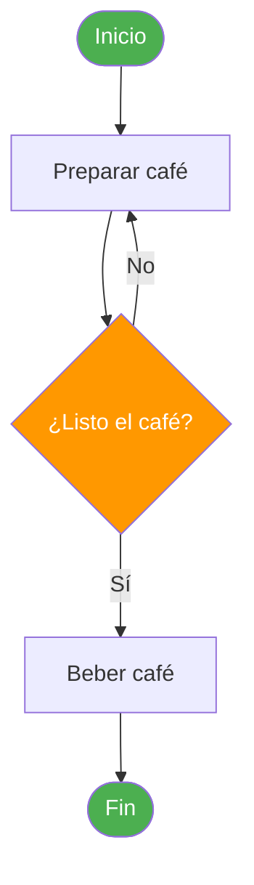
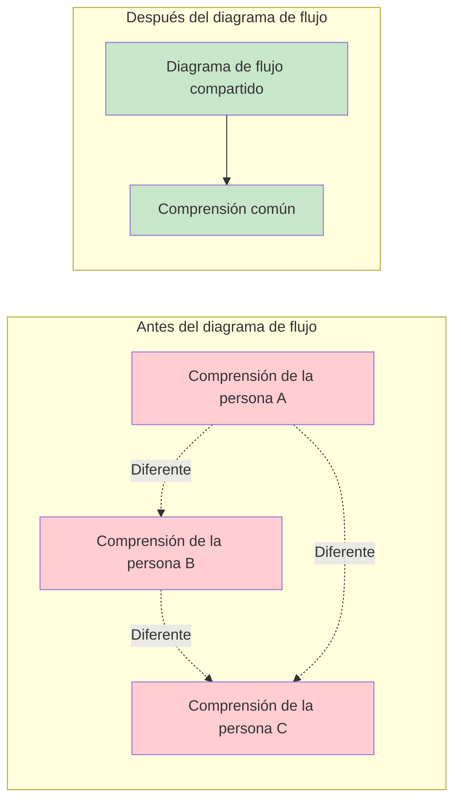
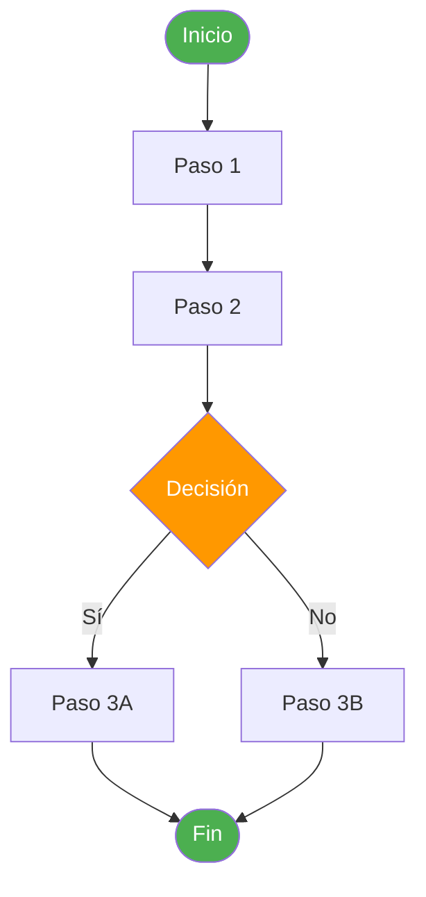
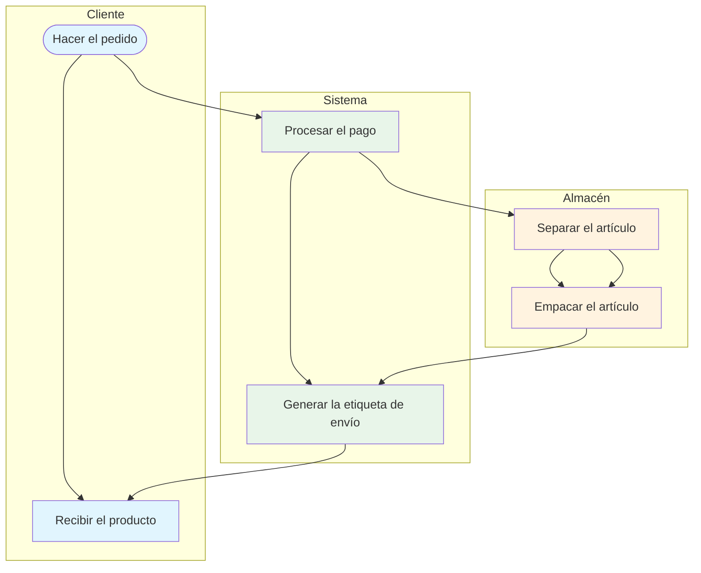
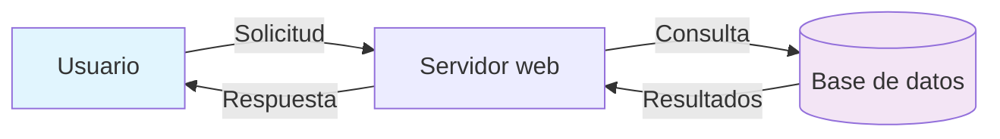
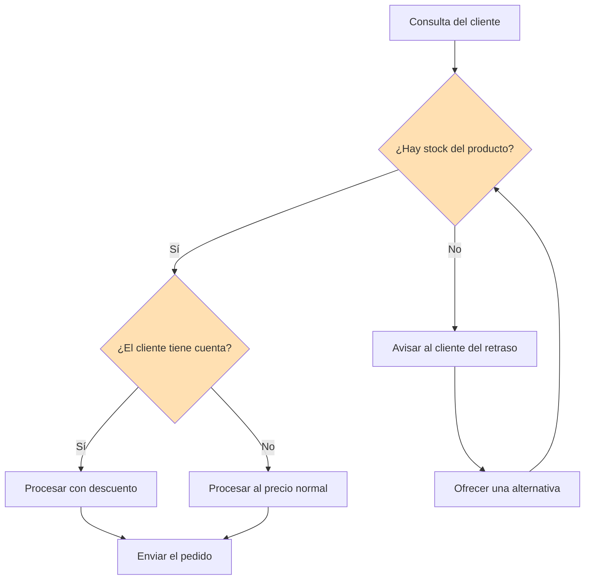
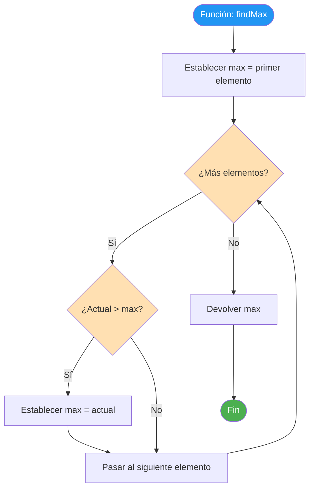
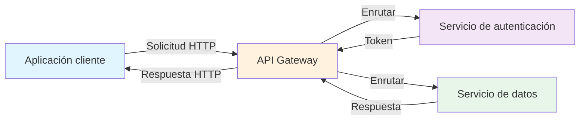

# Introducción a los diagramas de flujo

Los diagramas de flujo son una de las herramientas más potentes para visualizar procesos. Transforman secuencias abstractas de pasos en diagramas visuales y claros que cualquiera puede entender. En esta lección, exploraremos qué son los diagramas de flujo, por qué son importantes y cuándo usarlos.

## ¿Qué es un diagrama de flujo?

Un **diagrama de flujo** es un diagrama que representa un proceso o un flujo de trabajo mediante símbolos estandarizados conectados por flechas, para mostrar la secuencia de pasos y los puntos de decisión.

> [!NOTE] Definición simple
> Un diagrama de flujo es una **imagen de un proceso**. Así como una fotografía captura un momento, un diagrama de flujo captura cómo fluye el trabajo desde el inicio hasta el final.

### Un ejemplo mínimo de diagrama de flujo



## Una breve historia de los diagramas de flujo

### Orígenes (década de 1920)

Los diagramas de flujo fueron introducidos por primera vez por **Frank y Lillian Gilbreth** en 1921. Presentaron un diagrama llamado "Flow Process Chart" a la Sociedad Estadounidense de Ingenieros Mecánicos (ASME). Los Gilbreth fueron pioneros en la eficiencia y la optimización del flujo de trabajo.

### Estandarización (décadas de 1940-1960)

- **1947**: La ASME adoptó los símbolos de los Gilbreth como estándar
- **Década de 1960**: Los diagramas de flujo se usaron ampliamente en la programación de computadoras
- **1970**: La ISO estableció estándares internacionales para los símbolos de los diagramas de flujo

### Era moderna

Hoy, los diagramas de flujo se usan en prácticamente todas las industrias:

| Industria | Caso de uso |
|---|---|
| **Software** | Diseño de algoritmos, arquitectura de sistemas, depuración |
| **Manufactura** | Líneas de montaje, control de calidad, cadena de suministro |
| **Salud** | Triaje de pacientes, protocolos de tratamiento, respuesta a emergencias |
| **Negocios** | Incorporación de personal, aprobaciones, recorridos del cliente |
| **Educación** | Rutas de aprendizaje, árboles de decisión, guías de estudio |

## Por qué importan los diagramas de flujo

### 1. Comunicación visual

Un diagrama de flujo puede comunicar un proceso complejo en segundos: algo que podría exigir páginas de texto para describirse.

```
Descripción en texto:               Diagrama de flujo:
"Para procesar un pedido,           ([Inicio]) --> [Recibir pedido]
 primero recibes el pedido,         --> [Validar] --> {¿Válido?}
 lo validas y, si no es válido,     -->|Sí| [Procesar el pago]
 lo rechazas; si es válido,         -->|No| [Rechazar]
 procesas el pago y luego           --> [Enviar] --> ([Fin])
 lo envías..."
```

> [!TIP] La ventaja de la imagen
> Las investigaciones muestran que las personas recuerdan el **65% de la información visual** después de 3 días, frente a solo el **10% de la información basada en texto**. Los diagramas de flujo aprovechan esta ventaja visual.

### 2. Análisis de procesos

Los diagramas de flujo facilitan detectar:
- **Redundancias**: Pasos que se repiten de forma innecesaria
- **Cuellos de botella**: Puntos donde el trabajo se acumula
- **Pasos faltantes**: Huecos en el proceso
- **Complejidad innecesaria**: Caminos excesivamente complicados

### 3. Alineación del equipo

Cuando todos pueden ver el mismo diagrama de proceso, disminuyen los malentendidos y mejora la colaboración.



### 4. Documentación

Los diagramas de flujo sirven como documentación viva que puede actualizarse a medida que evolucionan los procesos.

## Cuándo usar los diagramas de flujo

### Escenarios ideales

| Escenario | Por qué ayuda el diagrama de flujo |
|---|---|
| **Incorporar a nuevos miembros del equipo** | Muestra de un vistazo cómo se hace el trabajo |
| **Depurar un proceso roto** | Facilita localizar dónde salen mal las cosas |
| **Diseñar un sistema nuevo** | Ayuda a planificar el flujo antes de la implementación |
| **Mejorar un proceso existente** | Visualiza el estado actual vs. el estado futuro |
| **Explicar a los interesados** | Las personas no técnicas pueden entender el flujo |
| **Cumplimiento y auditoría** | Proporciona documentación clara de los procedimientos |

### Cuándo NO usar los diagramas de flujo

| Situación | Alternativa mejor |
|---|---|
| Sistemas extremadamente complejos (100+ pasos) | Diagramas de arquitectura de sistemas |
| Relaciones entre datos | Diagramas entidad-relación (ERD) |
| Procesos basados en líneas de tiempo | Diagramas de Gantt o líneas de tiempo |
| Estructuras jerárquicas | Organigramas |
| Cambios de estado | Diagramas de máquina de estados |

> [!WARNING] No lo compliques en exceso
> Si tu diagrama de flujo tiene más de 30-40 nodos, considera dividirlo en varios subdiagramas. Un diagrama de flujo demasiado complejo derrota el propósito de simplificar.

## Tipos de diagramas de flujo

Diferentes situaciones exigen diferentes tipos de diagramas de flujo:

### 1. Diagrama de flujo básico

Muestra los pasos de un proceso en secuencia.



### 2. Diagrama de flujo por carriles (swimlane)

Muestra quién es responsable de cada paso, organizado por rol o departamento.



### 3. Diagrama de flujo de datos

Se centra en cómo se mueven los datos a través de un sistema.



### 4. Diagrama de decisiones

Se centra en la lógica de decisión y en los resultados.



## Diagramas de flujo en la ingeniería de software

Los diagramas de flujo son particularmente valiosos en el desarrollo de software:

### Diseño de algoritmos

Antes de escribir código, representa la lógica en un diagrama de flujo:



### Depuración

Representa en un diagrama el flujo esperado y luego compáralo con el comportamiento real para encontrar discrepancias.

### Diseño de sistemas

Muestra cómo interactúan los distintos componentes:



## Ejercicios prácticos

### Ejercicio 1: de texto a diagrama de flujo

Convierte esta descripción en texto en un diagrama de flujo:

> "Cuando un usuario inicia sesión, el sistema verifica sus credenciales. Si son válidas, verifica su rol. Los administradores van al panel de administración y los usuarios normales a la página de inicio. Si las credenciales no son válidas, el sistema muestra un error y permite 2 intentos más. Después de 3 intentos fallidos, la cuenta queda bloqueada."

### Ejercicio 2: Identifica el tipo de diagrama de flujo

Para cada escenario, determina qué tipo de diagrama de flujo sería el más apropiado:

1. Mostrar cómo un pedido de un cliente pasa por los departamentos de ventas, almacén y envío
2. Documentar los pasos para restablecer una contraseña olvidada
3. Mapear cómo fluyen los datos de usuario entre una aplicación móvil, una API y una base de datos
4. Mostrar la lógica de decisión de un sistema de aprobación de préstamos

<details>
<summary>Haz clic para ver las respuestas</summary>

1. **Diagrama de flujo por carriles (swimlane)**: Varios departamentos involucrados
2. **Diagrama de flujo básico**: Proceso secuencial simple
3. **Diagrama de flujo de datos**: Se centra en el movimiento de los datos
4. **Diagrama de decisiones**: Lógica de decisión intensiva

</details>

### Ejercicio 3: Detecta el problema

Mira esta descripción de un diagrama de flujo e identifica qué está mal:

```
Inicio → Paso A → Paso B → Paso C → Paso D → Fin
```

El proceso en realidad tiene una decisión en el Paso B que determina si se va al Paso C o si se salta al Paso D. ¿Qué le falta al diagrama de flujo?

<details>
<summary>Haz clic para ver la respuesta</summary>

Al diagrama de flujo le falta un **punto de decisión** (forma de rombo) en el Paso B. La representación correcta debería ser:

```
Inicio → Paso A → Paso B → {¿Condición?} →|Sí| Paso C → Paso D → Fin
                                        →|No| Paso D → Fin
```

</details>

## Conclusiones Clave (Key Takeaways)

- Los diagramas de flujo son **representaciones visuales de procesos** que usan símbolos estandarizados
- Fueron inventados en **1921** por Frank y Lillian Gilbreth
- Los diagramas de flujo mejoran la **comunicación**, el **análisis**, la **alineación** y la **documentación**
- Usa diagramas de flujo para la **incorporación**, la **depuración**, el **diseño** y la **mejora** de procesos
- Elige el **tipo de diagrama de flujo** adecuado para tu situación
- Mantén los diagramas de flujo **simples**: divide los complejos en subdiagramas
- En la próxima lección, aprenderemos los **símbolos estándar** que se usan en los diagramas de flujo

> [!SUCCESS] Has completado la lección 3
> Ahora entiendes qué son los diagramas de flujo, por qué son valiosos y cuándo usarlos. En la próxima lección, profundizaremos en los **símbolos y la notación de los diagramas de flujo**: el vocabulario visual que hace que los diagramas de flujo sean universales.
