# Símbolos y Notación de los Diagramas de Flujo

Los diagramas de flujo usan un conjunto estandarizado de símbolos que los hace universalmente comprensibles, sin importar el idioma o la industria. En esta lección aprenderemos cada símbolo, su significado, y veremos ejemplos prácticos de cómo usarlos.

## El conjunto esencial de símbolos

Aunque existen decenas de símbolos de diagramas de flujo, solo necesitas dominar un conjunto básico para crear diagramas de flujo eficaces en la mayoría de las situaciones.

### Símbolos terminales (Inicio/Fin)

Los símbolos terminales marcan el inicio y el fin de un proceso.

| Símbolo | Forma | Uso |
|---|---|---|
| `([Inicio])` | Rectángulo redondeado / Pílula | Marca el inicio de un proceso |
| `([Fin])` | Rectángulo redondeado / Pílula | Marca el fin de un proceso |


> [!NOTE] Mejor práctica
> Cada diagrama de flujo debe tener **exactamente un símbolo de Inicio**. Puede tener **uno o más símbolos de Fin** (para distintas rutas de salida).

### Símbolos de proceso (Acción/Operación)

Los símbolos de proceso representan una acción, una operación o un paso del flujo de trabajo.

| Símbolo | Forma | Uso |
|---|---|---|
| `[Acción]` | Rectángulo | Un solo paso u operación |

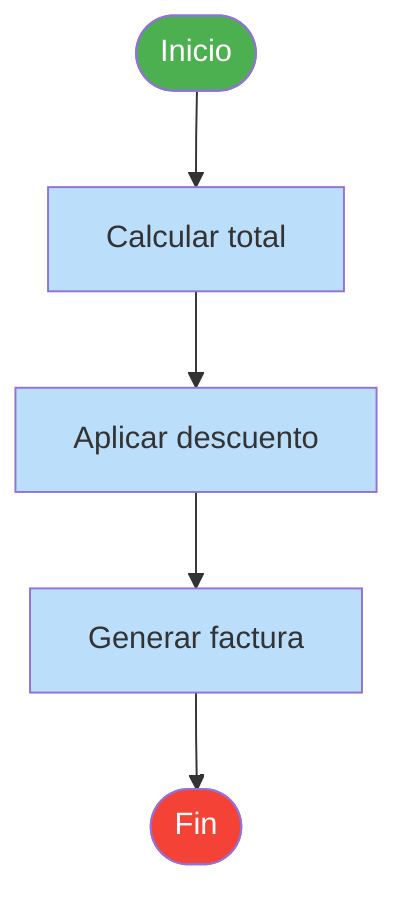

### Símbolos de decisión

Los símbolos de decisión representan un punto donde el proceso se bifurca en función de una condición.

| Símbolo | Forma | Uso |
|---|---|---|
| `{¿Condición?}` | Rombo | Una decisión sí/no o de múltiples vías |

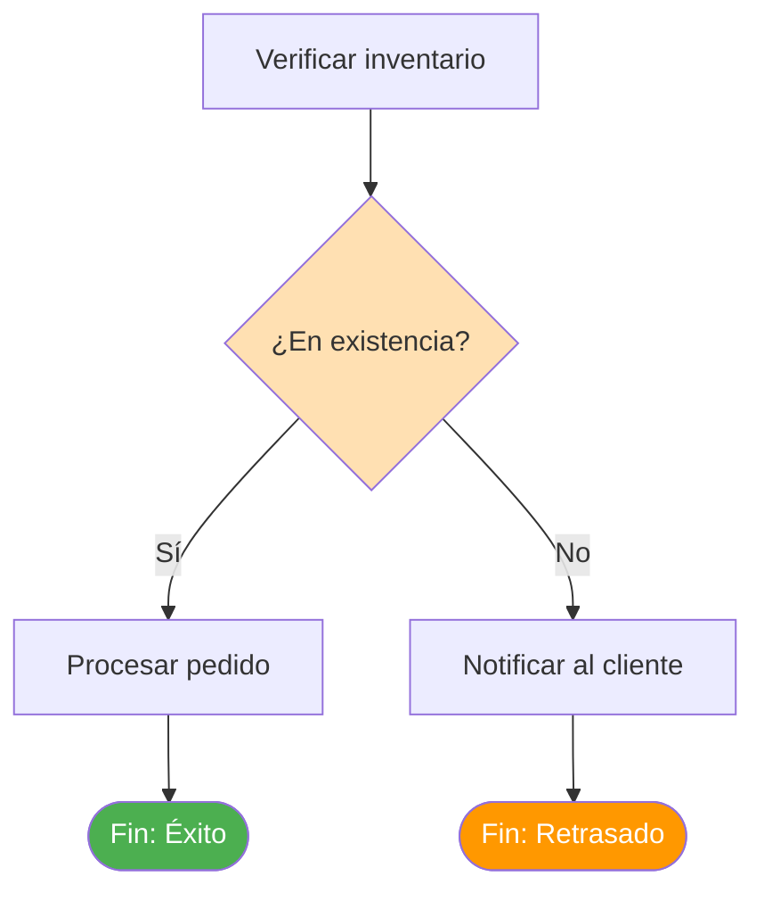

> [!TIP] Etiqueta tus bifurcaciones
> Etiqueta siempre las flechas que salen de los símbolos de decisión. Usa etiquetas claras como "Sí/No", "Aprobado/Rechazado" o valores específicos.

### Símbolos de entrada/salida

Los símbolos de entrada/salida representan datos que entran o salen del proceso.

| Símbolo | Forma | Uso |
|---|---|---|
| `[/Entrada/]` | Paralelogramo | Entrada de datos en el proceso |
| `[/Salida/]` | Paralelogramo | Salida de datos del proceso |

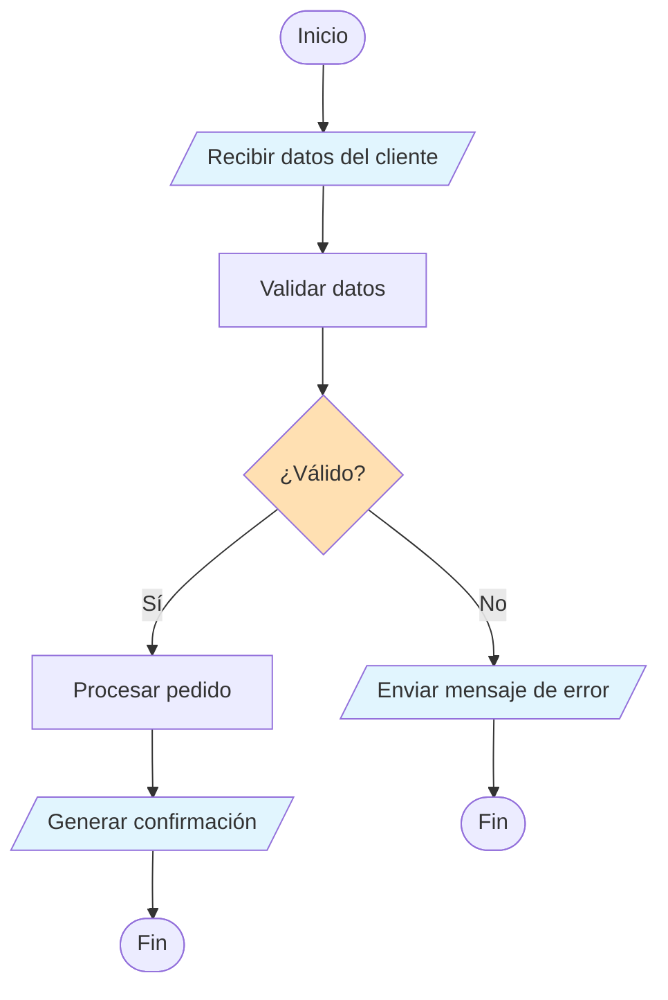

### Símbolos de documento

Los símbolos de documento representan documentos o informes generados por el proceso.

| Símbolo | Forma | Uso |
|---|---|---|
| `[[Documento]]` | Rectángulo con base ondulada | Un documento o informe |

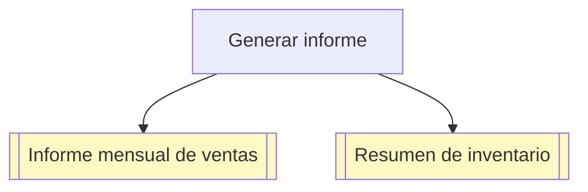

### Símbolos de base de datos

Los símbolos de base de datos representan el almacenamiento o la recuperación de datos.

| Símbolo | Forma | Uso |
|---|---|---|
| `[[(Base de datos)]]` | Cilindro | Base de datos o almacenamiento de datos |

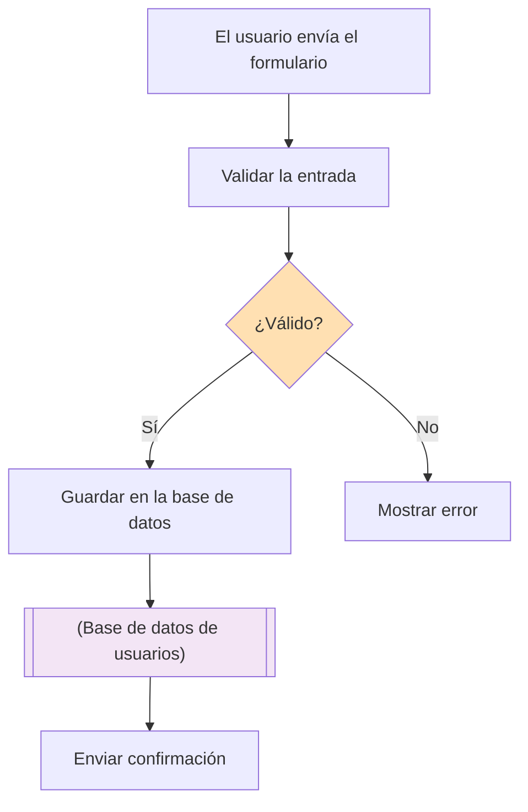

## Símbolos conectores

Los conectores muestran la dirección del flujo y enlazan las distintas partes del diagrama de flujo.

### Líneas de flujo (Flechas)

Las flechas muestran la dirección del flujo del proceso.

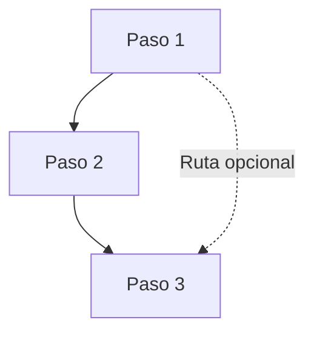

### Conectores fuera de página

Cuando un diagrama de flujo abarca varias páginas, los conectores fuera de página las enlazan.

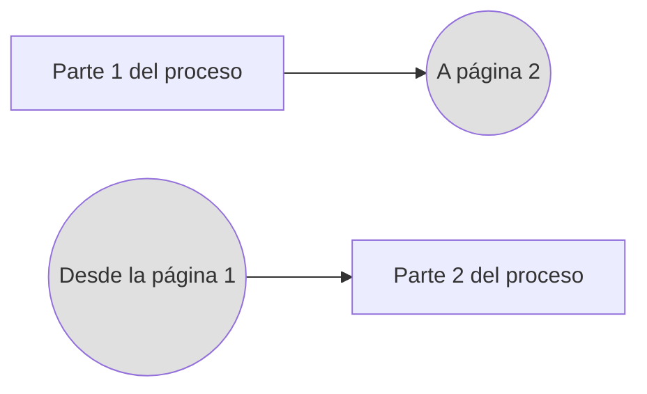

### Conectores dentro de página

Para diagramas de flujo complejos, los conectores dentro de página evitan las líneas cruzadas.

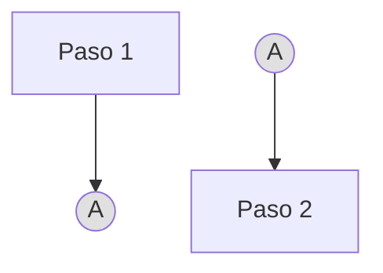

## Tabla de referencia completa de símbolos

| Símbolo | Sintaxis Mermaid | Forma | Nombre | Cuándo usarlo |
|---|---|---|---|---|
| `([Texto])` | `([Texto])` | Redondeado | Terminal | Inicio o fin del proceso |
| `[Texto]` | `[Texto]` | Rectángulo | Proceso | Acción u operación |
| `{Texto}` | `{Texto}` | Rombo | Decisión | Punto de bifurcación |
| `[/Texto/]` | `[/Texto/]` | Paralelogramo | E/S | Entrada o salida de datos |
| `[[Texto]]` | `[[Texto]]` | Rect. ondulado | Documento | Informe o documento |
| `[[(Texto)]]` | `[[(Texto)]]` | Cilindro | Base de datos | Almacenamiento de datos |
| `((Texto))` | `((Texto))` | Círculo | Conector | Enlace a otro punto |
| `==Texto==` | `==Texto==` | Línea doble | Proceso predefinido | Llamada a un subproceso |

## Ejemplos prácticos

### Ejemplo 1: Flujo de registro de usuarios

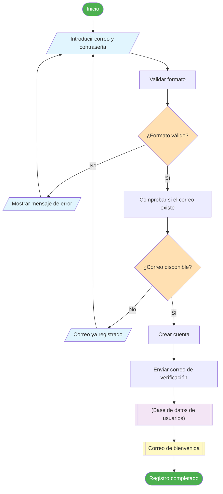

### Ejemplo 2: Clasificación de informes de bugs

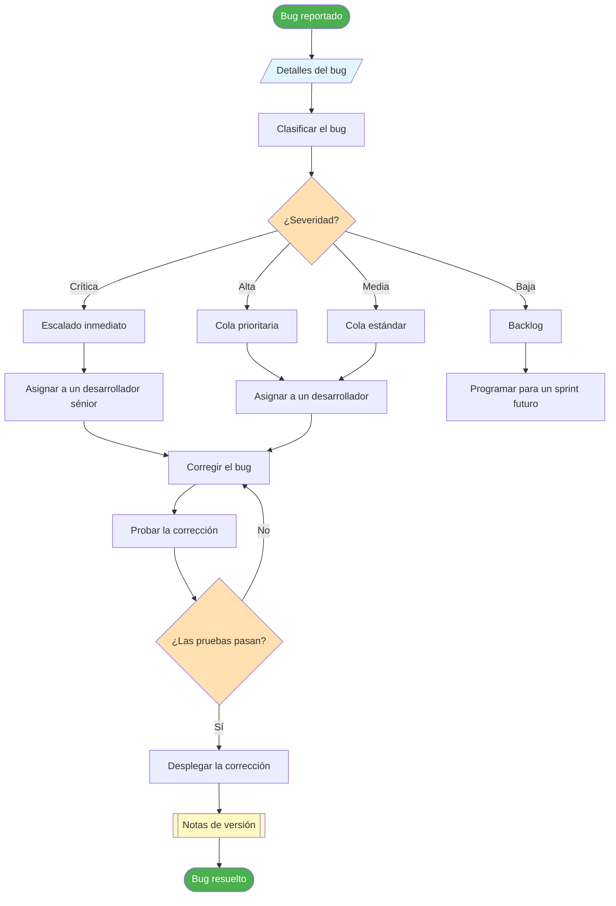

### Ejemplo 3: Finalizar compra en comercio electrónico

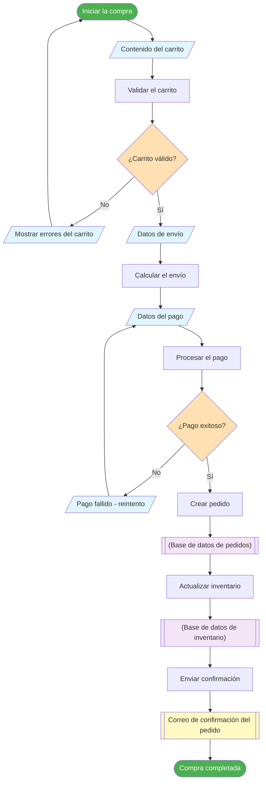

## Directrices de uso de símbolos

### Qué hacer y qué no hacer

| Hacer | No hacer |
|---|---|
| Usa formas de símbolo consistentes | Mezclar formas para el mismo propósito |
| Etiqueta las bifurcaciones de decisión con claridad | Dejar las bifurcaciones sin etiqueta |
| Mantén el texto conciso dentro de los símbolos | Escribir párrafos dentro de los símbolos |
| Usa símbolos estándar | Inventar símbolos personalizados sin leyenda |
| Fluye de arriba hacia abajo o de izquierda a derecha | Crear direcciones de flujo confusas |
| Usa el color con intención | Usar colores aleatorios sin significado |

> [!WARNING] Error común
> No uses un rectángulo para las decisiones solo porque es más fácil de escribir. La forma de rombo es universalmente reconocida como punto de decisión: usar la forma equivocada confunde a los lectores.

### Convenciones de codificación por colores

Aunque no están estandarizadas, estas convenciones de color se usan ampliamente:

| Color | Significado típico |
|---|---|
| Verde | Inicio, éxito, resultado positivo |
| Rojo | Fin, error, fallo, detención |
| Naranja/Amarillo | Puntos de decisión, advertencias |
| Azul | Pasos de proceso, acciones |
| Morado | Almacenamiento de datos, bases de datos |
| Amarillo | Documentos, informes |

## Ejercicios prácticos

### Ejercicio 1: Identificación de símbolos

Para cada descripción, identifica la forma correcta del símbolo:

1. El punto donde se comprueba el estado de suscripción de un usuario
2. El paso donde se genera un informe
3. El inicio del proceso de preparación de pedidos
4. Datos que se leen desde un archivo de configuración
5. Guardar un registro en la base de datos
6. Una referencia a un subproceso definido en otro lugar

<details>
<summary>Haz clic para ver las respuestas</summary>

1. **Rombo** `{}`: Punto de decisión
2. **Rectángulo ondulado** `[[]]`: Documento
3. **Rectángulo redondeado** `([ ])`: Terminal (Inicio)
4. **Paralelogramo** `[/ /]`: Entrada
5. **Cilindro** `[[( )]]`: Base de datos
6. **Círculo** `(( ))`: Conector (o rectángulo de línea doble para un proceso predefinido)

</details>

### Ejercicio 2: Corrige el diagrama de flujo

Este diagrama de flujo tiene errores de símbolos. Identifícalos y corrígelos:

```
[Inicio] → [Comprobar el rol del usuario] → [Admin?] → [Mostrar panel de administración] → [Fin]
```

<details>
<summary>Haz clic para ver la versión corregida</summary>

```
([Inicio]) → [Comprobar el rol del usuario] → {Admin?} →|Sí| [Mostrar panel de administración] → ([Fin])
                                                       →|No| [Mostrar panel de usuario] → ([Fin])
```

**Errores corregidos:**
- Inicio debería ser `([Inicio])` (terminal, no proceso)
- "Admin?" debería ser `{Admin?}` (decisión, no proceso)
- Fin debería ser `([Fin])` (terminal, no proceso)
- Faltaba la rama "No" de la decisión
- Las bifurcaciones deben estar etiquetadas

</details>

### Ejercicio 3: Dibuja un diagrama de flujo

Crea un diagrama de flujo para "Hacer una llamada telefónica" usando al menos:
- 2 símbolos terminales
- 4 símbolos de proceso
- 2 símbolos de decisión
- 1 símbolo de entrada/salida
- Flechas de flujo adecuadas con etiquetas

## Conclusiones Clave (Key Takeaways)

- Los diagramas de flujo usan **símbolos estandarizados** que se entienden universalmente
- El **conjunto básico de símbolos** incluye: terminales, procesos, decisiones, E/S, documentos, bases de datos y conectores
- Etiqueta siempre **las bifurcaciones de decisión** con claridad
- Usa **formas consistentes**: no mezcles símbolos para el mismo propósito
- La **codificación por colores** puede mejorar la legibilidad, pero no es obligatoria
- Mantén el texto de los símbolos **conciso**: usa descripciones fuera del diagrama si es necesario
- En la próxima lección aplicaremos estos símbolos para **construir tus primeros diagramas de flujo** paso a paso

> [!SUCCESS] Has completado la Lección 4
> Ya conoces los símbolos estándar de los diagramas de flujo y cómo usarlos. En la próxima lección pondremos ese conocimiento en práctica **construyendo diagramas de flujo desde cero** con ejemplos paso a paso.
