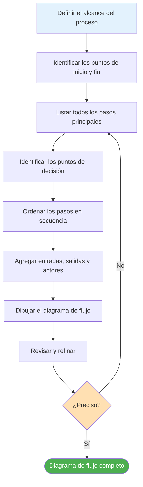
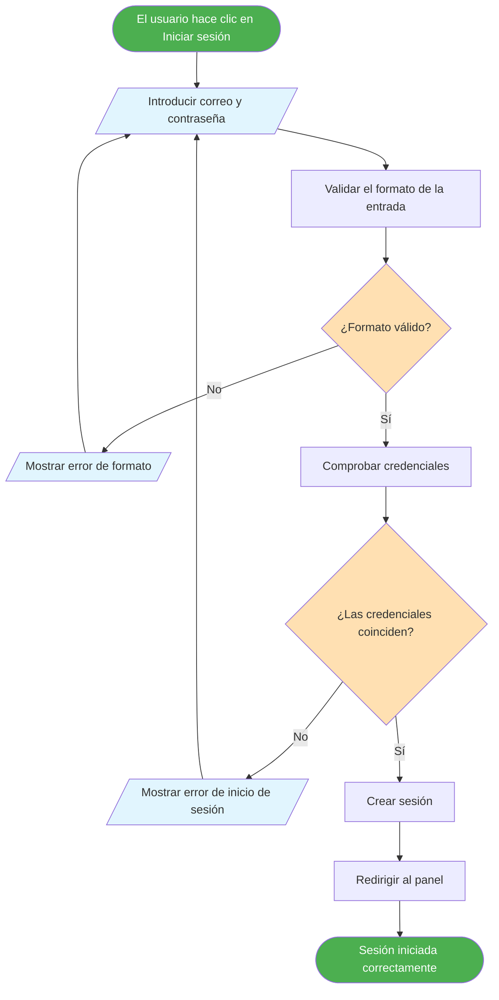
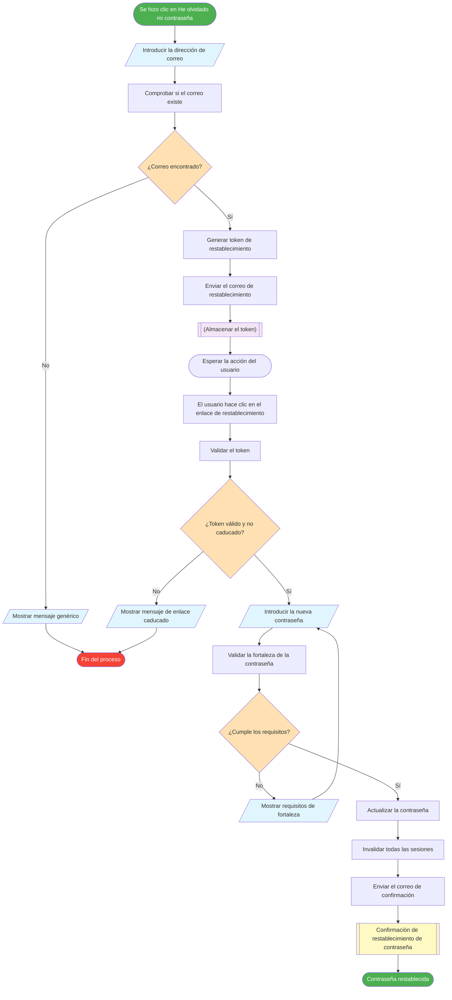
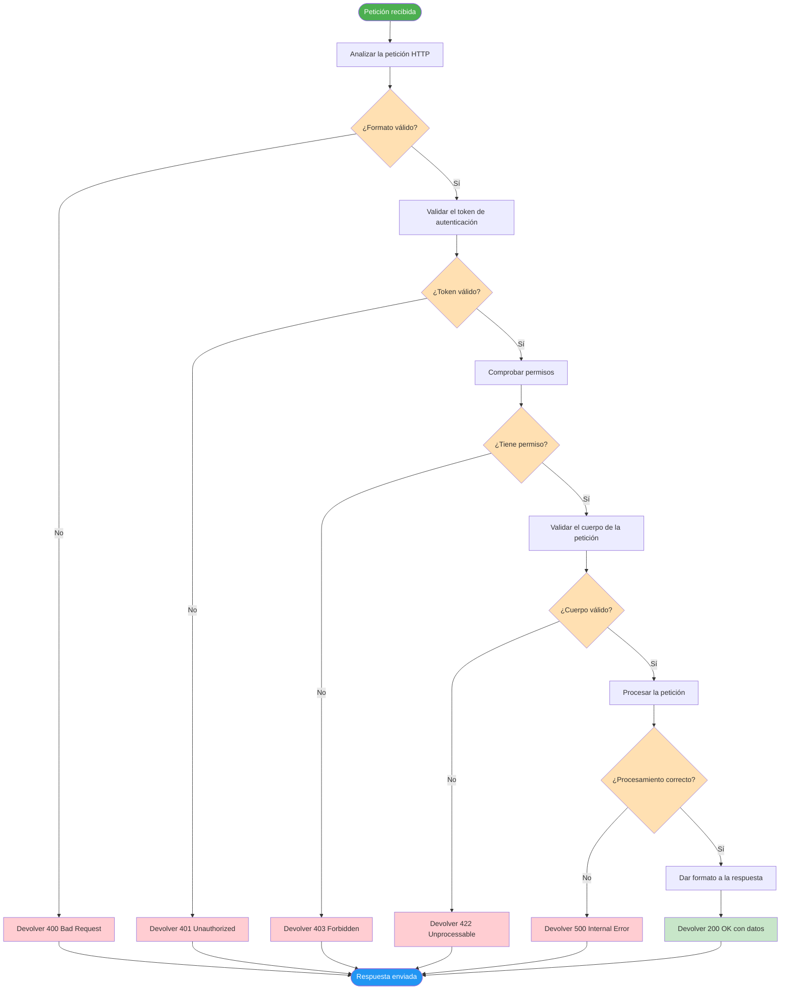
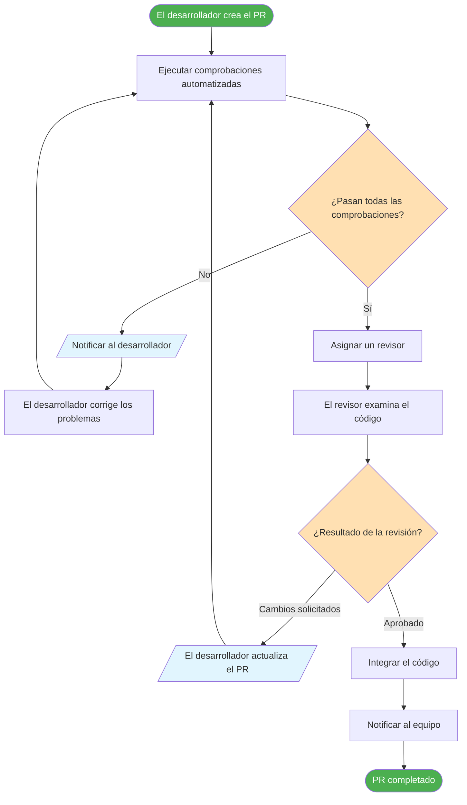
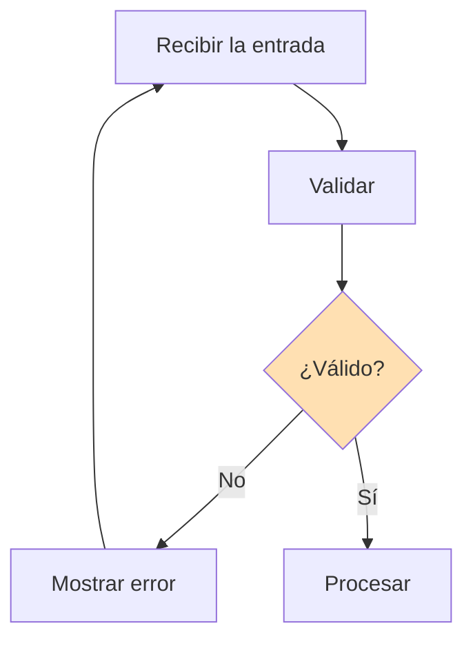
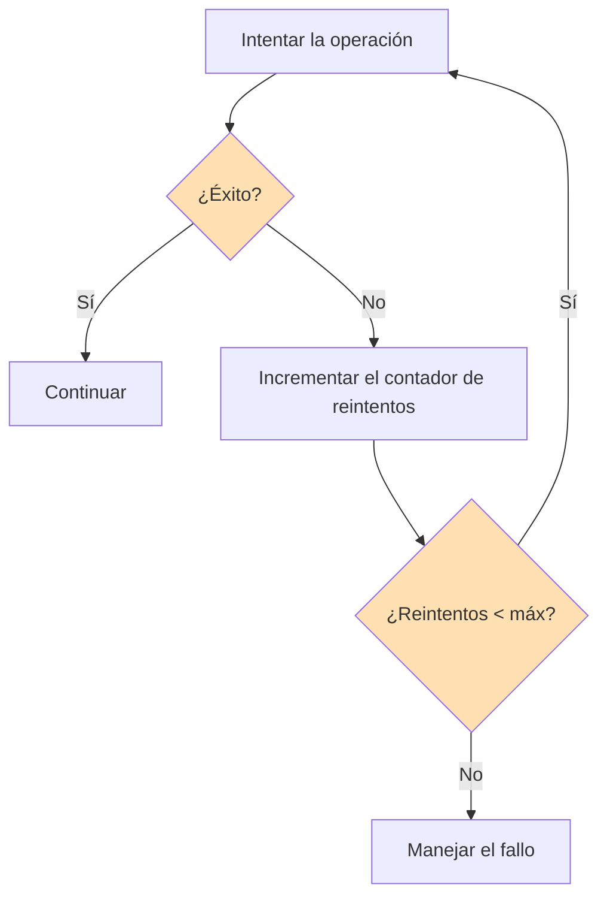
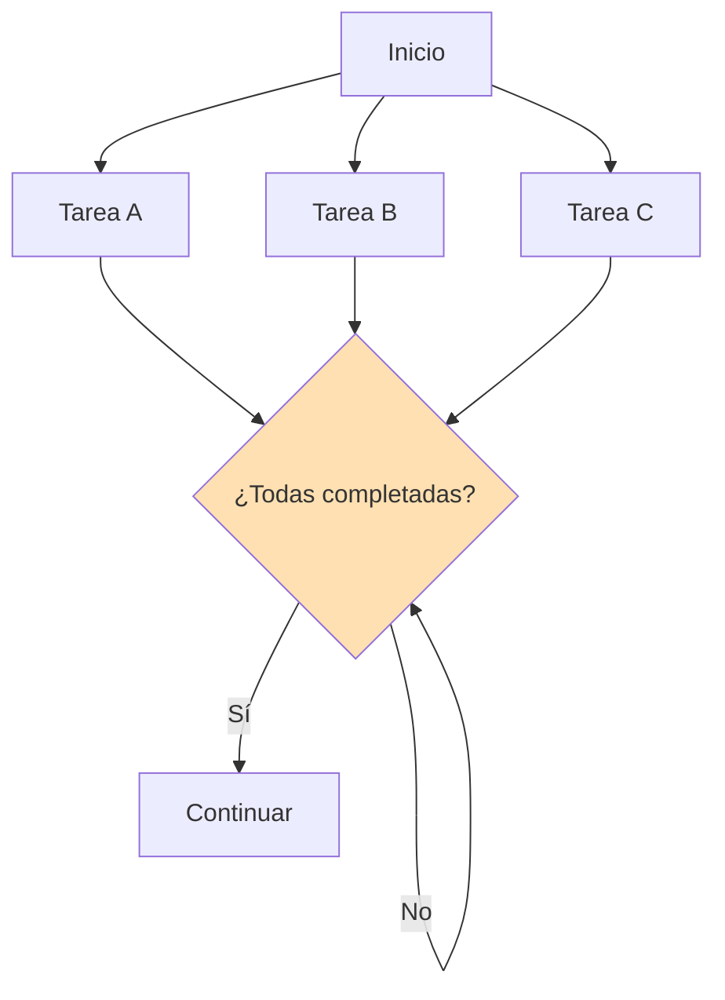
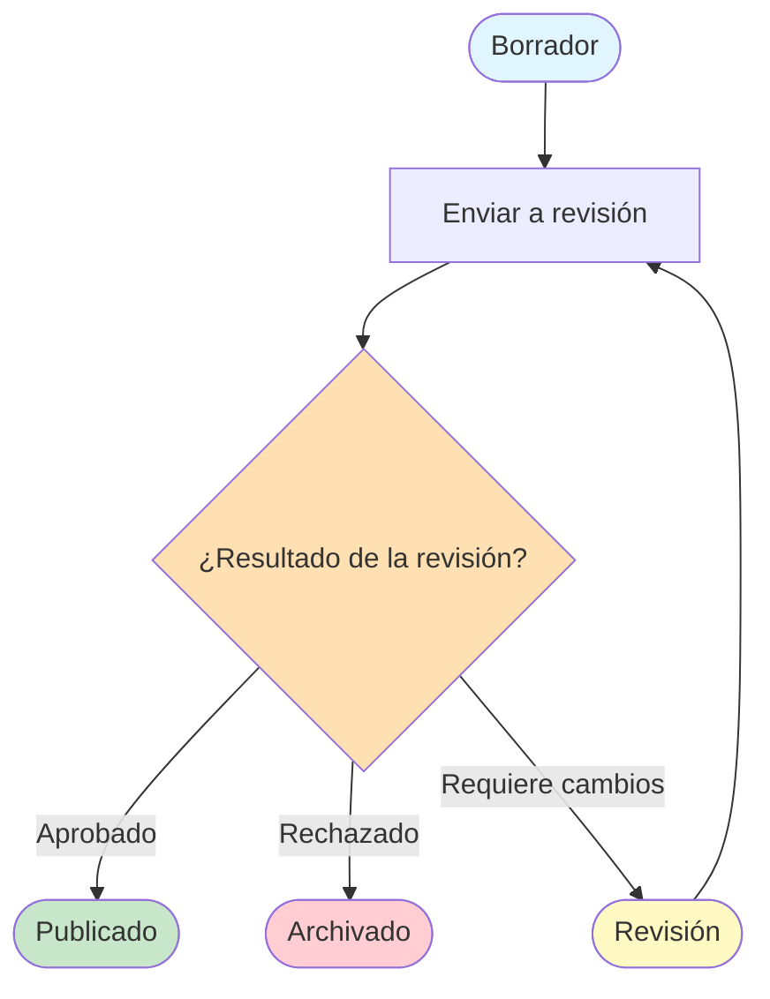

# Construye tus primeros diagramas de flujo

Ahora que entiendes los componentes de los procesos y los símbolos de los diagramas de flujo, es hora de poner ese conocimiento en práctica. En esta lección construiremos diagramas de flujo paso a paso, empezando de forma sencila y aumentando la complejidad de manera gradual.

## El proceso de construcción de diagramas de flujo

Crear un diagrama de flujo sigue un enfoque sistemático:

## Ejemplo paso a paso 1: Proceso de inicio de sesión simple

Construyamos desde cero un diagrama de flujo para un proceso de inicio de sesión de usuarios.

### Paso 1: Define el alcance

**Proceso:** Autenticación de usuarios para una aplicación web
**Inicio:** El usuario introduce sus credenciales
**Fin:** El usuario inicia sesión o recibe un error

### Paso 2: Lista los pasos

1. El usuario introduce el correo y la contraseña
2. El sistema valida el formato de la entrada
3. El sistema comprueba las credenciales en la base de datos
4. Si son válidas, crear una sesión
5. Si no son válidas, mostrar un mensaje de error
6. Redirigir a la página adecuada

### Paso 3: Identifica las decisiones

- ¿El formato de la entrada es válido?
- ¿Las credenciales coinciden?

### Paso 4: Construye el diagrama de flujo

> [!TIP] Construye de forma incremental
> Empieza por el "camino feliz" (todo sale bien) y luego agrega el manejo de errores y los casos extremos. Así tu diagrama de flujo se mantiene organizado.

## Ejemplo paso a paso 2: Flujo de restablecimiento de contraseñas

Construyamos un diagrama de flujo un poco más complejo.

### Paso 1: Define el alcance

**Proceso:** Restablecimiento de contraseñas para una aplicación web
**Inicio:** El usuario hace clic en "He olvidado mi contraseña"
**Fin:** La contraseña se restablece o se abandona el proceso

### Paso 2: Lista los pasos

1. El usuario hace clic en "He olvidado mi contraseña"
2. El usuario introduce su dirección de correo
3. El sistema valida que el correo exista
4. El sistema genera un token de restablecimiento
5. El sistema envía el correo de restablecimiento
6. El usuario hace clic en el enlace de restablecimiento
7. El sistema valida el token
8. El usuario introduce la nueva contraseña
9. El sistema valida la fortaleza de la contraseña
10. El sistema actualiza la contraseña
11. El usuario inicia sesión con la nueva contraseña

### Paso 3: Identifica las decisiones

- ¿Existe el correo en el sistema?
- ¿El token de restablecimiento es válido y no ha caducado?
- ¿La nueva contraseña cumple los requisitos de fortaleza?

### Paso 4: Construye el diagrama de flujo

> [!NOTE] Nota de seguridad
> Observa que cuando el correo no se encuentra, mostramos un "mensaje genérico" en lugar de "correo no encontrado". Esta es una buena práctica de seguridad: no reveles si un correo existe en tu sistema.

## Ejemplo paso a paso 3: Procesamiento de peticiones a una API

Ahora construyamos un diagrama de flujo técnico para el procesamiento de peticiones a una API.

### Paso 1: Define el alcance

**Proceso:** Manejo de una petición API entrante
**Inicio:** El servidor recibe la petición
**Fin:** Se envía la respuesta al cliente

### Paso 2: Lista los pasos

1. Petición recibida
2. Analizar la petición
3. Validar el token de autenticación
4. Comprobar autorización/permisos
5. Validar el cuerpo de la petición
6. Procesar la petición
7. Dar formato a la respuesta
8. Enviar la respuesta

### Paso 3: Identifica las decisiones

- ¿El formato de la petición es válido?
- ¿El token de autenticación es válido?
- ¿Tiene permisos el usuario?
- ¿El cuerpo de la petición es válido?
- ¿El procesamiento se completó correctamente?

### Paso 4: Construye el diagrama de flujo

## Práctica: construye el tuyo

### Ejercicio 1: Proceso de subida de archivos

Construye un diagrama de flujo para una función de subida de archivos con estos requisitos:
- El usuario selecciona un archivo
- El sistema valida el tipo de archivo (solo se permiten imágenes)
- El sistema valida el tamaño del archivo (máximo 5MB)
- El sistema lo sube al almacenamiento en la nube
- El sistema genera una miniatura
- El sistema guarda los metadatos en la base de datos
- El usuario recibe un mensaje de éxito o de error

### Ejercicio 2: Proceso de carrito de compras

Construye un diagrama de flujo para añadir un artículo al carrito de compras:
- El usuario navega por el catálogo de productos
- El usuario selecciona un producto
- El sistema comprueba la disponibilidad del producto
- El usuario selecciona la cantidad
- El sistema comprueba si la cantidad está disponible
- El sistema lo añade al carrito
- El sistema actualiza el total del carrito
- El usuario puede seguir comprando o pasar a la compra

### Ejercicio 3: Proceso de revisión de código

Construye un diagrama de flujo para un flujo de trabajo de revisión de código:
- El desarrollador crea un pull request
- Se ejecutan comprobaciones automatizadas (linting, pruebas)
- Si las comprobaciones fallan, el desarrollador corrige los problemas
- Si las comprobaciones pasan, se asigna un revisor
- El revisor examina el código
- El revisor aprueba o solicita cambios
- Si se solicitan cambios, el desarrollador actualiza el PR
- Si se aprueba, el código se integra (merge)
- Se envía una notificación al equipo

Haz clic para ver un diagrama de flujo de ejemplo de revisión de código

## Patrones comunes de diagramas de flujo

### Patrón 1: Bucle de validación

### Patrón 2: Reintentos con límite

### Patrón 3: Procesamiento paralelo

### Patrón 4: Máquina de estados

## Herramientas para construir diagramas de flujo

| Herramienta | Tipo | Mejor para |
|---|---|---|
| **Mermaid** | Basado en código | Documentación, control de versiones |
| **Draw.io** | Editor visual | Diagramas rápidos, colaboración |
| **Lucidchart** | Editor visual | Colaboración en equipo, plantillas |
| **PlantUML** | Basado en código | Diagramas técnicos |
| **Excalidraw** | Pizarra digital | Lluvia de ideas, diagramas informales |

> [!TIP] Empieza con Mermaid
> Como Mermaid está basado en código, tus diagramas de flujo pueden versionarse, revisarse en pull requests y renderizarse automáticamente en archivos Markdown. Esto lo hace ideal para la documentación.

## Conclusiones Clave (Key Takeaways)

- Sigue un **enfoque sistemático**: define el alcance → lista los pasos → identifica las decisiones → dibuja → revisa
- Construye primero el **camino feliz** y luego agrega el manejo de errores
- Usa **patrones comunes** como bucles de validación, lógica de reintentos y procesamiento paralelo
- **Revisa tu diagrama de flujo** respecto al proceso real para garantizar la precisión
- **Mermaid** es una excelente herramienta para crear diagramas de flujo con control de versiones
- La práctica hace al maestro: cuanto más diagramas de flujo construyas, mejor te irá

> [!SUCCESS] Has completado la Lección 5
> Ya sabes construir diagramas de flujo desde cero. En la lección final de este curso exploraremos la **optimización de procesos**: cómo usar los diagramas de flujo para identificar cuellos de botella y mejorar los procesos.
