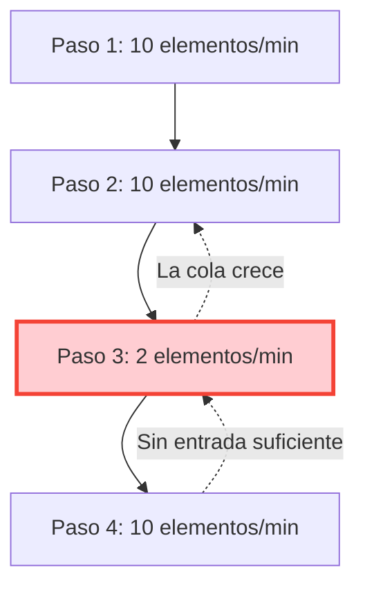
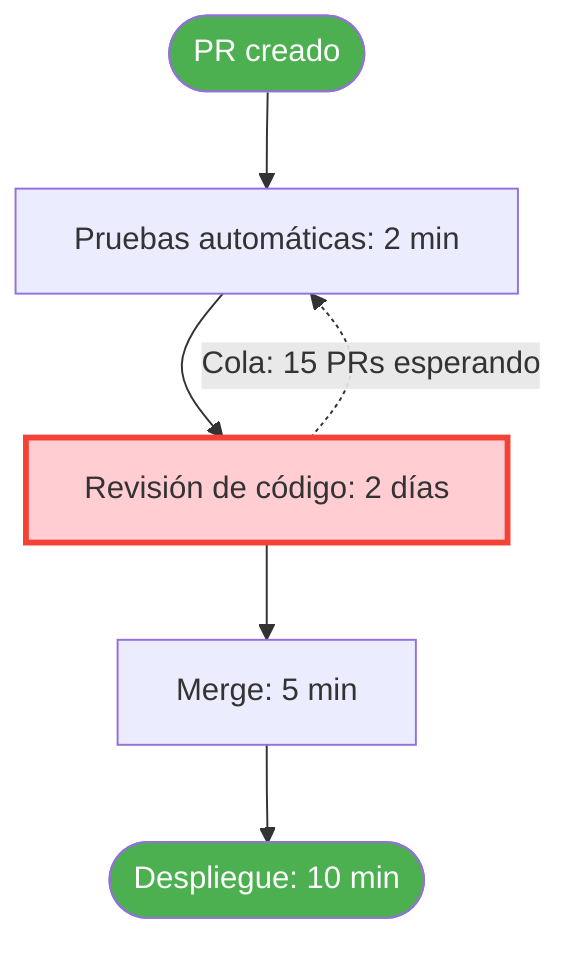
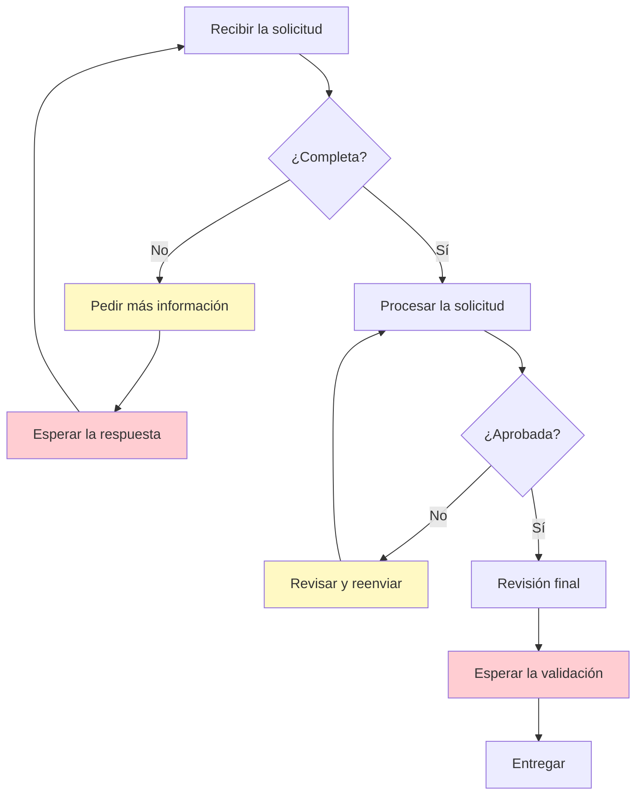
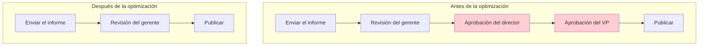
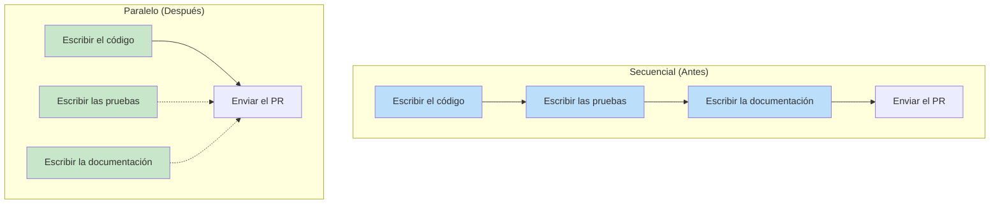
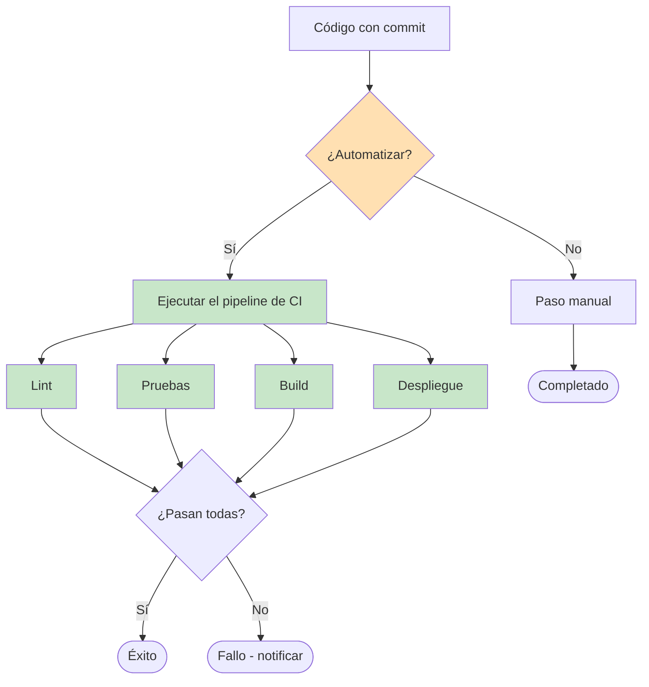
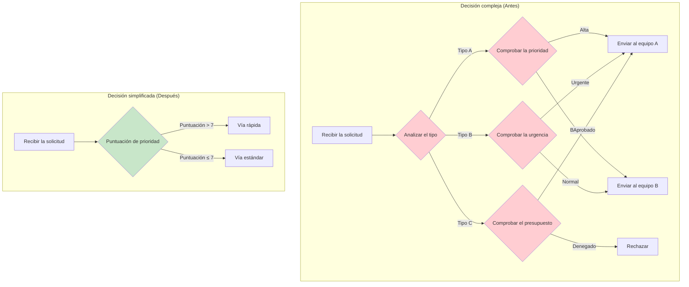
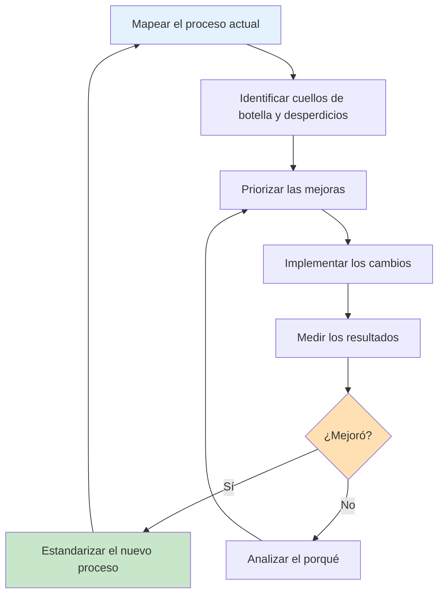
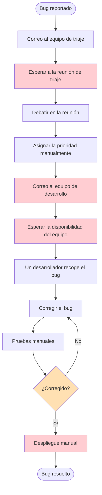
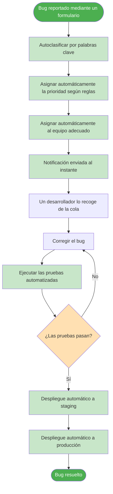

# Optimización de procesos

Los diagramas de flujo no sirven solo para documentar procesos — son herramientas potentes para mejorarlos. En esta lección final aprenderemos a usar los diagramas de flujo para identificar cuellos de botella, eliminar desperdicios y optimizar procesos para lograr mayor eficiencia y calidad.

## ¿Por qué optimizar los procesos?

La optimización de procesos aporta beneficios tangibles:

| Beneficio | Impacto | Ejemplo |
|---|---|---|
| **Velocidad** | Entrega más rápida | Reducir el procesamiento de pedidos de 2 días a 2 horas |
| **Calidad** | Menos errores | Reducir la tasa de bugs un 40% con un mejor proceso de revisión |
| **Costo** | Menores gastos | Eliminar pasos de aprobación redundantes |
| **Escalabilidad** | Soportar más volumen | Automatizar pasos manuales para soportar 10 veces la carga |
| **Satisfacción** | Usuarios más contentos | Reducir el tiempo de espera del cliente de 30 min a 5 min |

## Identificación de cuellos de botella

Un **cuello de botella** es un paso de un proceso que limita el throughput global. Es el punto más estrecho por el que todo debe pasar.

### La analogía del cuello de botella

```
┌──────────┐     ┌──────────┐     ┌──────┐     ┌──────────┐
│  Paso 1  │────►│  Paso 2  │────►│ Paso │────►│  Paso 4  │
│  Rápido  │     │  Rápido  │     │  3   │     │  Rápido  │
│  10/s    │     │  10/s    │     │LENTO │     │  10/s    │
└──────────┘     └──────────┘     │ 1/s  │     └──────────┘
                                  └──────┘
                                    ▲
                          ESTE ES EL CUELLO DE BOTELLA
                Throughput global: 1 elemento/segundo
```

### Detección de cuellos de botella en diagramas de flujo

Busca estos indicadores visuales:



> [!TIP] La prueba de la cola
> Donde el trabajo se acumula esperando a ser procesado, has encontrado un cuello de botella. Busca colas, acumulaciones o estados de espera en tu diagrama de flujo.

### Ejemplo real de cuello de botella: revisión de código



**Análisis:** El paso de revisión de código lleva 2 días mientras que los demás pasos llevan minutos. Ese es el cuello de botella.

**Soluciones:**
- Añadir más revisores
- Definir un SLA para el tiempo de respuesta de la revisión
- Implementar revisión automatizada para cambios simples
- Dividir los PR grandes en PR más pequeños

## Tipos de desperdicio en los procesos

La metodología Lean identifica siete tipos de desperdicio (TIMWOOD):

| Tipo de desperdicio | Descripción | Ejemplo en software |
|---|---|---|
| **T**ransporte | Mover elementos innecesariamente | Pasar trabajo entre equipos |
| **I**nventario | Exceso de trabajo en progreso | Demasiados PRs abiertos |
| **M**ovimiento | Movimiento innecesario | Buscar información |
| **W**aiting (espera) | Tiempo inactivo entre pasos | Esperar aprobaciones |
| **O**verprocessing (sobreproceso) | Hacer más de lo necesario | Sobrediseñar las soluciones |
| **O**verproduction (sobreproducción) | Producir más de lo necesario | Crear funciones que nadie usa |
| **D**efectos | Errores que exigen retrabajo | Bugs encontrados en producción |

### Visualización del desperdicio en un diagrama de flujo



**Desperdicios identificados:**
- `C` → Sobreproceso (solicitudes repetidas)
- `D` → Espera (tiempo inactivo)
- `G` → Defectos (retrabajo)
- `I` → Espera (retraso en la aprobación)

## Técnicas de optimización

### 1. Elimina los pasos innecesarios

Cuestiona cada paso: "¿Qué pasa si lo omitimos?"



### 2. Paraleliza los pasos independientes

Los pasos que no dependen entre sí pueden ejecutarse simultáneamente.



### 3. Automatiza los pasos repetitivos

Identifica los pasos que son manuales, repetitivos y se basan en reglas.

| Paso | Tiempo manual | Tiempo automatizado | Ahorro |
|---|---|---|---|
| Formato del código | 5 min | 10 seg | 97% |
| Ejecución de pruebas | 30 min | 5 min | 83% |
| Despliegue | 45 min | 2 min | 96% |
| Análisis de logs | 60 min | 1 min | 98% |



### 4. Simplifica los puntos de decisión

Las decisiones complejas ralentizan los procesos. Simplifícalas:
- Definiendo criterios claros desde el principio
- Usando listas de verificación
- Automatizando las decisiones simples
- Escalando solo los casos verdaderamente complejos



## El ciclo de optimización

La optimización de procesos no es una actividad única — es un ciclo continuo:



## Antes y después: ejemplo real de optimización

### Antes: proceso manual de triaje de bugs



**Problemas:** Múltiples puntos de espera, pasos manuales, comunicación por correo, ninguna automatización.

### Después: proceso automatizado de triaje de bugs



**Mejoras:**
- Se eliminaron 4 puntos de espera
- Se automatizaron 6 pasos manuales
- El tiempo de resolución pasó de días a horas
- Se añadieron pruebas y despliegues automatizados

## Buenas prácticas de optimización de procesos

| Práctica | Descripción |
|---|---|
| **Empieza con datos** | Mide el rendimiento actual antes de optimizar |
| **Concéntrate en los cuellos de botella** | Mejorar pasos que no son cuellos de botella no aumenta el throughput global |
| **Involucra al equipo** | Quienes hacen el trabajo conocen mejor los problemas |
| **Itera** | Haz cambios pequeños, mide y luego ajusta |
| **Documenta los cambios** | Mantén los diagramas de flujo actualizados a medida que evolucionan los procesos |
| **Define métricas** | Define qué significa "mejor" con objetivos medibles |
| **Celebra los logros** | Reconoce las mejoras para mantener el impulso |

> [!WARNING] Trampa de la optimización
> No optimices un proceso que no debería existir. Antes de optimizar, pregúntate: "¿Deberíamos hacer esto en absoluto?" A veces el mejor proceso es ningún proceso.

## Métricas clave para hacer seguimiento

| Métrica | Qué mide | Cómo se calcula |
|---|---|---|
| **Tiempo de ciclo** | Tiempo total desde el inicio hasta el fin | Tiempo final - Tiempo inicial |
| **Throughput** | Elementos procesados por unidad de tiempo | Recuento / Período de tiempo |
| **Tasa de error** | Porcentaje de elementos con defectos | Errores / Total de elementos × 100 |
| **Tiempo de espera** | Tiempo dedicado a esperar entre pasos | Suma de todos los períodos de espera |
| **Tiempo de contacto** | Tiempo realmente dedicado a trabajar | Tiempo total - Tiempo de espera |
| **Eficiencia** | Proporción entre el tiempo de contacto y el tiempo de ciclo | Tiempo de contacto / Tiempo de ciclo × 100 |

## Ejercicios prácticos

### Ejercicio 1: Encuentra el cuello de botella

Analiza este proceso e identifica el cuello de botella:

```
Pedido del cliente → Validar (1 min) → Comprobar inventario (2 min) → 
Aprobación del gerente (4 horas) → Preparar el pedido (5 min) → Enviar (1 día)
```

¿Cuál es el cuello de botella? ¿Qué harías para mejorarlo?

<details>
<summary>Haz clic para ver el análisis</summary>

**Cuello de botella:** Aprobación del gerente (4 horas) — todos los demás pasos llevan minutos.

**Sugerencias de mejora:**
- Definir umbrales de aprobación (exigir la aprobación del gerente solo para pedidos superiores a $X)
- Implementar autoaprobación para los pedidos estándar
- Añadir más aprobadores para distribuir la carga
- Crear listas de productos preaprobados

</details>

### Ejercicio 2: Optimiza un proceso

Toma el "Proceso de subida de archivos" de la Lección 5 e identifica:
1. Cuellos de botella potenciales
2. Tipos de desperdicio (TIMWOOD)
3. Pasos que podrían automatizarse
4. Pasos que podrían paralelizarse

### Ejercicio 3: Mide la mejora

Un proceso tarda actualmente 10 horas con una tasa de error del 30%. Después de optimizarlo, tarda 4 horas con una tasa de error del 10%. Calcula:

1. Porcentaje de mejora del tiempo
2. Porcentaje de mejora de la tasa de error
3. Si este proceso se ejecuta 100 veces por semana, ¿cuántas horas se ahorran por semana?

<details>
<summary>Haz clic para ver los cálculos</summary>

1. **Mejora del tiempo:** (10 - 4) / 10 × 100 = **60% más rápido**
2. **Mejora de la tasa de error:** (30 - 10) / 30 × 100 = **67% menos errores**
3. **Horas ahorradas por semana:** 100 × (10 - 4) = **600 horas ahorradas por semana**

</details>

## Resumen del curso

¡Felicitaciones por completar el curso "Procesos y Diagramas de Flujo"! Esto es lo que has aprendido:

| Lección | Conclusión clave |
|---|---|
| **1. ¿Qué son los procesos?** | Los procesos son secuencias repetibles que transforman entradas en salidas |
| **2. Componentes de los procesos** | Todo proceso tiene entradas, transformaciones, salidas, decisiones y actores |
| **3. Introducción a los diagramas de flujo** | Los diagramas de flujo comunican procesos visualmente usando símbolos estandarizados |
| **4. Símbolos de los diagramas de flujo** | Domina el conjunto básico: terminales, procesos, decisiones, E/S y más |
| **5. Construcción de diagramas de flujo** | Sigue un enfoque sistemático: alcance → pasos → decisiones → dibuja → revisa |
| **6. Optimización de procesos** | Usa los diagramas de flujo para identificar cuellos de botella, eliminar desperdicios y mejorar la eficiencia |

> [!SUCCESS] ¡Curso completado!
> Ya tienes las habilidades fundamentales para documentar, analizar y optimizar cualquier proceso usando diagramas de flujo. Sigue practicando y pronto el pensamiento de procesos se volverá algo natural.

## Próximos pasos

Continúa tu camino de aprendizaje:
- Practica creando diagramas de flujo para los procesos que encuentras a diario
- Explora temas avanzados como BPMN (Business Process Model and Notation)
- Aprende sobre herramientas de automatización de procesos (Zapier, n8n, GitHub Actions)
- Estudia las metodologías Lean y Six Sigma para técnicas de optimización más profundas
