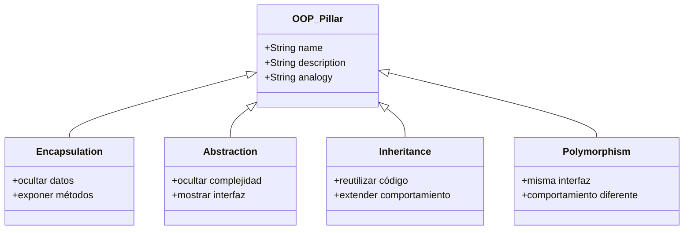
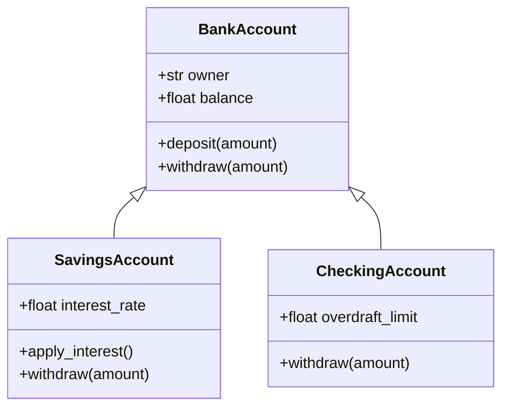
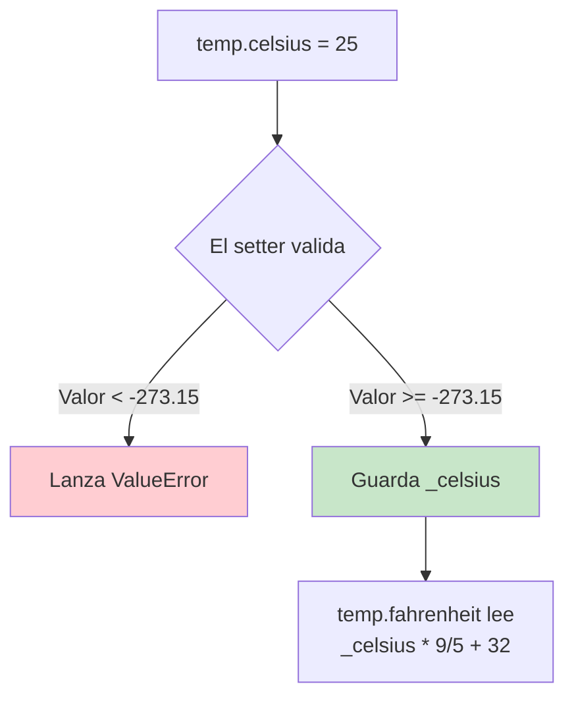
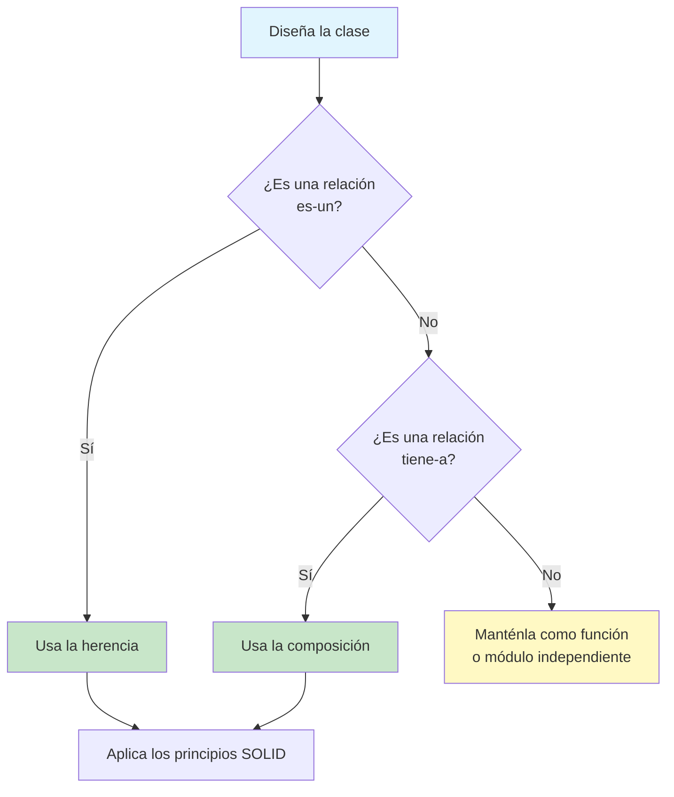

# Repaso de los Fundamentos de POO

Antes de adentrarnos en los principios SOLID, afiancemos tu comprensión de los fundamentos de la Programación Orientada a Objetos. Esta lección repasa los cuatro pilares de la POO y la mecánica de clases propia de Python.

## Los Cuatro Pilares de la POO

La Programación Orientada a Objetos se sustenta en cuatro conceptos centrales:

| Pilar | Descripción | Analogía del mundo real |
|--------|-------------|-------------------|
| **Encapsulamiento** | Agrupa datos y comportamiento; oculta el estado interno | Una expendedora: presionas botones, no tocas su interior |
| **Abstracción** | Expone solo los detalles esenciales | Un mando a distancia: importan los botones, no los circuitos |
| **Herencia** | Reutiliza el comportamiento de una clase padre | Los hijos heredan rasgos de los padres |
| **Polimorfismo** | Objetos de diferentes tipos responden a la misma interfaz | Un gato y un perro responden a `.speak()` |



## 1. Clases y Objetos

Una **clase** es un plano. Un **objeto** es una instancia de ese plano.

```python
class Product:
    def __init__(self, name: str, price: float, quantity: int = 0):
        self.name = name
        self.price = price
        self.quantity = quantity

    def total_value(self) -> float:
        return self.price * self.quantity

    def restock(self, amount: int) -> None:
        if amount <= 0:
            raise ValueError("Restock amount must be positive")
        self.quantity += amount

    def sell(self, amount: int) -> None:
        if amount <= 0:
            raise ValueError("Sell amount must be positive")
        if amount > self.quantity:
            raise ValueError("Insufficient stock")
        self.quantity -= amount

    def __repr__(self) -> str:
        return f"Product({self.name!r}, {self.price!r}, qty={self.quantity!r})"

laptop = Product("Laptop", 1200.00, 10)
laptop.sell(2)
laptop.restock(5)
print(laptop)                # Product('Laptop', 1200.0, qty=13)
print(laptop.total_value())  # 15600.0
```

> [!NOTE]
> `__init__` es el constructor. Se llama automáticamente cuando creas un objeto. El parámetro `self` hace referencia a la instancia actual y debe ser el primer parámetro de cada método de instancia.

## 2. Atributos de Instancia vs. de Clase

```python
class Employee:
    company = "Acme Corp"       # Class attribute — shared by all instances
    pay_periods = 26            # Class attribute

    def __init__(self, name: str, salary: float):
        self.name = name        # Instance attribute — unique per instance
        self.salary = salary

    def paycheck_amount(self) -> float:
        return self.salary / self.pay_periods

alice = Employee("Alice", 78000)
bob = Employee("Bob", 65000)

print(alice.paycheck_amount())  # 3000.0
print(bob.paycheck_amount())    # 2500.0
print(alice.company)            # "Acme Corp"

alice.company = "Startup Inc"   # Shadows the class attribute — Alice only
print(alice.company)            # "Startup Inc"
print(bob.company)              # "Acme Corp" — unchanged
print(Employee.company)         # "Acme Corp" — unchanged
```

> [!WARNING]
> Cuando asignas a un atributo mediante `self` o una instancia, Python crea un atributo de instancia que *sombrea* al atributo de clase. Esto puede provocar errores sutiles si no tienes cuidado.

## 3. Herencia

La herencia crea una relación "es-un" entre clases.

```python
class BankAccount:
    def __init__(self, owner: str, balance: float = 0.0):
        self.owner = owner
        self.balance = balance

    def deposit(self, amount: float) -> None:
        if amount <= 0:
            raise ValueError("Amount must be positive")
        self.balance += amount

    def withdraw(self, amount: float) -> None:
        if amount <= 0:
            raise ValueError("Amount must be positive")
        if amount > self.balance:
            raise ValueError("Insufficient funds")
        self.balance -= amount

    def __repr__(self) -> str:
        return f"{type(self).__name__}({self.owner!r}, {self.balance!r})"

class SavingsAccount(BankAccount):
    interest_rate = 0.04

    def apply_interest(self) -> None:
        interest = self.balance * self.interest_rate
        self.deposit(interest)

    def withdraw(self, amount: float) -> None:
        if amount > self.balance * 0.8:
            raise ValueError("Cannot withdraw more than 80% of balance")
        super().withdraw(amount)

class CheckingAccount(BankAccount):
    overdraft_limit = 500.0

    def withdraw(self, amount: float) -> None:
        if amount <= 0:
            raise ValueError("Amount must be positive")
        if amount > self.balance + self.overdraft_limit:
            raise ValueError("Overdraft limit exceeded")
        self.balance -= amount

sa = SavingsAccount("Alice", 10000)
sa.apply_interest()
print(sa.balance)  # 10400.0

ca = CheckingAccount("Bob", 1000)
ca.withdraw(1200)
print(ca.balance)  # -200.0
```



> [!SUCCESS]
> `super()` delega en la clase padre. Llama siempre a `super().__init__()` en las clases hijas para asegurar que los atributos del padre se inicialicen correctamente.

## 4. Orden de Resolución de Métodos (MRO)

Python usa la linealización C3 para determinar qué método llamar:

```python
class A:
    def identify(self):
        return "A"

class B(A):
    def identify(self):
        return "B"

class C(A):
    def identify(self):
        return "C"

class D(B, C):
    pass

d = D()
print(d.identify())  # "B"
print(D.__mro__)
# (<class 'D'>, <class 'B'>, <class 'C'>, <class 'A'>, <class 'object'>)
```

## 5. Polimorfismo Mediante ABCs

Las clases base abstractas (ABC) imponen un contrato entre diferentes implementaciones:

```python
from abc import ABC, abstractmethod
import math

class Shape(ABC):
    @abstractmethod
    def area(self) -> float:
        pass

    @abstractmethod
    def perimeter(self) -> float:
        pass

    def scale(self, factor: float) -> None:
        raise NotImplementedError

class Rectangle(Shape):
    def __init__(self, width: float, height: float):
        self.width = width
        self.height = height

    def area(self) -> float:
        return self.width * self.height

    def perimeter(self) -> float:
        return 2 * (self.width + self.height)

class Circle(Shape):
    def __init__(self, radius: float):
        self.radius = radius

    def area(self) -> float:
        return math.pi * self.radius ** 2

    def perimeter(self) -> float:
        return 2 * math.pi * self.radius

def print_shape_info(shape: Shape) -> None:
    print(f"{type(shape).__name__}: area={shape.area():.2f}, perimeter={shape.perimeter():.2f}")

shapes: list[Shape] = [Rectangle(5, 3), Circle(4)]
for s in shapes:
    print_shape_info(s)
```

## 6. Encapsulamiento con Propiedades

Usa `@property` para controlar el acceso a los atributos:

```python
class Temperature:
    def __init__(self, celsius: float = 0.0):
        self._celsius = celsius

    @property
    def celsius(self) -> float:
        return self._celsius

    @celsius.setter
    def celsius(self, value: float) -> None:
        if value < -273.15:
            raise ValueError("Temperature below absolute zero")
        self._celsius = value

    @property
    def fahrenheit(self) -> float:
        return self._celsius * 9 / 5 + 32

    @fahrenheit.setter
    def fahrenheit(self, value: float) -> None:
        self.celsius = (value - 32) * 5 / 9

    @property
    def kelvin(self) -> float:
        return self._celsius + 273.15

t = Temperature(25)
print(t.fahrenheit)  # 77.0
t.fahrenheit = 100
print(t.celsius)     # 37.777...
# t.celsius = -300   # Raises ValueError!
```



## 7. Composición Ante la Herencia

Las relaciones "tiene-a" suelen ser más flexibles que las "es-un":

```python
class Engine:
    def __init__(self, horsepower: int):
        self.horsepower = horsepower

    def start(self) -> str:
        return "Engine started"

    def stop(self) -> str:
        return "Engine stopped"

class Transmission:
    def __init__(self, gears: int = 6):
        self.gears = gears
        self.gear = 0

    def shift_up(self) -> str:
        if self.gear < self.gears:
            self.gear += 1
        return f"Shifted to gear {self.gear}"

    def shift_down(self) -> str:
        if self.gear > 0:
            self.gear -= 1
        return f"Shifted to gear {self.gear}"

class Car:
    def __init__(self, make: str, model: str, horsepower: int):
        self.make = make
        self.model = model
        self.engine = Engine(horsepower)
        self.transmission = Transmission()

    def drive(self) -> str:
        parts = [self.engine.start(), self.transmission.shift_up()]
        return " | ".join(parts)

    def park(self) -> str:
        parts = [self.transmission.shift_down(), self.engine.stop()]
        return " | ".join(parts)

car = Car("Honda", "Civic", 158)
print(car.drive())  # Engine started | Shifted to gear 1
```

> [!TIP]
> Prefiere la composición a la herencia. La herencia crea acoplamiento estrecho; la composición te permite intercambiar piezas en tiempo de ejecución.

## 8. Análisis de los Métodos Dunder

Los métodos especiales permiten que los objetos se integren con la sintaxis de Python:

```python
from typing import Any

class Vector:
    def __init__(self, x: float, y: float):
        self.x = x
        self.y = y

    def __repr__(self) -> str:
        return f"Vector({self.x!r}, {self.y!r})"

    def __add__(self, other: "Vector") -> "Vector":
        if not isinstance(other, Vector):
            return NotImplemented
        return Vector(self.x + other.x, self.y + other.y)

    def __sub__(self, other: "Vector") -> "Vector":
        if not isinstance(other, Vector):
            return NotImplemented
        return Vector(self.x - other.x, self.y - other.y)

    def __mul__(self, scalar: float) -> "Vector":
        return Vector(self.x * scalar, self.y * scalar)

    def __abs__(self) -> float:
        import math
        return math.sqrt(self.x ** 2 + self.y ** 2)

    def __eq__(self, other: object) -> bool:
        if not isinstance(other, Vector):
            return NotImplemented
        return self.x == other.x and self.y == other.y

    def __bool__(self) -> bool:
        return self.x != 0 or self.y != 0

v1 = Vector(3, 4)
v2 = Vector(1, 2)
print(v1 + v2)      # Vector(4, 6)
print(v1 * 2)       # Vector(6, 8)
print(abs(v1))      # 5.0
print(v1 == Vector(3, 4))  # True
print(bool(Vector(0, 0)))  # False
```

| Método | Propósito | Disparador |
|--------|---------|---------|
| `__init__` | Constructor | `obj = Class()` |
| `__repr__` | Representación para depuración | `repr(obj)`, REPL |
| `__str__` | Cadena legible para una persona | `print(obj)`, `str(obj)` |
| `__add__` | Suma | `obj + other` |
| `__sub__` | Resta | `obj - other` |
| `__mul__` | Multiplicación | `obj * other` |
| `__eq__` | Igualdad | `obj == other` |
| `__bool__` | Valor de verdad | `if obj:` |
| `__len__` | Longitud | `len(obj)` |
| `__getitem__` | Indexado | `obj[key]` |
| `__call__` | Objeto invocable | `obj()` |

> [!SUCCESS]
> Implementar `__repr__` en cada clase es un hábito que rinde enormemente durante la depuración. La convención es devolver una cadena que permita recrear el objeto.

## 9. Antes y Después: de lo Procedural a la POO

### Antes: Código Procedural (Violación)

```python
# Procedural — scattered state and behavior
def create_account(owner, balance=0.0):
    return {"owner": owner, "balance": balance}

def deposit(account, amount):
    if amount <= 0:
        raise ValueError("Amount must be positive")
    account["balance"] += amount

def withdraw(account, amount):
    if amount <= 0:
        raise ValueError("Amount must be positive")
    if amount > account["balance"]:
        raise ValueError("Insufficient funds")
    account["balance"] -= amount

def transfer(from_acc, to_acc, amount):
    withdraw(from_acc, amount)
    deposit(to_acc, amount)

acc1 = create_account("Alice", 1000)
acc2 = create_account("Bob", 500)
deposit(acc1, 200)
transfer(acc1, acc2, 300)
print(acc1["balance"])  # 900
print(acc2["balance"])  # 800
```

### Después: POO Refactorizado

```python
class Account:
    def __init__(self, owner: str, balance: float = 0.0):
        self.owner = owner
        self._balance = balance

    @property
    def balance(self) -> float:
        return self._balance

    def deposit(self, amount: float) -> None:
        if amount <= 0:
            raise ValueError("Amount must be positive")
        self._balance += amount

    def withdraw(self, amount: float) -> None:
        if amount <= 0:
            raise ValueError("Amount must be positive")
        if amount > self._balance:
            raise ValueError("Insufficient funds")
        self._balance -= amount

    def transfer_to(self, target: "Account", amount: float) -> None:
        self.withdraw(amount)
        target.deposit(amount)

    def __repr__(self) -> str:
        return f"Account({self.owner!r}, balance={self._balance!r})"

acc1 = Account("Alice", 1000)
acc2 = Account("Bob", 500)
acc1.deposit(200)
acc1.transfer_to(acc2, 300)
print(acc1.balance)  # 900
print(acc2.balance)  # 800
```

## 10. Comparación entre lo Procedural y la POO

| Aspecto | Procedural | POO |
|--------|-----------|-----|
| **Estado** | Diccionarios/variables externos | Encapsulado en objetos |
| **Comportamiento** | Funciones independientes | Métodos en los objetos |
| **Reutilización** | Copiar y pegar o funciones auxiliares | Herencia + composición |
| **Acoplamiento** | Estrecho (las funciones conocen la estructura del dict) | Flojo (basado en interfaces) |
| **Testeabilidad** | Hay que pasar el estado manualmente | Objetos autocontenidos |
| **Extensibilidad** | Modificar funciones existentes | Añadir nuevas clases |

## 11. Trampas Comunes de la POO

```python
# PITFALL 1: Mutable default arguments
class ShoppingCart:
    def __init__(self, items: list = []):  # BAD: shared list!
        self.items = items

a = ShoppingCart()
b = ShoppingCart()
a.items.append("apple")
print(b.items)  # ['apple'] — shared!

# FIX:
class ShoppingCart:
    def __init__(self, items: list | None = None):
        self.items = items if items is not None else []

# PITFALL 2: Overusing inheritance
class Animal:
    def eat(self): ...
    def sleep(self): ...

class Car(Animal):  # BAD: Car is NOT an Animal
    ...

# FIX: Use composition
class Engine: ...
class Car:
    def __init__(self):
        self.engine = Engine()

# PITFALL 3: Breaking encapsulation
class Person:
    def __init__(self, name: str):
        self.name = name

p = Person("Alice")
p.name = ""  # Allowed — no validation!

# FIX: Use properties
class Person:
    def __init__(self, name: str):
        self._name = name

    @property
    def name(self) -> str:
        return self._name

    @name.setter
    def name(self, value: str) -> None:
        if not value.strip():
            raise ValueError("Name cannot be empty")
        self._name = value
```

> [!WARNING]
> Los argumentos mutables por defecto se evalúan una sola vez, al definir la función, y no en cada llamada. Usa `None` como valor por defecto y crea un objeto mutable nuevo dentro del método.



## Ejercicios Prácticos

1. Crea una clase `Book` con `title`, `author`, `isbn` y `_available` (bool). Añade los métodos `check_out()`, `return_book()` y una propiedad `available`.

2. Construye una clase base `InventoryItem` con `name`, `price`, `quantity`. Crea `PerishableItem` (añade `expiry_date`) y `ElectronicItem` (añade `warranty_months`). Sobrescribe `__repr__` en ambas.

3. Escribe una jerarquía de clases `Logger`: `Logger` (base, abstracta), `FileLogger` (escribe en un archivo) y `ConsoleLogger` (imprime en stdout). Cada una implementa `log(level, message)`.

4. Crea una clase `Fraction` que implemente `__add__`, `__sub__`, `__mul__`, `__eq__` y `__repr__`. Asegúrate de que las fracciones siempre estén reducidas (usa `math.gcd`).

5. Refactoriza este código procedural a POO:
   ```python
   students = {}
   def add_grade(student_id, course, grade):
       if student_id not in students:
           students[student_id] = {}
       students[student_id][course] = grade
   def gpa(student_id):
       grades = students[student_id].values()
       return sum(grades) / len(grades)
   ```

6. ¿Cuál es el MRO para `class E(A, B, C)` donde `A` hereda de `object`, `B` hereda de `A` y `C` hereda de `object`? Usa `ClassName.__mro__` para verificar tu respuesta.

7. Implementa una clase `Playlist` con `__len__`, `__getitem__`, `__add__` (fusiona dos listas de reproducción) y `__repr__`. Almacena las canciones como una lista de tuplas `(title, artist)`.

8. Explica por qué el siguiente código viola el encapsulamiento y corrígelo usando propiedades:
   ```python
   class BankAccount:
       def __init__(self, owner, balance):
           self.owner = owner
           self.balance = balance  # Direct access — no validation
   ```

## Resumen

- **Las clases** son planos; **los objetos** son instancias
- **El encapsulamiento** oculta el estado interno mediante propiedades y atributos privados
- **La abstracción** expone solo lo necesario (ABCs, interfaces)
- **La herencia** permite reutilizar código, pero crea acoplamiento
- **El polimorfismo** permite que diferentes tipos compartan la misma interfaz
- **La composición** ("tiene-a") suele ser mejor que la herencia ("es-un")
- **Los métodos dunder** permiten que los objetos se integren con la sintaxis de Python

> [!SUCCESS]
> Has repasado tus conocimientos de POO. Ahora estás listo para aplicar los principios SOLID y construir sistemas orientados a objetos mantenibles y escalables.
