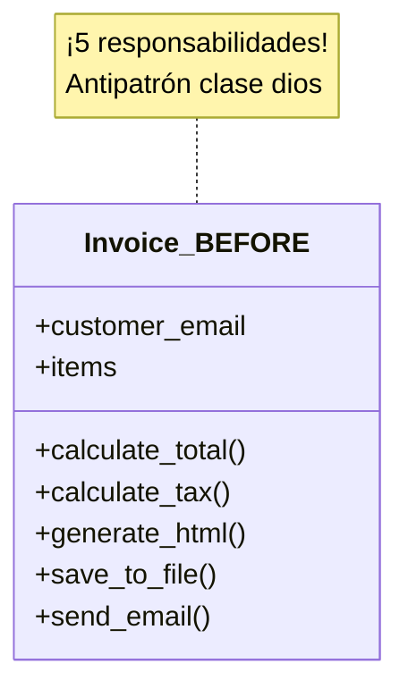
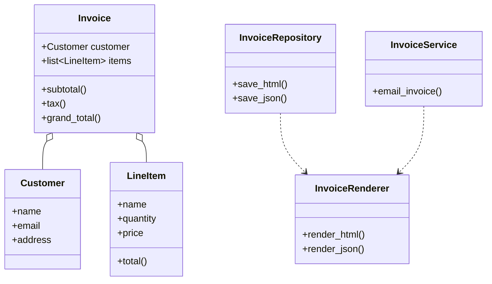
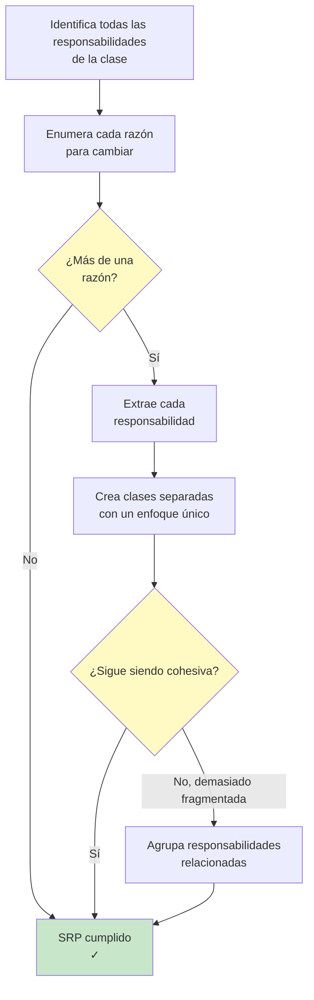

# Principio de Responsabilidad Única (SRP)

> **Una clase debe tener una, y solo una, razón para cambiar.**

El Principio de Responsabilidad Única es el primero de los principios SOLID. Establece que cada clase debe tener exactamente una responsabilidad: un solo trabajo que realizar y una sola razón para cambiar. Cuando una clase asume varias responsabilidades, se vuelve frágil, difícil de probar y difícil de mantener.

## El Problema: las Clases Dios

Una clase con demasiadas responsabilidades suele llamarse "clase dios". Sabe demasiado y hace demasiado.

### ANTES: Violación del SRP

```python
import json
import smtplib
from email.message import EmailMessage
from pathlib import Path
from typing import Any

class Invoice:
    def __init__(self, customer_email: str, items: list[dict[str, Any]]):
        self.customer_email = customer_email
        self.items = items

    def calculate_total(self) -> float:
        return sum(item["price"] * item["quantity"] for item in self.items)

    def calculate_tax(self, tax_rate: float = 0.08) -> float:
        return self.calculate_total() * tax_rate

    def generate_html(self) -> str:
        total = self.calculate_total()
        tax = self.calculate_tax()
        items_html = "".join(
            f"<tr><td>{i['name']}</td><td>{i['quantity']}</td>"
            f"<td>${i['price']:.2f}</td><td>${i['price'] * i['quantity']:.2f}</td></tr>"
            for i in self.items
        )
        return f"""<html><body>
<h1>Invoice</h1>
<table><tr><th>Item</th><th>Qty</th><th>Price</th><th>Total</th></tr>
{items_html}
<tr><td colspan="3">Subtotal</td><td>${total:.2f}</td></tr>
<tr><td colspan="3">Tax (8%)</td><td>${tax:.2f}</td></tr>
<tr><td colspan="3">Grand Total</td><td>${total + tax:.2f}</td></tr>
</table></body></html>"""

    def save_to_file(self, filename: str = "invoice.html") -> None:
        html = self.generate_html()
        Path(filename).write_text(html)

    def send_email(self) -> None:
        html = self.generate_html()
        msg = EmailMessage()
        msg["Subject"] = "Your Invoice"
        msg["From"] = "billing@company.com"
        msg["To"] = self.customer_email
        msg.set_content(html, subtype="html")
        with smtplib.SMTP("smtp.company.com") as server:
            server.send_message(msg)
```

> [!WARNING]
> Esta clase `Invoice` hace **cinco** cosas: calcula totales, genera HTML, guarda archivos, envía correos electrónicos y gestiona datos de clientes. ¡Son cinco razones para cambiar!

### Problemas de este diseño:

| Responsabilidad | Por qué es un problema |
|--------------|-------------------|
| **Lógica de negocio** (cálculos) | Cambia cuando cambian las reglas de impuestos |
| **Presentación** (HTML) | Cambia cuando cambia el diseño |
| **Persistencia** (guardado en archivos) | Cambia cuando cambia el almacenamiento |
| **Entrega** (correo electrónico) | Cambia cuando cambia la lógica de correo |
| **Datos** (información del cliente) | Cambia cuando cambian los campos del cliente |



### DESPUÉS: SRP Refactorizado

Cada clase tiene exactamente una responsabilidad:

```python
from dataclasses import dataclass
from typing import Any
from pathlib import Path
import json

# --- Responsibility 1: Data / Business Logic ---
@dataclass
class LineItem:
    name: str
    quantity: int
    price: float

    def total(self) -> float:
        return self.quantity * self.price

class Invoice:
    def __init__(self, customer: "Customer", items: list[LineItem]):
        self.customer = customer
        self.items = items

    def subtotal(self) -> float:
        return sum(item.total() for item in self.items)

    def tax(self, rate: float = 0.08) -> float:
        return self.subtotal() * rate

    def grand_total(self, rate: float = 0.08) -> float:
        return self.subtotal() + self.tax(rate)

@dataclass
class Customer:
    name: str
    email: str
    address: str

# --- Responsibility 2: Presentation ---
class InvoiceRenderer:
    @staticmethod
    def render_html(invoice: Invoice) -> str:
        items = "".join(
            f"<tr><td>{i.name}</td><td>{i.quantity}</td>"
            f"<td>${i.price:.2f}</td><td>${i.total():.2f}</td></tr>"
            for i in invoice.items
        )
        return f"""<html><body>
<h1>Invoice for {invoice.customer.name}</h1>
<table><tr><th>Item</th><th>Qty</th><th>Price</th><th>Total</th></tr>
{items}
<tr><td colspan="3">Subtotal</td><td>${invoice.subtotal():.2f}</td></tr>
<tr><td colspan="3">Tax</td><td>${invoice.tax():.2f}</td></tr>
<tr><td colspan="3">Grand Total</td><td>${invoice.grand_total():.2f}</td></tr>
</table></body></html>"""

    @staticmethod
    def render_json(invoice: Invoice) -> str:
        return json.dumps({
            "customer": invoice.customer.name,
            "email": invoice.customer.email,
            "items": [
                {"name": i.name, "qty": i.quantity,
                 "price": i.price, "total": i.total()}
                for i in invoice.items
            ],
            "subtotal": invoice.subtotal(),
            "tax": invoice.tax(),
            "grand_total": invoice.grand_total(),
        }, indent=2)

# --- Responsibility 3: Persistence ---
class InvoiceRepository:
    @staticmethod
    def save_html(invoice: Invoice, path: str = "invoice.html") -> None:
        html = InvoiceRenderer.render_html(invoice)
        Path(path).write_text(html)

    @staticmethod
    def save_json(invoice: Invoice, path: str = "invoice.json") -> None:
        data = InvoiceRenderer.render_json(invoice)
        Path(path).write_text(data)

# --- Responsibility 4: Delivery ---
class InvoiceService:
    def __init__(self, smtp_host: str = "smtp.company.com"):
        self.smtp_host = smtp_host

    def email_invoice(self, invoice: Invoice, recipient: str | None = None) -> None:
        import smtplib
        from email.message import EmailMessage

        html = InvoiceRenderer.render_html(invoice)
        msg = EmailMessage()
        msg["Subject"] = f"Invoice for {invoice.customer.name}"
        msg["From"] = "billing@company.com"
        msg["To"] = recipient or invoice.customer.email
        msg.set_content(html, subtype="html")

        with smtplib.SMTP(self.smtp_host) as server:
            server.send_message(msg)
```



> [!SUCCESS]
> Ahora cada clase tiene exactamente una responsabilidad. La clase `Invoice` gestiona la lógica de negocio. `InvoiceRenderer` gestiona la presentación. `InvoiceRepository` gestiona la persistencia. `InvoiceService` gestiona la entrega. Cada una tiene una razón para cambiar.

## Cómo Identificar las Violaciones del SRP

Hazte estas preguntas sobre tu clase:

| Pregunta | Si la respuesta es sí… |
|----------|-----------|
| ¿Esta clase tiene más de una "razón para cambiar"? | SRP violado |
| ¿Puedo describir lo que hace esta clase en una sola frase sin usar "y"? | SRP violado |
| ¿Esta clase depende de varios subsistemas no relacionados? | SRP violado |
| ¿Tendría que modificar esta clase por varias solicitudes de características diferentes? | SRP violado |
| ¿Esta clase es difícil de probar por mezclar responsabilidades? | SRP violado |

### Otro Ejemplo: Gestión de Usuarios

**ANTES: una clase lo hace todo**

```python
import hashlib
import re
import sqlite3
from typing import Optional

class UserManager:
    def __init__(self, db_path: str = "users.db"):
        self.db_path = db_path
        self._init_db()

    def _init_db(self) -> None:
        with sqlite3.connect(self.db_path) as conn:
            conn.execute("""
                CREATE TABLE IF NOT EXISTS users (
                    id INTEGER PRIMARY KEY AUTOINCREMENT,
                    email TEXT UNIQUE NOT NULL,
                    password_hash TEXT NOT NULL,
                    role TEXT DEFAULT 'user'
                )
            """)

    def register(self, email: str, password: str) -> int:
        if not re.match(r"[^@]+@[^@]+\.[^@]+", email):
            raise ValueError("Invalid email")
        if len(password) < 8:
            raise ValueError("Password too short")
        pw_hash = hashlib.sha256(password.encode()).hexdigest()
        with sqlite3.connect(self.db_path) as conn:
            cur = conn.execute(
                "INSERT INTO users (email, password_hash) VALUES (?, ?)",
                (email, pw_hash)
            )
            return cur.lastrowid

    def login(self, email: str, password: str) -> Optional[int]:
        pw_hash = hashlib.sha256(password.encode()).hexdigest()
        with sqlite3.connect(self.db_path) as conn:
            row = conn.execute(
                "SELECT id FROM users WHERE email=? AND password_hash=?",
                (email, pw_hash)
            ).fetchone()
            return row[0] if row else None

    def send_welcome_email(self, email: str) -> None:
        import smtplib
        from email.message import EmailMessage
        msg = EmailMessage()
        msg["Subject"] = "Welcome!"
        msg["From"] = "noreply@site.com"
        msg["To"] = email
        msg.set_content("Welcome to our platform!")
        with smtplib.SMTP("smtp.site.com") as server:
            server.send_message(msg)

    def log_activity(self, user_id: int, action: str) -> None:
        with sqlite3.connect(self.db_path) as conn:
            conn.execute(
                "INSERT INTO activity_log (user_id, action) VALUES (?, ?)",
                (user_id, action)
            )
```

> [!WARNING]
> `UserManager` gestiona la validación, el hash, las operaciones de base de datos, el envío de correos y el registro de actividad. ¡Son cinco responsabilidades!

**DESPUÉS: refactorización compatible con el SRP**

```python
import hashlib
import re
from typing import Optional, Protocol

# --- Responsibility 1: Validation ---
class Validator:
    @staticmethod
    def validate_email(email: str) -> str:
        if not re.match(r"[^@]+@[^@]+\.[^@]+", email):
            raise ValueError("Invalid email format")
        return email

    @staticmethod
    def validate_password(password: str) -> str:
        if len(password) < 8:
            raise ValueError("Password must be at least 8 characters")
        if not re.search(r"[A-Z]", password):
            raise ValueError("Password must contain an uppercase letter")
        if not re.search(r"\d", password):
            raise ValueError("Password must contain a digit")
        return password

# --- Responsibility 2: Hashing ---
class PasswordHasher:
    @staticmethod
    def hash(password: str) -> str:
        salt = "fixed_salt"  # Use a proper salt in production
        return hashlib.sha256((password + salt).encode()).hexdigest()

    @staticmethod
    def verify(password: str, hash_value: str) -> bool:
        return PasswordHasher.hash(password) == hash_value

# --- Responsibility 3: Database Access ---
class UserRepository:
    def __init__(self, db_path: str = "users.db"):
        self.db_path = db_path
        self._init_db()

    def _init_db(self) -> None:
        import sqlite3
        with sqlite3.connect(self.db_path) as conn:
            conn.execute("""
                CREATE TABLE IF NOT EXISTS users (
                    id INTEGER PRIMARY KEY AUTOINCREMENT,
                    email TEXT UNIQUE NOT NULL,
                    password_hash TEXT NOT NULL,
                    role TEXT DEFAULT 'user'
                )
            """)

    def create(self, email: str, password_hash: str) -> int:
        import sqlite3
        with sqlite3.connect(self.db_path) as conn:
            cur = conn.execute(
                "INSERT INTO users (email, password_hash) VALUES (?, ?)",
                (email, password_hash)
            )
            return cur.lastrowid

    def find_by_email(self, email: str) -> Optional[dict]:
        import sqlite3
        with sqlite3.connect(self.db_path) as conn:
            row = conn.execute(
                "SELECT id, email, password_hash, role FROM users WHERE email=?",
                (email,)
            ).fetchone()
            if row:
                return {"id": row[0], "email": row[1],
                        "password_hash": row[2], "role": row[3]}
            return None

# --- Responsibility 4: Notification ---
class EmailService:
    def __init__(self, smtp_host: str = "smtp.site.com",
                 from_addr: str = "noreply@site.com"):
        self.smtp_host = smtp_host
        self.from_addr = from_addr

    def send_welcome(self, to: str) -> None:
        import smtplib
        from email.message import EmailMessage
        msg = EmailMessage()
        msg["Subject"] = "Welcome!"
        msg["From"] = self.from_addr
        msg["To"] = to
        msg.set_content("Welcome to our platform!")
        with smtplib.SMTP(self.smtp_host) as server:
            server.send_message(msg)

# --- Responsibility 5: Auditing ---
class AuditLogger:
    def __init__(self, db_path: str = "audit.db"):
        self.db_path = db_path
        self._init_db()

    def _init_db(self) -> None:
        import sqlite3
        with sqlite3.connect(self.db_path) as conn:
            conn.execute("""
                CREATE TABLE IF NOT EXISTS activity_log (
                    id INTEGER PRIMARY KEY AUTOINCREMENT,
                    user_id INTEGER, action TEXT, created_at TIMESTAMP DEFAULT CURRENT_TIMESTAMP
                )
            """)

    def log(self, user_id: int, action: str) -> None:
        import sqlite3
        with sqlite3.connect(self.db_path) as conn:
            conn.execute(
                "INSERT INTO activity_log (user_id, action) VALUES (?, ?)",
                (user_id, action)
            )

# --- Orchestration ---
class RegistrationService:
    def __init__(self, repo: UserRepository, hasher: PasswordHasher,
                 email_svc: EmailService, audit: AuditLogger):
        self.repo = repo
        self.hasher = hasher
        self.email_svc = email_svc
        self.audit = audit

    def register(self, email: str, password: str) -> dict:
        email = Validator.validate_email(email)
        Validator.validate_password(password)
        pw_hash = self.hasher.hash(password)
        user_id = self.repo.create(email, pw_hash)
        self.email_svc.send_welcome(email)
        self.audit.log(user_id, "user_registered")
        return {"id": user_id, "email": email}
```

> [!TIP]
> Observa cómo la versión compatible con el SRP también es más fácil de probar. Puedes usar mocks de `UserRepository`, `EmailService` y `AuditLogger` de forma independiente. Cada clase tiene entradas y salidas claras.

## Señales Comunes de Violación del SRP

| Síntoma | Lo que significa |
|---------|---------------|
| El nombre de la clase tiene "And" o "Manager" | Probablemente gestiona demasiado |
| La clase tiene campos o métodos sin relación | Responsabilidades diferentes mezcladas |
| Un método usa solo algunos campos | Los campos que no se usan deberían estar en otra parte |
| Las pruebas requieren varios mocks | Las dependencias cruzan responsabilidades |
| Los cambios pequeños tocan muchos métodos | Las responsabilidades están enredadas |

## Cuando el SRP Parece Contradictorio

A algunos desarrolladores les preocupa que el SRP lleve a demasiadas clases pequeñas. Es una preocupación válida. El objetivo no es crear una clase para cada operación minúscula, sino agrupar responsabilidades *cohesivas*.

| Muy Pocas Clases (clase dios) | Demasiadas Clases (sobrefragmentadas) |
|----------------------------|------------------------------------|
| Difíciles de entender | Difícil seguir el flujo |
| Difíciles de probar | Demasiada indirecta |
| Difíciles de cambiar | Demasiada ceremonia |
| Conflictos de fusión frecuentes | Sobrecarga de configuración |

> [!NOTE]
> Encontrar la granularidad correcta es una habilidad que mejora con la práctica. Una buena regla general: si tu clase tiene más de 5-7 métodos públicos, considera si podría tener varias responsabilidades.



## Mundo Real: Generación de Informes

**ANTES: responsabilidades mezcladas**

```python
class Report:
    def __init__(self, title: str, data: list[dict]):
        self.title = title
        self.data = data
        self.filters: list = []

    def add_filter(self, column: str, value) -> None:
        self.filters.append((column, value))

    def get_filtered_data(self) -> list[dict]:
        result = self.data[:]
        for col, val in self.filters:
            result = [r for r in result if r.get(col) == val]
        return result

    def compute_summary(self) -> dict:
        data = self.get_filtered_data()
        return {
            "count": len(data),
            "total": sum(r.get("amount", 0) for r in data),
            "average": sum(r.get("amount", 0) for r in data) / len(data) if data else 0,
        }

    def to_csv(self) -> str:
        data = self.get_filtered_data()
        if not data:
            return ""
        headers = list(data[0].keys())
        lines = [",".join(headers)]
        for row in data:
            lines.append(",".join(str(row.get(h, "")) for h in headers))
        return "\n".join(lines)

    def to_json(self) -> str:
        import json
        return json.dumps(self.get_filtered_data(), indent=2)

    def save(self, filename: str, fmt: str = "csv") -> None:
        from pathlib import Path
        if fmt == "csv":
            Path(filename).write_text(self.to_csv())
        elif fmt == "json":
            Path(filename).write_text(self.to_json())
```

**DESPUÉS: responsabilidades separadas**

```python
from typing import Any, Callable
from dataclasses import dataclass

@dataclass
class ReportData:
    title: str
    rows: list[dict[str, Any]]

class DataFilter:
    def __init__(self):
        self.filters: list[tuple[str, Any]] = []

    def add(self, column: str, value: Any) -> None:
        self.filters.append((column, value))

    def apply(self, data: ReportData) -> ReportData:
        result = data.rows[:]
        for col, val in self.filters:
            result = [r for r in result if r.get(col) == val]
        return ReportData(data.title, result)

class ReportCalculator:
    @staticmethod
    def summary(data: ReportData) -> dict:
        amounts = [r.get("amount", 0) for r in data.rows]
        return {
            "count": len(data.rows),
            "total": sum(amounts),
            "average": sum(amounts) / len(amounts) if amounts else 0,
        }

class ReportFormatter:
    @staticmethod
    def to_csv(data: ReportData) -> str:
        if not data.rows:
            return ""
        headers = list(data.rows[0].keys())
        lines = [",".join(headers)]
        for row in data.rows:
            lines.append(",".join(str(row.get(h, "")) for h in headers))
        return "\n".join(lines)

    @staticmethod
    def to_json(data: ReportData) -> str:
        import json
        return json.dumps(data.rows, indent=2)

class ReportRepository:
    @staticmethod
    def save(data: ReportData, filename: str, content: str) -> None:
        from pathlib import Path
        Path(filename).write_text(content)
```

## Cuándo Aplicar el SRP

| Escenario | ¿Aplicar SRP? | Por qué |
|----------|-----------|-----|
| Clase con un solo método | No | Usa simplemente una función |
| Clase de datos (dataclass) | Normalmente no | Contiene datos, un solo trabajo |
| Clase con persistencia + lógica mezcladas | Sí | Dos razones para cambiar |
| Clase que hace cálculos + renderizado | Sí | La lógica de negocio no es la presentación |
| Clase que gestiona autenticación + registro | Sí | Responsabilidades diferentes |

> [!SUCCESS]
> El SRP hace que tu código sea más fácil de entender, probar y mantener. Cada clase cuenta una historia clara: "Hago esta única cosa, y la hago bien."

## Ejercicios Prácticos

1. Identifica las violaciones del SRP en esta clase y refactorízala:
   ```python
   class Order:
       def __init__(self, items, customer):
           self.items = items
           self.customer = customer
       def total(self): ...
       def print_order(self): ...
       def save_to_db(self): ...
       def send_confirmation(self): ...
       def apply_discount(self, code): ...
       def generate_label(self): ...
   ```

2. Una clase `DataProcessor` lee archivos CSV, limpia datos, ejecuta modelos de ML, genera gráficos y envía informes por correo. ¿Cómo la dividirías aplicando el SRP? Lista las nuevas clases.

3. Refactoriza el siguiente código para que siga el SRP:
   ```python
   class BlogPost:
       def __init__(self, title, body, author):
           self.title = title
           self.body = body
           self.author = author
           self.comments = []
       def add_comment(self, text, user): ...
       def to_html(self): ...
       def save(self): ...
       def send_notification(self): ...
       def validate(self): ...
   ```

4. ¿Cuál es la "razón para cambiar" de cada una de estas clases: `Invoice`, `InvoiceRenderer`, `InvoiceRepository`, `InvoiceService`?

5. Una clase `UserSettings` gestiona la carga y el guardado de ajustes en un archivo de configuración Y la aplicación de esos ajustes a la interfaz de usuario. ¿Es esto una violación del SRP? ¿Por qué? ¿Cómo lo corregirías?

6. Crea un sistema de calculadora sencillo donde la lógica de cálculo, el análisis de la entrada y la visualización de resultados estén en clases separadas que sigan el SRP.

7. Revisa tu propia base de código y encuentra una clase que viole el SRP. Describe qué responsabilidades tiene y propón una refactorización.

8. Explica con tus propias palabras: ¿cómo mejora el SRP la testeabilidad? Da un ejemplo concreto.

## Resumen

- **SRP**: una clase debe tener una, y solo una, razón para cambiar
- **Las clases dios** con varias responsabilidades son difíciles de mantener
- **Señales de violación**: nombres de clase con "And" o "Manager", métodos sin relación, amplias superficies de prueba
- **Refactorización**: extrae cada responsabilidad a su propia clase y luego compónelas
- **Beneficio en las pruebas**: cada clase pequeña es testeable de forma independiente con el mínimo de mocks
- **Equilibrio**: no sobrefragmentes; agrupa las responsabilidades cohesivas

> [!SUCCESS]
> El SRP es la base del diseño de POO limpio. Cuando cada clase tiene un solo trabajo, tu código se vuelve modular, testeable y un placer con el que trabajar.
