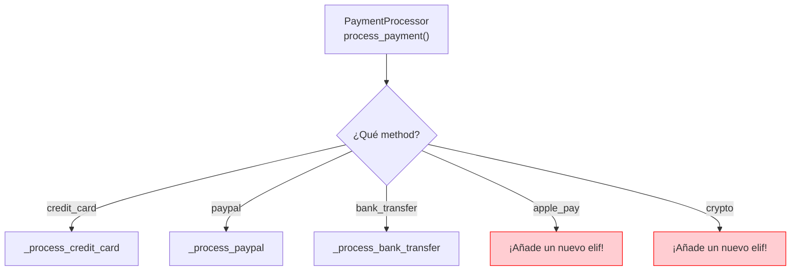
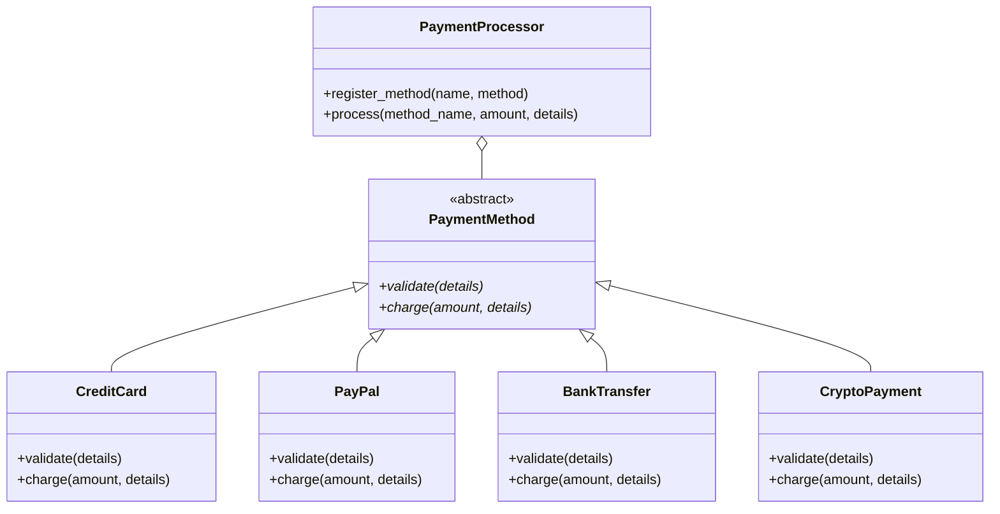
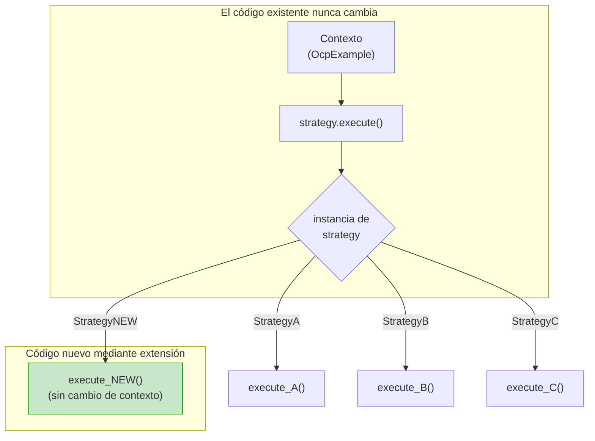
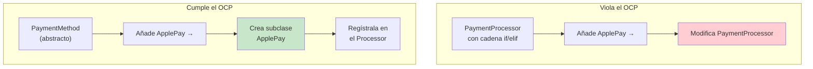

# Principio Abierto-Cerrado (OCP)

> **Las entidades de software (clases, módulos, funciones) deben estar abiertas para la extensión, pero cerradas para la modificación.**

El Principio Abierto-Cerrado es el segundo principio SOLID. Significa que deberías poder añadir nueva funcionalidad sin cambiar el código existente. En lugar de modificar una clase para soportar un nuevo comportamiento, la extiendes mediante herencia, composición o arquitecturas de plug-ins.

## El Problema: Cascadas de Modificaciones

Cuando el código no está cerrado a la modificación, cada funcionalidad nueva exige cambiar código existente. Esto provoca errores, regresiones y conflictos de fusión.

### ANTES: Violación del OCP

Imagina un sistema de procesamiento de pagos donde cada nuevo método de pago obliga a modificar el procesador:

```python
from typing import Any

class PaymentProcessor:
    def process_payment(self, method: str, amount: float,
                        details: dict[str, Any]) -> str:
        if method == "credit_card":
            return self._process_credit_card(amount, details)
        elif method == "paypal":
            return self._process_paypal(amount, details)
        elif method == "bank_transfer":
            return self._process_bank_transfer(amount, details)
        else:
            raise ValueError(f"Unknown payment method: {method}")

    def _process_credit_card(self, amount: float,
                             details: dict[str, Any]) -> str:
        card_number = details.get("card_number")
        cvv = details.get("cvv")
        if not card_number or not cvv:
            raise ValueError("Missing credit card details")
        if len(str(card_number)) != 16:
            raise ValueError("Invalid card number")
        print(f"Charging ${amount:.2f} to card ending in {str(card_number)[-4:]}")
        return f"cc_txn_{hash(card_number)}"

    def _process_paypal(self, amount: float,
                        details: dict[str, Any]) -> str:
        email = details.get("email")
        password = details.get("password")
        if not email or not password:
            raise ValueError("Missing PayPal credentials")
        print(f"Processing ${amount:.2f} via PayPal for {email}")
        return f"pp_txn_{hash(email)}"

    def _process_bank_transfer(self, amount: float,
                               details: dict[str, Any]) -> str:
        routing = details.get("routing_number")
        account = details.get("account_number")
        if not routing or not account:
            raise ValueError("Missing bank account details")
        print(f"Transferring ${amount:.2f} to account {str(account)[-4:]}")
        return f"bt_txn_{hash(account)}"
```

> [!WARNING]
> Cada vez que hace falta un nuevo método de pago (por ejemplo, `"crypto"`, `"apple_pay"`), debes modificar la clase `PaymentProcessor`. Esto viola el OCP: la clase no está cerrada a la modificación.



### Problemas de este diseño:

| Problema | Impacto |
|---------|--------|
| **Se requiere modificación** | Cada nuevo método de pago cambia el código existente |
| **Riesgo de regresión** | Añadir un método podría romper los existentes |
| **Cadenas condicionales largas** | Difíciles de leer, probar y mantener |
| **Acoplamiento estrecho** | Todos los métodos dependen de una sola clase |
| **También viola el SRP** | El procesador conoce todos los tipos de pago |

### DESPUÉS: Refactorización Compatible con el OCP

Usa una clase base abstracta y un despacho polimórfico:

```python
from abc import ABC, abstractmethod
from typing import Any, Optional

class PaymentMethod(ABC):
    """Abstract base — open for extension via new subclasses."""

    @abstractmethod
    def charge(self, amount: float, details: dict[str, Any]) -> str:
        pass

    @abstractmethod
    def validate(self, details: dict[str, Any]) -> None:
        pass

class CreditCard(PaymentMethod):
    def validate(self, details: dict[str, Any]) -> None:
        card = details.get("card_number")
        cvv = details.get("cvv")
        if not card or not cvv:
            raise ValueError("Missing credit card details")
        if len(str(card)) != 16:
            raise ValueError("Invalid card number")

    def charge(self, amount: float, details: dict[str, Any]) -> str:
        self.validate(details)
        card = str(details["card_number"])
        print(f"Charging ${amount:.2f} to card ending in {card[-4:]}")
        return f"cc_txn_{hash(card)}"

class PayPal(PaymentMethod):
    def validate(self, details: dict[str, Any]) -> None:
        if not details.get("email") or not details.get("password"):
            raise ValueError("Missing PayPal credentials")

    def charge(self, amount: float, details: dict[str, Any]) -> str:
        self.validate(details)
        email = details["email"]
        print(f"Processing ${amount:.2f} via PayPal for {email}")
        return f"pp_txn_{hash(email)}"

class BankTransfer(PaymentMethod):
    def validate(self, details: dict[str, Any]) -> None:
        if not details.get("routing_number") or not details.get("account_number"):
            raise ValueError("Missing bank account details")

    def charge(self, amount: float, details: dict[str, Any]) -> str:
        self.validate(details)
        account = str(details["account_number"])
        print(f"Transferring ${amount:.2f} to account {account[-4:]}")
        return f"bt_txn_{hash(account)}"

class PaymentProcessor:
    """Closed for modification — open for extension."""

    def __init__(self):
        self._methods: dict[str, PaymentMethod] = {}

    def register_method(self, name: str, method: PaymentMethod) -> None:
        self._methods[name] = method

    def process(self, method_name: str, amount: float,
                details: dict[str, Any]) -> str:
        method = self._methods.get(method_name)
        if not method:
            raise ValueError(f"Unknown payment method: {method_name}")
        return method.charge(amount, details)
```

> [!NOTE]
> La clase `PaymentProcessor` está **cerrada a la modificación**: su código nunca cambia cuando se añaden nuevos métodos de pago. Está **abierta a la extensión**: los nuevos métodos se añaden creando nuevas subclases de `PaymentMethod` y registrándolas.

```python
# Usage — adding crypto doesn't touch existing code!
processor = PaymentProcessor()
processor.register_method("credit_card", CreditCard())
processor.register_method("paypal", PayPal())
processor.register_method("bank_transfer", BankTransfer())

result = processor.process("credit_card", 150.00, {
    "card_number": 1234567812345678,
    "cvv": "123"
})
print(result)

# Adding a new method without modifying existing classes:
class CryptoPayment(PaymentMethod):
    def validate(self, details: dict[str, Any]) -> None:
        if not details.get("wallet_address"):
            raise ValueError("Missing wallet address")

    def charge(self, amount: float, details: dict[str, Any]) -> str:
        self.validate(details)
        wallet = details["wallet_address"]
        print(f"Sending ${amount:.2f} in crypto to {wallet[:8]}...")
        return f"crypto_txn_{hash(wallet)}"

processor.register_method("crypto", CryptoPayment())
```



> [!SUCCESS]
> Los nuevos métodos de pago se añaden ahora creando una subclase de `PaymentMethod` y registrándola en el procesador. `PaymentProcessor` y las clases de pago existentes nunca se modifican.

## Patrón Strategy: la Columna Vertebral del OCP

El ejemplo anterior usa el **patrón Strategy**, que es la forma más común de conseguir el OCP. Aquí tienes una plantilla genérica:

```python
from abc import ABC, abstractmethod
from typing import Any

class Strategy(ABC):
    @abstractmethod
    def execute(self, context: Any) -> Any:
        pass

class Context:
    def __init__(self):
        self._strategies: dict[str, Strategy] = {}

    def register(self, name: str, strategy: Strategy) -> None:
        self._strategies[name] = strategy

    def run(self, name: str, input_data: Any) -> Any:
        strategy = self._strategies.get(name)
        if not strategy:
            raise ValueError(f"Unknown strategy: {name}")
        return strategy.execute(input_data)

class ConcreteStrategyA(Strategy):
    def execute(self, context: Any) -> Any:
        return f"Strategy A processed: {context}"

class ConcreteStrategyB(Strategy):
    def execute(self, context: Any) -> Any:
        return f"Strategy B processed: {context}"
```

## Más Ejemplos de OCP

### Ejemplo 2: Calculadora de Descuentos

**ANTES: basado en modificaciones**

```python
class DiscountCalculator:
    def calculate(self, customer_type: str, amount: float) -> float:
        if customer_type == "regular":
            return amount * 0.05
        elif customer_type == "silver":
            return amount * 0.10
        elif customer_type == "gold":
            return amount * 0.20
        elif customer_type == "platinum":
            return amount * 0.30
        else:
            return 0.0
```

**DESPUÉS: basado en extensiones**

```python
from abc import ABC, abstractmethod

class DiscountStrategy(ABC):
    @abstractmethod
    def apply(self, amount: float) -> float:
        pass

class RegularDiscount(DiscountStrategy):
    def apply(self, amount: float) -> float:
        return amount * 0.05

class SilverDiscount(DiscountStrategy):
    def apply(self, amount: float) -> float:
        return amount * 0.10

class GoldDiscount(DiscountStrategy):
    def apply(self, amount: float) -> float:
        return amount * 0.20

class PlatinumDiscount(DiscountStrategy):
    def apply(self, amount: float) -> float:
        return amount * 0.30

class DiscountEngine:
    def __init__(self):
        self._discounts: dict[str, DiscountStrategy] = {}

    def register(self, customer_type: str, strategy: DiscountStrategy) -> None:
        self._discounts[customer_type] = strategy

    def calculate(self, customer_type: str, amount: float) -> float:
        strategy = self._discounts.get(customer_type)
        if not strategy:
            return 0.0
        return strategy.apply(amount)

engine = DiscountEngine()
engine.register("regular", RegularDiscount())
engine.register("silver", SilverDiscount())
engine.register("gold", GoldDiscount())
engine.register("platinum", PlatinumDiscount())

# New type added later — no existing code changed:
class VIPDiscount(DiscountStrategy):
    def apply(self, amount: float) -> float:
        return amount * 0.40

engine.register("vip", VIPDiscount())
```

### Ejemplo 3: Sistema de Notificaciones

**ANTES**

```python
class Notifier:
    def send(self, message: str, channel: str) -> None:
        if channel == "email":
            self._send_email(message)
        elif channel == "sms":
            self._send_sms(message)
        elif channel == "slack":
            self._send_slack(message)

    def _send_email(self, msg): ...
    def _send_sms(self, msg): ...
    def _send_slack(self, msg): ...
```

**DESPUÉS**

```python
from abc import ABC, abstractmethod

class NotificationChannel(ABC):
    @abstractmethod
    def send(self, message: str, recipient: str) -> None:
        pass

class EmailChannel(NotificationChannel):
    def send(self, message: str, recipient: str) -> None:
        import smtplib
        from email.message import EmailMessage
        msg = EmailMessage()
        msg["To"] = recipient
        msg["Subject"] = "Notification"
        msg.set_content(message)
        with smtplib.SMTP("smtp.example.com") as server:
            server.send_message(msg)

class SMSChannel(NotificationChannel):
    def send(self, message: str, recipient: str) -> None:
        print(f"Sending SMS to {recipient}: {message}")
        # Integration with Twilio or other SMS provider

class SlackChannel(NotificationChannel):
    def send(self, message: str, recipient: str) -> None:
        print(f"Sending Slack message to {recipient}: {message}")
        # Integration with Slack API

class Notifier:
    def __init__(self):
        self.channels: dict[str, NotificationChannel] = {}

    def register_channel(self, name: str, channel: NotificationChannel) -> None:
        self.channels[name] = channel

    def send(self, channel_name: str, message: str, recipient: str) -> None:
        channel = self.channels.get(channel_name)
        if not channel:
            raise ValueError(f"Unknown channel: {channel_name}")
        channel.send(message, recipient)

# Adding push notifications — no modification needed:
class PushChannel(NotificationChannel):
    def send(self, message: str, recipient: str) -> None:
        print(f"Sending push notification to device {recipient}: {message}")

notifier = Notifier()
notifier.register_channel("push", PushChannel())
```

## OCP y el Patrón Strategy



## OCP con el Patrón Template Method

A veces quieres un esqueleto de algoritmo donde las subclases rellenan los detalles:

```python
from abc import ABC, abstractmethod
from pathlib import Path

class DataExporter(ABC):
    """Template Method pattern — skeleton is closed, steps are open."""

    def export(self, data: list[dict], output_path: str) -> Path:
        validated = self._validate(data)
        transformed = self._transform(validated)
        content = self._serialize(transformed)
        path = Path(output_path)
        path.write_text(content)
        print(f"Exported {len(data)} records to {path}")
        return path

    def _validate(self, data: list[dict]) -> list[dict]:
        if not data:
            raise ValueError("No data to export")
        return data

    def _transform(self, data: list[dict]) -> list[dict]:
        return data  # Default: no transformation

    @abstractmethod
    def _serialize(self, data: list[dict]) -> str:
        pass

class CSVExporter(DataExporter):
    def _serialize(self, data: list[dict]) -> str:
        import csv
        import io
        output = io.StringIO()
        writer = csv.DictWriter(output, fieldnames=data[0].keys())
        writer.writeheader()
        writer.writerows(data)
        return output.getvalue()

class JSONExporter(DataExporter):
    def _serialize(self, data: list[dict]) -> str:
        import json
        return json.dumps(data, indent=2)

class XMLExporter(DataExporter):
    def _transform(self, data: list[dict]) -> list[dict]:
        # XML needs special character escaping
        result = []
        for item in data:
            escaped = {k: str(v).replace("&", "&amp;").replace("<", "&lt;")
                       for k, v in item.items()}
            result.append(escaped)
        return result

    def _serialize(self, data: list[dict]) -> str:
        lines = ["<?xml version='1.0' encoding='UTF-8'?>", "<records>"]
        for item in data:
            lines.append("  <record>")
            for key, value in item.items():
                lines.append(f"    <{key}>{value}</{key}>")
            lines.append("  </record>")
        lines.append("</records>")
        return "\n".join(lines)
```

## OCP con Composición (Patrón Decorator)

```python
from abc import ABC, abstractmethod

class DataSource(ABC):
    @abstractmethod
    def read(self) -> str:
        pass

    @abstractmethod
    def write(self, data: str) -> None:
        pass

class FileDataSource(DataSource):
    def __init__(self, path: str):
        self.path = path

    def read(self) -> str:
        from pathlib import Path
        return Path(self.path).read_text()

    def write(self, data: str) -> None:
        from pathlib import Path
        Path(self.path).write_text(data)

class EncryptionDecorator(DataSource):
    def __init__(self, source: DataSource):
        self._source = source

    def read(self) -> str:
        encrypted = self._source.read()
        return self._decrypt(encrypted)

    def write(self, data: str) -> None:
        encrypted = self._encrypt(data)
        self._source.write(encrypted)

    def _encrypt(self, data: str) -> str:
        import base64
        return base64.b64encode(data.encode()).decode()

    def _decrypt(self, data: str) -> str:
        import base64
        return base64.b64decode(data.encode()).decode()

class CompressionDecorator(DataSource):
    def __init__(self, source: DataSource):
        self._source = source

    def read(self) -> str:
        compressed = self._source.read()
        return self._decompress(compressed)

    def write(self, data: str) -> None:
        compressed = self._compress(data)
        self._source.write(compressed)

    def _compress(self, data: str) -> str:
        import gzip
        import base64
        return base64.b64encode(gzip.compress(data.encode())).decode()

    def _decompress(self, data: str) -> str:
        import gzip
        import base64
        return gzip.decompress(base64.b64decode(data.encode())).decode()

# Compose at runtime — OCP-compliant
source = CompressionDecorator(EncryptionDecorator(FileDataSource("data.txt")))
source.write("Hello, OCP!")
print(source.read())  # Original data back
```

> [!TIP]
> El patrón Decorator es una excelente manera de extender comportamiento sin modificar las clases existentes. Cada decorador añade una responsabilidad y, a su vez, está abierto a más decoración.

## Violaciones del OCP: Señales de Alerta

| Señal de alerta | Descripción |
|-------------|-------------|
| Cadenas `if/elif/else` sobre el tipo | Los tipos nuevos exigen ramas nuevas |
| `match/case` sobre códigos de tipo | El mismo problema que if/elif |
| Comprobaciones `isinstance()` | El polimorfismo debería reemplazarlas |
| Sentencias switch grandes | Suelen indicar una abstracción que falta |
| Flags de funcionalidad repartidos por el código | Considera el patrón Strategy en su lugar |
| Campo `type` con lógica condicional | Extráelo a clases polimórficas |

## Comparación de Enfoques

| Aspecto | Sin OCP (if/elif) | Con OCP (Strategy) |
|--------|---------------------|--------------------|
| Añadir un nuevo comportamiento | Modificar la clase existente | Crear una subclase nueva |
| Riesgo de regresión | Alto | Bajo |
| Superficie de prueba | Toda la clase | Una sola clase nueva |
| Reutilización de código | Baja (condicionales duplicados) | Alta (abstracciones compartidas) |
| Dirección de la dependencia | Lo concreto depende de lo concreto | Ambos dependen de una abstracción |
| Legibilidad | Empeora linealmente | Se mantiene constante |

> [!NOTE]
> El OCP no significa que nunca debas cambiar el código existente. Las correcciones de errores, la refactorización para mayor claridad y las optimizaciones de rendimiento son modificaciones válidas. El OCP apunta a la *extensión de comportamiento*: añadir nuevas características no debería obligar a reescribir las existentes.



## Ejercicios Prácticos

1. Identifica la violación del OCP en este código y refactorízalo:
   ```python
   class Logger:
       def log(self, message, output_type="console"):
           if output_type == "console":
               print(message)
           elif output_type == "file":
               with open("log.txt", "a") as f:
                   f.write(message + "\n")
           elif output_type == "db":
               # save to database...
               pass
   ```

2. Diseña un sistema de notificaciones que siga el OCP. Los usuarios deberían poder añadir nuevos canales de notificación (correo, SMS, push, Slack, Teams) sin modificar el código existente.

3. Una clase `ShippingCalculator` gestiona hoy los envíos `"ground"`, `"air"` y `"sea"`. Aplica el OCP para que se puedan añadir nuevos métodos de envío sin modificar la calculadora.

4. Implementa una clase abstracta `ValidationRule` y un `Validator` que ejecute las reglas registradas. Añade reglas para `EmailRule`, `RequiredRule`, `MinLengthRule` y `RangeRule`.

5. ¿Qué es el patrón Strategy y cómo ayuda a conseguir el OCP? Dibuja el diagrama de clases UML.

6. Refactoriza este código usando el OCP:
   ```python
   class ReportGenerator:
       def generate(self, data, format):
           if format == "pdf":
               # generate PDF
           elif format == "html":
               # generate HTML
           elif format == "xlsx":
               # generate Excel
   ```

7. Explica la diferencia entre "cerrado a la modificación" y "congelado/inmutable". ¿Cuándo es aceptable modificar el código existente?

8. Crea una arquitectura estilo plugin con el OCP donde un `TextProcessor` acepte plugins registrados que puedan transformar texto (por ejemplo, `UpperCasePlugin`, `LowerCasePlugin`, `RemovePunctuationPlugin`).

## Resumen

- **OCP**: las clases deben estar abiertas para la extensión y cerradas para la modificación
- **Objetivo**: añadir nuevas características sin cambiar el código existente y ya probado
- **Técnica principal**: clases base abstractas + despacho polimórfico (patrón Strategy)
- **Otros patrones**: Template Method, Decorator y Observer también soportan el OCP
- **Beneficio**: menor riesgo de regresión, pruebas más fáciles y puntos de extensión claros
- **Señales de violación**: cadenas if/elif largas, condicionales sobre códigos de tipo, comprobaciones `isinstance`

> [!SUCCESS]
> El OCP transforma tu código de un monolito frágil en un marco extensible. Cuando está bien hecho, añadir nuevas características se siente como conectar un componente, no como reescribir el código existente.
