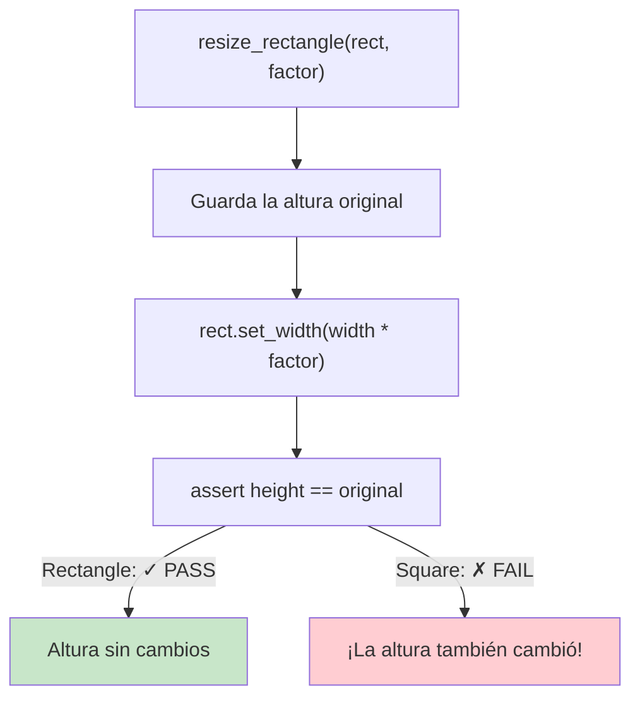
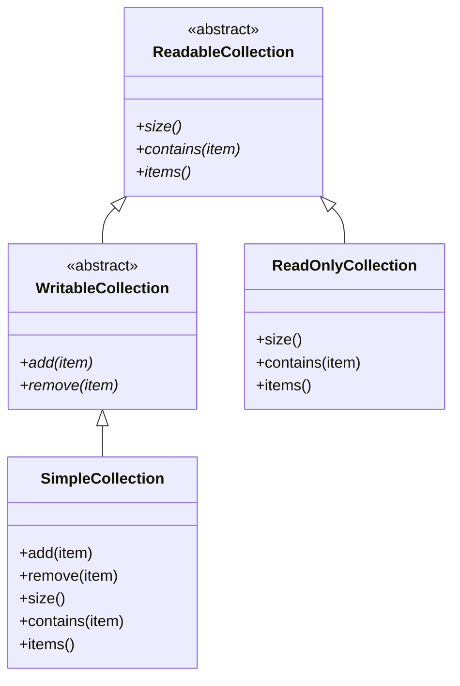
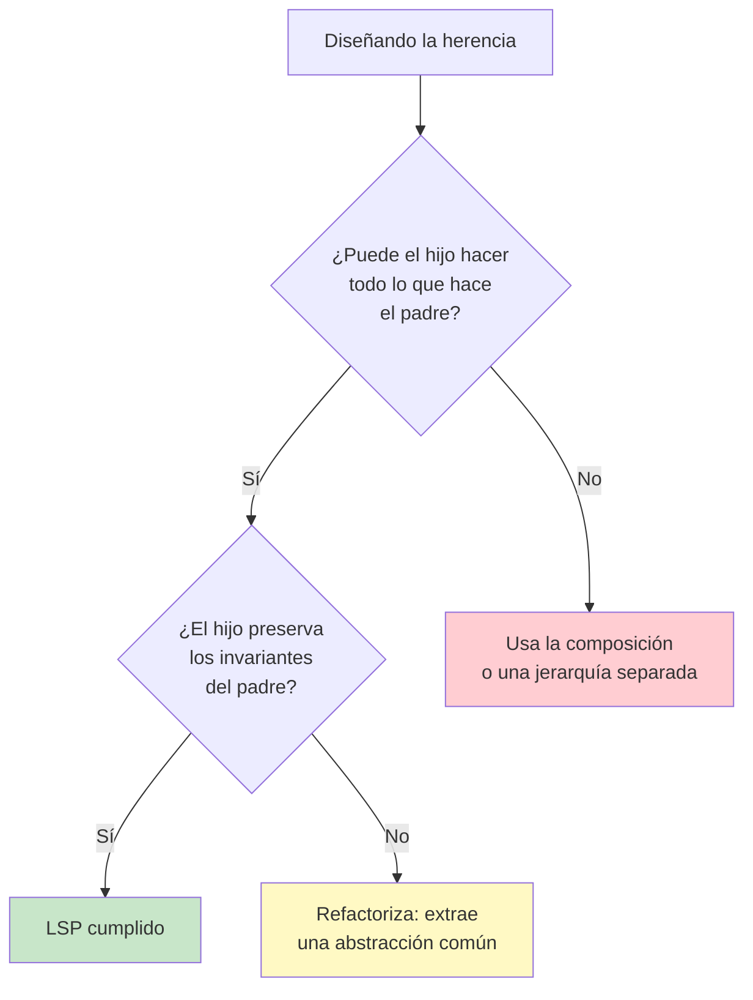

# Principio de Sustitución de Liskov (LSP)

> **Los objetos de una superclase deben poder sustituirse por objetos de sus subclases sin afectar a la corrección del programa.**

Introducido por Barbara Liskov en 1987, el Principio de Sustitución de Liskov es el tercer principio SOLID. Define un contrato de comportamiento fuerte para la herencia: las subclases deben respetar las expectativas establecidas por sus clases padre.

## La Esencia del LSP

Si tienes una función que trabaja con una clase base, debería funcionar correctamente con cualquiera de sus subclases, sin saber de qué subclase se trata.

```python
def process_shape(shape: Shape) -> None:
    print(f"Area: {shape.area()}")
    print(f"Perimeter: {shape.perimeter()}")
```

Esta función debería funcionar correctamente con `Rectangle`, `Circle`, `Triangle`: cualquier subclase de `Shape`. Si una subclase rompe esta expectativa, viola el LSP.

## ANTES: El Problema Clásico del Rectángulo y el Cuadrado

Esta es la violación del LSP más famosa:

```python
class Rectangle:
    def __init__(self, width: float, height: float):
        self.width = width
        self.height = height

    def set_width(self, width: float) -> None:
        self.width = width

    def set_height(self, height: float) -> None:
        self.height = height

    def area(self) -> float:
        return self.width * self.height

class Square(Rectangle):
    def __init__(self, side: float):
        super().__init__(side, side)

    def set_width(self, width: float) -> None:
        self.width = width
        self.height = width  # Maintains square invariant

    def set_height(self, height: float) -> None:
        self.width = height
        self.height = height  # Maintains square invariant
```

A primera vista esto parece razonable. Un cuadrado es un rectángulo, ¿no? Pero observa lo que sucede:

```python
def resize_rectangle(rect: Rectangle, factor: float) -> None:
    """Doubles width, keeps height — should work for any Rectangle."""
    original_height = rect.height
    rect.set_width(rect.width * factor)
    assert rect.height == original_height, "Height should not change!"
    print(f"Area changed from {rect.area() / factor:.2f} to {rect.area():.2f}")

r = Rectangle(10, 5)
resize_rectangle(r, 2)  # Works fine — width=20, height=5

s = Square(5)
resize_rectangle(s, 2)  # BREAKS! height also becomes 10, assertion fails
```

> [!WARNING]
> `Square` viola el LSP porque cambia el invariante de que `set_width` solo afecta al ancho. El código escrito para `Rectangle` asume que `set_width` deja `height` sin cambios.



### La Causa Raíz

`Square` debilita la postcondición de `set_width` y `set_height`. La clase padre garantiza:

| Método | Postcondición en Rectangle | Postcondición en Square | ¿LSP? |
|--------|------------------------|---------------------|------|
| `set_width(w)` | `width == w` | `width == w` AND `height == w` | Viola: restricción más fuerte |
| `set_height(h)` | `height == h` | `height == h` AND `width == h` | Viola: restricción más fuerte |

### DESPUÉS: Diseño Compatible con el LSP

No fuerces la herencia donde no encaja. Usa en su lugar una abstracción común:

```python
from abc import ABC, abstractmethod

class Shape(ABC):
    @abstractmethod
    def area(self) -> float:
        pass

    @abstractmethod
    def perimeter(self) -> float:
        pass

class Rectangle(Shape):
    def __init__(self, width: float, height: float):
        self.width = width
        self.height = height

    def area(self) -> float:
        return self.width * self.height

    def perimeter(self) -> float:
        return 2 * (self.width + self.height)

class Square(Shape):
    def __init__(self, side: float):
        self.side = side

    def area(self) -> float:
        return self.side ** 2

    def perimeter(self) -> float:
        return 4 * self.side

def print_shape_info(shape: Shape) -> None:
    print(f"Area: {shape.area():.2f}, Perimeter: {shape.perimeter():.2f}")

print_shape_info(Rectangle(10, 5))
print_shape_info(Square(5))
```

> [!SUCCESS]
> Tanto `Rectangle` como `Square` son ahora subclases de `Shape`. Ninguna viola el LSP porque `Shape` no tiene los métodos `set_width`/`set_height` que requerirían un comportamiento diferente.

## Definición Formal del LSP

El principio define el subtipado de comportamiento con estas restricciones:

| Restricción | Significado | Ejemplo de violación |
|-----------|---------|------------------|
| **Las precondiciones no pueden reforzarse** | Los métodos de la clase hija no deben añadir restricciones | El padre acepta todos los enteros, el hijo rechaza los negativos |
| **Las postcondiciones no pueden debilitarse** | El hijo debe garantizar al menos lo que garantiza el padre | El padre devuelve no nulo, el hijo devuelve nulo |
| **Los invariantes deben preservarse** | Los invariantes de clase deben cumplirse en el hijo | El campo inmutable del padre es mutable en el hijo |
| **Restricción de historial** | El hijo no debe permitir cambios de estado que el padre prohíbe | El padre es de solo lectura, el hijo permite escrituras |

## Ejemplo 2: Colección con Restricciones

**ANTES: violación del LSP**

```python
class CustomCollection:
    def add(self, item: str) -> None:
        self._items.append(item)

    def remove(self, item: str) -> None:
        self._items.remove(item)

    def size(self) -> int:
        return len(self._items)

class ReadOnlyCollection(CustomCollection):
    def add(self, item: str) -> None:
        raise NotImplementedError("Read-only collection")

    def remove(self, item: str) -> None:
        raise NotImplementedError("Read-only collection")
```

```python
def process_collection(coll: CustomCollection) -> None:
    coll.add("test")
    assert coll.size() == 1
    print("Item added successfully")

process_collection(CustomCollection())  # Works
process_collection(ReadOnlyCollection())  # Raises NotImplementedError!
```

> [!WARNING]
> `ReadOnlyCollection` viola el LSP al reforzar precondiciones y debilitar postcondiciones. El código que espera una `CustomCollection` que soporte `add` fallará con `ReadOnlyCollection`.

**DESPUÉS: compatible con el LSP**

```python
from abc import ABC, abstractmethod

class ReadableCollection(ABC):
    @abstractmethod
    def size(self) -> int:
        pass

    @abstractmethod
    def contains(self, item: str) -> bool:
        pass

    @abstractmethod
    def items(self) -> list[str]:
        pass

class WritableCollection(ReadableCollection):
    @abstractmethod
    def add(self, item: str) -> None:
        pass

    @abstractmethod
    def remove(self, item: str) -> None:
        pass

class SimpleCollection(WritableCollection):
    def __init__(self):
        self._items: list[str] = []

    def add(self, item: str) -> None:
        self._items.append(item)

    def remove(self, item: str) -> None:
        self._items.remove(item)

    def size(self) -> int:
        return len(self._items)

    def contains(self, item: str) -> bool:
        return item in self._items

    def items(self) -> list[str]:
        return list(self._items)

class ReadOnlyCollection(ReadableCollection):
    def __init__(self, items: list[str]):
        self._items = list(items)

    def size(self) -> int:
        return len(self._items)

    def contains(self, item: str) -> bool:
        return item in self._items

    def items(self) -> list[str]:
        return list(self._items)

def show_collection_info(coll: ReadableCollection) -> None:
    print(f"Collection has {coll.size()} items")
    print(f"Items: {coll.items()}")

def add_to_collection(coll: WritableCollection, item: str) -> None:
    coll.add(item)
    print(f"Added {item}, now {coll.size()} items")

show_collection_info(SimpleCollection())
show_collection_info(ReadOnlyCollection(["a", "b"]))
add_to_collection(SimpleCollection(), "test")
```



## Ejemplo 3: Cuenta con Restricciones de Retiro

**ANTES: violación del LSP**

```python
class BankAccount:
    def __init__(self, balance: float = 0):
        self.balance = balance

    def withdraw(self, amount: float) -> None:
        if amount <= 0:
            raise ValueError("Amount must be positive")
        if amount > self.balance:
            raise ValueError("Insufficient funds")
        self.balance -= amount

class FixedDepositAccount(BankAccount):
    def __init__(self, balance: float, maturity_date: str):
        super().__init__(balance)
        self.maturity_date = maturity_date
        self._matured = False

    def withdraw(self, amount: float) -> None:
        if not self._matured:
            raise ValueError("Cannot withdraw before maturity date")
        super().withdraw(amount)
```

```python
def process_withdrawal(account: BankAccount, amount: float) -> None:
    initial = account.balance
    account.withdraw(amount)
    assert account.balance == initial - amount
    print(f"Withdrew {amount}, balance: {account.balance}")

process_withdrawal(BankAccount(1000), 200)  # Works
process_withdrawal(FixedDepositAccount(5000, "2026-01-01"), 500)  # Fails!
```

**DESPUÉS: compatible con el LSP**

```python
from abc import ABC, abstractmethod

class Account(ABC):
    def __init__(self, balance: float = 0):
        self._balance = balance

    @property
    def balance(self) -> float:
        return self._balance

    @abstractmethod
    def can_withdraw(self) -> bool:
        pass

    def deposit(self, amount: float) -> None:
        if amount <= 0:
            raise ValueError("Amount must be positive")
        self._balance += amount

class WithdrawableAccount(Account):
    def withdraw(self, amount: float) -> None:
        if amount <= 0:
            raise ValueError("Amount must be positive")
        if amount > self._balance:
            raise ValueError("Insufficient funds")
        self._balance -= amount

    def can_withdraw(self) -> bool:
        return self._balance > 0

class CheckingAccount(WithdrawableAccount):
    pass

class SavingsAccount(WithdrawableAccount):
    withdrawal_limit = 6

    def withdraw(self, amount: float) -> None:
        if amount > self._balance * 0.8:
            raise ValueError("Exceeds withdrawal limit")
        super().withdraw(amount)

class FixedDepositAccount(Account):
    def __init__(self, balance: float, maturity_date: str):
        super().__init__(balance)
        self.maturity_date = maturity_date

    def can_withdraw(self) -> bool:
        from datetime import date
        return date.today() >= date.fromisoformat(self.maturity_date)

    def withdraw(self, amount: float) -> None:
        if not self.can_withdraw():
            raise ValueError("Account has not matured yet")
        if amount <= 0:
            raise ValueError("Amount must be positive")
        if amount > self._balance:
            raise ValueError("Insufficient funds")
        self._balance -= amount

def process_account(account: Account) -> None:
    print(f"Balance: ${account.balance:.2f}")
    print(f"Can withdraw: {account.can_withdraw()}")

def process_withdrawal(account: WithdrawableAccount, amount: float) -> None:
    initial = account.balance
    account.withdraw(amount)
    print(f"Withdrew ${amount:.2f}, remaining: ${account.balance:.2f}")
    assert account.balance == initial - amount

process_account(CheckingAccount(1000))
process_account(FixedDepositAccount(5000, "2026-01-01"))
process_withdrawal(CheckingAccount(1000), 200)
```

## Ejemplo 4: El Problema de la Jerarquía de Aves

**ANTES: violación del LSP**

```python
class Bird:
    def fly(self) -> str:
        return "Flying"

    def eat(self) -> str:
        return "Eating"

class Penguin(Bird):
    def fly(self) -> str:
        raise NotImplementedError("Penguins can't fly!")

def let_bird_fly(bird: Bird) -> None:
    print(bird.fly())

let_bird_fly(Bird())    # "Flying"
let_bird_fly(Penguin())  # NotImplementedError!
```

**DESPUÉS: compatible con el LSP**

```python
from abc import ABC, abstractmethod

class Bird(ABC):
    @abstractmethod
    def eat(self) -> str:
        pass

class FlyingBird(Bird):
    @abstractmethod
    def fly(self) -> str:
        pass

class SwimmingBird(Bird):
    @abstractmethod
    def swim(self) -> str:
        pass

class Sparrow(FlyingBird):
    def eat(self) -> str:
        return "Sparrow eating seeds"

    def fly(self) -> str:
        return "Sparrow flying"

class Penguin(SwimmingBird):
    def eat(self) -> str:
        return "Penguin eating fish"

    def swim(self) -> str:
        return "Penguin swimming"

def feed_bird(bird: Bird) -> None:
    print(bird.eat())

def let_fly(bird: FlyingBird) -> None:
    print(bird.fly())

def let_swim(bird: SwimmingBird) -> None:
    print(bird.swim())

feed_bird(Sparrow())
feed_bird(Penguin())
let_fly(Sparrow())
let_swim(Penguin())
```

## LSP vs. Directrices de Herencia

| Directriz | Descripción |
|-----------|-------------|
| **El subtipo exige** | El hijo no debe exigir más que el padre (precondiciones) |
| **El subtipo proporciona** | El hijo no debe proporcionar menos que el padre (postcondiciones) |
| **El subtipo preserva** | El hijo debe preservar todos los invariantes del padre |
| **El subtipo no lanza excepciones** | El hijo no debe lanzar tipos de excepción que el padre no lanza |
| **El subtipo devuelve el mismo tipo** | El tipo de retorno del hijo debe ser un subtipo del tipo de retorno del padre (covarianza) |

## Violaciones del LSP: Señales de Alerta

| Señal | Problema |
|------|---------|
| El hijo sobrescribe un método para no hacer nada o lanzar | Debilita la postcondición |
| El hijo sobrescribe un método para rechazar entradas válidas | Refuerza la precondición |
| Comprobaciones `isinstance` en el código cliente | El cliente sabe que la subclase rompe el contrato |
| La relación "es-un" resulta forzada | Cuadrado-Rectángulo, Ave-Pingüino |
| El hijo lanza tipos de excepción nuevos | El cliente no puede manejarlos |
| El hijo rompe los invariantes del padre | Campo mutable en una clase supuestamente inmutable |

> [!TIP]
> Si te descubres escribiendo `if isinstance(obj, SpecificType):` para manejar excepciones, casi siempre es una violación del LSP. El polimorfismo debería manejar la variación; las comprobaciones de tipo son un antipatrón de código.

## Contratos de Comportamiento

El LSP trata sobre contratos de comportamiento, no solo sobre firmas de tipo:

```python
from typing import Protocol, runtime_checkable

@runtime_checkable
class Container(Protocol):
    def add(self, item: str) -> None: ...
    def remove(self, item: str) -> None: ...
    def __len__(self) -> int: ...
    def __contains__(self, item: str) -> bool: ...

class ListContainer:
    def __init__(self):
        self._items: list[str] = []

    def add(self, item: str) -> None:
        self._items.append(item)

    def remove(self, item: str) -> None:
        self._items.remove(item)

    def __len__(self) -> int:
        return len(self._items)

    def __contains__(self, item: str) -> bool:
        return item in self._items

class SetContainer:
    def __init__(self):
        self._items: set[str] = set()

    def add(self, item: str) -> None:
        self._items.add(item)

    def remove(self, item: str) -> None:
        self._items.discard(item)

    def __len__(self) -> int:
        return len(self._items)

    def __contains__(self, item: str) -> bool:
        return item in self._items

def add_duplicate(cont: Container, item: str) -> None:
    """Add item twice — should work for any Container."""
    cont.add(item)
    cont.add(item)
    print(f"Count after adding {item!r} twice: {len(cont)}")

add_duplicate(ListContainer(), "hello")  # Count: 2
add_duplicate(SetContainer(), "hello")   # Count: 1 — still correct
```

Tanto `ListContainer` como `SetContainer` cumplen el protocolo `Container`. La función funciona correctamente con ambos porque ninguno viola el contrato de comportamiento.

## Comparación de Enfoques de Diseño

| Enfoque | Estado del LSP | Notas |
|----------|-----------|-------|
| Square hereda de Rectangle | Viola | Mutar una dimensión cambia la otra |
| Shape → Rectangle, Square | Cumple | Ambos son subtipos de Shape |
| Bird → Penguin (fly) | Viola | El pingüino no puede volar |
| Bird → FlyingBird, SwimmingBird | Cumple | Interfaces separadas para comportamientos separados |
| CustomCollection → ReadOnlyCollection | Viola | Lanza excepciones en add/remove |
| ReadableCollection → WritableCollection | Cumple | Segregación de interfaces |



## LSP y Programación por Contrato

La Programación por Contrato (DbC) formaliza el LSP:

| Término | Significado |
|------|---------|
| **Precondición** | Lo que debe ser verdad antes de llamar a un método |
| **Postcondición** | Lo que debe ser verdad después de llamar a un método |
| **Invariante** | Lo que debe ser siempre verdad sobre un objeto |

Para el LSP:
- **El hijo no puede reforzar las precondiciones** (no puede rechazar lo que el padre acepta)
- **El hijo no puede debilitar las postcondiciones** (debe garantizar al menos lo que garantiza el padre)
- **El hijo debe preservar todos los invariantes** (no puede romper las garantías del padre)

> [!NOTE]
> Aunque Python no impone contratos de forma nativa, puedes usar sentencias `assert`, la validación de `dataclass` o bibliotecas como `icontract` para hacerlo. Lo importante es *diseñar* teniendo en cuenta los contratos.

## Ejercicios Prácticos

1. ¿El siguiente código viola el LSP? ¿Por qué? Refactorízalo.
   ```python
   class Stack:
       def push(self, item): ...
       def pop(self): ...
   class NoPopStack(Stack):
       def pop(self):
           raise RuntimeError("Cannot pop from this stack")
   ```

2. El problema `Rectangle`-`Square` es la violación clásica del LSP. Crea un diseño correcto usando una clase base `Shape` con `area()` y `perimeter()`.

3. Identifica la violación del LSP en este código y corrígela:
   ```python
   class FileWriter:
       def write(self, data: str) -> None:
           with open("output.txt", "w") as f:
               f.write(data)
   class ReadOnlyFileWriter(FileWriter):
       def write(self, data: str) -> None:
           pass  # Does nothing
   ```

4. Una clase `Vehicle` tiene `start_engine()` y `drive()`. Una subclase `Bicycle` lanza `NotImplementedError` en `start_engine()`. ¿Cómo lo refactorizarías?

5. Explica la relación entre el LSP y la regla "es-un" de la herencia. ¿Cuándo NO deberías usar herencia?

6. Crea una jerarquía correcta: `DatabaseConnection` con los métodos `connect()`, `query()`, `disconnect()`. Crea las subclases `MySQLConnection`, `PostgreSQLConnection` y `RedisConnection`. Asegúrate de que se cumpla el LSP.

7. ¿Qué patrón o patrones de diseño ayudan a evitar violaciones del LSP? Da un ejemplo concreto.

8. Refactoriza este código para que sea compatible con el LSP:
   ```python
   class Discount:
       def apply(self, price: float) -> float:
           return price
   class NoDiscount(Discount):
       def apply(self, price: float) -> float:
           return price
   class PercentageDiscount(Discount):
       def __init__(self, percent: float):
           self.percent = percent
       def apply(self, price: float) -> float:
           return price * (1 - self.percent / 100)
   class FixedDiscount(Discount):
       def __init__(self, amount: float):
           self.amount = amount
       def apply(self, price: float) -> float:
           result = price - self.amount
           return result if result > 0 else 0
   ```

## Resumen

- **LSP**: los subtipos deben poder sustituir a sus tipos base
- **Contrato de comportamiento**: no se pueden reforzar las precondiciones, no se pueden debilitar las postcondiciones y los invariantes deben preservarse
- **Violación clásica**: Cuadrado-Rectángulo, Ave-Pingüino
- **Solución**: prefiere la composición y usa interfaces separadas para comportamientos separados
- **Detección**: comprobaciones `isinstance`, sobrescrituras que lanzan o no hacen nada, invariantes rotos
- **Idea clave**: un "es-un" desde la perspectiva del modelado no siempre significa "es-un" desde la perspectiva del comportamiento

> [!SUCCESS]
> El LSP nos enseña que la herencia trata sobre comportamiento, no solo sobre estructura. Una jerarquía bien diseñada garantiza que cualquier subclase pueda sustituir a su padre con seguridad y sin sorpresas.
