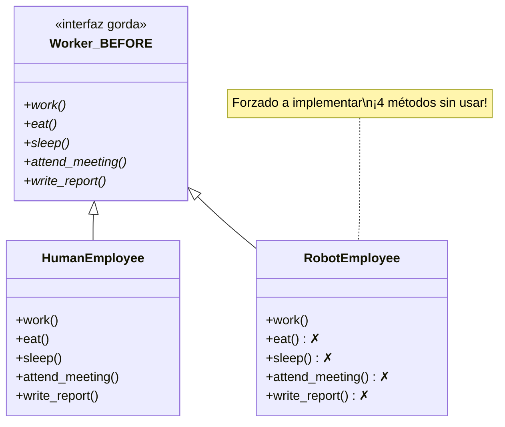
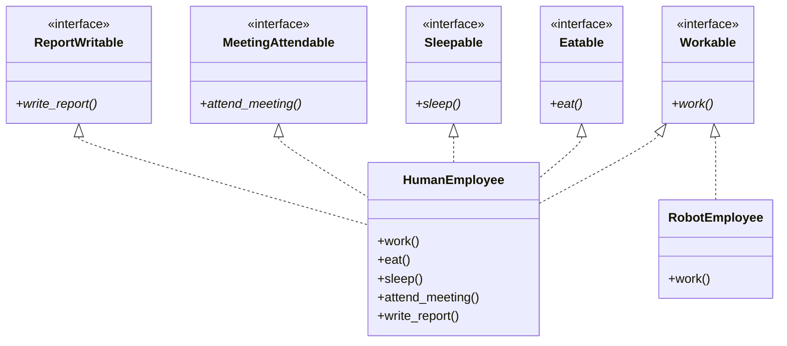
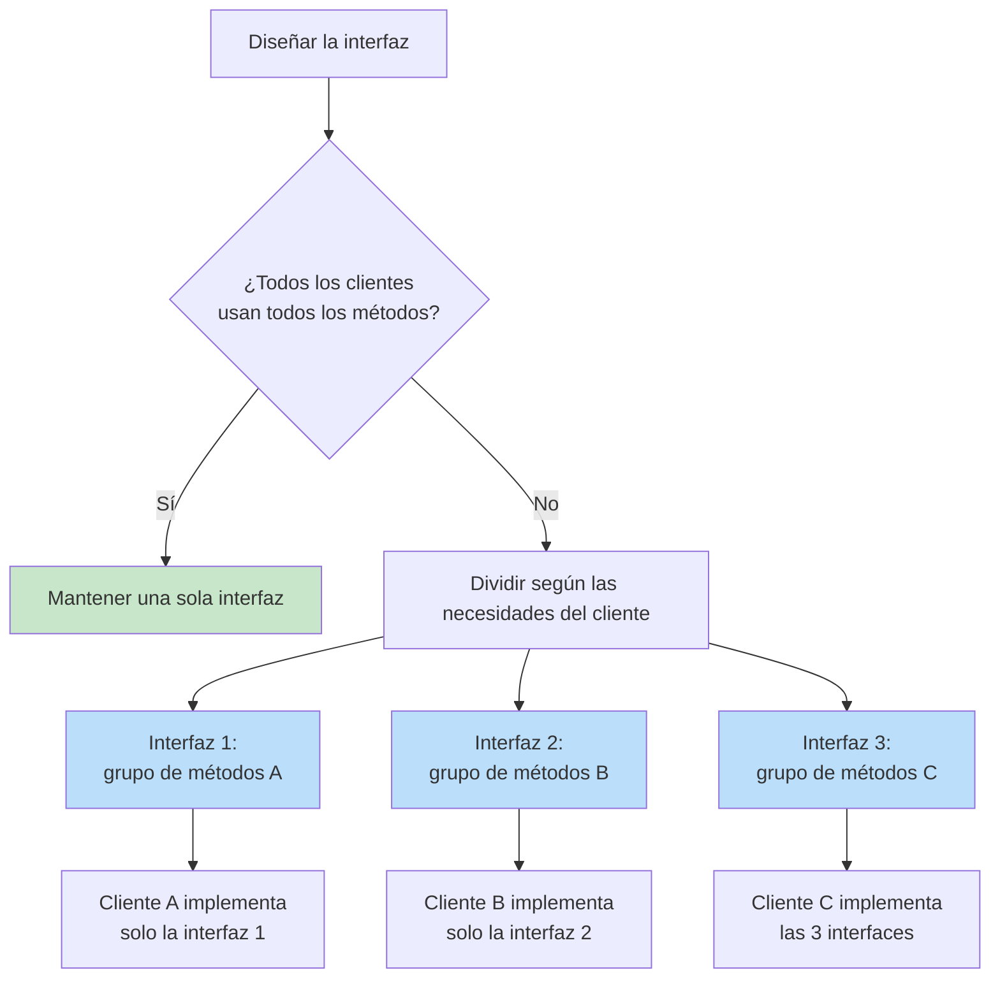

# Principio de Segregación de Interfaces (ISP)

> **Los clientes no deben verse obligados a depender de interfaces que no utilizan.**

El Principio de Segregación de Interfaces es el cuarto principio SOLID. Establece que ningún cliente debe verse obligado a implementar métodos que no usa. Las interfaces grandes, o "gordas", deben dividirse en interfaces más pequeñas y más específicas, de modo que los clientes solo conozcan los métodos que les resultan relevantes.

## El problema: las interfaces gordas

Cuando una interfaz tiene muchos métodos, las clases que la implementan se ven obligadas a proporcionar cuerpos para métodos que no necesitan. Esto produce implementaciones vacías, stubs con `NotImplementedError` y código confuso.

### ANTES: violación del ISP: una interfaz gorda

```python
from abc import ABC, abstractmethod
from typing import Any

class Worker(ABC):
    @abstractmethod
    def work(self) -> str:
        pass

    @abstractmethod
    def eat(self) -> str:
        pass

    @abstractmethod
    def sleep(self) -> str:
        pass

    @abstractmethod
    def attend_meeting(self) -> str:
        pass

    @abstractmethod
    def write_report(self) -> str:
        pass
```

Ahora cualquier clase que implemente `Worker` debe proporcionar los cinco métodos:

```python
class HumanEmployee(Worker):
    def work(self) -> str:
        return "Writing code"

    def eat(self) -> str:
        return "Eating lunch"

    def sleep(self) -> str:
        return "Sleeping 8 hours"

    def attend_meeting(self) -> str:
        return "Attending standup"

    def write_report(self) -> str:
        return "Writing weekly report"

class RobotEmployee(Worker):
    def work(self) -> str:
        return "Assembling parts"

    def eat(self) -> str:
        raise NotImplementedError("Robots don't eat")

    def sleep(self) -> str:
        raise NotImplementedError("Robots don't sleep")

    def attend_meeting(self) -> str:
        raise NotImplementedError("Robots don't attend meetings")

    def write_report(self) -> str:
        raise NotImplementedError("Robots don't write reports")
```

> [!WARNING]
> `RobotEmployee` se ve obligado a implementar cuatro métodos que no necesita. Esto viola el ISP. La interfaz gorda `Worker` obliga a los clientes a depender de métodos que no utilizan.

```python
def manage_worker(worker: Worker) -> None:
    print(worker.work())
    print(worker.eat())       # Crashes for RobotEmployee!
    print(worker.sleep())     # Crashes for RobotEmployee!

try:
    manage_worker(RobotEmployee())
except NotImplementedError as e:
    print(f"Error: {e}")
```



### DESPUÉS: cumplimiento del ISP: interfaces segregadas

```python
from abc import ABC, abstractmethod

class Workable(ABC):
    @abstractmethod
    def work(self) -> str:
        pass

class Eatable(ABC):
    @abstractmethod
    def eat(self) -> str:
        pass

class Sleepable(ABC):
    @abstractmethod
    def sleep(self) -> str:
        pass

class MeetingAttendable(ABC):
    @abstractmethod
    def attend_meeting(self) -> str:
        pass

class ReportWritable(ABC):
    @abstractmethod
    def write_report(self) -> str:
        pass

class HumanEmployee(Workable, Eatable, Sleepable,
                    MeetingAttendable, ReportWritable):
    def work(self) -> str:
        return "Writing code"

    def eat(self) -> str:
        return "Eating lunch"

    def sleep(self) -> str:
        return "Sleeping 8 hours"

    def attend_meeting(self) -> str:
        return "Attending standup"

    def write_report(self) -> str:
        return "Writing weekly report"

class RobotEmployee(Workable):
    def work(self) -> str:
        return "Assembling parts"

def manage_worker(worker: Workable) -> None:
    print(worker.work())

def lunch_break(worker: Eatable) -> None:
    print(worker.eat())

manage_worker(RobotEmployee())       # Works
manage_worker(HumanEmployee())       # Works
lunch_break(HumanEmployee())         # Works
# lunch_break(RobotEmployee())       # Type error — RobotEmployee is not Eatable
```

> [!SUCCESS]
> Cada interfaz tiene una única responsabilidad clara. `RobotEmployee` solo implementa lo que necesita. Ninguna clase se ve obligada a depender de métodos que no utiliza.



## Ejemplo 2: sistema de procesamiento de documentos

**ANTES: interfaz gorda**

```python
from abc import ABC, abstractmethod

class DocumentProcessor(ABC):
    @abstractmethod
    def read(self, path: str) -> str:
        pass

    @abstractmethod
    def write(self, path: str, content: str) -> None:
        pass

    @abstractmethod
    def format_as_pdf(self) -> bytes:
        pass

    @abstractmethod
    def format_as_html(self) -> str:
        pass

    @abstractmethod
    def spell_check(self) -> list[str]:
        pass

    @abstractmethod
    def translate(self, target_lang: str) -> str:
        pass
```

```python
class ReadOnlyDocument(DocumentProcessor):
    def read(self, path: str) -> str:
        from pathlib import Path
        return Path(path).read_text()

    def write(self, path: str, content: str) -> None:
        raise NotImplementedError("Read-only document")

    def format_as_pdf(self) -> bytes:
        raise NotImplementedError("Not supported")

    def format_as_html(self) -> str:
        raise NotImplementedError("Not supported")

    def spell_check(self) -> list[str]:
        raise NotImplementedError("Not supported")

    def translate(self, target_lang: str) -> str:
        raise NotImplementedError("Not supported")
```

> [!WARNING]
> `ReadOnlyDocument` se ve obligado a implementar cinco métodos que no necesita. Cada uno de ellos lanza `NotImplementedError`.

**DESPUÉS: interfaces segregadas**

```python
from abc import ABC, abstractmethod

class Readable(ABC):
    @abstractmethod
    def read(self, path: str) -> str:
        pass

class Writable(ABC):
    @abstractmethod
    def write(self, path: str, content: str) -> None:
        pass

class PDFFormattable(ABC):
    @abstractmethod
    def format_as_pdf(self) -> bytes:
        pass

class HTMLFormattable(ABC):
    @abstractmethod
    def format_as_html(self) -> str:
        pass

class SpellCheckable(ABC):
    @abstractmethod
    def spell_check(self) -> list[str]:
        pass

class Translatable(ABC):
    @abstractmethod
    def translate(self, target_lang: str) -> str:
        pass

class ReadOnlyDocument(Readable):
    def read(self, path: str) -> str:
        from pathlib import Path
        return Path(path).read_text()

class EditableDocument(Readable, Writable, SpellCheckable):
    def read(self, path: str) -> str:
        from pathlib import Path
        return Path(path).read_text()

    def write(self, path: str, content: str) -> None:
        from pathlib import Path
        Path(path).write_text(content)

    def spell_check(self) -> list[str]:
        return ["word1", "word2"]  # Example

class WebDocument(Readable, HTMLFormattable, Translatable):
    def read(self, path: str) -> str:
        from pathlib import Path
        return Path(path).read_text()

    def format_as_html(self) -> str:
        content = self.read("doc.txt")
        return f"<html><body><p>{content}</p></body></html>"

    def translate(self, target_lang: str) -> str:
        content = self.read("doc.txt")
        return f"[Translated to {target_lang}]: {content}"

def display_document(doc: Readable) -> None:
    print(doc.read("doc.txt"))

def save_document(doc: Writable, content: str) -> None:
    doc.write("doc.txt", content)
    print("Saved!")

def check_spelling(doc: SpellCheckable) -> None:
    errors = doc.spell_check()
    print(f"Spelling errors: {errors}")
```

## Ejemplo 3: sistema de notificaciones con ISP

**ANTES: interfaz monolítica**

```python
from abc import ABC, abstractmethod

class NotificationService(ABC):
    @abstractmethod
    def send_email(self, to: str, subject: str, body: str) -> None:
        pass

    @abstractmethod
    def send_sms(self, to: str, message: str) -> None:
        pass

    @abstractmethod
    def send_push(self, device_token: str, message: str) -> None:
        pass

    @abstractmethod
    def send_slack(self, channel: str, message: str) -> None:
        pass

    @abstractmethod
    def send_teams(self, webhook_url: str, message: str) -> None:
        pass
```

```python
class EmailOnlyService(NotificationService):
    def send_email(self, to: str, subject: str, body: str) -> None:
        print(f"Sending email to {to}: {subject}")

    def send_sms(self, to: str, message: str) -> None:
        raise NotImplementedError

    def send_push(self, device_token: str, message: str) -> None:
        raise NotImplementedError

    def send_slack(self, channel: str, message: str) -> None:
        raise NotImplementedError

    def send_teams(self, webhook_url: str, message: str) -> None:
        raise NotImplementedError
```

**DESPUÉS: interfaces segregadas**

```python
from abc import ABC, abstractmethod

class EmailSender(ABC):
    @abstractmethod
    def send_email(self, to: str, subject: str, body: str) -> None:
        pass

class SMSSender(ABC):
    @abstractmethod
    def send_sms(self, to: str, message: str) -> None:
        pass

class PushSender(ABC):
    @abstractmethod
    def send_push(self, device_token: str, message: str) -> None:
        pass

class SlackSender(ABC):
    @abstractmethod
    def send_slack(self, channel: str, message: str) -> None:
        pass

class TeamsSender(ABC):
    @abstractmethod
    def send_teams(self, webhook_url: str, message: str) -> None:
        pass

class SmtpEmailService(EmailSender):
    def __init__(self, smtp_host: str = "smtp.example.com"):
        self.smtp_host = smtp_host

    def send_email(self, to: str, subject: str, body: str) -> None:
        import smtplib
        from email.message import EmailMessage
        msg = EmailMessage()
        msg["Subject"] = subject
        msg["To"] = to
        msg.set_content(body)
        with smtplib.SMTP(self.smtp_host) as server:
            server.send_message(msg)

class TwilioSMSService(SMSSender):
    def send_sms(self, to: str, message: str) -> None:
        print(f"[SMS to {to}]: {message}")
        # Integration with Twilio API

class FirebasePushService(PushSender):
    def send_push(self, device_token: str, message: str) -> None:
        print(f"[Push to {device_token[:8]}...]: {message}")
        # Integration with Firebase Cloud Messaging

class CompositeNotifier(EmailSender, SMSSender, PushSender, SlackSender):
    """A service that can send via multiple channels."""
    def __init__(self):
        self._services: list = []

    def add_service(self, service) -> None:
        self._services.append(service)

    def send_email(self, to: str, subject: str, body: str) -> None:
        for s in self._services:
            if isinstance(s, EmailSender):
                s.send_email(to, subject, body)

    def send_sms(self, to: str, message: str) -> None:
        for s in self._services:
            if isinstance(s, SMSSender):
                s.send_sms(to, message)

    def send_push(self, device_token: str, message: str) -> None:
        for s in self._services:
            if isinstance(s, PushSender):
                s.send_push(device_token, message)

    def send_slack(self, channel: str, message: str) -> None:
        for s in self._services:
            if isinstance(s, SlackSender):
                s.send_slack(channel, message)
```

## ISP y los Protocolos de Python

Los Protocolos de `typing` de Python hacen que el ISP sea natural: ni siquiera necesitas clases base abstractas explícitas:

```python
from typing import Protocol

class Drawable(Protocol):
    def draw(self) -> str: ...

class Saveable(Protocol):
    def save(self, path: str) -> None: ...

class Printable(Protocol):
    def print_to(self, device: str) -> str: ...

class Circle:
    def draw(self) -> str:
        return "Drawing a circle"

    def save(self, path: str) -> None:
        from pathlib import Path
        Path(path).write_text(f"Circle at {path}")

class TextDocument:
    def save(self, path: str) -> None:
        from pathlib import Path
        Path(path).write_text("Document content")

    def print_to(self, device: str) -> str:
        return f"Printing to {device}"

class Screen:
    def draw(self) -> str:
        return "Drawing on screen"

    def print_to(self, device: str) -> str:
        return f"Screen output to {device}"

def render(thing: Drawable) -> None:
    print(thing.draw())

def persist(thing: Saveable) -> None:
    thing.save("output.dat")

def output(thing: Printable) -> None:
    print(thing.print_to("printer"))

render(Circle())      # Works
persist(Circle())     # Works
persist(TextDocument())  # Works
output(TextDocument())   # Works
```

> [!TIP]
> El subtipado estructural de Python (los Protocolos) fomenta de forma natural el ISP. A diferencia del tipado nominal, una clase no necesita declarar que implementa una interfaz: solo tiene que tener los métodos adecuados.

## Cuándo dividir las interfaces

| Criterio | Mantener juntas | Dividirlas |
|-----------|--------------|-------------|
| Métodos que siempre se usan juntos | Sí | No |
| Diferentes clientes necesitan diferentes subconjuntos | No | Sí |
| La implementación encaja de forma natural en la misma clase | Sí | No |
| Los métodos están en el mismo nivel de abstracción | Sí | No |
| Algunas implementaciones quedarían vacías o lanzarían excepciones | No | Sí |

## Violaciones del ISP: señales de alerta

| Señal | Problema | Solución |
|------|---------|-----|
| Cuerpo de método vacío | Obligado a implementar un método sin usar | Dividir la interfaz |
| `raise NotImplementedError` | No debería estar en la interfaz | Dividir la interfaz |
| `raise UnsupportedOperationError` | Nivel de abstracción incorrecto | Dividir la interfaz |
| `pass` como implementación | Operación sin efecto en un método requerido | Dividir la interfaz |
| Interfaz gorda con muchos métodos | Probablemente varios aspectos distintos | Extraer en interfaces más pequeñas |
| Comprobaciones `isinstance` de implementaciones concretas | El cliente sabe que las subclases omiten métodos | Dividir la interfaz |

> [!NOTE]
> Una interfaz gorda es aquella en la que la mayoría de las implementaciones solo usa un subconjunto de métodos. La "gordura" es relativa a los clientes, no al número de métodos.

## Comparación: ISP antes y después

| Aspecto | Interfaz gorda (antes) | Interfaces segregadas (después) |
|--------|----------------------|------------------------------|
| Número de interfaces | 1 | N (pequeñas y enfocadas) |
| Carga de implementación | Alta (todos los métodos) | Baja (solo los métodos necesarios) |
| Dependencia del cliente | Métodos innecesarios | Solo lo necesario |
| Impacto del cambio | Un cambio de interfaz afecta a todos los clientes | El cambio afecta solo a los clientes relevantes |
| Testeabilidad | Más difícil (más mocking) | Más fácil (contratos enfocados) |
| Reutilización | Baja | Alta |



## ISP y el patrón Adapter

Cuando necesites trabajar con una interfaz gorda ya existente, el patrón Adapter puede ayudarte:

```python
from abc import ABC, abstractmethod

# Existing fat interface (can't change — third-party library)
class LegacyWorker(ABC):
    @abstractmethod
    def work(self): pass
    @abstractmethod
    def eat(self): pass
    @abstractmethod
    def sleep(self): pass

# Our thin interfaces
class Workable(ABC):
    @abstractmethod
    def perform_work(self) -> str: pass

# Adapter
class RobotWorkerAdapter(Workable):
    def __init__(self, robot: LegacyWorker):
        self.robot = robot

    def perform_work(self) -> str:
        return self.robot.work()

# Concrete legacy class
class LegacyRobot(LegacyWorker):
    def work(self):
        return "Robot working"
    def eat(self):
        raise NotImplementedError
    def sleep(self):
        raise NotImplementedError

legacy = LegacyRobot()
adapter = RobotWorkerAdapter(legacy)
print(adapter.perform_work())  # "Robot working"
```

## Mundo real: checkout de comercio electrónico

**ANTES: interfaz gorda**

```python
from abc import ABC, abstractmethod

class CheckoutStep(ABC):
    @abstractmethod
    def validate_cart(self) -> bool: pass
    @abstractmethod
    def calculate_shipping(self) -> float: pass
    @abstractmethod
    def calculate_tax(self) -> float: pass
    @abstractmethod
    def apply_discount(self, code: str) -> float: pass
    @abstractmethod
    def process_payment(self) -> str: pass
    @abstractmethod
    def send_confirmation(self) -> None: pass
    @abstractmethod
    def update_inventory(self) -> None: pass
```

**DESPUÉS: segregadas**

```python
from abc import ABC, abstractmethod

class CartValidator(ABC):
    @abstractmethod
    def validate(self) -> bool: pass

class ShippingCalculator(ABC):
    @abstractmethod
    def calculate(self) -> float: pass

class TaxCalculator(ABC):
    @abstractmethod
    def calculate(self, subtotal: float) -> float: pass

class DiscountApplicator(ABC):
    @abstractmethod
    def apply(self, code: str, total: float) -> float: pass

class PaymentProcessor(ABC):
    @abstractmethod
    def process(self, amount: float) -> str: pass

class ConfirmationSender(ABC):
    @abstractmethod
    def send(self, transaction_id: str, email: str) -> None: pass

class InventoryUpdater(ABC):
    @abstractmethod
    def update(self, items: list) -> None: pass

class CheckoutService:
    def __init__(self, validator: CartValidator,
                 shipping: ShippingCalculator,
                 tax: TaxCalculator,
                 discount: DiscountApplicator,
                 payment: PaymentProcessor,
                 confirmation: ConfirmationSender,
                 inventory: InventoryUpdater):
        self._validator = validator
        self._shipping = shipping
        self._tax = tax
        self._discount = discount
        self._payment = payment
        self._confirmation = confirmation
        self._inventory = inventory

    def checkout(self, cart: dict, discount_code: str | None = None,
                 email: str = "") -> dict:
        self._validator.validate()
        subtotal = sum(item["price"] * item["qty"] for item in cart["items"])
        shipping = self._shipping.calculate()
        tax = self._tax.calculate(subtotal)
        total = subtotal + shipping + tax
        if discount_code:
            total = self._discount.apply(discount_code, total)
        txn_id = self._payment.process(total)
        self._inventory.update(cart["items"])
        if email:
            self._confirmation.send(txn_id, email)
        return {"transaction_id": txn_id, "total": total}
```

> [!SUCCESS]
> Cada interfaz representa una responsabilidad única y bien definida en el proceso de checkout. Las nuevas pasarelas de pago, los proveedores de envío o los calculadores de impuestos pueden implementarse de forma independiente.

## Ejercicios prácticos

1. Identifica la violación del ISP en este código y refactorízalo:
   ```python
   class MultiFunctionPrinter(ABC):
       @abstractmethod
       def print(self, doc): pass
       @abstractmethod
       def scan(self, doc): pass
       @abstractmethod
       def fax(self, doc): pass
       @abstractmethod
       def staple(self, doc): pass
   class SimplePrinter(MultiFunctionPrinter):
       def print(self, doc): ...
       def scan(self, doc): raise NotImplementedError
       def fax(self, doc): raise NotImplementedError
       def staple(self, doc): raise NotImplementedError
   ```

2. Divide la siguiente interfaz siguiendo el ISP:
   ```python
   class UserService(ABC):
       @abstractmethod
       def create_user(self, data): pass
       @abstractmethod
       def update_user(self, id, data): pass
       @abstractmethod
       def delete_user(self, id): pass
       @abstractmethod
       def send_welcome_email(self, email): pass
       @abstractmethod
       def send_password_reset(self, email): pass
       @abstractmethod
       def generate_report(self): pass
       @abstractmethod
       def export_users_csv(self): pass
   ```

3. ¿Cuál es la diferencia entre ISP y SRP? ¿Cómo se complementan entre sí?

4. Refactoriza lo siguiente para usar los Protocolos de Python (tipado estructural) con el ISP:
   ```python
   class MediaPlayer(ABC):
       @abstractmethod
       def play(self): pass
       @abstractmethod
       def pause(self): pass
       @abstractmethod
       def stop(self): pass
       @abstractmethod
       def record(self): pass
   ```

5. Una interfaz `Database` tiene `connect()`, `query()`, `insert()`, `update()`, `delete()`, `backup()`, `restore()`. Un `ReadOnlyDatabase` solo usa `connect()` y `query()`. Aplica el ISP.

6. Explica cómo se relaciona el ISP con el patrón Adapter. ¿Cuándo usarías un adaptador en lugar de refactorizar la interfaz?

7. Diseña interfaces para un sistema de hogar inteligente donde los controladores de luces, los del termostato y las cámaras de seguridad necesiten cada uno subconjuntos distintos de capacidades (encender y apagar, ajustar la temperatura, grabar vídeo, detectar movimiento).

8. ¿De qué manera una segregación de interfaces demasiado agresiva puede convertirse en un problema? ¿Cuál es el equilibrio entre el ISP y el pragmatismo?

## Resumen

- **ISP**: los clientes no deben verse obligados a depender de interfaces que no utilizan
- **Las interfaces gordas** obligan a las clases implementantes a proporcionar métodos sin usar (cuerpos vacíos o excepciones)
- **Solución**: dividir las interfaces grandes en interfaces más pequeñas, específicas de cada rol
- **Los Protocolos de Python** (subtipado estructural) fomentan de forma natural el ISP
- **Patrones relacionados**: el patrón Adapter ayuda a puentear interfaces gordas con interfaces segregadas
- **ISP + SRP**: el ISP trata del diseño de interfaces para los clientes; el SRP trata del diseño de clases para las responsabilidades
- **Equilibrio**: divide lo suficiente para evitar interfaces gordas, pero no tanto que crees complejidad innecesaria

> [!SUCCESS]
> El ISP mantiene tus interfaces ligeras y tus implementaciones honestas. Cada cliente depende exactamente de lo que necesita: nada más, nada menos.
