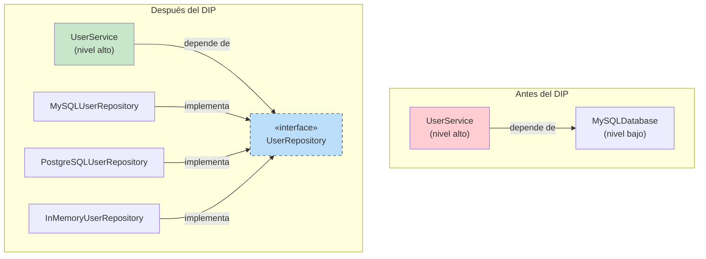
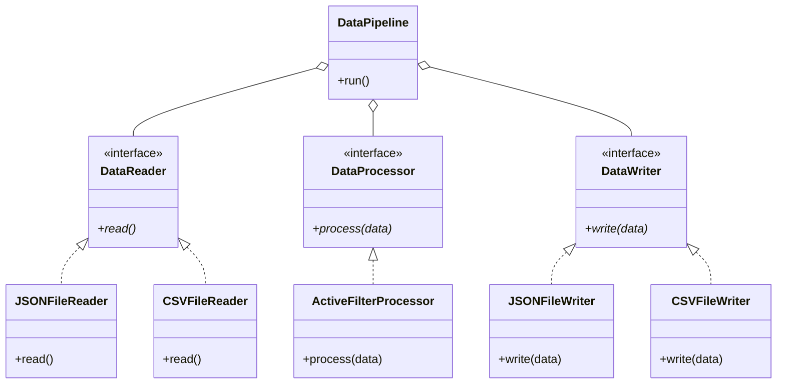
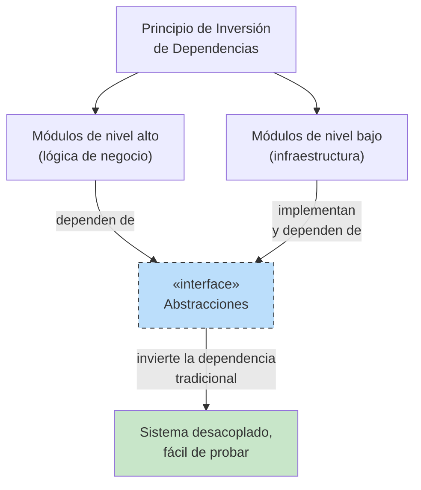

# Principio de Inversión de Dependencias (DIP)

> **Los módulos de alto nivel no deberían depender de los módulos de bajo nivel. Ambos deberían depender de abstracciones.**
> **Las abstracciones no deberían depender de los detalles. Los detalles deberían depender de abstracciones.**

El Principio de Inversión de Dependencias es el quinto y último principio SOLID. Invierte la dirección tradicional de la dependencia: en lugar de que el código de alto nivel dependa de los detalles de implementación de bajo nivel, ambos dependen de interfaces abstractas.

## El problema: el acoplamiento excesivo

Cuando la lógica de negocio de alto nivel depende directamente de implementaciones de bajo nivel (controladores de bases de datos, sistemas de archivos, APIs externas), cualquier cambio en esos detalles de bajo nivel obliga a cambiar la lógica de alto nivel.

### ANTES: violación del DIP

```python
import sqlite3
from pathlib import Path
from typing import Any

class MySQLDatabase:
    """Low-level module — concrete implementation."""

    def __init__(self, connection_string: str):
        self.connection_string = connection_string
        self._conn: Any = None

    def connect(self) -> None:
        print(f"Connecting to MySQL: {self.connection_string}")
        # In real code: self._conn = mysql.connector.connect(...)

    def save_user(self, user_id: int, name: str, email: str) -> None:
        print(f"MySQL: INSERT INTO users ({user_id}, {name}, {email})")
        # self._conn.execute("INSERT INTO users ...")

    def get_user(self, user_id: int) -> dict | None:
        print(f"MySQL: SELECT * FROM users WHERE id = {user_id}")
        # row = self._conn.execute("SELECT ...")
        return {"id": user_id, "name": "Alice", "email": "alice@example.com"}

class UserService:
    """High-level module — directly depends on MySQLDatabase."""

    def __init__(self):
        self.db = MySQLDatabase("mysql://localhost:3306/mydb")

    def register_user(self, user_id: int, name: str, email: str) -> dict:
        print("Validating user data...")
        if not name or not email:
            raise ValueError("Name and email are required")
        self.db.connect()
        self.db.save_user(user_id, name, email)
        return {"id": user_id, "name": name, "email": email}

    def get_user_profile(self, user_id: int) -> dict | None:
        self.db.connect()
        return self.db.get_user(user_id)
```

> [!WARNING]
> `UserService` (de alto nivel) depende directamente de `MySQLDatabase` (de bajo nivel). Si quieres cambiar a PostgreSQL, MongoDB o a un mock para pruebas, tienes que modificar `UserService`.

```python
# Problem: What if we want to test without a real database?
service = UserService()
result = service.register_user(1, "Alice", "alice@example.com")
# This hits the real database or crashes if MySQL isn't running!
```

### Problemas de este diseño:

| Problema | Impacto |
|---------|--------|
| **Acoplamiento excesivo** | El código de alto nivel queda atado a una base de datos concreta |
| **Difícil de probar** | No se pueden hacer pruebas unitarias sin una base de datos real |
| **Sin intercambio** | Cambiar de base de datos obliga a cambiar la lógica de negocio |
| **Viola el SRP** | La lógica de negocio conoce los detalles de la conexión a la base de datos |

### DESPUÉS: refactorización conforme al DIP

```python
from abc import ABC, abstractmethod
from typing import Optional

# --- Abstraction (the "inversion") ---

class UserRepository(ABC):
    """Abstraction — both high and low level depend on this."""

    @abstractmethod
    def connect(self) -> None:
        pass

    @abstractmethod
    def save(self, user_id: int, name: str, email: str) -> None:
        pass

    @abstractmethod
    def find_by_id(self, user_id: int) -> Optional[dict]:
        pass

# --- Low-level implementations depend on abstraction ---

class MySQLUserRepository(UserRepository):
    def __init__(self, connection_string: str):
        self.connection_string = connection_string

    def connect(self) -> None:
        print(f"Connecting to MySQL: {self.connection_string}")

    def save(self, user_id: int, name: str, email: str) -> None:
        print(f"MySQL: INSERT INTO users ({user_id}, {name}, {email})")

    def find_by_id(self, user_id: int) -> Optional[dict]:
        print(f"MySQL: SELECT * FROM users WHERE id = {user_id}")
        return {"id": user_id, "name": "Alice", "email": "alice@example.com"}

class PostgreSQLUserRepository(UserRepository):
    def __init__(self, connection_string: str):
        self.connection_string = connection_string

    def connect(self) -> None:
        print(f"Connecting to PostgreSQL: {self.connection_string}")

    def save(self, user_id: int, name: str, email: str) -> None:
        print(f"PostgreSQL: INSERT INTO users ({user_id}, {name}, {email})")

    def find_by_id(self, user_id: int) -> Optional[dict]:
        print(f"PostgreSQL: SELECT * FROM users WHERE id = {user_id}")
        return {"id": user_id, "name": "Alice", "email": "alice@example.com"}

class InMemoryUserRepository(UserRepository):
    """Mock repository for testing — no real database needed."""

    def __init__(self):
        self._users: dict[int, dict] = {}

    def connect(self) -> None:
        pass  # No connection needed

    def save(self, user_id: int, name: str, email: str) -> None:
        self._users[user_id] = {"id": user_id, "name": name, "email": email}
        print(f"InMemory: Saved user {user_id}")

    def find_by_id(self, user_id: int) -> Optional[dict]:
        return self._users.get(user_id)

# --- High-level module depends only on abstraction ---

class UserService:
    """Business logic depends on UserRepository abstraction, not on MySQL."""

    def __init__(self, repo: UserRepository):
        self._repo = repo

    def register_user(self, user_id: int, name: str, email: str) -> dict:
        print("Validating user data...")
        if not name or not email:
            raise ValueError("Name and email are required")
        self._repo.connect()
        self._repo.save(user_id, name, email)
        return {"id": user_id, "name": name, "email": email}

    def get_user_profile(self, user_id: int) -> dict | None:
        self._repo.connect()
        return self._repo.find_by_id(user_id)

# --- Usage ---

# Production: MySQL
mysql_repo = MySQLUserRepository("mysql://localhost:3306/mydb")
service = UserService(mysql_repo)
service.register_user(1, "Alice", "alice@example.com")

# Testing: In-memory
test_repo = InMemoryUserRepository()
test_service = UserService(test_repo)
test_service.register_user(1, "Bob", "bob@example.com")
profile = test_service.get_user_profile(1)
print(profile)  # {"id": 1, "name": "Bob", "email": "bob@example.com"}

# Future: PostgreSQL
pg_repo = PostgreSQLUserRepository("postgresql://localhost:5432/mydb")
new_service = UserService(pg_repo)
new_service.register_user(2, "Charlie", "charlie@example.com")
```

> [!SUCCESS]
> `UserService` ya no depende de `MySQLUserRepository`. Ambos dependen de la abstracción `UserRepository`. Puedes intercambiar implementaciones sin cambiar la lógica de negocio: perfecto para pruebas, migraciones o para soportar varias bases de datos.



## Inyección de dependencias: el mecanismo del DIP

La inyección de dependencias (DI) es la técnica principal para lograr el DIP. En lugar de que una clase cree sus dependencias, estas se "inyectan" desde el exterior:

```python
# Without DI (hard-coded dependency)
class EmailService:
    def __init__(self):
        self.smtp = SmtpClient("smtp.company.com")  # Created internally

# With DI (dependencies injected)
class EmailService:
    def __init__(self, smtp: SmtpClient):  # Injected
        self.smtp = smtp
```

### Tres formas de inyección de dependencias

```python
from abc import ABC, abstractmethod

class Logger(ABC):
    @abstractmethod
    def log(self, message: str) -> None:
        pass

class ConsoleLogger(Logger):
    def log(self, message: str) -> None:
        print(f"[LOG] {message}")

class FileLogger(Logger):
    def __init__(self, path: str = "app.log"):
        self.path = path

    def log(self, message: str) -> None:
        from pathlib import Path
        Path(self.path).write_text(f"{message}\n")

# 1. Constructor Injection (most common)
class PaymentService:
    def __init__(self, logger: Logger):  # Injected via constructor
        self.logger = logger

    def process(self, amount: float) -> None:
        self.logger.log(f"Processing payment: ${amount:.2f}")

# 2. Setter Injection
class ShoppingCart:
    def __init__(self):
        self.logger: Logger | None = None

    def set_logger(self, logger: Logger) -> None:  # Injected via setter
        self.logger = logger

    def checkout(self) -> None:
        if self.logger:
            self.logger.log("Checkout completed")

# 3. Method Injection (parameter)
class OrderProcessor:
    def process_order(self, order_id: int, logger: Logger) -> None:  # Injected via method
        logger.log(f"Processing order: {order_id}")

# Usage
logger = ConsoleLogger()
service = PaymentService(logger)  # Constructor injection
service.process(100.0)

cart = ShoppingCart()
cart.set_logger(logger)  # Setter injection
cart.checkout()

processor = OrderProcessor()
processor.process_order(42, logger)  # Method injection
```

## Ejemplo 2: sistema de notificaciones con DIP

**ANTES: el de alto nivel depende del de bajo nivel**

```python
class TwilioSMSProvider:
    def send(self, phone: str, msg: str) -> None:
        print(f"Twilio: Sending SMS to {phone}")

class NotificationService:
    def __init__(self):
        self.sms = TwilioSMSProvider()  # Direct dependency!

    def notify(self, user_phone: str, message: str) -> None:
        self.sms.send(user_phone, message)
```

**DESPUÉS: DIP aplicado**

```python
from abc import ABC, abstractmethod

class MessageProvider(ABC):
    @abstractmethod
    def send(self, recipient: str, message: str) -> None:
        pass

class TwilioSMSProvider(MessageProvider):
    def send(self, recipient: str, message: str) -> None:
        print(f"Twilio: Sending SMS to {recipient}: {message}")

class SendGridEmailProvider(MessageProvider):
    def send(self, recipient: str, message: str) -> None:
        print(f"SendGrid: Sending email to {recipient}: {message}")

class SlackWebhookProvider(MessageProvider):
    def send(self, recipient: str, message: str) -> None:
        print(f"Slack: Sending message to channel {recipient}: {message}")

class NotificationService:
    def __init__(self, provider: MessageProvider):
        self._provider = provider  # Depends on abstraction

    def notify(self, recipient: str, message: str) -> None:
        self._provider.send(recipient, message)

# Easy to switch providers
sms_notifier = NotificationService(TwilioSMSProvider())
sms_notifier.notify("+1234567890", "Hello via SMS!")

email_notifier = NotificationService(SendGridEmailProvider())
email_notifier.notify("user@example.com", "Hello via Email!")
```

## Ejemplo 3: pipeline de procesamiento de archivos

**ANTES: arquitectura rígida**

```python
import json
from pathlib import Path

class DataPipeline:
    def __init__(self):
        self.input_path = "data.json"
        self.output_path = "output.json"

    def run(self) -> None:
        raw = Path(self.input_path).read_text()
        data = json.loads(raw)
        processed = [item for item in data if item.get("active")]
        Path(self.output_path).write_text(json.dumps(processed, indent=2))
        print(f"Processed {len(processed)} records")
```

**DESPUÉS: flexible con DIP**

```python
from abc import ABC, abstractmethod
from typing import Any

class DataReader(ABC):
    @abstractmethod
    def read(self) -> list[dict[str, Any]]:
        pass

class DataWriter(ABC):
    @abstractmethod
    def write(self, data: list[dict[str, Any]]) -> None:
        pass

class DataProcessor(ABC):
    @abstractmethod
    def process(self, data: list[dict[str, Any]]) -> list[dict[str, Any]]:
        pass

class JSONFileReader(DataReader):
    def __init__(self, path: str):
        self.path = path

    def read(self) -> list[dict[str, Any]]:
        import json
        from pathlib import Path
        return json.loads(Path(self.path).read_text())

class CSVFileReader(DataReader):
    def __init__(self, path: str):
        self.path = path

    def read(self) -> list[dict[str, Any]]:
        import csv
        with open(self.path) as f:
            return list(csv.DictReader(f))

class JSONFileWriter(DataWriter):
    def __init__(self, path: str):
        self.path = path

    def write(self, data: list[dict[str, Any]]) -> None:
        import json
        from pathlib import Path
        Path(self.path).write_text(json.dumps(data, indent=2))

class CSVFileWriter(DataWriter):
    def __init__(self, path: str):
        self.path = path

    def write(self, data: list[dict[str, Any]]) -> None:
        import csv
        if not data:
            return
        with open(self.path, "w", newline="") as f:
            writer = csv.DictWriter(f, fieldnames=data[0].keys())
            writer.writeheader()
            writer.writerows(data)

class ActiveFilterProcessor(DataProcessor):
    def process(self, data: list[dict[str, Any]]) -> list[dict[str, Any]]:
        return [item for item in data if item.get("active")]

class DataPipeline:
    def __init__(self, reader: DataReader, processor: DataProcessor,
                 writer: DataWriter):
        self._reader = reader
        self._processor = processor
        self._writer = writer

    def run(self) -> None:
        raw = self._reader.read()
        processed = self._processor.process(raw)
        self._writer.write(processed)
        print(f"Pipeline: processed {len(processed)} records")

# Usage
pipeline = DataPipeline(
    reader=JSONFileReader("input.json"),
    processor=ActiveFilterProcessor(),
    writer=JSONFileWriter("output.json")
)
pipeline.run()
```



## DIP sin frameworks: conexión manual

Puedes implementar el DIP sin ningún framework de inyección de dependencias:

```python
# composition_root.py — the single place where the dependency graph is built

from abc import ABC, abstractmethod

class Cache(ABC):
    @abstractmethod
    def get(self, key: str) -> str | None: pass
    @abstractmethod
    def set(self, key: str, value: str, ttl: int = 300) -> None: pass

class RedisCache(Cache):
    def __init__(self, host: str = "localhost", port: int = 6379):
        self.host = host
        self.port = port
    def get(self, key: str) -> str | None:
        print(f"Redis GET {key}")
        return None
    def set(self, key: str, value: str, ttl: int = 300) -> None:
        print(f"Redis SET {key} = {value} (ttl={ttl})")

class InMemoryCache(Cache):
    def __init__(self):
        self._store: dict[str, tuple[str, int]] = {}
    def get(self, key: str) -> str | None:
        import time
        if key in self._store:
            value, expiry = self._store[key]
            if time.time() < expiry:
                return value
            del self._store[key]
        return None
    def set(self, key: str, value: str, ttl: int = 300) -> None:
        import time
        self._store[key] = (value, time.time() + ttl)

class UserRepository(ABC):
    @abstractmethod
    def find_by_id(self, user_id: int) -> dict | None: pass

class PostgresUserRepository(UserRepository):
    def __init__(self, conn_string: str, cache: Cache):
        self.conn_string = conn_string
        self.cache = cache
    def find_by_id(self, user_id: int) -> dict | None:
        cached = self.cache.get(f"user:{user_id}")
        if cached:
            return {"id": user_id, "name": "Cached", "email": cached}
        print(f"PostgreSQL: SELECT * FROM users WHERE id = {user_id}")
        return {"id": user_id, "name": "Alice", "email": "alice@example.com"}

class AnalyticsService:
    def __init__(self, repo: UserRepository):
        self.repo = repo
    def get_user_summary(self, user_id: int) -> dict:
        user = self.repo.find_by_id(user_id)
        return {"user_id": user_id, "exists": user is not None}

# --- Composition Root ---
def create_production_services() -> AnalyticsService:
    cache = RedisCache("redis.prod.com", 6379)
    repo = PostgresUserRepository("postgresql://prod/db", cache)
    return AnalyticsService(repo)

def create_test_services() -> AnalyticsService:
    cache = InMemoryCache()
    repo = PostgresUserRepository("postgresql://test/db", cache)
    return AnalyticsService(repo)

# Usage
analytics = create_production_services()
print(analytics.get_user_summary(1))
```

> [!TIP]
> El **Composition Root** es el único lugar de tu aplicación donde conectas todas las dependencias. Normalmente está en el arranque de la aplicación. Todo lo demás en tu base de código depende de abstracciones.

## DIP y pruebas

Uno de los mayores beneficios del DIP es la testeabilidad:

```python
from unittest.mock import Mock

# Without DIP — hard to test
class PaymentHandler:
    def __init__(self):
        self.gateway = StripeGateway()  # Can't mock this easily

    def charge(self, amount: float) -> bool:
        return self.gateway.charge(amount)

# With DIP — easy to test
class PaymentHandler:
    def __init__(self, gateway: PaymentGateway):
        self.gateway = gateway  # Can inject mock

    def charge(self, amount: float) -> bool:
        return self.gateway.charge(amount)

# Test
def test_payment_handler():
    mock_gateway = Mock()
    mock_gateway.charge.return_value = True
    handler = PaymentHandler(mock_gateway)
    assert handler.charge(100.0) == True
    mock_gateway.charge.assert_called_once_with(100.0)
```

## Violaciones del DIP: señales de alerta

| Señal de alerta | Problema |
|-------------|---------|
| Palabra clave `new` en la lógica de negocio | Crear dependencias concretas directamente |
| Llamadas a métodos estáticos en clases concretas | Acoplamiento excesivo a la implementación |
| Usar `import` para implementaciones concretas en módulos de alto nivel | Dependencia de detalles |
| Difícil de probar sin infraestructura real | El de alto nivel depende del de bajo nivel |
| Intercambiar implementaciones requiere cambios de código | Falta una capa de abstracción |
| Los cambios en la infraestructura obligan a cambiar la lógica de negocio | La dirección de la dependencia es incorrecta |

## Comparación de enfoques

| Aspecto | Sin DIP | Con DIP |
|--------|------------|----------|
| **Dirección de la dependencia** | Alto nivel → bajo nivel | Ambos → abstracción |
| **Reutilización de código** | Baja (atada a una implementación concreta) | Alta (cambia cualquier implementación) |
| **Testeabilidad** | Difícil (requiere dependencias reales) | Fácil (mock de abstracciones) |
| **Flexibilidad** | Baja (monolítica) | Alta (arquitectura enchufable) |
| **Complejidad** | Sencilla al principio | Un poco más de boilerplate |
| **Impacto del cambio** | Cambios en cascada | Cambios aislados |

> [!NOTE]
> El DIP añade algo de complejidad inicial (clases abstractas, inyección de dependencias), pero compensa de forma notable a medida que tu aplicación crece. Para scripts muy pequeños puede ser excesivo: usa tu criterio.

## Relación entre el DIP y los demás principios SOLID

| Principio | Relación |
|-----------|-------------|
| **SRP** | El DIP ayuda a lograr el SRP al separar la creación (el cableado) de la lógica de negocio |
| **OCP** | El DIP habilita el OCP: puedes añadir nuevas implementaciones sin modificar los clientes |
| **LSP** | El DIP se apoya en el LSP: las implementaciones inyectadas deben ser sustituibles |
| **ISP** | Las interfaces del DIP deben ser pequeñas (ISP) para minimizar el acoplamiento entre clientes e implementaciones |



## Ejercicios prácticos

1. Identifica la violación del DIP en este código y refactorízalo:
   ```python
   class OrderService:
       def __init__(self):
           self.email = SendGridEmailService()
           self.pdf = PDFSharpGenerator()
       def process_order(self, order_id):
           self.email.send_confirmation(order_id)
           self.pdf.generate_invoice(order_id)
   ```

2. Aplica el DIP a esta jerarquía de clases:
   ```python
   class WeatherApp:
       def __init__(self):
           self.api = OpenWeatherMapAPI()
       def get_forecast(self, city):
           return self.api.fetch(city)
   ```

3. Crea una abstracción `Cache` e implementa `RedisCache` e `InMemoryCache`. Después usa el DIP para que un `ProductService` dependa de la abstracción.

4. ¿Qué es el Composition Root y por qué es importante para el DIP? ¿Dónde debería ubicarse en una aplicación?

5. Implementa un contenedor simple de inyección de dependencias capaz de registrar y resolver servicios por sus abstracciones.

6. Refactoriza lo siguiente para seguir el DIP y permitir pruebas unitarias:
   ```python
   class ReportGenerator:
       def __init__(self):
           self.db = MySQLConnection("localhost", "root", "pass")
       def generate(self, report_id):
           data = self.db.query(f"SELECT * FROM reports WHERE id={report_id}")
           html = f"<h1>Report {report_id}</h1><p>{data}</p>"
           with open(f"report_{report_id}.html", "w") as f:
               f.write(html)
   ```

7. Explica la diferencia entre Inversión de Dependencias e Inyección de Dependencias. ¿Cómo se relacionan?

8. Diseña un sistema de notificaciones donde `AlertService` dependa de una abstracción `Notifier`. Implementa `EmailNotifier`, `SMSNotifier` y `SlackNotifier`. Muestra cómo el DIP hace fácil añadir `TeamsNotifier` más adelante.

## Resumen

- **DIP**: los módulos de alto nivel no deberían depender de los módulos de bajo nivel. Ambos deberían depender de abstracciones
- **Mecanismo**: inyección de dependencias: pasa las dependencias por constructor, setter o parámetro de método
- **Composition Root**: el único lugar donde se conecta todo el grafo de dependencias
- **Beneficios**: testeabilidad, flexibilidad, intercambiabilidad y menor acoplamiento
- **Pruebas**: haz mock de abstracciones, no de clases concretas
- **DIP + demás principios SOLID**: el DIP habilita el OCP (nuevas implementaciones sin modificar los clientes) y se apoya en LSP/ISP para las abstracciones
- **Contrapartida**: más interfaces, pero mucho más mantenible a medida que el sistema crece

> [!SUCCESS]
> El DIP es la piedra angular de la arquitectura limpia. Al invertir las dependencias hacia las abstracciones, creas un sistema donde la lógica de negocio es independiente de la infraestructura, lo que la hace testeable, flexible y resistente al cambio.
